Bu yazı, Başkent Üniversitesi **EEM312 Sayısal Elektronik** dersinin (Prof. Dr. Emin Akata) 2007–2011 yıllarına ait beş **yarıyıl sonu (final) sınavını** çözümleriyle bir araya getiriyor: 04.06.2007, 02.06.2008, 01.06.2009, 03.06.2010 ve 03.06.2011 (genel sınav). Sorular ve hocanın çözümleri yazıya döküldü, devre şekilleri görsel olarak eklendi; hesaplar kontrol edildi. Aynı sınavların başka klasörlerdeki kopyaları (`eem312_07_final.doc`, `FINAL_EEM312_08_S.doc`, `2007.pdf`, `2008.pdf`) elendi. Orijinal Word dosyaları yazının sonunda ZIP olarak indirilebilir. Önceki finaller: [Final Sınavları 2003–2006](/arsiv/eem312-final-sinavlari-2003-2006/); ara sınavlar: [2003–2006](/arsiv/eem312-ara-sinavlar-2003-2006/), [2007–2010](/arsiv/eem312-ara-sinavlar-2007-2010/).

## 2007 – Yarıyıl sonu sınavı (04.06.2007)

### Soru 1 (25p, her şık 5p)

**a)** Kısa devre (direct path) kaybı ile C_L ilişkisi: büyük C_L'de çıkış yavaş değiştiğinden girdi yükselirken PMOS hızla kesime gider ve I_sc ≈ 0 olur; küçük C_L'de PMOS girdinin yükseliş süresinin büyük kısmında iletimde kalır ve en büyük I_sc akar. Kaybı azaltmak için **C_L'nin büyük olmasında** yarar vardır.

**b)** Boşlukları doldurunuz (yanıtlar koyu):

- Moore kuralına göre IC içindeki MOSFET sayısı her **14–18 ayda** iki katına çıkmaktadır.
- "Hot-carrier" etkisi eşik geriliminin genliğinde **artışa** neden olur.
- Eşik geriliminin azaltılması, başarımı ve statik güç tüketimini **artırır**.
- CMOS tersleyicide **PMOS** genişliği büyütülürse VTC'de geçiş bölgesi sağa doğru kayar.
- CMOS üretim sürecinde die alanı artarsa **yield** düşer.

**c)** PUN ve PDN niçin sırasıyla PMOS ve NMOS'tan oluşur?

> PUN'da NMOS olsaydı, V_in = V_DD iken C_L NMOS üzerinden dolarken NMOS'un source'u V_out olur; V_out = V_DD − V_Tn'ye ulaşınca V_GS = V_Tn olur ve NMOS kesime gider. Benzer şekilde PDN'de PMOS olsaydı V_in = 0 iken C_L boşalırken V_out = |V_Tp|'ye düşünce PMOS kesime gider ve çıkış toprağa inemez. Böylece "rail-to-rail" salınım elde edilemez. PUN'da PMOS, PDN'de NMOS kullanıldığında rail-to-rail salınım sağlanır.

**d)** CMOS inverterde V_M noktasında transistörler hangi durumdadır?

> V_M tanım gereği V_in = V_out noktasıdır. I_DSp = −I_DSn; V_GSn = V_in, V_GSp = V_in − V_DD; V_DSn = V_out, V_DSp = V_out − V_DD olduğundan her iki transistörde de V_DS = V_GS yazılabilir. Bu da V_DSn ≥ V_GSn − V_Tn ve V_DSp ≤ V_GSp − V_Tp doyum koşullarının sağlandığını gösterir: V_M'de **her iki transistör de doyumdadır**.

**e)** PMOS/NMOS = 2 iken 2 girişli CMOS NOR'un mantıksal eforu: iki seri PMOS'un 4 kat büyütülmesi gerekir; her giriş 1 + 4 = 5 C_unit görür. İnverter girişi 1 + 2 = 3 C_unit gördüğünden **g = 5/3**.

### Soru 2 (10p): Çalışma bölgeleri

V_T = 0,4 V, V_DSAT = 1 V:

| V_GS | V_DS | Durum |
|---|---|---|
| 0,3 V | 3 V | V_GS < V_T, kanal oluşmaz: **OFF** |
| 0,8 V | 2 V | V_DS > V_DSAT > V_GS − V_T = 0,4 V: **SAT** |
| 1 V | 0,8 V | V_DSAT > V_DS > V_GS − V_T = 0,6 V: **SAT** |
| 2 V | 0,5 V | V_GS − V_T = 1,6 V > V_DSAT > V_DS: **LIN** |

### Soru 3 (20p): Complementary CMOS geçit

L_n = L_p; W_n = 1 µm için R_n = 10 kΩ, W_p = 1 µm için R_p = 30 kΩ, C_L = 1 pF.

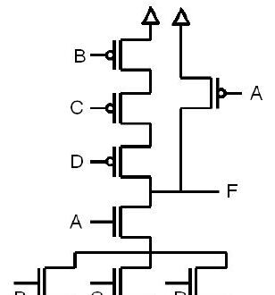

- **a)** F = [A(B + C + D)]′
- **b)** En kötü gecikme en büyük eşdeğer dirençli yoldan: PUN için D–C–B, PDN için A–B (ya da C ya da D). t_pLH,max = 0,69(3R_p)C_L = **62,1 ns**, t_pHL,max = 0,69(2R_n)C_L = **13,8 ns**.
- **c)** t_pLH = t_pHL için R_PUN = R_PDN: B, C, D PMOS çarpanı X, NMOS çarpanı Y ise 3R_p/X = 90/X ve 2R_n/Y = 20/Y ⇒ X = 9Y/2. W_n (A, B, C, D) = 2 µm seçilirse W_p (B, C, D) = **9 µm**. A PMOS'u tek başına R_pA = R_PDN = 10 kΩ verirse yeter: W_pA = (1 µm)(30 kΩ/10 kΩ) = **3 µm**.
- **d)** En uzun t_pLH: en büyük dirençli PUN yolu (B, C, D) ve dolacak iç düğüm sığalarının boş olması gerekir. A = 1 olmalı; D–C ve C–B arasındaki düğümlerin boş olması için çıkış 0 iken D = 0 ve C = 0 olmalı. **A = 1, C = 0, D = 0 iken B'nin 1→0 geçişi** en kötü gecikmeyi verir.

### Soru 4 (15p): NOR geçidinde olasılık ve güç

- **a)** Girişler eşit olasılıklıyken 3 girişli NOR için P(F = 1) = 1/2³ = **0,125**.
- **b)** Her girişin 0 olma olasılığı 0,1 ise P(F = 1) = 0,1³ = 0,001; P(F: 0→1) = (1 − 0,001)(0,001) = 0,999×10⁻³ ≈ **0,001**.
- **c)** V_DD = 2 V, C_L = 1 nF, f = 1 GHz: P_d = V_DD² C_L f P₀→₁ = 4 × 10⁻⁹ × 10⁹ × 10⁻³ = **4 mW**.

### Soru 5 (10p): Pass transistör mantığıyla 3 girişli AND

- **a)** Dört NMOS ile (girişlerin tersleri kullanılabilir): A girişi, kapıları B ve C olan seri iki transistör üzerinden F'ye aktarılır; kapıları C′ ve B′ olan iki transistör ise F'yi 0'a bağlar.
- **b)** V_Tn = 0,6 V, V_DD = 3 V: threshold drop nedeniyle V_OH = V_DD − V_Tn = **2,4 V**, V_OL = **0 V**, V_swing = **2,4 V**.

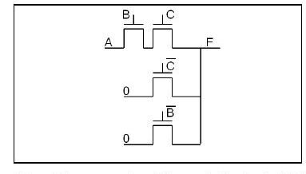

### Soru 6 (20p): Tersleyici zinciri

C_L = 10⁵ C_g yükü f = 5 ile sürülecek; ilk tersleyicide W_p = 4 µm, W_n = 2 µm, t_p0 = 0,2 ns, γ = 1.

- **a)** f = F^(1/N) = 10^(5/N) = 5 ⇒ N = 5/log 5 = 7,15 ⇒ **N = 7**.
- **b)** t_p = Nt_p0(1 + f/γ) = 7 × 0,2 ns × 6 = **8,4 ns**.
- **c)** 5. tersleyici birinciden f⁴ = 625 kat büyük: W_n5 = **1250 µm**, W_p5 = **2500 µm**.

Puanlar: S1 25p, S2 10p, S3 20p, S4 15p, S5 10p, S6 20p.

## 2008 – Yarıyıl sonu sınavı (02.06.2008)

### Soru 1 (25p, her şık 5p)

**a)** W_p artırılırsa V_M nasıl değişir? W_p arttıkça PMOS direnci düşer; R_p ve R_n'den oluşan gerilim bölücünün çıkışı V_DD'ye yaklaşır ve PMOS'un sürme gücü artar: **V_M, V_DD'ye yaklaşır**.

**b)** I_D–V_GS bağıntısı doyumda karesel ("üssel"), hız doyumunda niçin doğrusal? Doğrusal bölgede I_D = k′(W/L)[(V_GS − V_T)V_DS − V_DS²/2](1 + λV_DS). V_DS, V_DSAT'a ulaştığında hız doyumu başlar ve o andaki akım artan V_DS'de sabit kalır; bu ifadede V_DS = V_DSAT konunca I_D, V_GS ile **doğrusal** değişir. Doyum ise V_DS = V_GS − V_T'de başlar ve I_D = (k′/2)(W/L)(V_GS − V_T)²(1 + λV_DS) olur; burada bağıntı **kareseldir**.

**c)** Pass transistör mantığının temel sorunu ve transmission gate çözümü:

> NMOS pass transistörde V_GS, V_DD − V_T'ye ulaşınca transistör kesime gider; çıkış V_DD'ye yükselemez ve "zayıf 1" iletilir. V_BS de büyüdüğünden body effect V_T'yi artırır ve çıkış daha da düşük kalır. Transmission gate, NMOS'a paralel bir PMOS ekler: C = 1 iken ikisi de iletir. "1" iletilirken NMOS V_DD − V_T'de kesime gider ama PMOS sığacı V_DD'ye kadar doldurmaya devam eder; "0" iletilirken PMOS V_T'de kesime gider ama NMOS sığacı 0'a kadar boşaltır.

**d)** V_DD, V_T ve W/L ile güç–başarım optimizasyonu:

- V_T ↓ → başarım ↑, statik güç ↑
- V_DD ↓ → başarım ↓, dinamik güç ↓↓ (karesel)
- W/L ↑ → başarım ↑, dinamik güç ↑

V_DD'yi azaltmak dinamik gücü karesiyle düşürür ama başarım da düşer; V_DD ≈ 2V_T'ye inildiğinde düşüş kabul edilemez olur. Bu yüzden V_T de azaltılır, ama bu kez statik güç artar. Kaybedilen başarımı geri kazanmanın bir yolu W/L'yi büyütmektir; bu da C_L'yi artırdığından bir noktadan sonra "self loading" olur ve yüzey boşuna büyür.

**e)** PMOS/NMOS = 3 iken 2 girişli NAND'ın mantıksal eforu: inverterde giriş 3 + 1 = 4 C_unit görür (g = 1). NAND'da PMOS'lar 3, seri NMOS'lar 2 boyutlu olduğundan her giriş 5 C_unit görür: **g = 5/4**.

### Soru 2 (20p): Body effect

V_T0 = 0,5 V, k′ = 8,5×10⁻⁵ A/V², 2φ_F = −0,74 V, γ = 0,48 V^½, λ = 0,01 V⁻¹.

**a)** V_G = 2,8 V, V_D = 5 V, V_S = 1 V, V_B = 0 V, I_D = 0,425 A ölçülüyor; W/L?

- V_SB = 1 V: V_T = 0,5 + 0,48(√1,74 − √0,74) = 0,72 V
- V_GS = 1,8 V, V_DS = 4 V > V_GS − V_T = 1,08 V ⇒ doyum
- W/L = 2I_D / [k′(V_GS − V_T)²(1 + λV_DS)] = 2 × 0,425 / (8,5×10⁻⁵ × 1,17 × 1,04) = **8218**

**b)** V_G = 5 V, V_D = 4 V, V_S = 2 V, V_B = 1 V: V_SB yine 1 V, V_T = 0,72 V. V_GS = 3 V, V_DS = 2 V < V_GS − V_T = 2,28 V ⇒ doğrusal bölge.

- I_D = k′(W/L)[(V_GS − V_T)V_DS − V_DS²/2](1 + λV_DS) = 8,5×10⁻⁵ × 8218 × [2,28×2 − 4/2] × 1,02 = **1,82 A**

### Soru 3 (15p): Logical effort

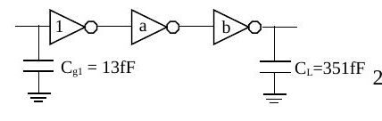

- **a)** F = C_L/C_g1 = 351/13 = 27. Tamponsuz gecikme t_p0(1 + F/γ) = 28 t_p0. N = 3 için t_p = 3t_p0(1 + ∛27) = **12 t_p0**, f = 3; **a = f = 3, b = f² = 9**.
- **b)** Ortadaki inverter yerine 2 girişli NAND (PMOS/NMOS = 2): g₁ = g₃ = 1, g₂ = 4/3; G = 4/3, H = 27 × 4/3 = 36, h = ∛36 = 3,3. f₁ = 3,3, f₂ = 2,475, f₃ = 3,3; **a = s₂ = f₁g₁/g₂ = 2,475**, **b = s₃ = f₁f₂g₁/g₃ = 8,17**.

### Soru 4 (20p)

**a)** X = [(A′ + B′)(C′ + D′ + E′) + F′]G′ = [(AB + CDE)F + G]′ işlevini, (W/L)_NMOS = 2, (W/L)_PMOS = 6 inverterle en kötü koşulda aynı akımı basacak biçimde tasarlayınız.

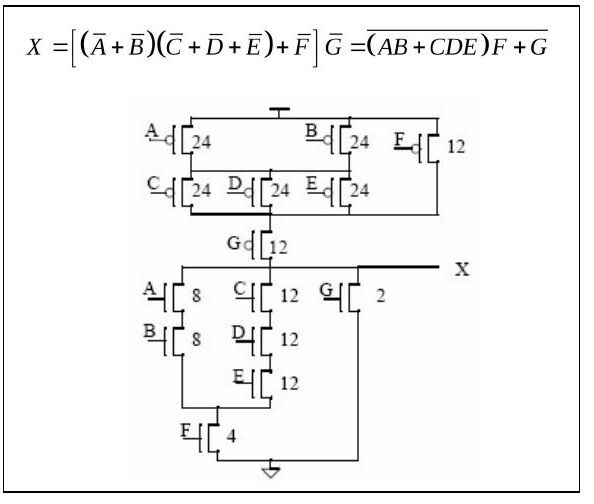

NMOS yolları: 1/8 + 1/8 + 1/4 = 1/2 ve 3/12 + 1/4 = 1/2 (inverterin 1/2'si); G tek başına 2. PMOS yolları: 1/24 + 1/24 + 1/12 = 1/6 ve 1/12 + 1/12 = 1/6.

**b)** Y = AB + C için pass transistör devresi ve CPL (differential) eklentisi (gereğinden fazla transistör kullanmadan, değillenmiş girdilerle):

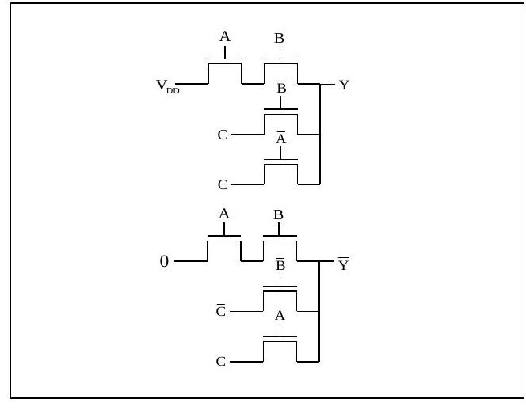

### Soru 5 (20p): Reconvergent fanout ve enerji

P_A = P_S = P_B = 0,5; C = 1 fF, V_DD = 3 V, f = 2 GHz (S'ye bağlı inverter çıkışındaki güç ihmal).

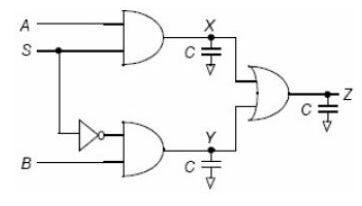

- P_X = P_A P_S = 0,25; P_X,0→1 = (1 − 0,25)(0,25) = 0,1875. P_S′ de 0,5 olduğundan P_Y ve P_X aynıdır.
- S ve S′ "reconvergent fanout" yaratır; Z için doğruluk çizelgesinden P_Z = 0,5, P_Z,0→1 = 0,25.

| A | S | B | S′ | Z |
|---|---|---|---|---|
| 0 | 0 | 0 | 1 | 0 |
| 0 | 0 | 1 | 1 | 1 |
| 0 | 1 | 0 | 0 | 0 |
| 0 | 1 | 1 | 0 | 0 |
| 1 | 0 | 0 | 1 | 0 |
| 1 | 0 | 1 | 1 | 1 |
| 1 | 1 | 0 | 0 | 1 |
| 1 | 1 | 1 | 0 | 1 |

- X (ve Y) düğümü: CV_DD²P_X,0→1 f = 10⁻¹⁵ × 9 × 0,1875 × 2×10⁹ = **3,375 µW**
- Z düğümü: 10⁻¹⁵ × 9 × 0,25 × 2×10⁹ = **4,5 µW**
- Toplam güç 3,375 + 3,375 + 4,5 = 11,25 µW; enerji = güç/f = **5,6 fJ**

Puanlar: S1 25p, S2 20p, S3 15p, S4 20p, S5 20p; süre 100 dakika.

## 2009 – Yarıyıl sonu sınavı (01.06.2009)

### Soru 1 (30p, her şık 5p)

**a)** V_M'yi toprağa yaklaştırmak için W_p/W_n nasıl değişmeli? V_M'de iki transistör de doyumdadır; R_p ve R_n bir gerilim bölücü oluşturur, PMOS V_M'yi yukarı, NMOS toprağa çeker. NMOS'un çıkışı toprağa çekebilmesi için R_n küçülmeli, yani **W_p/W_n oranı küçülmelidir**.

**b)** Oranlı (ratioed) ve oransız (ratioless) mantık: CMOS'ta çıkış R_n ve R_p'den bağımsız olarak V_DD ile toprak arasında salınır; bu yüzden "ratioless" denir. Dirençli yüklü (R_L) ratioed yapıda V_OH V_DD'ye çıkabilir ama V_OL = [R_PDN/(R_PDN + R_L)]V_DD olduğundan hiçbir zaman 0 V olamaz, dirençlerin oranına bağlı kalır. Bu asimetrik tepki ve statik güç tüketimi doğurur; buna karşın transistör sayısı yarı yarıya azalır.

**c)** Kısa devre kaybı ve C_L: V_out PMOS'un drain'idir. Büyük C_L'de girdi yükselirken (V_GS = V_DD) PMOS'un V_DS'si yaklaşık 0 V olduğundan I_sc ≈ 0; küçük C_L'de sığaç hızla boşalır, girdinin uzun yükselişi boyunca PMOS'un V_DS'si yaklaşık V_DD olur ve I_sc akar. Kaybı azaltmak için **C_L'nin büyük olması** yararlıdır.

**d)** Kanal sığası ölçümünde C_GCS = 0 bulunması neyi gösterir? Transistör kesimdeyken kanal oluşmadığından tüm sığa (WLC_ox) gate ile body arasında görünür. Kanal oluşunca kanal ekran görevi yapar; gate-body sığası sıfırlanır ve sığa gate-drain ile gate-source olarak görünür. C_GCS'nin sıfır olduğu tek durum **kesim (cut-off)** durumudur.

**e)** "Glitching": bir geçide tüm girdiler aynı anda gelmiyorsa çıkış, girdiler kararlı olana dek olması gerekenden farklı bir seviyede bulunabilir ve geçici salınımlar yapabilir. Örneğin F₁ → F₂ → F₃ zincirinde F₃'e bir sinyal doğrudan, diğeri gecikerek ulaşır. Glitching gecikmeyi ve güç kaybını artırır; işlevi değiştirmeden sinyallerin geçitlere aynı anda ulaşmasını sağlayan mantık değişiklikleri (ör. zinciri dengeli ağaca çevirmek) yarar sağlar.

**f)** Transmission gate'in pass transistöre katkısı: pass transistörün en önemli sorunu NMOS'tan oluşmasından kaynaklanan, "1" iletimindeki **threshold drop** kaybıdır. Transmission gate'te bir NMOS ve bir PMOS paralel bağlıdır; "1"i PMOS, "0"ı NMOS iletir (sığa PMOS üzerinden dolar, NMOS üzerinden boşalır) ve threshold drop önlenir.

### Soru 2 (20p): Çalışma bölgeleri

NMOS: V_T = 0,3 V, V_DSAT = 0,3 V, k′ = 100 µA/V²; PMOS: V_T = −0,3 V, V_DSAT = −0,5 V, k′ = −50 µA/V² (λ = 0, γ = 0).

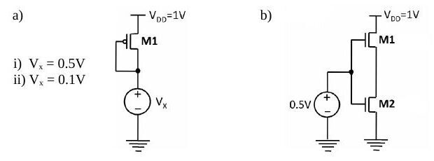

- **a)** V_x = 0,5 V: |V_GS| = 0,5 V, |V_GS| − |V_T| = 0,2 V < |V_DSAT|, |V_DS| = 0,5 V > 0,2 V ⇒ **doyum**. V_x = 0,1 V: |V_GS| = 0,9 V, |V_GS| − |V_T| = 0,6 V > |V_DSAT|, |V_DS| = 0,9 V > |V_DSAT| ⇒ **hız doyumu**.
- **b)** M1'in source'u (M2'nin drain'i) V_y olsun; V_y < 0,2 V olmalı (yoksa M1 kesimde olurdu). M2: V_GS − V_T = 0,2 V < V_DSAT ve V_DS = V_y < 0,2 V ⇒ **M2 doğrusal bölgede**. M1: V_DS = 1 − V_y > 0,8 V, 0 < V_GS − V_T < 0,2 V < V_DSAT ⇒ **M1 doyumda**.

### Soru 3 (20p)

**a–b)** X = (E′ + F′)[A′ + (B′ + C′)D′] işlevini (değillenmiş girdi yok) CMOS olarak tasarlayıp W_n/W_p = 1/2 olan en küçük inverterle aynı akımı basacak biçimde boyutlandırınız. De Morgan ile X′ = EF + A(BC + D), dolayısıyla V_out = X tek kademede elde edilir.

![PUN: E ∥ F (4) ile seri, A (4) ∥ [D (8) – (B ∥ C) (8)]; PDN: E–F seri (2) ∥ A (2) – [(B–C seri 4) ∥ D (2)]](f09-s3a.jpg "2009, Soru 3a–b")

**c)** Aşağıdaki devrenin çıktı işlevi:

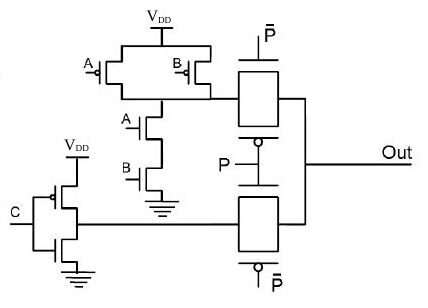

> C girişinde bir inverter, A ve B'de bir NAND ve çıkışa bağlı iki transmission gate var; P = 1 iken C′, P = 0 iken (AB)′ çıkışa aktarılır: **Out = C′P + (AB)′P′**.

### Soru 4 (30p): Logical effort ve güç

Girdilerdeki inverterler minimum boyutlu (giriş sığası 1 fF), C_L = 25 fF.

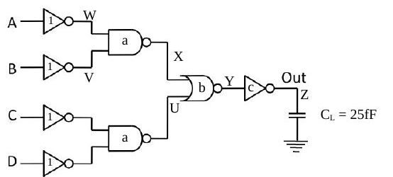

**a)** g₁ = g₄ = 1, g₂ = 4/3 (NAND2), g₃ = 5/3 (NOR2); G = 20/9, B = 1, F = 25, H = 55,56, h = ⁴√H = 2,73.

- f₁ = 2,73, f₂ = 2,05 ≈ 2, f₃ = 1,64 ≈ 1,6, f₄ = 2,73
- **a = f₁g₁/g₂ = 2**, **b = f₁f₂g₁/g₃ = 3,3**, **c = f₁f₂f₃g₁/g₄ = 8,7**
- Çözümde en küçük gecikme D = t_p0[Σp_j + N·H^(1/N)/γ] = t_p0[(1×2×1×2) + 4×2,73] = **14,9 t_p0** bulunuyor.

*Not: Çözümde parazitik gecikmeler toplanacakken çarpılmış. p_inv = 1, p_NAND2 = p_NOR2 = 2 için Σp = 1 + 2 + 2 + 1 = 6'dır; doğrusu D = (6 + 4 × 2,73)t_p0 ≈ 16,9 t_p0 olur.*

**b)** P_A = P_C = 0,5, P_B = P_D = 0,2, V_DD = 2,5 V, f = 1 GHz için Out'taki dinamik güç:

- P_W = 0,5, P_V = 0,8, P_X = 1 − P_W P_V = 0,6, P_U = P_X
- P_Y = (1 − P_X)(1 − P_U) = 0,16, P_Z = 0,84; P_Z,0→1 = 0,16 × 0,84 = 0,1344
- P_dyn = 25×10⁻¹⁵ × 6,25 × 0,1344 × 10⁹ = **21 µW**

Puanlar: S1 30p, S2 20p, S3 20p, S4 30p; süre 100 dakika.

## 2010 – Yarıyıl sonu sınavı (03.06.2010)

### Soru 1 (25p)

- **a)** V_DD, V_T ve W/L ile güç–başarım optimizasyonu — yanıt 2008 Soru 1d ile aynı.
- **b)** Kısa devre kaybı ve C_L — yanıt 2009 Soru 1c ile aynı: C_L'nin büyük olması yararlı.
- **c)** PUN/PDN'nin PMOS/NMOS olması — yanıt 2007 Soru 1c ile aynı (rail-to-rail salınım).
- **d)** Kritik sinyal ve transistör sıralaması: girdiler arasında kararlı duruma en son geçen sinyal kritik sinyaldir; çıkışa en yakın transistöre bağlanması başarımı artırır (o beklenirken alttaki iç düğüm sığaları boşalabilir).

**e)** Gate'i V_DD'de olan NMOS pass transistör, V_DD = 1,2 V, V_T = 0,4 V, body effect yok:

1. V_in = 0 V: giriş ucu source olur, V_GS = V_DD; transistör "güçlü 0" iletir: **V_out = 0 V**.
1. V_in = 0,6 V: V_DD − V_in = 0,6 V > V_T, transistör iletir ve giriş aynen aktarılır: **V_out = 0,6 V**.
1. V_in = 0,9 V: V_DD − V_in = 0,3 V < V_T; giriş drain, çıkış source olur, "zayıf 1" iletilir ve çıkış V_DD − V_T'ye kadar yükselir: **V_out = 0,8 V**.
1. V_in = 1,2 V: aynı gerekçeyle **V_out = 0,8 V**.

### Soru 2 (15p): f(a, b, c) = c(ab + a′b′)

NMOS/PMOS oranı 1/2 olan inverterle aynı direnci gösterecek CMOS devre (değillenmiş girişler kullanılabilir). PDN f′ = c′ + [(a′ + b′)(a + b)]'yi gerçekler, PUN bunun dualidir. W = 1 alınırsa c′ NMOS'u büyütülmez; diğerleri şekildeki gibi boyutlandırılır (seri NMOS çiftleri 2W, seri üç PMOS 6W).

![PUN: c′ (6W) ile seri, (a ∥ a′) – (b ∥ b′) ağı (6W); PDN: c′ (W) ∥ [(a, b paralel 2W) – (a′, b′ paralel 2W)]](f10-s2.jpg "2010, Soru 2")

### Soru 3 (15p): PMOS devresinde V_out

K_p = 1 mA/V², λ_p = 0, V_Tp = −1 V; source 5 V'ta, gate 1 V'ta, drain 2 kΩ ile toprağa bağlı.

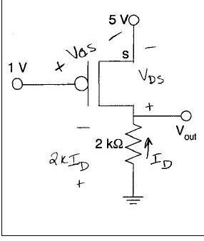

> V_GS = −4 V, devre kesimde değil. Doyum varsayılırsa I_D = −½K(V_GS − V_T)² = −4,5 mA ve 2000I_D + V_DS + 5 = 0'dan V_DS = +4 V çıkar; PMOS için V_DS pozitif olamaz, transistör doğrusal bölgededir. I_D = (3 + V_DS/2)V_DS ve I_D = −(5 + V_DS)/2000 birlikte çözülünce V_DS = −6,19 V (olanaksız) ya da **V_DS = −0,81 V**; **V_out = 5 − 0,81 = 4,19 V**.

### Soru 4 (15p): Toplam dinamik güç

V_DD = 2,5 V, f = 1 GHz, P_A=1 = 0,5, P_B=1 = 0,4, P_C=1 = 0,7.

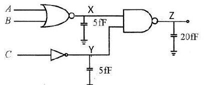

- P_X = (1 − P_A)(1 − P_B) = 0,3, P_X,0→1 = 0,7 × 0,3 = 0,21; P_dyn,X = 0,21 × 10⁹ × 5×10⁻¹⁵ × 2,5² = **6,6 µW**
- P_Y = 1 − P_C = 0,3, P_Y,0→1 = 0,21 ⇒ P_dyn,Y = **6,6 µW**
- P_Z = 1 − P_X P_Y = 0,91, P_Z,0→1 = 0,09 × 0,91 = 0,0819; P_dyn,Z = 0,0819 × 10⁹ × 20×10⁻¹⁵ × 2,5² = **10,2 µW**
- Toplam **23,4 µW**

### Soru 5 (30p)

2006 finalinin 3a ve 3b sorularının aynısıdır: C_inv'den 1200 C_inv yükü süren zincirde 4 inverterle t_p = 27,54 t_p0, en iyisi N = 6 ile 25,56 t_p0 (boyutlar 1; 3,26; 10,63; 34,6; 112,9; 368,2); NAND (2 fF) – inverter – NOR (200 fF) zincirinde h ≈ 6, s₁ = 1,5, s₂ = 9, s₃ = 32,4. Ayrıntılı çözüm için [2006 finali](/arsiv/eem312-final-sinavlari-2003-2006/).

Puanlar: S1 25p, S2 15p, S3 15p, S4 15p, S5a 15p, S5b 15p; süre 100 dakika.

## 2011 – Genel sınav (03.06.2011)

### Soru 1 (30p)

**a)** CPL yapısında 2 girişli XOR/XNOR: iki ayrı pass transistör ağı vardır; biri F'yi, diğeri F′'yi üretir. Örneğin en üstteki transistör A'yı B = 0 (B′ = 1) iken çıkışa iletir ve XOR'un AB′ terimini oluşturur.

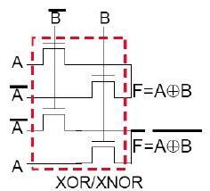

**b)** DCVSL: çıkışta işlevin kendisi ve değili birlikte elde edilir (differential); girişlerde tüm değişkenler ve değilleri bulunur. Pull-down ağı biri Out'u, diğeri Out′'yu oluşturan iki bloktan (PDN1, PDN2), pull-up ağı ise her biri bir çıkışa bağlı, çapraz bağlanmış iki PMOS'tan oluşur. İlgili PDN bloğu "on" iken karşı PMOS "off", "off" iken "on" olur; böylece CMOS'a benzer bir pull-up/pull-down işleyişi sağlanır.

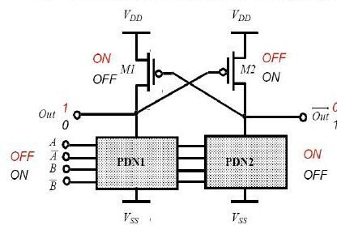

**c)** Tüm girdilerin 1 olma olasılığı %50; dinamik gücü daha az olan bir çözüm önerip sayısal olarak kanıtlayınız (glitch yok).

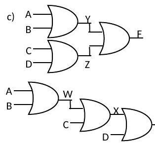

- Ağaç yapı: P_Y=0 = 0,5 × 0,5 = 0,25, P_Y=1 = 0,75, P_Y,0→1 = 0,1875; Z için de aynı. Toplam: 0,375 + P_F,0→1.
- Zincir yapı: W için 0,1875; P_X=0 = (1 − 0,75)(1 − 0,5) = 0,125, P_X,0→1 = 0,125 × 0,875 = 0,109. Toplam: 0,297 + P_F,0→1 (P_F iki yapıda aynı).
- 0,297 < 0,375 olduğundan **önerilen zincir yapının** dinamik güç tüketimi daha azdır.

**d)** 2 girişli NAND'da (A çıkışa yakın transistör) üç girdi örüntüsü:

1. A = 1, B = 0→1: pull-up tek transistör; C_int ve C_L boşalmalı.
1. A = 0→1, B = 1: pull-up tek transistör; C_int zaten boş, yalnız C_L boşalmalı — **en iyi gecikme**.
1. A = B = 0→1: pull-up'taki iki transistör de "off" edilmeli; C_int ve C_L boşalmalı — **en kötü gecikme**.

**e)** "Threshold drop": rail-to-rail salınım için C_L'nin toprağa kadar boşalması ve V_DD'ye kadar dolması gerekir. NMOS C_L'yi ancak V_DD − V_Tn'ye kadar doldurabilir (b), PMOS ise ancak |V_Tp|'ye kadar boşaltabilir (d). Transistörün C_L'ye bağlı ucu source olduğunda, sığaç dolup boşaldıkça değişen V_GS kritik V_T'nin altına düşer, transistör kesime gider ve yolu tıkar.

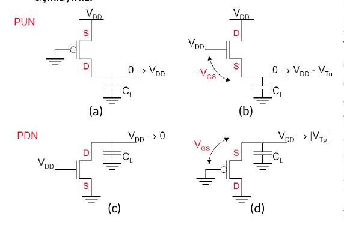

**f)** Gate'i 0 V'ta PMOS pass transistör, V_DD = 1,8 V, |V_T| = 0,5 V, çıkış sığası her seferinde 0,9 V'ta dolu:

1. V_in = 1,8 V: giriş source olur, V_GS = 1,8 V sabit: **V_out = 1,8 V**.
1. V_in = 0,6 V > |V_T|: aynı gerekçeyle **V_out = 0,6 V**.
1. V_in = 0,4 V < |V_T|: giriş drain olur, threshold drop nedeniyle **V_out = 0,5 V**.
1. V_in = 0 V: aynı nedenle **V_out = 0,5 V**.

### Soru 2a (10p): Gecikme–fan-out grafiği

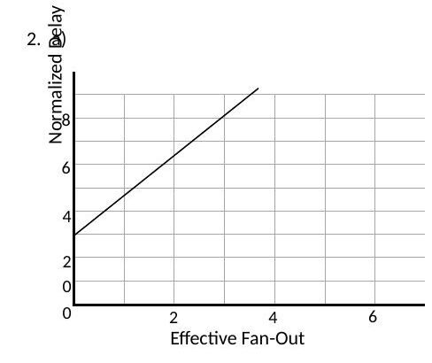

d = h + p, h = gf; doğru d = fg + p'dir. Doğrunun dikey ekseni kestiği nokta **p = 3** (intrinsic delay). d = 8 olduğuna göre **h = 8 − 3 = 5** (effort delay); eğim **g = 5/3** (logical effort); d = 8'e karşılık gelen yatay konum **f = 3** (effective fan-out). n girişli NAND için p = n olduğundan geçit **3 girişlidir**.

### Soru 2b (15p): Toplam dinamik güç

V_DD = 2 V, f = 1 GHz, P_A=1 = 0,3, P_B=1 = 0,6, P_C=1 = 0,4; C_L1 = 10 fF, C_L2 = 5 fF, C_L3 = 20 fF.

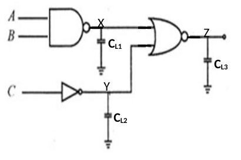

- P_X=0 = P_A P_B = 0,18, P_X=1 = 0,82, P_X,0→1 = 0,148
- P_Y=0 = P_C=1 = 0,4, P_Y=1 = 0,6, P_Y,0→1 = 0,24
- P_Z=1 = P_X=0 P_Y=0 = 0,072, P_Z=0 = 0,928, P_Z,0→1 = 0,067
- P_dyn = (10×10⁻¹⁵ × 4 × 0,148 × 10⁹) + (5×10⁻¹⁵ × 4 × 0,24 × 10⁹) + (20×10⁻¹⁵ × 4 × 0,067 × 10⁹) = **16,08 µW**

### Soru 3 (25p): Halka osilatör

Her inverterin gecikmesi ve salınım frekansı; yalnız gate sığaları (WLC_ox) ve çıkıştaki 5 pF dikkate alınacak; transistörler hız doyumunda ve rail-to-rail salınım varsayılacak.

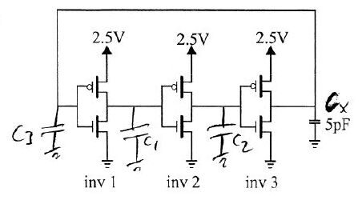

| | V_T (V) | k′ (µA/V²) | C_ox (fF/µm²) | V_DSAT (V) | W (µm) | L (µm) |
|---|---|---|---|---|---|---|
| NMOS | 0,4 | 120 | 6 | 0,6 | 0,5 | 0,25 |
| PMOS | −0,4 | −30 | 6 | −1 | 1,5 | 0,25 |

- I_DSATp = k′_p(W_p/L)[(V_DD − |V_Tp|)|V_DSATp| − V_DSATp²/2] = −30 × 6 × [2,1 × 1 − 0,5] = **−288 µA**; R_eqp = (3/4)V_DD/|I_DSATp| = 0,75 × 2,5/288 µA = **6,5 kΩ**
- I_DSATn = 120 × 2 × [2,1 × 0,6 − 0,18] = **259 µA**; R_eqn = 0,75 × 2,5/259 µA = **7,2 kΩ**
- C₁ = C₂ = C₃ = W_nLC_ox + W_pLC_ox = 0,75 + 2,25 = **3 fF**
- t_p1 = t_p2 = 0,69 C₁ (R_eqp + R_eqn)/2 = 0,69 × 3 fF × 6,85 kΩ = **14,18 ps**
- t_p3 = 0,69 (C₃ + C_x)(R_eqp + R_eqn)/2 = 0,69 × 5003 fF × 6,85 kΩ = **23,647 ns**
- f_osc = 1/[2(t_p1 + t_p2 + t_p3)] = 1/(2 × 23,675 ns) = **21,12 MHz**

### Soru 4 (20p): En az transistörlü CMOS

F(A, B, C) = (A′ + B′)(C′ + A′B′) işlevini (değillenmiş girdi yok) en az transistörle tasarlayıp NMOS/PMOS = 1/3 olan inverterle aynı akımı basacak biçimde boyutlandırınız.

> F = [AB + C(A + B)]′ = (A′ + B′)C′ + A′B′. PDN: A–B seri ∥ C–(A ∥ B), NMOS'lar 2; PUN dual yapı, PMOS'lar 6.

![PUN'u 6, PDN'i 2 boyutlu PMOS/NMOS'lardan oluşan, Y = [AB + C(A + B)]′ çıkışlı CMOS geçit](f11-s4.jpg "2011, Soru 4")

Puanlar: S1 30p, S2a 10p, S2b 15p, S3 25p, S4 20p; süre 100 dakika.
