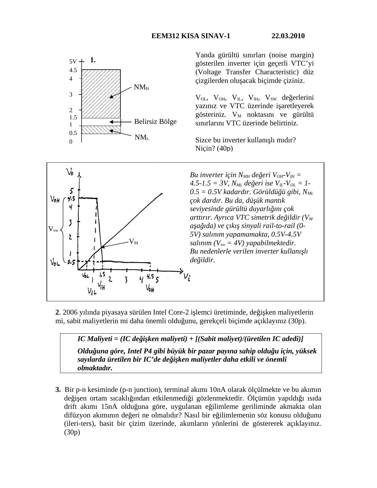
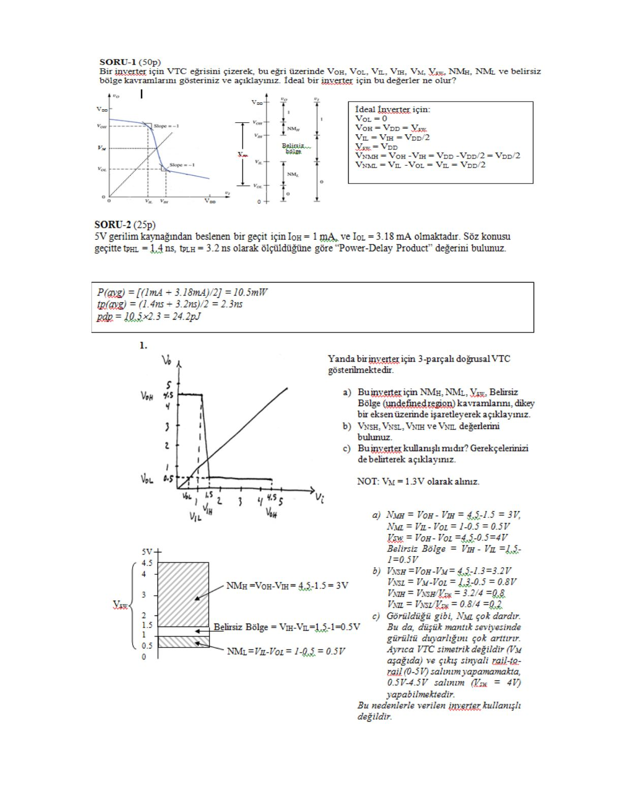

The document for **Quiz-1 dated 22 March 2010** of the **EEM312 Digital Electronics** course at Başkent University contains three questions and an answer key. The same file also includes additional questions on noise margins and the power-delay product. The PDF converted from the Word source can be downloaded at the end of the post.

## Question 1: Drawing the VTC from noise margins (40 points)

Draw the voltage transfer characteristic of the inverter whose noise limits are given, using straight-line segments. Show the values V_OL, V_OH, V_IL, V_IH and V_SW, the point V_M, and the noise margins. Explain whether the inverter is usable.

| Quantity | Value |
|---|---|
| Supply | 5 V |
| V_OH | 4.5 V |
| V_OL | 0.5 V |
| V_IL | 1 V |
| V_IH | 1.5 V |
| NM_H = V_OH − V_IH | 3 V |
| NM_L = V_IL − V_OL | 0.5 V |
| V_SW = V_OH − V_OL | 4 V |
| Width of the undefined region | 0.5 V |

For a low input, the VTC goes from the 4.5 V upper horizontal section, to the falling section between 1 and 1.5 V, and then to the 0.5 V lower horizontal section. The answer key finds this inverter not usable because the low-level noise margin is narrow, the transfer curve is asymmetric, and the output swing is 0.5–4.5 V instead of 0–5 V.

## Question 2: Integrated circuit manufacturing cost (30 points)

Explain, with justification, whether variable costs or fixed costs are more important in the manufacture of the Intel Core-2 processor, released in 2006.

IC cost = IC variable cost + fixed cost / number of ICs produced.

The answer key states that at high production volumes the per-unit share of the fixed cost decreases, so variable costs are more influential.

*Note: The question asks about the Core-2, whereas the answer text mentions the Intel P4; the cost explanation is reproduced as given.*

## Question 3: Diffusion and drift current (30 points)

The terminal current of a p-n junction is measured as 10 nA, and it is stated to be unaffected by changes in ambient temperature. If the drift current at the measurement temperature is 15 nA, what is the diffusion current? Explain the forward or reverse bias and the current directions.

The key writes **I = I_D − I_S**, assuming forward bias. The diffusion current flows from p to n, and the drift current flows in the opposite direction:

10 = I_D − 15 ⇒ **I_D = 25 nA**.

*Note: The key's step from the observation of temperature independence to the conclusion of forward bias is not a general criterion by itself; the forward diode current also depends on temperature. The result of 25 nA is a subtraction based on the current directions assumed by the key.*

## Additional questions in the document

### Ideal inverter and noise immunity

In the additional sketch, the levels V_OH, V_IH, V_OL, V_IL are placed at the edges of the noise intervals. For an ideal inverter:

- V_OL = 0; V_OH = V_DD; V_SW = V_DD.
- V_IL = V_IH = V_DD/2.
- NM_H = NM_L = V_DD/2.
- V_M is the switching point at which the input and output voltages are equal.

For the inverter in the first question, the additional question asks to take V_M = 1.3 V:

- V_NSH = V_OH − V_M = 4.5 − 1.3 = 3.2 V.
- V_NSL = V_M − V_OL = 1.3 − 0.5 = 0.8 V.
- V_NIH = V_NSH/V_SW = 3.2/4 = 0.8.
- V_NIL = V_NSL/V_SW = 0.8/4 = 0.2.

### Power-delay product

For a gate with a 5 V supply, I_OH = 1 mA, I_OL = 3.18 mA, t_pHL = 1.4 ns, and t_pLH = 3.2 ns are given. The key's results are P_avg = 10.5 mW, t_p = 2.3 ns, and PDP = 24.2 pJ.

*Note: The voltage factor is not written in the source's P_avg line. Assuming two states of equal duration, 5 × (1 + 3.18)/2 = 10.45 mW and PDP = 10.45 × 2.3 = 24.035 pJ are obtained; the source rounds the intermediate value to 10.5 mW.*

