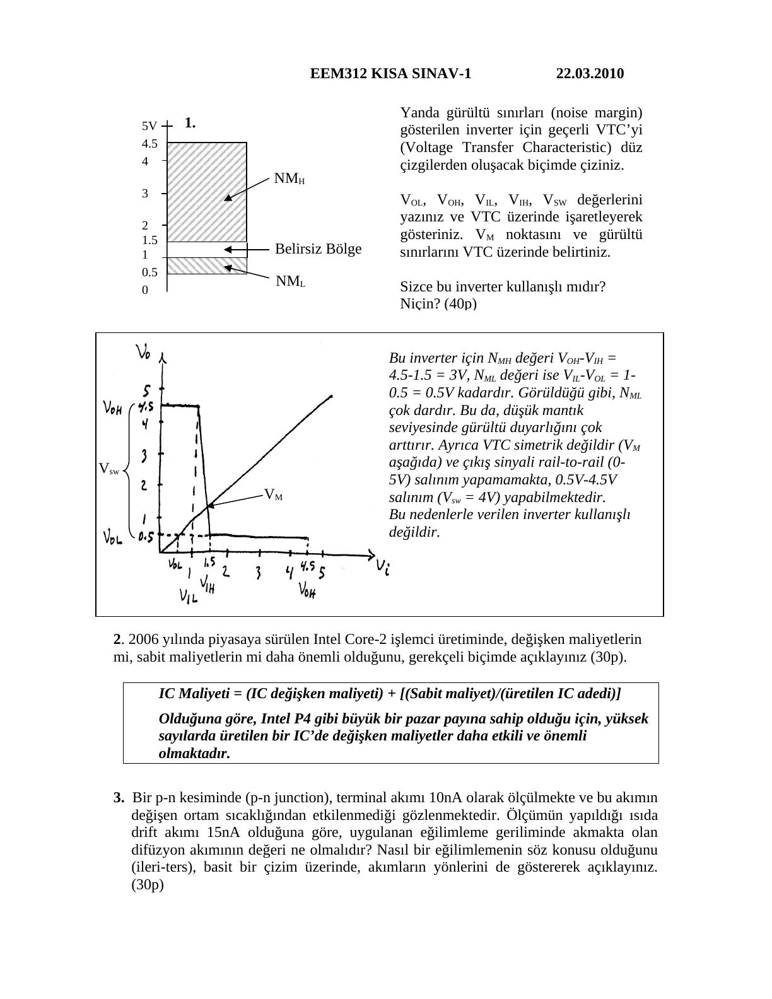
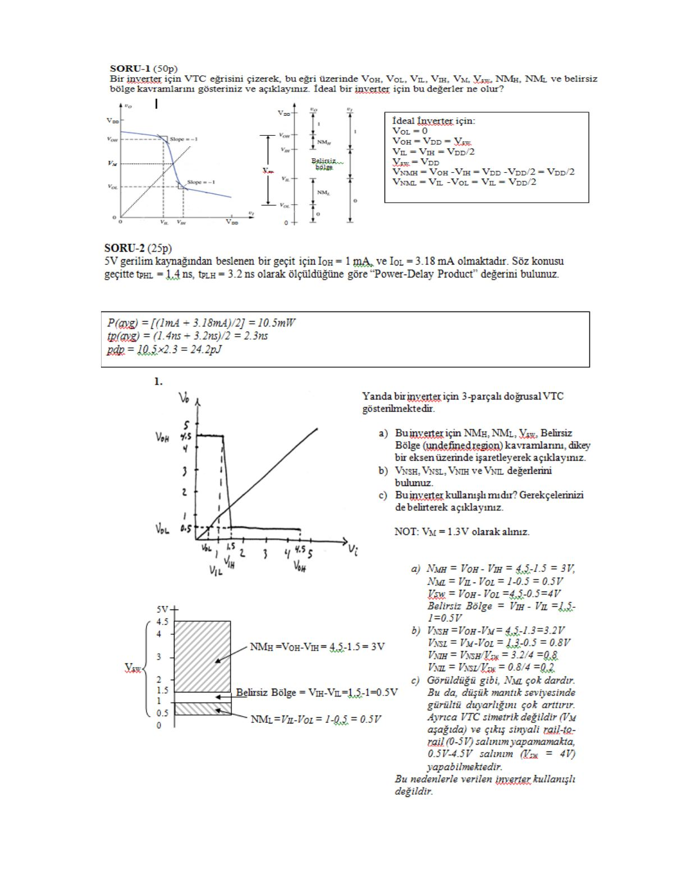

Başkent Üniversitesi **EEM312 Sayısal Elektronik** dersinin **22 Mart 2010 tarihli Kısa Sınav-1** belgesi, üç soruyu ve cevap anahtarını içeriyor. Aynı dosyada gürültü payları ve güç-gecikme çarpanı üzerine ek sorular da bulunuyor. Word kaynağından dönüştürülen PDF yazının sonunda indirilebilir.

## Soru 1: Gürültü paylarından VTC çizimi (40 puan)

Gürültü sınırları verilen tersleyicinin gerilim geçiş karakteristiğini düz çizgi parçalarıyla çiziniz. V_OL, V_OH, V_IL, V_IH ve V_SW değerlerini, V_M noktasını ve gürültü sınırlarını gösteriniz. Tersleyicinin kullanışlı olup olmadığını açıklayınız.

| Büyüklük | Değer |
|---|---|
| Besleme | 5 V |
| V_OH | 4,5 V |
| V_OL | 0,5 V |
| V_IL | 1 V |
| V_IH | 1,5 V |
| NM_H = V_OH − V_IH | 3 V |
| NM_L = V_IL − V_OL | 0,5 V |
| V_SW = V_OH − V_OL | 4 V |
| Belirsiz bölge genişliği | 0,5 V |

VTC, düşük girişte 4,5 V'luk üst yatay bölümden, 1–1,5 V aralığındaki düşen bölüme ve ardından 0,5 V'luk alt yatay bölüme geçer. Cevap anahtarı; düşük seviye gürültü payının dar, geçiş eğrisinin asimetrik ve çıkış salınımının 0–5 V yerine 0,5–4,5 V olması nedeniyle bu tersleyiciyi kullanışlı bulmuyor.

## Soru 2: Tümdevre üretim maliyeti (30 puan)

2006 yılında piyasaya sürülen Intel Core-2 işlemcisinin üretiminde değişken maliyetlerin mi, sabit maliyetlerin mi daha önemli olduğunu gerekçesiyle açıklayınız.

IC maliyeti = IC değişken maliyeti + sabit maliyet / üretilen IC adedi.

Cevap anahtarı yüksek üretim adedinde sabit maliyetin birim başına payının azaldığını, dolayısıyla değişken maliyetlerin daha etkili olduğunu söylüyor.

*Not: Soru Core-2'yi sorarken cevap metninde Intel P4 adı geçiyor; maliyet açıklaması aynı biçimde aktarılmıştır.*

## Soru 3: Difüzyon ve sürüklenme akımı (30 puan)

Bir p-n ekleminde terminal akımı 10 nA ölçülüyor ve ortam sıcaklığındaki değişimden etkilenmediği belirtiliyor. Ölçüm sıcaklığındaki drift akımı 15 nA ise difüzyon akımı nedir? İleri ya da ters kutuplamayı ve akım yönlerini açıklayınız.

Anahtar, ileri kutuplama kabulüyle **I = I_D − I_S** yazıyor. Difüzyon akımı p'den n'ye, sürüklenme akımı ters yöndedir:

10 = I_D − 15 ⇒ **I_D = 25 nA**.

*Not: Anahtarın sıcaklıktan etkilenmeme gözleminden ileri kutuplama sonucuna geçmesi tek başına genel bir ölçüt değildir; ileri yöndeki diyot akımı da sıcaklığa bağlıdır. 25 nA sonucu, anahtarın kabul ettiği akım yönlerine göre yapılan çıkarmadır.*

## Dosyadaki ek sorular

### İdeal tersleyici ve gürültü bağışıklığı

Ek çizimde V_OH, V_IH, V_OL, V_IL seviyeleri gürültü aralıklarının kenarlarına yerleştirilir. İdeal tersleyici için:

- V_OL = 0; V_OH = V_DD; V_SW = V_DD.
- V_IL = V_IH = V_DD/2.
- NM_H = NM_L = V_DD/2.
- V_M giriş ve çıkış gerilimlerinin eşit olduğu anahtarlama noktasıdır.

İlk sorudaki tersleyici için ek soruda V_M = 1,3 V alınması istenir:

- V_NSH = V_OH − V_M = 4,5 − 1,3 = 3,2 V.
- V_NSL = V_M − V_OL = 1,3 − 0,5 = 0,8 V.
- V_NIH = V_NSH/V_SW = 3,2/4 = 0,8.
- V_NIL = V_NSL/V_SW = 0,8/4 = 0,2.

### Güç-gecikme çarpanı

5 V beslemeli bir kapı için I_OH = 1 mA, I_OL = 3,18 mA, t_pHL = 1,4 ns ve t_pLH = 3,2 ns veriliyor. Anahtarın sonuçları P_avg = 10,5 mW, t_p = 2,3 ns ve PDP = 24,2 pJ.

*Not: Kaynaktaki P_avg satırında gerilim çarpanı yazılmamış. Eşit süreli iki durum varsayımıyla 5 × (1 + 3,18)/2 = 10,45 mW ve PDP = 10,45 × 2,3 = 24,035 pJ bulunur; kaynak ara değeri 10,5 mW'a yuvarlamıştır.*

