This post collects ten quizzes given between 2006 and 2009 in the **EEM312 Digital Electronics** course at Başkent University (Prof. Dr. Emin Akata), together with their answers. The answers were transcribed from the solution documents published by the instructor; some questions have no answer in the documents. Copies of the same quiz in the archive (such as the three copies of the 2007 Quiz-2) were included only once. The original Word files can be downloaded as a ZIP at the end of the post.

## 2006 Quiz-1 (13.03.2006)

### Question 1 (60 pts): Noise margins from the VTC

For the inverter whose VTC is given, find V_OH, V_OL, V_IL, V_IH, V_M and V_sw, and mark them on the VTC. What are NM_H, NM_L and the undefined region? Comment on the result.

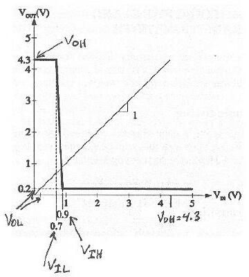

**Answer:**

- V_OH = 4.3 V, V_OL = 0.2 V, V_IL = 0.7 V, V_IH = 0.9 V, V_M ≅ 0.9 V
- V_sw = V_OH − V_OL = 4.3 − 0.2 = 4.1 V
- NM_H = V_OH − V_IH = 4.3 − 0.9 = 3.4 V
- NM_L = V_IL − V_OL = 0.7 − 0.2 = 0.5 V
- Undefined region = V_IH − V_IL = 0.9 − 0.7 = 0.2 V

The circuit has an extremely asymmetric swing (V_M lies within 20% of V_sw). The noise margins are also unequal; NM_L is very narrow.

### Question 2 (40 pts): Reverse-biased p-n junction

The terminal current of a reverse-biased p-n junction is measured as 10 nA. If the drift current at the measurement temperature is 15 nA, what must the diffusion current be? Show the directions of the currents. How does the terminal current change if the temperature increases, and why?

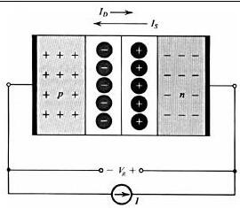

**Answer:** In a reverse-biased p-n junction the terminal current is I = I_S − I_D, where I_S is the drift (saturation) current and I_D is the diffusion current. The barrier voltage, increased by the reverse bias, has reduced I_D. Hence I_D = I_S − I = 15 − 10 = **5 nA**. If the temperature increases, the number of minority carriers increases and I_S increases as well; therefore the terminal current also increases.

## 2006 Quiz-2 (01.05.2006)

### Question 1a: Inverter design for a noisy high level

What would you do if you had to design a CMOS inverter for an application in which the high level of the input signal is noisy?

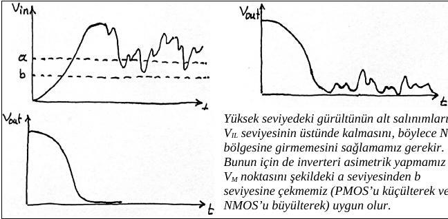

**Answer:** It must be ensured that the lower excursions of the noise on the high level stay above the V_IL level, so that they do not enter the NM_L region. To do this, it is appropriate to make the inverter asymmetric and to move the V_M point from level *a* to level *b* in the figure (by making the PMOS smaller or the NMOS larger).

### Question 1b: Self loading

In CMOS inverter performance optimization, what is "self loading" and why does it occur?

**Answer:** One of the most effective tools a designer has for improving performance is to increase the W/L ratio; the decreasing resistances also reduce t_p. However, while this reduces the resistances, it also increases the internal capacitances (C_int). When C_int becomes dominant in C_L = C_int + C_ext, the benefit of reducing the resistance is cancelled by the increase in capacitance; increasing W/L further enlarges the transistors (and the integrated circuit area) without improving performance significantly. This is called **self loading**.

### Question 1c: Gate-drain capacitance and the Miller effect

In an inverter fabricated in 0.25 µm CMOS technology, how much load does a gate-drain capacitance of 0.115 fF add to the output?

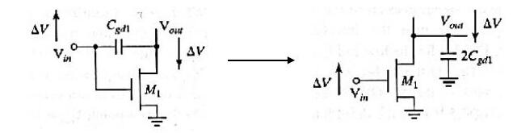

**Answer:** The gate-drain capacitance is connected in series between the input and the output. Since the voltage changes across its terminals are equal in magnitude but opposite in direction, by the **Miller effect** it can be replaced by a capacitance of twice the value connected in parallel with the output. That is, it adds a load of 2 × 0.115 = **0.23 fF** to the output.

### Question 2: Inverter chain

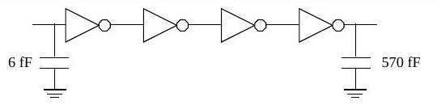

What are the scaling factor and the normalized delay (t_p/t_p0) for this arrangement? How much is the delay improved compared with a single inverter? (γ = 1)

**Answer:**

- Total effective fan-out: F = C_L / C_g,1 = 570 / 6 = 95
- Delay with a single inverter (unbuffered): t_p0 (1 + F/γ) = 96 t_p0
- For N = 4: t_p = N t_p0 (1 + F^(1/N)/γ) = 4 t_p0 (1 + 95^(1/4))
- t_p / t_p0 = 4 (1 + 3.12) = **16.49**; scaling factor f = 95^(1/4) ≈ 3.12
- Relative improvement = 96 / 16.49 = **5.82**

(Grading: each part of Question 1 is 15 pts, Question 2 is 55 pts; duration 30 min.)

## 2007 Quiz-1 (14.03.2007)

**Question 1:** Draw the VTC of the inverter whose noise margins are given using straight lines; write down V_OL, V_OH, V_IL, V_IH, V_SW and show them on the VTC; indicate V_M and the noise margins. Is this inverter useful?

**Answer:** NM_H = V_OH − V_IH = 4.5 − 1.5 = 3 V, NM_L = V_IL − V_OL = 1 − 0.5 = 0.5 V. Since NM_L is very narrow, the sensitivity to noise at the low logic level is very high. In addition, the VTC is not symmetric (V_M is low) and the output cannot swing rail-to-rail (0–5 V); it swings only between 0.5 and 4.5 V (V_SW = 4 V). For these reasons the inverter is not useful. (The same question, with its numerical values, was also asked in 2009 Quiz-1; the figure is below.)

**Question 2:** Identical to Question 2 of 2006 Quiz-1 (answer: I_D = 5 nA).

## 2007 Quiz-2 (03.04.2007)

### Question 1: Velocity saturation

What is velocity saturation and how does it occur? Find I_D for an NMOS with k_n′ = 115 × 10⁻⁶ A/V², W = 0.375 µm, L = 0.25 µm, V_T = 0.43 V, V_DSAT = 0.63 V, measured at V_GS = 2 V, V_DS = 1 V.

**Answer:** At low fields the carrier velocity is proportional to the electric field (constant mobility, slope µ). When the field in the channel reaches the critical value (ξ_c ≈ 1.5 V/µm), the carriers reach velocity saturation because of collisions with one another. In short-channel MOSFETs, as V_DS increases, this occurs before V_DS even reaches V_GS − V_T.

In saturation (V_DS > V_DSAT):

I_DSAT = k_n′ (W/L) [(V_GS − V_T) V_DSAT − V_DSAT²/2] = 115 × 10⁻⁶ × (0.375/0.25) × [(2 − 0.43) × 0.63 − 0.63²/2] = **136.4 µA**

*Note: The answer states "the saturation velocities of electrons and holes are approximately 10⁻⁵ m/s"; the correct value is 10⁵ m/s.*

### Question 2: CMOS inverter

Draw the CMOS inverter and explain its operation, indicate the states of the transistors on the VTC; explain why CMOS is preferred.

**Answer:** The CMOS inverter consists of one NMOS and one PMOS; the gates are joined as the input and the drains are joined as the output. When the input is low, the NMOS is in cutoff and the PMOS is conducting, and the output is V_DD; when the input is high, the NMOS is conducting and the PMOS is in cutoff, and the output is 0. The reasons CMOS is preferred are:

- It has a full (rail-to-rail) swing and takes up little area.
- In steady state there is always a finite-resistance path between the output and either V_DD or ground; the output impedance is low.
- The input resistance is very high, the input current is almost zero in steady state; fan-out is high.
- In steady state there is no direct path between the supply and ground; there is no static power consumption.
- The propagation delay depends on the load capacitance and the transistor resistances.

## 2007 Quiz-3 (01.05.2007)

**Question 1a:** Find the probability of the output of a 2-input NAND gate making a 0-to-1 transition (P₀→₁); calculate the dynamic energy dissipated in the load for C_L = 1.125 pF, V_DD = 3 V.

| A | B | (AB)′ |
|---|---|---|
| 0 | 0 | 1 |
| 0 | 1 | 1 |
| 1 | 0 | 1 |
| 1 | 1 | 0 |

**Answer:** P₀→₁ = P(out=0) × P(out=1) = ¼ × ¾ = 3/16 ≈ 0.19. E_dyn = C_L × V_DD² × P₀→₁ = 1.125 × 10⁻¹² × 9 × 0.19 = **1.9 pJ**.

**Question 1b–1c:** Identical to the self loading and Miller effect questions in 2006 Quiz-2 (answer: 0.23 fF).

**Question 2:** A chain of four inverters from a 5 fF input capacitance to a 625 fF load. What are the scaling factor, t_p/t_p0 and the improvement ratio? (γ = 1)

**Answer:** F = 625/5 = 125; the single-inverter delay is t_p0 (1 + F/γ) = 126 t_p0. For N = 4, t_p = 4 t_p0 (1 + 125^(1/4)), t_p/t_p0 = 4 (1 + 3.34) = **17.36**; scaling factor f = 125^(1/4) = **3.34**; improvement ratio 126 / 17.36 = **7.26**. (Duration 25 min.)

## 2008 Quiz-1 (06.03.2008)

**Question 1 (50 pts):** Draw the VTC for an inverter and show V_OH, V_OL, V_IL, V_IH, V_M, V_sw, NM_H, NM_L and the undefined region. What are these values for an ideal inverter?

**Answer (ideal inverter):** V_OL = 0; V_OH = V_DD = V_sw; V_IL = V_IH = V_DD/2; NM_H = V_OH − V_IH = V_DD/2; NM_L = V_IL − V_OL = V_DD/2.

**Question 2 (25 pts):** In a gate supplied with 5 V, I_OH = 1 mA, I_OL = 3.18 mA; t_PHL = 1.4 ns, t_PLH = 3.2 ns. What is the power-delay product (PDP)?

**Answer:** P_avg = 5 V × (1 + 3.18) mA / 2 ≈ 10.5 mW; t_p,avg = (1.4 + 3.2)/2 = 2.3 ns; PDP = 10.5 × 2.3 ≈ **24.2 pJ**.

**Question 3 (25 pts):** In the manufacture of the Intel P5 microprocessor, are variable costs or fixed costs more important?

**Answer:** IC cost = variable cost + (fixed cost / number of ICs produced). For an IC produced in very large quantities with a large market share, like Intel's, the fixed cost is divided by the quantity, so **variable costs** are more influential and important.

*Note: The answer refers to the question as "Intel P4"; the question says P5.*

## 2008 Quiz-2 (17.04.2008)

### Question 1a: MOS gate capacitances

In the table, mark the cases in which the gate-channel capacitances (C_GCB, C_GCS, C_GCD) are zero.

| Region | C_GCB | C_GCS | C_GCD |
|---|---|---|---|
| Cutoff | | 0 | 0 |
| Linear (resistive) | 0 | | |
| Saturation | 0 | | 0 |

**Answer:** In cutoff only C_GCB exists; since no channel is formed, the entire capacitance is seen between the gate and the body. In the linear region the conducting channel extending from end to end acts as a screen between the gate and the body. In saturation C_GCB is also zero; moreover, since the channel ends at the pinch-off point (the drain end), C_GCD is zero as well.

**Question 1b:** Miller effect question (answer: 0.23 fF).

### Question 2: Operating regions

For V_DD = 2.5 V, V_Tp = −0.4 V, V_Tn = 0.4 V, V_DSATp = −1 V, V_DSATn = 0.6 V, λ = 0, in which region do the following transistors operate?

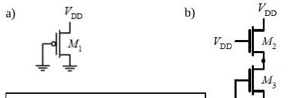

**Answer:**

- (a) V_GS1 = V_DS1 = −2.5 V; V_GT1 = V_GS1 − V_Tp = −2.5 + 0.4 = −2.1 V. Since |V_DSAT1| < |V_GT1| < |V_DS1|, M1 is in **velocity saturation**.
- (b) Since V_GS3 = 0 < V_T3, M3 is in cutoff; since I_D2 = I_D3 = 0, M2 is also in **cutoff**.

### Question 3: Effect of W_p and W_n on the VTC

How does the VTC of the inverter change with changes in W_p and W_n?

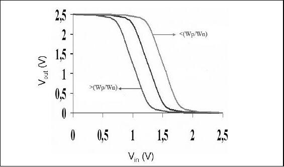

The graph in the answer document: as the W_p/W_n ratio increases, the VTC (and V_M) shifts to the right; as it decreases, it shifts to the left.

## 2008 Quiz-3 (13.05.2008)

### Question 1 (50 pts): Sizing with logical effort

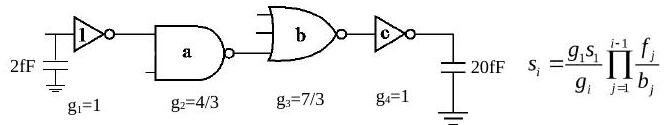

Find the sizes a, b and c for minimum delay along the path from input to output. (In the minimum-size inverter the NMOS/PMOS ratio is ½.)

**Answer:**

- Logical effort of a 2-input NAND = (n + 2)/3 = 4/3; logical effort of a 3-input NOR = (2n + 1)/3 = 7/3
- Effective fan-out F = 20/2 = 10
- Path logical effort G = 1 × 4/3 × 7/3 × 1 = 28/9 = 3.11
- No branching (B = 1), path effort H = G·F·B = 28/9 × 10 = 31.11
- Stage effort h = H^(1/N) = 31.11^(1/4) = 2.36; minimum-delay condition f₁g₁ = f₂g₂ = f₃g₃ = f₄g₄ = h
- f₁ = 2.36; f₂ = 2.36 × 3/4 = 1.77; f₃ = 2.36 × 3/7 = 1.01; f₄ = 2.36
- Using the formula s_i = (g₁s₁/g_i) × ∏ f_j/b_j: **a = s₂ = 1.77**, **b = s₃ = 1.79**, **c = s₄ = 4.22**

### Question 2 (25 pts): Threshold loss in pass transistors

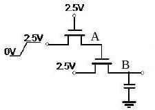

V_T = 0.5 V, body effect neglected, the capacitor is initially empty. What is the output in steady state after the input rises?

**Answer (from the document):** Since point A is the source terminal of the first transistor, it can rise at most to V_G − V_T: V_A = 2.5 − 0.5 = 2 V. "The same applies to B": V_B = 2 − 0.5 = 1.5 V.

*Note: In the figure, the gate of the second transistor is connected to 2.5 V, not to A. B can rise at most to V_G − V_T = 2.5 − 0.5 = 2 V, and V_A = 2 V at the drain is also at this value; therefore V_B = 2 V should be the result. The 1.5 V result would be valid if the gate of the second transistor were connected to A.*

### Question 3 (25 pts): Sizing a complex gate

Size the circuit so that it has the same current-driving capability as an inverter with an NMOS/PMOS ratio of 1/3.

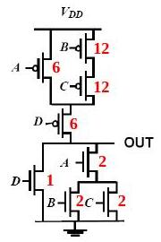

Sizes in the answer document (red): in the PMOS network A = 6, B = 12, C = 12, D = 6; in the NMOS network D = 1, A = 2, B = 2, C = 2.

## 2009 Quiz-1 (09.03.2009)

### Question 1: Three-segment piecewise-linear VTC

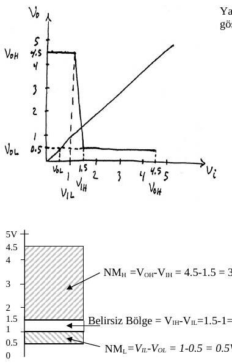

a) Show NM_H, NM_L, V_sw and the undefined region on the vertical axis. b) Find V_NSH, V_NSL, V_NIH and V_NIL. c) Is the inverter useful? (V_M = 1.3 V.)

**Answer:**

- a) NM_H = 4.5 − 1.5 = 3 V; NM_L = 1 − 0.5 = 0.5 V; V_sw = 4.5 − 0.5 = 4 V; undefined region = 1.5 − 1 = 0.5 V
- b) V_NSH = V_OH − V_M = 4.5 − 1.3 = 3.2 V; V_NSL = V_M − V_OL = 1.3 − 0.5 = 0.8 V; V_NIH = V_NSH/V_sw = 3.2/4 = 0.8; V_NIL = V_NSL/V_sw = 0.8/4 = 0.2
- c) NM_L is very narrow, the VTC is not symmetric (V_M is low), and the output swings 0.5–4.5 V instead of 0–5 V; the inverter is not useful.

### Question 2: p-n junction

In a reverse-biased junction the terminal current is 8 nA and the diffusion current is 4 nA. a) What is the drift current? b) How does the terminal current change if the temperature decreases? c) What does the voltage measured between the terminals conceptually equal?

**Answer:** a) From I = I_S − I_D, I_S = I_D + I = 4 + 8 = **12 nA**. b) If the temperature decreases, the number of minority carriers and I_S decrease; the terminal current also decreases. c) The threshold (barrier) voltage increases until the balance I = I_S − I_D is established; the difference between V₀ and the new threshold voltage is the V_R measured between the terminals. (Points: 1-c 15 pts, others 17 pts.)

## 2009 Quiz-2 (20.04.2009)

### Question 1: Lateral diffusion

In a CMOS transistor with L = 0.25 µm, C_GCD = 0.25 fF is measured, and the total gate capacitance in the same region is C_G = 0.7 fF. How large is the lateral diffusion x_d?

**Answer:** C_GCD is nonzero only in the linear (resistive) region and equals ½ C_ox WL; so the transistor is in the linear region and C_ox WL = 0.5 fF. In the linear region, since C_G = C_ox WL + 2C_o W = 0.7 fF, 2C_o W = 0.2 fF, C_o W = 0.1 fF. Since C_o W = C_ox x_d W and C_ox W = 0.5 fF / 0.25 µm = 2 fF/µm, x_d = 0.1 / 2 = **0.05 µm**.

### Question 2: W_n/W_p for V_M

In an unloaded CMOS inverter, V_DD = 5 V, V_Tn = −V_Tp = 1 V, C_ox = 5 fF/µm², L = 2.5 µm, λ = 0, µ_n = 50,000 mm²/Vs, µ_p = 25,000 mm²/Vs. What must W_n/W_p be for V_M = 2 V?

**Answer:** When V_out = V_M, V_in = V_out = 2 V; V_GSp = V_DSp = −3 V, V_GSn = V_DSn = 2 V and both transistors are in saturation, I_Dn = −I_Dp:

- I_DSATn = ½ (W_n/L_n) µ_n C_ox (V_GSn − V_Tn)² = ½ (W_n/2.5)(50,000 × 10⁶)(5 × 10⁻¹⁵)(2 − 1)² = 50 × 10⁻⁶ W_n
- I_DSATp = −½ (W_p/2.5)(25,000 × 10⁶)(5 × 10⁻¹⁵)(−3 + 1)² = −100 × 10⁻⁶ W_p
- 50 × 10⁻⁶ W_n = 100 × 10⁻⁶ W_p ⇒ **W_n/W_p = 2**
