Bu yazı, Başkent Üniversitesi **EEM312 Sayısal Elektronik** dersinde (Prof. Dr. Emin Akata) 2006–2009 yılları arasında yapılan on kısa sınavı (quiz) yanıtlarıyla birlikte bir araya getiriyor. Yanıtlar hocanın yayımladığı çözüm belgelerinden aktarıldı; bazı soruların yanıtı belgede yok. Arşivdeki aynı sınavın kopyaları (2007 Kısa Sınav-2'nin üç kopyası gibi) bir kez alındı. Orijinal Word dosyaları yazının sonunda ZIP olarak indirilebilir.

## 2006 Quiz-1 (13.03.2006)

### Soru 1 (60p): VTC'den gürültü payları

VTC'si verilen tersleyici için V_OH, V_OL, V_IL, V_IH, V_M ve V_sw değerlerini bulunuz, VTC üzerinde işaretleyiniz. NM_H, NM_L ve belirsiz bölge (undefined region) ne kadardır? Yorumlayınız.

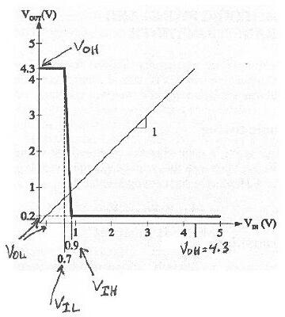

**Yanıt:**

- V_OH = 4,3 V, V_OL = 0,2 V, V_IL = 0,7 V, V_IH = 0,9 V, V_M ≅ 0,9 V
- V_sw = V_OH − V_OL = 4,3 − 0,2 = 4,1 V
- NM_H = V_OH − V_IH = 4,3 − 0,9 = 3,4 V
- NM_L = V_IL − V_OL = 0,7 − 0,2 = 0,5 V
- Belirsiz bölge = V_IH − V_IL = 0,9 − 0,7 = 0,2 V

Devrenin aşırı derecede asimetrik bir salınım yapısı var (V_M, V_sw'nin %20'si içinde). Gürültü payları da eşit değil; NM_L çok dar.

### Soru 2 (40p): Ters kutuplanmış p-n eklemi

Ters kutuplanmış bir p-n ekleminde terminal akımı 10 nA ölçülüyor. Ölçüm sıcaklığında drift akımı 15 nA olduğuna göre difüzyon akımı ne olmalıdır? Akımların yönlerini gösteriniz. Sıcaklık artarsa terminal akımı nasıl değişir, niçin?

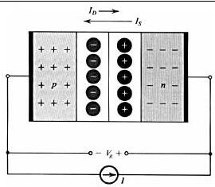

**Yanıt:** Ters kutuplanmış bir p-n ekleminde terminal akımı I = I_S − I_D'dir; I_S drift (doyma) akımı, I_D difüzyon akımıdır. Ters kutuplama nedeniyle artan bariyer gerilimi I_D'yi azaltmıştır. Buna göre I_D = I_S − I = 15 − 10 = **5 nA**. Sıcaklık artarsa azınlık taşıyıcısı (minority carrier) sayısı artar, I_S de artar; dolayısıyla terminal akımı da artar.

## 2006 Quiz-2 (01.05.2006)

### Soru 1a: Gürültülü yüksek seviye için tersleyici tasarımı

Girdi sinyalinin yüksek seviyesi gürültülü olan bir uygulama için CMOS tersleyici tasarlamak durumunda olsaydınız ne yapardınız?

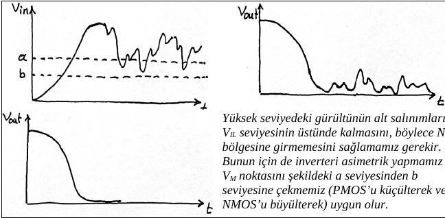

**Yanıt:** Yüksek seviyedeki gürültünün alt salınımlarının V_IL seviyesinin üstünde kalmasını, böylece NM_L bölgesine girmemesini sağlamak gerekir. Bunun için tersleyiciyi asimetrik yapmak ve V_M noktasını şekildeki *a* seviyesinden *b* seviyesine çekmek (PMOS'u küçülterek veya NMOS'u büyüterek) uygun olur.

### Soru 1b: Self loading

CMOS tersleyici performans optimizasyonunda "self loading" nedir, niçin oluşur?

**Yanıt:** Performans artırımı için tasarımcının elindeki en etkin araçlardan biri W/L oranını büyütmektir; azalan dirençler t_p'yi de azaltır. Ancak bu işlem dirençleri azaltırken iç sığaları (C_int) da büyütür. C_L = C_int + C_ext içinde C_int baskın hale geldiğinde, direnç küçültmenin yararı sığa artışıyla yok olur; W/L'yi daha fazla büyütmek performansı anlamlı ölçüde iyileştirmeden transistörleri (ve tümleşik devre alanını) büyütür. Bu duruma **self loading** denir.

### Soru 1c: Gate-drain sığası ve Miller etkisi

0,25 µm CMOS teknolojisiyle üretilen bir tersleyicide 0,115 fF'lık gate-drain sığası çıkışa ne kadar yük getirir?

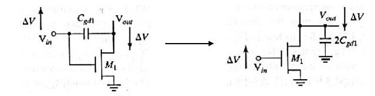

**Yanıt:** Gate-drain sığası giriş ile çıkış arasına seri bağlıdır. Uçlarında eşit büyüklükte ama zıt yönde gerilim değişimi olduğundan, **Miller etkisi** ile çıkışa paralel bağlı, iki katı değerde bir sığayla değiştirilebilir. Yani çıkışa 2 × 0,115 = **0,23 fF** yük getirir.

### Soru 2: Tersleyici zinciri

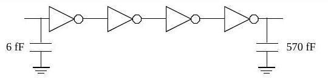

Bu kurguda uygulanacak ölçekleme faktörü ve normalize gecikme (t_p/t_p0) nedir? Tek tersleyiciye göre gecikme iyileşmesi ne kadardır? (γ = 1)

**Yanıt:**

- Toplam etkin fan-out: F = C_L / C_g,1 = 570 / 6 = 95
- Tek tersleyicili (unbuffered) gecikme: t_p0 (1 + F/γ) = 96 t_p0
- N = 4 için: t_p = N t_p0 (1 + F^(1/N)/γ) = 4 t_p0 (1 + 95^(1/4))
- t_p / t_p0 = 4 (1 + 3,12) = **16,49**; ölçekleme faktörü f = 95^(1/4) ≈ 3,12
- Oransal iyileşme = 96 / 16,49 = **5,82**

(Puanlama: 1. sorunun her şıkkı 15p, 2. soru 55p; süre 30 dk.)

## 2007 Quiz-1 (14.03.2007)

**Soru 1:** Gürültü payları verilen tersleyicinin VTC'sini düz çizgilerle çiziniz; V_OL, V_OH, V_IL, V_IH, V_SW değerlerini yazıp VTC üzerinde gösteriniz; V_M'yi ve gürültü sınırlarını belirtiniz. Bu tersleyici kullanışlı mıdır?

**Yanıt:** NM_H = V_OH − V_IH = 4,5 − 1,5 = 3 V, NM_L = V_IL − V_OL = 1 − 0,5 = 0,5 V. NM_L çok dar olduğundan düşük mantık seviyesinde gürültü duyarlılığı çok yüksektir. Ayrıca VTC simetrik değildir (V_M aşağıda) ve çıkış rail-to-rail (0–5 V) salınım yapamaz; yalnızca 0,5–4,5 V arasında salınır (V_SW = 4 V). Bu nedenlerle tersleyici kullanışlı değildir. (Aynı soru, sayısal değerleriyle birlikte 2009 Kısa Sınav-1'de de soruldu; şekli aşağıda.)

**Soru 2:** 2006 Quiz-1'in 2. sorusunun aynısı (yanıt: I_D = 5 nA).

## 2007 Kısa Sınav-2 (03.04.2007)

### Soru 1: Hız doyumu

Hız doyumu (velocity saturation) nedir, nasıl oluşur? k_n′ = 115 × 10⁻⁶ A/V², W = 0,375 µm, L = 0,25 µm, V_T = 0,43 V, V_DSAT = 0,63 V olan ve V_GS = 2 V, V_DS = 1 V'ta ölçülen bir NMOS için I_D'yi bulunuz.

**Yanıt:** Taşıyıcı hızı düşük alanlarda elektrik alanla orantılıdır (sabit mobilite, eğim µ). Kanaldaki alan kritik değere (ξ_c ≈ 1,5 V/µm) ulaştığında taşıyıcılar birbirleriyle çarpışmaları nedeniyle hız doyumuna ulaşır. Kısa kanallı MOSFET'lerde V_DS arttıkça bu durum, V_DS daha V_GS − V_T değerine ulaşmadan ortaya çıkar.

Doyumda (V_DS > V_DSAT):

I_DSAT = k_n′ (W/L) [(V_GS − V_T) V_DSAT − V_DSAT²/2] = 115 × 10⁻⁶ × (0,375/0,25) × [(2 − 0,43) × 0,63 − 0,63²/2] = **136,4 µA**

*Not: Yanıtta "elektron ve deliklerin doyum hızları yaklaşık 10⁻⁵ m/s" yazıyor; doğrusu 10⁵ m/s'dir.*

### Soru 2: CMOS tersleyici

CMOS tersleyiciyi çizerek çalışmasını açıklayınız, VTC üzerinde transistörlerin durumlarını belirtiniz; CMOS'un tercih edilme nedenlerini açıklayınız.

**Yanıt:** CMOS tersleyici bir NMOS ve bir PMOS'tan oluşur; kapıları birleşik giriş, drenleri birleşik çıkıştır. Giriş düşükken NMOS kesimde, PMOS iletimdedir ve çıkış V_DD olur; giriş yüksekken NMOS iletimde, PMOS kesimdedir ve çıkış 0 olur. CMOS'un tercih edilme nedenleri:

- Tam (rail-to-rail) salınım yapar, az yer kaplar.
- Kararlı durumda çıkış ile V_DD ya da toprak arasında her zaman sınırlı dirençli bir yol vardır; çıkış empedansı düşüktür.
- Giriş direnci çok yüksektir, kararlı durumda giriş akımı neredeyse sıfırdır; fan-out yüksektir.
- Kararlı durumda besleme ile toprak arasında doğrudan yol yoktur; durağan güç tüketimi yoktur.
- Yayılım gecikmesi yük sığasına ve transistör dirençlerine bağlıdır.

## 2007 Kısa Sınav-3 (01.05.2007)

**Soru 1a:** 2 girişli bir NAND kapısında çıkışın 0'dan 1'e geçme olasılığını (P₀→₁) bulunuz; C_L = 1,125 pF, V_DD = 3 V için yükte harcanan dinamik enerjiyi hesaplayınız.

| A | B | (AB)′ |
|---|---|---|
| 0 | 0 | 1 |
| 0 | 1 | 1 |
| 1 | 0 | 1 |
| 1 | 1 | 0 |

**Yanıt:** P₀→₁ = P(out=0) × P(out=1) = ¼ × ¾ = 3/16 ≈ 0,19. E_dyn = C_L × V_DD² × P₀→₁ = 1,125 × 10⁻¹² × 9 × 0,19 = **1,9 pJ**.

**Soru 1b–1c:** 2006 Quiz-2'deki self loading ve Miller etkisi sorularının aynısı (yanıt: 0,23 fF).

**Soru 2:** 5 fF giriş sığasından 625 fF yüke dört tersleyicilik zincir. Ölçekleme faktörü, t_p/t_p0 ve iyileşme oranı nedir? (γ = 1)

**Yanıt:** F = 625/5 = 125; tek tersleyicili gecikme t_p0 (1 + F/γ) = 126 t_p0. N = 4 için t_p = 4 t_p0 (1 + 125^(1/4)), t_p/t_p0 = 4 (1 + 3,34) = **17,36**; ölçekleme faktörü f = 125^(1/4) = **3,34**; iyileşme oranı 126 / 17,36 = **7,26**. (Süre 25 dk.)

## 2008 Kısa Sınav-1 (06.03.2008)

**Soru 1 (50p):** Bir tersleyici için VTC'yi çizip V_OH, V_OL, V_IL, V_IH, V_M, V_sw, NM_H, NM_L ve belirsiz bölgeyi gösteriniz. İdeal tersleyici için bu değerler ne olur?

**Yanıt (ideal tersleyici):** V_OL = 0; V_OH = V_DD = V_sw; V_IL = V_IH = V_DD/2; NM_H = V_OH − V_IH = V_DD/2; NM_L = V_IL − V_OL = V_DD/2.

**Soru 2 (25p):** 5 V ile beslenen bir kapıda I_OH = 1 mA, I_OL = 3,18 mA; t_PHL = 1,4 ns, t_PLH = 3,2 ns. Güç-gecikme çarpımı (PDP) nedir?

**Yanıt:** P_ort = 5 V × (1 + 3,18) mA / 2 ≈ 10,5 mW; t_p,ort = (1,4 + 3,2)/2 = 2,3 ns; PDP = 10,5 × 2,3 ≈ **24,2 pJ**.

**Soru 3 (25p):** Intel P5 mikroişlemci üretiminde değişken maliyetler mi, sabit maliyetler mi daha önemlidir?

**Yanıt:** IC maliyeti = değişken maliyet + (sabit maliyet / üretilen IC adedi). Intel gibi büyük pazar payıyla çok yüksek adetlerde üretilen bir IC'de sabit maliyet adede bölündüğünden **değişken maliyetler** daha etkili ve önemlidir.

*Not: Yanıtta soru "Intel P4" diye anılıyor; soruda P5 yazıyor.*

## 2008 Kısa Sınav-2 (17.04.2008)

### Soru 1a: MOS kapı sığaları

Çizelgede gate-channel sığalarının (C_GCB, C_GCS, C_GCD) sıfır olduğu durumları işaretleyiniz.

| Bölge | C_GCB | C_GCS | C_GCD |
|---|---|---|---|
| Kesim (cutoff) | | 0 | 0 |
| Doğrusal (resistive) | 0 | | |
| Doyum (saturation) | 0 | | 0 |

**Yanıt:** Kesimde yalnızca C_GCB vardır; kanal oluşmadığından tüm sığa gate ile body arasında görülür. Doğrusal bölgede boydan boya uzanan iletken kanal gate ile body arasında perde oluşturur. Doyumda da C_GCB sıfırdır; ayrıca pinch-off noktasında (drain ucu) kanal bittiği için C_GCD de sıfırdır.

**Soru 1b:** Miller etkisi sorusu (yanıt: 0,23 fF).

### Soru 2: Çalışma bölgeleri

V_DD = 2,5 V, V_Tp = −0,4 V, V_Tn = 0,4 V, V_DSATp = −1 V, V_DSATn = 0,6 V, λ = 0 için aşağıdaki transistörler hangi bölgede çalışır?

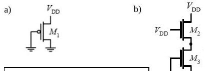

**Yanıt:**

- (a) V_GS1 = V_DS1 = −2,5 V; V_GT1 = V_GS1 − V_Tp = −2,5 + 0,4 = −2,1 V. |V_DSAT1| < |V_GT1| < |V_DS1| olduğundan M1 **hız doyumunda** (velocity saturation).
- (b) V_GS3 = 0 < V_T3 olduğundan M3 kesimde; I_D2 = I_D3 = 0 olduğundan M2 de **kesimde**.

### Soru 3: W_p ve W_n'nin VTC'ye etkisi

Tersleyicinin VTC'si W_p ve W_n'deki değişimlere göre nasıl değişir?

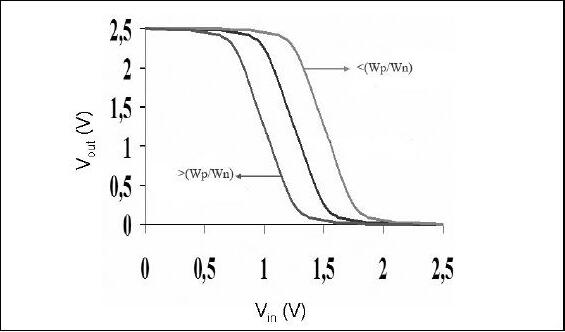

Yanıt belgesindeki grafik: W_p/W_n oranı büyüdükçe VTC (ve V_M) sağa, küçüldükçe sola kayar.

## 2008 Kısa Sınav-3 (13.05.2008)

### Soru 1 (50p): Logical effort ile boyutlandırma

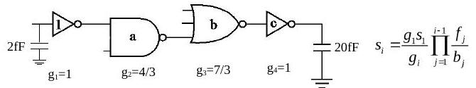

Girişten çıkışa giden yolda minimum gecikme için a, b ve c boyutlarını bulunuz. (Minimum boyutlu tersleyicide NMOS/PMOS oranı ½.)

**Yanıt:**

- 2 girişli NAND logical effort = (n + 2)/3 = 4/3; 3 girişli NOR logical effort = (2n + 1)/3 = 7/3
- Etkin fan-out F = 20/2 = 10
- Yol logical effort G = 1 × 4/3 × 7/3 × 1 = 28/9 = 3,11
- Dallanma yok (B = 1), yol eforu H = G·F·B = 28/9 × 10 = 31,11
- Kapı eforu h = H^(1/N) = 31,11^(1/4) = 2,36; minimum gecikme koşulu f₁g₁ = f₂g₂ = f₃g₃ = f₄g₄ = h
- f₁ = 2,36; f₂ = 2,36 × 3/4 = 1,77; f₃ = 2,36 × 3/7 = 1,01; f₄ = 2,36
- s_i = (g₁s₁/g_i) × ∏ f_j/b_j formülüyle: **a = s₂ = 1,77**, **b = s₃ = 1,79**, **c = s₄ = 4,22**

### Soru 2 (25p): Geçiş transistörlerinde eşik kaybı

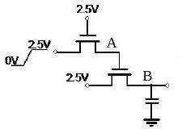

V_T = 0,5 V, gövde etkisi ihmal, sığaç başlangıçta boş. Giriş yükseldikten sonra kararlı durumda çıkış ne olur?

**Yanıt (belgedeki):** A noktası ilk transistörün source ucu olduğundan en fazla V_G − V_T'ye kadar yükselir: V_A = 2,5 − 0,5 = 2 V. "Aynı durum B için de geçerlidir": V_B = 2 − 0,5 = 1,5 V.

*Not: Şekilde ikinci transistörün kapısı A'ya değil 2,5 V'a bağlı. B en fazla V_G − V_T = 2,5 − 0,5 = 2 V'a kadar çıkabilir ve drain'deki V_A = 2 V da bu değerdedir; dolayısıyla V_B = 2 V olmalıdır. 1,5 V sonucu, ikinci transistörün kapısı A'ya bağlı olsaydı geçerli olurdu.*

### Soru 3 (25p): Karmaşık kapıyı boyutlandırma

Devreyi NMOS/PMOS oranı 1/3 olan bir tersleyiciyle aynı akım sürme kapasitesine sahip olacak şekilde boyutlandırınız.

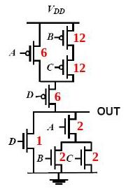

Yanıt belgesindeki boyutlar (kırmızı): PMOS ağında A = 6, B = 12, C = 12, D = 6; NMOS ağında D = 1, A = 2, B = 2, C = 2.

## 2009 Kısa Sınav-1 (09.03.2009)

### Soru 1: Üç parçalı doğrusal VTC

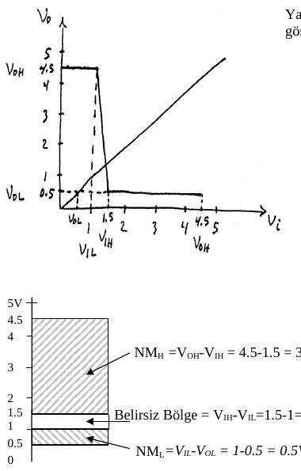

a) NM_H, NM_L, V_sw ve belirsiz bölgeyi dikey eksende gösteriniz. b) V_NSH, V_NSL, V_NIH ve V_NIL değerlerini bulunuz. c) Tersleyici kullanışlı mıdır? (V_M = 1,3 V.)

**Yanıt:**

- a) NM_H = 4,5 − 1,5 = 3 V; NM_L = 1 − 0,5 = 0,5 V; V_sw = 4,5 − 0,5 = 4 V; belirsiz bölge = 1,5 − 1 = 0,5 V
- b) V_NSH = V_OH − V_M = 4,5 − 1,3 = 3,2 V; V_NSL = V_M − V_OL = 1,3 − 0,5 = 0,8 V; V_NIH = V_NSH/V_sw = 3,2/4 = 0,8; V_NIL = V_NSL/V_sw = 0,8/4 = 0,2
- c) NM_L çok dar, VTC simetrik değil (V_M aşağıda) ve çıkış 0–5 V yerine 0,5–4,5 V salınıyor; tersleyici kullanışlı değil.

### Soru 2: p-n eklemi

Ters kutuplanmış bir eklemde terminal akımı 8 nA, difüzyon akımı 4 nA. a) Drift akımı nedir? b) Sıcaklık azalırsa terminal akımı nasıl değişir? c) Terminaller arasında ölçülen gerilim kavramsal olarak neye eşittir?

**Yanıt:** a) I = I_S − I_D'den I_S = I_D + I = 4 + 8 = **12 nA**. b) Sıcaklık azalırsa azınlık taşıyıcısı sayısı ve I_S azalır; terminal akımı da azalır. c) I = I_S − I_D dengesi oluşana kadar eşik (bariyer) gerilimi artar; V₀ ile yeni eşik gerilimi arasındaki fark terminaller arasında ölçülen V_R'dir. (Puanlar: 1-c 15p, diğerleri 17p.)

## 2009 Kısa Sınav-2 (20.04.2009)

### Soru 1: Lateral diffusion

L = 0,25 µm bir CMOS transistörde C_GCD = 0,25 fF, aynı bölgede toplam gate sığası C_G = 0,7 fF ölçülüyor. Lateral diffusion x_d ne kadardır?

**Yanıt:** C_GCD yalnızca doğrusal (resistive) bölgede sıfırdan farklıdır ve ½ C_ox WL'ye eşittir; demek ki transistör doğrusal bölgede ve C_ox WL = 0,5 fF. Doğrusal bölgede C_G = C_ox WL + 2C_o W = 0,7 fF olduğundan 2C_o W = 0,2 fF, C_o W = 0,1 fF. C_o W = C_ox x_d W ve C_ox W = 0,5 fF / 0,25 µm = 2 fF/µm olduğundan x_d = 0,1 / 2 = **0,05 µm**.

### Soru 2: V_M için W_n/W_p

Yüksüz bir CMOS tersleyicide V_DD = 5 V, V_Tn = −V_Tp = 1 V, C_ox = 5 fF/µm², L = 2,5 µm, λ = 0, µ_n = 50.000 mm²/Vs, µ_p = 25.000 mm²/Vs. V_M = 2 V için W_n/W_p ne olmalıdır?

**Yanıt:** V_out = V_M olduğunda V_in = V_out = 2 V; V_GSp = V_DSp = −3 V, V_GSn = V_DSn = 2 V ve iki transistör de doyumdadır, I_Dn = −I_Dp:

- I_DSATn = ½ (W_n/L_n) µ_n C_ox (V_GSn − V_Tn)² = ½ (W_n/2,5)(50.000 × 10⁶)(5 × 10⁻¹⁵)(2 − 1)² = 50 × 10⁻⁶ W_n
- I_DSATp = −½ (W_p/2,5)(25.000 × 10⁶)(5 × 10⁻¹⁵)(−3 + 1)² = −100 × 10⁻⁶ W_p
- 50 × 10⁻⁶ W_n = 100 × 10⁻⁶ W_p ⇒ **W_n/W_p = 2**
