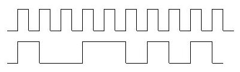

This post contains two assignments given in the 2005-2006 spring semester of the Başkent University **EEM312 Digital Electronics** course (Prof. Dr. Emin Akata): the English **Homework #1** (due 21.04.2006) and the Turkish **Homework #2** (due 15.05.2006). The assignments contain only the questions, without solutions. The original Word files can be downloaded as a ZIP at the end of the post.

## Homework #1: p-n Junction and MOSFET (due 21.04.2006)

1. For a p-n junction in which the built-in voltage is 0.7 V, what are the doping concentrations in the two regions if: a) they are equal, b) they are in the ratio 10 to 1? For each case, what is the width of the depletion region and the distance it extends each side of the junction? For a junction that is 30 µm by 50 µm in size, what is the magnitude of the space charge on each side? *Note: take q = 1.60 × 10⁻¹⁹ C, nᵢ = 1.5 × 10¹⁰ cm⁻³, ε_si = 1.053 × 10⁻¹⁰ F/m, φ_T = 26 mV.*
1. For a particular reverse-biased p-n junction, the terminal current is 10 nA. If the drift current at the operating temperature is 15 nA, what must the voltage-dependent diffusion current be at this particular reverse voltage?
1. For a particular junction for which m = 1.6, a capacitance C_j of 1.8 pF is measured for a reverse junction voltage of 2 V, and 0.2 pF for a voltage of 10 V. What are the corresponding values of φ₀, C_j0 and C_j at 0 V?
1. An n-channel enhancement MOS transistor for which V_T = 1.5 V is operated with a source voltage of 0 V. For what range of values of V_GS is a channel induced? For V_GS = 3 V, for what range of values of V_DS is the channel pinched off at the drain end? For what range of values of V_D does the transistor operate in the triode mode?
1. An n-channel enhancement MOSFET having µnC_ox = 20 µA/V², W/L = 10 and V_T = 1 V is operated with V_S = 0 V and V_G = 3 V. For what range of values of V_D is operation in the triode region? What current flows for V_DS = 2 V, 1 V and 0.5 V? What is the value of R_DS for V_DS relatively small? At what value of V_DS does R_DS increase beyond its very low-voltage value by 1% and by 10%?

## Homework #2: Short Channel, Sizing, Power and Delay (due 15.05.2006)

### Question 1

The 5 sets of measurement data in the table belong to a short-channel NMOS transistor. Given that V_DSAT = 0.6 V and k′ = 100 µA/V² for this transistor, find V_T0, λ and W/L. Can the body-effect coefficient (γ) be found from the same data? How?

*NOTE: For each measurement, you need to consider the state of the transistor (velocity saturation, saturation, cutoff, linear).*

| Measurement | V_GS (V) | V_DS (V) | V_BS (V) | I_D (µA) |
|---|---|---|---|---|
| 1 | 2.5 | 1.8 | 0 | 1812 |
| 2 | 2 | 1.8 | 0 | 1297 |
| 3 | 2 | 2.5 | 0 | 1361 |
| 4 | 2 | 1.8 | −1 | 1146 |
| 5 | 2 | 1.8 | −2 | 1039 |

### Question 2

When the size of the transistors in a CMOS inverter is considered relative to that of a minimal reference inverter, C_int = S·C_iref, and the delay is expressed as

t_p = t_p0 · (1 + C_ext / (S·C_iref))

The capacitance values required for a cascaded pair of inverters are given in the attached table. Accordingly, what is the maximum performance gain that can be achieved by sizing the driving inverter? If the scaling factor is chosen as 10, what percentage of this maximum gain is realized?

Table attached to the assignment (components of C_L):

| Capacitance | Expression | Value (fF) |
|---|---|---|
| C_gd1 | 2·CGD0_n·W_n | 0.23 |
| C_gd2 | 2·CGD0_p·W_p | 0.61 |
| C_db1 | K_eqn·AD_n·CJ + K_eqswn·PD_n·CJSW | 0.66 |
| C_db2 | K_eqp·AD_p·CJ + K_eqswp·PD_p·CJSW | 1.5 |
| C_g3 | (CGD0_n + CGS0_n)·W_n + C_ox·W_n·L_n | 0.76 |
| C_g4 | (CGD0_p + CGS0_p)·W_p + C_ox·W_p·L_p | 2.28 |
| C_w | From extraction | 0.12 |
| C_L | Σ | 6.1 |

Here, the driver's own (internal) capacitance is C_gd1 + C_gd2 + C_db1 + C_db2, and the external load is C_g3 + C_g4 + C_w.

### Question 3

In a digital circuit, the clock frequency is 4 GHz and the signal activity is as shown below; the circuit is powered from a 3 V supply. Given that the capacitive load in the circuit is C_L = 6 fF:

1. Find the dynamic power and energy the circuit will consume.
1. Assuming that static and short-circuit losses are negligible and that the circuit is active at the highest possible speed, find the PDP (power-delay product).

### Question 4

For each of the circuits below, find the scaling values x that will minimize the delay (t_p) from V_in to V_out. *NOTE: For each circuit, write the expression t_p(x) and obtain the result by calculating dt_p/dx; do not directly apply the formulas in the textbook. Assume C_g1 = 1, γ = 1.*

, (b) and (c)")
