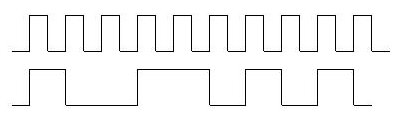

Bu yazı, Başkent Üniversitesi **EEM312 Sayısal Elektronik** dersinin 2005-2006 bahar yarıyılında (Prof. Dr. Emin Akata) verilen iki ödevi içeriyor: İngilizce **Homework #1** (teslim 21.04.2006) ve Türkçe **Ödev-2** (teslim 15.05.2006). Ödevlerde yalnızca sorular var, çözüm yok. Orijinal Word dosyaları yazının sonunda ZIP olarak indirilebilir.

## Homework #1: p-n eklemi ve MOSFET (teslim 21.04.2006)

1. For a p-n junction in which the built-in voltage is 0.7 V, what are the doping concentrations in the two regions if: a) they are equal, b) they are in the ratio 10 to 1? For each case, what is the width of the depletion region and the distance it extends each side of the junction? For a junction that is 30 µm by 50 µm in size, what is the magnitude of the space charge on each side? *Note: take q = 1.60 × 10⁻¹⁹ C, nᵢ = 1.5 × 10¹⁰ cm⁻³, ε_si = 1.053 × 10⁻¹⁰ F/m, φ_T = 26 mV.*
1. For a particular reverse-biased p-n junction, the terminal current is 10 nA. If the drift current at the operating temperature is 15 nA, what must the voltage-dependent diffusion current be at this particular reverse voltage?
1. For a particular junction for which m = 1.6, a capacitance C_j of 1.8 pF is measured for a reverse junction voltage of 2 V, and 0.2 pF for a voltage of 10 V. What are the corresponding values of φ₀, C_j0 and C_j at 0 V?
1. An n-channel enhancement MOS transistor for which V_T = 1.5 V is operated with a source voltage of 0 V. For what range of values of V_GS is a channel induced? For V_GS = 3 V, for what range of values of V_DS is the channel pinched off at the drain end? For what range of values of V_D does the transistor operate in the triode mode?
1. An n-channel enhancement MOSFET having µnC_ox = 20 µA/V², W/L = 10 and V_T = 1 V is operated with V_S = 0 V and V_G = 3 V. For what range of values of V_D is operation in the triode region? What current flows for V_DS = 2 V, 1 V and 0.5 V? What is the value of R_DS for V_DS relatively small? At what value of V_DS does R_DS increase beyond its very low-voltage value by 1% and by 10%?

## Ödev-2: Kısa kanal, boyutlandırma, güç ve gecikme (teslim 15.05.2006)

### Soru 1

Tabloda yer alan 5 set ölçüm verisi kısa kanallı bir NMOS transistöre aittir. Bu transistör için V_DSAT = 0,6 V ve k′ = 100 µA/V² olduğuna göre V_T0, λ ve W/L değerlerini bulunuz. Aynı veriden hareketle gövde etkisi katsayısı (body-effect coefficient, γ) bulunabilir mi? Nasıl?

*NOT: Her ölçüm için transistörün durumunu (hız doyumu, doyum, kesim, doğrusal) göz önünde bulundurmanız gerekir.*

| Ölçüm | V_GS (V) | V_DS (V) | V_BS (V) | I_D (µA) |
|---|---|---|---|---|
| 1 | 2,5 | 1,8 | 0 | 1812 |
| 2 | 2 | 1,8 | 0 | 1297 |
| 3 | 2 | 2,5 | 0 | 1361 |
| 4 | 2 | 1,8 | −1 | 1146 |
| 5 | 2 | 1,8 | −2 | 1039 |

### Soru 2

CMOS tersleyicideki transistörlerin büyüklüğünü bir minimal referans tersleyicininkiyle oranlı düşündüğümüzde C_int = S·C_iref olur ve gecikme

t_p = t_p0 · (1 + C_ext / (S·C_iref))

şeklinde ifade edilir. Kaskat bağlı bir tersleyici çifti için gerekli sığa değerleri ekli çizelgede verilmiştir. Buna göre, sürücü konumdaki tersleyicide yapılacak boyutlandırma (sizing) ile sağlanabilecek en büyük performans kazancı ne kadar olur? Ölçekleme faktörü 10 seçilirse bu en büyük kazancın yüzde kaçı gerçekleşir?

Ödeve eklenen çizelge (C_L'nin bileşenleri):

| Sığa | İfade | Değer (fF) |
|---|---|---|
| C_gd1 | 2·CGD0_n·W_n | 0,23 |
| C_gd2 | 2·CGD0_p·W_p | 0,61 |
| C_db1 | K_eqn·AD_n·CJ + K_eqswn·PD_n·CJSW | 0,66 |
| C_db2 | K_eqp·AD_p·CJ + K_eqswp·PD_p·CJSW | 1,5 |
| C_g3 | (CGD0_n + CGS0_n)·W_n + C_ox·W_n·L_n | 0,76 |
| C_g4 | (CGD0_p + CGS0_p)·W_p + C_ox·W_p·L_p | 2,28 |
| C_w | Çıkarımdan (extraction) | 0,12 |
| C_L | Σ | 6,1 |

Burada sürücünün kendi (iç) sığası C_gd1 + C_gd2 + C_db1 + C_db2, dış yük ise C_g3 + C_g4 + C_w'dir.

### Soru 3

Bir sayısal devrede saat frekansı 4 GHz olup sinyal aktivitesi aşağıda gösterildiği gibidir; devre 3 V kaynaktan beslenmektedir. Devredeki kapasitif yük C_L = 6 fF olduğuna göre:

1. Devrenin tüketeceği dinamik gücü ve enerjiyi bulunuz.
1. Statik ve kısa devre kayıplarının ihmal edilebilir olduğunu ve devrenin olası en yüksek hızda aktivite gösterdiğini varsayarak PDP (güç-gecikme çarpımı) değerini bulunuz.

### Soru 4

Aşağıdaki devrelerin her biri için V_in'den V_out'a kadar olan gecikmeyi (t_p) en aza indirecek x ölçekleme değerlerini bulunuz. *NOT: Her devre için t_p(x) ifadesini yazıp dt_p/dx hesabını yaparak sonuca ulaşınız; kitaptaki formülleri doğrudan uygulamayınız. C_g1 = 1, γ = 1 kabul ediniz.*

, (b) ve (c) devreleri")
