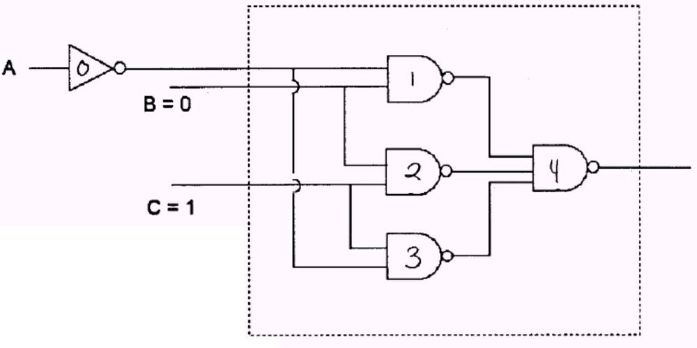
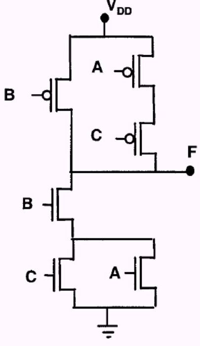
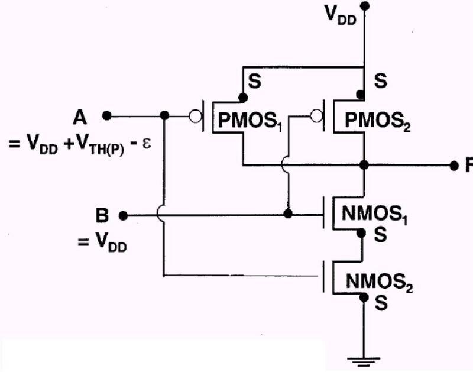
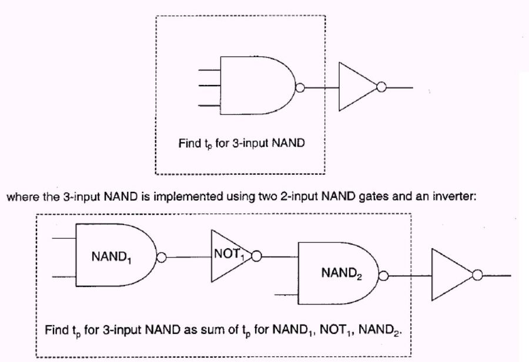
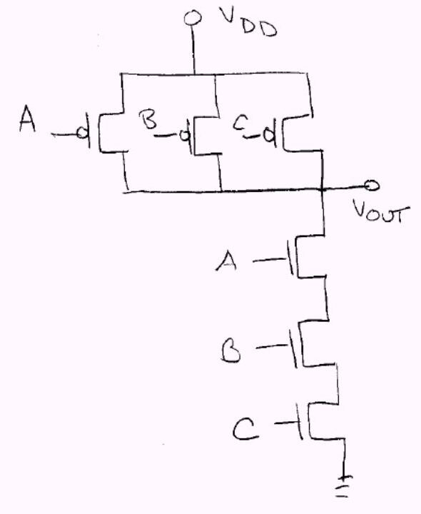
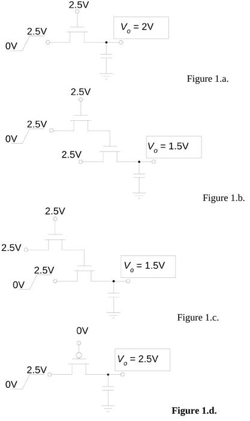

This post presents the document of solved example problems named `ORNEKLER_EEM312_02.doc` from the Başkent University **EEM312 Digital Electronics** course folder. The document does not state its source; the questions and handwritten solutions appear to be compiled from homework and exam solutions of a digital integrated circuits course at a foreign university (possibly of UC Berkeley EE141 origin, judging by the topics and notation). A PDF copy of the same content (`ornekler.pdf`) is dated 28.05.2009. The questions and solutions were transcribed, the circuit figures were added as images, and the calculations were checked. The original Word file can be downloaded at the end of the post.

*Note: This content belongs to a third-party source; it is shared for archival and nostalgic purposes with the source credited. It will be removed upon the request of the rights holder.*

## Problem 1: Propagation delay between two CMOS inverters

The output of CMOS inverter 1 is connected to the input of CMOS inverter 2. Common values for the two inverters:

- µ_N = 500 cm²/Vs, µ_P = 250 cm²/Vs, V_T(N) = −V_T(P) = 1 V
- t_ox = 10 nm (oxide thickness), k_ox = 4 (oxide dielectric constant), V_DD = 5 V
- L_I = 20 µm (interconnect length), W_I = 1 µm (interconnect width), ε₀ = 8.85 × 10⁻¹² F/m

| | L_N = L_P | W_N | W_P | C_DB(P) = C_DB(N) |
|---|---|---|---|---|
| Inverter 1 | 2 µm | 6 µm | 24 µm | 50 fF |
| Inverter 2 | 2 µm | 8 µm | 16 µm | 75 fF |

The input of inverter 1 stays at 0 for a long time and then switches instantly to 1; find the propagation delay at the output of inverter 1.

**Solution:** t_p = 0.69τ, τ = R_N(C_DBN1 + C_DBP1 + C_GBN2 + C_GBP2 + C_I).

- R_N = 0.75V_DD/I_DSAT1 = 0.75V_DD / [(W_N1/2L_N1) µ_n C_ox (V_GS − V_T)²] = 0.75(5) / [(6/(2·2))(500×10⁻⁴)(4 × 8.85×10⁻¹²/10×10⁻⁹)(5 − 1)²] = **883 Ω**
- C_GBN2 = C_ox W_N2 L_N2 = 56 fF, C_GBP2 = C_ox W_P2 L_P2 = 112 fF, C_I = C_ox W_I L_I = 70 fF
- t_p = 0.69 × 883 × (56 + 112 + 70 + 50 + 50) × 10⁻¹⁵ = **206 ps**

## Problem 2: Delay in a NAND-NAND adder

An inverter is connected to one of the inputs of the most significant digit function of a 3-bit adder; with the other inputs fixed (B = 0, C = 1), find the propagation delay from the input to the inverter output when the inverter input A goes from low to high. For all gates, C_DB(P) = C_DB(N) = 50 fF, C_GB(P) = 50 fF, C_GB(N) = 75 fF, C_I = 100 fF per gate, R_N = 3 kΩ, R_P = 2 kΩ.

**Solution:** The delay of the inverter is affected only by gates 1 and 3, which are directly connected to it. One interconnect goes to gate 1 and one to gate 3: for each, two gate capacitances (C_GBN and C_GBP) and two interconnect capacitances C_I are used.

- t_p = 0.69 R_N (C_DBN0 + C_DBP0 + C_GBN1 + C_GBP1 + C_GBN3 + C_GBP3 + 2C_I)
- = 0.69 × 3000 × (50 + 50 + 75 + 50 + 75 + 50 + 2 × 100) × 10⁻¹⁵ = **1.14 ns**

## Problem 3: Does the circuit perform a logic operation?

Determine whether the circuit below performs a logic operation; if it does, give its Boolean function, and if it does not, find a set of inputs that gives an invalid output. (All PMOS sources are at the top, all NMOS sources at the bottom.)

**Solution:**

- From the PMOS half: if B conducts **or** (A conducts **and** C conducts), F = V_DD ⇒ F = B′ + A′C′
- From the NMOS half: if B conducts **and** (A conducts **or** C conducts), F = 0 ⇒ F′ = B(A + C)
- The two agree by De Morgan's law; the circuit is a logic circuit: **F = B′ + A′C′**.

## Problem 4: Operating regions of the transistors

In the CMOS logic circuit below, determine the most likely operating region of each transistor. ε is a very small positive number, and V_DD is much larger in magnitude than both V_TH values; A = V_DD + V_TH(P) − ε, B = V_DD.

**Solution:**

- **PMOS₂ is in cutoff** (V_GSP2 = V_DD − V_DD = 0 V).
- PMOS₁ is barely conducting (V_GSP1 = V_DD + V_THP − ε − V_DD = V_THP − ε); the I_D shared by PMOS₁, NMOS₁ and NMOS₂ is small.
- For NMOS₂, V_GSN2 = V_DD + V_THP − ε is not small and is positive (V_DD is much larger than V_THP and ε); NMOS₂ is fully on and I_D is small ⇒ **NMOS₂ is in triode**; therefore V_DSN2 is small.
- V_GSN1 = V_DD − V_DSN2 is also not small; NMOS₁ is fully on and I_D is small ⇒ **NMOS₁ is in triode**; V_DSN1 is also small.
- V_DD = V_DSN1 + V_DSN2 − V_DSP1 (two small terms) ⇒ V_DSP1 is large in magnitude and negative; V_GSP1 is small in magnitude and negative, V_DSP1 is large in magnitude and negative ⇒ **PMOS₁ is in saturation**.

## Problem 5: Delay of a 3-input NAND

A 3-input NAND loaded by an inverter is implemented with two 2-input NANDs and an inverter; find t_p of the 3-input NAND as the sum of the worst-case delays of the gates inside it (NAND₁, NOT₁, NAND₂). R_N = 1 kΩ, R_P = 2 kΩ, C_G = 10 fF per transistor; interconnect capacitance is neglected.

**Solution:**

- NAND₁: the worst-case resistance is 2R_N or R_P (equal); the load is an inverter, C_out = 2C_G ⇒ t_p = 0.69 R_P (2C_G) = **27.6 ps**; the same holds for NAND₂.
- NOT₁: the worst-case resistance is R_P; the output goes to one input of the NAND (2 of its 4 transistors), C_out = 2C_G ⇒ t_p = **27.6 ps**.
- Total: 3 × 27.6 ps = **82.8 ps**.

## Problem 6: A faster 3-input NAND

Using only NMOS and PMOS transistors (and the supply), design a 3-input NAND with a shorter worst-case delay than that in Problem 5; the transistor characteristics are the same, and the output is loaded by a single inverter.

**Solution:** Single-stage static CMOS NAND3: the worst-case resistance is 3R_N (pull-down); with an inverter load, C_out = 2C_G ⇒ t_p = 0.69(3R_N)(2C_G) = **41.4 ps**, which is half of the solution to Problem 5.

## Problem 7: Pass-transistor circuits and energy

**a) (4p)** Find the final value of V_o in the circuits of Figures 1.a–1.d when a low-to-high transition is applied to the input. V_TN = |V_TP| = 0.5 V; the capacitor is initially empty; subthreshold conduction and body effect are neglected.

Answers: Figure 1.a **V_o = 2 V**, Figure 1.b **V_o = 1.5 V**, Figure 1.c **V_o = 1.5 V**, Figure 1.d **V_o = 2.5 V**.

**b) (2p)** When the output reaches its final value, a 2.5 V → 0 step is applied to the input; the energy dissipated in the transistors of Figure 1.c during the transition (symbolic):

- E_dis = ½C(V − 2V_T)², E₁→₀ = ½C(V − 2V_T)²

**c) (6p)** For Figure 1.d, the energy dissipated in the transistor during the first 0→1 transition; then, once the output reaches its final value, a 2.5 V → 0 step is applied, followed by a second 0 → 2.5 V step; the energies dissipated in the transistor during the first 1→0 and the second 0→1 transitions:

- First E₀→₁ = ½CV²
- First E₁→₀ = ½C(V² − V_T²)
- Second E₀→₁ = ½C(V − V_T)²
