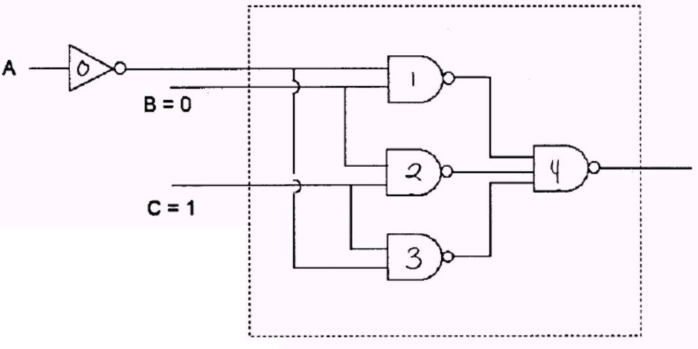
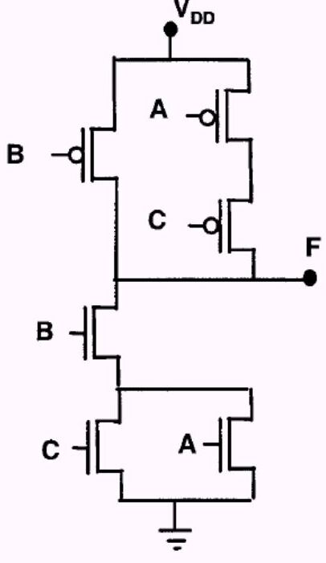
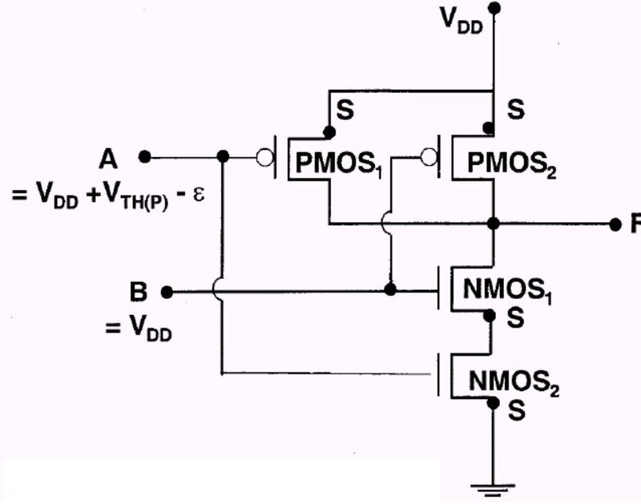
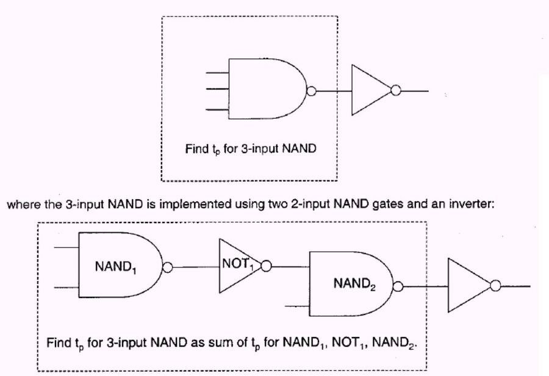
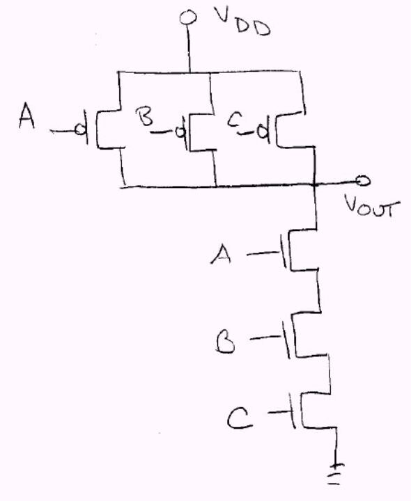
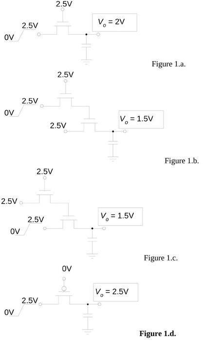

Bu yazı, Başkent Üniversitesi **EEM312 Sayısal Elektronik** dersi klasöründeki `ORNEKLER_EEM312_02.doc` adlı çözümlü örnek problemler belgesini aktarıyor. Belgede kaynak belirtilmemiş; sorular ve el yazısı çözümler İngilizce ve yabancı bir üniversitenin dijital tümdevre dersine ait ödev ve sınav çözümlerinden derlenmiş görünüyor (konu ve gösterim bakımından UC Berkeley EE141 kökenli olabilir). Aynı içeriğin PDF kopyası (`ornekler.pdf`) 28.05.2009 tarihli. Sorular ve çözümler yazıya döküldü, devre şekilleri görsel olarak eklendi; hesaplar kontrol edildi. Orijinal Word dosyası yazının sonunda indirilebilir.

*Bu içerik üçüncü taraf bir kaynağa aittir; arşiv ve nostalji amacıyla kaynak belirtilerek paylaşılmıştır. Hak sahibinin talebi hâlinde kaldırılır.*

## Problem 1: İki CMOS inverter arasında yayılım gecikmesi

CMOS inverter 1'in çıkışı CMOS inverter 2'nin girişine bağlı. İki inverter için ortak değerler:

- µ_N = 500 cm²/Vs, µ_P = 250 cm²/Vs, V_T(N) = −V_T(P) = 1 V
- t_ox = 10 nm (oksit kalınlığı), k_ox = 4 (oksit dielektrik sabiti), V_DD = 5 V
- L_I = 20 µm (bağlantı uzunluğu), W_I = 1 µm (bağlantı genişliği), ε₀ = 8,85 × 10⁻¹² F/m

| | L_N = L_P | W_N | W_P | C_DB(P) = C_DB(N) |
|---|---|---|---|---|
| Inverter 1 | 2 µm | 6 µm | 24 µm | 50 fF |
| Inverter 2 | 2 µm | 8 µm | 16 µm | 75 fF |

İnverter 1'in girişi uzun süre 0'da kaldıktan sonra anında 1'e geçiyor; inverter 1 çıkışındaki yayılım gecikmesini bulunuz.

**Çözüm:** t_p = 0,69τ, τ = R_N(C_DBN1 + C_DBP1 + C_GBN2 + C_GBP2 + C_I).

- R_N = 0,75V_DD/I_DSAT1 = 0,75V_DD / [(W_N1/2L_N1) µ_n C_ox (V_GS − V_T)²] = 0,75(5) / [(6/(2·2))(500×10⁻⁴)(4 × 8,85×10⁻¹²/10×10⁻⁹)(5 − 1)²] = **883 Ω**
- C_GBN2 = C_ox W_N2 L_N2 = 56 fF, C_GBP2 = C_ox W_P2 L_P2 = 112 fF, C_I = C_ox W_I L_I = 70 fF
- t_p = 0,69 × 883 × (56 + 112 + 70 + 50 + 50) × 10⁻¹⁵ = **206 ps**

## Problem 2: NAND-NAND toplayıcıda gecikme

3 bitlik toplayıcının en anlamlı basamak işlevinin girişlerinden birine bir inverter bağlanıyor; diğer girişler sabitken (B = 0, C = 1) inverter girişi A alçaktan yükseğe geçtiğinde girişten inverter çıkışına kadar yayılım gecikmesini bulunuz. Tüm geçitler için C_DB(P) = C_DB(N) = 50 fF, C_GB(P) = 50 fF, C_GB(N) = 75 fF, geçit başına C_I = 100 fF, R_N = 3 kΩ, R_P = 2 kΩ.

**Çözüm:** İnverterin gecikmesini yalnız doğrudan bağlı 1 ve 3 numaralı geçitler etkiler. Geçit 1'e bir, geçit 3'e bir bağlantı: her biri için iki gate sığası (C_GBN ve C_GBP) ve iki bağlantı sığası C_I kullanılır.

- t_p = 0,69 R_N (C_DBN0 + C_DBP0 + C_GBN1 + C_GBP1 + C_GBN3 + C_GBP3 + 2C_I)
- = 0,69 × 3000 × (50 + 50 + 75 + 50 + 75 + 50 + 2 × 100) × 10⁻¹⁵ = **1,14 ns**

## Problem 3: Devre bir mantık işlemi yapıyor mu?

Aşağıdaki devrenin bir mantık işlemi yapıp yapmadığını belirleyiniz; yapıyorsa Boole işlevini veriniz, yapmıyorsa geçersiz çıkış veren bir giriş kümesi bulunuz. (Tüm PMOS'ların source'u üstte, tüm NMOS'ların source'u altta.)

**Çözüm:**

- PMOS yarısından: B iletirse **ya da** (A iletir **ve** C iletirse) F = V_DD ⇒ F = B′ + A′C′
- NMOS yarısından: B iletir **ve** (A iletir **ya da** C iletirse) F = 0 ⇒ F′ = B(A + C)
- İkisi De Morgan yasasıyla uyuşur; devre bir mantık devresidir: **F = B′ + A′C′**.

## Problem 4: Transistörlerin çalışma bölgeleri

Aşağıdaki CMOS mantık devresinde her transistörün en olası çalışma bölgesini belirleyiniz. ε çok küçük pozitif bir sayı, V_DD her iki V_TH'den genlikçe çok büyük; A = V_DD + V_TH(P) − ε, B = V_DD.

**Çözüm:**

- **PMOS₂ kesimde** (V_GSP2 = V_DD − V_DD = 0 V).
- PMOS₁ zar zor iletimde (V_GSP1 = V_DD + V_THP − ε − V_DD = V_THP − ε); PMOS₁, NMOS₁ ve NMOS₂'nin paylaştığı I_D küçüktür.
- NMOS₂ için V_GSN2 = V_DD + V_THP − ε küçük değil ve pozitif (V_DD, V_THP ve ε'dan çok büyük); NMOS₂ tam iletimde ve I_D küçük ⇒ **NMOS₂ triyot**; dolayısıyla V_DSN2 küçük.
- V_GSN1 = V_DD − V_DSN2 de küçük değil; NMOS₁ tam iletimde, I_D küçük ⇒ **NMOS₁ triyot**; V_DSN1 de küçük.
- V_DD = V_DSN1 + V_DSN2 − V_DSP1 (iki küçük terim) ⇒ V_DSP1 büyük genlikli ve negatif; V_GSP1 küçük genlikli negatif, V_DSP1 büyük genlikli negatif ⇒ **PMOS₁ doyumda**.

## Problem 5: 3 girişli NAND'ın gecikmesi

İnverter yüklü 3 girişli NAND, iki 2 girişli NAND ve bir inverterle gerçekleştiriliyor; 3 girişli NAND'ın t_p'sini içindeki geçitlerin (NAND₁, NOT₁, NAND₂) en kötü durum gecikmelerinin toplamı olarak bulunuz. R_N = 1 kΩ, R_P = 2 kΩ, transistör başına C_G = 10 fF; bağlantı sığası ihmal.

**Çözüm:**

- NAND₁: en kötü direnç 2R_N ya da R_P (eşit); yük inverter, C_out = 2C_G ⇒ t_p = 0,69 R_P (2C_G) = **27,6 ps**; NAND₂ için de aynı.
- NOT₁: en kötü direnç R_P; çıkış NAND'ın bir girişine (4 transistörün 2'sine) gider, C_out = 2C_G ⇒ t_p = **27,6 ps**.
- Toplam: 3 × 27,6 ps = **82,8 ps**.

## Problem 6: Daha hızlı 3 girişli NAND

Yalnız NMOS ve PMOS transistörlerle (ve besleme) Problem 5'tekinden daha kısa en kötü durum gecikmeli bir 3 girişli NAND tasarlayınız; transistör özellikleri aynı, çıkışta tek inverter yükü var.

**Çözüm:** Tek kademeli statik CMOS NAND3: en kötü direnç 3R_N (pull-down); inverter yükünde C_out = 2C_G ⇒ t_p = 0,69(3R_N)(2C_G) = **41,4 ps**, yani Problem 5 çözümünün yarısı.

## Problem 7: Geçiş transistörlü devreler ve enerji

**a) (4p)** Şekil 1.a–1.d'deki devrelerde girişe alçaktan yükseğe geçiş uygulandığında V_o'nun son değerini bulunuz. V_TN = |V_TP| = 0,5 V; sığaç başlangıçta boş; eşik altı iletim ve body effect ihmal.

Yanıtlar: Şekil 1.a **V_o = 2 V**, Şekil 1.b **V_o = 1,5 V**, Şekil 1.c **V_o = 1,5 V**, Şekil 1.d **V_o = 2,5 V**.

**b) (2p)** Çıkış son değerine ulaşınca girişe 2,5 V → 0 basamağı uygulanıyor; Şekil 1.c'deki transistörlerde geçiş sırasında harcanan enerji (sembolik):

- E_dis = ½C(V − 2V_T)², E₁→₀ = ½C(V − 2V_T)²

**c) (6p)** Şekil 1.d için ilk 0→1 geçişinde transistörde harcanan enerji; ardından çıkış son değerine ulaşınca 2,5 V → 0, sonra ikinci 0 → 2,5 V basamağı uygulanıyor; ilk 1→0 ve ikinci 0→1 geçişlerinde transistörde harcanan enerjiler:

- İlk E₀→₁ = ½CV²
- İlk E₁→₀ = ½C(V² − V_T²)
- İkinci E₀→₁ = ½C(V − V_T)²
