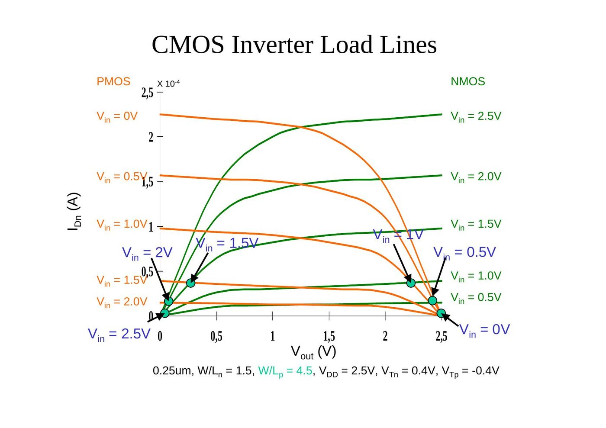
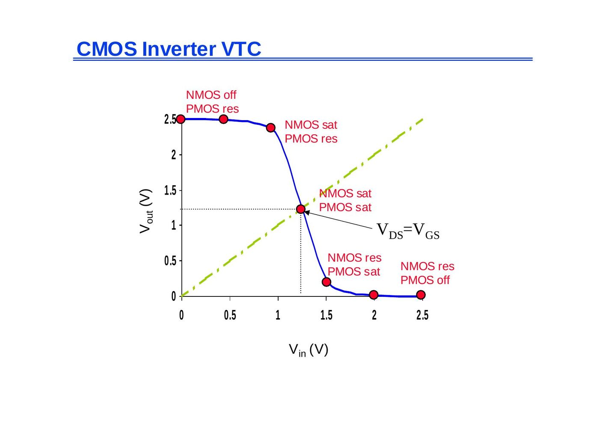
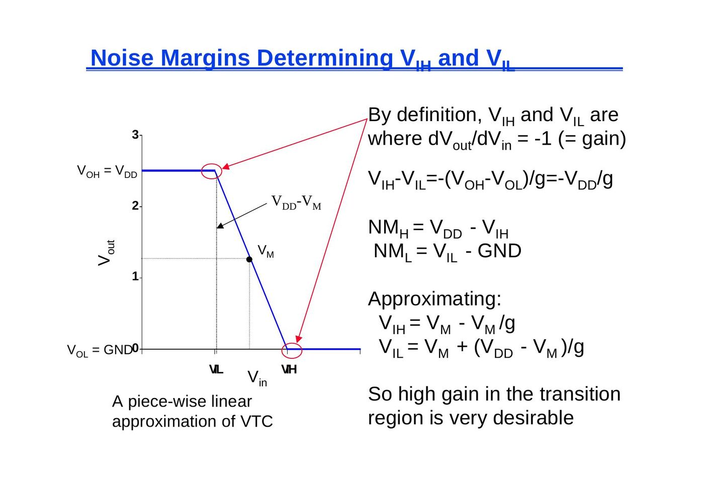
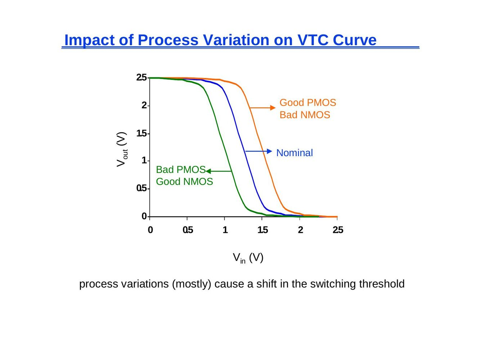
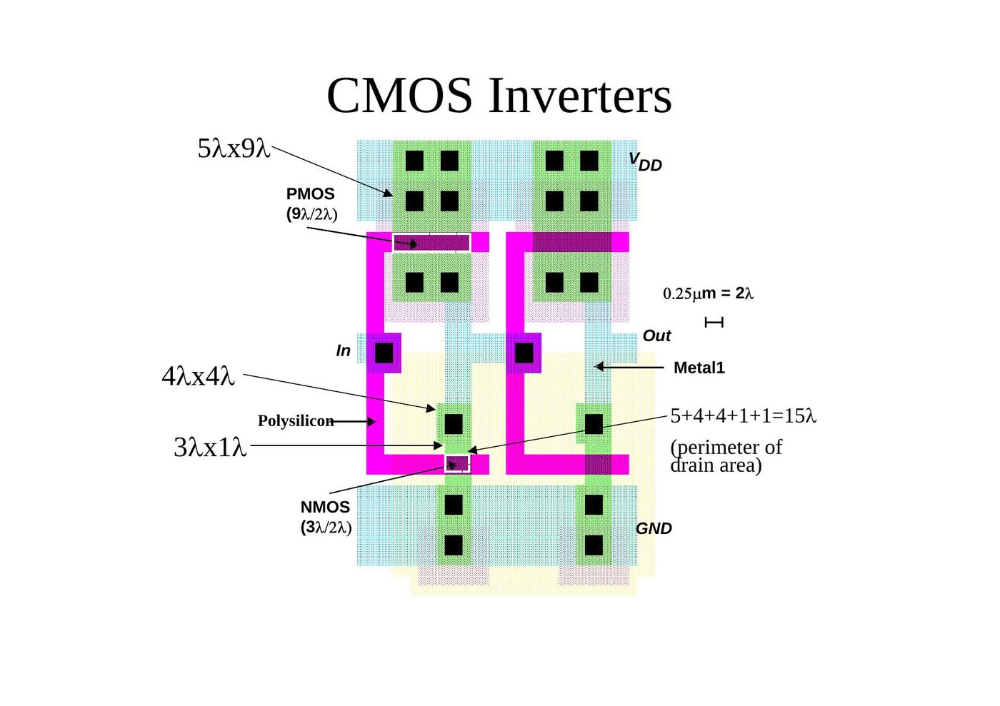
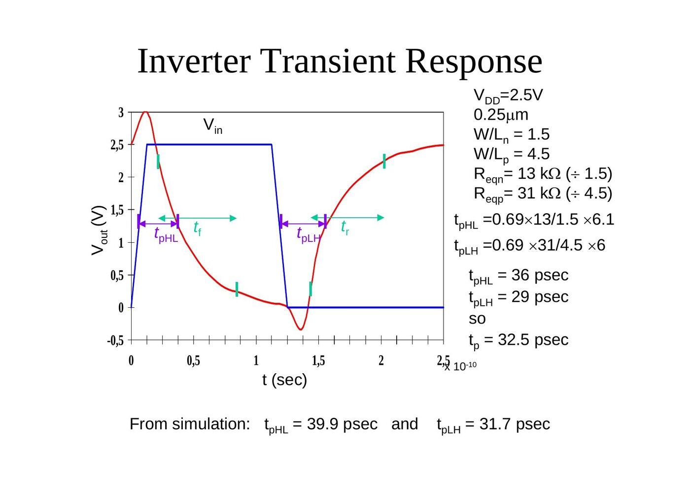
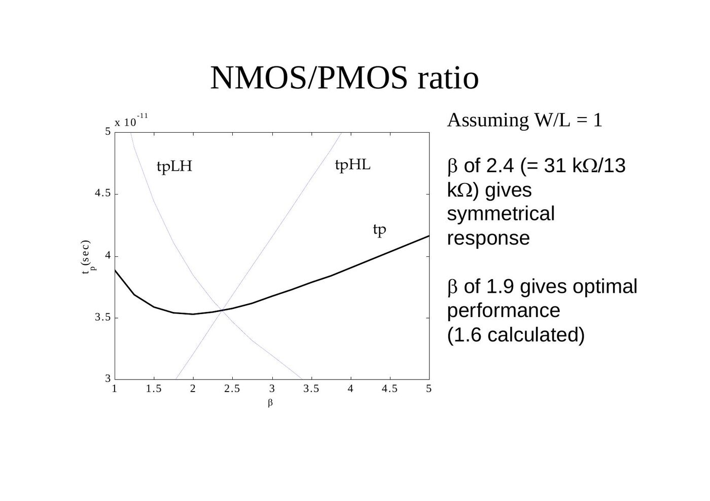
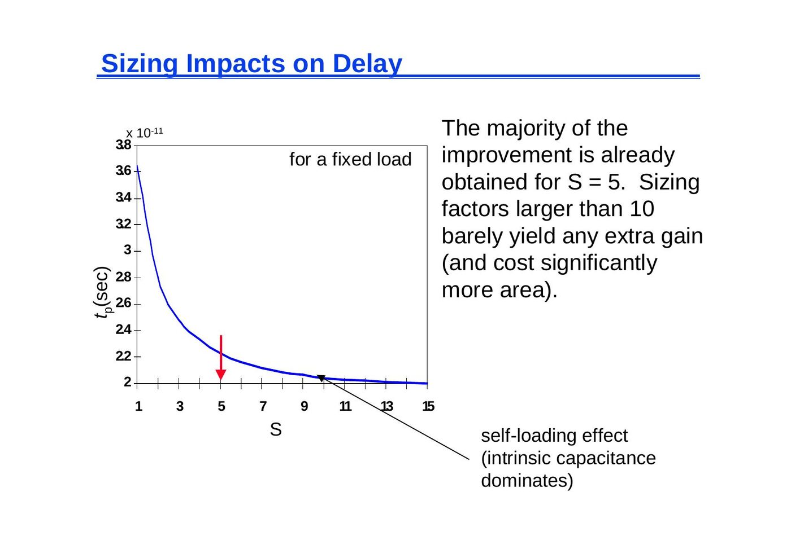
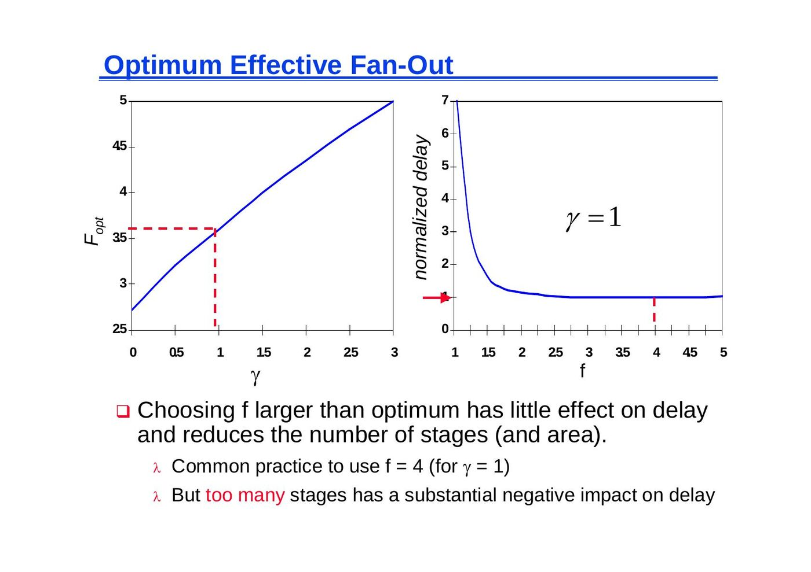

Bu yazı, Başkent Üniversitesi **EEM312 Sayısal Elektronik** dersinde Prof. Dr. Emin Akata'nın Nisan 2005'te PDF olarak dağıttığı "The CMOS Inverter" ders notunun içeriğidir. Slaytlar **Jan M. Rabaey**'in **UC Berkeley EE141 (Digital Integrated Circuits)** dersi slaytlarından derlenmiştir; aralara kaynak kitaptan alınmış birkaç şekil ve tablo ile açıklama sayfaları eklenmiştir. Slayt metinleri İngilizce olarak konu başlıklarıyla aktarıldı, formüller düz metne çevrildi; yalnız metne dökülemeyen grafikler görsel olarak kondu. Orijinal PDF yazının sonunda indirilebilir.

*Bu içerik üçüncü taraf bir kaynağa aittir; arşiv ve nostalji amacıyla kaynak belirtilerek paylaşılmıştır. Hak sahibinin talebi hâlinde kaldırılır.*

## The CMOS Inverter: a first glance

The CMOS inverter consists of a PMOS transistor (source at V_DD) and an NMOS transistor (source at GND) whose gates are tied together as the input V_in and whose drains are tied together as the output V_out, driving a load capacitance C_L.

")

### Steady-state response

- V_in = 0: the PMOS conducts (modelled as resistor R_p), the NMOS is off → V_out = 1.
- V_in = V_DD: the NMOS conducts (R_n), the PMOS is off → V_out = 0.
- V_OL = 0, V_OH = V_DD, V_M = f(R_n, R_p).

### Transient response

(a) Low-to-high: C_L charges through R_p. (b) High-to-low: C_L discharges through R_n.

t_pHL = f(R_on · C_L) = 0.69 R_on C_L

### CMOS properties

- Full rail-to-rail swing ⇒ high noise margins.
  - Logic levels not dependent upon the relative device sizes ⇒ transistors can be minimum size ⇒ *ratioless*.
- Always a path to V_DD or GND in steady state ⇒ low output impedance (output resistance in kΩ range) ⇒ large fan-out (less sensitive to noise as well).
- Extremely high input resistance (gate of MOS transistor is near perfect insulator) ⇒ nearly zero steady-state input current.
- No direct path in steady state between power and ground ⇒ no static power dissipation.
- Propagation delay is a function of load capacitance and resistance of transistors (limits fan-out).

## Load lines and the VTC

### Review: short-channel I-V plots

- NMOS transistor, 0.25 µm, L_d = 0.25 µm, W/L = 1.5, V_DD = 2.5 V, V_T = 0.4 V: I_D curves for V_GS = 1.0, 1.5, 2.0, 2.5 V (I_D up to about 2.2 × 10⁻⁴ A); in saturation the current shows a *linear dependence* on V_GS (velocity saturation).
- PMOS transistor, 0.25 µm, L_d = 0.25 µm, W/L = 1.5, V_DD = 2.5 V, V_T = −0.4 V: all polarities of all voltages and currents are reversed (V_GS = −1.0 … −2.5 V, I_D down to about −1 × 10⁻⁴ A).

### Transforming PMOS I-V lines

We want a common coordinate set V_in, V_out and I_Dn (load-line plot):

- I_DSp = −I_DSn
- V_GSn = V_in; V_GSp = V_in − V_DD
- V_DSn = V_out; V_DSp = V_out − V_DD

The PMOS curves are first mirrored around the x-axis (V_in = V_DD + V_GSp, I_Dn = −I_Dp) and then shifted horizontally over V_DD (V_out = V_DD + V_DSp).

### CMOS inverter VTC

The voltage transfer characteristic is obtained from the intersections of the load lines. Going from V_in = 0 to V_in = 2.5 V, the operating regions are: NMOS off / PMOS resistive → NMOS saturated / PMOS resistive → both saturated (around V_M, where the VTC crosses the line V_out = V_in) → NMOS resistive / PMOS saturated → NMOS resistive / PMOS off.

The response of the inverter is dominated mainly by the output capacitance of the gate C_L, which is composed of:

- drain diffusion capacitance of the PMOS and NMOS transistors,
- capacitances of connecting wires,
- input capacitance of the fan-out gates.

A fast gate is built either by keeping the output capacitance small or by decreasing the on-resistance of the transistor. The latter is achieved by increasing the W/L ratio.

### Relative transistor sizing

When designing static CMOS circuits, balance the driving strengths of the transistors by making the PMOS section wider than the NMOS section to

- maximize the noise margins and
- obtain symmetrical characteristics.

## Switching threshold

### Switching threshold as a function of transistor ratio

In the transition region both PMOS and NMOS transistors are always saturated, since V_DS = V_GS. By equating the currents through the transistors (assuming velocity saturation and ignoring channel length modulation): V_in = V_out = V_M, V_GS = V_M (NMOS), V_GS = V_M − V_DD (PMOS):

k_n V_DSATn (V_M − V_Tn − V_DSATn/2) + k_p V_DSATp (V_M − V_DD − V_Tp − V_DSATp/2) = 0

Solving for V_M yields:

V_M = [(V_Tn + V_DSATn/2) + r (V_DD + V_Tp + V_DSATp/2)] / (1 + r), with r = k_p V_DSATp / (k_n V_DSATn) = υ_satp W_p / (υ_satn W_n)

### Switching threshold for large V_DD

V_M is where V_in = V_out (both PMOS and NMOS in saturation since V_DS = V_GS). For large values of V_DD (with respect to threshold and saturation voltages):

V_M ≈ r V_DD / (1 + r), where r = k_p V_DSATp / (k_n V_DSATn)

- The switching threshold is set by the ratio r, which compares the **relative driving strengths** of the PMOS and NMOS transistors.
- For V_M to be at V_DD/2, r ≈ 1, which is equivalent to sizing the PMOS device so that (W/L)_p = (W/L)_n × (V_DSATn k'_n) / (V_DSATp k'_p).
- To move V_M upwards, a larger value of r is required, which means making the PMOS wider.

The required ratio of PMOS to NMOS transistor sizes such that the switching threshold is set to a desired value V_M:

(W/L)_p / (W/L)_n = [k'_n V_DSATn (V_M − V_Tn − V_DSATn/2)] / [k'_p V_DSATp (V_DD − V_M + V_Tp + V_DSATp/2)]

For long-channel devices or when the supply voltage is low (no velocity saturation):

V_M = [V_Tn + r (V_DD + V_Tp)] / (1 + r), r = √(−k_p / k_n)

### Switching threshold example

In our generic 0.25 µm CMOS process, using the process parameters V_DD = 2.5 V and a minimum-size NMOS device ((W/L)_n of 1.5):

|  | V_T0 (V) | γ (V^0.5) | V_DSAT (V) | k' (A/V²) | λ (V⁻¹) |
|---|---|---|---|---|---|
| NMOS | 0.43 | 0.4 | 0.63 | 115 × 10⁻⁶ | 0.06 |
| PMOS | −0.4 | −0.4 | −1 | −30 × 10⁻⁶ | −0.1 |

For V_M = 1.25 V (half of V_DD):

(W/L)_p / (W/L)_n = (115 × 10⁻⁶ / −30 × 10⁻⁶) × (0.63 / −1.0) × (1.25 − 0.43 − 0.63/2) / (1.25 − 0.4 − 1.0/2) = 3.5

(W/L)_p = 3.5 × 1.5 = 5.25 for a V_M of 1.25 V.

### Simulated inverter V_M

- V_M is relatively insensitive to variations in device ratio: setting the ratio to 3, 2.5 and 2 gives V_M's of 1.22 V, 1.18 V and 1.13 V (the simulated ratio for V_M = 1.25 V is about 3.4; x-axis semilog).
- Increasing the width of the PMOS moves V_M towards V_DD.
- Increasing the width of the NMOS moves V_M toward GND.

A modified threshold can be useful: with a noisy input signal, an inverter with a shifted switching threshold can suppress the ringing that a standard inverter passes to its output.

 Response of standard inverter, b) Response of modified threshold")

## Noise margins and gain

### Noise margins: determining V_IH and V_IL

Using a piece-wise linear approximation of the VTC:

- By definition, V_IH and V_IL are where dV_out/dV_in = −1 (= gain).
- V_IH − V_IL = −(V_OH − V_OL)/g = −V_DD/g
- NM_H = V_DD − V_IH
- NM_L = V_IL − GND
- Approximating: V_IH = V_M − V_M/g, V_IL = V_M + (V_DD − V_M)/g

So high gain in the transition region is very desirable.

### Gain determinants

Gain is a strong function of the slopes of the currents in the saturation region, for V_in = V_M (the plotted gain of the 0.25 µm inverter reaches about −17 at V_M):

g = dV_out/dV_in = −(1/I_D(V_M)) × (k_n V_DSATn + k_p V_DSATp)/(λ_n − λ_p) ≈ (1 + r) / [(V_M − V_Tn − V_DSATn/2)(λ_n − λ_p)]

The gain is determined by technology parameters, especially channel length modulation (λ). The only designer influence is through **supply voltage** and V_M (**transistor sizing**).

### Impact of process variation on the VTC curve

Process variations (mostly) cause a shift in the switching threshold: "good PMOS / bad NMOS" shifts the VTC to the right, "bad PMOS / good NMOS" to the left of the nominal curve.

### Gain as a function of V_DD

The slide compares the VTCs for decreasing supply voltages, from 2.5 V down to the very low range (V_out axis up to 0.2 V); even there the VTC keeps a steep transition, and the curve with "Gain = −1" marks the lowest usable supply.

Why don't we operate at low supply voltages?

- Reducing the supply voltage improves gain and energy dissipation, but severely degrades the delay of the gate.
- The dc characteristic becomes increasingly sensitive to variations in the device parameters.
- While it helps to reduce the internal noise (such as crosstalk), it makes the device more sensitive to external noise sources that do not scale.

To achieve sufficient gain for use in a digital circuit, the supply must be at least 4φ_T, where φ_T = kT/q. (The only way to operate CMOS inverters below 100 mV is to reduce the ambient temperature, that is, to cool the circuit.)

## Capacitances of the cascaded inverter pair

The transient behavior of a cascaded inverter pair (M1/M2 driving M3/M4) is influenced by these parasitic capacitances: the gate-drain capacitance C_gd12, the diffusion capacitances C_db1 and C_db2, the wiring capacitance C_w and the gate capacitances of the fan-out C_g3 and C_g4.

**Miller effect:** a capacitor experiencing identical but opposite voltage swings at both its terminals can be replaced by a capacitor to ground whose value is two times the original value (C_gd → 2C_gd).

**Diffusion capacitances C_db1 and C_db2:** the nonlinear junction capacitance is linearized over the voltage swing:

C_eq = K_eq C_j0

K_eq = −Φ_0^m / [(V_high − V_low)(1 − m)] × [(Φ_0 − V_high)^(1−m) − (Φ_0 − V_low)^(1−m)]

For the 2.5 V swing the junction capacitance is linearized over {2.5 V, 1.25 V} for the high-to-low and {0, 1.25 V} for the low-to-high transition. The book values quoted on the slide:

| Device / transition | Bottom plate K_eq | Sidewall K_eqsw |
|---|---|---|
| NMOS, high-to-low (V_high = −2.5 V, V_low = −1.25 V) | 0.57 (m = 0.5, Φ_0 = 0.9) | 0.61 (m = 0.44, Φ_0 = 0.9) |
| NMOS, low-to-high (V_high = −1.25 V, V_low = 0 V) | 0.79 | 0.81 |
| PMOS, high-to-low (V_low = 0, V_high = −1.25 V) | 0.79 (m = 0.48) | 0.86 (m = 0.32) |
| PMOS, low-to-high (V_low = −1.25 V, V_high = −2.5 V) | 0.59 | 0.7 |

**Gate capacitances of fan-out C_g3 and C_g4:**

C_fan-out = C_gate(NMOS) + C_gate(PMOS) = (C_GSOn + C_GDOn + W_n L_n C_ox) + (C_GSOp + C_GDOp + W_p L_p C_ox)

Inverter transistor data: NMOS W/L = 0.375/0.25, AD = 0.3 µm² (19λ²), PD = 1.875 µm (15λ), AS = 0.3 µm², PS = 1.875 µm; PMOS W/L = 1.125/0.25, AD = 0.7 µm² (45λ²), PD = 2.375 µm (19λ), AS = 0.7 µm², PS = 2.375 µm. Overlap capacitance CGDO(NMOS) = 0.31 fF/µm, CGDO(PMOS) = 0.27 fF/µm; bottom junction capacitance CJ(NMOS) = 2 fF/µm², CJ(PMOS) = 1.9 fF/µm²; sidewall junction capacitance CJSW(NMOS) = 0.28 fF/µm, CJSW(PMOS) = 0.22 fF/µm; gate capacitance C_ox(NMOS) = C_ox(PMOS) = 6 fF/µm².

The areas and perimeters follow from the layout of the inverter (0.25 µm = 2λ, PMOS 9λ/2λ, NMOS 3λ/2λ): the PMOS drain is a 5λ × 9λ region (45λ²); the NMOS drain consists of a 4λ × 4λ and a 3λ × 1λ region (19λ²), with a perimeter of 5 + 4 + 4 + 1 + 1 = 15λ.

Components of C_L (for high-to-low and low-to-high transitions):

| Capacitor | Expression | Value (fF) H→L | Value (fF) L→H |
|---|---|---|---|
| C_gd1 | 2 CGDO_n W_n | 0.23 | 0.23 |
| C_gd2 | 2 CGDO_p W_p | 0.61 | 0.61 |
| C_db1 | K_eqn AD_n CJ + K_eqswn PD_n CJSW | 0.66 | 0.90 |
| C_db2 | K_eqp AD_p CJ + K_eqswp PD_p CJSW | 1.5 | 1.15 |
| C_g3 | (CGDO_n + CGSO_n) W_n + C_ox W_n L_n | 0.76 | 0.76 |
| C_g4 | (CGDO_p + CGSO_p) W_p + C_ox W_p L_p | 2.28 | 2.28 |
| C_w | from extraction | 0.12 | 0.12 |
| C_L | Σ | 6.1 | 6.0 |

## Propagation delay

I = C dV/dt → dt = (C/I) dV → t_p = ∫ from V1 to V2 of (C_L / i) dV

Both C_L and i are nonlinear functions of V; an exact computation of this equation is very difficult. Instead, we use the simplified switch model: an RC circuit with v_out(t) = (1 − e^(−t/τ)) V, where τ = RC. The time to reach the 50% point is t = ln(2) τ = 0.69 τ.

### Inverter propagation delay

Propagation delay is proportional to the time constant of the network formed by the pull-down resistor and the load capacitance:

- t_pHL = f(R_n, C_L)
- t_pHL = ln(2) R_eqn C_L = 0.69 R_eqn C_L
- t_pLH = ln(2) R_eqp C_L = 0.69 R_eqp C_L
- t_p = (t_pHL + t_pLH)/2 = 0.69 C_L (R_eqn + R_eqp)/2

To equalize rise and fall times, make the on-resistance of the NMOS and PMOS approximately equal.

### Inverter transient response

For V_DD = 2.5 V, 0.25 µm, W/L_n = 1.5, W/L_p = 4.5, R_eqn = 13 kΩ (÷ 1.5), R_eqp = 31 kΩ (÷ 4.5):

- t_pHL = 0.69 × 13/1.5 × 6.1 = 36 ps
- t_pLH = 0.69 × 31/4.5 × 6 = 29 ps
- so t_p = 32.5 ps

From simulation: t_pHL = 39.9 ps and t_pLH = 31.7 ps.

### Delay as a function of V_DD

Ignoring channel length modulation, if V_DD >> V_Tn + V_DSATn/2:

t_pHL ≈ 0.52 C_L / [(W/L)_n k'_n V_DSATn]

that is, the delay becomes independent of V_DD. (The slide's plot shows normalized t_p versus V_DD from 0.8 V to 2.4 V; dots indicate the calculated values, assuming velocity saturation; deviation appears at low supply voltages.)

### Design for performance

- **Keep capacitances small:** good design practice requires keeping the drain diffusion areas as small as possible.
- **Increase transistor sizes:** watch out for self-loading! The intrinsic capacitance (i.e. diffusion capacitance) starts to dominate the extrinsic load (wiring and fan-out).
- **Increase V_DD:** trade-off with energy dissipation; oxide breakdown, hot carrier effects; minimal improvement above a certain level.

## NMOS/PMOS ratio

So far we have considered a widened PMOS so that its resistance matches that of the pull-down NMOS to yield a symmetrical VTC. However, this does not imply that this ratio also yields the minimum overall propagation delay. If symmetry and reduced noise margins are not of prime concern, it is possible to speed up the inverter by reducing the width of the PMOS device.

Consider two identical cascaded CMOS inverters, with the approximate load capacitance of the first gate C_L:

- C_L = (C_dp1 + C_dn1) + (C_gp2 + C_gn2) + C_w
- β = (W/L)_p / (W/L)_n → C_dp1 = β C_dn1, C_gp2 = β C_gn2
- C_L = (1 + β)(C_dn1 + C_gn2) + C_w, since t_p = 0.69 C_L (R_eqn + R_eqp)/2
- t_p = (0.69/2) [(1 + β)(C_dn1 + C_gn2) + C_w] (R_eqn + R_eqp/β) = 0.345 [(1 + β)(C_dn1 + C_gn2) + C_w] R_eqn (1 + r/β), where r = R_eqp/R_eqn

To find the optimal value of β, setting ∂t_p/∂β = 0 we find:

β_opt = √(r (1 + C_w / (C_dn1 + C_gn2))), or β_opt = √r when C_dn1 + C_gn2 >> C_w

Assuming W/L = 1: β of 2.4 (= 31 kΩ / 13 kΩ) gives a symmetrical response; β of 1.9 gives optimal performance (1.6 calculated).

Summary:

- So far we have sized the PMOS and NMOS so that the R_eq's match (ratio of 3 to 3.5): symmetrical VTC, equal high-to-low and low-to-high propagation delays.
- If speed is the only concern, reduce the width of the PMOS device! Widening the PMOS degrades t_pHL due to larger parasitic capacitance.
- β = (W/L)_p / (W/L)_n; r = R_eqp/R_eqn (resistance ratio of identically sized PMOS and NMOS); β_opt = √r when wiring capacitance is negligible.

## Device sizing for performance

The next question is how transistor sizing (sizing both NMOS and PMOS with the same ratio) impacts the performance of the gate. To answer this question we use a sizing factor S, which relates the transistor sizes of our inverter to a reference gate, typically a minimum-sized inverter.

- Divide the capacitive load C_L into C_int (intrinsic: diffusion and Miller effect) and C_ext (extrinsic: wiring and fan-out):
  - t_p = 0.69 R_eq (C_int + C_ext) = 0.69 R_eq C_int (1 + C_ext/C_int) = t_p0 (1 + C_ext/C_int)
  - where t_p0 = 0.69 R_eq C_int is the intrinsic (unloaded) delay of the gate (C_ext = 0).
- Widening both PMOS and NMOS by a factor S reduces R_eq by an identical factor (R_eq = R_ref/S), but raises the intrinsic capacitance by the same factor (C_int = S C_iref):
  - t_p = 0.69 R_ref C_iref (1 + C_ext/(S C_iref)) = t_p0 (1 + C_ext/(S C_iref))
  - t_p0 is independent of the sizing of the gate; with no load, the drive of the gate is totally offset by the increased capacitance.
  - Any S sufficiently larger than (C_ext/C_int) yields the best performance gains with least silicon area impact.

### Sizing impacts on delay

For a fixed load, the majority of the improvement is already obtained for S = 5. Sizing factors larger than 10 barely yield any extra gain (and cost significantly more area): the self-loading effect (intrinsic capacitance) dominates.

## Sizing a chain of inverters

While sizing up an inverter reduces its delay, it also increases its input capacitance. Gate sizing without taking into account its impact on the delay of the preceding gates is a purely academic enterprise. Therefore, a more relevant problem is determining the optimum sizing of a gate when embedded in a real environment.

### Impact of fan-out on delay

- Extrinsic capacitance C_ext is a function of the fan-out of the gate: the larger the fan-out, the larger the external load.
- First determine the input loading effect of the inverter. Both the input gate capacitance C_g and the intrinsic output capacitance C_int are proportional to the gate sizing, so C_int = γ C_g is independent of gate sizing and

t_p = t_p0 (1 + C_ext/(γ C_g)) = t_p0 (1 + f/γ)

i.e. the delay of an inverter is a function of the ratio between its external load capacitance and its input gate capacitance: the **effective fan-out** f = C_ext/C_g.

### Inverter chain

The real goal is to minimize the delay through an inverter chain (stages 1 … N, input capacitance C_g,1, load C_L). The delay of the j-th inverter stage is (C_W ignored):

- t_p,j = t_p0 (1 + C_g,j+1/(γ C_g,j)) = t_p0 (1 + f_j/γ)
- t_p = t_p1 + t_p2 + … + t_pN
- t_p = Σ t_p,j = t_p0 Σ (1 + C_g,j+1/(γ C_g,j)), with C_g,N+1 = C_L

If C_L is given: how should the inverters be sized, and how many stages are needed to minimize the delay?

This equation has N − 1 unknowns, C_g,2, C_g,3, … C_g,N. The minimum delay can be found by taking N − 1 partial derivatives and equating them to zero: ∂t_p/∂C_g,j = 0. The result is a set of constraints:

C_g,j+1 / C_g,j = C_g,j / C_g,j−1, with j = 2, … N

In other words, the optimum size of each inverter is the geometric mean of its neighbors' sizes: C_g,j = √(C_g,j−1 C_g,j+1).

### Sizing the inverters in the chain

- The optimum size of each inverter is the geometric mean of its neighbors, meaning that if each inverter is sized up by the same factor f with respect to the preceding gate, it will have the same effective fan-out and the same delay:
  - f = (C_L/C_g,1)^(1/N) = F^(1/N)
  - where F represents the overall effective fan-out of the circuit (F = C_L/C_g,1 = f^N),
  - and the minimum delay through the inverter chain is t_p = N t_p0 (1 + F^(1/N)/γ).
- The relationship between t_p and F is linear for one inverter, square root for two, etc.

**Example:** with C_L = 8 C_g,1 and N = 3 inverters, C_L/C_g,1 = 8 has to be evenly distributed over the three stages: f = ∛8 = 2, so the stages are sized 1, f = 2 and f² = 4.

### Determining N: optimal number of inverters

What is the optimal value for N given F (= f^N)?

- If the number of stages is too large, the intrinsic delay of the stages becomes dominant.
- If the number of stages is too small, the effective fan-out of each stage becomes dominant.

t_p = N t_p0 (1 + F^(1/N)/γ)

The optimum N is found by differentiating the minimum delay expression and setting the result to 0, giving

γ + F^(1/N) − F^(1/N) ln F / N = 0, or equivalently f = e^(1 + γ/f)

- For γ = 0 (self-loading is ignored), N = ln(F) and the effective fan-out becomes f = e = 2.71828.
- For γ = 1 (the typical case) the optimum effective fan-out (tapering factor) turns out to be close to 3.6.

Choosing f larger than the optimum has little effect on delay and reduces the number of stages (and area). Common practice is to use f = 4 (for γ = 1). But too many stages have a substantial negative impact on delay.

### Example of inverter (buffer) staging

For C_g,1 = 1 and C_L = 64 C_g,1 (t_p in units of t_p0, γ = 1):

| N | f | t_p |
|---|---|---|
| 1 | 64 | 65 |
| 2 | 8 | 18 |
| 3 | 4 | 15 |
| 4 | 2.8 | 15.3 |

### Impact of buffer staging for large C_L

| F (γ = 1) | Unbuffered | Two-stage chain | Opt. inverter chain | N |
|---|---|---|---|---|
| 10 | 11 | 8.3 | 8.3 | 2 |
| 100 | 101 | 22 | 16.5 | 4 |
| 1,000 | 1001 | 65 | 24.8 | 5 |
| 10,000 | 10,001 | 202 | 33.1 | 7 |

Impressive speed-ups with an optimized cascaded inverter chain for very large capacitive loads.

## Input signal rise/fall time

- In reality, the input signal changes gradually (and both PMOS and NMOS conduct for a brief time). This affects the current available for charging/discharging C_L and impacts propagation delay.
- t_p increases linearly with increasing input slope t_s, once t_s > t_p (simulated for a minimum-size inverter with a fan-out of a single gate).
- t_s is due to the limited driving capability of the preceding gate.

### Design challenge

- A gate is never designed in isolation: its performance is affected by both the fan-out and the driving strength of the gate(s) feeding its inputs:
  - t^i_p = t^i_step + η t^(i−1)_step (η ≈ 0.25)
- Keep signal rise times smaller than or equal to the gate propagation delays: good for performance, good for power consumption.
- Keeping rise and fall times of the signals small and of approximately equal values is one of the major challenges in high-performance designs: *slope engineering*.

## Delay with long interconnects

When gates are farther apart, wire capacitance and resistance can no longer be ignored. For a driver with intrinsic capacitance c_int driving a wire (r_w, c_w, L) and a fan-out load c_fan:

t_p = 0.69 R_dr C_int + (0.69 R_dr + 0.38 R_w) C_w + 0.69 (R_dr + R_w) C_fan, where R_dr = (R_eqn + R_eqp)/2

= 0.69 R_dr (C_int + C_fan) + 0.69 (R_dr c_w + r_w C_fan) L + 0.38 r_w c_w L²

Wire delay rapidly becomes the dominant factor (due to the quadratic term) in the delay budget for longer wires.
