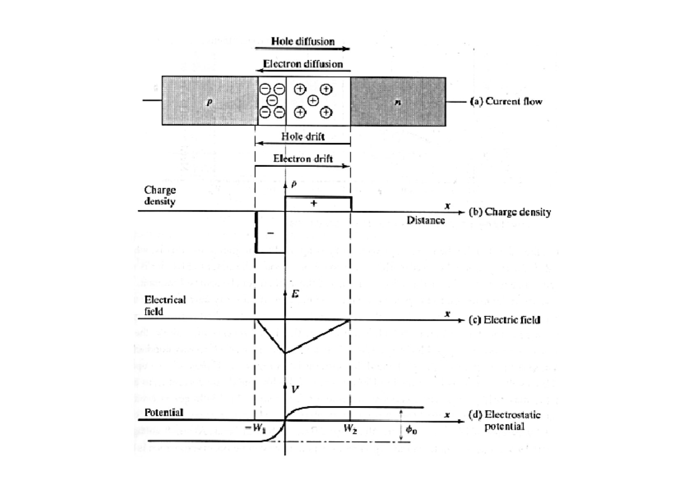
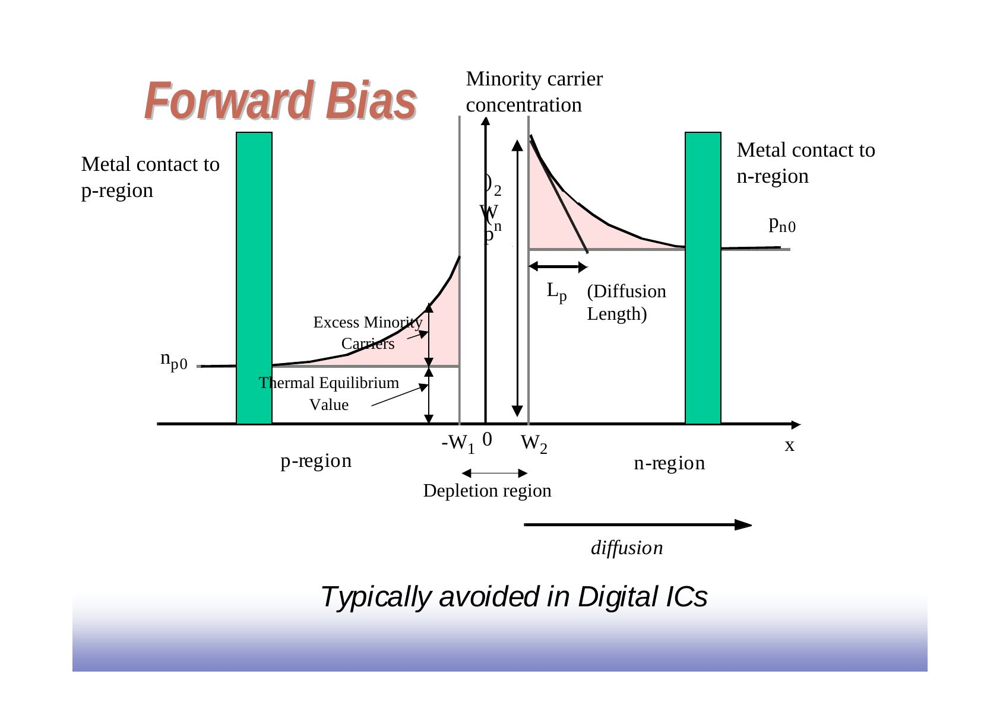
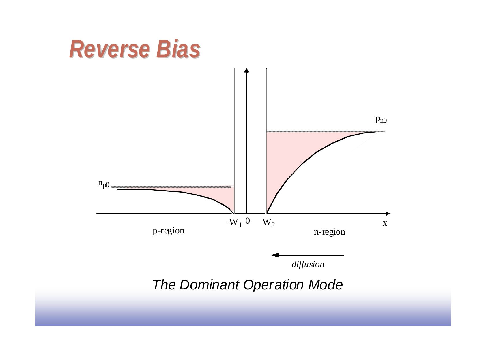
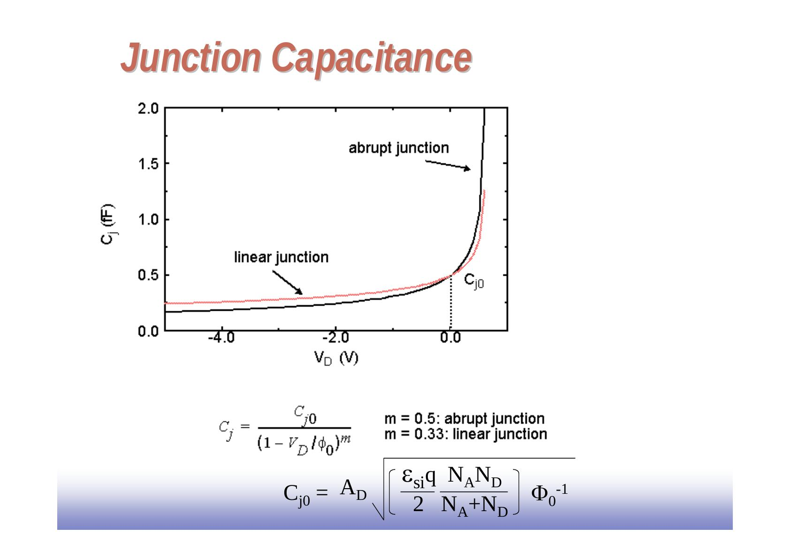
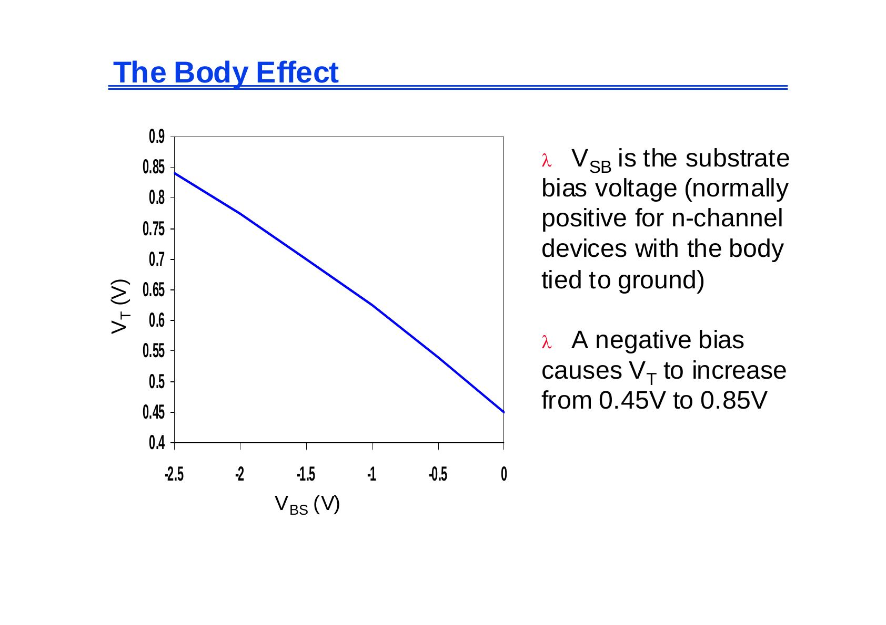
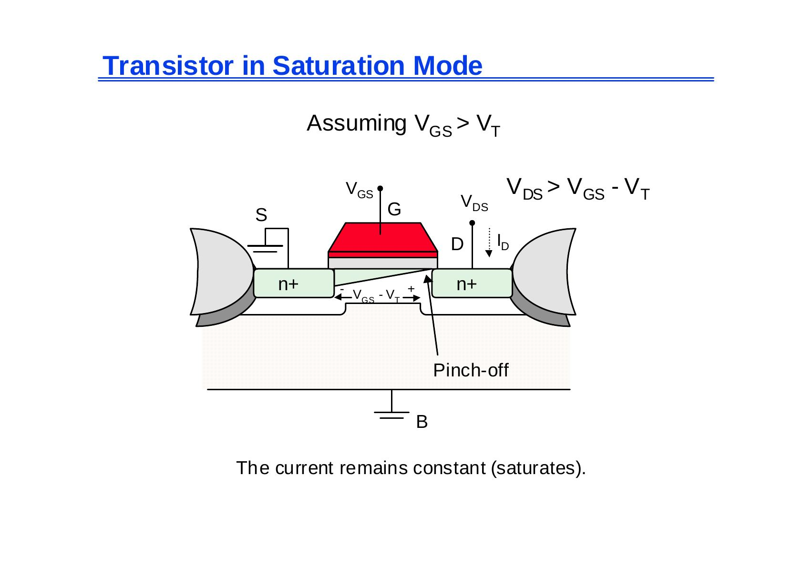

This post presents the 37-page presentation titled "The Diode," which Prof. Dr. Emin Akata distributed in the EEM312 **Digital Electronics** course at Başkent University in the spring semester of 2006. The presentation is largely based on the **UC Berkeley EE141 (Digital Integrated Circuits)** lecture slides by **Jan M. Rabaey**; the instructor's handwriting and derivations, along with a few figures taken from other textbooks, were added. The slides are in English; the content is transcribed below with explanations in English and the formulas. The original PDF can be downloaded at the end of the post. The series continues with: [MOS Transistor](/arsiv/eem312-rabaey-mos-transistor/).

*This content belongs to a third-party source; it is shared for archival and nostalgic purposes with the source credited. It will be removed upon request by the rights holder.*

## Diode

In an IC process, a p-n junction is formed by a p region inside an n substrate with aluminum contacts on top (A: anode, B: cathode). In digital integrated circuits, the diode is mostly present as a **parasitic element** (e.g., the source/drain–substrate junctions of MOS transistors).

### Forward and reverse bias

- **Forward bias:** minority carriers are injected into both sides of the junction; the excess minority carriers decay over the diffusion length (L_p) back to their equilibrium values (n_p0, p_n0). In digital ICs this mode of operation is **generally avoided**.
- **Reverse bias:** the minority carrier concentrations at the junction edge fall below their equilibrium values; in digital ICs this is the **dominant mode of operation**.

### Diode current

- I_D = I_S (e^(V_D/Φ_T) − 1)
- Built-in potential: Φ₀ = Φ_T ln(N_A N_D / n_i²)
- Thermal voltage: Φ_T = kT/q = 26 mV (300 K)
- N_A is the acceptor concentration, N_D the donor concentration; n_i ≅ 1.5 × 10¹⁰ cm⁻³ (silicon, 300 K); k = 1.38 × 10⁻²³ J/K; T = 273 + °C; q = 1.6 × 10⁻¹⁹ C

Notes:

- I_S is the saturation current and is proportional to the cross-sectional area of the diode.
- I_S depends strongly on temperature; it roughly doubles for every 5 °C increase.
- In real devices the reverse current is about 3 times larger than I_S; this is due to electron-hole pairs thermally generated in the depletion region and swept out by the electric field. The reverse current doubles every 10 °C.
- In typical silicon junctions, I_S is on the order of 10⁻¹⁷ A/µm².
- Φ₀ is also called the cut-in voltage (0.6–0.8 V).

On a linear scale, the diode current rises rapidly beyond V_D ≈ 0.7 V; on a logarithmic scale, the forward current increases with a slope of 2.3Φ_T V/decade.

**Hand-analysis models:** (a) ideal diode model I_D = I_S(e^(V_D/Φ_T) − 1); (b) first-order model: the diode, when conducting, is a voltage source of value V_Don. In an example taken from a textbook in the presentation, for a simple diode circuit with V_S = 3 V, R_S = 10 kΩ and I_S = 0.5 × 10⁻¹⁶ A, the numerical solution of the equation V_S − R_S I_D = V_D gives I_D = 0.224 mA, V_D = 0.757 V; the simple model with V_Don = 0.7 V gives V_D = 0.7 V, I_D = 0.23 mA. For this reason, it makes sense to use the simple model in the first-approximation solution.

## Depletion region

**Charge:** The space charges on the two sides of the depletion region are equal:

- −qW₁N_A A_D = qW₂N_D A_D ⇒ W₁ = −W₂ N_D/N_A … (1)
- Region width W_j = W₂ − W₁ ⇒ W₂ = W_j + W₁ … (2)
- From (1) and (2), W₂ = W_j / (1 + N_D/N_A) … (3) (W₁ is negative)
- Q_j = Q_N = qW₂N_D A_D … (4) ⇒ Q_j = q [N_A N_D/(N_A + N_D)] A_D W_j … (5)
- From device physics, W_j = √[(2ε_si/q)((N_A + N_D)/(N_A N_D))(Φ₀ − V_D)] … (6)
- Substituting (6) into (5): **Q_j = A_D √[2ε_si q (N_A N_D/(N_A + N_D)) (Φ₀ − V_D)]**

Under reverse bias, V_D is negative.

**Maximum electric field:** From Gauss's law, E = q/(ε₀A); hence

- **E_j = √[(2q/ε_si)(N_A N_D/(N_A + N_D))(Φ₀ − V_D)]**

## Junction capacitance

Since there are very few free carriers in the space-charge region, the region behaves like an insulator with dielectric constant ε_si, and the n and p regions behave like capacitor plates. Taking the derivative C_j = dQ_j/dV_D and rearranging:

- C_j = A_D √[(ε_si q/2)(N_A N_D/(N_A + N_D))(Φ₀ − V_D)⁻¹]
- At zero bias (V_D = 0): **C_j0 = A_D √[(ε_si q/2)(N_A N_D/(N_A + N_D)) Φ₀⁻¹]**
- **C_j = C_j0 / √(1 − V_D/Φ₀)**, in general C_j = C_j0/(1 − V_D/Φ₀)^m; m = 0.5 for an abrupt junction, m = 0.33 for a linearly graded junction

### Diffusion capacitance

The dynamic behavior of the diode is modeled by the nonlinear capacitance C_D, which combines the charge-storage effects of the space charge and the excess minority carriers:

- Stored excess minority carrier charge Q = τ_T I_D = τ_T I_S(e^(V_D/nΦ_T) − 1) ≅ τ_T I_S e^(V_D/nΦ_T) (for I_D ≫ I_S); n is the emission coefficient, which is 1 for most diodes, and τ_T is the mean transit time.
- C_d = dQ/dV_D; **C_D = C_j + C_d = C_j0/(1 − V_D/Φ₀)^m + (τ_T I_S/Φ_T) e^(V_D/nΦ_T)**
- C_d is significant only under forward bias; this is not the case in digital integrated circuits.

### Large-signal equivalent capacitance

The junction capacitance depends on voltage; since the voltage in digital circuits changes rapidly over the V_high–V_low range, it is more convenient to use an equivalent linear C_eq instead of the nonlinear C_j:

- C_eq = ΔQ_j/ΔV_D = [Q_j(high) − Q_j(low)] / (V_high − V_low) = K_eq C_j0
- K_eq = [−Φ₀^m / ((V_high − V_low)(1 − m))] [(Φ₀ − V_high)^(1−m) − (Φ₀ − V_low)^(1−m)]

**Diode model:** series resistance R_S, current source I_D, and parallel C_D. **Secondary effects:** avalanche breakdown at about −20 V.

## Introduction to the MOS transistor

A transistor is a switch: when V_GS ≥ V_T, it behaves like a switch with resistance R_on between the source and the drain. The MOS transistor consists of a polysilicon gate, a thin gate oxide, n+ source/drain regions, field oxide, and a p-type substrate.

")

### Threshold voltage

The value of V_GS at which strong inversion occurs is called the **threshold voltage V_T**.

- Depletion region width W_d = √(2ε_si φ/(qN_A)), its charge Q_d = √(2qN_A ε_si φ); φ is the potential at the oxide-silicon interface and N_A is the substrate doping.
- When the inversion layer is present, the depletion region charge is constant: Q_B0 = √(2qN_A ε_si |2φ_F|).
- If a substrate bias V_SB is applied, the surface potential required for strong inversion increases: Q_B = √(2qN_A ε_si (|−2φ_F| + V_SB)).

**V_T = V_T0 + γ(√|−2φ_F + V_SB| − √|−2φ_F|)**

- V_T0: threshold voltage at V_SB = 0; it mostly depends on the fabrication process (work-function difference between gate and substrate, oxide thickness, Fermi voltage, charges trapped at the surface, ion implantation dose, etc.).
- V_SB: source-bulk voltage.
- φ_F = −φ_T ln(N_A/n_i): Fermi potential (~ −0.3 V).
- γ = √(2qε_si N_A)/C_ox: body-effect coefficient; ε_si = 1.053 × 10⁻¹⁰ F/m, C_ox = ε_ox/t_ox, ε_ox = 3.5 × 10⁻¹¹ F/m.

V_SB is normally positive in n-channel devices whose body is tied to ground; a negative V_BS raises V_T from 0.45 V to 0.85 V.

### Linear and saturation regions

- **Linear region** (V_GS > V_T, V_DS < V_GS − V_T): the current is a linear function of both V_GS and V_DS (for small V_DS).
- **Saturation region** (V_DS > V_GS − V_T): the channel is pinched off at the drain end and the current remains constant (saturates).

### Derivation of the linear-region current

1. The charge in a dx-long segment of the channel: dq(x) = −C_ox W dx [V_GS − v(x) − V_T]; the charge per unit area is Q_i(x) = −C_ox[V_GS − v(x) − V_T], C_ox = ε_ox/t_ox.
1. The field at point x, E(x) = −dv(x)/dx, drives the electrons toward the drain with velocity µ_n dv(x)/dx; i = (dx/dt)(dq/dx) = µ_n (dv(x)/dx)(dq(x)/dx).
1. Substituting, I_D = −i = µ_n C_ox W [V_GS − v(x) − V_T] dv(x)/dx; both sides are integrated from 0 to L and from 0 to V_DS, respectively.
1. **I_D = (µ_n C_ox)(W/L)[(V_GS − V_T)V_DS − V_DS²/2]**

Here µ_n C_ox = k′_n is the process transconductance parameter, k_n = k′_n W/L is the gain factor, and W/L is the aspect ratio.

*Note: Some pages of the presentation (e.g., the diode circuit example, the three-dimensional structure and cross-section of the MOSFET, the i_D–v_DS curves) are figures scanned from printed textbooks; these were not included as images in the post, and only their content was summarized.*
