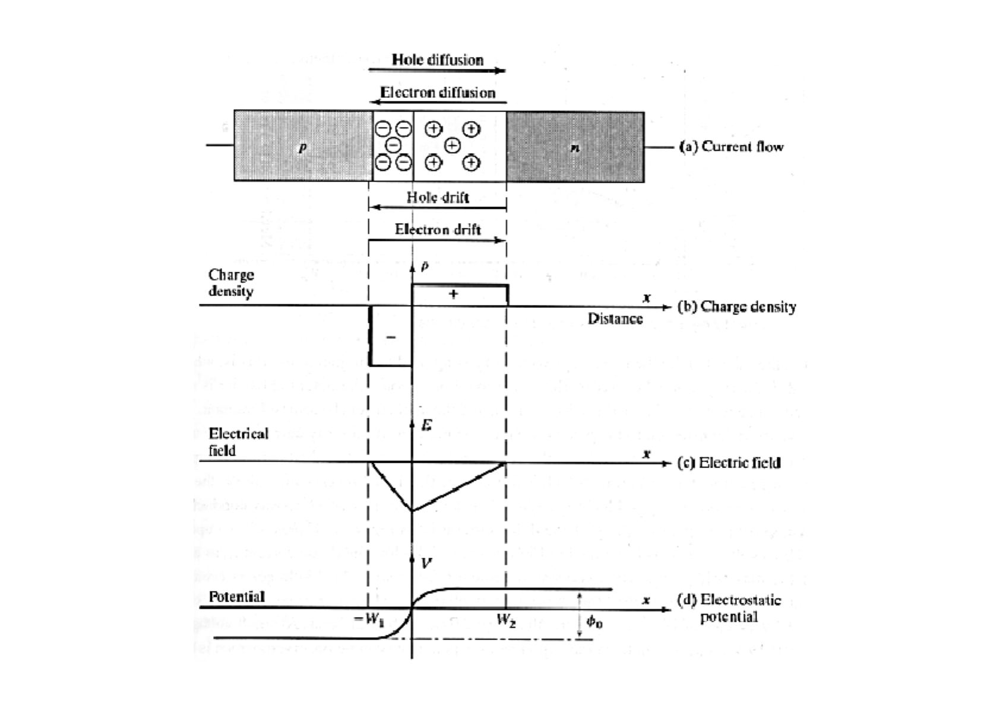
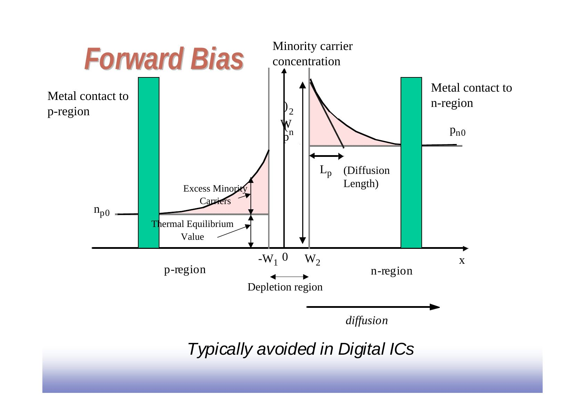
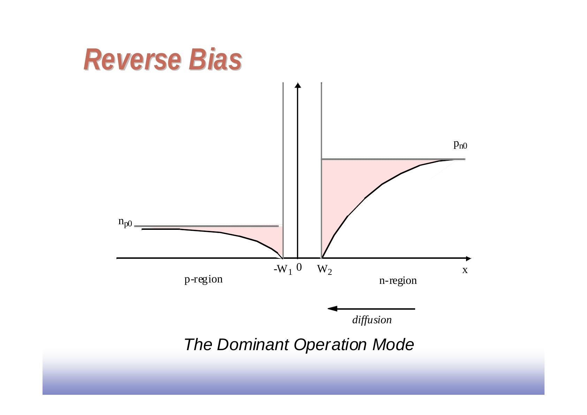
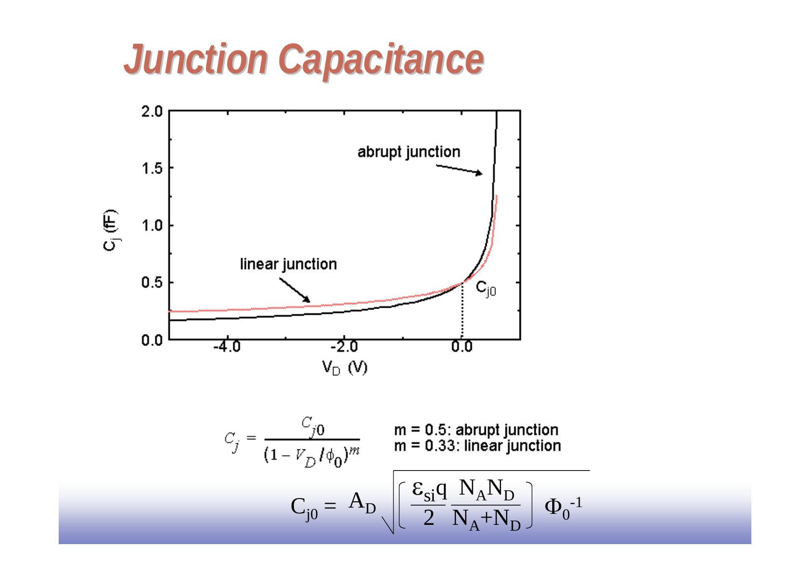
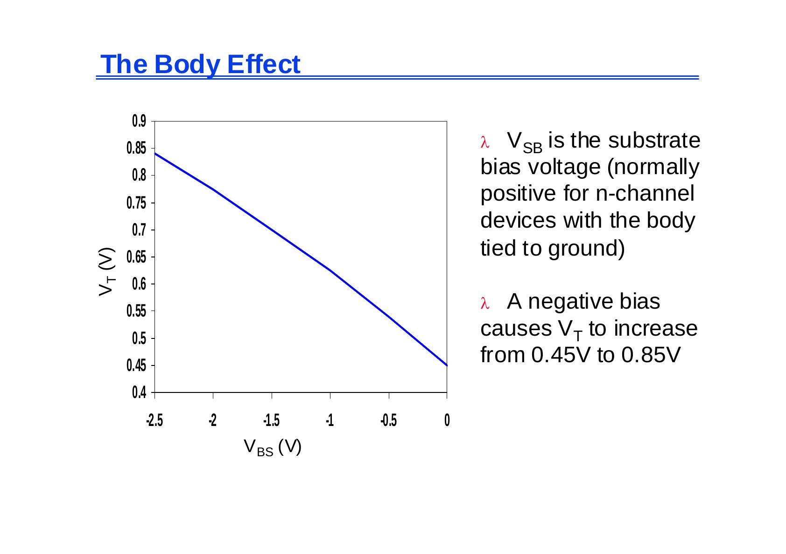
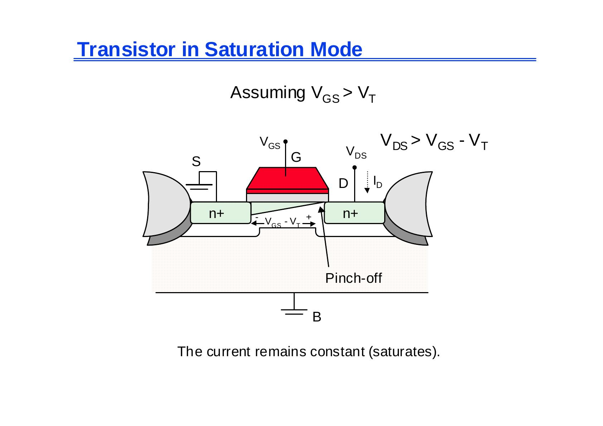

Bu yazı, Başkent Üniversitesi **EEM312 Sayısal Elektronik** dersinde Prof. Dr. Emin Akata'nın 2006 bahar döneminde dağıttığı "The Diode" başlıklı 37 sayfalık sunumu aktarıyor. Sunum büyük ölçüde **Jan M. Rabaey'in UC Berkeley EE141 (Digital Integrated Circuits)** ders slaytlarına dayanıyor; hocanın el yazısı ve formül türetmeleri ile başka ders kitaplarından alınmış birkaç şekil eklenmiş. Slaytlar İngilizce; içerik aşağıda Türkçe açıklamalarla ve formülleriyle yazıya döküldü. Orijinal PDF yazının sonunda indirilebilir. Aynı serinin devamı: [MOS Transistör](/arsiv/eem312-rabaey-mos-transistor/).

*Bu içerik üçüncü taraf bir kaynağa aittir; arşiv ve nostalji amacıyla kaynak belirtilerek paylaşılmıştır. Hak sahibinin talebi hâlinde kaldırılır.*

## Diyot

Bir IC sürecinde p-n eklemi, n alttaş içinde p bölgesi ve üzerinde alüminyum kontaklarla oluşur (A: anot, B: katot). Sayısal tümdevrelerde diyot çoğunlukla **parazitik bir eleman** olarak bulunur (ör. MOS transistörlerin source/drain–alttaş eklemleri).

### İleri ve ters kutuplama

- **İleri kutuplama:** azınlık taşıyıcıları eklemin iki yanına enjekte edilir; fazla azınlık taşıyıcıları difüzyon uzunluğu (L_p) boyunca azalarak denge değerine (n_p0, p_n0) döner. Sayısal IC'lerde **genellikle kaçınılan** çalışma biçimidir.
- **Ters kutuplama:** azınlık taşıyıcı yoğunlukları eklem kenarında denge değerinin altına düşer; sayısal IC'lerde **baskın çalışma biçimidir**.

### Diyot akımı

- I_D = I_S (e^(V_D/Φ_T) − 1)
- Yerleşik (built-in) potansiyel: Φ₀ = Φ_T ln(N_A N_D / n_i²)
- Isıl gerilim: Φ_T = kT/q = 26 mV (300 K)
- N_A alıcı, N_D verici yoğunluğu; n_i ≅ 1,5 × 10¹⁰ cm⁻³ (silisyum, 300 K); k = 1,38 × 10⁻²³ J/K; T = 273 + °C; q = 1,6 × 10⁻¹⁹ C

Notlar:

- I_S doyma akımıdır ve diyotun kesit alanıyla doğru orantılıdır.
- I_S sıcaklığa çok bağlıdır; yaklaşık her 5 °C artışta iki katına çıkar.
- Gerçek aygıtlarda ters akım I_S'den yaklaşık 3 kat büyüktür; bunun nedeni boşaltılmış bölgede ısıl olarak üretilen ve elektrik alanla süpürülen elektron-hole çiftleridir. Ters akım her 10 °C'de iki katına çıkar.
- Tipik silisyum eklemlerde I_S, 10⁻¹⁷ A/µm² mertebesindedir.
- Φ₀'a eşik (cut-in) gerilimi de denir (0,6–0,8 V).

Diyot akımı doğrusal ölçekte V_D ≈ 0,7 V'tan sonra hızla artar; logaritmik ölçekte ileri yönde akım 2,3Φ_T V/dekad eğimle artar.

**El analizi modelleri:** (a) ideal diyot modeli I_D = I_S(e^(V_D/Φ_T) − 1); (b) birinci derece model: diyot, iletimdeyken V_Don değerinde bir gerilim kaynağı. Sunumda bir ders kitabından alınmış örnekte V_S = 3 V, R_S = 10 kΩ ve I_S = 0,5 × 10⁻¹⁶ A olan basit diyot devresinde V_S − R_S I_D = V_D denkleminin sayısal çözümü I_D = 0,224 mA, V_D = 0,757 V; V_Don = 0,7 V'luk basit model ise V_D = 0,7 V, I_D = 0,23 mA veriyor. Bu yüzden ilk yaklaşım çözümünde basit model kullanmak mantıklıdır.

## Boşaltılmış bölge (depletion region)

**Yük:** Boşaltılmış bölgenin iki yanındaki uzay yükü eşittir:

- −qW₁N_A A_D = qW₂N_D A_D ⇒ W₁ = −W₂ N_D/N_A … (1)
- Bölge genişliği W_j = W₂ − W₁ ⇒ W₂ = W_j + W₁ … (2)
- (1) ve (2)'den W₂ = W_j / (1 + N_D/N_A) … (3) (W₁ negatiftir)
- Q_j = Q_N = qW₂N_D A_D … (4) ⇒ Q_j = q [N_A N_D/(N_A + N_D)] A_D W_j … (5)
- Aygıt fiziğinden W_j = √[(2ε_si/q)((N_A + N_D)/(N_A N_D))(Φ₀ − V_D)] … (6)
- (6), (5)'e konunca: **Q_j = A_D √[2ε_si q (N_A N_D/(N_A + N_D)) (Φ₀ − V_D)]**

Ters kutuplamada V_D negatiftir.

**En büyük elektrik alan:** Gauss yasasından E = q/(ε₀A); buradan

- **E_j = √[(2q/ε_si)(N_A N_D/(N_A + N_D))(Φ₀ − V_D)]**

## Eklem sığası

Uzay yükü bölgesinde serbest taşıyıcı çok az olduğundan bölge ε_si dielektrik sabitli bir yalıtkan gibi, n ve p bölgeleri de kondansatör levhaları gibi davranır. C_j = dQ_j/dV_D türevi alınıp düzenlenirse:

- C_j = A_D √[(ε_si q/2)(N_A N_D/(N_A + N_D))(Φ₀ − V_D)⁻¹]
- Sıfır kutuplamada (V_D = 0): **C_j0 = A_D √[(ε_si q/2)(N_A N_D/(N_A + N_D)) Φ₀⁻¹]**
- **C_j = C_j0 / √(1 − V_D/Φ₀)**, genel olarak C_j = C_j0/(1 − V_D/Φ₀)^m; m = 0,5 ani (abrupt), m = 0,33 doğrusal eklem

### Difüzyon sığası

Diyotun dinamik davranışı, uzay yükü ve fazla azınlık taşıyıcılarının yük depolama etkilerini birleştiren doğrusal olmayan C_D sığasıyla modellenir:

- Depolanan fazla azınlık taşıyıcı yükü Q = τ_T I_D = τ_T I_S(e^(V_D/nΦ_T) − 1) ≅ τ_T I_S e^(V_D/nΦ_T) (I_D ≫ I_S için); n çoğu diyotta 1 olan yayınım katsayısı, τ_T ortalama geçiş süresidir.
- C_d = dQ/dV_D; **C_D = C_j + C_d = C_j0/(1 − V_D/Φ₀)^m + (τ_T I_S/Φ_T) e^(V_D/nΦ_T)**
- C_d yalnız ileri kutuplamada önemlidir; sayısal tümdevrelerde bu durum söz konusu değildir.

### Büyük işaret eşdeğer sığası

Eklem sığası gerilime bağlıdır; sayısal devrelerde gerilim V_high–V_low aralığında hızla değiştiği için doğrusal olmayan C_j yerine eşdeğer doğrusal bir C_eq kullanmak daha uygundur:

- C_eq = ΔQ_j/ΔV_D = [Q_j(high) − Q_j(low)] / (V_high − V_low) = K_eq C_j0
- K_eq = [−Φ₀^m / ((V_high − V_low)(1 − m))] [(Φ₀ − V_high)^(1−m) − (Φ₀ − V_low)^(1−m)]

**Diyot modeli:** seri direnç R_S, akım kaynağı I_D ve paralel C_D. **İkincil etkiler:** yaklaşık −20 V'ta çığ kırılması (avalanche breakdown).

## MOS transistöre giriş

Transistör bir anahtardır: V_GS ≥ V_T iken source ile drain arasında R_on dirençli bir anahtar gibi davranır. MOS transistör; polisilisyum gate, ince gate oksidi, n+ source/drain bölgeleri, alan oksidi (field oxide) ve p tipi alttaştan oluşur.

")

### Eşik gerilimi

Güçlü evirtimin (strong inversion) oluştuğu V_GS değerine **eşik gerilimi V_T** denir.

- Boşaltılmış bölge genişliği W_d = √(2ε_si φ/(qN_A)), yükü Q_d = √(2qN_A ε_si φ); φ, oksit-silisyum sınırındaki potansiyel, N_A alttaş katkısıdır.
- Evirtim katmanı varken boşaltılmış bölge yükü sabittir: Q_B0 = √(2qN_A ε_si |2φ_F|).
- Alttaş kutuplaması V_SB uygulanırsa güçlü evirtim için gereken yüzey potansiyeli artar: Q_B = √(2qN_A ε_si (|−2φ_F| + V_SB)).

**V_T = V_T0 + γ(√|−2φ_F + V_SB| − √|−2φ_F|)**

- V_T0: V_SB = 0'daki eşik gerilimi; çoğunlukla üretim sürecine bağlıdır (gate ile alttaş arasındaki iş fonksiyonu farkı, oksit kalınlığı, Fermi gerilimi, yüzeyde tutulan yabancı yükler, iyon ekme dozu vb.).
- V_SB: source-bulk gerilimi.
- φ_F = −φ_T ln(N_A/n_i): Fermi potansiyeli (~ −0,3 V).
- γ = √(2qε_si N_A)/C_ox: body-effect katsayısı; ε_si = 1,053 × 10⁻¹⁰ F/m, C_ox = ε_ox/t_ox, ε_ox = 3,5 × 10⁻¹¹ F/m.

V_SB, gövdesi toprağa bağlı n kanallı aygıtlarda normalde pozitiftir; negatif V_BS, V_T'yi 0,45 V'tan 0,85 V'a yükseltir.

### Doğrusal ve doyum bölgeleri

- **Doğrusal bölge** (V_GS > V_T, V_DS < V_GS − V_T): akım hem V_GS hem V_DS'nin doğrusal fonksiyonudur (küçük V_DS'de).
- **Doyum bölgesi** (V_DS > V_GS − V_T): kanal drain ucunda kısılır (pinch-off) ve akım sabit kalır (doyar).

### Doğrusal bölge akımının türetilmesi

1. Kanalın dx'lik parçasındaki yük: dq(x) = −C_ox W dx [V_GS − v(x) − V_T]; birim alan başına yük Q_i(x) = −C_ox[V_GS − v(x) − V_T], C_ox = ε_ox/t_ox.
1. x noktasındaki alan E(x) = −dv(x)/dx elektronları µ_n dv(x)/dx hızıyla drain'e sürükler; i = (dx/dt)(dq/dx) = µ_n (dv(x)/dx)(dq(x)/dx).
1. Yerine koyunca I_D = −i = µ_n C_ox W [V_GS − v(x) − V_T] dv(x)/dx; iki taraf 0'dan L'ye ve 0'dan V_DS'ye integre edilir.
1. **I_D = (µ_n C_ox)(W/L)[(V_GS − V_T)V_DS − V_DS²/2]**

Burada µ_n C_ox = k′_n süreç geçiş iletkenliği parametresi, k_n = k′_n W/L kazanç çarpanı, W/L en-boy oranıdır.

*Not: Sunumda bazı sayfalar (ör. diyot devresi örneği, MOSFET'in üç boyutlu yapısı ve kesiti, i_D–v_DS eğrileri) basılı ders kitaplarından taranmış şekillerdir; bunlar yazıya görsel olarak alınmadı, yalnız içerikleri özetlendi.*
