Bu yazı, Başkent Üniversitesi **EEM312 Sayısal Elektronik** dersinde Prof. Dr. Emin Akata'nın Mayıs 2005'te PDF olarak dağıttığı "Designing Combinational Logic Circuits" ders notunun içeriğidir. Slaytlar **Jan M. Rabaey**'in **UC Berkeley EE141 (Digital Integrated Circuits)** dersi slaytlarından derlenmiştir (sayfalarda "EE141" altbilgisi vardır); aralara açıklama sayfaları eklenmiştir. Slayt metinleri İngilizce olarak konu başlıklarıyla aktarıldı, formüller düz metne çevrildi; yalnız metne dökülemeyen devre şemaları görsel olarak kondu. Orijinal PDF yazının sonunda indirilebilir.

*Bu içerik üçüncü taraf bir kaynağa aittir; arşiv ve nostalji amacıyla kaynak belirtilerek paylaşılmıştır. Hak sahibinin talebi hâlinde kaldırılır.*

## Combinational vs. sequential logic

- Combinational: Output = f(In).
- Sequential: Output = f(In, Previous In); the logic circuit has a feedback path through a *state* element.

## Static CMOS circuits

- At every point in time (except during the switching transients) each gate output is connected to either V_DD or V_SS via a low-resistive path.
- The outputs of the gates assume at all times the value of the Boolean function implemented by the circuit (ignoring, once again, the transient effects during switching periods).
- This is in contrast to the *dynamic* circuit class, which relies on temporary storage of signal values on the capacitance of high-impedance circuit nodes.

### CMOS circuit styles

- **Static complementary CMOS:** except during switching, the output is connected to either V_DD or GND via a low-resistance path.
  - high noise margins: full rail-to-rail swing; V_OH and V_OL are at V_DD and GND, respectively
  - low output impedance, high input impedance
  - no steady-state path between V_DD and GND (no static power consumption)
  - delay a function of load capacitance and transistor resistance
  - comparable rise and fall times (under the appropriate transistor sizing conditions)
- **Dynamic CMOS:** relies on temporary storage of signal values on the capacitance of high-impedance circuit nodes.
  - simpler, faster gates
  - increased sensitivity to noise

### Static complementary CMOS: PUN and PDN

- **Pull-up network (PUN)**, PMOS transistors only: makes a connection from V_DD to F when F(In1, In2, … InN) = 1.
- **Pull-down network (PDN)**, NMOS transistors only: makes a connection from F to GND when F(In1, In2, … InN) = 0.
- PUN and PDN are *dual* logic networks. One and only one of the networks is conducting in steady state.

 and pull-down network (NMOS)")

### Threshold drops

An NMOS in the PUN can only pull the output up to V_DD − V_Tn (0 → V_DD − V_Tn), while a PMOS pulls it fully to V_DD. Likewise a PMOS in the PDN can only pull the output down to |V_Tp| (V_DD → |V_Tp|), while an NMOS pulls it fully to 0. This is why the PUN is built from PMOS and the PDN from NMOS transistors.

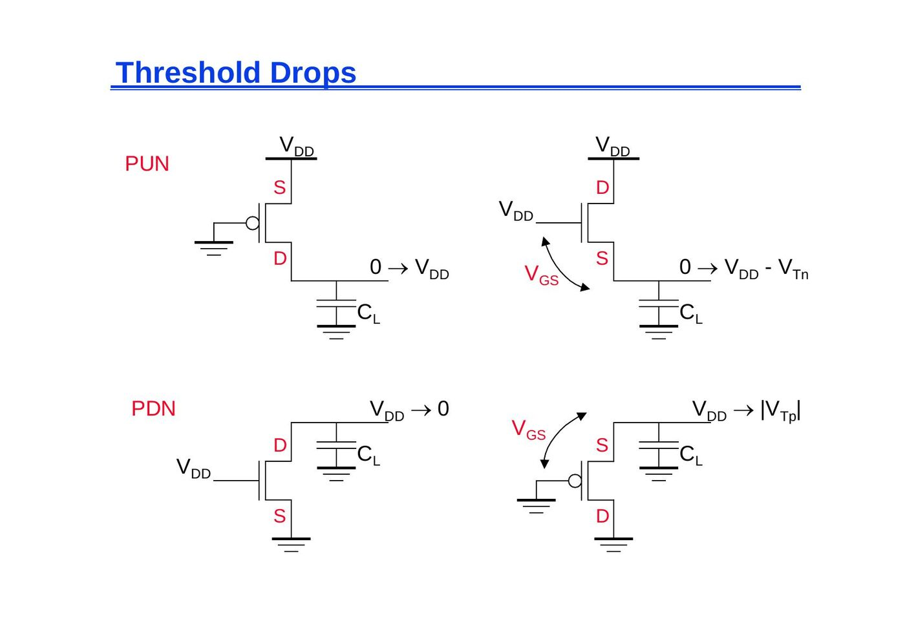

### NMOS and PMOS transistors in series/parallel connection

Transistors can be thought of as switches controlled by their gate signal.

- An NMOS switch closes when the switch control input is high: in series, Y = X if A AND B; in parallel, Y = X if A OR B. NMOS transistors pass a "strong" 0 but a "weak" 1.
- A PMOS switch closes when the switch control input is low: in series, Y = X if Ā AND B̄ = (A + B)'; in parallel, Y = X if Ā OR B̄ = (AB)'. PMOS transistors pass a "strong" 1 but a "weak" 0.

### Construction of the PDN

- NMOS devices in series implement a NAND function: (A·B)'.
- NMOS devices in parallel implement a NOR function: (A + B)'.

### Dual PUN and PDN

- PUN and PDN are dual networks (DeMorgan's theorems):
  - (A + B)' = A' · B'
  - (A · B)' = A' + B'
  - a parallel connection of transistors in the PUN corresponds to a series connection in the PDN.
- The complementary gate is naturally inverting (NAND, NOR, XNOR): AND = NAND + INV.
- The number of transistors for an N-input logic gate is 2N.

### CMOS NAND and NOR

CMOS NAND: two parallel PMOS in the PUN, two series NMOS in the PDN, F = (A·B)'.

| A | B | F (NAND) | F (NOR) |
|---|---|---|---|
| 0 | 0 | 1 | 1 |
| 0 | 1 | 1 | 0 |
| 1 | 0 | 1 | 0 |
| 1 | 1 | 0 | 0 |

CMOS NOR: two series PMOS in the PUN, two parallel NMOS in the PDN, F = (A + B)'.

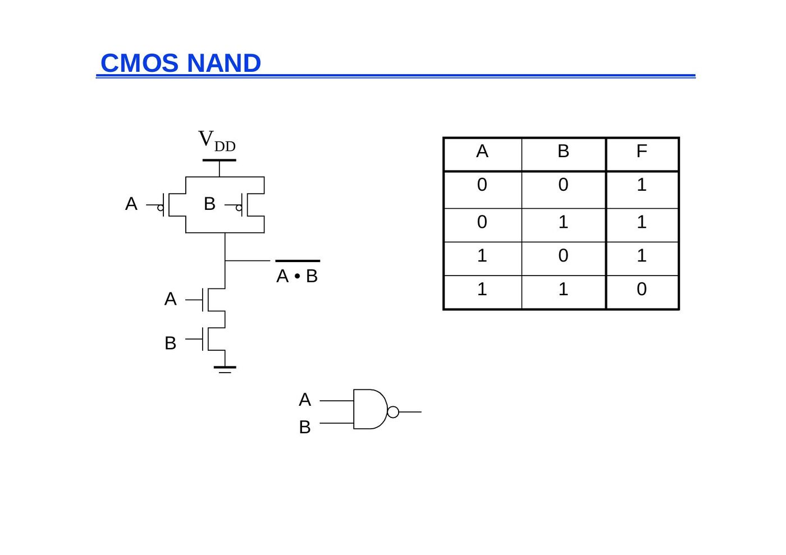

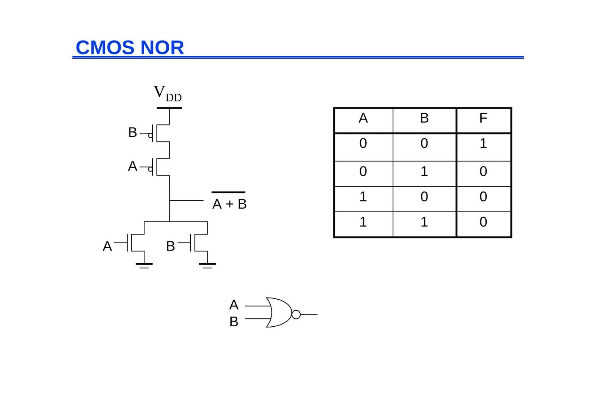

### Complex CMOS gate

OUT = (D + A·(B + C))': in the PDN, B and C are in parallel, this pair is in series with A, and the whole branch is in parallel with D. The PUN is the dual: B and C in series, in parallel with A, and this group in series with D (internal nodes SN1 … SN4).

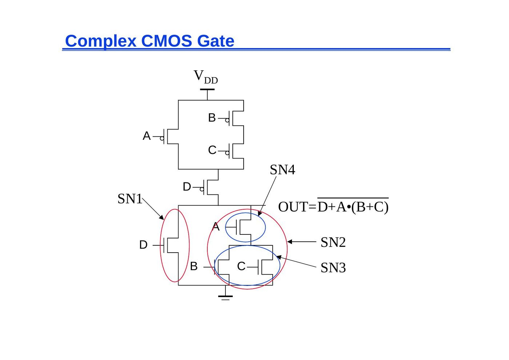

## Delay of static CMOS gates

### The VTC is data-dependent

For a 2-input NAND (NMOS 0.5 µm/0.25 µm, PMOS 0.75 µm/0.25 µm) the VTC depends on which inputs switch: A, B: 0 → 1 together; B = 1, A: 0 → 1; A = 1, B: 0 → 1 (weaker PUN when only one PMOS is on).

- The threshold voltage of M2 (upper NMOS) is higher than that of M1 due to the body effect (γ):
  - V_Tn1 = V_Tn0
  - V_Tn2 = V_Tn0 + γ(√(|2φ_F| + V_int) − √|2φ_F|)
  - since V_SB of M2 is not zero (when V_B = 0) due to the presence of C_int.

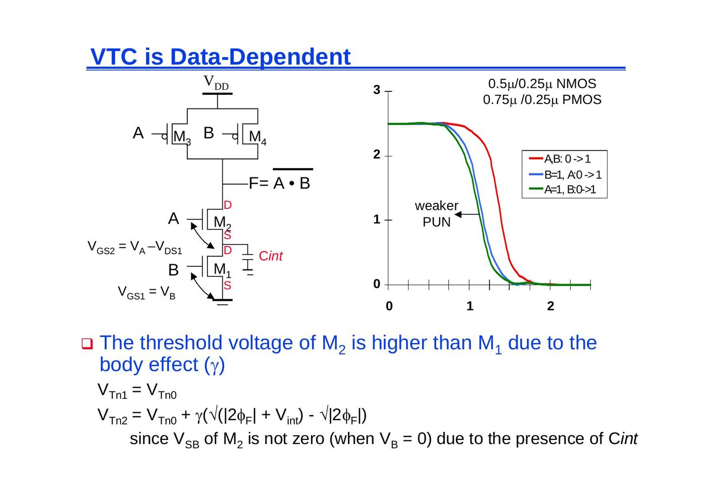

### Switch delay model

Each transistor is replaced by an equivalent resistance (R_p for PMOS, R_n for NMOS) in series with an ideal switch. For the NAND2, the two R_p are in parallel and the two R_n are in series (internal capacitance C_int between them); for the NOR2 it is the opposite.

### Input pattern effects on delay

Delay is dependent on the pattern of inputs (2-input NAND):

- Low-to-high transition:
  - both inputs go low: delay is 0.69 (R_p/2) C_L
  - one input goes low: delay is 0.69 R_p C_L
- High-to-low transition:
  - both inputs go high: delay is 0.69 · 2R_n · C_L

Adding devices in series slows down the circuit, and devices must be made wider to avoid a performance penalty. When sizing the transistors in a gate with multiple inputs, we should pick the combination of inputs that triggers the worst-case conditions. For the NAND gate to have the same pull-down delay (t_pHL) as an inverter, the NMOS devices in the PDN stack must be made twice as wide (2.5 times, if velocity saturation is effective). PMOS devices can remain unchanged. (Extra capacitance introduced by widening is ignored here, which is not a good assumption.)

### Delay dependence on input patterns

NAND gate, NMOS = 0.5 µm/0.25 µm, PMOS = 0.75 µm/0.25 µm, C_L = 100 fF:

| Input data pattern | Delay (ps) |
|---|---|
| A = B = 0 → 1 | 69 |
| A = 1, B = 0 → 1 | 62 |
| A = 0 → 1, B = 1 | 50 |
| A = B = 1 → 0 | 35 |
| A = 1, B = 1 → 0 | 76 |
| A = 1 → 0, B = 1 | 57 |

### Transistor sizing

Taking the inverter (NMOS 1, PMOS 2) as reference:

- NAND2: PMOS 2 and 2 (parallel), NMOS 2 and 2 (series).
- NOR2: PMOS 4 and 4 (series), NMOS 1 and 1 (parallel).

For the complex gate OUT = (D + A·(B + C))' the PDN sizes are A = 2, B = 2, C = 2, D = 1; the PUN sizes are B = 8, C = 8, A = 4, D = 4 (or alternatively B = 6, C = 6, A = 3, D = 6).

)'")

### Fan-in considerations

For a 4-input NAND, the PDN is a chain of 4 NMOS transistors with node capacitances C1, C2, C3 and C_L. Using the distributed RC model (Elmore delay):

t_pHL = 0.69 [R1 C1 + (R1 + R2) C2 + (R1 + R2 + R3) C3 + (R1 + R2 + R3 + R4) C_L]

Assuming all NMOS devices of equal size: t_pHL = 0.69 R_eqn (C1 + 2C2 + 3C3 + 4C_L).

Propagation delay deteriorates rapidly as a function of fan-in: quadratically in the worst case.

- t_p of a CMOS NAND as a function of fan-in (assuming a fixed fan-out of one inverter): t_pHL grows quadratically, t_pLH linearly. Gates with a fan-in greater than 4 should be avoided.
- t_p as a function of fan-out (NOR2, NAND2, INV, all with the same drive current): linear; the slope is a function of the "driving strength".
- Fan-in: quadratic due to increasing resistance and capacitance.
- Fan-out: each additional fan-out gate adds two gate capacitances to C_L.

## Fast complex gates

### Design technique 1: transistor sizing

- Transistor sizing: as long as fan-out capacitance dominates.
- Progressive sizing (distributed RC line): M1 > M2 > M3 > … > MN (the FET closest to the output is the smallest). Can reduce delay by more than 20%; decreasing gains as technology shrinks.

### Design technique 2: transistor ordering

An input signal is called "critical" if it is the last signal to assume a stable value; the path which determines the ultimate speed is called the "critical path". If the critical input drives the transistor closest to ground (M1), the delay is determined by the time to discharge C_L, C1 and C2 (all charged). If the critical input drives the transistor closest to the output (M3), C1 and C2 are already discharged and the delay is determined by the time to discharge C_L only. So put the critical signal closest to the output.

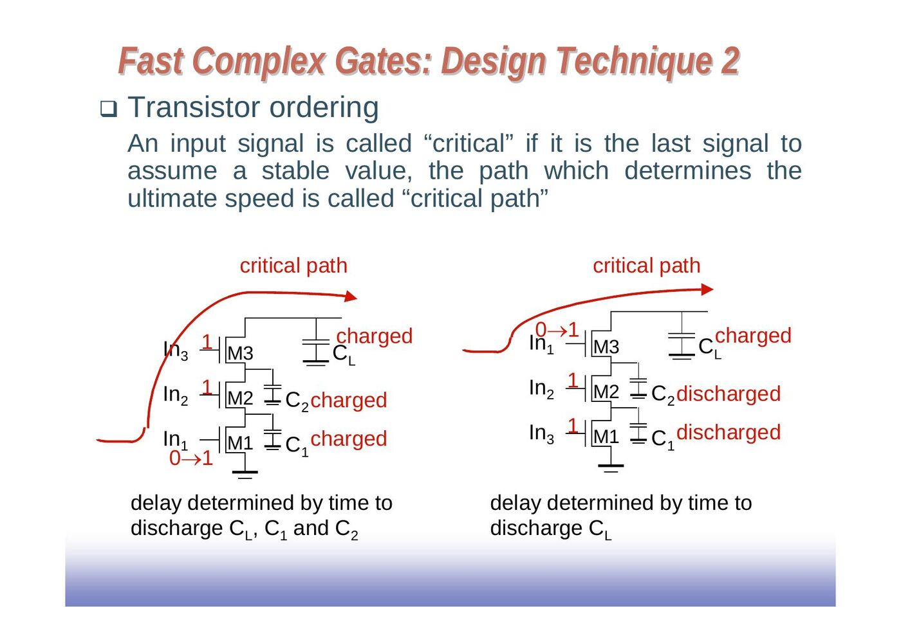

### Design technique 3: alternative logic structures

F = ABCDEFGH can be built as a single 8-input gate or as a tree of smaller NAND/NOR gates; the alternatives have different delays.

### Design technique 4: buffer insertion

Isolating fan-in from fan-out using buffer insertion: a large fan-in gate does not drive C_L directly but through an inverter chain.

## Logical effort

t_p = t_p0 (1 + C_ext/(γ C_g)) = t_p0 (1 + f/γ)

t_p = t_p0 (p + g f/γ)

- p: ratio of the intrinsic (unloaded) delays of the complex gate and the simple inverter
- g: **logical effort**, how much more input capacitance a gate presents to deliver the same output current as an inverter (how much worse it is at producing output current than an inverter)
- f: effective fan-out (C_ext/C_g) (electrical effort)

Normalize everything to an inverter: g_inv = 1, p_inv = 1; p = n for n-input NAND and NOR gates. Assume γ = 1.

- The inverter has the smallest logical effort and intrinsic delay of all static CMOS gates.
- The logical effort of a gate represents the ratio of its input capacitance to the inverter capacitance when sized to deliver the same current.
- Logical effort increases with the gate complexity.

### Delay in a logic gate

- Gate delay: d = h + p (effort delay + intrinsic delay)
- Effort delay (gate effort): h = g f (logical effort × effective fan-out, f = C_out/C_in)
- Logical effort is a function of topology, independent of sizing. Effective fan-out (electrical effort) is a function of load/gate size.

Assuming a PMOS/NMOS ratio of 2, the input capacitance of a minimum-sized symmetrical inverter equals 3 times the gate capacitance of a minimum-sized NMOS (called C_unit):

- Inverter (PMOS 2, NMOS 1): g = 1 (3 C_unit)
- 2-input NAND (PMOS 2, NMOS 2): g = 4/3 (4 C_unit)
- 2-input NOR (PMOS 4, NMOS 1): g = 5/3 (5 C_unit)

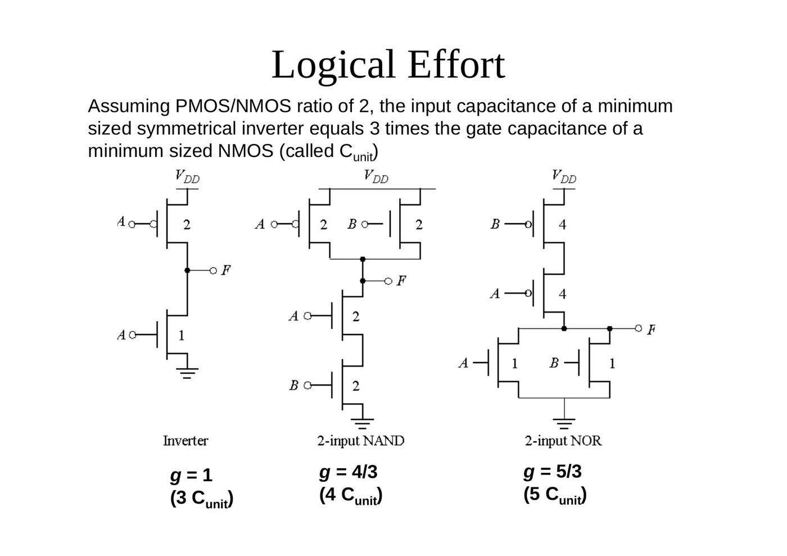

### Intrinsic delay term p

The more involved the structure of the complex gate, the higher the intrinsic delay compared to an inverter (ignoring second-order effects such as internal node capacitances):

| Gate type | p |
|---|---|
| Inverter | 1 |
| n-input NAND | n |
| n-input NOR | n |
| n-way mux | 2n |
| XOR, XNOR | n · 2^(n−1) |

### Logical effort of gates

| Gate type | 1 input | 2 inputs | 3 inputs | n inputs |
|---|---|---|---|---|
| Inverter | 1 | | | |
| NAND | | 4/3 | 5/3 | (n + 2)/3 |
| NOR | | 5/3 | 7/3 | (2n + 1)/3 |
| Multiplexer | | 2 | 2 | 2 |
| XOR | | 4 | 12 | |

For the same input capacitance, 2-input NAND and NOR gates have 4/3 and 5/3 less driving strength than the inverter.

### Delay as a function of fan-out

- NAND2: g = 4/3, p = 2, d = (4/3) f + 2; inverter: g = 1, p = 1, d = f + 1.
- The slope of the line is the logical effort of the gate (d = p + f g).
- The y-axis intercept is the intrinsic delay.
- The delay can be adjusted by adjusting the effective fan-out (by sizing) or by choosing a gate with a different logical effort.
- Gate effort: h = f g.

### Multistage networks

Total delay of a path: t_p = Σ t_p,j = t_p0 Σ (p_j + f_j g_j / γ), j = 1 … N

Using a similar procedure as for the sizing of the inverter chain (finding N − 1 partial derivatives and equating them to zero), we find that each stage should bear the same gate effort: f1 g1 = f2 g2 = … = fN gN.

Definitions:

- Path effective fan-out (path electrical effort): F = C_L / C_g1
- Path logical effort: G = g1 g2 … gN = Π g_i
- Branching effort of a logic gate on a path: b = (C_on-path + C_off-path) / C_on-path
- Path branching effort: B = Π b_i
- The path electrical effort can now be related to the electrical and branching efforts: F = Π (f_i / b_i) = Π f_i / B
- Total path effort: H = Π h_i = Π g_i f_i = G F B

From here on, the analysis can be carried out as in the case of the inverter chain. The gate effort that minimizes the path delay is h = H^(1/N), and the minimum delay through the path is

D = t_p0 (Σ p_j + N · H^(1/N) / γ)

We assume that a unit-size gate has a driving capability equal to a minimum-size inverter. This means that its input capacitance is g times larger than that of the reference inverter (C_ref). With s1 the sizing factor of the first gate in the chain, the input capacitance of the chain can be written as C_g1 = g1 s1 C_ref. Including the branching effort, the input capacitance of gate 2 will be f1/b1 times larger:

g2 s2 C_ref = (f1/b1) g1 s1 C_ref

For gate i in the chain: s_i = (g1 s1 / g_i) · Π (f_j / b_j), j = 1 … i − 1

### Example: optimize path

A path of an inverter (g = 1), a 3-input NAND a (g = 5/3), a 2-input NOR b (g = 5/3) and an inverter c (g = 1) drives a load of 5 (C_g1 = 1):

- Effective fan-out F = 5
- G = 1 × (5/3) × (5/3) × 1 = 25/9
- H = G F B (no branching) = 125/9 = 13.9
- h = H^(1/4) = 1.93
- since f1 g1 = f2 g2 = f3 g3 = f4 g4 = h: f1 = 1.93, f2 = 1.93 × (3/5) = 1.16, f3 = 1.16, f4 = 1.93
- a = s2 = f1 g1 / g2 = 1.16
- b = s3 = f1 f2 g1 / g3 = 1.34
- c = s4 = f1 f2 f3 g1 / g4 = 2.60

")

### Path logical effort variation with restructuring (8-input AND)

- (a) 8-input NAND (g = 10/3) + inverter (g = 1): G = 3.33
- (b) two 4-input NANDs (g = 2) + 2-input NOR (g = 5/3): G = 3.33
- (c) 2-input NANDs (g = 4/3) + 2-input NORs (g = 5/3) + 2-input NAND (g = 4/3) + inverter (g = 1): G = 2.96

")

## Power dissipation and switching activity

### Dynamic power consumption is data dependent

Switching activity P_0→1 has two components:

- a static component: function of the logic topology
- a dynamic component: function of the timing behavior (glitching)

P_dyn = C_L V_DD² f_0→1 = C_L V_DD² P_0→1 f = C_EFF V_DD² f

Static transition probability: P_0→1 = P_out=0 × P_out=1 = P_0 × (1 − P_0)

For a 2-input NOR gate (truth table: only A = B = 0 gives Out = 1), with input signal probabilities P_A=1 = 1/2 and P_B=1 = 1/2, the NOR static transition probability is 3/4 × 1/4 = 3/16.

N_0 and N_1 are the number of zero and one entries in the output column of the truth table of the function. Assuming that the N inputs are independent and uniformly distributed (all possible input states are equally likely):

P_0→1 = (N_0 / 2^N) × (N_1 / 2^N) = N_0 (2^N − N_0) / 2^(2N)

### NOR gate transition probabilities

Switching activity is a strong function of the input signal statistics. With P_A and P_B the probabilities that inputs A and B are one:

- P_1 = (1 − P_A)(1 − P_B)
- P_0→1 = P_0 × P_1 = (1 − (1 − P_A)(1 − P_B)) (1 − P_A)(1 − P_B)

### Transition probabilities for some basic gates

P_0→1 = P_out=0 × P_out=1:

| Gate | P_0→1 |
|---|---|
| NOR | (1 − (1 − P_A)(1 − P_B)) × (1 − P_A)(1 − P_B) |
| OR | (1 − P_A)(1 − P_B) × (1 − (1 − P_A)(1 − P_B)) |
| NAND | P_A P_B × (1 − P_A P_B) |
| AND | (1 − P_A P_B) × P_A P_B |
| XOR | (1 − (P_A + P_B − 2 P_A P_B)) × (P_A + P_B − 2 P_A P_B) |

Example: A (0.5) drives an inverter whose output X goes, together with B (0.5), into an AND gate with output Z.

- For X: P_0→1 = P_0 × P_1 = (1 − P_A) P_A = 0.5 × 0.5 = 0.25
- For Z: P_0→1 = P_0 × P_1 = (1 − P_X P_B) P_X P_B = (1 − 0.5 × 0.5) × (0.5 × 0.5) = 3/16

### Inter-signal correlations

Determining switching activity is complicated by the fact that signals exhibit correlation in space and time.

- If B is not connected to A: P(Z = 1) = P(B = 1, C = 1) = 1/4.
- Reconvergent fan-out (B = A, C = Ā): P(Z = 1) = P(C = 1 | B = 1) · P(B = 1) = 0.
- We have to use conditional probabilities.

### Glitching

In a chain of NAND gates, the outputs Out1 … Out5 show spurious transitions (glitches) before settling, because the signals arrive at the gates at different times.

### Balanced delay paths to reduce glitching

Glitching is due to a mismatch in the path lengths in the logic network; if all input signals of a gate change simultaneously, no glitching occurs. So equalize the lengths of timing paths through the logic (a tree F1, F2 → F3 instead of a chain F1 → F2 → F3).

### Logic restructuring

Logic restructuring: changing the topology of a logic network to reduce transitions. For AND: P_0→1 = P_0 × P_1 = (1 − P_A P_B) × P_A P_B. With all inputs at probability 0.5:

- Chain (A·B → W, W·C → X, X·D → F): W: (1 − 0.25) × 0.25 = 3/16, X: 7/64, F: 15/256.
- Tree (A·B → Y, C·D → Z, Y·Z → F): Y: 3/16, Z: 3/16, F: 15/256.

The chain implementation has a lower overall switching activity than the tree implementation for random inputs (this ignores glitching effects).

### Input ordering

- A (0.5) and B (0.2) first, then C (0.1): P_X = (1 − 0.5 × 0.2) × (0.5 × 0.2) = 0.09
- B (0.2) and C (0.1) first, then A (0.5): P_X = (1 − 0.2 × 0.1) × (0.2 × 0.1) = 0.0196

It is beneficial to postpone the introduction of signals with a high transition rate (signals with signal probability close to 0.5).

## Ratioed logic

A PDN is combined with a single load device: (a) resistive load R_L, (b) depletion-load NMOS (V_T < 0), (c) PMOS load (pseudo-NMOS). Nominal V_OH = V_DD but nominal V_OL ≠ 0. Goal: to reduce the number of devices over complementary CMOS.

With a resistive load:

- N transistors + load
- V_OH = V_DD
- V_OL = R_PN / (R_PN + R_L) · V_DD
- asymmetrical response
- static power consumption
- t_pL = 0.69 R_L C_L

### Pseudo-NMOS

A pseudo-NMOS NOR gate uses a PMOS with grounded gate as load: smaller area and load, but static power dissipation!

To obtain V_OL, equate the currents of the load (PMOS) and the driver (NMOS) when V_in = V_DD. It is reasonable to assume the NMOS is in the linear region (the output should be close to 0 V) and the PMOS is in saturation:

k_n ((V_DD − V_Tn) V_OL − V_OL²/2) + k_p ((−V_DD − V_Tp) V_DSATp − V_DSATp²/2) = 0

Assuming that V_OL << (V_DD − V_T), V_DSATp << (V_DD − V_T) and |V_Tn| = |V_Tp|:

V_OL ≈ k_p (V_DD + V_Tp) V_DSATp / (k_n (V_DD − V_Tn)) ≈ (μ_p W_p / μ_n W_n) V_DSATp

In order to make V_OL small, the PMOS must be sized much smaller than the NMOS. But this has a negative effect on the propagation delay. A major disadvantage of pseudo-NMOS is the static power dissipation when the output is low:

P_static = V_DD I_low ≈ V_DD k_p ((−V_DD − V_Tp) V_DSATp − V_DSATp²/2)

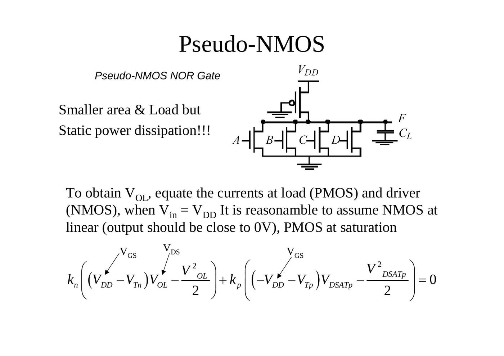

### Pseudo-NMOS VTC (inverter)

| W/L_p | V_OL (V) | P (µW) | t_pLH (ps) |
|---|---|---|---|
| 4 | 0.69 | 564 | 14 |
| 2 | 0.27 | 298 | 56 |
| 1 | 0.13 | 160 | 123 |
| 0.5 | 0.06 | 80 | 268 |
| 0.25 | 0.03 | 41 | 569 |

A wider PMOS load gives a faster rising output but a higher V_OL and more static power.

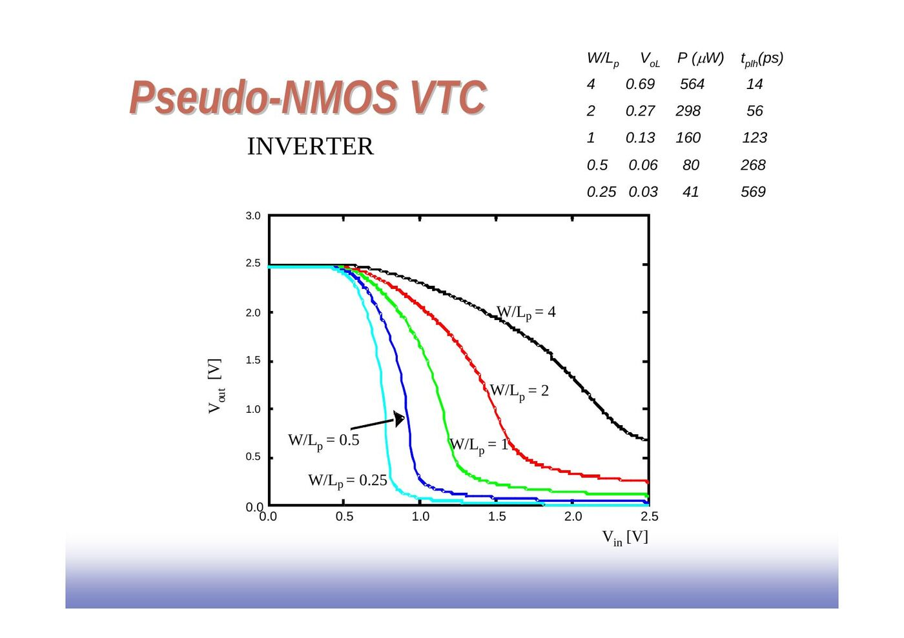

### Improved loads: DCVSL

Differential Cascode Voltage Switch Logic (DCVSL): two cross-coupled PMOS loads M1 and M2 and two complementary pull-down networks PDN1 and PDN2 driven by the inputs and their complements. One output is pulled to 0, which turns on the opposite PMOS and pulls the other output to 1; there is no static current in steady state.

")

DCVSL example, XOR-XNOR gate: Out = AB + A'B', Out' = AB' + A'B.

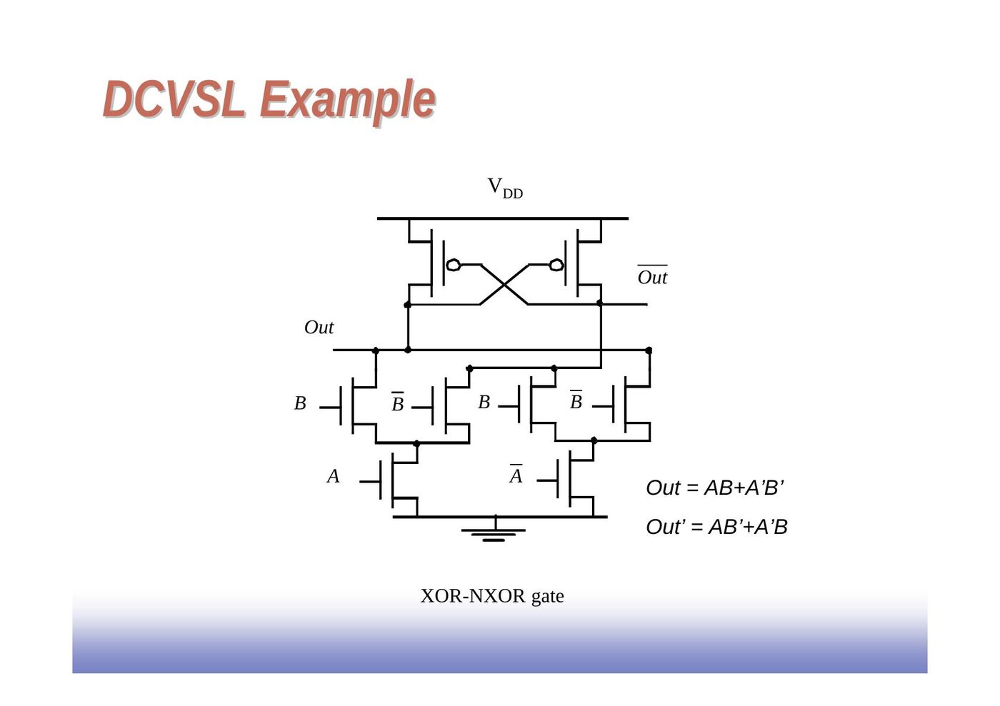

## Pass-transistor logic

### NMOS and PMOS transistors in series/parallel

- Primary inputs drive both gate and source/drain terminals.
- An NMOS switch closes when the gate input is high: in series X = Y if A and B; in parallel X = Y if A or B. Remember: NMOS transistors pass a strong 0 but a weak 1.
- A PMOS switch closes when the gate input is low: in series X = Y if Ā and B̄ = (A + B)'; in parallel X = Y if Ā or B̄ = (A·B)'. Remember: PMOS transistors pass a strong 1 but a weak 0.

### Pass-transistor logic

The inputs drive a switch network whose output feeds an inverter:

- N transistors
- no static consumption

**Example, AND gate:** one pass transistor controlled by B passes A, another controlled by B' passes 0, F = AB. It requires 4 transistors (including the inverter for B'), whereas the AND function requires 6 transistors in CMOS (NAND-INVERT).

### Pass transistor (PT) logic properties

- The gate is static: a low-impedance path exists to both supply rails under all circumstances.
- N transistors instead of 2N.
- No static power consumption.
- Ratioless.
- Bidirectional (versus unidirectional).

### NMOS-only PT driving an inverter

- V_x does not pull up to V_DD, but to V_DD − V_Tn.
- The threshold voltage drop causes static power consumption (M2 may be weakly conducting, forming a path from V_DD to GND).
- Notice that V_Tn of the pass transistor increases due to the body effect (V_SB).

### Voltage swing of a PT driving an inverter

With In = 0 → V_DD (pass transistor 0.5/0.25, inverter 1.5/0.25 and 0.5/0.25), node x only reaches 1.8 V.

- Body effect: large V_SB at x when pulling high (B is tied to GND and S is charged up close to V_DD).
- So the voltage drop is even worse: V_x = V_DD − (V_Tn0 + γ(√(|2φ_f| + V_x) − √|2φ_f|))

### Cascaded NMOS-only PTs

- If the output of one pass transistor drives the *gate* of the next: swing on y = V_DD − V_Tn1 − V_Tn2.
- If the pass transistors are in series (source to drain): swing on y = V_DD − V_Tn2.
- Pass-transistor gates should never be cascaded as in the first case.
- Logic as in the second case suffers from static power dissipation and reduced noise margins.

### VTC of the pass-transistor AND gate

For the pass-transistor AND gate (pass transistors 0.5 µm/0.25 µm, output inverter 1.5 µm/0.25 µm and 0.5 µm/0.25 µm), assuming V_M of the inverter = V_DD/2, the VTC depends on which input switches: for B = V_DD, A = 0 → V_DD the output simply follows the input, while for A = V_DD, B = 0 → V_DD and A = B = 0 → V_DD it switches more sharply. Pure pass-transistor gates are not regenerative.

### Differential PT logic (CPL)

A PT network and an inverse PT network are driven by the inputs and their complements (A, Ā, B, B̄) and produce F and F̄, each buffered by an inverter. The same topology implements AND/NAND (F = AB), OR/NOR (F = A + B) and XOR/XNOR (F = A ⊕ B); only the inputs are permuted.

: AND/NAND, OR/NOR, XOR/XNOR")

The slides also show the layout of a 4-input AND/NAND gate in CPL.

CPL properties:

- Differential, so complementary data inputs and outputs are always available (no extra inverters needed).
- Still static, since the output-defining nodes are always tied to V_DD or GND through a low-resistance path.
- Design is modular; all gates use the same topology, only the inputs are permuted.
- A simple XOR makes it attractive for structures like adders.
- Fast (assuming the number of transistors in series is small).
- Additional routing overhead for complementary signals.
- Still have static power dissipation problems.

### Level restoration

A PMOS feedback transistor M_r from V_DD to node X, controlled by the inverter output, restores the high level. When A goes high, all nodes are either 0 or V_DD. To pull node X down, M_n needs to be stronger than M_r. That requires careful transistor sizing: if R_r is too small with respect to R_n, it is impossible to bring V_x below the switching threshold of the inverter.

### Transmission gates (TGs)

- The most widely used solution for level restoration: an NMOS (gate C) and a PMOS (gate C̄) in parallel.
- With C = V_DD (C̄ = GND), A = V_DD is passed to B through the PMOS as a strong 1, and A = GND is passed through the NMOS as a strong 0.
- Full-swing bidirectional switch controlled by the gate signal C: A = B if C = 1.

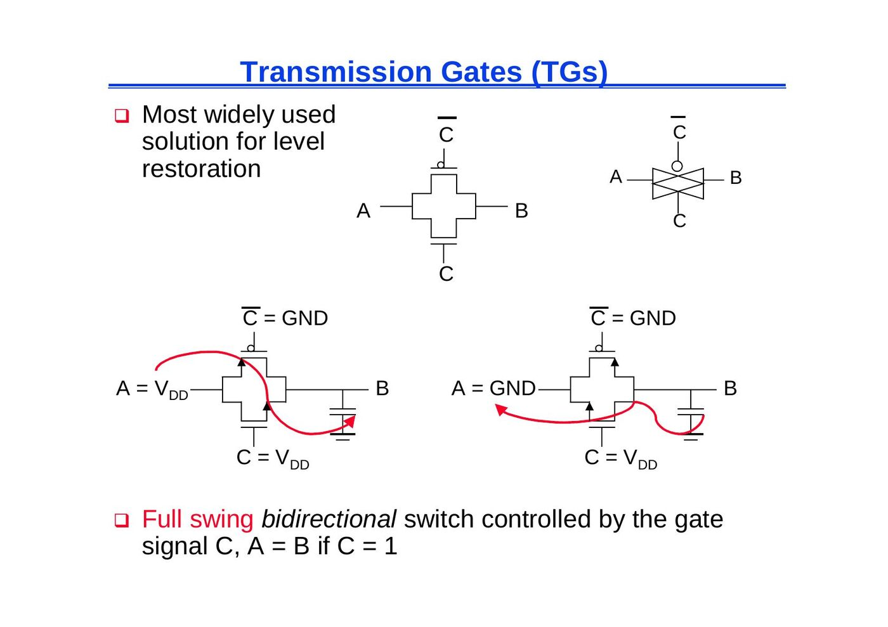

Other transmission-gate circuits on the slides:

- Transmission gate 2-input inverting multiplexer: two TGs controlled by S and S̄ select A or B, followed by an inverter (M1, M2): F = (AS + BS')'.
- Transmission gate XOR: an inverter-like pair M1/M2 supplied by B and B̄, plus a TG (M3/M4) controlled by B: F = A'B + AB'.
