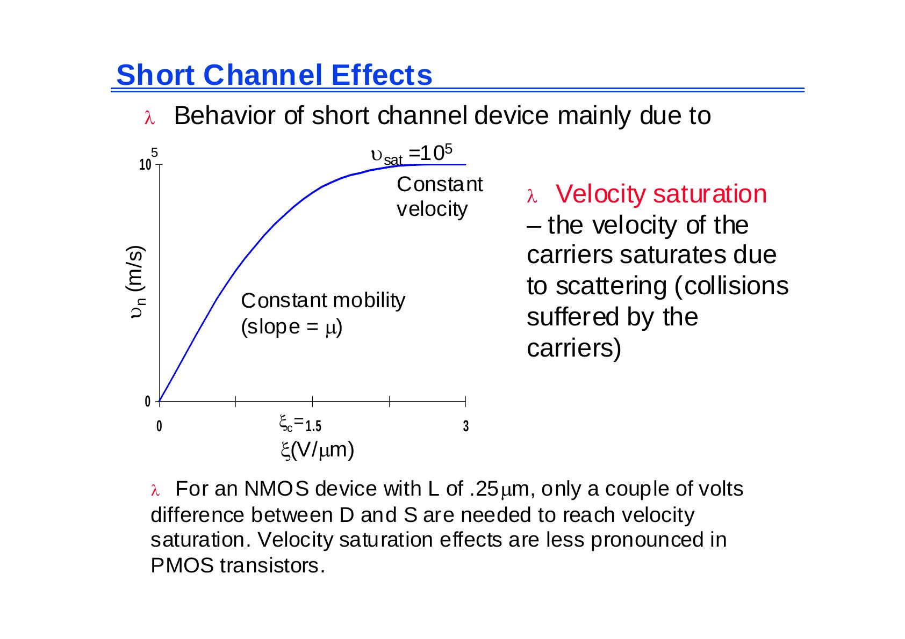
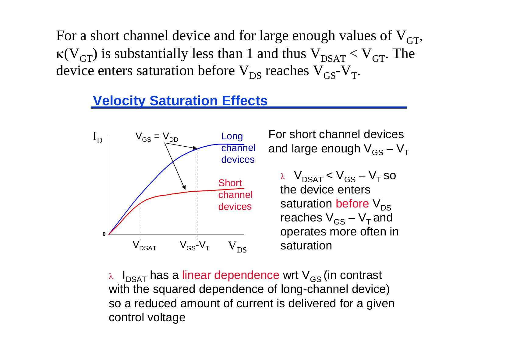
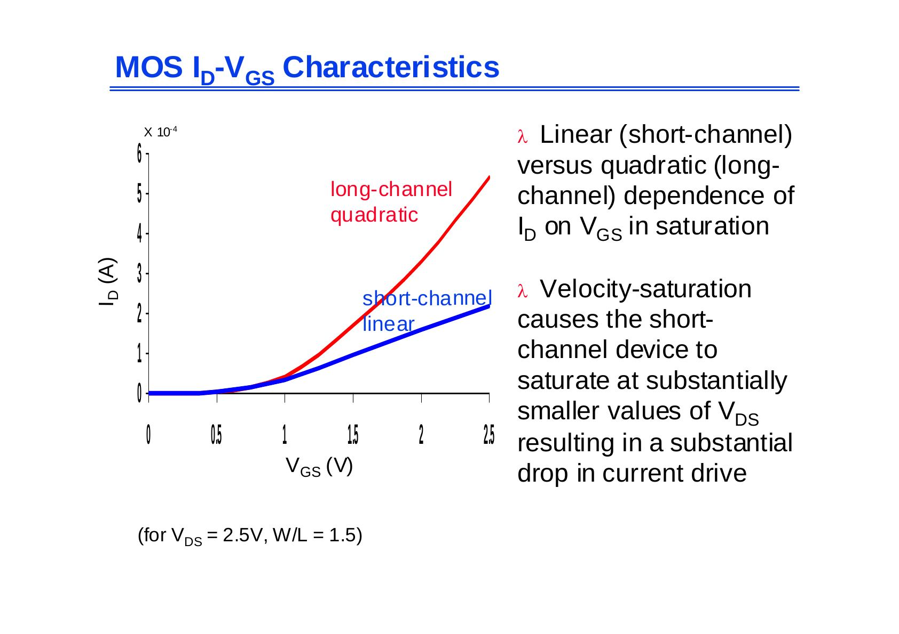
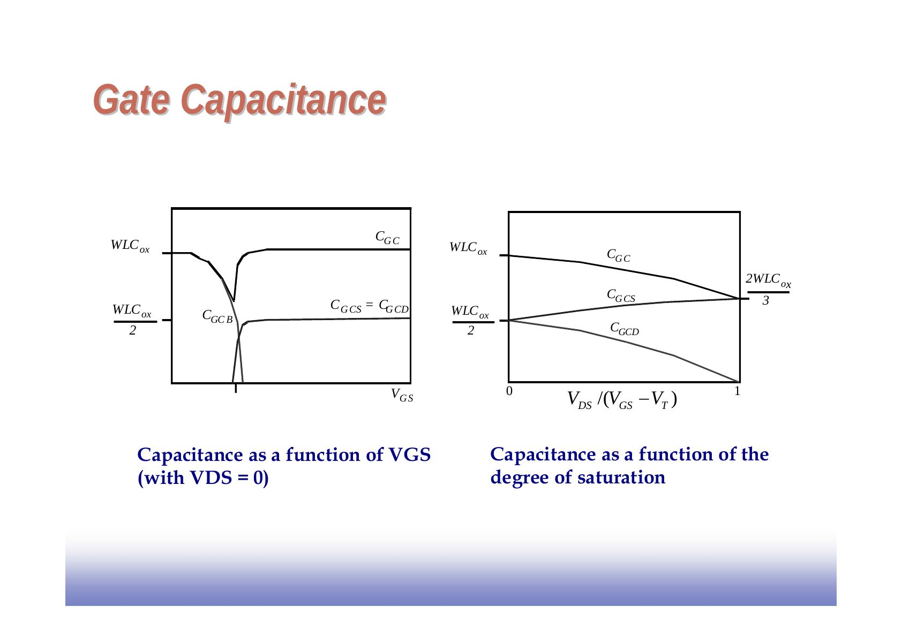
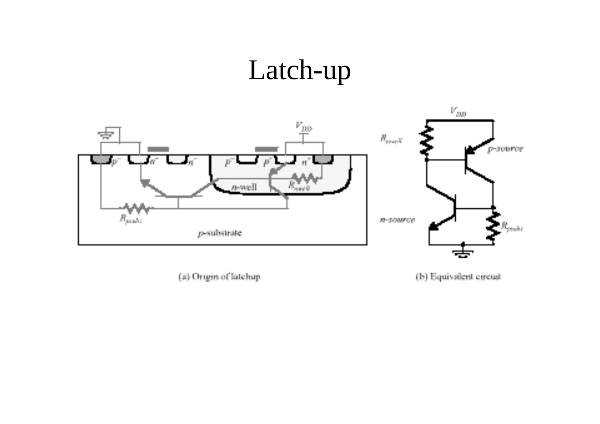

This post presents the 41-page MOS transistor presentation that Prof. Dr. Emin Akata distributed in the spring 2006 semester in the **EEM312 Digital Electronics** course at Başkent University. The presentation is largely based on the **UC Berkeley EE141 (Digital Integrated Circuits)** lecture slides by **Jan M. Rabaey**, with the instructor's derivations and explanations added. The slides are in English; the content is written up below with explanations and formulas. The original PDF can be downloaded at the end of the post. Previous part of the series: [Introduction to the Diode and the MOS Transistor](/arsiv/eem312-rabaey-diyot/).

*This content belongs to a third-party source; it is shared for archival and nostalgic purposes with the source cited. It will be removed upon the request of the rights holder.*

## Current–voltage relation in the long-channel transistor

**Linear (resistive) region** (L > 0.25 µm, V_DS ≤ V_GS − V_T):

- I_D = k′_n (W/L)[(V_GS − V_T)V_DS − V_DS²/2]
- k′_n = µ_n C_ox = µ_n ε_ox/t_ox: process transconductance parameter (µ_n is the carrier mobility, m²/Vs); k_n = k′_n W/L: the gain factor of the device
- At small V_DS there is a linear relationship between I_D and V_DS; the region takes its name from this.

**Saturation region** (V_DS ≥ V_GS − V_T): V_GS − V_T is substituted for V_DS in the expression above:

- I_D′ = (k′_n/2)(W/L)(V_GS − V_T)²
- Since the voltage between the pinch-off point and the source remains fixed at V_GS − V_T, I_D no longer depends on V_DS. However, because the effective length of the conducting channel changes with V_DS: **I_D = I_D′(1 + λV_DS)**; λ is the channel length modulation coefficient and is inversely proportional to the channel length.

A transistor in saturation behaves like an ideal current source; but as V_DS increases, the effective channel shortens and the current increases (L is in the denominator). In short transistors, channel length modulation is more pronounced because the depletion region of the drain junction occupies a larger portion of the channel; if a high-impedance current source is needed, choosing a long-channel transistor is recommended.

**Factors that determine the current** (for constant V_DS and V_GS > V_T): the source-drain distance L, the channel width W, the threshold voltage V_T, the SiO₂ thickness t_ox, the dielectric constant of the gate insulator ε_ox, and the carrier mobility (µ_n = 500 cm²/Vs for nFET, µ_p = 180 cm²/Vs for pFET).

## Velocity saturation

Very short-channel transistors deviate noticeably from the resistive and saturation models. While the carrier velocity is v_n = µ_n ξ(x), the mobility is constant; but when the lateral field reaches a critical value ξ_c, the velocity saturates because of collisions. This condition is easily met in short-channel devices.

To reach velocity saturation in an L = 0.25 µm NMOS, a difference of only a few volts between D and S is sufficient; in PMOS, velocity saturation is less pronounced.

**Approximate velocity curve:** v = µ_n ξ/(1 + ξ/ξ_c) (ξ ≤ ξ_c), v = v_sat (ξ ≥ ξ_c). Continuity of the curve at v_sat requires ξ_c = 2v_sat/µ_n. When the current expression is recalculated with this velocity expression:

- Linear (V_DS ≤ V_GS − V_T): I_D = κ(V_DS) k′_n (W/L)[(V_GS − V_T)V_DS − V_DS²/2]
- κ(V) = 1/(1 + V/(ξ_c L)): a measure of the degree of velocity saturation
- Saturation (V_DS = V_DSAT): I_DSAT = κ(V_DSAT) k′_n (W/L)[(V_GS − V_T)V_DSAT − V_DSAT²/2]
- For a long channel or small V_DS, κ → 1; for a short channel, κ < 1 and less current than expected is delivered.

From the resistive-region expression dq(x) = −C_ox W dx[V_GS − V(x) − V_T], we get I(x) = C_ox W v_n(x)[V_GS − V(x) − V_T], and in saturation I_DSAT = C_ox W v_sat [V_GS − V_DSAT − V_T]; equating these two expressions gives **V_DSAT = κ(V_GT)V_GT**, V_GT = V_GS − V_T.

In a short-channel device and at sufficiently large V_GT, κ(V_GT) is noticeably smaller than 1 and V_DSAT < V_GT: the device enters saturation before V_DS reaches V_GS − V_T and operates mostly in saturation. I_DSAT depends **linearly** on V_GS (in contrast to the quadratic dependence in the long channel); less current is delivered for a given control voltage. At V_GS = V_DS = 2.5 V, the current of the short transistor is only 40% of that of the long one (220 µA versus 540 µA).

In PMOS, all voltage and current signs are reversed (example: 0.25 µm PMOS, W/L = 1.5, V_DD = 2.5 V, V_T = −0.4 V; at V_GS = −2.5 V, I_D ≈ −1 × 10⁻⁴ A).

### Simplified model

Since the expressions found are too complicated for hand analysis, two assumptions are made:

1. The velocity saturates abruptly at ξ_c: v = µ_n ξ (ξ ≤ ξ_c), v = v_sat = µ_n ξ_c (ξ ≥ ξ_c).
1. The V_DSAT at which the critical field is reached is constant (reasonable for large V_GT): V_DSAT ≈ Lξ_c = Lv_sat/µ_n.

V_DSAT = κ(V_GT)V_GT = [ξ_c L/(ξ_c L + V_GT)]V_GT, and for large V_GT it is ≈ ξ_c L. With these assumptions, the resistive-region equations remain the same as in the long-channel model; when V_DSAT is reached, the current saturates abruptly:

- I_DSAT = µ_n C_ox (W/L)[(V_GS − V_T)V_DSAT − V_DSAT²/2], substituting µ_n/L = v_sat/V_DSAT
- **I_DSAT = v_sat C_ox W (V_GS − V_T − V_DSAT/2)**

This model is indeed first-order and empirical; it causes deviations in the transition between the linear and velocity-saturated regions.

## Subthreshold conduction

When V_GS < V_T, the transition from conduction to cutoff is gradual rather than abrupt; the current does not drop to zero immediately but decreases exponentially, as in a bipolar transistor. When there is no conducting channel, the source, bulk and drain form a parasitic npn bipolar transistor:

- I_D = I_S e^(qV_GS/(nkT)) (1 − e^(−qV_DS/(kT)))(1 + λV_DS); I_S and n are empirical parameters, with n typically around 1.5 (≥ 1)
- Slope factor S = n(kT/q) ln(10): typically 60 (n = 1) to 100 mV/decade
- The rate at which the current decreases is also affected by temperature increase; subthreshold conduction causes problems in dynamic circuits and in power consumption.

## Summary: current relations

| Region | Condition | I_D |
|---|---|---|
| Cutoff | V_GS ≤ V_T | 0 |
| Triode | V_GS > V_T, V_DS < V_GS − V_T | k_n[(V_GS − V_T)V_DS − V_DS²/2] |
| Saturation | V_GS > V_T, V_DS ≥ V_GS − V_T | (k_n/2)(V_GS − V_T)²(1 + λV_DS) |
| Velocity saturation | V_GS > V_T, V_DS ≥ V_DSAT, V_DSAT < V_GS − V_T | k_n[(V_GS − V_T)V_DSAT − V_DSAT²/2] ≈ v_sat C_ox W(V_GS − V_T − V_DSAT/2) |

k_n = k′_n W/L, k′_n = µ_n C_ox = µ_n ε_ox/t_ox, V_GT = V_GS − V_T.

### Unified hand-analysis model

- I_D = 0 (V_GT ≤ 0)
- I_D = k′(W/L)[V_GT V_min − V_min²/2](1 + λV_DS) (V_GT ≥ 0), V_min = min(V_GT, V_DS, V_DSAT)
- V_T = V_T0 + γ(√|−2φ_F + V_SB| − √|−2φ_F|)

The model is determined by the voltages at the four terminals and five device parameters (V_T0, γ, V_DSAT, k′, λ). In PMOS, all of these parameters are negative and "max" is used instead of "min". Since in digital circuits the device mostly operates in the high-current region (V_GS = V_DS = V_DD), it is important that the model fits well in this region. For 0.25 µm CMOS:

| | V_T0 (V) | γ (V^0.5) | V_DSAT (V) | k′ (A/V²) | λ (V⁻¹) |
|---|---|---|---|---|---|
| NMOS | 0.43 | 0.4 | 0.63 | 115 × 10⁻⁶ | 0.06 |
| PMOS | −0.4 | −0.4 | −1 | −30 × 10⁻⁶ | −0.1 |

The presentation also includes a comparison of the simple model with SPICE: the two curves are close in the linear, velocity-saturated and saturated regions; the V_DS = V_DSAT and V_DSAT = V_GT boundaries are marked.

## Channel resistance and the switch model

**Drain-source resistance in the linear region** (neglecting channel length modulation and velocity saturation):

- R_DS = (∂I_D/∂V_DS)⁻¹ = 1/[k_n(V_GS − V_T − V_DS)]; as V_DS → V_GS − V_T, R_DS → ∞

**In saturation** (including channel length modulation, neglecting velocity saturation): R_DS = [λ(k_n/2)(V_GS − V_T)²]⁻¹ ≅ (λI_D)⁻¹ (for constant V_GS).

**Switch model:** the transistor is modeled as a switch with infinite off resistance and a finite on resistance R_on. The resistance is inversely proportional to W/L (doubling W halves R_on); for V_DD ≫ V_T + V_DSAT/2, R_on is independent of V_DD; as V_DD approaches V_T, R_on increases rapidly. For W/L = 1 (V_GS = V_DD, V_DS: V_DD → V_DD/2):

| V_DD (V) | 1 | 1.5 | 2 | 2.5 |
|---|---|---|---|---|
| NMOS R_eq (kΩ) | 35 | 19 | 15 | 13 |
| PMOS R_eq (kΩ) | 115 | 55 | 38 | 31 |

For larger devices, R_eq is divided by W/L.

R_on is a time-varying, nonlinear quantity that depends on the operating point; the average resistance R_eq over the end points of the transition is a good constant approximation:

- R_eq = 1/(t₂ − t₁) ∫ R_on(t) dt = 1/(t₂ − t₁) ∫ V_DS(t)/I_D(t) dt ≈ ½[R_on(t₁) + R_on(t₂)]

By the definition of propagation delay, taking the discharge of a capacitance from V_DD to V_DD/2 through an NMOS in velocity saturation:

- **R_eq = (3/4)(V_DD/I_DSAT)(1 − (7/9)λV_DD)**, I_DSAT = k′(W/L)[(V_DD − V_T)V_DSAT − V_DSAT²/2]
- If the resistances at the end points are averaged and simplified with a Taylor expansion, a similar result is obtained: R_eq ≈ (3/4)(V_DD/I_DSAT)(1 − (5/6)λV_DD)

## MOS capacitances

**Overlap capacitance:** because of lateral diffusion x_d, the gate overlaps the source and drain (L_d = L − 2x_d): C_GSO = C_GDO = C_ox x_d W = C_o W.

**Gate-channel capacitance** by region:

| Region | C_GCB | C_GCS | C_GCD | C_GC | C_G |
|---|---|---|---|---|---|
| Cutoff | C_ox WL | 0 | 0 | C_ox WL | C_ox WL + 2C_o W |
| Resistive | 0 | C_ox WL/2 | C_ox WL/2 | C_ox WL | C_ox WL + 2C_o W |
| Saturation | 0 | (2/3)C_ox WL | 0 | (2/3)C_ox WL | (2/3)C_ox WL + 2C_o W |

In digital design, the most important regions are saturation and cutoff.

**Diffusion capacitance:** consists of the bottom and side wall junctions of the source/drain region:

- C_j = C_j0/(1 − V_D/φ₀)^m, C_sw = C′_sw x_j (W + 2L_s), C_jsw = C′_sw x_j
- C_diff = C_bottom + C_sw = C_j × area + C_jsw × perimeter = C_j L_s W + C_jsw(2L_s + W)

**MOSFET capacitance model:** C_GS = C_GCS + C_GSO, C_GD = C_GCD + C_GDO, C_GB = C_GCB, C_SB = C_Sdiff, C_DB = C_Ddiff.

Capacitance parameters in the 0.25 µm CMOS process:

| | C_ox (fF/µm²) | C_O (fF/µm) | C_j (fF/µm²) | m_j | φ_b (V) | C_jsw (fF/µm) | m_jsw | φ_bsw (V) |
|---|---|---|---|---|---|---|---|---|
| NMOS | 6 | 0.31 | 2 | 0.5 | 0.9 | 0.28 | 0.44 | 0.9 |
| PMOS | 6 | 0.27 | 1.9 | 0.48 | 0.9 | 0.22 | 0.32 | 0.9 |

**Parasitic resistances:** the series resistances of the source and drain regions, R_S and R_D; the figure shows the effective gate voltage V_GS,eff and the distance L_D between the drain contact and the gate, along with W.

## Hot-carrier effects, threshold variations and latch-up

**Hot-carrier effects:** a tendency toward drift over time in short-channel devices. While device dimensions keep shrinking, the supply and operating voltages have not scaled down at the same rate; the electric field and electron velocity increase. High-energy electrons enter the gate oxide and become trapped there; this leads to an increase in the threshold voltage (a decrease in PMOS) and is a long-term reliability problem. Solution: specially designed drain and source regions that limit electric field peaks, and reduced supply voltages.

**Threshold variations:** at low V_DS, the threshold voltage drops as the channel length shortens (below the long-channel threshold); at short L, the threshold drops as V_DS increases (**drain-induced barrier lowering**, DIBL). Data-dependent noise: the subthreshold leakage current becomes dependent on the data patterns on the bit line.

**Latch-up:** the last slide shows the source of latch-up: the parasitic pnp and npn transistors formed in the n-well and p-substrate in the CMOS structure (with the resistances R_nwell and R_psubs) and their equivalent circuit.

