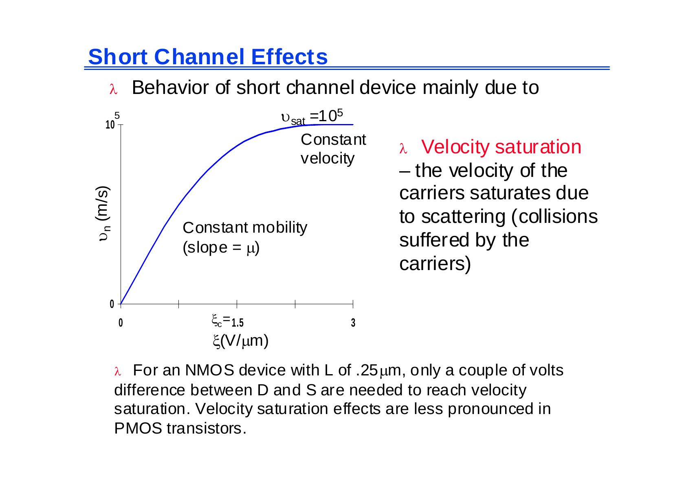
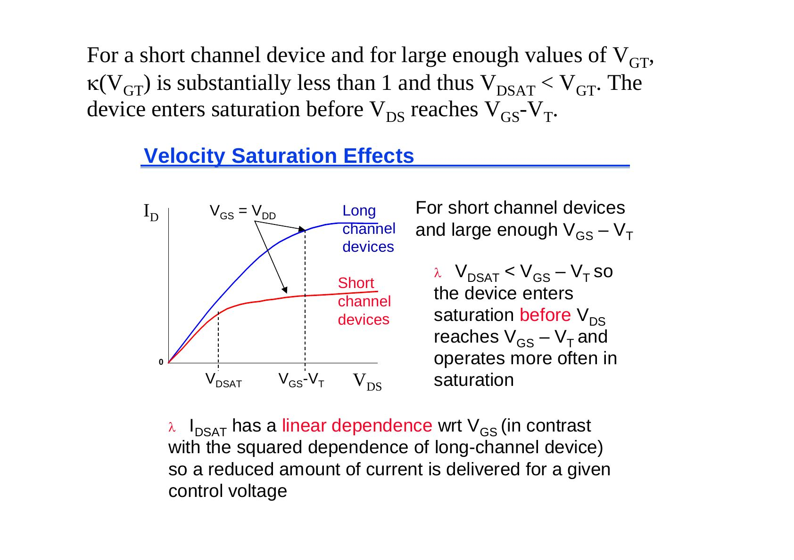
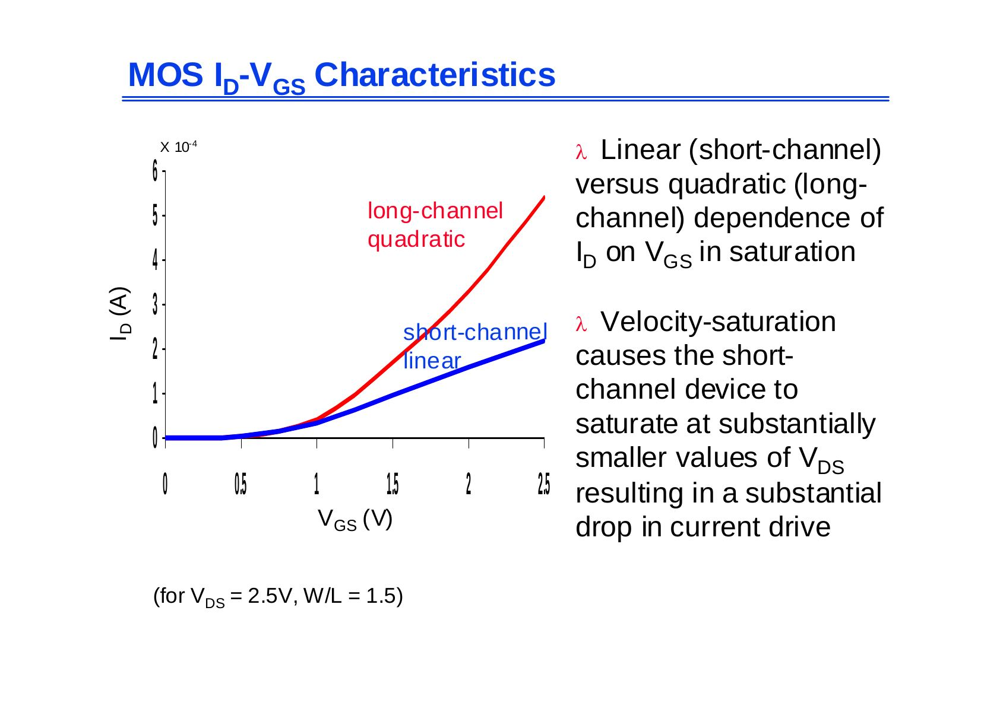
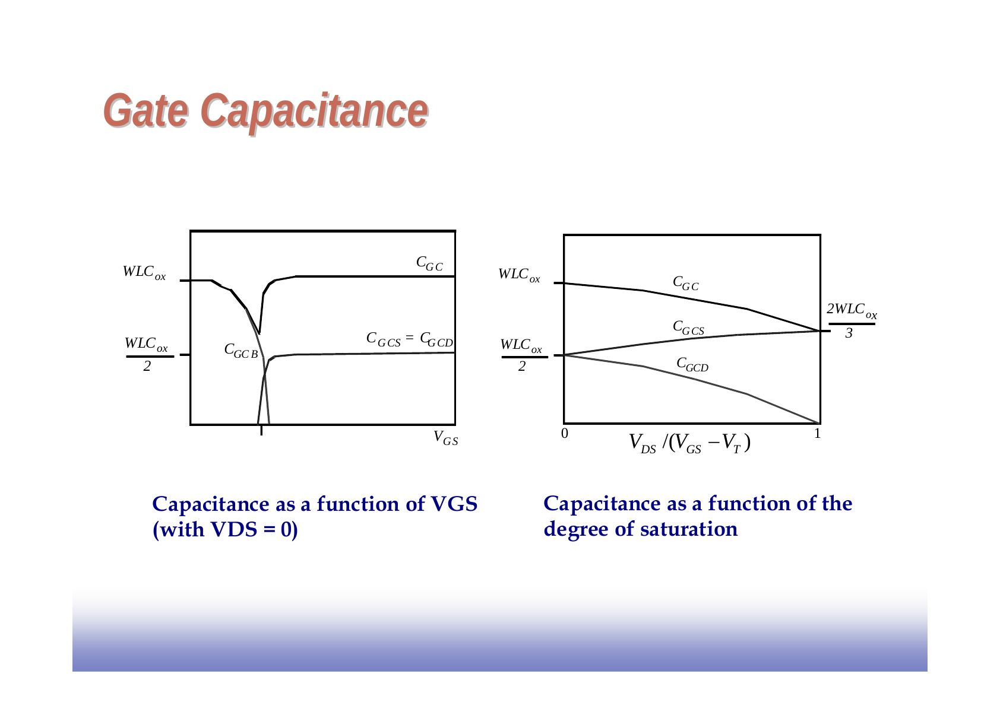
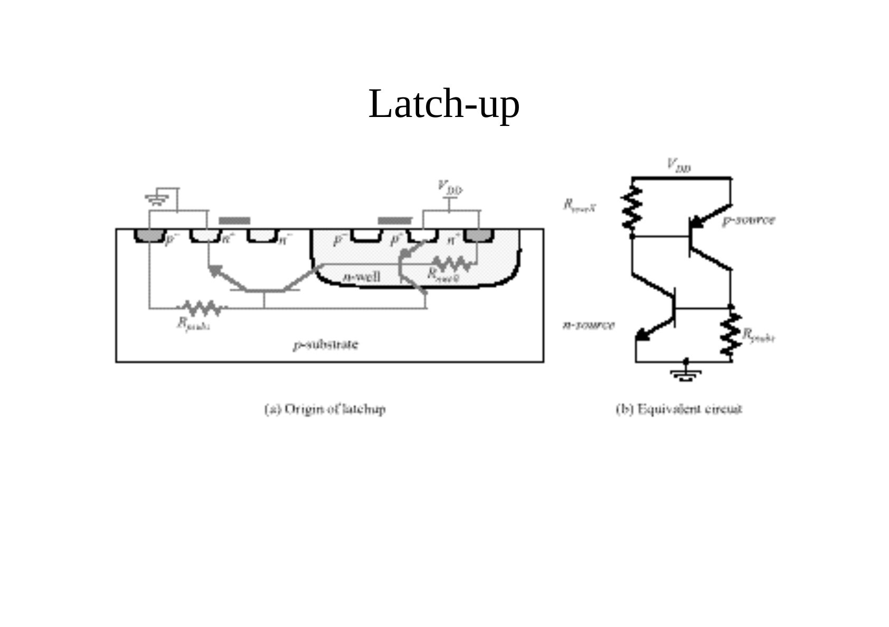

Bu yazı, Başkent Üniversitesi **EEM312 Sayısal Elektronik** dersinde Prof. Dr. Emin Akata'nın 2006 bahar döneminde dağıttığı 41 sayfalık MOS transistör sunumunu aktarıyor. Sunum büyük ölçüde **Jan M. Rabaey'in UC Berkeley EE141 (Digital Integrated Circuits)** ders slaytlarına dayanıyor; hocanın türetmeleri ve açıklamaları eklenmiş. Slaytlar İngilizce; içerik aşağıda Türkçe açıklamalarla ve formülleriyle yazıya döküldü. Orijinal PDF yazının sonunda indirilebilir. Serinin önceki bölümü: [Diyot ve MOS Transistöre Giriş](/arsiv/eem312-rabaey-diyot/).

*Bu içerik üçüncü taraf bir kaynağa aittir; arşiv ve nostalji amacıyla kaynak belirtilerek paylaşılmıştır. Hak sahibinin talebi hâlinde kaldırılır.*

## Uzun kanallı transistörde akım–gerilim bağıntısı

**Doğrusal (rezistif) bölge** (L > 0,25 µm, V_DS ≤ V_GS − V_T):

- I_D = k′_n (W/L)[(V_GS − V_T)V_DS − V_DS²/2]
- k′_n = µ_n C_ox = µ_n ε_ox/t_ox: süreç geçiş iletkenliği parametresi (µ_n taşıyıcı hareketliliği, m²/Vs); k_n = k′_n W/L: aygıtın kazanç çarpanı
- Küçük V_DS'de I_D ile V_DS arasında doğrusal ilişki vardır; bölgenin adı buradan gelir.

**Doyum bölgesi** (V_DS ≥ V_GS − V_T): yukarıdaki ifadede V_DS yerine V_GS − V_T konur:

- I_D′ = (k′_n/2)(W/L)(V_GS − V_T)²
- Kısılma (pinch-off) noktası ile source arasındaki gerilim V_GS − V_T'de sabit kaldığından I_D artık V_DS'ye bağlı değildir. Ancak iletken kanalın etkin uzunluğu V_DS ile değiştiğinden: **I_D = I_D′(1 + λV_DS)**; λ kanal boyu modülasyonu katsayısıdır ve kanal boyuyla ters orantılıdır.

Doyumdaki transistör ideal bir akım kaynağı gibi davranır; ama V_DS arttıkça etkin kanal kısalır ve akım artar (L paydadadır). Kısa transistörlerde drain ekleminin boşaltılmış bölgesi kanalın daha büyük bir kısmını kapladığından kanal boyu modülasyonu daha belirgindir; yüksek empedanslı bir akım kaynağı gerekiyorsa uzun kanallı transistör seçmek önerilir.

**Akımı belirleyenler** (sabit V_DS ve V_GS > V_T için): source-drain uzaklığı L, kanal genişliği W, eşik gerilimi V_T, SiO₂ kalınlığı t_ox, gate yalıtkanının dielektrik sabiti ε_ox ve taşıyıcı hareketliliği (nFET için µ_n = 500 cm²/Vs, pFET için µ_p = 180 cm²/Vs).

## Hız doyumu (velocity saturation)

Çok kısa kanallı transistörler rezistif ve doyum modellerinden belirgin biçimde sapar. Taşıyıcı hızı v_n = µ_n ξ(x) iken hareketlilik sabittir; ama yatay alan kritik bir ξ_c değerine ulaşınca çarpışmalar nedeniyle hız doyar. Bu koşul kısa kanallı aygıtlarda kolayca sağlanır.

L = 0,25 µm'lik bir NMOS'ta hız doyumuna ulaşmak için D ile S arasında yalnızca birkaç voltluk fark yeterlidir; PMOS'ta hız doyumu daha az belirgindir.

**Yaklaşık hız eğrisi:** v = µ_n ξ/(1 + ξ/ξ_c) (ξ ≤ ξ_c), v = v_sat (ξ ≥ ξ_c). Eğrinin v_sat'ta sürekli olması ξ_c = 2v_sat/µ_n gerektirir. Akım ifadesi bu hız ifadesiyle yeniden hesaplanınca:

- Doğrusal (V_DS ≤ V_GS − V_T): I_D = κ(V_DS) k′_n (W/L)[(V_GS − V_T)V_DS − V_DS²/2]
- κ(V) = 1/(1 + V/(ξ_c L)): hız doyumunun derecesinin ölçüsü
- Doyum (V_DS = V_DSAT): I_DSAT = κ(V_DSAT) k′_n (W/L)[(V_GS − V_T)V_DSAT − V_DSAT²/2]
- Uzun kanalda ya da küçük V_DS'de κ → 1; kısa kanalda κ < 1 ve beklenenden az akım verilir.

Rezistif bölgedeki dq(x) = −C_ox W dx[V_GS − V(x) − V_T] ifadesinden I(x) = C_ox W v_n(x)[V_GS − V(x) − V_T], doyumda I_DSAT = C_ox W v_sat [V_GS − V_DSAT − V_T]; bu iki ifade eşitlenince **V_DSAT = κ(V_GT)V_GT**, V_GT = V_GS − V_T.

Kısa kanallı aygıtta ve yeterince büyük V_GT'de κ(V_GT) 1'den belirgin biçimde küçüktür ve V_DSAT < V_GT olur: aygıt V_DS, V_GS − V_T'ye ulaşmadan doyuma girer ve daha çok doyumda çalışır. I_DSAT, V_GS'ye **doğrusal** bağlıdır (uzun kanaldaki karesel bağımlılığın aksine); belli bir kontrol gerilimi için daha az akım verilir. V_GS = V_DS = 2,5 V'ta kısa transistörün akımı uzun olanınkinin yalnızca %40'ı kadardır (220 µA'e karşı 540 µA).

PMOS'ta tüm gerilim ve akım işaretleri terstir (örnek: 0,25 µm PMOS, W/L = 1,5, V_DD = 2,5 V, V_T = −0,4 V; V_GS = −2,5 V'ta I_D ≈ −1 × 10⁻⁴ A).

### Basitleştirilmiş model

Bulunan ifadeler el analizi için karmaşık olduğundan iki varsayım yapılır:

1. Hız ξ_c'de birden doyar: v = µ_n ξ (ξ ≤ ξ_c), v = v_sat = µ_n ξ_c (ξ ≥ ξ_c).
1. Kritik alanın oluştuğu V_DSAT sabittir (büyük V_GT için makul): V_DSAT ≈ Lξ_c = Lv_sat/µ_n.

V_DSAT = κ(V_GT)V_GT = [ξ_c L/(ξ_c L + V_GT)]V_GT ve büyük V_GT'de ≈ ξ_c L. Bu varsayımlarla rezistif bölge denklemleri uzun kanal modeliyle aynı kalır; V_DSAT'a ulaşılınca akım birden doyar:

- I_DSAT = µ_n C_ox (W/L)[(V_GS − V_T)V_DSAT − V_DSAT²/2], µ_n/L = v_sat/V_DSAT konunca
- **I_DSAT = v_sat C_ox W (V_GS − V_T − V_DSAT/2)**

Bu model gerçekten birinci derece ve deneyseldir; doğrusal ve hız doyumlu bölgeler arasındaki geçişte sapmalara yol açar.

## Eşik altı iletim (subthreshold conductance)

V_GS < V_T iken iletimden kesime geçiş ani değil, kademelidir; akım hemen sıfıra düşmez, bipolar transistördeki gibi üstel olarak azalır. İletken kanal yokken source, bulk ve drain parazitik bir npn bipolar transistör oluşturur:

- I_D = I_S e^(qV_GS/(nkT)) (1 − e^(−qV_DS/(kT)))(1 + λV_DS); I_S ve n deneysel parametreler, n tipik olarak 1,5 civarı (≥ 1)
- Eğim çarpanı S = n(kT/q) ln(10): tipik 60 (n = 1) ile 100 mV/dekad
- Akımın azalma hızı sıcaklık artışından da etkilenir; eşik altı iletim dinamik devrelerde ve güç tüketiminde sorun yaratır.

## Özet: akım bağıntıları

| Bölge | Koşul | I_D |
|---|---|---|
| Kesim | V_GS ≤ V_T | 0 |
| Triyot | V_GS > V_T, V_DS < V_GS − V_T | k_n[(V_GS − V_T)V_DS − V_DS²/2] |
| Doyum | V_GS > V_T, V_DS ≥ V_GS − V_T | (k_n/2)(V_GS − V_T)²(1 + λV_DS) |
| Hız doyumu | V_GS > V_T, V_DS ≥ V_DSAT, V_DSAT < V_GS − V_T | k_n[(V_GS − V_T)V_DSAT − V_DSAT²/2] ≈ v_sat C_ox W(V_GS − V_T − V_DSAT/2) |

k_n = k′_n W/L, k′_n = µ_n C_ox = µ_n ε_ox/t_ox, V_GT = V_GS − V_T.

### Birleşik (unified) el analizi modeli

- I_D = 0 (V_GT ≤ 0)
- I_D = k′(W/L)[V_GT V_min − V_min²/2](1 + λV_DS) (V_GT ≥ 0), V_min = min(V_GT, V_DS, V_DSAT)
- V_T = V_T0 + γ(√|−2φ_F + V_SB| − √|−2φ_F|)

Model dört uçtaki gerilimlerle ve beş aygıt parametresiyle (V_T0, γ, V_DSAT, k′, λ) belirlenir. PMOS'ta bu parametrelerin hepsi negatiftir ve "min" yerine "max" kullanılır. Sayısal devrelerde aygıt çoğunlukla yüksek akım bölgesinde (V_GS = V_DS = V_DD) çalıştığından modelin bu bölgede iyi uyması önemlidir. 0,25 µm CMOS için:

| | V_T0 (V) | γ (V^0,5) | V_DSAT (V) | k′ (A/V²) | λ (V⁻¹) |
|---|---|---|---|---|---|
| NMOS | 0,43 | 0,4 | 0,63 | 115 × 10⁻⁶ | 0,06 |
| PMOS | −0,4 | −0,4 | −1 | −30 × 10⁻⁶ | −0,1 |

Sunumda basit modelin SPICE ile karşılaştırması da var: doğrusal, hız doyumlu ve doymuş bölgelerde iki eğri yakın; V_DS = V_DSAT ve V_DSAT = V_GT sınırları işaretli.

## Kanal direnci ve anahtar modeli

**Doğrusal bölgede drain-source direnci** (kanal boyu modülasyonu ve hız doyumu ihmal):

- R_DS = (∂I_D/∂V_DS)⁻¹ = 1/[k_n(V_GS − V_T − V_DS)]; V_DS → V_GS − V_T iken R_DS → ∞

**Doyumda** (kanal boyu modülasyonu dahil, hız doyumu ihmal): R_DS = [λ(k_n/2)(V_GS − V_T)²]⁻¹ ≅ (λI_D)⁻¹ (sabit V_GS için).

**Anahtar modeli:** transistör, sonsuz kesim direnci ve sonlu R_on iletim direnci olan bir anahtar gibi modellenir. Direnç W/L ile ters orantılıdır (W'yi iki katına çıkarmak R_on'u yarıya indirir); V_DD ≫ V_T + V_DSAT/2 için R_on V_DD'den bağımsızdır; V_DD, V_T'ye yaklaştıkça R_on hızla artar. W/L = 1 için (V_GS = V_DD, V_DS: V_DD → V_DD/2):

| V_DD (V) | 1 | 1,5 | 2 | 2,5 |
|---|---|---|---|---|
| NMOS R_eq (kΩ) | 35 | 19 | 15 | 13 |
| PMOS R_eq (kΩ) | 115 | 55 | 38 | 31 |

Daha büyük aygıtlar için R_eq, W/L'ye bölünür.

R_on zamanla değişen, doğrusal olmayan ve çalışma noktasına bağlı bir büyüklüktür; geçişin uç noktalarındaki ortalama direnç R_eq iyi bir sabit yaklaşımdır:

- R_eq = 1/(t₂ − t₁) ∫ R_on(t) dt = 1/(t₂ − t₁) ∫ V_DS(t)/I_D(t) dt ≈ ½[R_on(t₁) + R_on(t₂)]

Yayılım gecikmesi tanımı gereği, bir sığanın V_DD'den V_DD/2'ye hız doyumundaki bir NMOS üzerinden boşalması alınırsa:

- **R_eq = (3/4)(V_DD/I_DSAT)(1 − (7/9)λV_DD)**, I_DSAT = k′(W/L)[(V_DD − V_T)V_DSAT − V_DSAT²/2]
- Uç noktalardaki dirençlerin ortalaması alınıp Taylor açılımıyla sadeleştirilirse benzer sonuç: R_eq ≈ (3/4)(V_DD/I_DSAT)(1 − (5/6)λV_DD)

## MOS sığaları

**Örtüşme (overlap) sığası:** yanal difüzyon x_d nedeniyle gate, source ve drain'in üzerine taşar (L_d = L − 2x_d): C_GSO = C_GDO = C_ox x_d W = C_o W.

**Gate-kanal sığası** bölgeye göre:

| Bölge | C_GCB | C_GCS | C_GCD | C_GC | C_G |
|---|---|---|---|---|---|
| Kesim | C_ox WL | 0 | 0 | C_ox WL | C_ox WL + 2C_o W |
| Rezistif | 0 | C_ox WL/2 | C_ox WL/2 | C_ox WL | C_ox WL + 2C_o W |
| Doyum | 0 | (2/3)C_ox WL | 0 | (2/3)C_ox WL | (2/3)C_ox WL + 2C_o W |

Sayısal tasarımda en önemli bölgeler doyum ve kesimdir.

**Difüzyon sığası:** source/drain bölgesinin taban (bottom) ve yan duvar (side wall) eklemlerinden oluşur:

- C_j = C_j0/(1 − V_D/φ₀)^m, C_sw = C′_sw x_j (W + 2L_s), C_jsw = C′_sw x_j
- C_diff = C_bottom + C_sw = C_j × alan + C_jsw × çevre = C_j L_s W + C_jsw(2L_s + W)

**MOSFET sığa modeli:** C_GS = C_GCS + C_GSO, C_GD = C_GCD + C_GDO, C_GB = C_GCB, C_SB = C_Sdiff, C_DB = C_Ddiff.

0,25 µm CMOS sürecindeki sığa parametreleri:

| | C_ox (fF/µm²) | C_O (fF/µm) | C_j (fF/µm²) | m_j | φ_b (V) | C_jsw (fF/µm) | m_jsw | φ_bsw (V) |
|---|---|---|---|---|---|---|---|---|
| NMOS | 6 | 0,31 | 2 | 0,5 | 0,9 | 0,28 | 0,44 | 0,9 |
| PMOS | 6 | 0,27 | 1,9 | 0,48 | 0,9 | 0,22 | 0,32 | 0,9 |

**Parazitik dirençler:** source ve drain bölgelerinin seri dirençleri R_S ve R_D; şekilde etkin gate gerilimi V_GS,eff ile drain kontağı–gate arasındaki L_D uzaklığı ve W gösteriliyor.

## Hot-carrier etkileri, eşik değişimleri ve latch-up

**Hot-carrier etkileri:** kısa kanallı aygıtlarda zamanla kayma eğilimi. Aygıt boyutları sürekli küçülürken besleme ve çalışma gerilimleri aynı oranda küçülmemiştir; elektrik alan ve elektron hızı artar. Yüksek enerjili elektronlar gate oksidine girip orada tutulur; bu da eşik geriliminin artmasına (PMOS'ta azalmasına) yol açar ve uzun vadeli bir güvenilirlik sorunudur. Çözüm: elektrik alan tepelerini sınırlayan özel tasarlanmış drain ve source bölgeleri ve düşürülmüş besleme gerilimleri.

**Eşik değişimleri:** düşük V_DS'de eşik gerilimi kanal boyu kısaldıkça düşer (uzun kanal eşiğinden aşağı); kısa L'de V_DS arttıkça eşik düşer (**drain-induced barrier lowering**, DIBL). Veriye bağlı gürültü: eşik altı sızıntı akımı bit hattındaki veri örüntülerine bağlı hâle gelir.

**Latch-up:** son slaytta latch-up'ın kaynağı gösteriliyor: CMOS yapısında n-well ve p-alttaş içinde oluşan parazitik pnp ve npn transistörler (R_nwell ve R_psubs dirençleriyle) ve bunların eşdeğer devresi.

