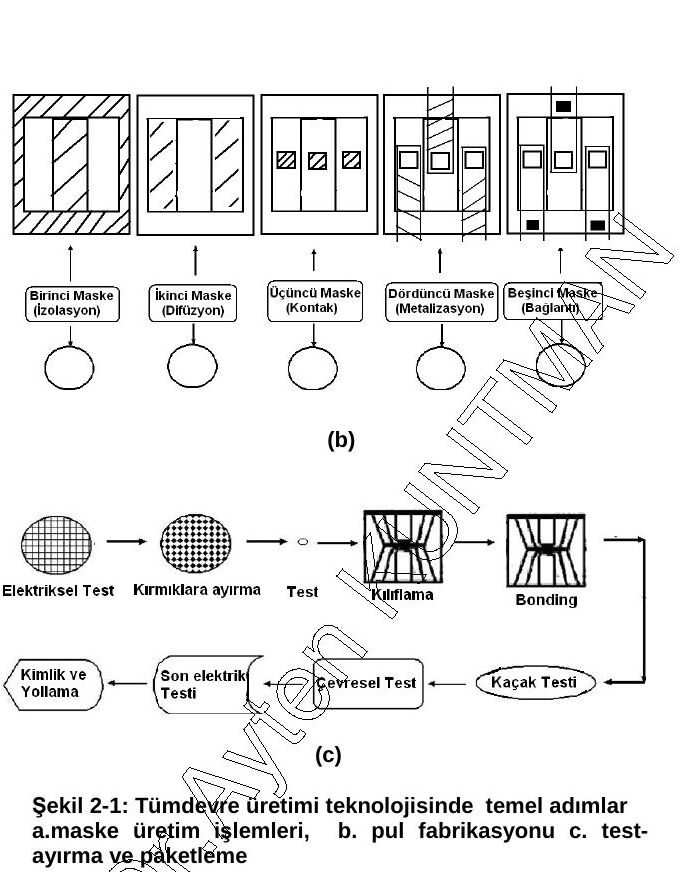
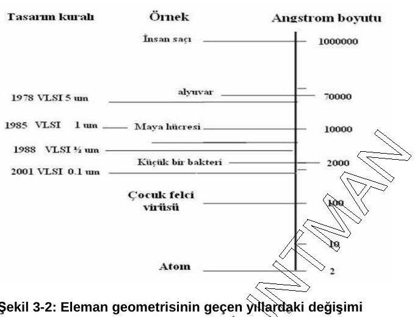
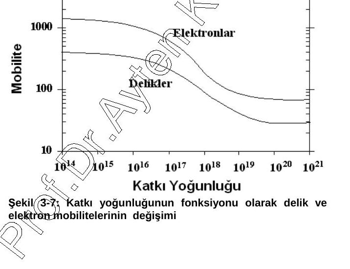
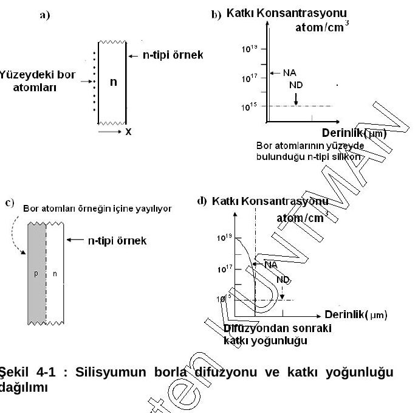
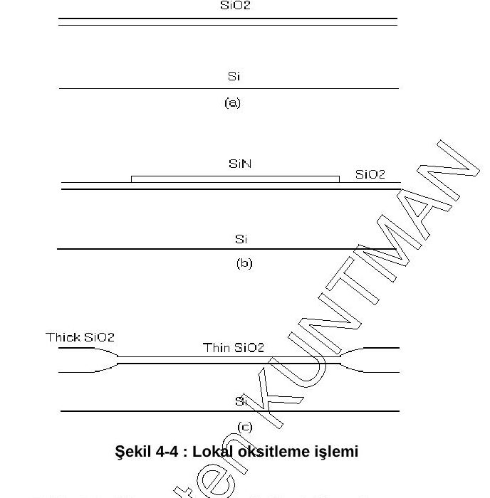
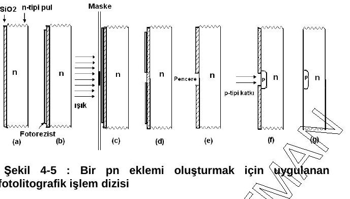
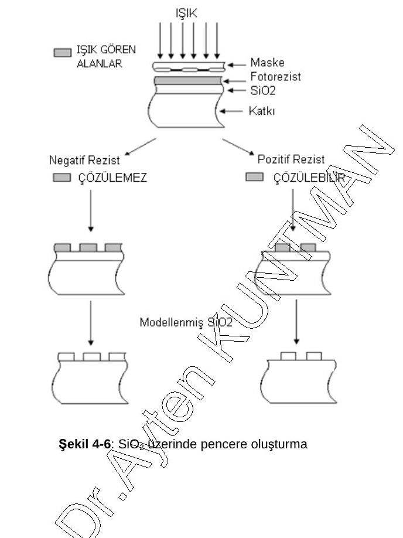

This post is the first part of the 158-page lecture note **"VLSI Design"** found in the EEM312 Digital Electronics course folder. The cover of the document states *"These notes are a reorganized version of the notes published by Prof. Dr. Ayten Kuntman on 11.03.2009"*; the pages carry a "Prof. Dr. Ayten KUNTMAN" watermark. The PDF was created on 28 April 2009; the document does not say who did the reorganization or at which institution the note was taught (Prof. Dr. Ayten Kuntman is a faculty member at İstanbul Technical University).

*This content belongs to a third-party source; it is shared for archival and nostalgic purposes with the source credited. It will be removed at the request of the rights holder.*

Because the note is long, it has been split into four posts: **1) IC fabrication, silicon and process steps** (this post, pp. 1–25), [2) MOS integrated circuits, the CMOS process and layout rules](/arsiv/eem312-vlsi-tasarimi-kuntman-2-mos-tumdevreler/) (pp. 26–75), [3) bipolar integrated circuits](/arsiv/eem312-vlsi-tasarimi-kuntman-3-bipolar-tumdevreler/) (pp. 76–102), [4) SPICE, layout examples, questions and references](/arsiv/eem312-vlsi-tasarimi-kuntman-4-spice-serim-sorular/) (pp. 103–158). The text, formulas and tables are transcribed below (garbled Turkish characters in the PDF have been corrected); figures that could not be rendered as text are included as cropped images. The **complete note (158 pages)** can be downloaded at the end of the post.

## Contents (entire note)

1. Introduction
1. Stages of IC design and fabrication: mask production stage, applying the produced masks to the silicon, testing and packaging
1. Electrical properties of silicon: silicon as the basic building block in VLSI, semiconductor behavior, intrinsic silicon, doping of silicon, conductivity of doped silicon
1. Basic process steps used in IC fabrication: diffusion (electrical properties of the diffused layer), thermal oxidation, polysilicon formation (CVD), ion implantation, epitaxy, lithography
1. MOS integrated circuits: basic MOS structures (E-NMOS, D-NMOS, E-PMOS), operating regions, NMOS fabrication process; derivation of the current expression and the current-voltage relationship; model parameters (threshold voltage, body parameter, effective channel length, transconductance, switching speed, output conductance); MOS capacitances; measurement of parameters; CMOS technology (n-well CMOS process)
1. Layout design rules: "full-custom" mask layout rules, CMOS inverter layout design, MOS integrated circuit design (NMOS and CMOS inverters)
1. Bipolar integrated circuits: junction-isolated technology, integrated npn transistor, breakdown voltage, saturation current, parasitic resistances, collector-base capacitance; passive elements (resistors, capacitors, diodes); linear (analog) integrated circuit design principles; analog processing blocks and bias circuits
1. Appendices: the SPICE program, layout examples, problems, references

## 1. Introduction

Integrated circuit technology covers, in terms of content, the design and fabrication of very large scale integration (VLSI) circuits and their preparation for use in the market. The main material in IC fabrication is **silicon**. Silicon, which is abundant in nature in amorphous form, is made suitable for semiconductor circuit fabrication through long metallurgical processes. Silicon crystal is obtained as long shiny rods; these rods are then sliced into thin **wafers** and made ready for use. The sliced wafers are 350–400 µm thick and about 3–5 inches in diameter.

Microelectronics technology makes it possible to produce a large number of integrated circuits as a result of a series of processes. 100–200 integrated circuits can be formed on a single wafer; if 10 wafers are processed at the same time, 100 × 10 = 1000 integrated circuits may be produced in one process run. Integrated circuits are produced mainly using **bipolar** and **MOS** technologies:

- With **bipolar technology**, analog structures are built: they have high gain, low noise and good precision.
- With **MOS technology**, digital structures are built: it is preferred because it is more convenient in terms of use and layout, and because it is simpler to scale.

The most basic element in IC fabrication is the transistor. With bipolar technology, npn and pnp transistors are formed; with MOS technology, N-channel and P-channel MOS transistors are formed. In VLSI circuits, device geometry is very important, and circuits generally consist of CMOS.

## 2. Stages of IC design and fabrication

The designer designs an integrated circuit that can perform the desired function while trying to minimize device geometry; design is a process that is completed before fabrication begins. IC design and fabrication take place in three main stages:

- Mask production stage
- Applying the masks to the silicon
- Testing and packaging

### 2.1. Mask production stage

This stage covers the selection of the circuit that will perform the desired function, the determination of the design quantities, the layout, and mask production. Selecting the circuit and determining the design quantities means determining the desired electrical quantity–dimension relationship with suitable simulation programs; the commonly used program for this is **SPICE**.

- **Layout:** After the circuit is selected and its dimensions are determined, the placement of the circuit on the chip is created. This is done in a computer environment with programs such as L-EDIT and ORCAD. The physical mask layout is made by special procedures that satisfy certain geometric rules or constraints; these are called **layout design rules**.
- **Mask production:** After the layout drawing, masks are prepared for each fabrication step. These masks basically cover the steps of **isolation, diffusion, contact, metallization and bonding pad (terminal) opening**.

The flow in Figure 2-1(a): design optimization (SPICE) → integrated circuit design → mask preparation and replication (CAD).

### 2.2. Applying the produced masks to the silicon

This is the process of transferring the masks prepared for the circuit to be realized onto the silicon; it is the **fabrication** stage of the integrated circuit. Simulation programs such as SUPREM and OSIS are used to extract the process parameters required to transfer the steps onto the wafer. There are five main masks and mask steps: isolation, diffusion, contact, metallization and bonding pad opening. In VLSI circuits, the number of masks may be higher in order to increase yield.

### 2.3. Testing and packaging

As a result of applying all the masks to the wafer in sequence, a large number of integrated circuits are formed on the wafer. Testing them, packaging them and making them ready for use is the third important step:

1. First, whether all the dice (chips) work is checked using the test transistor placed on each chip during fabrication. Measurements can be made with an instrument called a "prober"; faulty ones are automatically marked with red ink.
1. The dice are separated (dicing): the separation lines on the wafer are scribed with a diamond cutter, the back is ground down while the front is protected, and the wafer is broken apart.
1. Faulty dice are discarded; good ones are attached to a carrier, and the connection from the die to the carrier is made (*bonding*). The integrated circuit's connection to the outside world is through the pins on the carrier.
1. Electrical measurements are repeated; the good ones are sealed and the integrated circuit is ready for use.

## 3. Electrical properties of silicon

### 3.1. The basic building block in VLSI: silicon

VLSI circuits generally consist of CMOS. With integration, 10⁶–10⁷ transistors can be placed in 1 cm²; for example, a one-megabit DRAM chip can contain more than 1,000,000 transistors and more than 1,000,000 capacitors. Each individual unit on the wafer is called a **die / chip** (Figure 3-1: identical integrated circuits on a silicon wafer).

**Minimum feature size:** The minimum distance between two lines in an integrated circuit layout. In 1978 the minimum feature size in an integrated circuit was 5 µm, while in 1988 it was 0.5 µm; this is about the size of a bacterium. The point reached in 2004 is 0.1 micron.

The semiconductor widely used in IC-microelectronics technology is silicon; GaAs and Ge can be given as examples of other semiconductors. Germanium has been abandoned. Gallium arsenide is mostly used in optical and RF applications; today GaAs is used in RF-VLSI circuit design.

### 3.2. Semiconductor behavior

In semiconductor electronics, conduction is explained by the **energy band model**. Three bands are defined: the **valence band**, the **conduction band** and the **forbidden band** (band gap). The valence electrons of the elements reside in the valence band.

**Forbidden band:** The energy required for a valence electron to become a free electron is defined as the band gap energy (E_G). Its value is a function of temperature; for silicon:

E_G = 1.21 − 3.6×10⁻⁴·T   (eV)

*Note: In the document the expression is written as "E_G = (1.21 − 3.6×10⁻⁴)T", with the parenthesis in the wrong place; the temperature multiplies only the second term (for T = 300 K, E_G ≈ 1.10 eV).*

| Material | Bands | Explanation |
|---|---|---|
| Insulator | E_G > 5 eV | Valence electrons cannot move to the conduction band, so no conduction occurs (e.g., Teflon, rubber). |
| Semiconductor | E_G(Si) = 1.1 eV | In pure form it is close to an insulator; by doping, carriers can be added and additional energy levels created to make it conductive. An electron that gains enough energy can move from the valence band to the conduction band. |
| Conductor (metal) | No forbidden band | The valence and conduction bands overlap; there are many electrons in the structure, and conduction is achieved by directing them. |

Silicon is made rich in electrons or holes by adding impurities externally, and its conductivity is thereby changed.

### 3.3. Intrinsic silicon

**Intrinsic silicon** is silicon to which no impurity atoms have been added. At room temperature, in intrinsic silicon n_i = p_i = 1.5×10¹⁰ /cm³ (n denotes electrons, p denotes holes). In undoped semiconductor the numbers of holes and electrons are equal. Si atoms, which have a valence of +4, are bonded to each other by covalent bonds (Figure 3-4).

*Note: In the document, n_i is called the "doping concentration of intrinsic silicon"; n_i is actually the intrinsic carrier (electron/hole) concentration, not a doping concentration.*

### 3.4. Doping of silicon

The process of adding foreign atoms to make silicon conductive is called **doping**, and the dopant atom is called an *impurity*.

- **n-type doping:** Generally +5 valence atoms are added. For example, with phosphorus (P) the structure is made rich in electrons: phosphorus forms 4 covalent bonds with Si; the 5th electron is left free and moves about in the structure, causing an excess of one electron (Figure 3-5).
- **p-type doping:** +3 valence atoms (e.g., boron) are added. B and Si together form 3 covalent bonds; a vacancy remains in the 4th bond, which causes an excess of holes in the structure (Figure 3-6).

### 3.5. Conductivity of doped silicon

The conductivity of doped silicon depends on the concentration of the dopant atoms. Definitions:

- n: equilibrium concentration of electrons in Si (1/cm³)
- p: equilibrium concentration of holes in Si (1/cm³)
- N_D: concentration of n-type dopant atoms; N_A: concentration of p-type dopant atoms

If the number of dopant atoms is assumed equal to the number of carriers, one can write n ≈ N_D for n-type Si and p ≈ N_A for p-type Si.

With R the number of recombinations per second and γ the proportionality coefficient:

R = n·p·γ   (3-1)

At equilibrium, the generation (G) and recombination of electron-hole pairs are equal to each other:

G = R = n·p·γ = constant   (3-2)

Without doping, the numbers of electrons and holes are equal and are a function of temperature: n = p = n_i(T)   (3-3). From this:

**n·p = n_i²(T)**   (3-4)

That the product of the hole and electron concentrations is constant and equal to the square of the intrinsic concentration is an important finding. The specific conductivity is:

**σ = q·(µ_n·n + µ_p·p)**   (3-5)

Here σ is the electrical conductivity ((Ω·cm)⁻¹), µ_n and µ_p are the mobilities of electrons and holes (cm²/V·s), and q is the electron charge (1.6×10⁻¹⁹ C).

Combining with (3-4) for an n-type sample gives σ = q(µ_n·N_D + µ_p·n_i²/N_D); since N_D is sufficiently large, the second term is neglected:

σ = q·µ_n·N_D   (3-6)

Similarly, for a p-type sample σ = q(µ_n·n_i²/N_A + µ_p·N_A) and

σ = q·µ_p·N_A   (3-7)

In intrinsic semiconductor, σ = q·n_i·(µ_n + µ_p). Conductivity increases with doping concentration and mobility; however, mobility decreases as doping concentration increases: above a doping concentration of 10¹⁸ /cm³, mobility drops considerably.

**Table 3-1: Some electrical values for silicon (300 K)**

| Quantity | Value |
|---|---|
| ε_r | 11.7 |
| E_G | 1.1 eV |
| n_i | 1.5×10¹⁰ 1/cm³ |
| µ_n | 1300 cm²/V·s |
| µ_p | 500 cm²/V·s |

## 4. Basic process steps used in IC fabrication

### 4.1. Diffusion

Diffusion is a process carried out to achieve doping; a junction results from it. It is used basically to form the source-drain regions in MOS structures and the emitter-base structures in bipolar structures. For diffusion to the desired depth, the **diffusion source, temperature and time** are the determining factors. The diffusion source can be solid, liquid or gas. Diffusion is carried out at high temperature (1000–1200 °C) in special furnaces. Programs such as SUPREM are used to determine process parameters and for process optimization.

In Figure 4-1(a), boron atoms are on the silicon surface and diffusion has not yet started; in Figure 4-1(b), diffusion has taken place at a suitable temperature in the diffusion furnace and the doping profile has formed. The maximum depth obtained by doping is 20 µm; the diffusion time ranges from a few tens of minutes to several hours.

#### 4.1.1. Electrical properties of the diffused layer

The electrical properties of the diffused layer are defined by the **sheet resistance**. Sheet resistance is a quantity established for the electrical characterization of the doped region, defined as the **resistance per square**.

For a uniformly diffused rectangular layer (Figure 4-2) of length L, width W and depth T, the resistance is:

R = ρ·L/A = (1/σ)·L/(W·T)   (4-1)

Expanding the resistivity:

R = (1/(q·µ·N))·L/(W·T)   (4-2)

Taking out L/W gives the sheet resistance:

**R□ = 1/(q·µ·N·T)**   (4-3)

Its unit is Ω/□ (ohms per square). µ is the mobility and N is the doping concentration. Sheet resistance is also expressed as R□ = ρ/T. Depending on the doping type:

- For p-type silicon: R□ = 1/(q·µ_p·N_A·T)   (4-4)
- For n-type silicon: R□ = 1/(q·µ_n·N_D·T)   (4-5)

This is a simplified approximation; in reality the doping concentration is a function of depth (Figure 4-3), and with x_j the junction depth:

R = (L/W) · 1 / ∫₀^xj q·µ_n·N_D(x) dx   (4-6)

R□ = [∫₀^xj q·µ_n·N_D(x) dx]⁻¹ = [q·µ_n·∫₀^xj N_D(x) dx]⁻¹   (4-7)

The inverse of resistance gives conductance.

### 4.2. Thermal oxidation

Oxidation is the process of forming **SiO₂** on silicon; dielectric and insulating films are formed on silicon. Oxide is used as a mask against dopant diffusion, to form the gate in MOS structures, for passivation of active regions, and as a capacitor dielectric. The local oxidation used in MOS structures, called **field oxide**, is shown in Figure 4-4.

**Table 4-1: Uses of silicon dioxide**

| Where the oxide is used | Approximate thickness (Å) |
|---|---|
| As a mask against dopant diffusion | 4000–6000 |
| For forming the gate in MOS structures | 50–200 |
| For passivation of active regions | 7000–10000 |
| For making capacitor dielectric | 600–800 |

Oxidation is a thermal process and is carried out in special furnaces at 1000–1200 °C. The silicon in the wafer combines with the oxygen in the ambient to form oxide (oxygen advances into the silicon by diffusion). The oxide thickness is determined by temperature, oxygen source and time. There are two types of oxidation:

- **Dry oxidation** (oxygen-only ambient): Si + O₂ → SiO₂
- **Wet oxidation** (ambient containing oxygen and water vapor): Si + 2H₂O → SiO₂ + 2H₂ — it is faster.

### 4.3. Chemical vapor deposition (CVD)

Chemical vapor deposition is a method of forming a film on the wafer surface through the thermal decomposition of gaseous compounds. Polysilicon, SiO₂, silicon nitride and metal deposition can be done by CVD.

- **SiO₂ deposition:** Unlike thermal oxide, it is formed by the deposition of SiO₂ onto Si; its quality is lower, and it is done at low temperature (400–600 °C) and in a shorter time. It is used as inter-metal insulator in the multilevel metallization of very dense circuits. It is generally obtained by burning silane with oxygen: SiH₄ + O₂ → SiO₂ + 2H₂.
- **Polysilicon formation:** It is a chemical Si deposition process. Its most important use is as the gate electrode in MOS structures; it is also used in making high-value resistors and in forming ohmic contacts with Si crystal. It occurs by pyrolysis of silane: SiH₄ → Si + 2H₂.

*Note: In the document the silane reaction is written as "SiH₄ + O₂ → SiO₂ + H₂"; the balanced form is SiH₄ + O₂ → SiO₂ + 2H₂.*

### 4.4. Ion implantation

It is a doping method. It allows doping of smaller dimensions than diffusion; doping can be done with high purity. Its advantages are operation at low temperature and the ability to form small-sized structures. Its disadvantages are that it forms shallow junctions and that it is an expensive technique.

*Note: The document states that the basis of the technique is "accelerating and sending electrons"; what is accelerated and sent into the silicon in ion implantation is the **ions** of the dopant atoms.*

### 4.5. Epitaxy

It is the process of growing silicon again on silicon while preserving the crystal structure. In bipolar structures it provides isolation of circuit elements from each other. In VLSI structures, to minimize defects that may occur, it is used for doping n on n⁺ and p on p⁺.

### 4.6. Lithography

Lithography enables the transfer of the prepared circuit patterns onto the Si wafer. This requires a **mask, a radiation source and a suitable resist**; devices such as the *spinner* and *mask aligner* are used in IC fabrication. UV rays, electron bombardment and X-rays are used as the radiation source; the process is named after the source (photolithography if UV, electron-beam lithography if an electron beam).

- **Mask:** The structure that separates the region to be processed at a certain step on the wafer from the others.
- **Resist:** A light-sensitive chemical. Since the solubility of the areas that see light and those that do not changes, the pattern on the mask is transferred to the wafer.

At least 5–8 masks are needed to form a bipolar or MOS transistor; the mask for each region is prepared separately and a lithographic process is applied for each mask.

The photolithographic process applied while p-type doping an n-type wafer to form a pn junction (Figure 4-5): a) oxide growth, b) photoresist coating, c) exposure, d) oxide etching (forming the window), e) photoresist stripping, f) diffusion into the opened window, g) oxide stripping from the entire surface.

1. About 1000 Å of thermal oxide is grown on the n-type wafer to act as a mask for diffusion.
1. Photoresist is spread.
1. The mask is applied and exposure is carried out in the mask aligner.
1. A window is opened in the photoresist with a suitable solvent.
1. A window is opened in the oxide.
1. Diffusion is carried out in the defined region; then the silicon dioxide is stripped and the p-n junction is obtained.

The processes for positive and negative photoresist are shown in Figure 4-6: in negative resist, the areas exposed to light become insoluble; in positive resist, they become soluble.

The continuation of the note (MOS integrated circuits, CMOS technology and layout rules) is in the 2nd post of the series: [2) MOS integrated circuits, the CMOS process and layout rules](/arsiv/eem312-vlsi-tasarimi-kuntman-2-mos-tumdevreler/).
