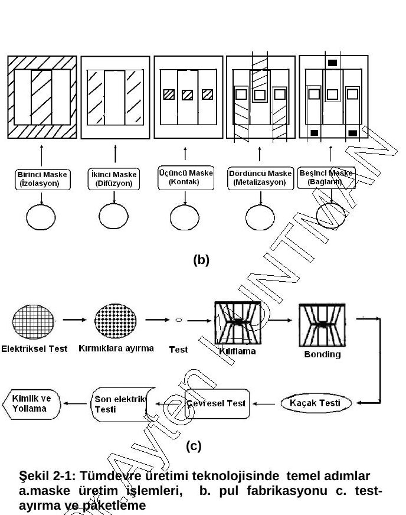
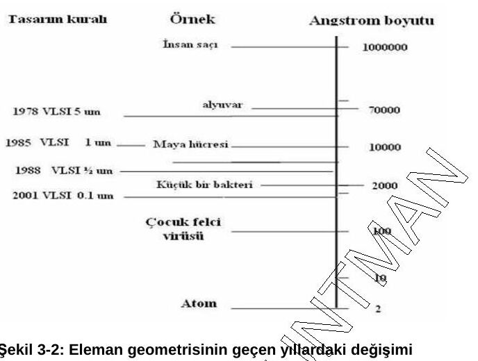
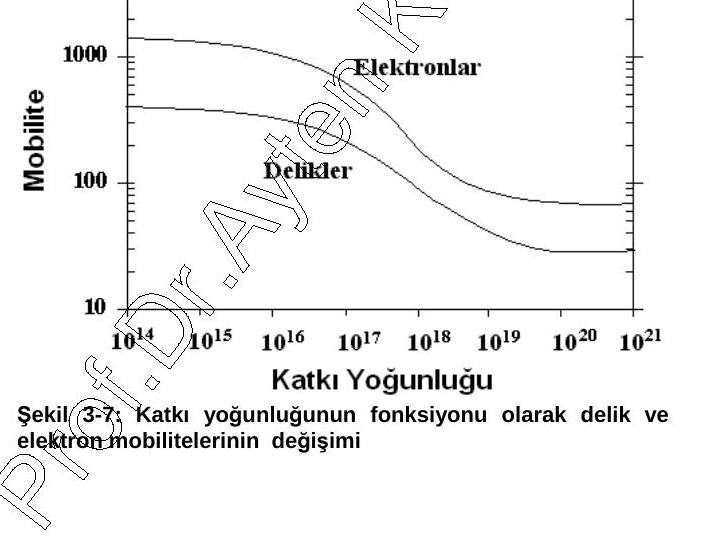
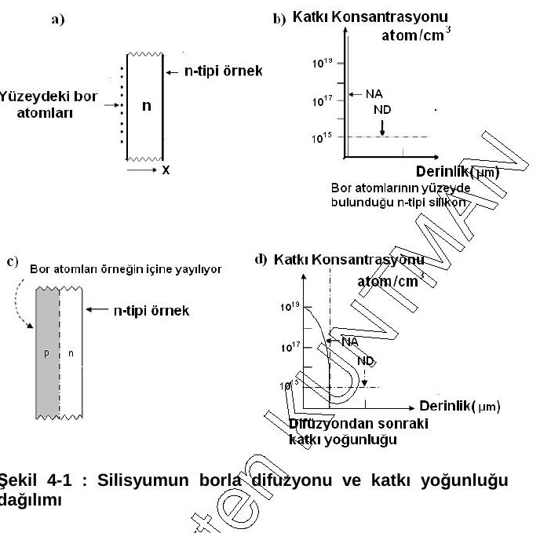
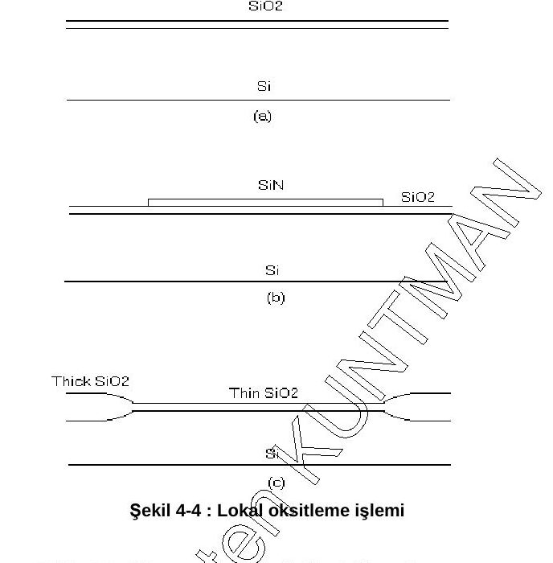
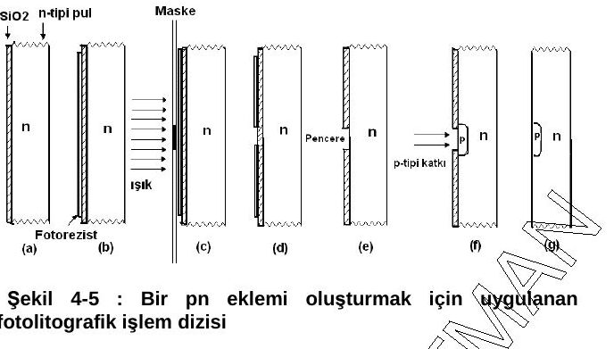
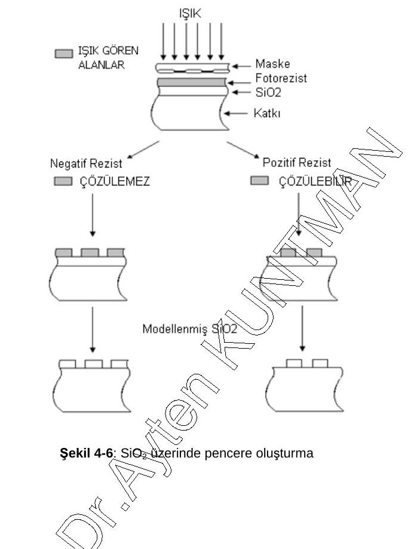

Bu yazı, EEM312 Sayısal Elektronik dersinin klasöründe bulunan 158 sayfalık **"VLSI Tasarımı"** ders notunun ilk bölümüdür. Belgenin kapağında *"Bu notlar Prof. Dr. Ayten Kuntman tarafından 11.03.2009 tarihinde yayınlanan notların yeniden düzenlenmiş halidir"* yazıyor; sayfalarda "Prof. Dr. Ayten KUNTMAN" filigranı var. PDF 28 Nisan 2009'da oluşturulmuş; düzenlemeyi kimin yaptığı ve notun hangi kurumda okutulduğu belgede yazmıyor (Prof. Dr. Ayten Kuntman, İstanbul Teknik Üniversitesi öğretim üyesidir).

*Bu içerik üçüncü taraf bir kaynağa aittir; arşiv ve nostalji amacıyla kaynak belirtilerek paylaşılmıştır. Hak sahibinin talebi hâlinde kaldırılır.*

Not uzun olduğu için dört yazıya bölündü: **1) tümdevre üretimi, silisyum ve proses adımları** (bu yazı, s. 1–25), [2) MOS tümdevreler, CMOS prosesi ve serim kuralları](/arsiv/eem312-vlsi-tasarimi-kuntman-2-mos-tumdevreler/) (s. 26–75), [3) bipolar tümdevreler](/arsiv/eem312-vlsi-tasarimi-kuntman-3-bipolar-tumdevreler/) (s. 76–102), [4) SPICE, serim örnekleri, sorular ve kaynaklar](/arsiv/eem312-vlsi-tasarimi-kuntman-4-spice-serim-sorular/) (s. 103–158). Metin, formüller ve tablolar aşağıya aktarıldı (PDF'teki bozuk Türkçe karakterler düzeltildi); metne dökülemeyen şekiller kırpılarak eklendi. **Notun tamamı (158 sayfa)** yazının sonunda indirilebilir.

## İçindekiler (notun tamamı)

1. Giriş
1. Tümdevre tasarımı ve üretimi aşamaları: maske üretim aşaması, üretilen maskelerin silisyuma uygulanması, test ve paketleme
1. Silisyumun elektriksel özelliği: VLSI'da temel yapıtaşı silisyum, yarıiletken davranışı, has silisyum, silisyumun katkılanması, katkılanmış silisyumun iletkenliği
1. Tümdevre üretiminde kullanılan temel proses adımları: difüzyon (difüzyon tabakasının elektriksel özelliği), termal oksitleme, polisilisyum oluşturma (CVD), iyon ekme (implantasyon), epitaksi, litografi
1. MOS tümdevreler: temel MOS yapıları (E-NMOS, D-NMOS, E-PMOS), çalışma bölgeleri, NMOS üretim süreci; akım ifadesinin çıkarılışı ve akım-gerilim ilişkisi; model parametreleri (eşik gerilimi, gövde parametresi, etkin kanal boyu, geçiş iletkenliği, anahtarlama hızı, çıkış iletkenliği); MOS kapasiteler; parametrelerin ölçülmesi; CMOS teknolojisi (n-kuyulu CMOS prosesi)
1. Serim tasarım kuralları: "full-custom" maske serim kuralları, CMOS evirici serim tasarımı, MOS tümdevre tasarımı (NMOS ve CMOS eviriciler)
1. Bipolar tümdevreler: jonksiyon izolasyonlu teknoloji, tümleştirilmiş npn tranzistör, belverme gerilimi, doyma akımı, parazitik dirençler, kollektör-baz kapasitesi; pasif elemanlar (dirençler, kapasiteler, diyotlar); lineer (analog) tümdevre tasarım ilkeleri; analog işlem blokları ve kutuplama devreleri
1. Ekler: SPICE programı, serim örnekleri, problemler, kaynaklar

## 1. Giriş

Tümdevre teknolojisi, içerik olarak çok geniş çapta tümleştirilmiş (VLSI, *Very Large Scale Integration*) devre tasarımını, üretimini ve piyasada kullanılacak hâle gelmesini kapsar. Tümdevre üretiminde ana malzeme **silisyumdur**. Doğada amorf olarak bolca bulunan silisyum, uzun metalurjik işlemler sonucunda yarıiletken devre yapımına uygun hâle getirilir. Silisyum kristali uzun parlak çubuklar hâlinde elde edilir; bu çubuklar daha sonra ince **pul** (*wafer*) şeklinde kesilerek kullanıma hazır hâle getirilir. Kesilen pulların kalınlıkları 350–400 µm, çapları ise 3–5 inç civarındadır.

Mikroelektronik teknolojisi, bir dizi işlem (proses) sonucunda çok sayıda tümdevre üretimini mümkün kılar. Bir pul üzerinde 100–200 adet tümdevre oluşturulabilir; aynı anda 10 pulla çalışılırsa bir proses sonucunda 100 × 10 = 1000 adet tümdevre üretilmiş olabilir. Tümdevreler temelde **bipolar** ve **MOS** teknolojileri kullanılarak üretilir:

- **Bipolar teknoloji** ile analog yapılar oluşturulur: kazancı fazla, gürültüsü az, hassasiyeti iyidir.
- **MOS teknolojisi** ile sayısal yapılar oluşturulur: kullanım ve yerleşim açısından daha elverişli ve ölçeklenmesi daha basit olduğu için tercih edilir.

Tümdevre üretiminde en temel eleman tranzistördür. Bipolar teknoloji ile npn ve pnp, MOS teknoloji ile N kanallı ve P kanallı MOS tranzistörler oluşturulur. VLSI devrelerde eleman geometrisi oldukça önemlidir ve devreler genellikle CMOS'lardan oluşur.

## 2. Tümdevre tasarımı ve üretimi aşamaları

Tasarımcı, eleman geometrisini en aza indirmeye çalışarak istenen fonksiyonu gerçekleştirebilecek tümdevreyi tasarlar; tasarım, üretim başlamadan sonuçlanan bir işlemdir. Tümdevre tasarımı ve üretimi üç ana aşamada gerçekleşir:

- Maske üretim aşaması
- Maskelerin silisyuma uygulanması
- Test ve paketleme

### 2.1. Maske üretim aşaması

Bu aşama, istenen fonksiyonu gerçekleştirecek devrenin seçimini ve tasarım büyüklüklerinin belirlenmesini, serimi (*layout*) ve maske üretimini kapsar. Devre seçimi ve tasarım büyüklüklerinin belirlenmesi, istenen elektriksel büyüklük–boyut ilişkisinin uygun simülasyon programlarıyla belirlenmesidir; bunun için yaygın kullanılan program **SPICE**'tır.

- **Serim (layout):** Devre seçimi ve boyutların belirlenmesinden sonra devrenin çip üzerindeki yerleşimi oluşturulur. Bilgisayar ortamında L-EDIT, ORCAD gibi programlarla yapılır. Fiziksel maske serimi bazı geometrik kuralları veya sınırlamaları sağlayan özel işlemlerle yapılır; bunlara **serim tasarım kuralları** denir.
- **Maske üretimi:** Serim çiziminden sonra her üretim aşaması için maskeler hazırlanır. Bu maskeler temelde **izolasyon, difüzyon, kontak, metalizasyon ve bağlantı uçlarının alınması** adımlarını içerir.

Şekil 2-1(a)'daki akış: tasarım optimizasyonu (SPICE) → tümdevre tasarımı → maske hazırlanması ve çoğullama (CAD).

### 2.2. Üretilen maskelerin silisyuma uygulanması

Gerçeklenecek devre için hazırlanan maskelerin silisyum üzerine aktarılması işlemidir; tümdevre **fabrikasyon** aşamasıdır. Adımların pula aktarılması için gerekli işlem parametrelerinin çıkarılmasında SUPREM, OSIS gibi simülasyon programlarından yararlanılır. Beş ana maske ve maske adımı vardır: izolasyon, difüzyon, kontak, metalizasyon ve bağlantı uçlarının alınması. VLSI devrelerde verimi artırmak için maske sayısı daha fazla olabilir.

### 2.3. Test ve paketleme

Tüm maskelerin pul üzerine sırayla uygulanması sonucunda pul üzerinde çok sayıda tümdevre oluşur. Bunların test edilmesi, paketlenmesi ve kullanıma hazır hâle gelmesi üçüncü önemli adımdır:

1. Önce tüm kırmıkların (çiplerin) çalışıp çalışmadığı, üretim sırasında her çipe yerleştirilmiş test tranzistöründen yararlanılarak kontrol edilir. Ölçümler "prober" denilen ölçü aletiyle yapılabilir; bozuk olanlar otomatik olarak kırmızı mürekkeple işaretlenir.
1. Kırmıklar ayrılır (parçalama): pul üzerindeki ayrım çizgileri elmas bir kesiciyle çizilir, ön yüz korunarak sırtı aşındırılır ve parçalanır.
1. Bozuk kırmıklar ayrılır; sağlam olanlar bir taşıyıcı üzerine yapıştırılır ve kırmıktan taşıyıcıya bağlantı yapılır (*bonding*). Tümdevrenin dış dünyayla bağlantısı taşıyıcı üzerindeki bacaklarla olur.
1. Elektriksel ölçümler tekrarlanır; sağlam olanların üzeri kapatılır ve tümdevre kullanıma hazırdır.

## 3. Silisyumun elektriksel özelliği

### 3.1. VLSI'da temel yapıtaşı: silisyum

VLSI devreler genellikle CMOS'lardan oluşur. Tümleştirmeyle 1 cm²'ye 10⁶–10⁷ tranzistör yerleştirilebilmektedir; örneğin bir megabitlik DRAM çipi 1.000.000'dan çok tranzistör ve 1.000.000'dan çok kapasite içerebilir. Pul üzerindeki her bir birime **kırmık / yonga** (*chip*) denir (Şekil 3-1: silisyum pul üzerinde birbirinin aynı tümdevreler).

**Minimum boyut:** Bir tümdevre serimindeki iki çizgi arasındaki minimum uzaklıktır. 1978'de entegre devre içindeki minimum boyut 5 µm iken 1988'de 0,5 µm olmuştur; bu, yaklaşık bir bakterinin boyutu kadardır. 2004'te gelinen nokta ise 0,1 mikrondur.

Tümdevre-mikroelektronik teknolojisinde yaygın kullanılan yarıiletken silisyumdur; diğer yarıiletkenlere GaAs ve Ge örnek verilebilir. Germanyum terk edilmiştir. Galyum arsenit çoğunlukla optik ve RF uygulamalarda kullanılır; günümüzde GaAs, RF-VLSI devre tasarımında kullanılmaktadır.

### 3.2. Yarıiletken davranışı

Yarıiletken elektroniğinde iletim **enerji-band modeli** ile açıklanır. Üç band tanımlanır: **valans bandı**, **iletim bandı** ve **yasak band**. Valans bandında elementlerin değerlik elektronları bulunur.

**Yasak band:** Bir valans elektronunun serbest elektron hâline geçmesi için gerekli enerji, yasak band enerjisi (E_G) olarak tanımlanır. Değeri sıcaklığın fonksiyonudur; silisyum için:

E_G = 1,21 − 3,6×10⁻⁴·T   (eV)

*Not: Belgede ifade "E_G = (1.21 − 3.6×10⁻⁴)T" biçiminde, parantez yanlış yerde yazılmış; sıcaklık yalnız ikinci terimle çarpılır (T = 300 K için E_G ≈ 1,10 eV).*

| Malzeme | Bandlar | Açıklama |
|---|---|---|
| Yalıtkan | E_G > 5 eV | Valans elektronları iletim bandına geçemez, iletkenlik oluşmaz (ör. teflon, kauçuk). |
| Yarıiletken | E_G(Si) = 1,1 eV | Saf hâlde yalıtkana yakındır; katkılama ile taşıyıcı eklenip ek enerji seviyeleri oluşturularak iletken kılınabilir. Yeterince enerji alan elektron valans bandından iletim bandına geçebilir. |
| İletken (metal) | Yasak band yok | Valans ve iletim bantları iç içe geçmiştir; yapıda çok sayıda elektron vardır, yönlendirilerek iletim sağlanır. |

Silisyum, dışarıdan katkı eklenerek elektronca veya delikçe zengin hâle getirilir ve iletkenlik özelliği değiştirilir.

### 3.3. Has silisyum

**Has (intrinsik) silisyum**, içine katkı atomu eklenmemiş silisyumdur. Oda sıcaklığında has silisyumda n_i = p_i = 1,5×10¹⁰ /cm³'tür (n elektronları, p delikleri gösterir). Katkılanmamış yarıiletkende delik ve elektron sayıları eşittir. Değerliği +4 olan Si atomları birbirine kovalent bağlarla bağlıdır (Şekil 3-4).

*Not: Belgede n_i "has silisyumun katkı yoğunluğu" olarak adlandırılıyor; n_i aslında has taşıyıcı (elektron/delik) yoğunluğudur, katkı yoğunluğu değildir.*

### 3.4. Silisyumun katkılanması

Silisyumu iletken kılmak için yabancı atom ekleme işlemine **katkılama** (*doping*), katkı atomuna ise *impurity* denir.

- **n-tipi katkılama:** Genelde +5 değerlikli atom eklenir. Örneğin fosfor (P) ile yapı elektronca zengin hâle getirilir: fosfor, Si ile 4 kovalent bağ yapar; 5. elektron serbest kalarak yapıda dolaşır ve bir elektron fazlalığına yol açar (Şekil 3-5).
- **p-tipi katkılama:** +3 değerlikli atom (ör. bor) eklenir. B ile Si ortaklaşa 3 kovalent bağ yapar; 4. bağda bir boşluk kalır ve bu, yapıda delik fazlalığına neden olur (Şekil 3-6).

### 3.5. Katkılanmış silisyumun iletkenliği

Katkılanmış silisyumun iletkenliği katkı atomlarının konsantrasyonuna bağlıdır. Tanımlar:

- n: Si içindeki elektronların denge konsantrasyonu (1/cm³)
- p: Si içindeki deliklerin denge konsantrasyonu (1/cm³)
- N_D: n tipi katkı atomlarının konsantrasyonu; N_A: p tipi katkı atomlarının konsantrasyonu

Katkı atomu sayısı taşıyıcı sayısına eşit kabul edilirse n tipi Si için n ≈ N_D, p tipi Si için p ≈ N_A yazılabilir.

R saniyedeki birleşme sayısı ve γ orantı katsayısı olmak üzere:

R = n·p·γ   (3-1)

Dengede elektron-delik çiftlerinin üremesi (G) ve birleşmesi birbirine eşittir:

G = R = n·p·γ = sabit   (3-2)

Katkılama yokken elektron ve delik sayıları eşittir ve sıcaklığın fonksiyonudur: n = p = n_i(T)   (3-3). Buradan:

**n·p = n_i²(T)**   (3-4)

Delik ve elektron yoğunluklarının çarpımının sabit ve has yoğunluğun karesine eşit olması önemli bir saptamadır. Özgül iletkenlik:

**σ = q·(µ_n·n + µ_p·p)**   (3-5)

Burada σ elektriksel iletkenlik ((Ω·cm)⁻¹), µ_n ve µ_p elektron ve deliklerin hareket yeteneği (mobilite, cm²/V·s), q elektron yükü (1,6×10⁻¹⁹ C).

n-tipi örnek için (3-4) ile birleştirilirse σ = q(µ_n·N_D + µ_p·n_i²/N_D); N_D yeterince büyük olduğundan ikinci terim ihmal edilir:

σ = q·µ_n·N_D   (3-6)

p-tipi örnek için benzer şekilde σ = q(µ_n·n_i²/N_A + µ_p·N_A) ve

σ = q·µ_p·N_A   (3-7)

Has yarıiletkende ise σ = q·n_i·(µ_n + µ_p)'dir. İletkenlik katkı yoğunluğu ve mobiliteyle artar; ancak mobilite katkı yoğunluğu arttıkça düşer: 10¹⁸ /cm³ katkı yoğunluğunun üstünde mobilite oldukça azalır.

**Tablo 3-1: Silisyuma ait bazı elektriksel değerler (300 K)**

| Büyüklük | Değer |
|---|---|
| ε_r | 11,7 |
| E_G | 1,1 eV |
| n_i | 1,5×10¹⁰ 1/cm³ |
| µ_n | 1300 cm²/V·s |
| µ_p | 500 cm²/V·s |

## 4. Tümdevre üretiminde kullanılan temel proses adımları

### 4.1. Difüzyon

Difüzyon, katkılamayı gerçekleştirmek için yapılan bir işlemdir; sonucunda jonksiyon oluşur. Temelde MOS yapılarda kaynak-savak bölgelerinin, bipolar yapılarda emetör-baz yapılarının oluşturulmasında kullanılır. İstenen derinlikte difüzyon için **difüzyon kaynağı, sıcaklık ve süre** belirleyicidir. Difüzyon kaynağı katı, sıvı veya gaz olabilir. Difüzyon yüksek sıcaklıkta (1000–1200 °C) özel fırınlarda yapılır. Proses parametrelerinin belirlenmesinde ve proses optimizasyonunda SUPREM gibi programlardan yararlanılır.

Şekil 4-1(a)'da silisyum yüzeyinde bor atomları bulunur ve henüz difüzyon başlamamıştır; Şekil 4-1(b)'de uygun sıcaklıkta difüzyon fırınında difüzyon gerçekleşerek katkı profili oluşmuştur. Katkılama ile elde edilen maksimum derinlik 20 µm'dir; difüzyon süresi birkaç on dakikadan birkaç saate kadardır.

#### 4.1.1. Difüzyon tabakasının elektriksel özelliği

Difüzyon tabakasının elektriksel özelliği **tabaka direnci** ile tanımlanır. Tabaka direnci, katkılanmış bölgenin elektriksel karakterizasyonu için belirlenmiş, **birim kare başına direnç** olarak tanımlanan bir büyüklüktür.

Uzunluğu L, genişliği W ve derinliği T olan düzgün difüzyonlu dikdörtgen bir tabakanın (Şekil 4-2) direnci:

R = ρ·L/A = (1/σ)·L/(W·T)   (4-1)

Özgül direnç açılırsa:

R = (1/(q·µ·N))·L/(W·T)   (4-2)

L/W çekildiğinde tabaka direnci elde edilir:

**R□ = 1/(q·µ·N·T)**   (4-3)

Birimi Ω/□'dir (ohm/kare). µ mobilite, N katkı yoğunluğudur. Tabaka direnci R□ = ρ/T olarak da ifade edilir. Katkı tipine göre:

- p-tipi silisyum için: R□ = 1/(q·µ_p·N_A·T)   (4-4)
- n-tipi silisyum için: R□ = 1/(q·µ_n·N_D·T)   (4-5)

Bu sadeleştirilmiş bir yaklaşımdır; gerçekte katkı yoğunluğu derinliğin fonksiyonudur (Şekil 4-3) ve x_j jonksiyon derinliği olmak üzere:

R = (L/W) · 1 / ∫₀^xj q·µ_n·N_D(x) dx   (4-6)

R□ = [∫₀^xj q·µ_n·N_D(x) dx]⁻¹ = [q·µ_n·∫₀^xj N_D(x) dx]⁻¹   (4-7)

Direncin tersi iletkenliği verir.

### 4.2. Termal oksitleme

Oksitleme, silisyum üzerinde **SiO₂** oluşturma işlemidir; silisyum üzerinde dielektrik ve yalıtkan filmler oluşturulur. Oksit; katkı difüzyonuna karşı maske olarak, MOS yapılarda geçit oluşturmada, aktif bölgelerin pasivasyonunda ve kapasite dielektriği olarak kullanılır. MOS yapılarda kullanılan ve **alan oksiti** olarak adlandırılan lokal oksitleme Şekil 4-4'te görülmektedir.

**Tablo 4-1: Silisyum dioksitin kullanıldığı yerler**

| Oksitin kullanıldığı yer | Yaklaşık kalınlık (Å) |
|---|---|
| Katkı difüzyonuna karşı maske olarak | 4000–6000 |
| MOS yapılarda geçit oluşturmada | 50–200 |
| Aktif bölgelerin pasivasyonunda | 7000–10000 |
| Kapasite dielektriği yapımı | 600–800 |

Oksitleme ısıl bir işlemdir ve 1000–1200 °C'de özel fırınlarda yapılır. Puldaki silisyum, ortamdaki oksijenle birleşerek oksit oluşturur (oksijen silisyum içine difüzyonla ilerler). Oksit kalınlığını sıcaklık, oksijen kaynağı ve süre belirler. İki tür oksitleme vardır:

- **Kuru oksitleme** (yalnız oksijenli ortam): Si + O₂ → SiO₂
- **Nemli oksitleme** (oksijen ve su buharı içeren ortam): Si + 2H₂O → SiO₂ + 2H₂ — daha hızlıdır.

### 4.3. Kimyasal buhar depolama (CVD)

Kimyasal buhar depolama (*Chemical Vapor Deposition*), gaz bileşiklerin ısıl ayrışmasıyla pul yüzeyinde film oluşturma yöntemidir. Polisilisyum, SiO₂, silisyum nitrür ve metal depolama CVD ile yapılabilir.

- **SiO₂ depolama:** Termal oksitten farklı olarak SiO₂'nin Si üzerine yığılmasıyla oluşur; kalitesi düşüktür, düşük sıcaklıkta (400–600 °C) ve daha kısa sürede yapılır. Çok yoğun devrelerin çok katlı metalizasyonunda metaller arası yalıtkan olarak kullanılır. Genelde silanın oksijenle yakılmasıyla elde edilir: SiH₄ + O₂ → SiO₂ + 2H₂.
- **Polisilisyum oluşturma:** Kimyasal olarak Si depolama işlemidir. En önemli kullanım alanı MOS yapılarda geçit elektrodudur; yüksek değerli direnç yapımında ve Si kristaliyle omik kontak oluşturmada da kullanılır. Silanın pirolizi ile gerçekleşir: SiH₄ → Si + 2H₂.

*Not: Belgede silan tepkimesi "SiH₄ + O₂ → SiO₂ + H₂" olarak yazılmış; denkleştirilmiş hâli SiH₄ + O₂ → SiO₂ + 2H₂'dir.*

### 4.4. İyon ekme (implantasyon)

Bir katkılama yöntemidir. Difüzyona göre daha küçük boyutların katkılanmasını sağlar; yüksek saflıkta katkılama yapılabilir. Düşük sıcaklıkta çalışma ve küçük boyutlu yapılar oluşturabilme avantajlarıdır. Dezavantajları sığ jonksiyon oluşturması ve pahalı bir teknik olmasıdır.

*Not: Belgede tekniğin temelinde "elektronların hızlandırılıp gönderilmesi" olduğu yazıyor; iyon ekmede hızlandırılıp silisyuma gönderilen, katkı atomlarının **iyonlarıdır**.*

### 4.5. Epitaksi

Silisyum üzerinde, kristal yapı korunarak yeniden silisyum büyütülmesi işlemidir. Bipolar yapılarda devre elemanlarının birbirinden izole edilmesini sağlar. VLSI yapılarda oluşabilecek hataları en aza indirmek için n⁺ üzerine n, p⁺ üzerine p katkılamada kullanılır.

### 4.6. Litografi

Litografi, hazırlanan devre desenlerinin Si pul üzerine aktarılmasını sağlar. Bunun için **maske, ışın kaynağı ve uygun bir rezist** gerekir; tümdevre üretiminde *spinner* ve *mask aligner* gibi cihazlardan yararlanılır. Işın kaynağı olarak UV ışınları, elektron bombardımanı, X ışınları kullanılır; işlem kaynağın adıyla anılır (UV ise fotolitografi, elektron demeti ise elektron litografisi).

- **Maske:** Pul üzerinde belli bir aşamada işlem yapılacak bölgeyi diğerlerinden ayıran yapıdır.
- **Rezist:** Işığa duyarlı kimyasal maddedir. Işık gören ve görmeyen alanların çözünürlükleri değiştiği için maskedeki şekil pula aktarılır.

Bir bipolar veya MOS tranzistör oluşturmak için en az 5–8 maske gerekir; her bölgenin maskesi ayrı hazırlanır ve her maske için litografik işlem uygulanır.

Bir pn eklemi oluşturmak için n-tipi bir pul üzerine p-tipi katkılama yapılırken uygulanan fotolitografik işlem (Şekil 4-5): a) oksit büyütme, b) fotorezist serme, c) ışıklandırma, d) oksit soyma (pencereyi oluşturma), e) fotorezist soyma, f) açılan pencereye difüzyon, g) tüm yüzeyden oksit soyma.

1. n-tipi pul üzerine difüzyona maske olmak üzere 1000 Å civarında termal oksit büyütülür.
1. Fotorezist serilir.
1. Maske uygulanarak mask aligner'da ışıklandırma yapılır.
1. Uygun bir çözücüyle fotorezist üzerinde pencere açılır.
1. Oksit üzerinde pencere açılır.
1. Tanımlanan bölgeye difüzyon yapılır; ardından silisyum dioksit soyulur ve p-n jonksiyonu elde edilmiş olur.

Pozitif ve negatif fotorezist için yapılan işlemler Şekil 4-6'da görülmektedir: negatif rezistte ışık gören alanlar çözülemez, pozitif rezistte ise çözülebilir hâle gelir.

Notun devamı (MOS tümdevreler, CMOS teknolojisi ve serim kuralları) serinin 2. yazısındadır: [2) MOS tümdevreler, CMOS prosesi ve serim kuralları](/arsiv/eem312-vlsi-tasarimi-kuntman-2-mos-tumdevreler/).
