This post is the second part of the 158-page **"VLSI Design"** lecture note found in the EEM312 Digital Electronics course folder (pages 26–75 of the note). The cover of the document states *"These notes are a reorganized version of the notes published by Prof. Dr. Ayten Kuntman on 11.03.2009"*; the PDF was created on 28 April 2009. The document does not say who did the reorganization or at which institution the note was taught (Prof. Dr. Ayten Kuntman is a faculty member at İstanbul Technical University).

*This content belongs to a third-party source; it is shared for archival and nostalgic purposes with attribution. It will be removed at the request of the rights holder.*

Other posts in the series: [1) IC fabrication, silicon, and process steps](/arsiv/eem312-vlsi-tasarimi-kuntman-1-uretim-ve-proses/) (the full note can be downloaded there), [3) bipolar integrated circuits](/arsiv/eem312-vlsi-tasarimi-kuntman-3-bipolar-tumdevreler/), [4) SPICE, layout examples, questions, and references](/arsiv/eem312-vlsi-tasarimi-kuntman-4-spice-serim-sorular/). The text, formulas, and tables of this part are transcribed below (garbled Turkish characters and formulas scattered in the PDF have been corrected); the figures were cropped and included. A PDF made up of the pages of this part can be downloaded at the end of the post.

## 5. MOS Integrated Circuits

The basic building blocks of MOS integrated circuit fabrication are MOSFETs; this chapter describes the MOSFET fabrication steps and their effects on circuit performance characteristics. MOS (metal-oxide-semiconductor) structures are widely used in digital electronic circuits; their advantages are simplicity, ease of scaling, low power dissipation, and high speed. MOS devices fall into three main groups:

- N-channel MOS transistors
- P-channel MOS transistors
- CMOS (divided into n-well and p-well types)

## 5.1. Basic MOS Structures

N-channel MOS transistors are divided into **enhancement-mode (E-NMOS)** and **depletion-mode (D-NMOS)** types. The threshold voltage of an E-NMOS is greater than zero, and that of a D-NMOS is less than zero.

#### Enhancement-Mode NMOS (E-NMOS)

In an E-NMOS, the source and drain regions are formed by n-type diffusion on a p-type substrate. Above the gate there is SiO₂ and a polysilicon gate electrode; the transistor is completed with contacts and metal interconnects. Initially there is no channel. If a voltage more positive than the source is applied to the gate, the electric field between the gate and the substrate attracts electrons upward and pushes holes downward, and an **n-channel** forms between drain and source.

*Note: The document states "source (drain) and drain (source)" the wrong way around; the correct terms are source = source and drain = drain (the Turkish terms "kaynak" and "savak" had been swapped).*

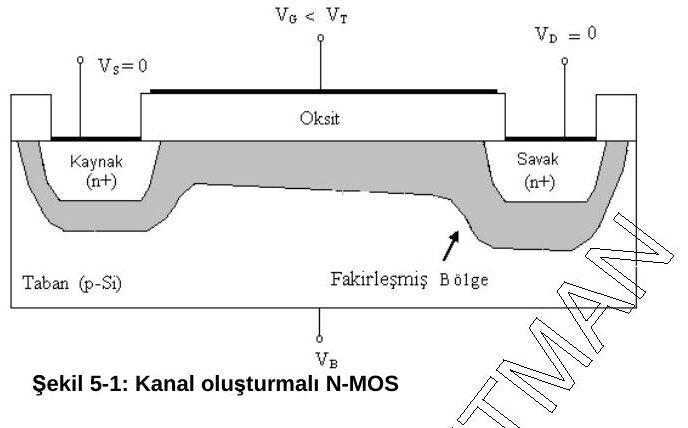

#### Depletion-Mode NMOS (D-NMOS)

In a D-NMOS the threshold voltage is less than zero. Unlike the E-NMOS, the gate region is doped during fabrication: the region between source and drain is enriched with electrons by ion implantation. Thus a channel already exists in the structure before any gate voltage is applied (even at V_GS = 0); during operation, the current is controlled by applying a voltage to the gate.

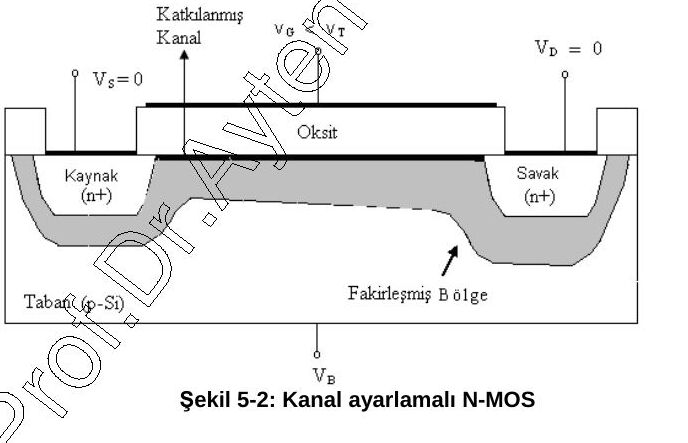

#### Enhancement-Mode PMOS (E-PMOS)

In p-channel MOS devices, the source and drain regions are formed by p-type diffusion on an n-type substrate. When a **negative** voltage of suitable magnitude is applied to the gate, holes are attracted upward and the channel forms (Figure 5-3).

#### 5.1.2. Operating Regions of the E-NMOS Transistor

A MOS transistor has three operating conditions: the non-saturation (triode) region, the saturation region, and pinch-off (Figure 5-4):

- **a) Channel formation:** V_GS ≥ V_TO. When the applied V_GS reaches the threshold voltage, the channel forms and current begins to flow.
- **b) Non-saturation region:** V_DS ≤ V_GS − V_TO. If V_DS is increased, the drain current increases.
- **c) Saturation region:** V_DS ≥ V_GS − V_TO. This is the region in which the current is controlled by the gate voltage; as V_GS increases, the drain current increases. Beyond a certain value, a pinch-off forms at the drain end of the channel and the operating conditions change.

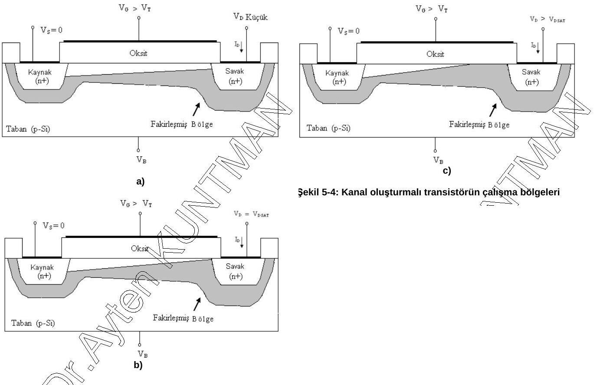

#### 5.1.3. N-Channel MOS Transistor Fabrication Process

The fabrication of an n-channel MOS transistor with a polysilicon gate begins with growing silicon dioxide on the p-type silicon surface using mask 1; this is called the **field oxide**. The transistor area is defined on the field oxide with the oxide mask, and a high-quality thin oxide that will form the gate of the MOS transistor is grown. Polysilicon is grown on top of the thin oxide, and the polysilicon gate electrode is formed with mask 2. On both sides of the gate electrode, n-regions (source and drain) are formed by doping. Then contact windows are opened with mask 3; the entire surface is covered with metal, and metal lines are formed with mask 4. The masks applied are:

1. Active region and thin oxide mask (transistor area)
1. Polysilicon mask
1. Contact windows mask
1. Metal mask

Each masking step is carried out by a lithographic process.

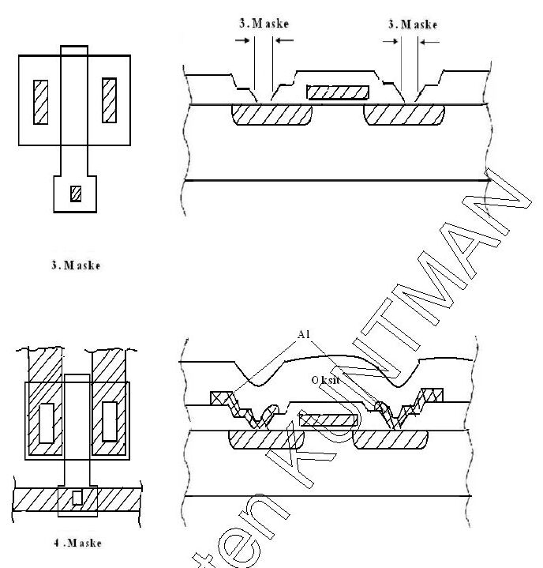

## 5.2. Basic Electrical Properties of MOS Integrated Circuits

Channel length and channel width are important quantities that determine the area the transistor occupies on the chip and the drain current.

- **Channel length (L):** The length of the channel in the direction of the drain current flowing between source and drain.
- **Channel width (W):** The length perpendicular to the channel length.
- L × W is the transistor's **effective channel area**.

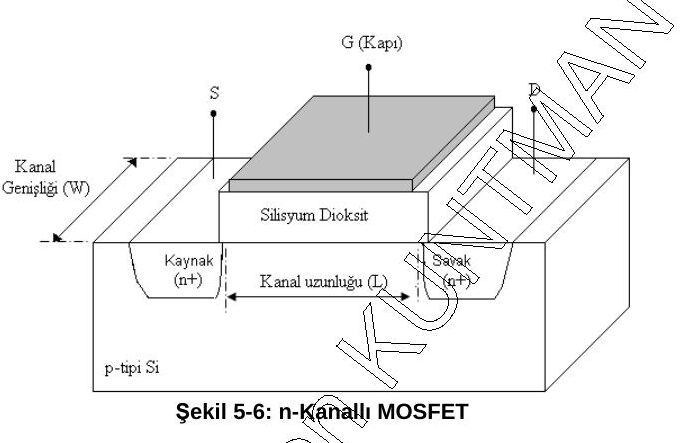

The formation of current depends on the charge induced in the channel by the voltage applied to the gate. The channel length, the electric field strength, and the transit time of the electrons affect the speed and current of the device. The current is the amount of charge induced in the channel per unit time:

I_DS = Q_C / τ   (charge induced in the channel / electron transit time)   (5-1)

τ = L / v   (5-2),   v = µ·E_DS   (5-3),   E_DS = V_DS / L   (5-4)

τ = L² / (µ·V_DS)   (5-5)

Here v is the velocity, L is the channel length, and E_DS is the electric field strength.

#### 5.2.1. Derivation of the Current Expression of the N-Channel MOS Transistor

- **Cutoff region:** V_GS − V_TO < 0; there is no channel between source and drain, and no current flows.
- **Non-saturation region:** V_GS ≥ V_TO and V_DS < V_GS − V_TO; the current is determined by the source-drain voltage.
- **Saturation region:** V_DS ≥ V_GS − V_TO > 0; the current is determined by the gate-source voltage. The saturation boundary is V_DS = V_GS − V_TO.

With E_g the electric field at the gate, ε_r(SiO₂) the relative permittivity of SiO₂, ε₀ the permittivity of free space, and WL the effective transistor area, the charge induced at the gate is:

Q_C = E_g·ε_r(SiO₂)·ε₀·W·L   (5-6)

The average electric field at the gate in the non-saturation region is:

E_g = [(V_GS − V_TO) − V_DS/2] / t_ox   (5-7)

Q_C = (W·L·ε_r(SiO₂)·ε₀ / t_ox)·[(V_GS − V_TO) − V_DS/2]   (5-8)

I_DS = (ε_r(SiO₂)·ε₀·µ / t_ox)·(W/L)·[(V_GS − V_TO) − V_DS/2]·V_DS   (5-9)

**I_DS = K·(W/L)·[(V_GS − V_TO)·V_DS − V_DS²/2]**   (5-10) — current relation in the non-saturation region

Here K is the SPICE process parameter:

K = ε_r(SiO₂)·ε₀·µ / t_ox   (5-11)

The same expression can also be written in terms of the gate region capacitance:

C_g = ε_r(SiO₂)·ε₀·W·L / t_ox   (gate region capacitance)   (5-12)

I_DS = (C_g·µ / L²)·[(V_GS − V_TO)·V_DS − V_DS²/2]   (5-13)

β = µ·C_ox·(W/L)   (5-14),   C_ox = ε_ox / t_ox = ε_r(SiO₂)·ε₀ / t_ox   (gate capacitance per unit area)   (5-15)

**I_DS = β·[V_GS − V_TO − V_DS/2]·V_DS**   (5-16)

The current expressions in the saturation region in terms of K, C_g, and β:

I_DS = K·(W/L)·(V_GS − V_TO)²/2   (5-17)

I_DS = (C_g·µ / 2L²)·(V_GS − V_TO)²   (5-18)

**I_DS = (β/2)·(V_GS − V_TO)²**   (5-19)

The variation of the drain current with the source-drain voltage is defined as the transistor's **current-voltage characteristic** (Figure 5-7), and the variation of the drain current with the gate voltage is defined as the **transfer characteristic** (Figure 5-8).

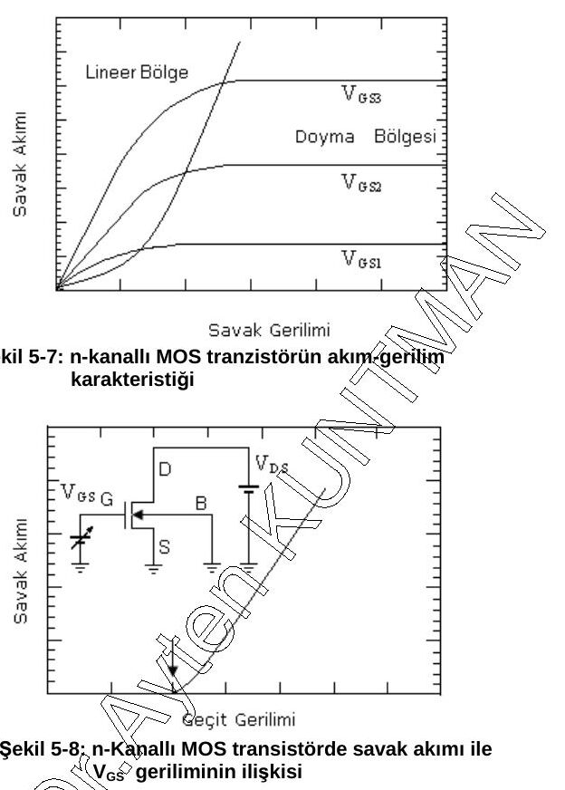

#### Current Expressions of the p-Channel MOS Transistor

The operating regions of the PMOS are similar to those of the NMOS, with opposite signs (V_DS < 0; V_TO < 0):

1. In cutoff: V_GS − V_TO > 0, I_D = 0.
1. In the non-saturation region (V_DS > V_GS − V_TO): I_DS = β·[V_GS − V_TO − V_DS/2]·V_DS   (5-20)
1. In the saturation region (V_DS < V_GS − V_TO < 0): I_DS = (β/2)·(V_GS − V_TO)²   (5-21)

## 5.3. Model Parameters of MOS Transistors

The most fundamental model parameters of a MOS transistor are: threshold voltage, body parameter, channel length modulation parameter, effective channel length, transconductance, switching speed, output conductance, and MOS capacitances.

#### 5.3.1. Threshold Voltage (V_TO)

The threshold voltage is the minimum voltage that must be applied to the gate for current to flow through the transistor. It has four physical components:

- a) The work function difference between the gate and the channel
- b) The effect of the surface potential
- c) The effect of the charges in the depleted region
- d) The gate oxide and Si–SiO₂ interface charges

**V_TO = Φ_GC − 2Φ_F − Q_BO/C_ox − Q_ox/C_ox**   (5-22)

Here Φ_F is the Fermi potential of the substrate (negative for NMOS, positive for PMOS), Q_BO is the depletion region charge of the body per unit area (negative for NMOS, positive for PMOS), Q_ox is the Si–SiO₂ interface charge, and C_ox is the oxide capacitance per unit area. The analysis is carried out for the n-channel; with small changes it is also valid for the p-channel.

The work function difference depends on the gate material:

- For a metal gate: Φ_GC = Φ_F(substrate) − Φ_M
- For a polysilicon gate: Φ_GC = Φ_F(substrate) − Φ_F(gate)

The surface potential changes by −2Φ_F. The Fermi potential is:

- For p-type semiconductor: Φ_F = (kT/q)·ln(n_i/N_A)   (5-23)
- For n-type semiconductor: Φ_F = (kT/q)·ln(N_D/n_i)   (5-24)

The depletion region charge density when the source-substrate voltage is zero is:

Q_BO = −√(2q·N_A·ε_Si·|−2Φ_F|)   (5-25)

With a source-substrate voltage V_SB:

Q_B = −√(2q·N_A·ε_Si·|−2Φ_F + V_SB|)   (5-26)

Oxide capacitance per unit area: C_ox = ε_ox / t_ox   (5-27)

The generalized threshold voltage including the effect of V_SB:

V_T = Φ_GC − 2Φ_F − Q_B/C_ox − Q_ox/C_ox   (5-28)

The document gives a value range of Q_ox = (1.5 – 8)×10⁻⁸ for the interface charge (the unit is written in the document as "c²/m²"; the unit of charge density should be C/cm²).

V_T = V_TO − (Q_B − Q_BO)/C_ox   (5-29)

−(Q_B − Q_BO)/C_ox = (√(2q·N_A·ε_Si) / C_ox)·(√|−2Φ_F + V_SB| − √|−2Φ_F|)   (5-30)

**V_T = V_TO + γ·(√|−2Φ_F + V_SB| − √|2Φ_F|)**   (5-31)

γ = √(2q·N_A·ε_Si) / C_ox   (body effect coefficient)   (5-32)

This expression can be used for both n-channel and p-channel transistors; only the signs of the terms need attention. Φ_F is negative for NMOS and positive for PMOS; Q_BO and Q_B are negative for NMOS and positive for PMOS; γ is positive for NMOS and negative for PMOS; V_SB is positive for NMOS and negative for PMOS.

#### 5.3.2. Body Parameter (Substrate Bias Coefficient)

γ = √(2q·N_A·ε_Si) / C_ox   (5-33)

Here q is the electron charge, N_A is the doping concentration, ε_Si is the dielectric constant of silicon, and C_ox is the oxide capacitance per unit area.

#### 5.3.3. Effective Channel Length of the MOS Transistor

The channel length drawn in the design is L. Because unwanted lateral diffusion occurs during source-drain diffusion, the channel length is shortened by 2·L_lateral diff.; this is called the **metallurgical channel length** and is used in calculations in the linear region:

L_met = L_drawn − 2·L_lateral diff.

In saturation operation, a depletion region of X_D forms at the drain end of the channel and the channel becomes shorter by a further X_D. The channel length in this case is the **effective channel length**:

L_eff = L_drawn − 2·L_lateral diff. − X_D   (5-34)

The gain of the transistor varies with the effective channel length. The channel shortening is:

X_D = √(2ε·(V_DS − V_DSsat) / (q·N_A))   (5-35),   V_DSsat = √(2I_D/β)   (5-36)

#### 5.3.4. Transconductance (g_m)

Transconductance gives the relationship between the input voltage and the output current:

g_m = ∂I_DS/∂V_GS   (V_DS = constant)   (5-37)

In terms of charge: τ = Q_C/I_DS, ∂I_DS = ∂Q_C/τ_SD, τ_SD = L²/(µ·V_DS) (5-40). Since the change in charge is δQ_C = C_g·δV_GS:

∂I_DS = C_g·∂V_GS·µ·V_DS / L²   (5-42)

g_m = ∂I_DS/∂V_GS = C_g·µ·V_DS / L²   (5-43)

In saturation operation:

**g_m = (µ·ε_r(SiO₂)·ε₀ / t_ox)·(W/L_eff)·(V_GS − V_TO)**   (5-44)

#### 5.3.5. Switching Speed (Operating Frequency)

ω₀ = g_m / C_g = (µ/L²)·(V_GS − V_TO)   (5-45)

#### 5.3.6. Output Conductance

For small changes in the source-drain voltage, it expresses the change in current resulting from channel shortening; its inverse is the output resistance:

g_o = (I_D / L_eff)·(∂X_D/∂V_DS),   R_O = 1/g_o   (5-46)

## 5.4. MOS Capacitances

For the time-domain response of a MOSFET, the type and magnitude of the capacitances are important in digital circuits. Two kinds of parasitic capacitance generally arise in the structure: **oxide capacitance** and **junction capacitance**.

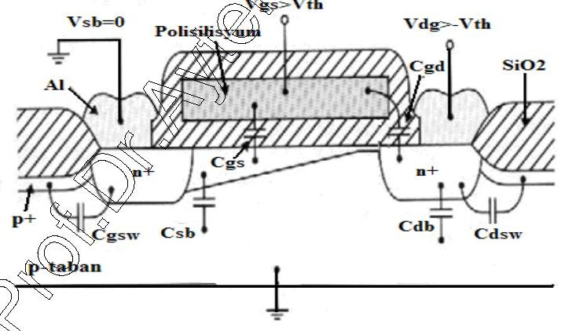

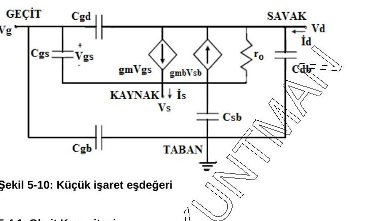

#### 5.4.1. Oxide Capacitance

The parasitic oxide capacitances are the gate-substrate (C_gb), gate-drain (C_gd), and gate-source (C_gs) capacitances; they are also known as **overlap capacitances** and form as parallel-plate capacitors. The oxide capacitance per unit area of the gate region is:

C_ox = ε_ox / t_ox = ε_r(SiO₂)·ε₀ / t_ox   (5-47)

Their values according to the operating regions (L_D: overlap/lateral diffusion length):

| Capacitance | Cutoff | Linear region | Saturation region |
|---|---|---|---|
| C_gb (total) | C_ox·W·L | 0 | 0 |
| C_gd (total) | C_ox·W·L_D | ½·C_ox·W·L + C_ox·W·L_D | C_ox·W·L_D |
| C_gs (total) | C_ox·W·L_D | ½·C_ox·W·L + C_ox·W·L_D | ⅔·C_ox·W·L + C_ox·W·L_D |

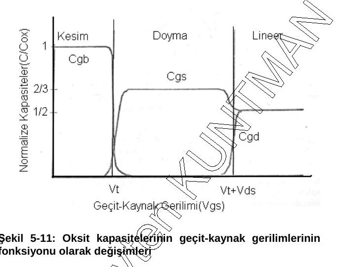

#### 5.4.2. Junction Capacitances

Depending on the applied voltage, capacitance forms at the source-substrate and drain-substrate junctions. Every pn junction can behave like a capacitor: the depletion region acts like a dielectric. For a reverse-biased abrupt (step) pn junction, the depletion region thickness is found first:

x_d = √((2ε_Si/q)·((N_A + N_D)/(N_A·N_D))·(Φ₀ − V))   (5-48)

In the document this expression is written with (Φ₀ − V_R), and V_R is defined as the "reverse bias".

*Note: If V_R is the magnitude of the reverse bias (a positive number), the expression should be (Φ₀ + V_R); the (Φ₀ − V) form is correct when V is the signed voltage applied to the junction (negative under reverse bias). (5-50)–(5-53) below use this second form.*

The built-in (body) potential of the junction:

Φ₀ = (kT/q)·ln(N_A·N_D / n_i²)   (5-49)

The charge stored in the depleted region (A is the junction area):

Q_j = A·q·(N_A·N_D/(N_A + N_D))·x_d = A·√(2ε_Si·q·(N_A·N_D/(N_A + N_D))·(Φ₀ − V))   (5-50)

The junction capacitance is calculated as C_j = dQ_j/dV (5-51):

C_j(V) = A·√((ε_Si·q/2)·(N_A·N_D/(N_A + N_D))·1/(Φ₀ − V))   (5-52)

In a more general form, with m the grading coefficient (1/2 for an abrupt junction, 1/3 for a linear junction):

**C_j(V) = A·C_j0 / (1 − V/Φ₀)^m**   (5-53)

C_j0 = √((ε_Si·q/2)·(N_A·N_D/(N_A + N_D))·1/Φ₀)   (zero-bias junction capacitance per unit area)   (5-54)

## 5.5. Measurement of Parameters

Using the current relations given earlier (5-16, 5-19, 5-20, 5-21), the threshold voltage V_TO, the body effect coefficient γ, the channel length modulation coefficient λ, and the transconductance parameters can be extracted experimentally:

β_n = µ_n·C_ox·(W/L)   (5-55),   β_p = µ_p·C_ox·(W/L)   (5-56)

The extraction of β_n, V_TO, and γ for an n-channel MOSFET is shown in Figure 5-13. With V_SB held constant, the current is measured for different values of V_GS; the drain and gate are at the same potential (V_DS = V_GS), so V_DS > V_GS − V_T and the transistor operates in saturation. If channel length modulation is neglected:

I_D(sat) = (β_n/2)·(V_GS − V_T)²   (5-57)

√I_D = √(β_n/2)·(V_GS − V_T)   (5-58)

If √I_D is plotted against V_GS, a straight line is obtained for each V_SB. The point where the V_SB = 0 line crosses the voltage axis gives V_TO, and the points where the V_SB > 0 lines cross give V_T. The slope of each line is equal to √(β_n/2); β_n is easily found from this slope. γ is then:

γ = (V_T(V_SB) − V_TO) / (√(2|φ_F| + V_SB) − √(2|φ_F|))   (5-59)

*Note: In the document, the measured current is referred to as the "gate current"; a MOSFET has no gate current—the current that is measured and whose square root is taken is the **drain current** (I_D).*

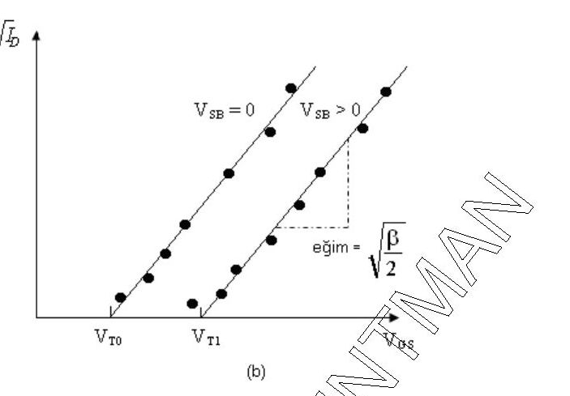

The channel length modulation coefficient λ is determined with a different test circuit (Figure 5-14). V_GS is set to V_TO + 1, V_DS is chosen sufficiently large (V_DS > V_GS − V_TO), and the transistor operates in saturation. The drain current is measured for two different values, V_DS1 and V_DS2:

I_D(saturation) = (β_n/2)·(V_GS − V_TO)²·(1 + λ·V_DS)   (5-60)

I_D2 / I_D1 = (1 + λ·V_DS2) / (1 + λ·V_DS1)   (5-61)

The slope of the I_D–V_DS curve in the saturation region is λ·β_n/2 (for V_GS − V_TO = 1 V). Thus the threshold voltage, body parameter, channel length modulation parameter, and transconductance parameter can be found from transistor measurements.

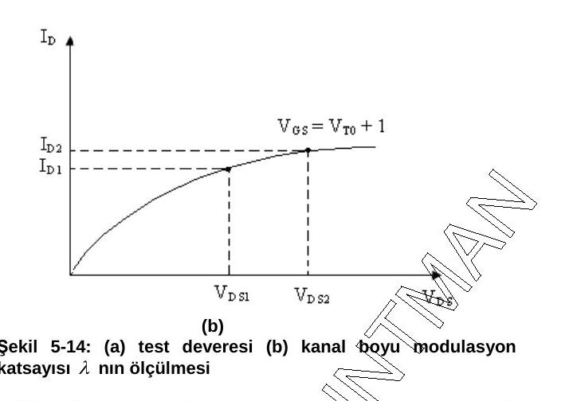

## 5.6. CMOS Technology: The n-Well CMOS Process

For n-well CMOS, p-type silicon with a doping concentration of around 10¹⁵ atoms/cm³ is used as the substrate. An oxide that will act as a mask against diffusion is grown, mask 1, which will form the n-well, is applied, and the n-well is opened by a lithographic process. Then the active regions of the nMOS and pMOS transistors are defined. A CMOS inverter is fabricated with at least 7 masks:

1. Formation of the n-well (assuming a p substrate is used)
1. Opening of the n-channel transistor area and formation of the gates
1. Formation of the active regions of the NMOS
1. Formation of the active regions of the PMOS
1. Definition of the contact areas
1. Al deposition and patterning for the metal interconnects
1. Formation of the bonding pads and passivation

The steps in Figure 5-16:

- **(a.1)** Field oxide is grown; the n-well is formed with mask 1; gate oxide is grown. The thickness and quality of the gate oxide are two important fabrication parameters that affect the characteristics and lifetime of MOS transistors.
- **(a.2)** The n-channel transistor area is defined with mask 2.
- **(b)** The gates are formed: the polysilicon layer is deposited by chemical vapor deposition and patterned by plasma etching with the gate mask. These polysilicon lines are the gates of the nMOS and pMOS transistors.
- **(c)** The p⁺ regions are formed; the ohmic connections to the substrate and the n-well are also made in this step.
- **(d)** The n⁺ regions are formed.
- **(e)** Contacts are opened: first an insulating SiO₂ layer is formed by CVD, then the contacts are defined and etched to open windows to silicon or polysilicon.
- **(f)** Metal is evaporated onto the chip for the circuit interconnections and patterned with the metal lines mask.
- **(g)** The layout and vertical cross-section with the pMOS transistor inside the n-well and the nMOS transistor outside it, completed with polysilicon and metal connections. The last step is passivation for protection.

, (a.2), (b), (c): Fabrication steps of the CMOS inverter")

, (e), (f), (g): Fabrication steps of the CMOS inverter")

## 6. Layout Design Rules

The physical mask layout of any circuit is created with special procedures that satisfy certain geometric rules or constraints; these are called **layout design rules**. The rules ensure that the metal or polysilicon interconnects on the chip have the minimum allowed width, that devices have minimum sizes, and that the distance between two devices is at least the minimum allowed value. For example, if a narrow metal line is fabricated with an unsuitable technology, it may break during or after fabrication and create unwanted open circuits; if two metal lines are too close to each other, unwanted short circuits may occur. The purpose of the design rules is to build high-reliability, high-quality circuits while using the smallest silicon area. The rules do not draw a sharp line between correct and incorrect designs, but they generally increase fabrication yield and quality significantly.

Two rule types are used for dimensioning:

- **Micron rule:** Minimum device dimensions and the distances between devices are specified with exact micron values.
- **Lambda rule:** Layout rules are determined as multiples of the parameter λ; thus linearly proportional scaling can be performed.

Lambda-based rules are designed to simplify micron-based rules and to make scaling easier; however, in some submicron CMOS applications the design rules do not follow linear scaling, so they must be determined with great care there.

**Table 6-1: Lambda-based layout design rules for the MOSIS (MOS Implementation System) CMOS process**

| Rule | Description | λ rule |
|---|---|---|
| R1 | Minimum active area width | 3λ |
| R2 | Minimum active area spacing | 3λ |
| R3 | Minimum poly width | 2λ |
| R4 | Minimum poly spacing | 2λ |
| R5 | Minimum gate extension of poly over active area | 2λ |
| R6 | Minimum poly-to-active edge spacing (poly outside the active area) | 1λ |
| R7 | Minimum poly-to-active edge spacing (poly inside the active area) | 3λ |
| R8 | Minimum metal width | 3λ |
| R9 | Minimum metal spacing | 3λ |
| R10 | Poly contact size | 2λ |
| R11 | Minimum poly contact spacing | 2λ |
| R12 | Minimum poly contact–to–poly edge spacing | 1λ |
| R13 | Minimum poly contact–to–metal edge spacing | 1λ |
| R14 | Minimum poly contact–to–active edge spacing | 3λ |
| R15 | Active contact size | 2λ |
| R16 | Minimum active contact spacing (on the same active region) | 2λ |
| R17 | Minimum active contact–to–active edge spacing | 1λ |
| R18 | Minimum active contact–to–metal edge spacing | 1λ |
| R19 | Minimum active contact–to–poly edge spacing | 3λ |
| R20 | Minimum active contact spacing (on different active regions) | 6λ |

R1–R2 are active area rules, R3–R7 are polysilicon rules, R8–R9 are metal rules, and R10–R20 are contact rules.

*Note: In the document, R20 is written as "Minimum poly contact spacing (on different active regions)"; since the description and figure refer to active contacts, it is given as "active contact" in the table.*

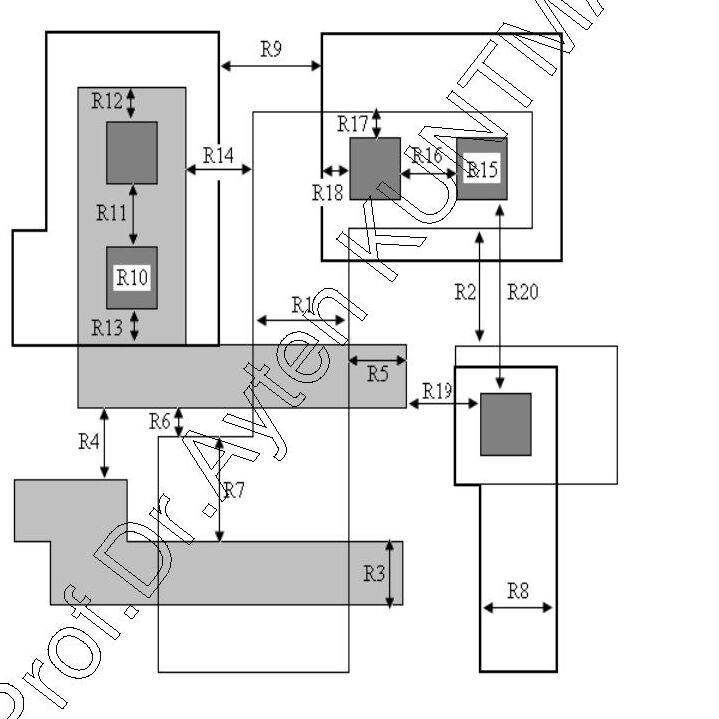

## 6.1. "Full-Custom" Mask Layout Rules

The physical layout and circuit performance are tightly coupled: the physical structure directly determines the transconductance of the transistors, the parasitic capacitances and resistances, and the silicon area used. On the other hand, detailed mask layout of logic gates is time-consuming. The physical (mask layout) design of CMOS logic gates is an iterative process that begins with the circuit topology (for the desired logic function) and the initial sizes of the transistors (for the desired performance). At this point, the designer can estimate the total parasitic load at the output only from the number of devices at the output and the estimated interconnect lengths. If the logic gate contains more than 4–6 transistors, topological drawing and the **Euler path method** help find the optimal ordering of the transistors; in this step a simple **stick diagram** and the contact locations can be drawn.

After a realizable topology is found, the mask layers are drawn with a layout editor according to the design rules; this is repeated several times but the basic topology does not change much. **DRC** (*Design Rule Check*) is performed on the finished layout and the parasitic capacitances at each node are determined. The result of the *extraction* step is an automatically generated detailed SPICE file; the actual circuit performance is determined with SPICE. If the simulation results do not meet the desired performance, the entire process is repeated. Layout changes are made through the W/L ratio, since it determines the parasitic source-drain capacitances and the transconductance; the designer can also change the circuit topology to reduce parasitic effects.

## 6.2. CMOS Inverter Layout Design

As an example, the mask layout of an n-well CMOS inverter is considered. First, the minimum-size design rules for the n-channel MOS transistor are determined (Figure 6-2). The polysilicon width over the active area (the gate) is typically taken as the minimum poly width. Accordingly:

- **Minimum active area length** = (minimum polysilicon width) + 2 × (minimum poly–to–contact spacing) + 2 × (minimum contact width) + 2 × (minimum active region edge–to–contact spacing)
- **Minimum active area width** = (minimum contact width) + 2 × (minimum contact–to–active edge distance)

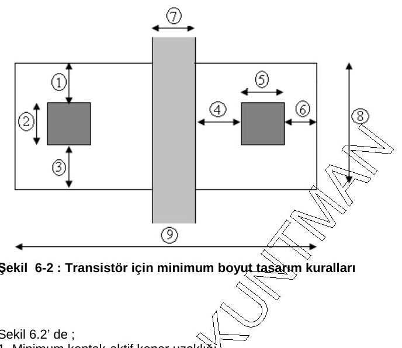

The dimensions in Figure 6-2: 1, 3, and 6: minimum contact–to–active edge distance; 2: minimum contact width; 4: minimum polysilicon edge–to–contact distance; 5: minimum contact length; 7: minimum polysilicon length; 8: minimum active area width; 9: minimum active area length.

In n-well CMOS, the n-channel MOS is located on the p-substrate; the PMOS transistor, on the other hand, is formed **inside the n-well** made on the p-substrate. The minimum size of the n-well is determined by the PMOS active area and the minimum distance between the n-well and the p⁺ region. The distance between the NMOS and PMOS is determined by the distance between the n⁺ active area and the n-well (Figure 6-3). The polysilicon gates of the NMOS and PMOS are generally joined; the gate connection is made with a single polysilicon line. Long polysilicon lines are avoided because of the large parasitic capacitance, resistance, and RC delays they create; interconnections are made with metal wherever possible, and when necessary the layers are joined with metal–polysilicon contacts.

Full-custom layout allows the desired changes in device sizing, placement, and interconnections; the designer selects a mask layout from among alternatives according to criteria such as small silicon area, reduced delay, and placement of the input/output terminals; the number of possible layouts increases with the complexity of the circuit.

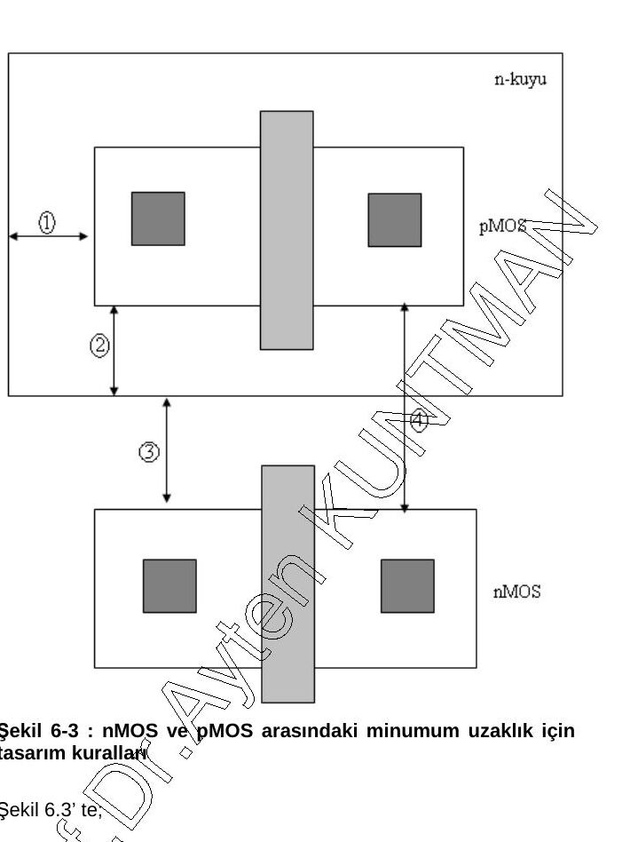

In Figure 6-3, 1 and 2: minimum distance between the n-well and the p⁺ active area; 3: minimum distance between the n⁺ active area and the n-well; 4: minimum distance between the nMOS and pMOS transistors.

## 6.3. MOS Integrated Circuit Design

In digital integrated circuits, integration is achieved with MOS and CMOS technologies; the transistor type, channel length, and channel width are important parameters. In NMOS technology, in logic gates the E-NMOS devices are used as **driver** and the D-NMOS devices as **load** transistors; in CMOS technology, the E-NMOS devices are used as drivers and the PMOS devices as load transistors. Once the technology is chosen, the two basic tasks are selecting the circuit that will realize the function and sizing the transistors; the process parameters are determined by the technology.

#### 6.3.1. Inverters

The logic gates built with transistors can be listed as NOT, OR, AND, NOR, NAND; the most fundamental of these is the **inverter**, which performs the operation Y = X̄ (NOT).

#### 6.3.2. NMOS Inverter

In NMOS technology, the E-NMOS is the driver transistor (T_D) and the D-NMOS is the load transistor (T_L).

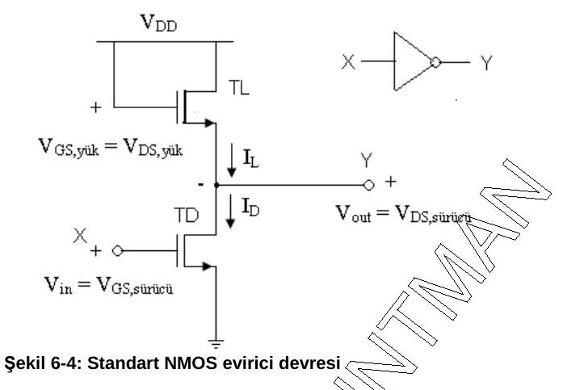

Initially, until V_i reaches the threshold of T_D, T_D is in cutoff and V_O = V_DD (logic 1). As V_i increases, the output falls, and the lowest output voltage is V_L (logic 0). The point where the 45°-sloped line intersects the transfer curve is called **V_INV** (the inversion point). V_DD and V_L are the nominal voltage levels corresponding to the logic 1 and logic 0 states.

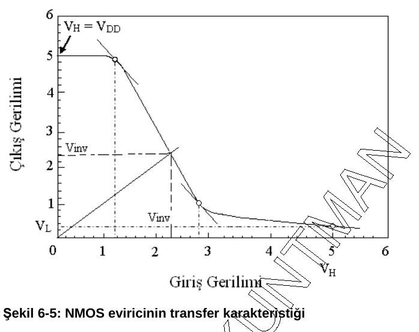

##### Quantities relating the electrical properties of the inverter to its structure

Five quantities primarily determine inverter performance: logic 0 voltage, logic threshold, fall delay, rise delay, and power dissipation.

**1. Logic 0 voltage (V_L):** The output voltage obtained when V_DD is applied to the input. In this case T_D operates in the non-saturation region and T_L in the saturation region; equating the currents of the two transistors:

V_L = [(−V_TL)² / (β_D/β_L)]·1/(V_DD − V_TD)   (6-1)

V_L = [(−V_TL)² / ((W_D/L_D)/(W_L/L_L))]·1/(V_DD − V_TD)   (6-2)

β = µ·C_ox·(W/L)   (parameter belonging to the transistor)   (6-3)

*Note: Equating the currents and neglecting the V_L² term gives β_D·(V_DD − V_TD)·V_L = (β_L/2)·V_TL² and V_L ≈ (−V_TL)²/(2·(β_D/β_L)·(V_DD − V_TD)); in (6-1) and (6-2) in the document the factor of 2 in the denominator is missing.*

**2. Logic threshold (V_INV):** The voltage that, when applied to the input, brings the output to the same value; the point where the line drawn at 45° from the origin in Figure 5-6 intersects the transfer curve. For V_i > V_inv, V_o < V_inv, and for V_i < V_inv, V_o > V_inv. For this reason it is taken as the boundary between logic 0 and logic 1; it is approximately V_DD/2.

V_inv = V_TD + (−V_TL)/√(β_D/β_L) = V_TD + (−V_TL)/√((W_D/L_D)/(W_L/L_L))   (6-4)

**3. Fall delay (τ_D):** The time it takes for the output to change from 1 to 0; it is needed in determining the speed of the circuit and the frequency of the signal at the input. A system with a large fall delay cannot respond to fast pulses.

τ_D = Q_L / I_D   (6-5)

τ_D = 2C_L·V_DD / (β_D·(V_DD − V_TD)²)   (6-6)

τ_D = 2C_L·V_DD / (µ·C_ox·(W_D/L_D)·(V_DD − V_TD)²)   (6-7)

τ_D = (C_L / (C_ox·W_D·L_D))·2L_D²·V_DD / (µ·(V_DD − V_TD)²)   (6-8)

**4. Rise delay (τ_U):** The time it takes for the output to change from 0 to 1.

τ_U = Q_L / I_L = C_L·V_DD / ((β_L/2)·(−V_TL)²)   (6-9)

τ_U = C_L·V_DD / (µ·C_ox·(W_L/2L_L)·(−V_TL)²)   (6-10)

τ_U = (C_L / (C_ox·W_L·L_L))·2V_DD·L_L² / (µ·(−V_TL)²)   (6-11)

*Note: In the document, the denominator of (6-11) is written as (V_DD − V_TL)²; continuing from (6-9) and (6-10), the correct form is (−V_TL)².*

**5. Power dissipation:** In the NMOS inverter, power is dissipated when the output is at logic 0 (both transistors conducting):

P = (β_L/2)·(−V_TL)²·V_DD = ½·µ·C_ox·(W_L/L_L)·(−V_TL)²·V_DD

All of these parameters are optimized together.

#### 6.3.3. CMOS Inverters

In CMOS technology, the E-NMOS is the driver and the PMOS is the load transistor. In the circuit in Figure 6-6, initially at V_i = 0, T_L is conducting, T_D is in cutoff, and V_O = V_DD (logic 1). When V_i = V_DD + V_TL, T_L enters cutoff, T_D is conducting, and V_O = 0 (logic 0). From the transfer curve it is seen that V_o = 0 for V_i = V_DD and V_o = V_DD for V_i = 0.

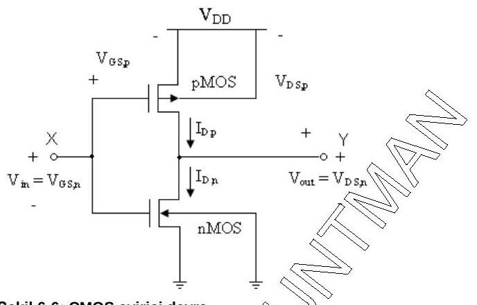

**V_inv = (V_DD + V_TL + √(β_D/β_L)·V_TD) / (√(β_D/β_L) + 1)**   (6-12)

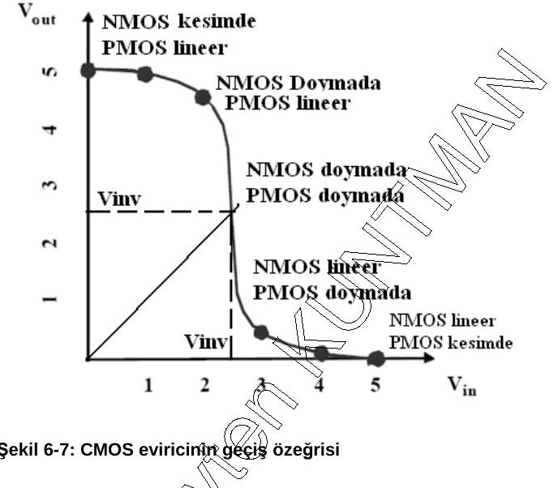

In the CMOS inverter, the fall and rise delays are calculated by assuming that when one of the transistors is conducting, the other is in cutoff. Since no current flows except during the transition, the power dissipation of CMOS is low.

τ_D = (C_L / (C_ox·W_D·L_D))·2L_D²·V_DD / (µ_n·(V_DD − V_TD)²)   (6-13)

τ_U = τ_D·β_D·(V_DD − V_TD)² / (β_L·(V_DD + V_TL)²) = 2C_L·V_DD / (β_L·(V_DD + V_TL)²)   (6-14)

The continuation of the note (bipolar integrated circuits) is in the 3rd post of the series: [3) bipolar integrated circuits](/arsiv/eem312-vlsi-tasarimi-kuntman-3-bipolar-tumdevreler/).
