Bu yazı, EEM312 Sayısal Elektronik dersinin klasöründe bulunan 158 sayfalık **"VLSI Tasarımı"** ders notunun ikinci bölümüdür (notun 26–75. sayfaları). Belgenin kapağında *"Bu notlar Prof. Dr. Ayten Kuntman tarafından 11.03.2009 tarihinde yayınlanan notların yeniden düzenlenmiş halidir"* yazıyor; PDF 28 Nisan 2009'da oluşturulmuş. Düzenlemeyi kimin yaptığı ve notun hangi kurumda okutulduğu belgede yazmıyor (Prof. Dr. Ayten Kuntman, İstanbul Teknik Üniversitesi öğretim üyesidir).

*Bu içerik üçüncü taraf bir kaynağa aittir; arşiv ve nostalji amacıyla kaynak belirtilerek paylaşılmıştır. Hak sahibinin talebi hâlinde kaldırılır.*

Serinin diğer yazıları: [1) tümdevre üretimi, silisyum ve proses adımları](/arsiv/eem312-vlsi-tasarimi-kuntman-1-uretim-ve-proses/) (notun tamamı orada indirilebilir), [3) bipolar tümdevreler](/arsiv/eem312-vlsi-tasarimi-kuntman-3-bipolar-tumdevreler/), [4) SPICE, serim örnekleri, sorular ve kaynaklar](/arsiv/eem312-vlsi-tasarimi-kuntman-4-spice-serim-sorular/). Bu bölümün metni, formülleri ve tabloları aşağıya aktarıldı (bozuk Türkçe karakterler ve PDF'te dağılmış formüller düzeltildi); şekiller kırpılarak eklendi. Bu bölümün sayfalarından oluşan PDF yazının sonunda indirilebilir.

## 5. MOS tümdevreler

MOS tümdevre üretiminde temel yapıtaşı MOSFET'lerdir; bu bölümde MOSFET üretim aşamaları ve bunların devre performans karakteristiklerine etkileri anlatılır. MOS (metal-oksit-yarıiletken) yapılar sayısal elektronik devre yapımında çok yaygın kullanılır; avantajları basitlik, ölçekleme kolaylığı, düşük güç harcaması ve yüksek hızdır. MOS'lar üç ana grupta toplanır:

- N-kanallı MOS tranzistörler
- P-kanallı MOS tranzistörler
- CMOS'lar (kendi aralarında n-kuyulu ve p-kuyulu olmak üzere ikiye ayrılır)

## 5.1. Temel MOS yapıları

N-kanallı MOS tranzistörler **kanal oluşturmalı (E-NMOS)** ve **kanal ayarlamalı (D-NMOS)** olmak üzere ikiye ayrılır. E-NMOS'un eşik gerilimi sıfırdan büyük, D-NMOS'un eşik gerilimi sıfırdan küçüktür.

#### Kanal oluşturmalı NMOS (E-NMOS)

E-NMOS'ta p-tipi bir taban üzerine n-tipi difüzyonla kaynak ve savak bölgeleri oluşturulur. Geçit üzerinde SiO₂ ve polisilisyum geçit elektrodu vardır; kontak ve metal bağlantılarla tranzistör tamamlanır. Başlangıçta kanal yoktur. Geçide kaynağa göre daha pozitif bir gerilim uygulanırsa geçit-taban arasında oluşan elektrik alan nedeniyle elektronlar yukarı çekilir, delikler aşağı itilir ve savak-kaynak arasında bir **n-kanal** oluşur.

*Not: Belgede "kaynak (drain) ve savak (source)" yazılmış; doğrusu kaynak = source, savak = drain'dir.*

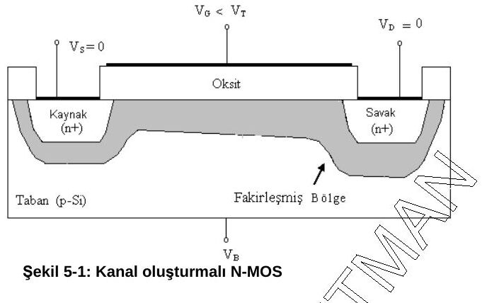

#### Kanal ayarlamalı NMOS (D-NMOS)

D-NMOS'ta eşik gerilimi sıfırdan küçüktür. E-NMOS'tan farklı olarak yapım sırasında geçit bölgesi katkılanmıştır: kaynak-savak arası iyon implantasyonuyla elektronca zenginleştirilir. Böylece geçide gerilim uygulanmadan önce (V_GS = 0'da da) yapıda bir kanal vardır; çalışma sırasında geçide gerilim uygulanarak akım kontrol edilir.

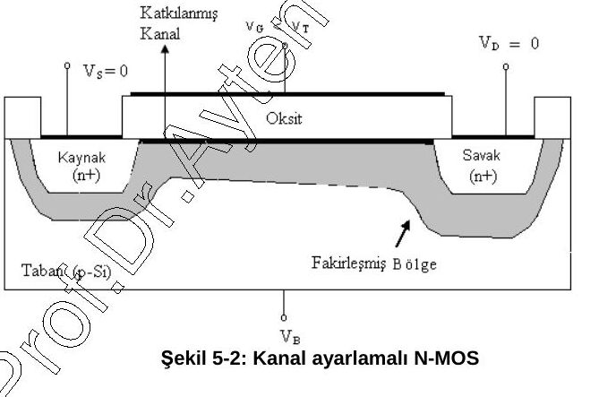

#### Kanal oluşturmalı PMOS (E-PMOS)

P-kanallı MOS'larda n-tipi taban üzerine p-tipi difüzyonla kaynak ve savak bölgeleri oluşturulur. Geçide uygun büyüklükte **negatif** bir gerilim uygulanınca delikler yukarı çekilerek kanal oluşur (Şekil 5-3).

#### 5.1.2. E-NMOS tranzistörün çalışma bölgeleri

MOS tranzistörün doymasız bölge, doymalı bölge ve kısılma olmak üzere üç çalışma durumu vardır (Şekil 5-4):

- **a) Kanal oluşumu:** V_GS ≥ V_TO. Uygulanan V_GS eşik gerilimine ulaşınca kanal oluşur ve akım akmaya başlar.
- **b) Doymasız bölge:** V_DS ≤ V_GS − V_TO. V_DS artırılırsa savak akımı artar.
- **c) Doymalı bölge:** V_DS ≥ V_GS − V_TO. Akımın geçit gerilimiyle kontrol edildiği bölgedir; V_GS arttıkça savak akımı artar. Belli bir değerden sonra kanalın savak ucunda bir kısılma oluşur ve çalışma koşulları değişir.

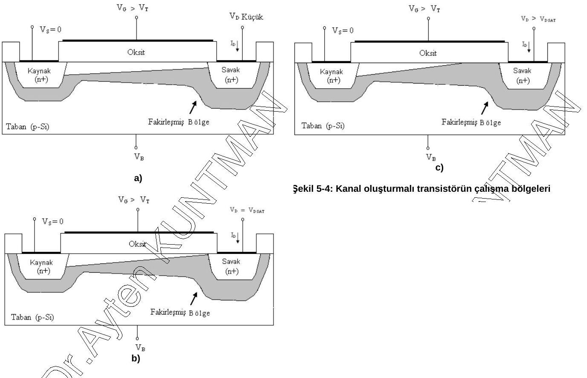

#### 5.1.3. N-kanallı MOS tranzistör üretim süreci

Polisilisyum geçitli n-kanallı MOS tranzistörün üretimi, p-tipi silisyum yüzeyinde 1. maske kullanılarak silisyum dioksit büyütmeyle başlar; buna **alan oksiti** denir. Alan oksiti üzerinde oksit maskesiyle tranzistör yapılacak alan belirlenir ve MOS tranzistörün geçidini oluşturacak yüksek kaliteli ince bir oksit büyütülür. İnce oksidin üzerine polisilisyum büyütülür ve 2. maskeyle polisilisyum geçit elektrodu oluşturulur. Geçit elektrodunun iki yanında katkılamayla n-bölgeleri (kaynak ve savak) oluşturulur. Ardından 3. maskeyle kontak pencereleri açılır; tüm yüzey metalle kaplanır ve 4. maskeyle metal yollar oluşturulur. Uygulanan maskeler:

1. Aktif bölge ve ince oksit maskesi (tranzistör alanı)
1. Polisilisyum maskesi
1. Kontak pencereleri maskesi
1. Metal maskesi

Her maskeleme adımı litografik işlemle gerçekleştirilir.

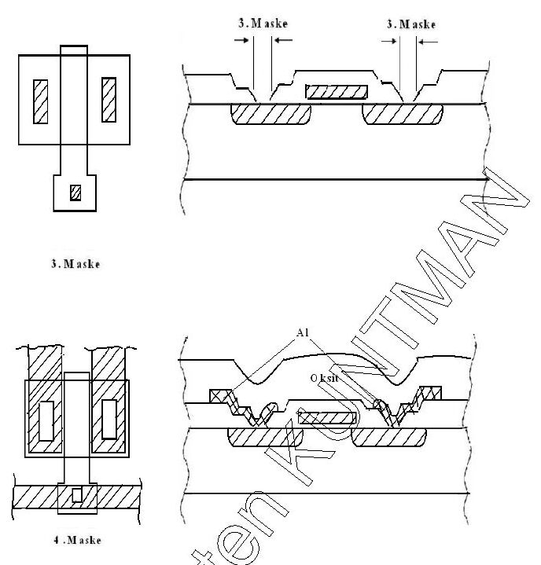

## 5.2. MOS tümdevrelerin temel elektriksel özellikleri

Kanal boyu ve kanal genişliği, tranzistörün kırmık üzerinde kapladığı alanı ve savak akımını belirleyen önemli büyüklüklerdir.

- **Kanal boyu (L):** Kanalın, kaynak-savak arasında akan savak akımı doğrultusundaki boyu.
- **Kanal genişliği (W):** Kanal boyuna dik uzunluk.
- L × W tranzistörün **etkin kanal alanıdır**.

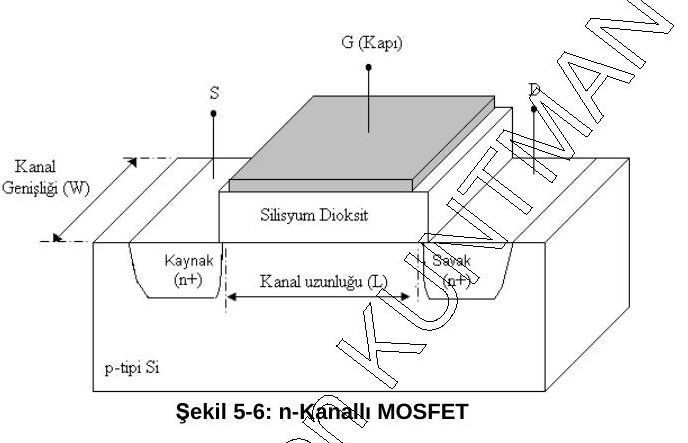

Akımın oluşması, geçide uygulanan gerilim sonucu kanala yük indüklenmesine bağlıdır. Kanal boyu, elektrik alan şiddeti ve elektronların geçiş süresi elemanın hızını ve akımını etkiler. Akım, birim zamanda kanalda indüklenen yük miktarıdır:

I_DS = Q_C / τ   (kanala indüklenmiş yükler / elektronların geçiş süresi)   (5-1)

τ = L / v   (5-2),   v = µ·E_DS   (5-3),   E_DS = V_DS / L   (5-4)

τ = L² / (µ·V_DS)   (5-5)

Burada v hız, L kanal boyu, E_DS elektrik alan şiddetidir.

#### 5.2.1. N-kanallı MOS tranzistörün akım ifadesinin çıkarılışı

- **Kesim bölgesi:** V_GS − V_TO < 0; kaynak-savak arasında kanal yoktur, akım akmaz.
- **Doymasız bölge:** V_GS ≥ V_TO ve V_DS < V_GS − V_TO; akım kaynak-savak gerilimiyle belirlenir.
- **Doymalı bölge:** V_DS ≥ V_GS − V_TO > 0; akım geçit-kaynak gerilimiyle belirlenir. Doyma sınırı V_DS = V_GS − V_TO'dur.

Geçitte indüklenen yükler, E_g geçitteki elektrik alan, ε_r(SiO₂) SiO₂'nin bağıl dielektrik sabiti, ε₀ boşluğun dielektrik sabiti ve WL etkin tranzistör alanı olmak üzere:

Q_C = E_g·ε_r(SiO₂)·ε₀·W·L   (5-6)

Doymasız bölgede geçitteki ortalama elektrik alan:

E_g = [(V_GS − V_TO) − V_DS/2] / t_ox   (5-7)

Q_C = (W·L·ε_r(SiO₂)·ε₀ / t_ox)·[(V_GS − V_TO) − V_DS/2]   (5-8)

I_DS = (ε_r(SiO₂)·ε₀·µ / t_ox)·(W/L)·[(V_GS − V_TO) − V_DS/2]·V_DS   (5-9)

**I_DS = K·(W/L)·[(V_GS − V_TO)·V_DS − V_DS²/2]**   (5-10) — doymasız bölge akım bağıntısı

Burada K, SPICE proses parametresidir:

K = ε_r(SiO₂)·ε₀·µ / t_ox   (5-11)

Aynı ifade geçit bölgesi kapasitesi cinsinden de yazılabilir:

C_g = ε_r(SiO₂)·ε₀·W·L / t_ox   (geçit bölgesi kapasitesi)   (5-12)

I_DS = (C_g·µ / L²)·[(V_GS − V_TO)·V_DS − V_DS²/2]   (5-13)

β = µ·C_ox·(W/L)   (5-14),   C_ox = ε_ox / t_ox = ε_r(SiO₂)·ε₀ / t_ox   (birim alan başına geçit kapasitesi)   (5-15)

**I_DS = β·[V_GS − V_TO − V_DS/2]·V_DS**   (5-16)

Doymalı bölgede akım ifadeleri K, C_g ve β cinsinden:

I_DS = K·(W/L)·(V_GS − V_TO)²/2   (5-17)

I_DS = (C_g·µ / 2L²)·(V_GS − V_TO)²   (5-18)

**I_DS = (β/2)·(V_GS − V_TO)²**   (5-19)

Kaynak-savak gerilimiyle savak akımının değişimi tranzistörün **akım-gerilim karakteristiği** (Şekil 5-7), geçit gerilimiyle savak akımının değişimi ise **transfer karakteristiği** (Şekil 5-8) olarak tanımlanır.

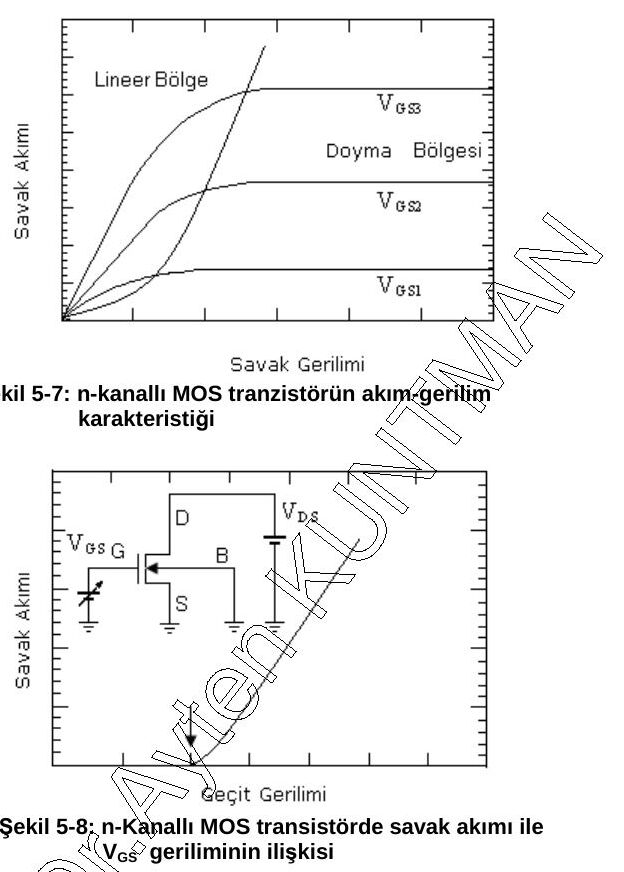

#### p-kanallı MOS tranzistörün akım ifadeleri

PMOS'un çalışma bölgeleri NMOS'unkilere benzer, ters işaretlidir (V_DS < 0; V_TO < 0):

1. Kesimde: V_GS − V_TO > 0, I_D = 0.
1. Doymasız bölgede (V_DS > V_GS − V_TO): I_DS = β·[V_GS − V_TO − V_DS/2]·V_DS   (5-20)
1. Doymalı bölgede (V_DS < V_GS − V_TO < 0): I_DS = (β/2)·(V_GS − V_TO)²   (5-21)

## 5.3. MOS tranzistörlerde model parametreleri

MOS tranzistörde en temel model parametreleri: eşik gerilimi, gövde parametresi, kanal boyu modülasyon parametresi, etkin kanal boyu, geçiş iletkenliği, anahtarlama hızı, çıkış iletkenliği ve MOS kapasitelerdir.

#### 5.3.1. Eşik gerilimi (V_TO)

Eşik gerilimi, tranzistörden akım akması için geçide uygulanması gereken minimum gerilimdir. Dört fiziksel bileşeni vardır:

- a) Geçit ile kanal arasındaki iş fonksiyonu farkı
- b) Yüzey potansiyelinin etkisi
- c) Boşaltılmış (fakirleşmiş) bölge yüklerinin etkisi
- d) Geçit oksidi ve Si–SiO₂ arayüzey yükleri

**V_TO = Φ_GC − 2Φ_F − Q_BO/C_ox − Q_ox/C_ox**   (5-22)

Burada Φ_F tabanın Fermi potansiyeli (NMOS'ta negatif, PMOS'ta pozitif), Q_BO gövdenin birim alan başına fakirleşmiş bölge yükü (NMOS'ta negatif, PMOS'ta pozitif), Q_ox Si–SiO₂ arayüzey yükleri, C_ox birim alan başına oksit kapasitesidir. Analiz n-kanal için yapılır; küçük değişikliklerle p-kanal için de geçerlidir.

İş fonksiyonu farkı geçit malzemesine bağlıdır:

- Metal geçit için: Φ_GC = Φ_F(taban) − Φ_M
- Polisilisyum geçit için: Φ_GC = Φ_F(taban) − Φ_F(geçit)

Yüzey potansiyeli −2Φ_F kadar değişir. Fermi potansiyeli:

- p-tipi yarıiletken için: Φ_F = (kT/q)·ln(n_i/N_A)   (5-23)
- n-tipi yarıiletken için: Φ_F = (kT/q)·ln(N_D/n_i)   (5-24)

Kaynak-taban gerilimi sıfırken boşaltılmış bölge yük yoğunluğu:

Q_BO = −√(2q·N_A·ε_Si·|−2Φ_F|)   (5-25)

Kaynak-taban gerilimi V_SB varken:

Q_B = −√(2q·N_A·ε_Si·|−2Φ_F + V_SB|)   (5-26)

Birim alan başına oksit kapasitesi: C_ox = ε_ox / t_ox   (5-27)

V_SB etkisini içeren genelleştirilmiş eşik gerilimi:

V_T = Φ_GC − 2Φ_F − Q_B/C_ox − Q_ox/C_ox   (5-28)

Belgede arayüzey yükü için Q_ox = (1,5 – 8)×10⁻⁸ değer aralığı verilmiş (birim belgede "c²/m²" olarak yazılmış; yük yoğunluğu birimi C/cm² olmalıdır).

V_T = V_TO − (Q_B − Q_BO)/C_ox   (5-29)

−(Q_B − Q_BO)/C_ox = (√(2q·N_A·ε_Si) / C_ox)·(√|−2Φ_F + V_SB| − √|−2Φ_F|)   (5-30)

**V_T = V_TO + γ·(√|−2Φ_F + V_SB| − √|2Φ_F|)**   (5-31)

γ = √(2q·N_A·ε_Si) / C_ox   (gövde etkisi katsayısı)   (5-32)

Bu ifade hem n-kanallı hem p-kanallı tranzistörlerde kullanılabilir; yalnız terimlerin işaretlerine dikkat etmek gerekir. Φ_F NMOS'ta negatif, PMOS'ta pozitif; Q_BO ve Q_B NMOS'ta negatif, PMOS'ta pozitif; γ NMOS'ta pozitif, PMOS'ta negatif; V_SB NMOS'ta pozitif, PMOS'ta negatiftir.

#### 5.3.2. Gövde parametresi (taban kutuplama katsayısı)

γ = √(2q·N_A·ε_Si) / C_ox   (5-33)

Burada q elektron yükü, N_A katkı yoğunluğu, ε_Si silisyumun dielektrik sabiti, C_ox birim alan başına oksit kapasitesidir.

#### 5.3.3. MOS tranzistörün etkin kanal boyu

Tasarımda çizilen kanal boyu L'dir. Kaynak-savak difüzyonu sırasında istenmeyen yan difüzyonlar olacağından kanal boyu 2·L_yan dif. kadar kısalır; buna **metalurjik kanal boyu** denir ve lineer bölgedeki hesaplarda kullanılır:

L_met = L_tasarlanan − 2·L_yan dif.

Doymalı çalışmada kanalın savak ucunda X_D kadar fakirleşmiş bölge oluşur ve kanal X_D kadar daha kısalır. Bu durumdaki kanal boyu **efektif (etkin) kanal boyudur**:

L_eff = L_tasarlanan − 2·L_yan dif. − X_D   (5-34)

Tranzistörün kazancı efektif kanal boyuna göre değişir. Kanal kısalması:

X_D = √(2ε·(V_DS − V_DSsat) / (q·N_A))   (5-35),   V_DSsat = √(2I_D/β)   (5-36)

#### 5.3.4. Geçiş iletkenliği (g_m)

Geçiş iletkenliği giriş gerilimiyle çıkış akımı arasındaki ilişkiyi verir:

g_m = ∂I_DS/∂V_GS   (V_DS = sabit)   (5-37)

Yükler cinsinden: τ = Q_C/I_DS, ∂I_DS = ∂Q_C/τ_SD, τ_SD = L²/(µ·V_DS) (5-40). Yüklerdeki değişim δQ_C = C_g·δV_GS olduğundan:

∂I_DS = C_g·∂V_GS·µ·V_DS / L²   (5-42)

g_m = ∂I_DS/∂V_GS = C_g·µ·V_DS / L²   (5-43)

Doymalı çalışmada:

**g_m = (µ·ε_r(SiO₂)·ε₀ / t_ox)·(W/L_eff)·(V_GS − V_TO)**   (5-44)

#### 5.3.5. Anahtarlama hızı (çalışma frekansı)

ω₀ = g_m / C_g = (µ/L²)·(V_GS − V_TO)   (5-45)

#### 5.3.6. Çıkış iletkenliği

Kaynak-savak gerilimindeki küçük değişimler için kanal kısalması sonucu akımdaki değişimi ifade eder; tersi çıkış direncidir:

g_o = (I_D / L_eff)·(∂X_D/∂V_DS),   R_O = 1/g_o   (5-46)

## 5.4. MOS kapasiteler

MOSFET'in zaman alanı cevabı için kapasitelerin tipi ve büyüklüğü sayısal devrelerde önemlidir. Yapıda parazitik olarak genelde **oksit kapasitesi** ve **jonksiyon kapasitesi** olmak üzere iki tür kapasite oluşur.

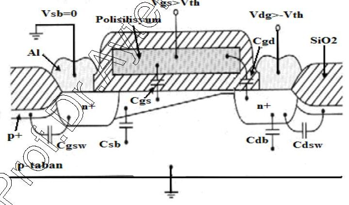

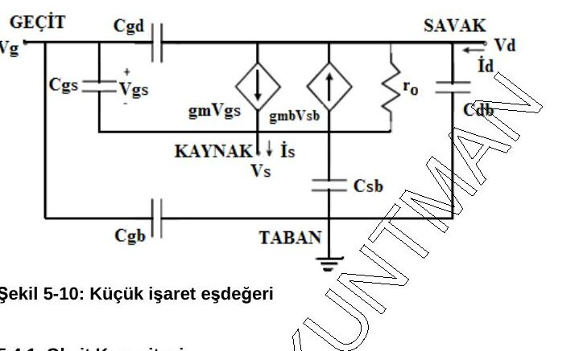

#### 5.4.1. Oksit kapasitesi

Parazitik oksit kapasiteleri geçit-taban (C_gb), geçit-savak (C_gd) ve geçit-kaynak (C_gs) kapasiteleridir; **bindirme kapasiteleri** olarak da bilinirler ve paralel plakalı kapasite şeklinde oluşurlar. Geçit bölgesinin birim alan başına oksit kapasitesi:

C_ox = ε_ox / t_ox = ε_r(SiO₂)·ε₀ / t_ox   (5-47)

Çalışma bölgelerine göre değerleri (L_D: bindirme/yan difüzyon uzunluğu):

| Kapasite | Kesim | Lineer bölge | Doyma bölgesi |
|---|---|---|---|
| C_gb (toplam) | C_ox·W·L | 0 | 0 |
| C_gd (toplam) | C_ox·W·L_D | ½·C_ox·W·L + C_ox·W·L_D | C_ox·W·L_D |
| C_gs (toplam) | C_ox·W·L_D | ½·C_ox·W·L + C_ox·W·L_D | ⅔·C_ox·W·L + C_ox·W·L_D |

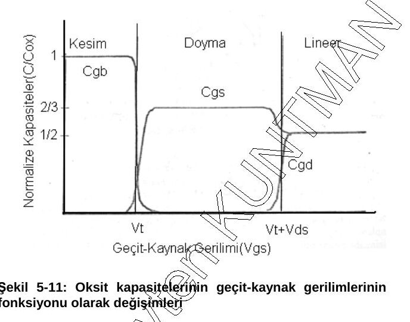

#### 5.4.2. Jonksiyon kapasiteleri

Uygulanan gerilime bağlı olarak kaynak-taban ve savak-taban jonksiyonlarında kapasite oluşur. Her pn jonksiyonu bir kapasite gibi davranabilir: fakirleşmiş bölge dielektrik gibi davranır. Ters öngerilimli keskin (sert) geçişli bir pn jonksiyonunda önce fakirleşmiş bölge kalınlığı bulunur:

x_d = √((2ε_Si/q)·((N_A + N_D)/(N_A·N_D))·(Φ₀ − V))   (5-48)

Belgede bu ifade (Φ₀ − V_R) ile yazılmış ve V_R "ters öngerilim" olarak tanımlanmış.

*Not: V_R ters öngerilimin büyüklüğü (pozitif sayı) ise ifade (Φ₀ + V_R) olmalıdır; (Φ₀ − V) yazımı, V'nin jonksiyona uygulanan işaretli gerilim (ters kutuplamada negatif) olduğu durumda doğrudur. Aşağıdaki (5-50)–(5-53) bu ikinci yazımı kullanır.*

Jonksiyonun yerleşik (gövde) potansiyeli:

Φ₀ = (kT/q)·ln(N_A·N_D / n_i²)   (5-49)

Boşaltılmış bölgede depolanan yük (A eklem alanı):

Q_j = A·q·(N_A·N_D/(N_A + N_D))·x_d = A·√(2ε_Si·q·(N_A·N_D/(N_A + N_D))·(Φ₀ − V))   (5-50)

Jonksiyon kapasitesi C_j = dQ_j/dV (5-51) ile hesaplanır:

C_j(V) = A·√((ε_Si·q/2)·(N_A·N_D/(N_A + N_D))·1/(Φ₀ − V))   (5-52)

Daha genel hâlde, m derecelendirme katsayısı (keskin eklem için 1/2, lineer eklem için 1/3) olmak üzere:

**C_j(V) = A·C_j0 / (1 − V/Φ₀)^m**   (5-53)

C_j0 = √((ε_Si·q/2)·(N_A·N_D/(N_A + N_D))·1/Φ₀)   (birim alan başına öngerilimsiz jonksiyon kapasitesi)   (5-54)

## 5.5. Parametrelerin ölçülmesi

Daha önce verilen akım bağıntılarından (5-16, 5-19, 5-20, 5-21) yararlanılarak eşik gerilimi V_TO, gövde etkisi katsayısı γ, kanal boyu modülasyon katsayısı λ ve geçiş iletkenliği parametreleri deneysel olarak çıkarılabilir:

β_n = µ_n·C_ox·(W/L)   (5-55),   β_p = µ_p·C_ox·(W/L)   (5-56)

n-kanallı MOSFET için β_n, V_TO ve γ'nın çıkarılması Şekil 5-13'te görülür. V_SB sabit tutularak V_GS'nin farklı değerleri için akım ölçülür; savak ve geçit aynı potansiyeldedir (V_DS = V_GS), dolayısıyla V_DS > V_GS − V_T ve tranzistör doymada çalışır. Kanal boyu modülasyonu ihmal edilirse:

I_D(sat) = (β_n/2)·(V_GS − V_T)²   (5-57)

√I_D = √(β_n/2)·(V_GS − V_T)   (5-58)

√I_D, V_GS'ye karşı çizilirse her V_SB için bir doğru elde edilir. V_SB = 0 doğrusunun gerilim eksenini kestiği nokta V_TO'yu, V_SB > 0 doğrularının kestiği noktalar V_T'yi verir. Her doğrunun eğimi √(β_n/2)'ye eşittir; β_n bu eğimden kolayca bulunur. γ ise:

γ = (V_T(V_SB) − V_TO) / (√(2|φ_F| + V_SB) − √(2|φ_F|))   (5-59)

*Not: Belgede ölçülen akım "geçit akımı" olarak geçiyor; MOSFET'te geçit akımı yoktur, ölçülen ve karekökü alınan **savak akımıdır** (I_D).*

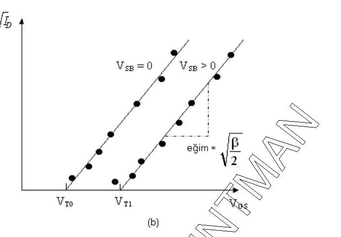

Kanal boyu modülasyon katsayısı λ farklı bir test devresiyle belirlenir (Şekil 5-14). V_GS = V_TO + 1'e ayarlanır, V_DS yeterince büyük seçilir (V_DS > V_GS − V_TO) ve tranzistör doymada çalışır. V_DS1 ve V_DS2 gibi iki farklı değer için savak akımı ölçülür:

I_D(doyma) = (β_n/2)·(V_GS − V_TO)²·(1 + λ·V_DS)   (5-60)

I_D2 / I_D1 = (1 + λ·V_DS2) / (1 + λ·V_DS1)   (5-61)

Doyma bölgesindeki I_D–V_DS eğrisinin eğimi λ·β_n/2'dir (V_GS − V_TO = 1 V için). Böylece eşik gerilimi, gövde parametresi, kanal boyu modülasyon parametresi ve geçiş iletkenliği parametresi tranzistör ölçümlerinden bulunabilir.

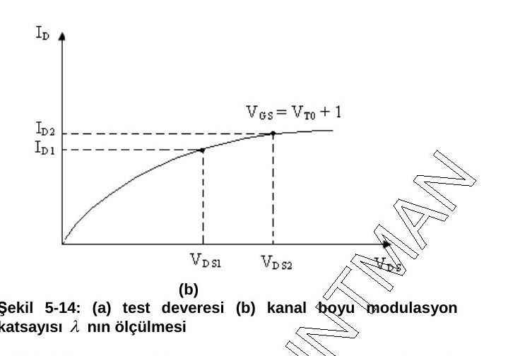

## 5.6. CMOS teknolojisi: n-kuyulu CMOS prosesi

n-kuyulu CMOS için taban olarak katkı yoğunluğu 10¹⁵ atom/cm³ civarında p-tipi silisyum kullanılır. Difüzyona karşı maske görevi görecek oksit büyütülür, n-kuyuyu oluşturacak 1. maske uygulanır ve litografik işlemle n-kuyu açılır. Ardından nMOS ve pMOS tranzistörlerin aktif bölgeleri tanımlanır. CMOS evirici en az 7 maskeyle üretilir:

1. n-kuyu oluşturulması (p taban kullanıldığı varsayılıyor)
1. n-kanallı tranzistör alanının açılması ve geçitlerin oluşturulması
1. NMOS'un aktif bölgelerinin oluşturulması
1. PMOS'un aktif bölgelerinin oluşturulması
1. Kontak alanlarının belirlenmesi
1. Metal bağlantılar için Al yoğuşturma ve şekillendirme
1. Bağlantı pabuçlarının oluşturulması ve pasivasyon

Şekil 5-16'daki adımlar:

- **(a.1)** Alan oksiti büyütülür; 1. maskeyle n-kuyusu oluşturulur; geçit oksidi büyütülür. Geçit oksidinin kalınlığı ve kalitesi, MOS tranzistörlerin karakteristiğini ve ömrünü etkileyen iki önemli üretim parametresidir.
- **(a.2)** 2. maskeyle n-kanallı tranzistör alanı belirlenir.
- **(b)** Geçitler oluşturulur: polisilisyum tabakası kimyasal buhar depolamayla depolanır ve geçit maskesiyle plazma aşındırma yapılarak şekillendirilir. Bu polisilisyumlar nMOS ve pMOS tranzistörlerin geçitleridir.
- **(c)** p⁺ bölgeler oluşturulur; taban ve n-kuyusundaki omik bağlantılar da bu adımda yapılır.
- **(d)** n⁺ bölgeler oluşturulur.
- **(e)** Kontaklar açılır: önce CVD ile yalıtkan SiO₂ tabakası oluşturulur, sonra kontaklar tanımlanıp aşındırılarak silisyum ya da polisilisyum pencereleri açılır.
- **(f)** Devre bağlantıları için kırmık üzerine metal buharlaştırılır ve metal yollar maskesiyle şekillendirilir.
- **(g)** n-kuyusu içindeki pMOS ve dışındaki nMOS tranzistörler, polisilisyum ve metal bağlantılarla tamamlanmış serim ve düşey kesit. Son adım koruma amaçlı pasivasyondur.

, (a.2), (b), (c): CMOS evirici üretim aşamaları")

, (e), (f), (g): CMOS evirici üretim aşamaları")

## 6. Serim tasarım kuralları

Herhangi bir devrenin fiziksel maske serimi, bazı geometrik kuralları veya sınırlamaları sağlayan özel işlemlerle yapılır; bunlara **serim (layout) tasarım kuralları** denir. Kurallar, kırmık üzerindeki metal veya polisilisyum bağlantıların izin verilen minimum genişlikte, elemanların minimum boyutlarda ve iki eleman arasındaki uzaklığın izin verilen minimum değerde olmasını sağlar. Örneğin dar bir metal yol uygun olmayan bir teknolojiyle yapılırsa üretim sırasında veya sonrasında kırılarak istenmeyen açık devreler oluşturabilir; iki metal yol birbirine çok yakınsa istenmeyen kısa devreler olabilir. Tasarım kurallarının amacı, en küçük silisyum alanını kullanırken yüksek güvenilirlikli ve kaliteli devreler yapmaktır. Kurallar doğru ve yanlış tasarım arasında kesin bir sınır vermez; ama üretim başarısını ve kaliteyi genellikle önemli ölçüde artırır.

Boyutlandırmada iki kural kullanılır:

- **Mikron kuralı:** Minimum eleman boyutları ve elemanlar arasındaki uzaklıklar kesin mikron değerleriyle belirtilir.
- **Lambda kuralı:** Serim kuralları λ parametresinin katlarıyla belirlenir; böylece lineer orantılı ölçekleme yapılabilir.

Lambda tabanlı kurallar mikron tabanlı kuralları basitleştirmek ve ölçeklemeyi kolaylaştırmak için tasarlanmıştır; ancak bazı mikron altı CMOS uygulamalarında tasarım kuralları lineer ölçeklemeye uymaz, bu nedenle orada büyük dikkatle belirlenmelidir.

**Tablo 6-1: MOSIS (MOS Implementation System) CMOS prosesi için lambda tabanlı serim tasarım kuralları**

| Kural | Tanımlama | λ kuralı |
|---|---|---|
| R1 | Minimum aktif alan genişliği | 3λ |
| R2 | Minimum aktif alan boşluğu | 3λ |
| R3 | Minimum poli genişliği | 2λ |
| R4 | Minimum poli boşluğu | 2λ |
| R5 | Aktif alandaki polinin minimum geçit açıklığı | 2λ |
| R6 | Minimum poli-aktif kenar boşluğu (poli aktif alanın dışında) | 1λ |
| R7 | Minimum poli-aktif kenar boşluğu (poli aktif alanın içinde) | 3λ |
| R8 | Minimum metal genişliği | 3λ |
| R9 | Minimum metal boşluğu | 3λ |
| R10 | Poli kontak büyüklüğü | 2λ |
| R11 | Minimum poli kontak boşluğu | 2λ |
| R12 | Minimum poli kontak–poli kenar boşluğu | 1λ |
| R13 | Minimum poli kontak–metal kenar boşluğu | 1λ |
| R14 | Minimum poli kontak–aktif kenar boşluğu | 3λ |
| R15 | Aktif kontak büyüklüğü | 2λ |
| R16 | Minimum aktif kontak boşluğu (aynı aktif bölgede) | 2λ |
| R17 | Minimum aktif kontak–aktif kenar boşluğu | 1λ |
| R18 | Minimum aktif kontak–metal kenar boşluğu | 1λ |
| R19 | Minimum aktif kontak–poli kenar boşluğu | 3λ |
| R20 | Minimum aktif kontak boşluğu (farklı aktif bölgelerde) | 6λ |

R1–R2 aktif alan, R3–R7 polisilisyum, R8–R9 metal, R10–R20 kontak kurallarıdır.

*Not: Belgede R20 "Minimum poli kontak boşluğu (farklı aktif bölgelerde)" diye yazılmış; tanım ve şekil aktif kontaklara işaret ettiği için tabloda "aktif kontak" olarak verildi.*

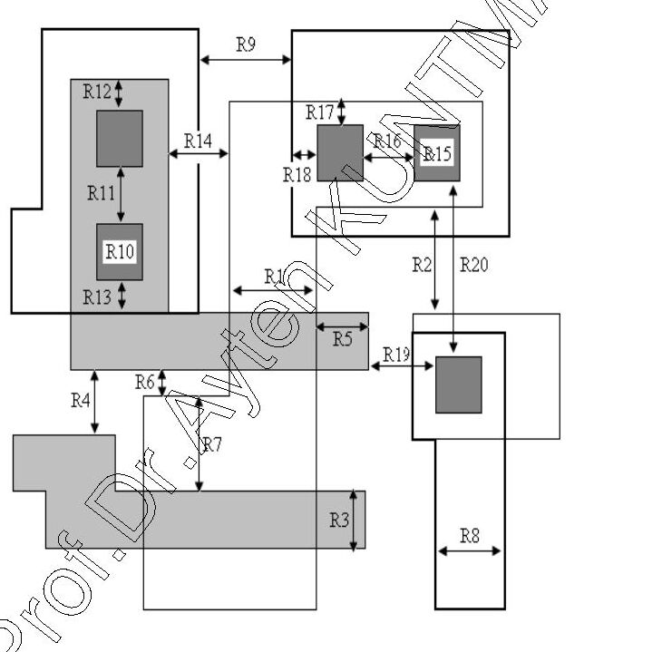

## 6.1. "Full-custom" maske serim kuralları

Fiziksel serim ve devre performansı birbirine sıkı sıkıya bağlıdır: fiziksel yapı doğrudan tranzistörlerin geçiş iletkenliğini, parazitik kapasite ve dirençleri ve kullanılan silisyum alanını belirler. Öte yandan lojik kapıların ayrıntılı maske serimi zaman alır. CMOS lojik kapıların fiziksel (maske serimi) tasarımı, devre topolojisi (istenen lojik fonksiyon için) ve tranzistörlerin başlangıç boyutları (istenen performans için) ile başlayan yinelemeli bir işlemdir. Bu noktada tasarımcı, çıkıştaki toplam parazitik yükü yalnızca çıkıştaki eleman sayısı ve tahmini bağlantı uzunluklarına göre kestirebilir. Lojik kapı 4–6 tranzistörden fazlasını içeriyorsa topolojik çizim ve **Euler yolu yöntemi**, tranzistörlerin en uygun sıralamasını bulmaya yardımcı olur; bu adımda basit bir **stick diyagramı** ve kontak yerleri çizilebilir.

Gerçeklenebilir topoloji bulunduktan sonra maske katmanları serim editörüyle tasarım kurallarına göre çizilir; bu birkaç kez tekrarlanır ama temel topoloji pek değişmez. Biten serimde **DRC** (*Design Rule Check*) yapılır ve her düğümdeki parazitik kapasiteler belirlenir. *Extraction* adımının sonucu, otomatik üretilen ayrıntılı bir SPICE dosyasıdır; gerçek devre performansı SPICE ile belirlenir. Benzetim sonuçları istenen performansı sağlamazsa tüm işlemler tekrarlanır. Serim değişiklikleri, parazitik kaynak-savak kapasitelerini ve geçiş iletkenliğini belirlediği için W/L oranı üzerinden yapılır; tasarımcı parazitik etkileri azaltmak için devre topolojisini de değiştirebilir.

## 6.2. CMOS evirici serim tasarımı

Örnek olarak n-kuyulu CMOS eviricinin maske serimi ele alınır. Önce n-kanallı MOS tranzistör için minimum boyut tasarım kuralları belirlenir (Şekil 6-2). Aktif alan üzerindeki polisilisyum genişliği (geçit) tipik olarak minimum poli genişliği alınır. Buna göre:

- **Minimum aktif alan uzunluğu** = (minimum polisilisyum genişliği) + 2 × (minimum poli–kontak boşluğu) + 2 × (minimum kontak genişliği) + 2 × (minimum aktif bölge kenarı–kontak boşluğu)
- **Minimum aktif alan genişliği** = (minimum kontak genişliği) + 2 × (minimum kontak–aktif kenar uzaklığı)

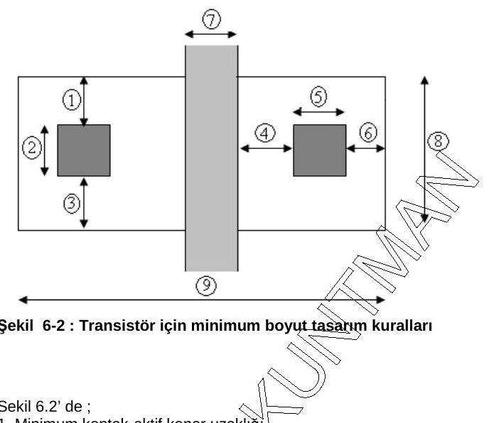

Şekil 6-2'deki ölçüler: 1, 3 ve 6: minimum kontak–aktif kenar uzaklığı; 2: minimum kontak genişliği; 4: minimum polisilisyum kenar–kontak uzaklığı; 5: minimum kontak uzunluğu; 7: minimum polisilisyum uzunluğu; 8: minimum aktif alan genişliği; 9: minimum aktif alan uzunluğu.

n-kuyulu CMOS'ta p-taban üzerinde n-kanallı MOS bulunur; PMOS tranzistör ise p-taban üzerine yapılan **n-kuyu içinde** oluşturulur. n-kuyunun minimum boyutu PMOS aktif alanı ve n-kuyu ile p⁺ bölge arasındaki minimum uzaklıkla belirlenir. NMOS ve PMOS arasındaki mesafe, n⁺ aktif alan ile n-kuyu arasındaki mesafeyle belirlenir (Şekil 6-3). NMOS ve PMOS'un polisilisyum geçitleri genelde birleşiktir; geçit bağlantısı tek bir polisilisyum yolla yapılır. Uzun polisilisyum yollardan, oluşturduğu büyük parazitik kapasite, direnç ve RC gecikmeleri nedeniyle kaçınılır; bağlantılar mümkün olduğunca metalle yapılır, gerektiğinde metal–polisilisyum kontaklarıyla katmanlar birleştirilir.

Full-custom serim; eleman boyutlandırmada, yerleştirmede ve bağlantılarda istenen değişikliklerin yapılmasına olanak verir. Tasarımcı, silisyum alanının küçüklüğü, gecikmenin azaltılması, giriş/çıkış uçlarının yerleşimi gibi kriterlere göre alternatifler arasından bir maske serimi seçer; olası serim sayısı devrenin karmaşıklığıyla artar.

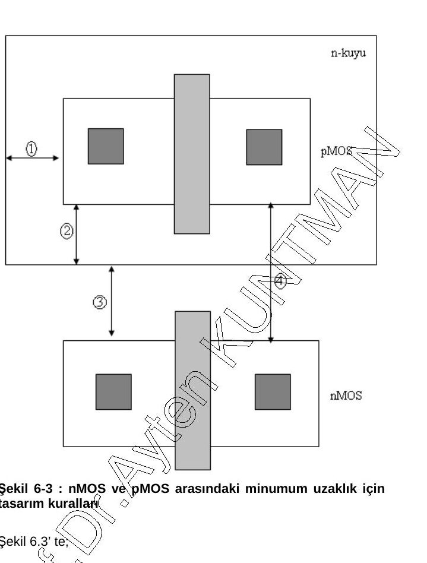

Şekil 6-3'te 1 ve 2: n-kuyu ile p⁺ aktif alan arasındaki minimum uzaklık; 3: n⁺ aktif alan ile n-kuyu arasındaki minimum uzaklık; 4: nMOS ve pMOS tranzistör arasındaki minimum uzaklık.

## 6.3. MOS tümdevre tasarımı

Sayısal tümdevrelerde tümleştirme MOS ve CMOS teknolojileriyle yapılır; tranzistörün tipi, kanal boyu ve kanal genişliği önemli parametrelerdir. NMOS teknolojisinde lojik kapılarda E-NMOS'lar **sürücü**, D-NMOS'lar **yük** tranzistörü olarak; CMOS teknolojisinde ise E-NMOS'lar sürücü, PMOS'lar yük tranzistörü olarak kullanılır. Teknoloji seçildikten sonra iki temel iş, fonksiyonu gerçekleştirecek devrenin seçimi ve tranzistörlerin boyutlandırılmasıdır; proses parametreleri teknolojiye göre belirlenir.

#### 6.3.1. Eviriciler

Tranzistörlerle oluşturulan lojik kapılar NOT, OR, AND, NOR, NAND olarak sayılabilir; bunların en temeli Y = X̄ (NOT) işlemini yapan **evirici**dir.

#### 6.3.2. NMOS evirici

NMOS teknolojisinde E-NMOS sürücü tranzistör (T_D), D-NMOS yük tranzistörüdür (T_L).

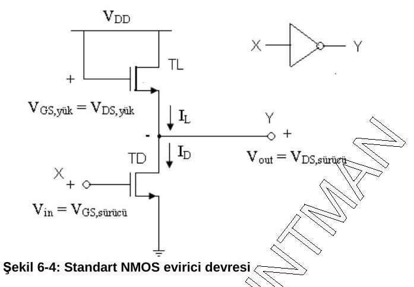

Başlangıçta V_i, T_D'nin eşiğine gelene kadar T_D kesimdedir ve V_O = V_DD (lojik 1) olur. V_i arttıkça çıkış düşer ve en düşük çıkış gerilimi V_L (lojik 0) olur. 45° eğimli doğrunun özeğriyi kestiği nokta **V_INV** (evirtim noktası) olarak adlandırılır. V_DD ve V_L, lojik 1 ve lojik 0 durumlarına karşı düşen nominal gerilim seviyeleridir.

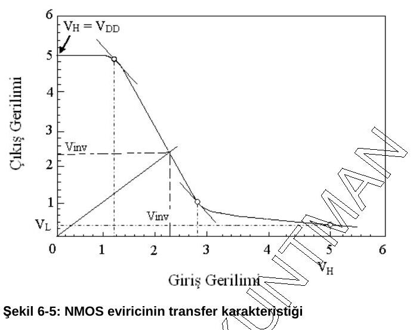

##### Eviricinin elektriksel özellik–yapı ilişkisini veren büyüklükler

Evirici performansını birinci planda belirleyen beş büyüklük: lojik 0 gerilimi, lojik eşik, aşağı gecikme, yukarı gecikme, güç harcaması.

**1. Lojik 0 gerilimi (V_L):** Girişe V_DD uygulandığında elde edilen çıkış gerilimidir. Bu durumda T_D doymasız, T_L doymalı bölgede çalışır; iki tranzistörün akımları eşitlenirse:

V_L = [(−V_TL)² / (β_D/β_L)]·1/(V_DD − V_TD)   (6-1)

V_L = [(−V_TL)² / ((W_D/L_D)/(W_L/L_L))]·1/(V_DD − V_TD)   (6-2)

β = µ·C_ox·(W/L)   (tranzistöre ait parametre)   (6-3)

*Not: Akımlar eşitlenip V_L² terimi ihmal edilirse β_D·(V_DD − V_TD)·V_L = (β_L/2)·V_TL² ve V_L ≈ (−V_TL)²/(2·(β_D/β_L)·(V_DD − V_TD)) bulunur; belgedeki (6-1) ve (6-2)'de paydadaki 2 çarpanı eksik.*

**2. Lojik eşik (V_INV):** Girişe uygulandığında çıkışı da aynı değere getiren gerilimdir; Şekil 6-5'te orijinden 45° eğimle çizilen doğrunun özeğriyi kestiği nokta. V_i > V_inv için V_o < V_inv, V_i < V_inv için V_o > V_inv olur. Bu yüzden lojik 0 ile lojik 1 arasında sınır kabul edilir; yaklaşık V_DD/2'dir.

V_inv = V_TD + (−V_TL)/√(β_D/β_L) = V_TD + (−V_TL)/√((W_D/L_D)/(W_L/L_L))   (6-4)

**3. Aşağı gecikme (τ_D):** Çıkışın 1'den 0'a değişmesine kadar geçen süredir; devrenin hızını ve girişteki işaretin frekansını belirlemede gerekir. Aşağı gecikmesi büyük bir sistem hızlı darbelere cevap veremez.

τ_D = Q_L / I_D   (6-5)

τ_D = 2C_L·V_DD / (β_D·(V_DD − V_TD)²)   (6-6)

τ_D = 2C_L·V_DD / (µ·C_ox·(W_D/L_D)·(V_DD − V_TD)²)   (6-7)

τ_D = (C_L / (C_ox·W_D·L_D))·2L_D²·V_DD / (µ·(V_DD − V_TD)²)   (6-8)

**4. Yukarı gecikme (τ_U):** Çıkışın 0'dan 1'e değişmesine kadar geçen süredir.

τ_U = Q_L / I_L = C_L·V_DD / ((β_L/2)·(−V_TL)²)   (6-9)

τ_U = C_L·V_DD / (µ·C_ox·(W_L/2L_L)·(−V_TL)²)   (6-10)

τ_U = (C_L / (C_ox·W_L·L_L))·2V_DD·L_L² / (µ·(−V_TL)²)   (6-11)

*Not: Belgede (6-11)'in paydasında (V_DD − V_TL)² yazılmış; (6-9) ve (6-10)'dan devam edildiğinde doğrusu (−V_TL)²'dir.*

**5. Güç harcaması:** NMOS eviricide güç, çıkış lojik 0'dayken (her iki tranzistör iletimde) harcanır:

P = (β_L/2)·(−V_TL)²·V_DD = ½·µ·C_ox·(W_L/L_L)·(−V_TL)²·V_DD

Tüm bu parametreler birlikte optimize edilir.

#### 6.3.3. CMOS eviriciler

CMOS teknolojisinde E-NMOS sürücü, PMOS yük tranzistörüdür. Şekil 6-6'daki devrede başlangıçta V_i = 0'da T_L iletimde, T_D kesimdedir ve V_O = V_DD (lojik 1) olur. V_i = V_DD + V_TL olduğunda T_L kesime girer, T_D iletimdedir ve V_O = 0 (lojik 0) olur. Geçiş özeğrisinden V_i = V_DD için V_o = 0, V_i = 0 için V_o = V_DD olduğu görülür.

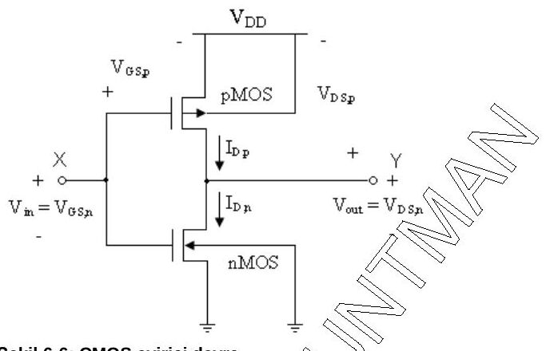

**V_inv = (V_DD + V_TL + √(β_D/β_L)·V_TD) / (√(β_D/β_L) + 1)**   (6-12)

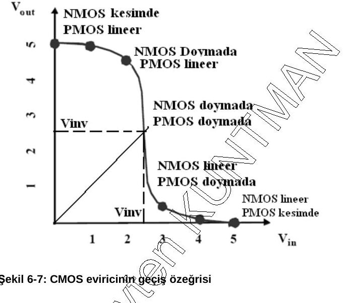

CMOS eviricide tranzistörlerden biri iletimdeyken diğeri kesimde kabul edilerek aşağı ve yukarı gecikmeler hesaplanır. Geçiş anı dışında akım akmadığı için CMOS'un güç harcaması azdır.

τ_D = (C_L / (C_ox·W_D·L_D))·2L_D²·V_DD / (µ_n·(V_DD − V_TD)²)   (6-13)

τ_U = τ_D·β_D·(V_DD − V_TD)² / (β_L·(V_DD + V_TL)²) = 2C_L·V_DD / (β_L·(V_DD + V_TL)²)   (6-14)

Notun devamı (bipolar tümdevreler) serinin 3. yazısındadır: [3) bipolar tümdevreler](/arsiv/eem312-vlsi-tasarimi-kuntman-3-bipolar-tumdevreler/).
