This post is the third part of the 158-page **"VLSI Design"** lecture note found in the EEM312 Digital Electronics course folder (pages 76–102 of the note). The cover of the document states *"These notes are a reorganized version of the notes published by Prof. Dr. Ayten Kuntman on 11.03.2009"*; the PDF was created on 28 April 2009. The document does not say who did the reorganization or at which institution the note was used in teaching (Prof. Dr. Ayten Kuntman is a faculty member at Istanbul Technical University).

*This content belongs to a third-party source; it is shared for archival and nostalgic purposes with the source credited. It will be removed at the request of the rights holder.*

Other posts in the series: [1) IC fabrication, silicon and process steps](/arsiv/eem312-vlsi-tasarimi-kuntman-1-uretim-ve-proses/) (the whole note can be downloaded there), [2) MOS integrated circuits, the CMOS process and layout rules](/arsiv/eem312-vlsi-tasarimi-kuntman-2-mos-tumdevreler/), [4) SPICE, layout examples, questions and references](/arsiv/eem312-vlsi-tasarimi-kuntman-4-spice-serim-sorular/). The text, formulas and tables of this part are transcribed below (broken Turkish characters and scrambled formulas were corrected); the figures were cropped and included. A PDF made up of the pages of this part can be downloaded at the end of the post.

## 7. Bipolar integrated circuits

Although technology in recent years has been dominated by MOS and CMOS, bipolar integrated circuits retain their importance. Bipolar ICs fall into two main groups: **junction-isolated** and **dielectric-isolated**; in standard production, junction-isolated ones are more common. At least 5–8 mask steps are used for bipolar IC fabrication: epitaxy, p-diffusion, n-diffusion, oxidation, contact, metal bonding pads, isolation. Lithography is performed with the appropriate mask for each.

## 7.1. Junction-isolated bipolar IC technology

The widely used technology is junction-isolated bipolar IC (JIBT) technology. Each element of the circuit is formed in an **isolation island**; the isolation island is obtained by epitaxy. Isolation is provided by **reverse-biasing** the junction between the island and the substrate.

In junction-isolated bipolar circuits the most basic element is the **npn transistor**: it has n-type doped emitter and collector regions and a p-type doped base region. The emitter is the region with the highest doping concentration; its bulk resistance is on the order of a few ohms. The collector is the region with the lowest doping concentration; its bulk resistance is fairly high. The base region, whose doping concentration lies between the two, has a bulk resistance on the order of tens of ohms.

A **p-type** Si wafer, 400 µm thick, 4 inches in diameter, with a doping concentration of 10¹⁶ /cm³, is used as the substrate. Steps (Figure 7-1):

1. **Buried layer diffusion (1st mask, n⁺ diffusion):** It is part of the collector; it is performed to improve transistor performance and reduce the parasitic collector resistance. The doping concentration is high and the diffusion depth is about 8 µm (Figure 7-1a).
1. **Epitaxy:** The oxide is stripped and the epitaxial layer is grown. The n-epi region forms the collector of the transistor and the isolation island in which the element will be formed. Its doping concentration is 10¹⁵ /cm³ and its thickness is 15–20 µm. The collector-base breakdown voltage is determined by the thickness and resistivity of the epi region: for a device to operate at a 36 V supply, the epi thickness should be 17 µm and the doping concentration 10¹⁵ /cm³; for a 36 V supply the C-B breakdown voltage should be about 90 V (Figure 7-1b).
1. **Isolation diffusion (p⁺):** Oxide is grown on the surface and, with the appropriate mask, p⁺ diffusions that will form the isolation islands are made in the epitaxial layer. The pn junction between the collector and the p⁺ diffusion is reverse-biased to isolate the island. The sheet resistance of the isolation diffusion is around 20–40 Ω/□ (Figure 7-1c).
1. **Base diffusion (4th mask):** The sheet resistance of the boron diffusion is 100–300 Ω/□ (Figure 7-1d).
1. **Emitter diffusion (5th mask, n⁺):** The emitter region and, at the same time, the collector contact are formed. Its depth is 0.5–2.5 µm and its sheet resistance is 2–10 Ω/□. Since the doping of the n-epi is low, the heavily doped emitter diffusion is used here as well to obtain a good contact to the collector (Figure 7-1e).
1. **Contact and metallization:** With the contact mask, contact windows are opened in the oxide over the emitter, base and collector regions (and over the passive elements on the chip). The whole wafer is coated with about 1 µm of metal (gold or aluminum), and the interconnections between elements are formed with the metal mask (Figure 7-1f).

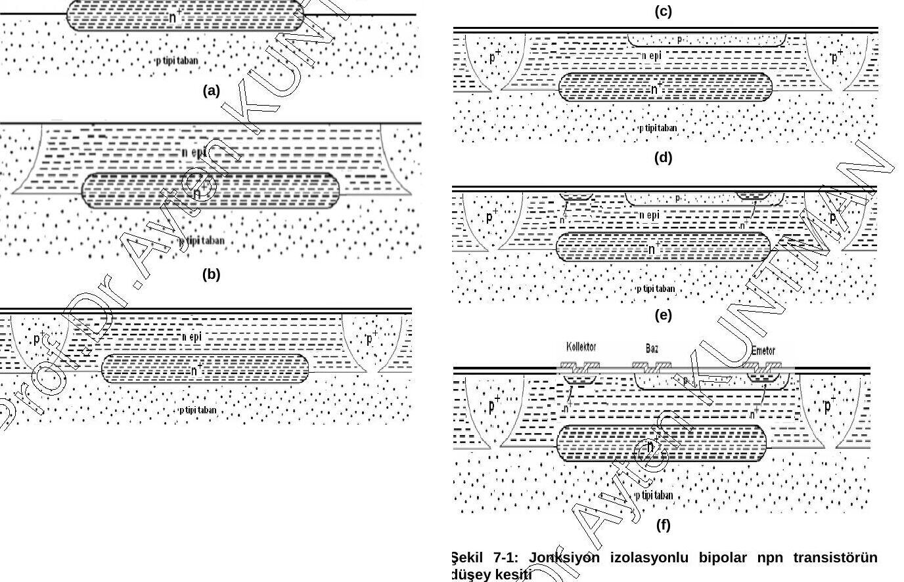

A typical diffusion profile for analog circuits is shown in Figure 7-2. For the cross-section along A-A′:

| Region | Doping concentration (1/cm³) | Diffusion depth / thickness |
|---|---|---|
| Substrate | ~10¹⁶ | — |
| Epi | ~10¹⁵ | ~17 µm |
| Base | ~10¹⁹ | ~3 µm |
| Emitter | ~10²¹ | ~2.5 µm |
| Buried layer | — | ~8 µm |

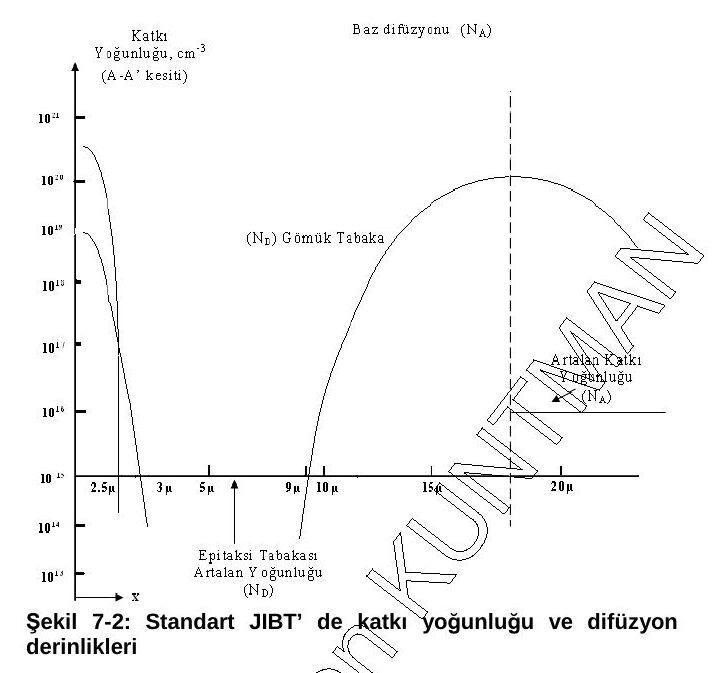

## 7.3. Active elements in bipolar analog integrated circuits

The npn transistor is the basic building block in IC fabrication. Although their current gains and frequency responses are low, there are also pnp transistors that can be formed together with the standard bipolar process. Three structures realized on the same substrate are described: the **npn**, the **lateral pnp** and the **substrate pnp**.

#### 7.3.1. Integrated npn transistor

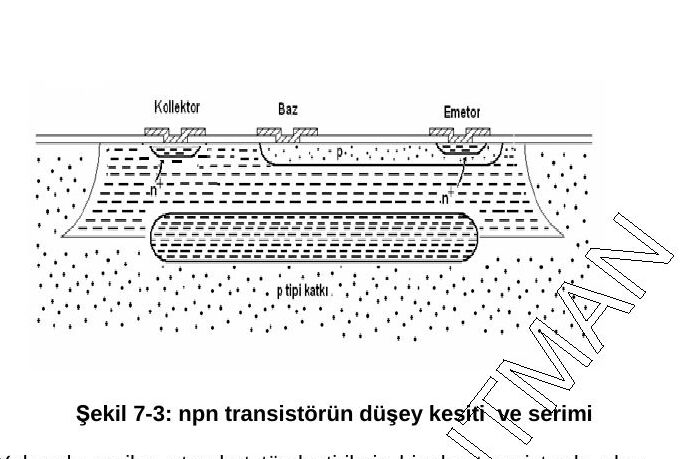

Possible dimensions in a standard integrated bipolar transistor:

| Region | Dimension |
|---|---|
| Base region | 60 µm × 45 µm |
| Collector region | 140 µm × 95 µm |
| Collector contact | 18 µm × 49 µm |
| Buried layer | 41 µm × 85 µm |
| Base contact | 18 µm × 30 µm |
| Emitter contact | 18 µm × 25 µm |

#### 7.3.2. Basic concepts important for design in bipolar structures

Junction breakdown voltage, saturation current of the npn transistor, parasitic resistances and parasitic capacitances.

##### Junction breakdown voltage

It is the maximum voltage a junction can withstand without breaking down; it is a function of the doping concentrations and the critical electric field:

**V_B = [ε·(N_A + N_D) / (2q·N_A·N_D)]·E²_critical**   (7-1)

Here V_B is the breakdown voltage, ε the dielectric constant of silicon, N_A and N_D the p-type and n-type doping concentrations, q the electron charge (1.6×10⁻¹⁹ C), and E_critical the critical field strength. The maximum field is:

E_max = E_crit ≅ −q·N_A·W₁/ε   (p-type side)   (7-2)

E_max = E_crit ≅ −q·N_D·W₂/ε   (n-type side)   (7-3)

W₁ and W₂ are the thicknesses of the depleted region on the p and n sides:

W₁ = [2ε(ψ₀ + V_R) / (q·N_A·(1 + N_A/N_D))]^(1/2)   (7-4)

W₂ = [2ε(ψ₀ + V_R) / (q·N_D·(1 + N_D/N_A))]^(1/2)   (7-5)

ψ₀ is the voltage that arises (the built-in voltage) even though no external influence is applied to the junction:

ψ₀ = V_T·ln(N_A·N_D / n_i²)   (7-6)

V_T = kT/q ≅ 26 mV (300 K)   (thermal voltage)   (7-7)

V_R is the reverse bias voltage and n_i is the carrier concentration in intrinsic silicon; for silicon ε = 1.04×10⁻¹² F/cm.

##### Saturation current of the npn transistor

The npn transistor has four operating regions (Figure 7-4, horizontal axis V_BE, vertical axis V_BC):

| Region | V_BE (npn) | V_BC (npn) | Operation |
|---|---|---|---|
| I. Saturation | Forward | Forward | Switch operation (current flows) |
| II. Reverse operation region | Reverse | Forward | Reverse active |
| III. Cutoff | Reverse | Reverse | Switch operation (no current flows) |
| IV. Forward active | Forward | Reverse | Operates as an amplifier |

*Note: In Figure 7-4 of the document the region descriptions are placed in a mixed-up way (the phrase "no current flows" sits under region IV); in the table the regions are given as they should be according to the bias directions. For the pnp, the axes are V_EB and V_CB.*

In the active region, the part that carries the current is the base region under the emitter; for this reason determining the emitter area and doping is important, and the saturation current is used for this purpose. Although the numerical value of the saturation current is very small, it is important for modeling:

**I_S = q·A·D_n·n_i² / Q_B**   (7-8)

Here A is the emitter-base junction area, n_i is the intrinsic carrier concentration, Q_B is the number of dopant atoms per unit area in the base (1/cm²), and D_n is the diffusion constant of electrons in the base region. The collector current is:

I_C = I_S·exp(V_BE / V_T)   (7-9)

Combining the two relations:

Q_B = A·D_n·(q·n_i² / I_C)·exp(V_BE / V_T)   (7-10)

Q_B = W_B·N_A   (7-11)

W_B is the base width and N_A is the doping concentration in the base.

##### Series base resistance

Unwanted series resistances arise because of the different dopings in the base and collector regions; their values and models are important in design.

The cause of the series base resistance is that the base contact is quite far from the active base region. A series ohmic resistance consisting of two components, r_b1 and r_b2, forms between the base contact and the active base (Figure 7-5). This resistance degrades the noise characteristics of the transistor, reduces the high-frequency gain and has a limiting effect on the collector current.

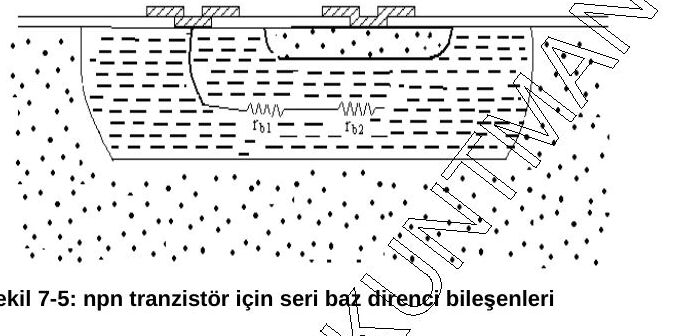

r_b1 is the resistance that forms along the base region from the base contact; it is calculated like a uniformly doped layer (L and W are the length and width of the base contact region, R□ is the base sheet resistance):

r_b1 = (L/W)·R□   (7-12)

Calculating r_b2 is difficult because of the different doping distribution. In active operation r_b2 weakens and r_b1 approaches r_b. As seen in Figure 7-7, when the series base resistance rises above 200 Ω, a limitation on the collector current begins. A low base resistance is important for low-noise and high-frequency applications; in design, the series base resistance is kept at around 200 Ω.

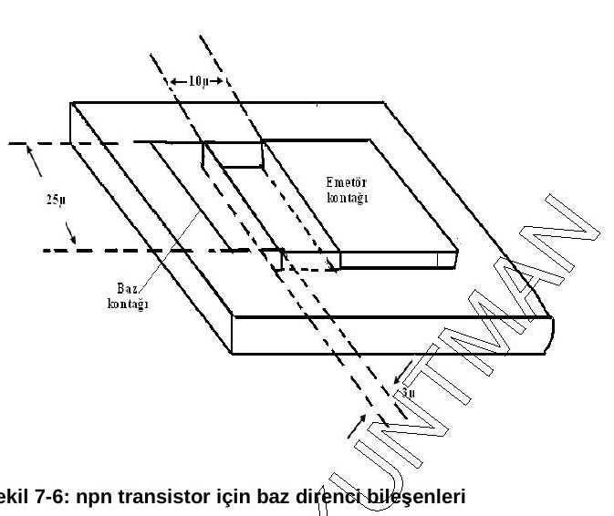

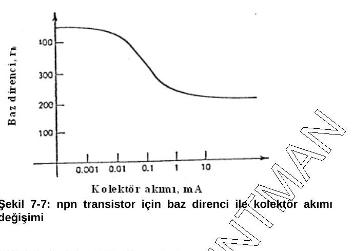

##### Series collector resistance (r_c)

The series collector resistance is important in low-frequency applications as well as in high-frequency applications. The collector region has a complex structure and three resistances are effective in active operation (Figure 7-8):

- r_c1: the resistance between the buried layer and the base region
- r_c2: the resistance formed by the buried layer
- r_c3: the resistance between the buried layer and the collector contact

r_c = r_c1 + r_c2 + r_c3   (7-13)

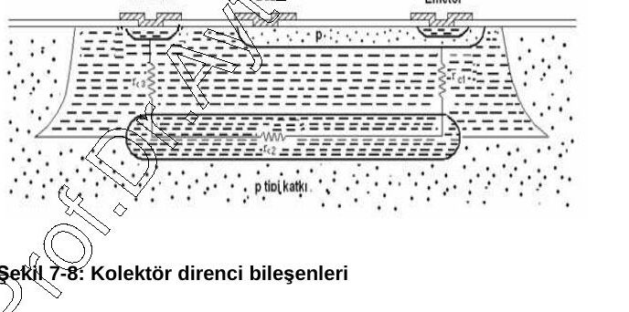

Calculating r_c1 and r_c3 is more complicated because of the doping differences in the regions; they are solved with a Laplace approach and under certain assumptions. The proposed model (Figure 7-9) is a block in the shape of a truncated pyramid:

R = (ρ·T / (W·L))·ln(a/b) / (a − b)   (7-14)

Here ρ is the resistivity, T is the thickness of the region, W and L are the width and length of the top of the block, a is the ratio of the base width of the block to its top width, and b is the ratio of the base length to the top length.

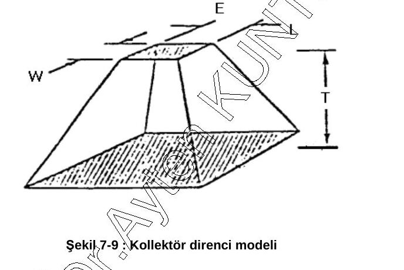

For the model to be applicable to the real structure, the document states that the side walls must make a 60° angle with the vertical, and with this assumption the base dimensions are:

L_base = L_top + 2T;   W_base = W_top + 2T   (7-15)

*Note: The relation L_base = L_top + 2T corresponds to side walls making a **45°** angle with the vertical (an expansion of T on each side); with 60°, the expansion on each side would be T·tan 60° ≈ 1.73T.*

The top L and W values are the dimensions of the emitter and collector contact regions for r_c1 and r_c3. r_c2 is calculated like the sheet resistance of a uniformly doped region: r_c2 = R□·L/W.

##### Collector-base junction capacitance

C_j = A·[q·ε·N_A·N_D / (2(N_A + N_D))]^(1/2)·1/√(ψ₀ + V_R)   (7-16)

N_D is the doping concentration of the epi region (~10¹⁵ /cm³) and N_A that of the base region (~10¹⁹ /cm³). If N_A ≫ N_D:

C_j / A = √(q·ε·N_D / (2(ψ₀ + V_R)))   (7-17)

This is the **capacitance per unit area for an abrupt junction**. Figure 7-10 shows the variation of the capacitance per unit area and of the depletion region thickness with the applied voltage.

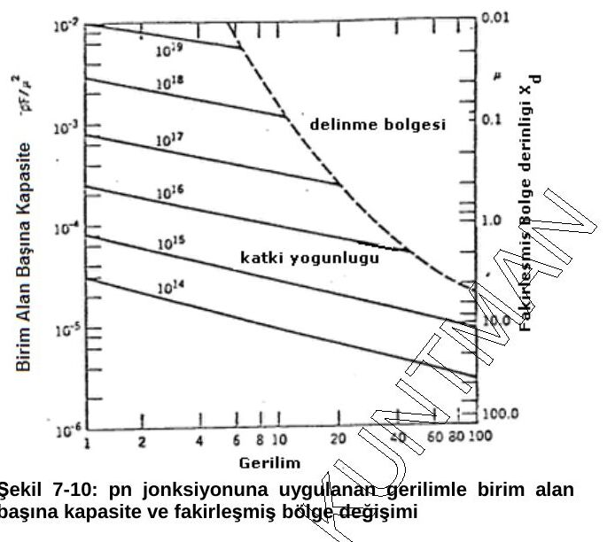

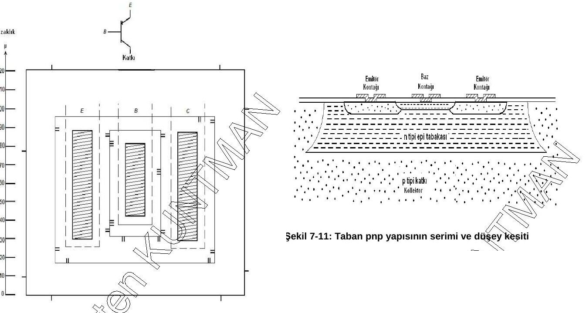

## 7.4. Passive elements in bipolar integrated circuits

These are the resistor, the capacitor and the diode.

#### 7.4.1. Diffused resistors

During npn transistor fabrication, resistors can be made in any diffusion step (base diffusion, emitter diffusion, epitaxial layer). The selection is made according to the value of the resistor, its tolerance and its temperature coefficient. For example, the **base-diffused resistor** makes use of the p-type diffusion performed while the base of the npn transistor is formed (Figure 7-12).

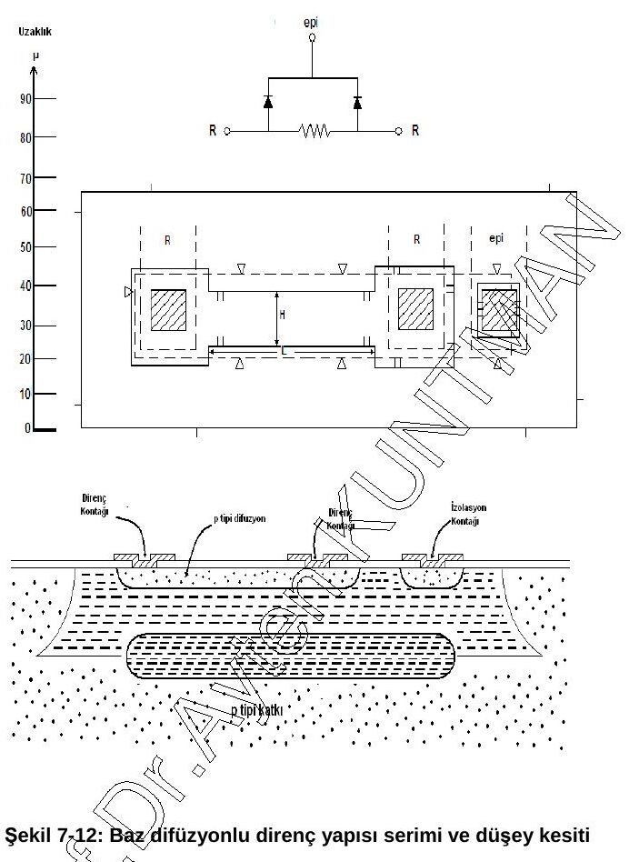

The resistance of a diffused region (N doping concentration, T diffusion depth):

R = R□·L/W   (7-18),   R□ = 1/(q·µ·N·T)   (7-19)

**Characteristics of the different resistors used in integrated circuits**

| Resistor type | Sheet resistance (Ω/□) | Absolute tolerance (%) | Temperature coefficient (ppm/°C) |
|---|---|---|---|
| Base diffusion | 100–200 | ±20 | 1500–2000 |
| Emitter diffusion | 2–10 | ±20 | 600 |
| Ion implantation | 100–1000 | ±3 | 100 |
| Epitaxy | 2k–5k | ±30 | 3000 |
| Base pinch | 2k–10k | ±50 | 2500 |
| Epitaxial pinch | 4k–10k | ±50 | 3000 |

#### 7.4.2. Capacitors

There are two types of capacitors in ICs: junction capacitors and MOS capacitors.

- **Junction capacitors:** They are made using the C-B or B-E junction; their value depends on the applied voltage and the doping concentration. The depletion region formed in the junction forms the capacitance:

C = A·[q·ε·N_A·N_D / (2(N_A + N_D))]^(1/2)·1/√(ψ₀ + V_R)   (7-20)

(N_D is the epi and N_A the base doping concentration; A is the C-B junction area; ψ₀ is the built-in potential; V_R is the reverse bias voltage.)

- **MOS capacitors:** They are obtained by coating a thin SiO₂ as the dielectric over the emitter diffusion and Al on top of it. The capacitance value is 0.2–0.3 pF/mil² and the breakdown voltage is between 60 and 100 V.

C = ε·A / t   (ε: dielectric constant of SiO₂, t: dielectric thickness, A: area)   (7-21)

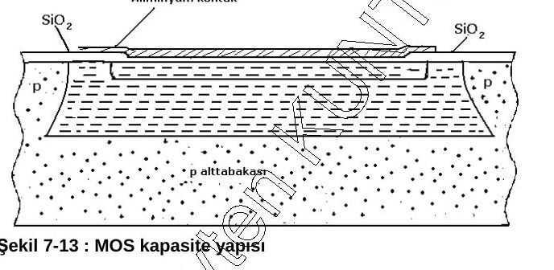

#### 7.4.3. Diodes

Junction diodes are obtained by connecting npn and pnp transistors in different ways (Figure 7-14). In connections a, b and d the collector-base junction is forward-biased, and in connection c the emitter-base junction is forward-biased, so that the transistors operate as diodes.

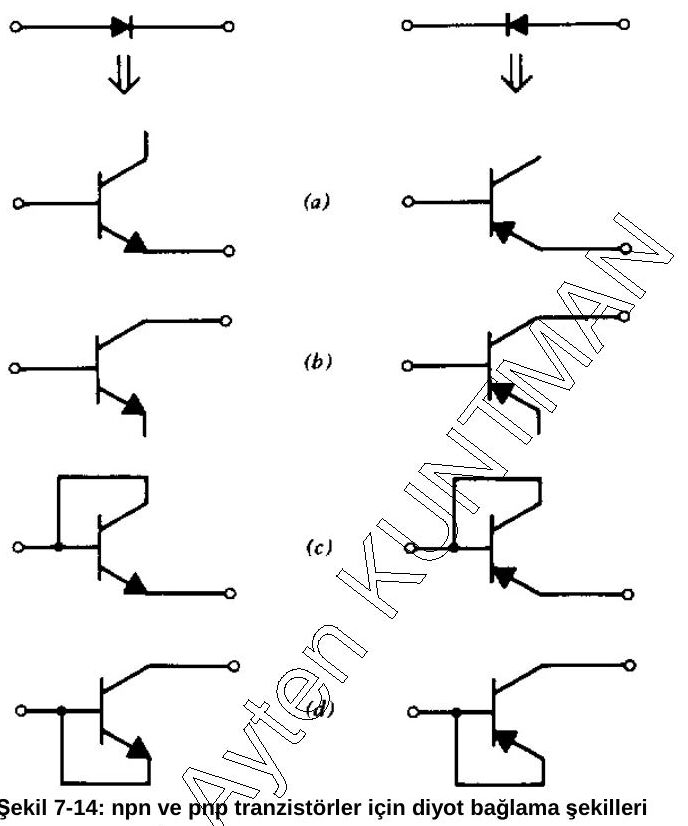

## 7.5. Linear (analog) integrated circuit design principles

Analog ICs are generally made with bipolar elements. Four basic rules are taken into account in design:

1. **Avoiding absolute-value tolerances:** The tolerances are very high compared with discrete elements; for example ±30% for diffused resistors and ±50% for the npn transistor (current gain).
1. **Matching:** It is the agreement and tracking of element values with one another; relying on ratios is important in integrated circuits. Since all elements are formed on the same material, matching and temperature tracking are far better than with discrete elements: diffused resistors track one another within ±2% and npn transistors within ±5%. The temperature difference between two points on the chip surface is around ±0.5 °C; the V_BE voltages of two tracking transistors vary by ±10 µV/°C.
1. **Using more elements without extra cost:** In an integrated circuit the cost of an active element is very low; adding passive elements requires new steps and takes up a lot of space. For this reason active elements are used as much as possible; some passive elements can also be realized with active elements.
1. **Avoiding elements that are hard to integrate:** Although capacitors, large-value resistors and transistors drawing high current can be integrated, they are mostly kept off the chip because they enlarge the area.

Advantages of integrated circuit design: realizing a large number of elements at a small cost difference, close thermal coupling, good matching and tracking of element values, and the ability to control placement and geometry. Disadvantages: large tolerances, limited passive element values, and the inability to make large-value capacitors and inductors.

## 7.6. Analog processing blocks

Analog ICs consist of analog processing blocks: operational amplifiers, power amplifiers, oscillators, analog multiplier circuits, ADCs and DACs, voltage regulators, audio and video circuits. Analog processing blocks in turn consist of **sub-blocks** (sub-blocks → analog processing blocks → systems):

- **Biasing circuits:** current-voltage sources, reference generators
- **Gain stages:** differential amplifiers, active-load amplifiers, output stages

#### Biasing circuits and the current mirror

Providing the current or voltage required for a semiconductor element to start conducting is called **biasing**; it is divided into current sources and voltage sources. The current mirror is taken as an example: the circuit in Figure 7-15 consists of two transistors and a resistor; Q1 is the biasing transistor and Q2 is the current source transistor.

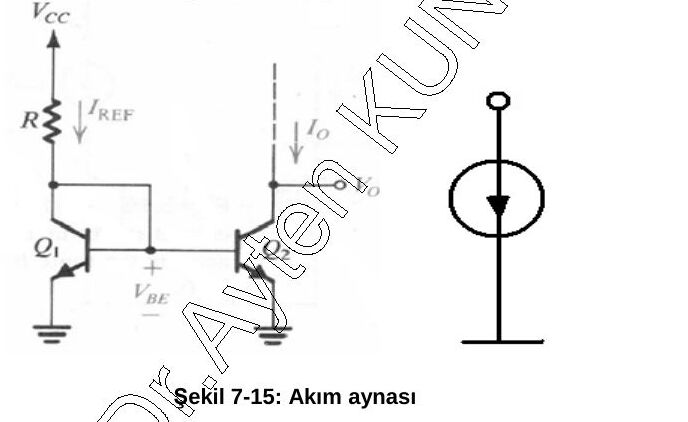

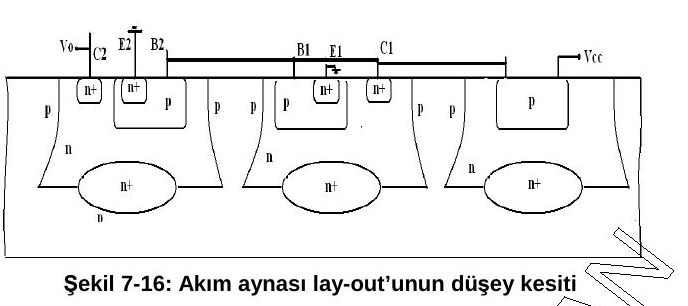

If the transistors are assumed identical, I_C1 = I_C2 and at the Q1 node:

I_ref − I_C1 − 2·I_C1/β_F = 0   (7-22)

If the base currents are neglected:

I_C2 ≅ I_ref = (V_CC − V_BE) / R   (7-23)

The reference current depends on the resistor R. If the base currents are taken into account:

I_C1 = I_C2 = I_ref / (1 + 2/β_F)   (7-24)

*Note: In the document, the numerator of (7-23) reads "V_CC − ΔV_BE"; the voltage across R is V_CC − V_BE.*

Figure 7-17 shows the **Widlar current source** and its vertical cross-section (a current mirror with a resistor R2 added to the emitter of Q2).

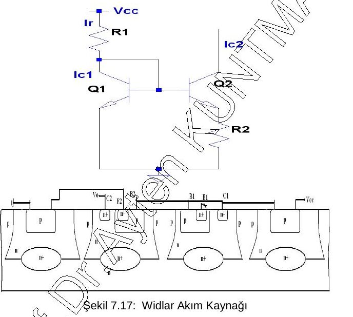

The rest of the note (the SPICE program, layout examples, questions and references) is in the 4th post of the series: [4) SPICE, layout examples, questions and references](/arsiv/eem312-vlsi-tasarimi-kuntman-4-spice-serim-sorular/).
