Bu yazı, EEM312 Sayısal Elektronik dersinin klasöründe bulunan 158 sayfalık **"VLSI Tasarımı"** ders notunun üçüncü bölümüdür (notun 76–102. sayfaları). Belgenin kapağında *"Bu notlar Prof. Dr. Ayten Kuntman tarafından 11.03.2009 tarihinde yayınlanan notların yeniden düzenlenmiş halidir"* yazıyor; PDF 28 Nisan 2009'da oluşturulmuş. Düzenlemeyi kimin yaptığı ve notun hangi kurumda okutulduğu belgede yazmıyor (Prof. Dr. Ayten Kuntman, İstanbul Teknik Üniversitesi öğretim üyesidir).

*Bu içerik üçüncü taraf bir kaynağa aittir; arşiv ve nostalji amacıyla kaynak belirtilerek paylaşılmıştır. Hak sahibinin talebi hâlinde kaldırılır.*

Serinin diğer yazıları: [1) tümdevre üretimi, silisyum ve proses adımları](/arsiv/eem312-vlsi-tasarimi-kuntman-1-uretim-ve-proses/) (notun tamamı orada indirilebilir), [2) MOS tümdevreler, CMOS prosesi ve serim kuralları](/arsiv/eem312-vlsi-tasarimi-kuntman-2-mos-tumdevreler/), [4) SPICE, serim örnekleri, sorular ve kaynaklar](/arsiv/eem312-vlsi-tasarimi-kuntman-4-spice-serim-sorular/). Bu bölümün metni, formülleri ve tabloları aşağıya aktarıldı (bozuk Türkçe karakterler ve dağılmış formüller düzeltildi); şekiller kırpılarak eklendi. Bu bölümün sayfalarından oluşan PDF yazının sonunda indirilebilir.

## 7. Bipolar tümdevreler

Teknoloji son yıllarda MOS ve CMOS ağırlıklı olsa da bipolar tümdevreler önemini korur. Bipolar tümdevreler **jonksiyon izolasyonlu** ve **dielektrik izolasyonlu** olmak üzere iki ana gruba ayrılır; standart üretimde jonksiyon izolasyonlu olanlar daha yaygındır. Bipolar tümdevre üretimi için en az 5–8 maske adımı kullanılır: epitaksi, p-difüzyonu, n-difüzyonu, oksitleme, kontak, metal bağlantı pabuçları, izolasyon. Her biri için uygun maskeyle litografi yapılır.

## 7.1. Jonksiyon izolasyonlu bipolar tümdevre teknolojisi

Yaygın kullanılan teknoloji jonksiyon izolasyonlu bipolar tümdevre (JIBT) teknolojisidir. Tümdevrenin her elemanı bir **izolasyon adasında** oluşturulur; izolasyon adası epitaksiyle elde edilir. İzolasyon, ada ile taban arasındaki jonksiyonun **tıkama yönünde** kutuplanmasıyla sağlanır.

Jonksiyon izolasyonlu bipolar devrelerde en temel eleman **npn tranzistördür**: n-tipi katkılı emetör ve kollektör, p-tipi katkılı baz bölgeleri vardır. Emetör, katkı yoğunluğu en yüksek bölgedir; gövde direnci birkaç ohm civarındadır. Kollektör, katkı yoğunluğunun en düşük olduğu bölgedir; gövde direnci oldukça yüksektir. Katkı yoğunluğu ikisinin arasında olan baz bölgesinin gövde direnci on ohmlar mertebesindedir.

Üretimde 400 µm kalınlığında, 4 inçlik, katkı yoğunluğu 10¹⁶ /cm³ olan **p-tipi** Si pul taban olarak kullanılır. Adımlar (Şekil 7-1):

1. **Gömük tabaka difüzyonu (1. maske, n⁺ difüzyonu):** Kollektörün bir parçasıdır; tranzistörün performansını iyileştirmek ve parazitik kollektör direncini azaltmak için yapılır. Katkı yoğunluğu yüksektir, difüzyon derinliği yaklaşık 8 µm'dir (Şekil 7-1a).
1. **Epitaksi:** Oksit soyularak epitaksiyel tabaka büyütülür. n-epi bölgesi tranzistörün kollektörünü ve elemanın içinde oluşturulacağı izolasyon adasını oluşturur. Katkı yoğunluğu 10¹⁵ /cm³, kalınlığı 15–20 µm'dir. Kollektör-baz belverme gerilimini epi bölgesinin kalınlığı ve direnci belirler: 36 V beslemede çalışacak bir eleman için epi kalınlığı 17 µm, katkı yoğunluğu 10¹⁵ /cm³ olmalıdır; 36 V besleme için C-B belverme gerilimi yaklaşık 90 V olmalıdır (Şekil 7-1b).
1. **İzolasyon difüzyonu (p⁺):** Yüzeyde oksit büyütülür ve uygun maskeyle epitakside izolasyon adalarını oluşturacak p⁺ difüzyonları yapılır. Kollektör ile p⁺ difüzyonu arasındaki pn jonksiyonu ters kutuplanarak ada yalıtılır. İzolasyon difüzyonunun tabaka direnci 20–40 Ω/□ civarındadır (Şekil 7-1c).
1. **Baz difüzyonu (4. maske):** Yapılan bor difüzyonunun tabaka direnci 100–300 Ω/□'dir (Şekil 7-1d).
1. **Emetör difüzyonu (5. maske, n⁺):** Emetör bölgesi ve aynı anda kollektör kontağı oluşturulur. Derinliği 0,5–2,5 µm, tabaka direnci 2–10 Ω/□'dir. n-epinin katkısı düşük olduğundan kollektörden iyi kontak almak için yüksek katkılı emetör difüzyonu burada da kullanılır (Şekil 7-1e).
1. **Kontak ve metalizasyon:** Kontak maskesiyle emetör, baz ve kollektör bölgelerinde (ve kırmıktaki pasif elemanlarda) oksit üzerinde kontak pencereleri açılır. Tüm pul yaklaşık 1 µm metalle (altın veya alüminyum) kaplanır ve metal maskesiyle elemanlar arası bağlantılar oluşturulur (Şekil 7-1f).

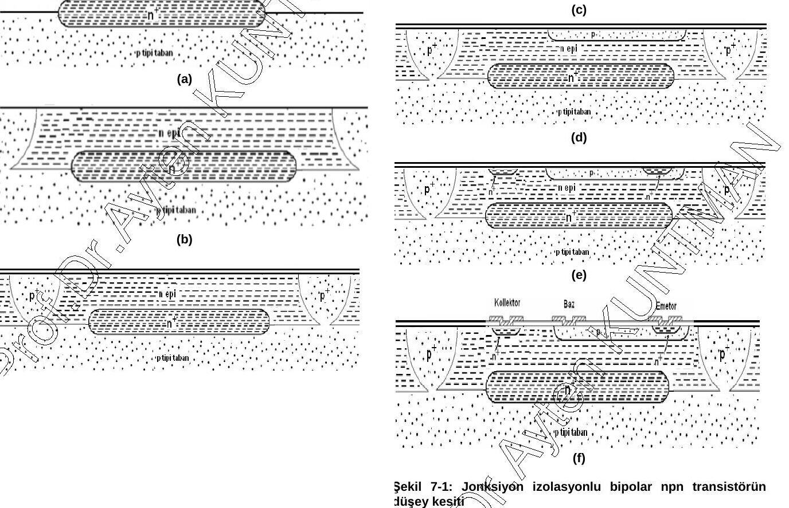

Analog devreler için tipik bir difüzyon profili Şekil 7-2'de görülmektedir. A-A′ doğrultusundaki kesit için:

| Bölge | Katkı yoğunluğu (1/cm³) | Difüzyon derinliği / kalınlık |
|---|---|---|
| Taban | ~10¹⁶ | — |
| Epi | ~10¹⁵ | ~17 µm |
| Baz | ~10¹⁹ | ~3 µm |
| Emetör | ~10²¹ | ~2,5 µm |
| Gömük tabaka | — | ~8 µm |

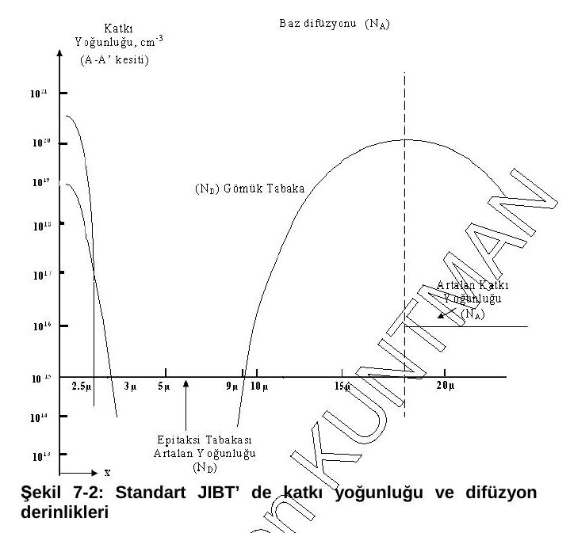

## 7.3. Bipolar analog tümdevrelerde aktif elemanlar

Tümdevre üretiminde npn tranzistör temel yapı taşıdır. Akım kazançları ve frekans cevapları düşük olsa da standart bipolar prosesle birlikte oluşturulabilen pnp tranzistörler de vardır. Aynı taban üzerinde gerçekleştirilen üç yapı anlatılır: **npn**, **enine (lateral) pnp** ve **taban (substrate) pnp**.

#### 7.3.1. Tümleştirilmiş npn tranzistör

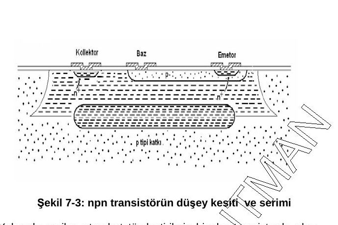

Standart tümleştirilmiş bipolar tranzistörde olası boyutlar:

| Bölge | Boyut |
|---|---|
| Baz bölgesi | 60 µm × 45 µm |
| Kollektör bölgesi | 140 µm × 95 µm |
| Kollektör kontağı | 18 µm × 49 µm |
| Gömük tabaka | 41 µm × 85 µm |
| Baz kontağı | 18 µm × 30 µm |
| Emetör kontağı | 18 µm × 25 µm |

#### 7.3.2. Bipolar yapılarda tasarım için önemli temel kavramlar

Jonksiyonun belverme gerilimi, npn tranzistörün doyma akımı, parazitik dirençler ve parazitik kapasiteler.

##### Jonksiyonun belverme gerilimi

Jonksiyonun bozulmadan dayanabileceği maksimum gerilimdir; katkı yoğunluklarının ve kritik elektrik alanın fonksiyonudur:

**V_B = [ε·(N_A + N_D) / (2q·N_A·N_D)]·E²_kritik**   (7-1)

Burada V_B belverme gerilimi, ε silisyumun dielektrik sabiti, N_A ve N_D p ve n tipi katkı yoğunlukları, q elektron yükü (1,6×10⁻¹⁹ C), E_kritik kritik alan şiddetidir. Maksimum alan:

E_max = E_krit ≅ −q·N_A·W₁/ε   (p-tipi taraf için)   (7-2)

E_max = E_krit ≅ −q·N_D·W₂/ε   (n-tipi taraf için)   (7-3)

W₁ ve W₂, p ve n tarafındaki fakirleşmiş bölge kalınlıklarıdır:

W₁ = [2ε(ψ₀ + V_R) / (q·N_A·(1 + N_A/N_D))]^(1/2)   (7-4)

W₂ = [2ε(ψ₀ + V_R) / (q·N_D·(1 + N_D/N_A))]^(1/2)   (7-5)

ψ₀, jonksiyona dışarıdan bir etki yapılmadığı hâlde oluşan (yerleşik) gerilimdir:

ψ₀ = V_T·ln(N_A·N_D / n_i²)   (7-6)

V_T = kT/q ≅ 26 mV (300 K)   (ısıl gerilim)   (7-7)

V_R ters kutuplama gerilimi, n_i katkısız silisyumdaki taşıyıcı yoğunluğu; silisyum için ε = 1,04×10⁻¹² F/cm'dir.

##### npn tranzistörün doyma akımı

npn tranzistörün dört çalışma bölgesi vardır (Şekil 7-4, yatay eksen V_BE, düşey eksen V_BC):

| Bölge | V_BE (npn) | V_BC (npn) | Çalışma |
|---|---|---|---|
| I. Doyma | Geçirme yönü | Geçirme yönü | Anahtar çalışma (akım akar) |
| II. Ters çalışma bölgesi | Tıkama yönü | Geçirme yönü | Ters aktif |
| III. Kesim | Tıkama yönü | Tıkama yönü | Anahtar çalışma (akım akmaz) |
| IV. İleri yönde aktif | Geçirme yönü | Tıkama yönü | Kuvvetlendirici olarak çalışır |

*Not: Belgedeki Şekil 7-4'te bölge açıklamaları karışık yerleştirilmiş ("akım akmaz" ifadesi IV. bölgenin altında duruyor); tabloda bölgeler, kutuplama yönlerine göre olması gerektiği gibi verildi. pnp için eksenler V_EB ve V_CB'dir.*

Aktif bölgede akımı sağlayan kısım emetör altındaki baz bölgesidir; bu yüzden emetör alanının ve katkısının belirlenmesi önemlidir ve bunun için doyma akımından yararlanılır. Doyma akımının sayısal değeri çok küçük olsa da modelleme açısından önemlidir:

**I_S = q·A·D_n·n_i² / Q_B**   (7-8)

Burada A emetör-baz jonksiyon alanı, n_i has taşıyıcı yoğunluğu, Q_B bazın birim alandaki katkı atomu sayısı (1/cm²), D_n baz bölgesindeki elektronların difüzyon sabitidir. Kollektör akımı:

I_C = I_S·exp(V_BE / V_T)   (7-9)

İki bağıntı birleştirilirse:

Q_B = A·D_n·(q·n_i² / I_C)·exp(V_BE / V_T)   (7-10)

Q_B = W_B·N_A   (7-11)

W_B baz genişliği, N_A bazdaki katkı yoğunluğudur.

##### Seri baz direnci

Baz ve kollektör bölgelerindeki farklı katkılar nedeniyle istenmeyen seri dirençler oluşur; değerleri ve modelleri tasarımda önemlidir.

Seri baz direncinin nedeni, baz kontağının aktif baz bölgesinden oldukça uzak olmasıdır. Baz kontağı ile aktif baz arasında r_b1 ve r_b2 gibi iki bileşenden oluşan seri omik direnç oluşur (Şekil 7-5). Bu direnç tranzistörün gürültü özelliklerini bozar, yüksek frekans kazancını düşürür ve kollektör akımını sınırlayıcı etki yapar.

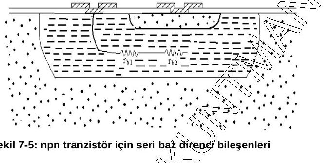

r_b1, baz kontağından baz bölgesi boyunca oluşan dirençtir; düzgün katkılı tabaka gibi hesaplanır (L ve W baz kontağı bölgesinin boyu ve genişliği, R□ baz tabaka direnci):

r_b1 = (L/W)·R□   (7-12)

r_b2'nin hesabı farklı katkı dağılımı nedeniyle zordur. Aktif çalışmada r_b2 zayıflar ve r_b1, r_b'ye yaklaşır. Şekil 7-7'de görüldüğü gibi seri baz direnci 200 Ω'un üzerine çıkınca kollektör akımında sınırlama başlar. Düşük gürültü ve yüksek frekans uygulamaları için düşük baz direnci önemlidir; tasarımda seri baz direnci 200 Ω civarında tutulmaya çalışılır.

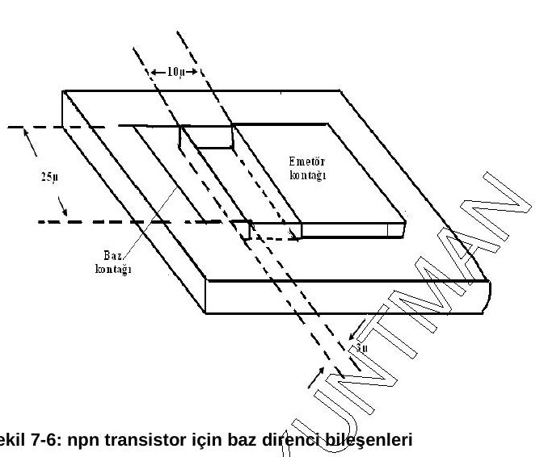

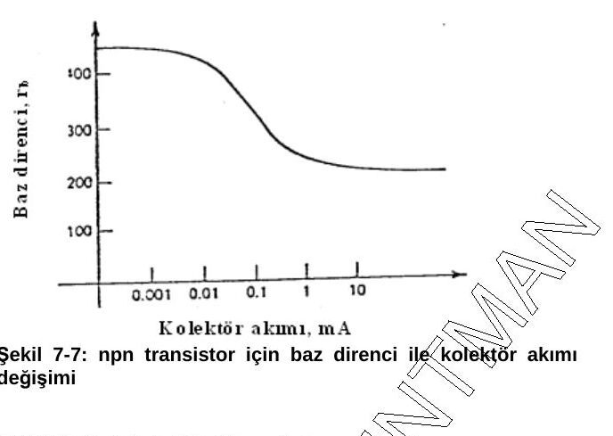

##### Seri kollektör direnci (r_c)

Seri kollektör direnci yüksek frekans uygulamalarında olduğu kadar düşük frekans uygulamalarında da önemlidir. Kollektör bölgesi karmaşık yapıdadır ve aktif çalışmada üç direnç etkili olur (Şekil 7-8):

- r_c1: gömük tabaka ile baz bölgesi arasındaki direnç
- r_c2: gömük tabakanın oluşturduğu direnç
- r_c3: gömük tabaka ile kollektör kontağı arasındaki direnç

r_c = r_c1 + r_c2 + r_c3   (7-13)

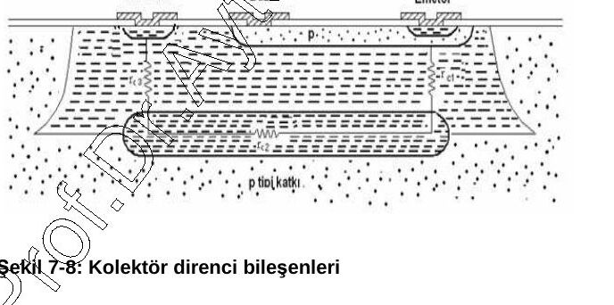

r_c1 ve r_c3'ün hesabı, bölgelerdeki katkı farkları nedeniyle daha karmaşıktır; Laplace yaklaşımıyla ve belli kabullerle çözülür. Önerilen model (Şekil 7-9) kesik piramit biçimli bir bloktur:

R = (ρ·T / (W·L))·ln(a/b) / (a − b)   (7-14)

Burada ρ özdirenç, T bölgenin kalınlığı, W ve L blok tepesinin genişliği ve uzunluğu, a blok taban genişliğinin tepe genişliğine oranı, b taban uzunluğunun tepe uzunluğuna oranıdır.

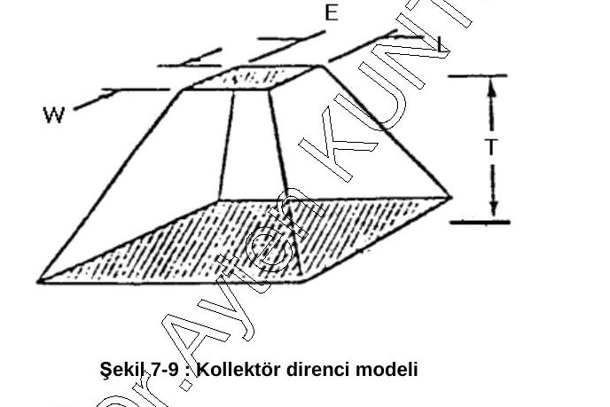

Modelin gerçeğe uygulanabilmesi için belgede yan duvarların dikeyle 60° açı yapması gerektiği yazıyor ve bu kabulle taban boyutları:

L_taban = L_tavan + 2T;   W_taban = W_tavan + 2T   (7-15)

*Not: L_taban = L_tavan + 2T bağıntısı, yan duvarların dikeyle **45°** açı yapmasına karşılık gelir (her yanda T kadar genişleme); 60° olsaydı her yanda T·tan 60° ≈ 1,73T genişleme olurdu.*

Tavan L ve W değerleri, r_c1 ve r_c3 için emetör ve kollektör kontağı bölgelerinin boyutlarıdır. r_c2 düzgün katkılı bölgenin tabaka direnci gibi hesaplanır: r_c2 = R□·L/W.

##### Kollektör-baz jonksiyon kapasitesi

C_j = A·[q·ε·N_A·N_D / (2(N_A + N_D))]^(1/2)·1/√(ψ₀ + V_R)   (7-16)

N_D epi bölgesinin (~10¹⁵ /cm³), N_A baz bölgesinin (~10¹⁹ /cm³) katkı yoğunluğudur. N_A ≫ N_D ise:

C_j / A = √(q·ε·N_D / (2(ψ₀ + V_R)))   (7-17)

Bu, **sert geçişli jonksiyon için birim alan başına kapasitedir**. Şekil 7-10'da uygulanan gerilimle birim alan başına kapasitenin ve fakirleşmiş bölge kalınlığının değişimi görülmektedir.

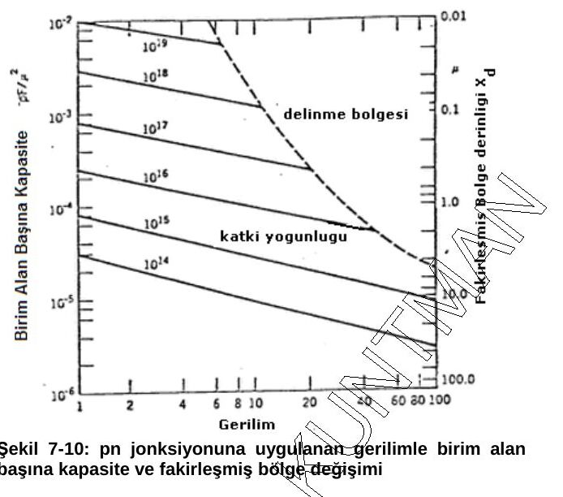

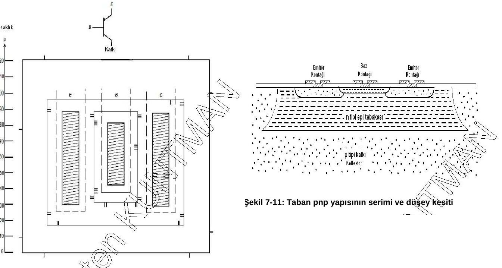

## 7.4. Bipolar entegre devrelerde pasif elemanlar

Bunlar direnç, kapasite ve diyottur.

#### 7.4.1. Difüzyonlu dirençler

npn tranzistör yapımı sırasında herhangi bir difüzyon aşamasında (baz difüzyonu, emetör difüzyonu, epitaksi tabakası) dirençler yapılabilir. Seçim direncin değerine, toleransına ve sıcaklık katsayısına göre yapılır. Örneğin **baz difüzyonlu direnç**, npn tranzistörün bazı oluşturulurken yapılan p-tipi difüzyondan yararlanır (Şekil 7-12).

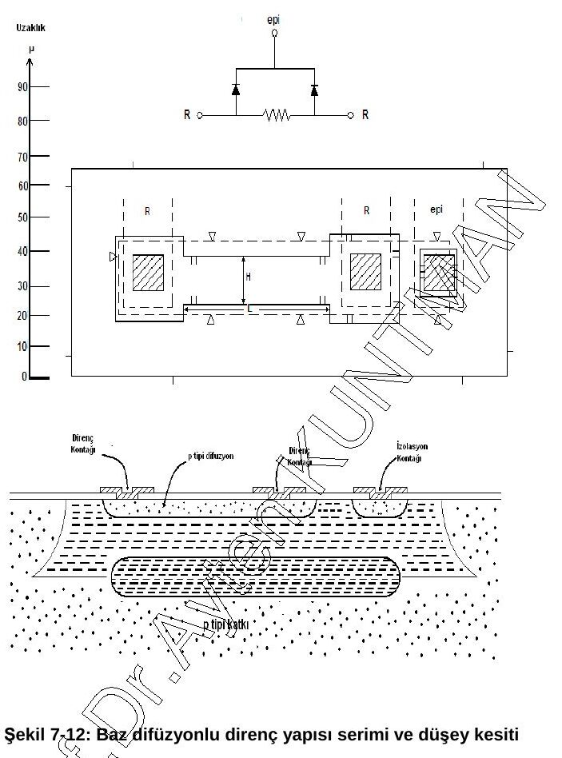

Difüzyonla yapılan bir bölgenin direnci (N katkı yoğunluğu, T difüzyon derinliği):

R = R□·L/W   (7-18),   R□ = 1/(q·µ·N·T)   (7-19)

**Entegre devrelerde kullanılan farklı dirençlerin özellikleri**

| Direnç tipi | Tabaka direnci (Ω/□) | Mutlak tolerans (%) | Sıcaklık katsayısı (ppm/°C) |
|---|---|---|---|
| Baz difüzyonu | 100–200 | ±20 | 1500–2000 |
| Emetör difüzyonu | 2–10 | ±20 | 600 |
| İyon ekme | 100–1000 | ±3 | 100 |
| Epitaksi | 2k–5k | ±30 | 3000 |
| Baz ayarlı (pinch) | 2k–10k | ±50 | 2500 |
| Epitaksi kısılma | 4k–10k | ±50 | 3000 |

#### 7.4.2. Kapasiteler

Tümdevrelerde iki tür kapasite vardır: jonksiyonlu kapasiteler ve MOS kapasiteler.

- **Jonksiyonlu kapasiteler:** C-B veya B-E jonksiyonu kullanılarak yapılır; değeri uygulanan gerilime ve katkı yoğunluğuna bağlıdır. Jonksiyonda oluşan fakirleşmiş bölge kapasiteyi oluşturur:

C = A·[q·ε·N_A·N_D / (2(N_A + N_D))]^(1/2)·1/√(ψ₀ + V_R)   (7-20)

(N_D epi, N_A baz katkı yoğunluğu; A C-B jonksiyon alanı; ψ₀ yerleşik potansiyel; V_R ters kutuplama gerilimi.)

- **MOS kapasiteler:** Emetör difüzyonu üzerine dielektrik olarak ince bir SiO₂ ve üzerine Al kaplanarak elde edilir. Kapasite değeri 0,2–0,3 pF/mil², belverme gerilimi 60–100 V arasındadır.

C = ε·A / t   (ε: SiO₂'nin dielektrik sabiti, t: dielektrik kalınlığı, A: alan)   (7-21)

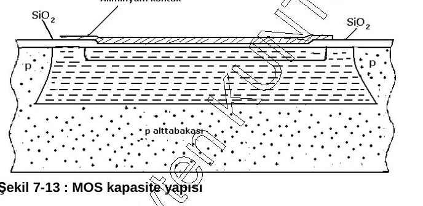

#### 7.4.3. Diyotlar

npn ve pnp tranzistörlerin farklı bağlanmasıyla jonksiyonlu diyotlar elde edilir (Şekil 7-14). a, b ve d bağlantılarında kollektör-baz jonksiyonunun, c bağlantısında emetör-baz jonksiyonunun ileri kutuplanmasıyla tranzistörler diyot olarak çalıştırılır.

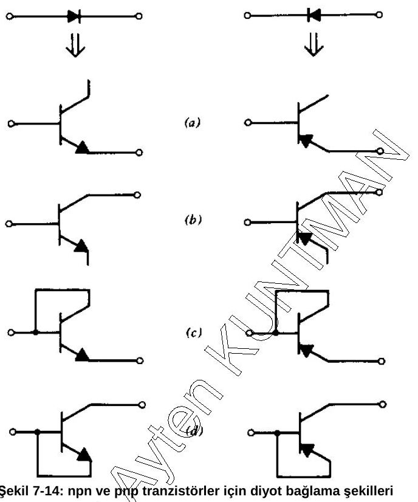

## 7.5. Lineer (analog) entegre devre tasarım ilkeleri

Analog tümdevreler genelde bipolar elemanlarla yapılır. Tasarımda dört temel kural göz önüne alınır:

1. **Mutlak değer toleranslarından kaçınma:** Toleranslar ayrık elemanlara göre çok yüksektir; örneğin difüzyonlu dirençler için ±%30, npn tranzistör (akım kazancı) için ±%50.
1. **Eşleştirme:** Eleman değerlerinin birbirine uyması ve birbirini izlemesidir; entegre devrelerde oranlara dayanmak önemlidir. Tüm elemanlar aynı malzeme üzerinde oluştuğu için eşleştirme ve sıcaklık izleme ayrık elemanlardan çok daha iyidir: difüzyonlu dirençler ±%2, npn tranzistörler ±%5 farkla birbirini izler. Kırmık yüzeyinde iki nokta arasındaki sıcaklık farkı ±0,5 °C civarındadır; birbirini izleyen iki tranzistörün V_BE gerilimleri ±10 µV/°C farkla değişir.
1. **Fazladan masraf yapmadan daha çok eleman kullanma:** Entegre devrede aktif eleman maliyeti çok düşüktür; pasif eleman eklemek yeni adımlar gerektirir ve çok yer kaplar. Bu yüzden mümkün olduğunca aktif elemanlar kullanılır; bazı pasif elemanlar da aktif elemanlarla gerçekleştirilebilir.
1. **Entegrasyona zor uyan elemanlardan kaçınma:** Kondansatörler, büyük değerli dirençler ve yüksek akım çeken tranzistörler entegre edilebilse de yüzeyi büyüttükleri için çoğunlukla entegrasyon dışına alınır.

Entegre devre tasarımının avantajları: çok sayıda elemanın küçük maliyet farkıyla gerçekleştirilmesi, yakın ısıl bağlaşma, eleman değerlerinin iyi eşleşmesi ve birbirini izlemesi, yerleşimin ve geometrinin kontrol edilebilmesi. Dezavantajları: büyük toleranslar, pasif eleman değerlerinin sınırlı olması, büyük değerli kapasite ve endüktansların yapılamaması.

## 7.6. Analog işlem blokları

Analog tümdevreler analog işlem bloklarından oluşur: işlemsel kuvvetlendiriciler, güç kuvvetlendiricileri, osilatörler, analog çarpma devreleri, ADC ve DAC'ler, gerilim regülatörleri, ses ve video devreleri. Analog işlem blokları da **alt bloklardan** oluşur (alt bloklar → analog işlem blokları → sistemler):

- **Kutuplama devreleri:** akım-gerilim kaynakları, referans üreteçleri
- **Kazanç katları:** fark kuvvetlendiricileri, aktif yüklü kuvvetlendiriciler, çıkış katları

#### Kutuplama devreleri ve akım aynası

Bir yarıiletken elemanın iletime girmesi için gereken akım veya gerilimin sağlanmasına **kutuplama** denir; akım kaynakları ve gerilim kaynakları olarak ikiye ayrılır. Örnek olarak akım aynası ele alınır: Şekil 7-15'teki devre iki tranzistör ve bir dirençten oluşur; Q1 kutuplama tranzistörü, Q2 akım kaynağı tranzistörüdür.

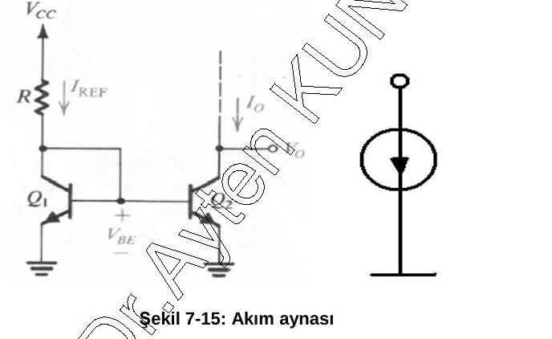

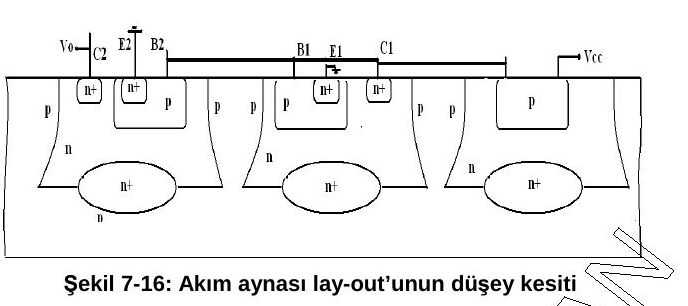

Tranzistörler eş kabul edilirse I_C1 = I_C2 olur ve Q1 düğümünde:

I_ref − I_C1 − 2·I_C1/β_F = 0   (7-22)

Baz akımları ihmal edilirse:

I_C2 ≅ I_ref = (V_CC − V_BE) / R   (7-23)

Referans akımı R direncine bağlıdır. Baz akımları hesaba katılırsa:

I_C1 = I_C2 = I_ref / (1 + 2/β_F)   (7-24)

*Not: Belgede (7-23)'ün payında "V_CC − ΔV_BE" yazıyor; R üzerindeki gerilim V_CC − V_BE'dir.*

Şekil 7-17'de **Widlar akım kaynağı** ve düşey kesiti görülmektedir (Q2'nin emetörüne R2 direnci eklenmiş akım aynası).

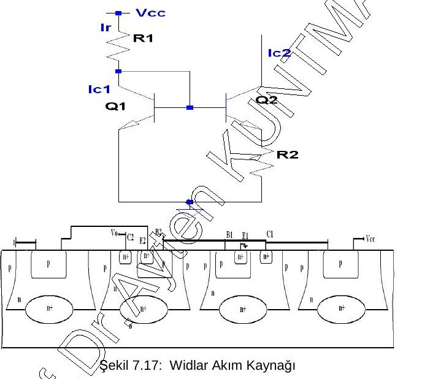

Notun devamı (SPICE programı, serim örnekleri, sorular ve kaynaklar) serinin 4. yazısındadır: [4) SPICE, serim örnekleri, sorular ve kaynaklar](/arsiv/eem312-vlsi-tasarimi-kuntman-4-spice-serim-sorular/).
