This post is the fourth and last part of the 158-page **"VLSI Design"** lecture note found in the EEM312 Digital Electronics course folder (pages 103–158 of the note: appendices). The cover of the document states *"These notes are a reorganized version of the notes published by Prof. Dr. Ayten Kuntman on 11.03.2009"*; the PDF was created on 28 April 2009. The document does not say who did the reorganization or at which institution the note was taught (Prof. Dr. Ayten Kuntman is a faculty member at Istanbul Technical University). Let us also add that, as stated in the document, the information in the SPICE section was taken from the SPICE developers' website and supported with examples.

*This content belongs to a third-party source; it is shared for archival and nostalgia purposes with the source credited. It will be removed at the request of the rights holder.*

Other posts in the series: [1) integrated circuit fabrication, silicon and process steps](/arsiv/eem312-vlsi-tasarimi-kuntman-1-uretim-ve-proses/) (the whole note can be downloaded there), [2) MOS integrated circuits, the CMOS process and layout rules](/arsiv/eem312-vlsi-tasarimi-kuntman-2-mos-tumdevreler/), [3) bipolar integrated circuits](/arsiv/eem312-vlsi-tasarimi-kuntman-3-bipolar-tumdevreler/). The text, SPICE files, tables and questions of this section have been transcribed below; simulation results and layouts have been added in cropped form. A PDF made up of the pages of this section can be downloaded at the end of the post.

## 8. The SPICE program

### General structure

SPICE (*Simulation Program with Integrated Circuit Emphasis*) is a general-purpose electronic circuit simulator developed in the EECS department at the University of California at Berkeley; it is easy to learn and quite practical. A SPICE file consists, in order, of a **title**, the **description of the circuit**, the **analyses to be performed** and the **.end** section.

- When starting a program, an `*` must always be placed at the start of the first line and the title written after it; otherwise the first line is treated as the title and is not processed.
- Lines beginning with `*` are not read by the program; comments are written this way.
- The program always ends with the `.end` command. To see the results, `.probe` is usually used before `.end`; if it is not used, the program runs and closes, and the results must be examined from the output files.
- Every active or passive element is denoted by a letter and written together with the nodes it is connected to. Case is not distinguished. If a line is not enough, the statement is continued on the next line by placing a `+`.
- Semiconductor elements are defined by **model parameters**; the parameters can be redefined for different processes. BSIM, the most advanced version of the model parameters, contains a large number of parameters.

### Element models

After the connections of the element are written, the model parameters are written with the `.model` command:

```spice
.MODEL MNAME TYPE (PNAME1=PVAL1 PNAME2=PVAL2 ...)
.MODEL MOD1 NPN (BF=50 IS=1E-13 VBF=50)
```

MNAME is a name given by the user; TYPE is one of the fixed names indicating the element type:

| Type | Element |
|---|---|
| R | Semiconductor resistor |
| C | Semiconductor capacitor |
| SW | Voltage-controlled switch |
| CSW | Current-controlled switch |
| URC | Uniform distributed RC model |
| LTRA | Lossy transmission line |
| D | Diode |
| NPN / PNP | NPN / PNP BJT |
| NJF / PJF | N / P-channel JFET |
| NMOS / PMOS | N / P-channel MOSFET |
| NMF / PMF | N / P-channel MESFET |

### Subcircuits

Subcircuits with the same structure can be defined once with `.subckt` and used repeatedly; the definition ends with `.ends`. In the circuit, a subcircuit is called with the letter `X`:

```spice
.SUBCKT subname N1 N2 N3 ...
...
.ends subname

.SUBCKT OPAMP 1 2 3 4
...
.ends OPAMP

XYYYYYYY N1 N2 N3 ... SUBNAME
X1 2 4 17 3 1 OPAMP
```

### Passive elements

```spice
* Resistor: RXXXXXXX N1 N2 VALUE
R1 1 2 100
RC1 12 17 1K
* Semiconductor resistor: RXXXXXXX N1 N2 <VALUE> <MNAME> <L=LENGTH> <W=WIDTH> <TEMP=T>
RLOAD 2 10 10K
RMOD 3 7 RMODEL L=10u W=1u
* Capacitor: CXXXXXXX N+ N- VALUE <IC=INCOND>
CBYP 13 0 1UF
COSC 17 23 10U IC=3V
* Semiconductor capacitor: CXXXXXXX N1 N2 <VALUE> <MNAME> <L=LENGTH> <W=WIDTH> <IC=VAL>
CLOAD 2 10 10P
CMOD 3 7 CMODEL L=10u W=1u
* Inductor: LYYYYYYY N+ N- VALUE <IC=INCOND>
LLINK 42 69 1UH
LSHUNT 23 51 10U IC=15.7MA
```

If the value of a semiconductor resistor or capacitor is not given, the model name and the length must be specified.

**Table 8.2: Semiconductor resistor model parameters**

| Symbol | Parameter | Unit | Default | Example |
|---|---|---|---|---|
| TC1 | First-order temperature coefficient | Ω/°C | 0.0 | — |
| TC2 | Second-order temperature coefficient | Ω/°C² | 0.0 | — |
| RSH | Sheet resistance | Ω/□ | — | 50 |
| DEFW | Default width | m | 1e-6 | 2e-6 |
| NARROW | Narrowing due to side etching | m | 0.0 | 1e-7 |
| TNOM | Parameter measurement temperature | °C | 27 | 50 |

**Table 8.3: Semiconductor capacitor model parameters**

| Symbol | Parameter | Unit | Default | Example |
|---|---|---|---|---|
| CJ | Junction bottom capacitance | F/m² | — | 5e-5 |
| CJSW | Junction sidewall capacitance | F/m | — | 2e-11 |
| DEFW | Default element width | m | 1e-6 | 2e-6 |
| NARROW | Narrowing due to side etching | m | 0.0 | 1e-7 |

### Voltage and current sources

An independent voltage source is denoted by `V` and an independent current source by `I`; the positive terminal is written first, then the negative terminal, followed by the DC/AC type and the value:

```spice
VXXXXXXX N+ N- <DC/AC> <VALUE>
IYYYYYYY N+ N- <DC/AC> <VALUE>
VCC 10 0 DC 6
VIN 13 2 AC 5
* Pulse source: PULSE(V1 V2 TD TR TF PW PER)
VIN 3 0 PULSE(-1 1 2NS 2NS 2NS 50NS 100NS)
* Sinusoidal source: SIN(VO VA FREQ TD THETA)
VIN 3 0 SIN(0 1 100MEG 1NS 1E10)
* Exponential source: EXP(V1 V2 TD1 TAU1 TD2 TAU2)
VIN 3 0 EXP(-4 -1 2NS 30NS 60NS 40NS)
```

| Source | Parameter (default value, unit) |
|---|---|
| PULSE | V1 initial value (V/A); V2 pulse value (V/A); TD delay (0.0 s); TR rise time (TSTEP); TF fall time (TSTEP); PW pulse width (TSTOP); PER period (TSTOP) |
| SIN | VO offset (V/A); VA amplitude (V/A); FREQ frequency (1/TSTOP Hz); TD delay (0.0 s); THETA damping factor (0.0 1/s) |
| EXP | V1 initial value (V/A); V2 pulse value (V/A); TD1 rise delay (0.0 s); TAU1 rise time constant (TSTEP); TD2 fall delay (TD1 + TSTEP); TAU2 fall time constant (TSTEP) |

### Semiconductor circuit elements

Diodes, BJTs, JFETs, MOSFETs and MESFETs are introduced through model parameters: after the connections are written, the element is given a model name, and this name and the element type (D, NPN/PNP, NMOS/PMOS) are written on the `.model` line.

```spice
* Diode: DXXXXXXX N+ N- MNAME  (anode, cathode)
DBRIDGE 2 10 DIODE1
.model DIODE1 D (...)
DCLMP 3 7 DMOD 3.0 IC=0.2
* BJT: QXXXXXXX NC NB NE MNAME <AREA> <OFF> <IC=VBE,VCE> <TEMP=T>
Q23 10 24 13 QMOD IC=0.6, 5.0
Q50A 11 26 4 MOD1
.model MOD1 npn (...)
* MOSFET: MXXXXXXX ND NG NS NB MNAME <L=VAL> <W=VAL> <AD=VAL> <AS=VAL>
* + <PD=VAL> <PS=VAL> <NRD=VAL> <NRS=VAL> <OFF> <IC=VDS,VGS,VBS> <TEMP=T>
M1 24 2 0 20 TYPE1
.model TYPE1 NMOS (...)
M31 2 17 6 10 MODM L=5U W=2U
.model MODM PMOS (...)
M1 2 9 3 0 MOD1 L=10U W=5U AD=100P AS=100P PD=40U PS=40U
```

**Table 8.7: Diode model parameters**

| Symbol | Parameter | Unit | Default | Example |
|---|---|---|---|---|
| IS | Saturation current | A | 1.0e-14 | 1.0e-14 |
| RS | Ohmic resistance | Ω | 0 | 10 |
| N | Emission coefficient | — | 1 | 1.0 |
| TT | Transit time | s | 0 | 0.1 ns |
| CJO | Junction capacitance at zero bias | F | 0 | 2 pF |
| VJ | Junction potential | V | 1 | 0.6 |
| M | Grading coefficient | — | 0.5 | 0.5 |
| EG | Activation energy | eV | 1.11 | 1.11 Si; 0.69 Sbd; 0.67 Ge |
| XTI | Saturation current temperature exponent | — | 3.0 | 3.0 jn; 2.0 Sbd |
| KF | Flicker noise coefficient | — | 0 | — |
| AF | Flicker noise exponent | — | 1 | — |
| FC | Coefficient for the forward-bias depletion capacitance formula | — | 0.5 | — |
| BV | Reverse breakdown voltage | V | infinite | 40.0 |
| IBV | Current at breakdown voltage | A | 1.0e-3 | — |
| TNOM | Parameter measurement temperature | °C | 27 | 50 |

**Table 8.8: BJT model parameters**

| Symbol | Parameter | Unit | Default | Example |
|---|---|---|---|---|
| IS | Transport saturation current | A | 1.0e-16 | 1.0e-15 |
| BF | Ideal maximum forward beta | — | 100 | 100 |
| NF | Forward current emission coefficient | — | 1.0 | 1 |
| VAF | Forward Early voltage | V | infinite | 200 |
| IKF | Corner for forward beta high-current roll-off | A | infinite | 0.01 |
| ISE | B-E leakage saturation current | A | 0 | 1.0e-13 |
| NE | B-E leakage emission coefficient | — | 1.5 | 2 |
| BR | Ideal maximum reverse beta | — | 1 | 0.1 |
| NR | Reverse current emission coefficient | — | 1 | 1 |
| VAR | Reverse Early voltage | V | infinite | 200 |
| IKR | Corner for reverse beta high-current roll-off | A | infinite | 0.01 |
| ISC | B-C leakage saturation current | A | 0 | — |
| NC | B-C leakage emission coefficient | — | 2 | 1.5 |
| RB | Zero-bias base resistance | Ω | 0 | 100 |
| IRB | Current at which the base resistance falls halfway to its minimum | A | infinite | 0.1 |
| RBM | Minimum base resistance at high current | Ω | RB | 10 |
| RE | Emitter resistance | Ω | 0 | 1 |
| RC | Collector resistance | Ω | 0 | 10 |
| CJE | B-E zero-bias depletion capacitance | F | 0 | 2 pF |
| VJE | B-E built-in potential | V | 0.75 | 0.6 |
| MJE | B-E junction exponential factor | — | 0.33 | 0.33 |
| TF | Ideal forward transit time | s | 0 | 0.1 ns |
| XTF | Coefficient for bias dependence of TF | — | 0 | — |
| VTF | Voltage describing the V_BC dependence of TF | V | infinite | — |
| ITF | High-current parameter for the effect on TF | A | 0 | — |
| PTF | Excess phase at f = 1/(2π·TF) Hz | degrees | 0 | — |
| CJC | B-C zero-bias depletion capacitance | F | 0 | 2 pF |
| VJC | B-C built-in potential | V | 0.75 | 0.5 |
| MJC | B-C junction exponential factor | — | 0.33 | 0.5 |
| XCJC | Fraction of the B-C capacitance connected to the internal base node | — | 1 | — |
| TR | Ideal reverse transit time | s | 0 | 10 ns |
| CJS | Zero-bias collector-substrate capacitance | F | 0 | 2 pF |
| VJS | Substrate junction built-in potential | V | 0.75 | — |
| MJS | Substrate junction exponential factor | — | 0 | 0.5 |
| XTB | Forward and reverse beta temperature exponent | — | 0 | — |
| EG | Energy gap for the IS temperature effect | eV | 1.11 | — |
| XTI | Temperature exponent for the IS effect | — | 3 | — |
| KF | Flicker noise coefficient | — | 0 | — |
| AF | Flicker noise exponent | — | 1 | — |
| FC | Coefficient for the forward-bias depletion capacitance formula | — | 0.5 | — |
| TNOM | Parameter measurement temperature | °C | 27 | 50 |

**Table 8.9: MOSFET model parameters**

| Symbol | Parameter | Unit | Default | Example |
|---|---|---|---|---|
| LEVEL | Model index | — | 1 | — |
| VTO | Zero-bias threshold voltage (V_T0) | V | 0.0 | 1.0 |
| KP | Transconductance parameter | A/V² | 2.0e-5 | 3.1e-5 |
| GAMMA | Bulk threshold parameter (γ) | V^½ | 0.0 | 0.37 |
| PHI | Surface potential (2Φ_F) | V | 0.6 | 0.65 |
| LAMBDA | Channel-length modulation (MOS1, MOS2 only) | 1/V | 0.0 | 0.02 |
| RD | Drain ohmic resistance | Ω | 0.0 | 1.0 |
| RS | Source ohmic resistance | Ω | 0.0 | 1.0 |
| CBD | Zero-bias B-D junction capacitance | F | 0.0 | 20 fF |
| CBS | Zero-bias B-S junction capacitance | F | 0.0 | 20 fF |
| IS | Bulk junction saturation current | A | 1.0e-14 | 1.0e-15 |
| PB | Bulk junction potential | V | 0.8 | 0.87 |
| CGSO | Gate-source overlap capacitance per meter of channel width | F/m | 0.0 | 4.0e-11 |
| CGDO | Gate-drain overlap capacitance per meter of channel width | F/m | 0.0 | 4.0e-11 |
| CGBO | Gate-bulk overlap capacitance per meter of channel length | F/m | 0.0 | 2.0e-10 |
| RSH | Drain and source diffusion sheet resistance | Ω/□ | 0.0 | 10.0 |
| CJ | Zero-bias bottom capacitance per m² of junction area | F/m² | 0.0 | 2.0e-4 |
| MJ | Bulk junction bottom grading coefficient | — | 0.5 | 0.5 |
| CJSW | Zero-bias sidewall capacitance per meter of junction perimeter | F/m | 0.0 | 1.0e-9 |
| MJSW | Bulk junction sidewall grading coefficient | — | 0.50 (level 1); 0.33 (level 2, 3) | — |
| JS | Saturation current per m² of junction area | A/m² | — | 1.0e-8 |
| TOX | Oxide thickness | m | 1.0e-7 | 1.0e-7 |
| NSUB | Substrate doping | 1/cm³ | 0.0 | 4.0e15 |
| NSS | Surface state density | 1/cm² | 0.0 | 1.0e10 |
| NFS | Fast surface state density | 1/cm² | 0.0 | 1.0e10 |
| TPG | Gate material type: +1 opposite to substrate, −1 same as substrate, 0 Al gate | — | 1.0 | — |
| XJ | Metallurgical junction depth | m | 0.0 | 1 µ |
| LD | Lateral diffusion | m | 0.0 | 0.8 µ |
| UO | Surface mobility | cm²/V·s | 600 | 700 |
| UCRIT | Critical field for mobility degradation (MOS2 only) | V/cm | 1.0e4 | 1.0e4 |
| UEXP | Critical field exponent in mobility degradation (MOS2 only) | — | 0.0 | 0.1 |
| UTRA | Transverse field coefficient (removed in MOS2) | — | 0.0 | 0.3 |
| VMAX | Maximum carrier drift velocity | m/s | 0.0 | 5.0e4 |
| NEFF | Total channel charge (fixed and mobile) coefficient (MOS2 only) | — | 1.0 | 5.0 |
| KF | Flicker noise coefficient | — | 0.0 | 1.0e-26 |
| AF | Flicker noise exponent | — | 1.0 | 1.2 |
| FC | Coefficient for the forward-bias depletion capacitance formula | — | 0.5 | — |
| DELTA | Width effect on threshold voltage (MOS2, MOS3) | — | 0.0 | 1.0 |
| THETA | Mobility modulation (MOS3 only) | 1/V | 0.0 | 0.1 |
| ETA | Static feedback (MOS3 only) | — | 0.0 | 1.0 |
| KAPPA | Saturation field factor (MOS3 only) | — | 0.2 | 0.5 |
| TNOM | Parameter measurement temperature | °C | 27 | 50 |

### Analyses

#### AC analysis

After the `.ac` command, the sweep type (dec/oct/lin), the number of points per decade/octave (or in total), and the start and stop frequencies are written:

```spice
.AC DEC ND FSTART FSTOP
.AC OCT NO FSTART FSTOP
.AC LIN NP FSTART FSTOP
.AC DEC 10 1 10K
.AC DEC 10 1K 100MEG
.AC LIN 100 1 100HZ
```

Example: an RC low-pass filter with R = 1 kΩ, C = 1 µF. By removing the `*` at the beginning of a line, the desired one of the time, DC, AC, distortion and noise analyses is run:

```spice
**title
*vs 1 0 sin(0 1 1k)    * input required for time analysis
vs 1 0 ac 5v
r1 1 2 1k
c1 2 0 1u
*.tran 1n 2m                    *time analysis
*.dc vs 0 5 0.1                 *dc analysis
*.ac dec 101 10 10K             *ac analysis
*.disto DEC 10 10 10k           *distortion analysis
*.NOISE V(2) Vs DEC 101 10 10K  *noise analysis
.probe
.end
```

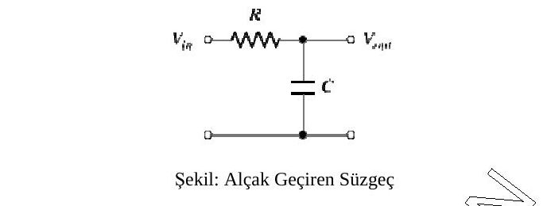

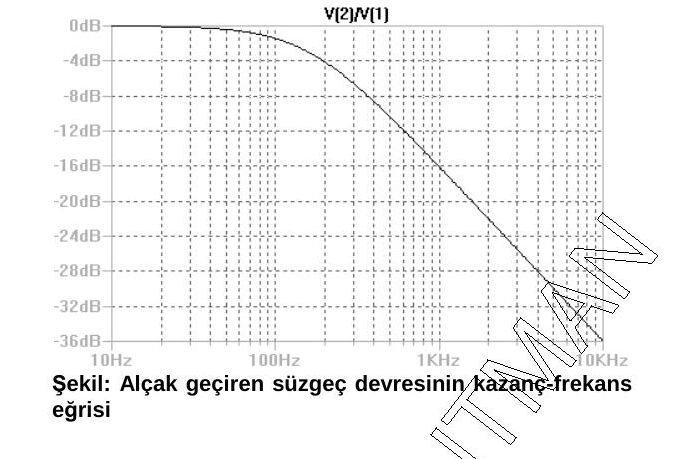

#### DC analysis

After the `.dc` command, the name of the source to be swept, the start value, the stop value and the step are written; a second source can be added on the same line:

```spice
.DC SRCNAM VSTART VSTOP VINCR [SRC2 START2 STOP2 INCR2]
.DC VIN 0.25 5.0 0.25
.DC VDS 0 10 .5 VGS 0 5 1
.DC VCE 0 10 .25 IB 0 10U 1U
```

Extracting the current-voltage characteristic of a MOS transistor (BSIM3 model parameters are used in the example):

```spice
*n-MOS characteristic
VGS 2 0 dc 0
VDS 3 0 dc 0
M1 3 2 0 0 NMOD L=1U W=2U
.MODEL NMOD NMOS (...)
.dc Vds 0 3 0.1 vgs 0 3 1
.probe
.end
```

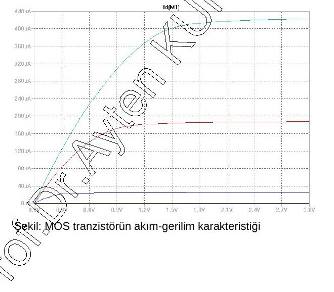

#### Time-domain analysis

After the `.tran` command, the time step, the stop time and (optionally) the start time are written; if TSTART is not specified, it is taken as 0:

```spice
.TRAN TSTEP TSTOP TSTART
.TRAN 1NS 100NS
.TRAN 1NS 1000NS 500NS
*RLC analysis
Vin 1 0 pulse(-220 220 0 1ns 1ns 100us 200us)
R1 1 2 2
L1 2 3 50uH
C1 3 0 10uF
.tran 1u 400u
.probe
.end
```

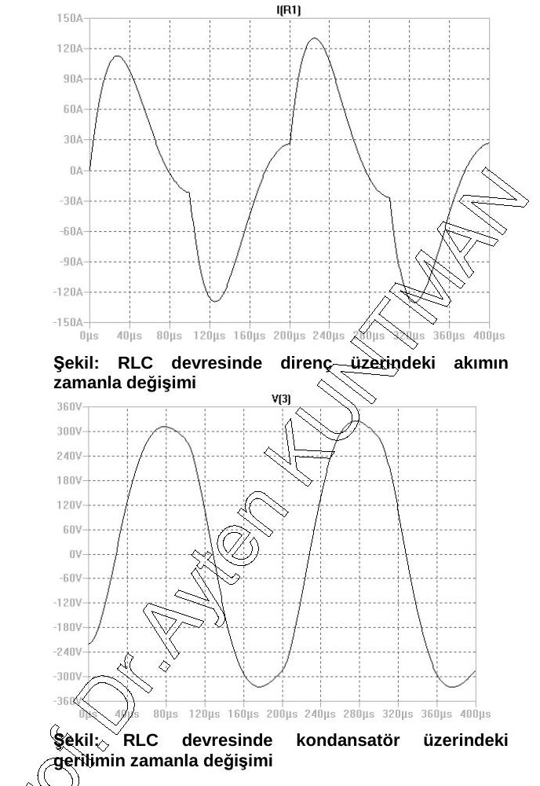

#### Distortion and noise analysis

Distortion analysis computes the small-signal distortion of circuits; its syntax is similar to AC analysis. In noise analysis, after the `.noise` command, the point at which the output noise is measured, the input source, and the frequency sweep as in AC analysis are written:

```spice
.DISTO DEC ND FSTART FSTOP
.DISTO DEC 10 1kHz 100Mhz
.NOISE V(OUTPUT) V(INPUT) (DEC | LIN | OCT) PTS FSTART FSTOP
.NOISE V(5) VIN DEC 10 1kHZ 100Mhz
.NOISE V(5,3) V1 OCT 8 100 10kHz
```

Noise analysis of a symmetrical CMOS OTA (TÜBİTAK 3 µ model parameters are used in the example):

```spice
*Symmetrical CMOS OTA
Vdd 1 0 dc 2.5V
Vss 3 0 dc -2.5V
Vn 5 0 dc 2v
Vp 9 0 dc 0v
M1 4 5 6 6 NMOD L=1U W=2U
M2 7 9 6 6 NMOD L=1U W=2U
M7 2 2 3 3 NMOD L=1U W=2U
M8 8 2 3 3 NMOD L=1U W=2U
M3 4 4 1 1 PMOD L=1U W=5U
M4 7 7 1 1 PMOD L=1U W=5U
M5 2 4 1 1 PMOD L=1U W=4U
M6 8 7 1 1 PMOD L=1U W=4U
IB 6 3 DC 100uA
*vx 8 0 dc 0V
.MODEL NMOD NMOS (...)
.MODEL PMOD PMOS (...)
*.dc vn -2 2 0.1 ib 10u 100u 20u
.NOISE V(8) VN OCT 8 100 1000000kHz
.probe
.end
```

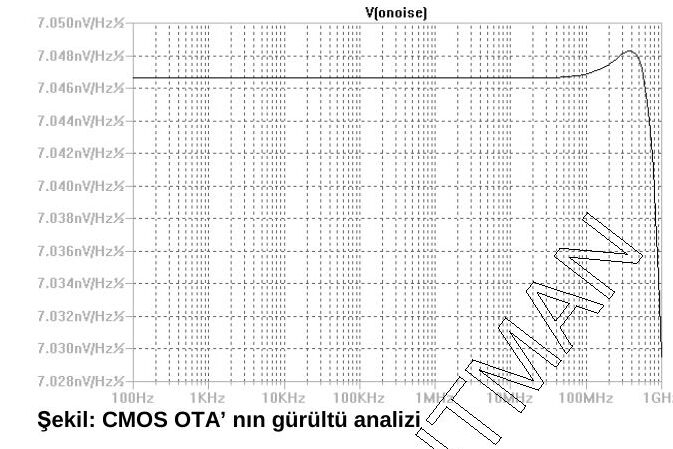

## 9. The layout editor concept

According to the definition in the note, which is based on Wikipedia, integrated circuit layout (IC layout, IC mask layout or mask design) is the representation of an integrated circuit's metal, oxide and semiconductor layers as planar geometric shapes. In a standard process, the operation of the integrated circuit depends on the position and connections of these shapes. The layout engineer's task is to place and connect the elements on the chip so as to satisfy all design conditions; the main properties watched are performance, size and manufacturability.

The layout is put through a series of tests called verification; the two most important steps are **DRC** (*Design Rule Checking*) and **LVS** (*Layout Versus Schematic*). After verification, the data are put into a form suitable for industrial processing and production begins. Before computer-aided design, layout was done by hand on opaque films; today it is done with EDA tools (L-Edit, LASI, Electric…).

The note also gives the flow chart of the bipolar integrated circuit process:

1. Thermal oxidation
1. Buried collector mask (**mask 1**) → antimony diffusion and oxidation
1. Epitaxial layer formation
1. Isolation mask (**mask 2**) → boron diffusion and oxidation
1. Base mask (**mask 3**) → base diffusion and oxidation
1. Emitter mask (**mask 4**) → emitter diffusion (P or As)
1. Contact mask (**mask 5**) → metal deposition
1. Metal pattern mask (**mask 6**) → metal etching
1. SiO₂ passivation layer → opening of the connection paths (pads) (**mask 7**)

### SPICE and layout examples: CMOS NAND gate

The PMOSs (W/L = 16/3) are connected in parallel and the NMOSs (W/L = 8/3) in series. Truth table (D, E inputs; C output): C = 1 when D = 0 or E = 0; C = 0 when D = E = 1.

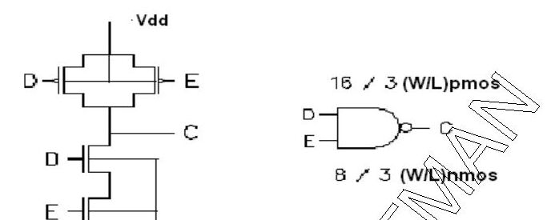

```spice
*nand
vdd 1 0 dc 5V
m1 2 4 1 1 pmod W=16u L=3u
m2 2 5 1 1 pmod W=16u L=3u
m3 2 4 3 0 nmod W=8u L=3u
m4 3 5 0 0 nmod W=8u L=3u
.MODEL NMOD NMOS (... LEVEL=3 model parameters ...)
.MODEL PMOD PMOS (... LEVEL=3 model parameters ...)
v1 4 0 pulse(0 5V 1n 0 0 10n 15n)
v2 5 0 pulse(0 5V 5n 0 0 15n 20n)
.tran 0.1n 25n
.probe
.end
```

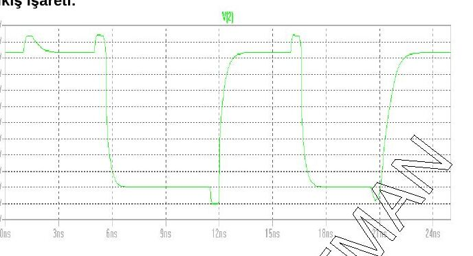

The masks of the NAND gate are drawn in order: 1) formation of the n-well, 2) formation of the gate region, 3) N⁺ diffusion, 4) P⁺ diffusion, 5) contacts, 6) metallization and connections.

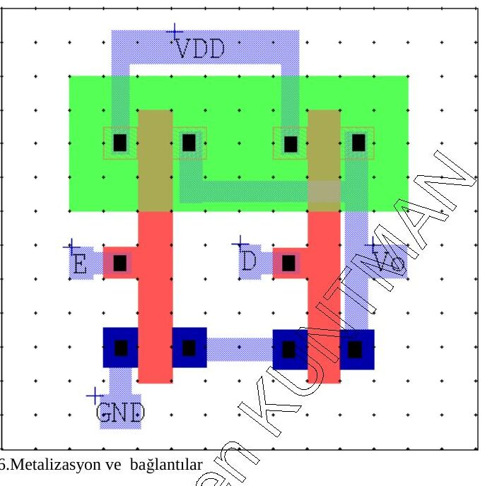

### CMOS NOR gate

The PMOSs (W/L = 10/2) are connected in series and the NMOSs (W/L = 5/2) in parallel. Truth table (G, H inputs; F output): F = 1 only when G = H = 0; F = 0 in all other cases.

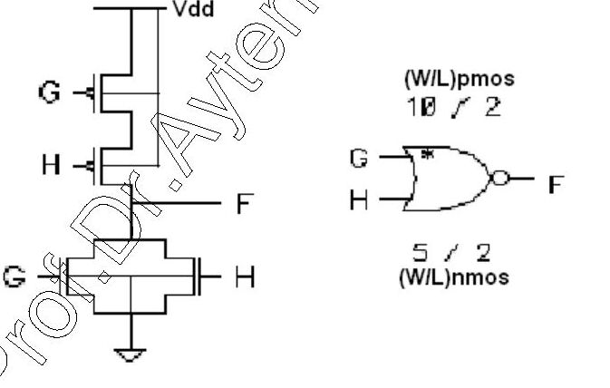

```spice
*nor
vdd 1 0 dc 5V
m1 2 4 1 1 pmod W=10u L=2u
m2 3 5 2 1 pmod W=10u L=2u
m3 3 4 0 0 nmod W=5u L=2u
m4 3 5 0 0 nmod W=5u L=2u
.MODEL NMOD NMOS (LEVEL=3 model parameters)
.MODEL PMOD PMOS (LEVEL=3 model parameters)
v1 4 0 pulse(0 5V 2n 0 0 5n 10n)
v2 5 0 pulse(0 5V 3n 0 0 4n 15n)
.tran 0.1n 17n
.probe
.end
```

The same six mask steps (n-well, gate, N⁺, P⁺, contacts, metallization) are drawn for the NOR gate as well.

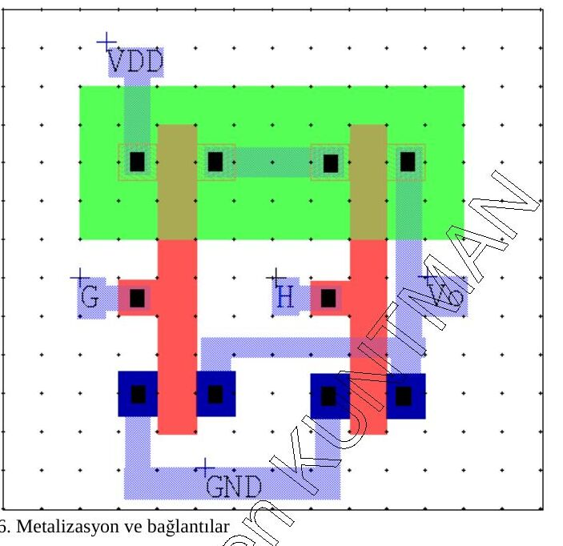

### Integrated circuit technology course lab plan

1. Introduction to the SPICE program; extracting the current-voltage curves of basic semiconductor elements (diode, BJT, MOSFET).
1. Introduction to the L-Edit program.
1. Examination of basic analog processing blocks (current mirror, …) with SPICE.
1. Preparing the layout of a bipolar transistor and current mirror with L-Edit.
1. Examination of basic analog processing blocks (current mirror, NMOS and CMOS inverters, basic amplifier structures) with SPICE.
1. Preparing the layout of a MOS transistor and CMOS inverter with L-Edit.
1. Application using SPICE and L-Edit together (NOR gate).

## 10. Questions

1. When a voltage of 4 V is applied across the terminals of an integrated-circuit resistor, a current of 2 mA flows. Determine the fabrication method of this resistor and find its L/W ratio. Draw its vertical cross-section.
1. For a p-n junction with N_A = 5×10¹⁵ atoms/cm³, N_D = 10¹⁶ atoms/cm³, and E_critical = 3×10⁵ V/cm: a) find the breakdown voltage of the junction (ε = 1.04×10⁻¹² F/cm); b) find the depletion region thickness in the p-type region.
1. The breakdown voltage of an abrupt p-n junction with N_A = 2×10¹⁵ atoms/cm³ and N_D = 5×10¹⁶ atoms/cm³ is 30 V. Calculate the depletion region thickness in the p-type region.
1. Calculate the sheet resistance of a 4 µm-thick diffusion region with an n-type doping density of 10¹⁸ atoms/cm³.
1. a) Draw the vertical cross-section along A-A′ of the structure whose layout is given in Figure 1 (p-substrate, n-well, and gate masks). b) Draw the masks and construct the layout of the structure whose vertical cross-section is given in Figure 2 (p-type substrate, n⁺ buried layer, n-epi, p and n diffusions).
1. a) Starting from the MOSFET fabrication steps, draw the vertical cross-section along A-A′ of the device whose layout is given (active, polysilicon, and metal layers). b) What is the main purpose of the metallization process in integrated circuit fabrication? c) What is the main purpose of the polysilicon process?
1. a) Using the MOSIS layout design rules, calculate the on-chip layout area of a CMOS inverter; draw and show the minimum dimensions used (λ = 0.5 µm). b) Draw and show the contact mask.
1. The source and drain regions of a p-channel MOS transistor are doped at 10¹⁹ 1/cm³ and have a diffusion depth of 3 µm. a) Calculate the sheet resistance of this region. b) What L/W ratio gives the region a resistance of 50 Ω? (µ_p = 70 cm²/V·s)
1. In a p-channel MOS transistor, the process parameters are N_D = 10¹⁶ 1/cm³, (source-drain) 10²⁰ 1/cm³, N_ox = 4×10¹⁰, t_ox = 0.1 µm, q = 1.6×10⁻¹⁹ C, V_SB = 0, ε_r(SiO₂) = 4, ε_r(Si) = 11.7, ε₀ = 8.86×10⁻¹⁴ F/cm, Φ_GC = −0.2014 V, Q_BO = 4.81×10⁻⁸ C/cm², n_i = 1.5×10¹⁰ 1/cm³. Calculate the threshold voltage of this transistor.
1. In a MOS transistor, the source-drain diffusion has a doping density of N_A = 10²⁰ 1/cm³, a junction depth of 3 µm, and a resistance of 100 Ω. Find the W/L ratio of the source-drain region (µ = 500 cm²/V·s, q = 1.6×10⁻¹⁹ C).
1. Figures 1 and 2 show the I_D–V_DS curves of the NMOS and PMOS. A CMOS inverter powered by a 5 V supply and driving a 10 pF capacitive load is to be designed with these transistors. Calculate the inverter's a) logic 0 voltage, b) inversion point, c) high-to-low delay, d) low-to-high delay (µ_n·C_ox = 130 µA/V², µ_p·C_ox = 10 µA/V²).
1. The variation of √I_D with V_GS for an NMOS transistor is shown in the figure (√I_D = 0.4 mA^½ at V_GS = 2 V, and 0.8 mA^½ at V_GS = 3 V). µC_ox = 60 µA/V² and V_BS = 0. a) What is the threshold voltage? b) In which operating region does it operate? c) Calculate the transistor's β value and W/L ratio.
1. The I-V characteristic of the nMOS transistor shown in the figure (V_GS = V_DS) at room temperature under different bias conditions is given below. W/L = 1.0, t_ox = 150 Å, |2Φ_F| = 0.64 V. Find a) the threshold voltage V_TO, b) the electron mobility µ_n, c) the body-effect coefficient γ.
1. Calculate the capacitances formed in an N-channel MOS transistor with no applied voltage, and show them on the figure. The drawn channel width is 90 µ, the channel length is 6 µ; L(overlap) = 0.3 µ, t_ox = 100 Å, ε_r(Si) = 11.7, ε_r(SiO₂) = 4, ε₀ = 8.85×10⁻¹⁴ F/cm.
1. In a CMOS inverter, K_p = µ_p·C_ox = 10 µA/V², K_n = µ_n·C_ox = 30 µA/V², V_TD = 1 V, V_TL = −2 V; V_inv = V_DD/2 is required. a) What should the (W/L)_D and (W/L)_L ratios be? b) What should the ratio (W/L)_D/(W/L)_L be for the delay times to be equal? (C_L = 5 pF)
1. In a current mirror, the supply voltage is 5 V, I_ref = 1 mA, V_T = 26 mV, I_S = 10⁻¹⁵ A, and β ≫ 1 (I_C1 = I_ref = I_S·e^(V_BE/V_T)). a) V_BE = ? b) R1 = ? c) In which process step can resistor R1 be realized?
1. a) Calculate the maximum collector-base capacitance that would form in an npn transistor at 40 °C temperature, at zero bias, over an area of 50 µm² (epi doping density 5×10¹⁵ cm⁻³, base doping density 8×10¹⁹ cm⁻³, ε₀ = 8.86×10⁻¹⁴ F/cm, ε_r(Si) = 11.8, n_i = 1.5×10¹⁰ /cm³, q = 1.6×10⁻¹⁹ C, k = 1.38×10⁻²³ J/K). b) How much chip area would be required if the same capacitance were built as a MOS capacitor? (ε_r(SiO₂) = 4, t_ox = 1000 Å)
1. In a bipolar npn transistor, the drawn base region dimensions are W = 40 µm, L = 30 µm, the diffusion depth is 4 µm, and the base region resistance is 50 Ω. Calculate the doping density of the region (µ = 120 cm²/V·s, q = 1.6×10⁻¹⁹ C).
1. The drawn dimensions of an npn transistor are: emitter 20 µm × 25 µm, buried layer 41 µm × 65 µm, epi region 140 µm × 75 µm, collector contact 18 µm × 49 µm, base 60 µm × 45 µm, isolation diffusion 10 µm × 15 µm. Calculate the area the transistor occupies on the chip.
1. For a bipolar npn transistor with V_BE = 550 mV, I_C = 10 µA, and an emitter area of 4 mil × 4 mil, calculate the base region doping density (φ_B). D_n = 13 cm²/s, V_T = 26 mV (300 K), 1 mil = 25.4 µm.
1. a) A series base resistance of 200 Ω is required in a bipolar integrated-circuit design; what is the reason for this? b) For a diffusion thickness of 25 µm and a doping density of 5×10¹⁵ atoms/cm³, find the L/W ratio of the base region. c) Find the dimensions of the base region.
1. Find the maximum collector-base capacitance per unit area that can occur in a typical npn transistor at zero bias (300 K). Also: calculate the sheet resistance of an n-type diffusion layer with a concentration of 6×10²⁰ atoms/cm³ and a thickness of 2 µm.
1. Find the maximum collector-base capacitance of an npn transistor at 45 °C: A = 20 µm², n_i = 1.5×10¹⁰ /cm³, ε = 1.04×10⁻¹² F/cm, k = 1.38×10⁻²³ J/K, q = 1.6×10⁻¹⁹ C, base doping N_A = 8×10¹⁹ atoms/cm³, epi doping N_D = 5×10¹⁵ 1/cm³.
1. In a classical npn transistor, doping is carried out with phosphorus atoms at a doping density of 5×10²⁰ atoms/cm³; the depth of the resulting layer is 2 µm. Calculate the sheet resistance. Which region of the transistor does this layer form? Why?
1. For a transistor with V_BE = 620 mV, an emitter area of 5 × 5 mm, and a doping density per unit base area of 8×10¹² atoms/cm² at 300 K, calculate the collector current of the transistor (D = 13 cm²/s).
1. Calculate the resistance of the base region of a typical npn transistor for an area of 25 × 15 µm; what are the criteria? (N_A = 10¹⁹ 1/cm³, N_D = 10¹⁵ 1/cm³, T = 3 µm, µ_p = 70 cm²/V·s)
1. A lateral pnp transistor is formed in an epi layer with a resistivity of 0.5 Ω·cm. Find the collector current at which the current gain begins to drop (D_p = 10 cm²/s, base width 8 µm, perimeter 40 × 40 µm, µ_n = 0.14×10⁴ cm²/V·s, base diffusion depth ≅ 3 µm).
1. Find the emitter area of an npn transistor with V_BE = 560 mV, I_C = 11 µA, φ_B = 10¹² atoms/cm², D_n = 13 cm²/s at 300 K.
1. A Widlar current source circuit is given. a) Draw the vertical cross-section of the integrated Widlar current source. b) Write the number of masks used in fabrication and the names of the masks. c) Draw the emitter mask. d) Calculate the value of R2 for I_C2 = 10 µA (V_T·ln(I_C1/I_C2) = I_C2·R2). e) In which process step can this resistor be formed? Determine the W/L ratio (V_CC = 15 V, V_BE = 0.7 V, R1 = 14.3 kΩ, T = 300 K).
1. a) Given that the base resistance of an npn transistor in standard bipolar structures is 5 kΩ, find the L/W ratio of the base region (µ_n = 1000 cm²/V·s; the graph of doping concentrations can be used). b) Why does the series collector resistance of an npn transistor arise? For emitter dimensions W = 15 µm, L = 34 µm, T = 6 µm, a collector region resistivity of ρ = 5 Ω·cm, and µ_n = 1000 cm²/V·s, calculate the series collector resistance r_c1.
1. a) A 10 pF capacitance is to be obtained at 300 K using the collector-base junction; calculate the required chip area (N_D = 10¹⁵, N_A = 10¹⁹ 1/cm³, V_T = 26 mV, n_i = 1.5×10¹⁰ 1/cm³, q = 1.6×10⁻¹⁹ C, ε = 1.04×10⁻¹² F/cm). b) Calculate the depletion region width in the p region.
1. (Repeat of question 15) CMOS inverter: K_p = 10 µA/V², K_n = 30 µA/V², V_TD = 1 V, V_TL = −2 V, V_inv = V_DD/2; a) (W/L)_D and (W/L)_L ratios? b) (W/L)_D/(W/L)_L for equal delay? (C_L = 5 pF)
1. (Repeat of question 18) W = 40 µm, L = 30 µm, depth 4 µm, base resistance 50 Ω; doping density? (µ = 120 cm²/V·s)
1. For a pn junction with N_D = 10¹⁵ 1/cm³ and N_A = 10¹⁶ 1/cm³, calculate a) the breakdown voltage (E_crit = 3×10⁵ V/cm), b) the depletion region thickness on the p side (V_T = 26 mV, n_i = 1.5×10¹⁰ 1/cm³, q = 1.6×10⁻¹⁹ C, ε = 1.04×10⁻¹² F/cm).
1. (Repeat of question 16) Current mirror: 5 V, I_ref = 1 mA, V_T = 26 mV, I_S = 10⁻¹⁵ A, β ≫ 1; a) V_BE, b) R1, c) in which process step is R1 made?
1. a) Calculate the on-chip area occupied by the npn transistor of question 19 (this time with a buried layer of 41 µm × 85 µm). b) Find the W/L ratio of the source-drain region of a MOS transistor whose source-drain diffusion has a doping density of N_A = 10¹⁹ 1/cm³, a junction depth of 3 µm, and a resistance of 900 Ω (µ = 500 cm²/V·s).
1. Calculate the sheet resistance of a 2 µm-thick diffusion region with an n-type doping density of 6×10²⁰ atoms/cm³. Which region of a lateral pnp transistor in an integrated circuit does this diffusion form? Explain.
1. The drain current of a MOS transistor operating in saturation is 100 µA at V_GS = 1.5 V and 10 µA at V_GS = 0.8 V. Neglecting subthreshold conduction and assuming that the mobility does not change, determine the threshold voltage of the transistor and the product µ_n·C_ox·(W/L).
1. (Repeat of question 10) N_A = 10²⁰ 1/cm³, junction depth 3 µm, resistance 100 Ω; W/L ratio of the source-drain region? (µ = 500 cm²/V·s)
1. (Repeat of question 7) CMOS inverter layout area using MOSIS rules (λ = 0.5 µm) and contact mask.

Measurements for Question 13:

| V_GS (V) | V_DS (V) | V_SB (V) | I_D (in the document, "mA") |
|---|---|---|---|
| 4 | 4 | 0.0 | 256 |
| 5 | 5 | 0.0 | 441 |
| 4 | 4 | 2.6 | 144 |
| 5 | 5 | 2.6 | 256 |

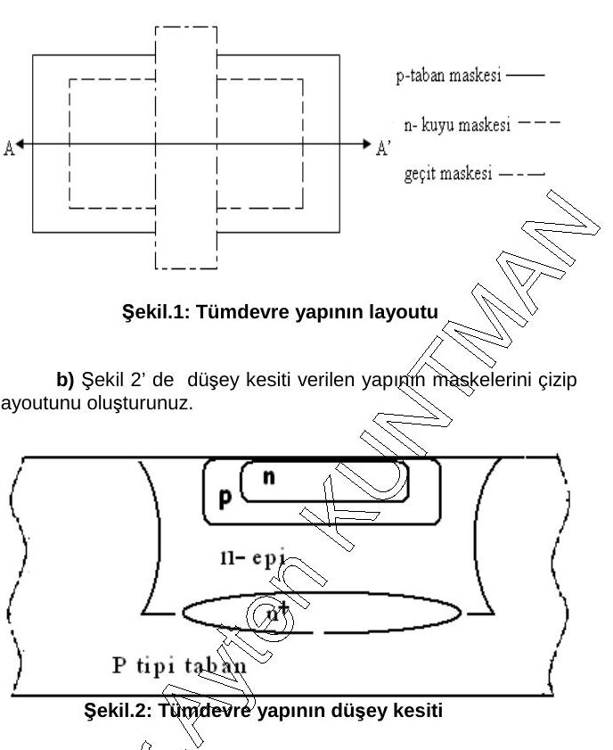

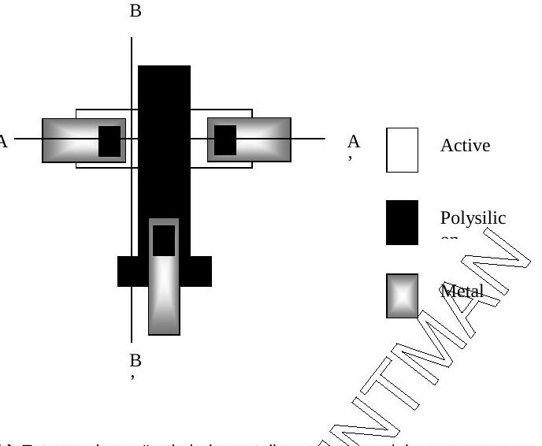

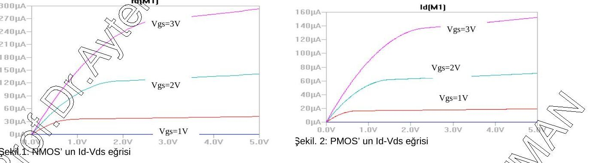

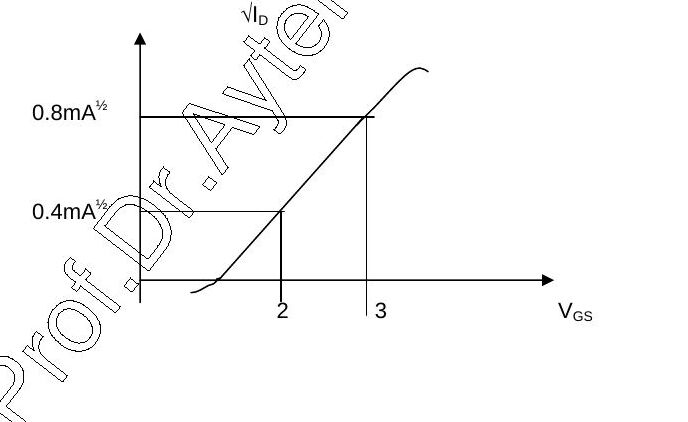

*Note: The questions are numbered 1–40 in the document; some are repeated verbatim (15 = 32, 16 = 35, 18 = 33, 10 = 39, 7 = 40), the number "36" is used twice, and a separate sheet-resistance question titled "Question 6" got mixed into question 22; here they are numbered sequentially. In question 8 the mobility unit is written as "cm³/V·s" (it should be cm²/V·s). In question 9, both doping densities are written as "N_D" (the second should be the p⁺ source-drain density), and the unit of the oxide charge density N_ox is given as 1/cm³ (it should be 1/cm² as a surface density). The currents in question 13 cannot be on the order of mA for W/L = 1 and t_ox = 150 Å, and are most likely µA; moreover, the V_SB = 0 data give a √I_D–V_GS slope of 5 and the V_SB = 2.6 V data give 4 (µA^½/V), so the two measurement sets are not consistent with the same β.*

## 11. References

1. SEGEM, TÜBİTAK Seminar Notes.
1. S. M. Kang, Y. Leblebici, *CMOS Digital Integrated Circuits*, McGraw-Hill, 1999.
1. W. Maly, *Atlas of IC Technologies*, Benjamin/Cummings, Menlo Park, CA, 1987.
1. R. L. Geiger, P. E. Allen, N. R. Strader, *VLSI Design Techniques for Analog and Digital Circuits*, McGraw-Hill, 1990.
1. P. R. Gray, R. G. Meyer, *Analysis and Design of Analog Integrated Circuits*, John Wiley & Sons, 1997.
1. D. A. Pucknell, K. Eshraghian, *Basic VLSI Design: Systems and Circuits*, Prentice Hall, 1988.
1. P. Antognetti, G. Massobrio, *Semiconductor Device Modeling with SPICE*, McGraw-Hill.
1. A. B. Grebene, *Bipolar and MOS Analog Integrated Circuit Design*, John Wiley, 1984.

*Note: In the document, the author names in the references were misspelled ("Pischnell, Eshraghair", "Antapnetti, Gossobrio", "Geige") and the Geiger–Allen book appears twice (with the years 1996 and 1990); here the names have been corrected and the duplicates merged.*
