Bu yazı, EEM312 Sayısal Elektronik dersinin klasöründe bulunan 158 sayfalık **"VLSI Tasarımı"** ders notunun dördüncü ve son bölümüdür (notun 103–158. sayfaları: ekler). Belgenin kapağında *"Bu notlar Prof. Dr. Ayten Kuntman tarafından 11.03.2009 tarihinde yayınlanan notların yeniden düzenlenmiş halidir"* yazıyor; PDF 28 Nisan 2009'da oluşturulmuş. Düzenlemeyi kimin yaptığı ve notun hangi kurumda okutulduğu belgede yazmıyor (Prof. Dr. Ayten Kuntman, İstanbul Teknik Üniversitesi öğretim üyesidir). SPICE bölümünün bilgilerinin, belgede belirtildiği gibi, SPICE geliştiricilerinin web sitesinden alınıp örneklerle desteklendiğini de ekleyelim.

*Bu içerik üçüncü taraf bir kaynağa aittir; arşiv ve nostalji amacıyla kaynak belirtilerek paylaşılmıştır. Hak sahibinin talebi hâlinde kaldırılır.*

Serinin diğer yazıları: [1) tümdevre üretimi, silisyum ve proses adımları](/arsiv/eem312-vlsi-tasarimi-kuntman-1-uretim-ve-proses/) (notun tamamı orada indirilebilir), [2) MOS tümdevreler, CMOS prosesi ve serim kuralları](/arsiv/eem312-vlsi-tasarimi-kuntman-2-mos-tumdevreler/), [3) bipolar tümdevreler](/arsiv/eem312-vlsi-tasarimi-kuntman-3-bipolar-tumdevreler/). Bu bölümün metni, SPICE dosyaları, tabloları ve soruları aşağıya aktarıldı; benzetim sonuçları ve serimler kırpılarak eklendi. Bu bölümün sayfalarından oluşan PDF yazının sonunda indirilebilir.

## 8. SPICE programı

### Genel yapı

SPICE (*Simulation Program with Integrated Circuit Emphasis*), University of California at Berkeley'de EECS bölümünde geliştirilmiş genel amaçlı bir elektronik devre simülatörüdür; öğrenmesi kolay ve oldukça kullanışlıdır. Bir SPICE dosyası sırasıyla **başlık**, **devrenin yazılması**, **yapılacak analizlerin yazılması** ve **.end** bölümlerinden oluşur.

- Program yazmaya başlarken ilk satıra mutlaka `*` işareti konup başlık yazılmalıdır; aksi hâlde ilk satır başlık olarak algılanır ve işleme konmaz.
- Önünde `*` olan satırlar program tarafından okunmaz; açıklamalar bu şekilde yazılır.
- Program her zaman `.end` komutuyla biter. Sonuçları görmek için `.end`'den önce genellikle `.probe` kullanılır; kullanılmazsa program çalışıp kapanır ve sonuçlar çıkış dosyalarından izlenmek zorunda kalınır.
- Her aktif veya pasif eleman bir harfle simgelenir ve bağlı olduğu düğümlerle yazılır. Büyük-küçük harf ayrımı yapılmaz. Satır yetmezse alt satıra `+` konarak devam edilir.
- Yarıiletken elemanlar **model parametreleriyle** tanımlanır; parametreler farklı prosesler için yeniden tanımlanabilir. Model parametrelerinin en gelişmiş sürümü olan BSIM çok sayıda parametre içerir.

### Eleman modelleri

Elemanın bağlantıları yazıldıktan sonra `.model` komutuyla model parametreleri yazılır:

```spice
.MODEL MNAME TYPE (PNAME1=PVAL1 PNAME2=PVAL2 ...)
.MODEL MOD1 NPN (BF=50 IS=1E-13 VBF=50)
```

MNAME kullanıcının verdiği addır; TYPE ise elemanın tipini belirten sabit adlardan biridir:

| Tip | Eleman |
|---|---|
| R | Yarıiletken direnç |
| C | Yarıiletken kapasite |
| SW | Gerilim kontrollü anahtar |
| CSW | Akım kontrollü anahtar |
| URC | Tekdüze dağılmış RC modeli |
| LTRA | Kayıplı iletim hattı |
| D | Diyot |
| NPN / PNP | NPN / PNP BJT |
| NJF / PJF | N / P kanallı JFET |
| NMOS / PMOS | N / P kanallı MOSFET |
| NMF / PMF | N / P kanallı MESFET |

### Alt devreler

Aynı yapıdaki alt devreler `.subckt` ile bir kez tanımlanıp tekrar tekrar kullanılabilir; tanım `.ends` ile biter. Devrede alt devre `X` harfiyle çağrılır:

```spice
.SUBCKT subname N1 N2 N3 ...
...
.ends subname

.SUBCKT OPAMP 1 2 3 4
...
.ends OPAMP

XYYYYYYY N1 N2 N3 ... SUBNAME
X1 2 4 17 3 1 OPAMP
```

### Pasif elemanlar

```spice
* Direnç: RXXXXXXX N1 N2 VALUE
R1 1 2 100
RC1 12 17 1K
* Yarıiletken direnç: RXXXXXXX N1 N2 <VALUE> <MNAME> <L=LENGTH> <W=WIDTH> <TEMP=T>
RLOAD 2 10 10K
RMOD 3 7 RMODEL L=10u W=1u
* Kondansatör: CXXXXXXX N+ N- VALUE <IC=INCOND>
CBYP 13 0 1UF
COSC 17 23 10U IC=3V
* Yarıiletken kondansatör: CXXXXXXX N1 N2 <VALUE> <MNAME> <L=LENGTH> <W=WIDTH> <IC=VAL>
CLOAD 2 10 10P
CMOD 3 7 CMODEL L=10u W=1u
* Bobin: LYYYYYYY N+ N- VALUE <IC=INCOND>
LLINK 42 69 1UH
LSHUNT 23 51 10U IC=15.7MA
```

Yarıiletken direnç veya kondansatörün değeri yazılmamışsa model adı ve uzunluğu mutlaka belirtilmelidir.

**Tablo 8.2: Yarıiletken direnç model parametreleri**

| Simge | Parametre | Birim | Varsayılan | Örnek |
|---|---|---|---|---|
| TC1 | Birinci derece sıcaklık katsayısı | Ω/°C | 0,0 | — |
| TC2 | İkinci derece sıcaklık katsayısı | Ω/°C² | 0,0 | — |
| RSH | Tabaka direnci | Ω/□ | — | 50 |
| DEFW | Varsayılan genişlik | m | 1e-6 | 2e-6 |
| NARROW | Yan aşındırmadan kaynaklanan daralma | m | 0,0 | 1e-7 |
| TNOM | Parametre ölçüm sıcaklığı | °C | 27 | 50 |

**Tablo 8.3: Yarıiletken kondansatör model parametreleri**

| Simge | Parametre | Birim | Varsayılan | Örnek |
|---|---|---|---|---|
| CJ | Jonksiyon taban kapasitesi | F/m² | — | 5e-5 |
| CJSW | Jonksiyon yan duvar kapasitesi | F/m | — | 2e-11 |
| DEFW | Varsayılan eleman genişliği | m | 1e-6 | 2e-6 |
| NARROW | Yan aşındırmadan kaynaklanan daralma | m | 0,0 | 1e-7 |

### Gerilim ve akım kaynakları

Bağımsız gerilim kaynağı `V`, bağımsız akım kaynağı `I` ile gösterilir; önce pozitif, sonra negatif uç yazılır, ardından DC/AC türü ve değeri gelir:

```spice
VXXXXXXX N+ N- <DC/AC> <VALUE>
IYYYYYYY N+ N- <DC/AC> <VALUE>
VCC 10 0 DC 6
VIN 13 2 AC 5
* Darbe kaynağı: PULSE(V1 V2 TD TR TF PW PER)
VIN 3 0 PULSE(-1 1 2NS 2NS 2NS 50NS 100NS)
* Sinüzoidal kaynak: SIN(VO VA FREQ TD THETA)
VIN 3 0 SIN(0 1 100MEG 1NS 1E10)
* Üstel kaynak: EXP(V1 V2 TD1 TAU1 TD2 TAU2)
VIN 3 0 EXP(-4 -1 2NS 30NS 60NS 40NS)
```

| Kaynak | Parametre (varsayılan değer, birim) |
|---|---|
| PULSE | V1 başlangıç değeri (V/A); V2 darbe değeri (V/A); TD gecikme (0,0 s); TR yükselme süresi (TSTEP); TF düşme süresi (TSTEP); PW darbe genişliği (TSTOP); PER periyot (TSTOP) |
| SIN | VO ofset (V/A); VA genlik (V/A); FREQ frekans (1/TSTOP Hz); TD gecikme (0,0 s); THETA sönüm katsayısı (0,0 1/s) |
| EXP | V1 başlangıç değeri (V/A); V2 darbe değeri (V/A); TD1 yükselme gecikmesi (0,0 s); TAU1 yükselme zaman sabiti (TSTEP); TD2 düşme gecikmesi (TD1 + TSTEP); TAU2 düşme zaman sabiti (TSTEP) |

### Yarıiletken devre elemanları

Diyot, BJT, JFET, MOSFET ve MESFET'ler model parametreleriyle tanıtılır: bağlantılar yazıldıktan sonra elemana bir model adı verilir ve `.model` satırında bu ad ile elemanın tipi (D, NPN/PNP, NMOS/PMOS) yazılır.

```spice
* Diyot: DXXXXXXX N+ N- MNAME  (anot, katot)
DBRIDGE 2 10 DIODE1
.model DIODE1 D (...)
DCLMP 3 7 DMOD 3.0 IC=0.2
* BJT: QXXXXXXX NC NB NE MNAME <AREA> <OFF> <IC=VBE,VCE> <TEMP=T>
Q23 10 24 13 QMOD IC=0.6, 5.0
Q50A 11 26 4 MOD1
.model MOD1 npn (...)
* MOSFET: MXXXXXXX ND NG NS NB MNAME <L=VAL> <W=VAL> <AD=VAL> <AS=VAL>
* + <PD=VAL> <PS=VAL> <NRD=VAL> <NRS=VAL> <OFF> <IC=VDS,VGS,VBS> <TEMP=T>
M1 24 2 0 20 TYPE1
.model TYPE1 NMOS (...)
M31 2 17 6 10 MODM L=5U W=2U
.model MODM PMOS (...)
M1 2 9 3 0 MOD1 L=10U W=5U AD=100P AS=100P PD=40U PS=40U
```

**Tablo 8.7: Diyot model parametreleri**

| Simge | Parametre | Birim | Varsayılan | Örnek |
|---|---|---|---|---|
| IS | Doyma akımı | A | 1,0e-14 | 1,0e-14 |
| RS | Omik direnç | Ω | 0 | 10 |
| N | Emisyon katsayısı | — | 1 | 1,0 |
| TT | Geçiş süresi | s | 0 | 0,1 ns |
| CJO | Sıfır kutuplamada jonksiyon kapasitesi | F | 0 | 2 pF |
| VJ | Jonksiyon potansiyeli | V | 1 | 0,6 |
| M | Derecelendirme katsayısı | — | 0,5 | 0,5 |
| EG | Aktivasyon enerjisi | eV | 1,11 | 1,11 Si; 0,69 Sbd; 0,67 Ge |
| XTI | Doyma akımı sıcaklık üssü | — | 3,0 | 3,0 jn; 2,0 Sbd |
| KF | Kırpışma (flicker) gürültüsü katsayısı | — | 0 | — |
| AF | Kırpışma gürültüsü üssü | — | 1 | — |
| FC | İleri kutuplama fakirleşme kapasitesi formülü katsayısı | — | 0,5 | — |
| BV | Ters belverme gerilimi | V | sonsuz | 40,0 |
| IBV | Belverme gerilimindeki akım | A | 1,0e-3 | — |
| TNOM | Parametre ölçüm sıcaklığı | °C | 27 | 50 |

**Tablo 8.8: BJT model parametreleri**

| Simge | Parametre | Birim | Varsayılan | Örnek |
|---|---|---|---|---|
| IS | Taşıma doyma akımı | A | 1,0e-16 | 1,0e-15 |
| BF | İdeal maksimum ileri beta | — | 100 | 100 |
| NF | İleri akım emisyon katsayısı | — | 1,0 | 1 |
| VAF | İleri Early gerilimi | V | sonsuz | 200 |
| IKF | İleri betanın yüksek akımda düşme köşesi | A | sonsuz | 0,01 |
| ISE | B-E kaçak doyma akımı | A | 0 | 1,0e-13 |
| NE | B-E kaçak emisyon katsayısı | — | 1,5 | 2 |
| BR | İdeal maksimum ters beta | — | 1 | 0,1 |
| NR | Ters akım emisyon katsayısı | — | 1 | 1 |
| VAR | Ters Early gerilimi | V | sonsuz | 200 |
| IKR | Ters betanın yüksek akımda düşme köşesi | A | sonsuz | 0,01 |
| ISC | B-C kaçak doyma akımı | A | 0 | — |
| NC | B-C kaçak emisyon katsayısı | — | 2 | 1,5 |
| RB | Sıfır kutuplamada baz direnci | Ω | 0 | 100 |
| IRB | Baz direncinin minimuma yarı yoldan düştüğü akım | A | sonsuz | 0,1 |
| RBM | Yüksek akımda minimum baz direnci | Ω | RB | 10 |
| RE | Emetör direnci | Ω | 0 | 1 |
| RC | Kollektör direnci | Ω | 0 | 10 |
| CJE | B-E sıfır kutuplama fakirleşme kapasitesi | F | 0 | 2 pF |
| VJE | B-E yerleşik potansiyeli | V | 0,75 | 0,6 |
| MJE | B-E jonksiyonu üstel çarpanı | — | 0,33 | 0,33 |
| TF | İdeal ileri geçiş süresi | s | 0 | 0,1 ns |
| XTF | TF'nin kutuplama bağımlılığı katsayısı | — | 0 | — |
| VTF | TF'nin V_BC bağımlılığını tanımlayan gerilim | V | sonsuz | — |
| ITF | TF üzerindeki etki için yüksek akım parametresi | A | 0 | — |
| PTF | f = 1/(2π·TF) Hz'de fazla faz | derece | 0 | — |
| CJC | B-C sıfır kutuplama fakirleşme kapasitesi | F | 0 | 2 pF |
| VJC | B-C yerleşik potansiyeli | V | 0,75 | 0,5 |
| MJC | B-C jonksiyonu üstel çarpanı | — | 0,33 | 0,5 |
| XCJC | B-C kapasitesinin iç baz düğümüne bağlı kesri | — | 1 | — |
| TR | İdeal ters geçiş süresi | s | 0 | 10 ns |
| CJS | Sıfır kutuplamada kollektör-taban kapasitesi | F | 0 | 2 pF |
| VJS | Taban jonksiyonu yerleşik potansiyeli | V | 0,75 | — |
| MJS | Taban jonksiyonu üstel çarpanı | — | 0 | 0,5 |
| XTB | İleri ve ters beta sıcaklık üssü | — | 0 | — |
| EG | IS sıcaklık etkisi için enerji aralığı | eV | 1,11 | — |
| XTI | IS sıcaklık etkisi üssü | — | 3 | — |
| KF | Kırpışma gürültüsü katsayısı | — | 0 | — |
| AF | Kırpışma gürültüsü üssü | — | 1 | — |
| FC | İleri kutuplama fakirleşme kapasitesi formülü katsayısı | — | 0,5 | — |
| TNOM | Parametre ölçüm sıcaklığı | °C | 27 | 50 |

**Tablo 8.9: MOSFET model parametreleri**

| Simge | Parametre | Birim | Varsayılan | Örnek |
|---|---|---|---|---|
| LEVEL | Model indeksi | — | 1 | — |
| VTO | Sıfır kutuplama eşik gerilimi (V_T0) | V | 0,0 | 1,0 |
| KP | Geçiş iletkenliği parametresi | A/V² | 2,0e-5 | 3,1e-5 |
| GAMMA | Gövde eşik parametresi (γ) | V^½ | 0,0 | 0,37 |
| PHI | Yüzey potansiyeli (2Φ_F) | V | 0,6 | 0,65 |
| LAMBDA | Kanal boyu modülasyonu (yalnız MOS1, MOS2) | 1/V | 0,0 | 0,02 |
| RD | Savak omik direnci | Ω | 0,0 | 1,0 |
| RS | Kaynak omik direnci | Ω | 0,0 | 1,0 |
| CBD | Sıfır kutuplamada B-D jonksiyon kapasitesi | F | 0,0 | 20 fF |
| CBS | Sıfır kutuplamada B-S jonksiyon kapasitesi | F | 0,0 | 20 fF |
| IS | Gövde jonksiyonu doyma akımı | A | 1,0e-14 | 1,0e-15 |
| PB | Gövde jonksiyonu potansiyeli | V | 0,8 | 0,87 |
| CGSO | Kanal genişliğinin metresi başına geçit-kaynak bindirme kapasitesi | F/m | 0,0 | 4,0e-11 |
| CGDO | Kanal genişliğinin metresi başına geçit-savak bindirme kapasitesi | F/m | 0,0 | 4,0e-11 |
| CGBO | Kanal boyunun metresi başına geçit-gövde bindirme kapasitesi | F/m | 0,0 | 2,0e-10 |
| RSH | Savak ve kaynak difüzyonu tabaka direnci | Ω/□ | 0,0 | 10,0 |
| CJ | Jonksiyon alanının m²'si başına sıfır kutuplama taban kapasitesi | F/m² | 0,0 | 2,0e-4 |
| MJ | Gövde jonksiyonu taban derecelendirme katsayısı | — | 0,5 | 0,5 |
| CJSW | Jonksiyon çevresinin metresi başına sıfır kutuplama yan duvar kapasitesi | F/m | 0,0 | 1,0e-9 |
| MJSW | Gövde jonksiyonu yan duvar derecelendirme katsayısı | — | 0,50 (level 1); 0,33 (level 2, 3) | — |
| JS | Jonksiyon alanının m²'si başına doyma akımı | A/m² | — | 1,0e-8 |
| TOX | Oksit kalınlığı | m | 1,0e-7 | 1,0e-7 |
| NSUB | Taban katkısı | 1/cm³ | 0,0 | 4,0e15 |
| NSS | Yüzey durum yoğunluğu | 1/cm² | 0,0 | 1,0e10 |
| NFS | Hızlı yüzey durum yoğunluğu | 1/cm² | 0,0 | 1,0e10 |
| TPG | Geçit malzemesi tipi: +1 tabana zıt, −1 tabanla aynı, 0 Al geçit | — | 1,0 | — |
| XJ | Metalurjik jonksiyon derinliği | m | 0,0 | 1 µ |
| LD | Yanal difüzyon | m | 0,0 | 0,8 µ |
| UO | Yüzey mobilitesi | cm²/V·s | 600 | 700 |
| UCRIT | Mobilite düşmesi için kritik alan (yalnız MOS2) | V/cm | 1,0e4 | 1,0e4 |
| UEXP | Mobilite düşmesinde kritik alan üssü (yalnız MOS2) | — | 0,0 | 0,1 |
| UTRA | Enine alan katsayısı (MOS2'de kaldırıldı) | — | 0,0 | 0,3 |
| VMAX | Taşıyıcıların maksimum sürüklenme hızı | m/s | 0,0 | 5,0e4 |
| NEFF | Toplam kanal yükü (sabit ve hareketli) katsayısı (yalnız MOS2) | — | 1,0 | 5,0 |
| KF | Kırpışma gürültüsü katsayısı | — | 0,0 | 1,0e-26 |
| AF | Kırpışma gürültüsü üssü | — | 1,0 | 1,2 |
| FC | İleri kutuplama fakirleşme kapasitesi formülü katsayısı | — | 0,5 | — |
| DELTA | Genişliğin eşik gerilimine etkisi (MOS2, MOS3) | — | 0,0 | 1,0 |
| THETA | Mobilite modülasyonu (yalnız MOS3) | 1/V | 0,0 | 0,1 |
| ETA | Statik geri besleme (yalnız MOS3) | — | 0,0 | 1,0 |
| KAPPA | Doyma alanı çarpanı (yalnız MOS3) | — | 0,2 | 0,5 |
| TNOM | Parametre ölçüm sıcaklığı | °C | 27 | 50 |

### Analizler

#### AC analiz

`.ac` komutundan sonra taramanın türü (dec/oct/lin), her on katlık/oktav başına (ya da toplam) nokta sayısı ve başlangıç ile bitiş frekansları yazılır:

```spice
.AC DEC ND FSTART FSTOP
.AC OCT NO FSTART FSTOP
.AC LIN NP FSTART FSTOP
.AC DEC 10 1 10K
.AC DEC 10 1K 100MEG
.AC LIN 100 1 100HZ
```

Örnek: R = 1 kΩ, C = 1 µF'lık RC alçak geçiren süzgeç. Satır başındaki `*` kaldırılarak zaman, DC, AC, distorsiyon ve gürültü analizlerinden istenen çalıştırılır:

```spice
**başlık
*vs 1 0 sin(0 1 1k)    * zaman analizi için gerekli giriş
vs 1 0 ac 5v
r1 1 2 1k
c1 2 0 1u
*.tran 1n 2m                    *zaman analizi
*.dc vs 0 5 0.1                 *dc analiz
*.ac dec 101 10 10K             *ac analiz
*.disto DEC 10 10 10k           *distorsiyon analizi
*.NOISE V(2) Vs DEC 101 10 10K  *gürültü analizi
.probe
.end
```

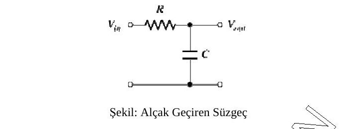

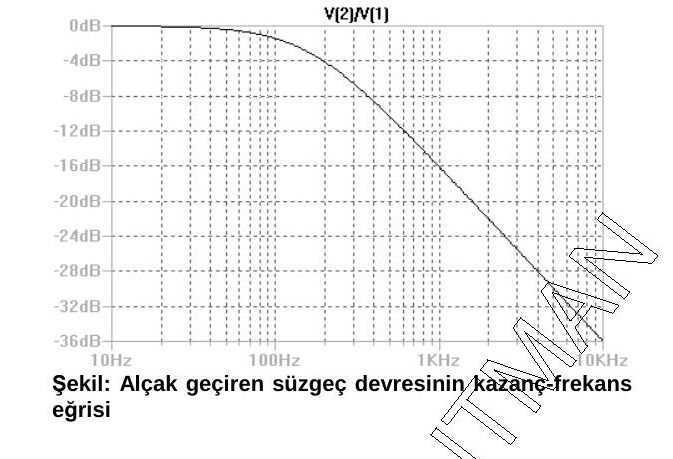

#### DC analiz

`.dc` komutundan sonra taranacak kaynağın adı, başlangıç, bitiş değeri ve adımı yazılır; ikinci bir kaynak aynı satıra eklenebilir:

```spice
.DC SRCNAM VSTART VSTOP VINCR [SRC2 START2 STOP2 INCR2]
.DC VIN 0.25 5.0 0.25
.DC VDS 0 10 .5 VGS 0 5 1
.DC VCE 0 10 .25 IB 0 10U 1U
```

MOS tranzistörün akım-gerilim karakteristiğinin çıkarılması (örnekte BSIM3 model parametreleri kullanılmış):

```spice
*n-MOS özeğri
VGS 2 0 dc 0
VDS 3 0 dc 0
M1 3 2 0 0 NMOD L=1U W=2U
.MODEL NMOD NMOS (...)
.dc Vds 0 3 0.1 vgs 0 3 1
.probe
.end
```

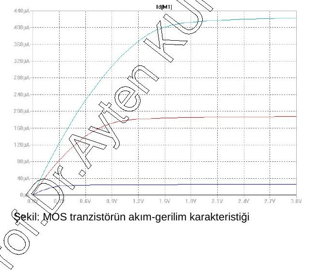

#### Zaman bölgesi analizi

`.tran` komutundan sonra zaman adımı, bitiş süresi ve (isteğe bağlı) başlangıç süresi yazılır; TSTART belirtilmezse 0 alınır:

```spice
.TRAN TSTEP TSTOP TSTART
.TRAN 1NS 100NS
.TRAN 1NS 1000NS 500NS
*RLC analizi
Vin 1 0 pulse(-220 220 0 1ns 1ns 100us 200us)
R1 1 2 2
L1 2 3 50uH
C1 3 0 10uF
.tran 1u 400u
.probe
.end
```

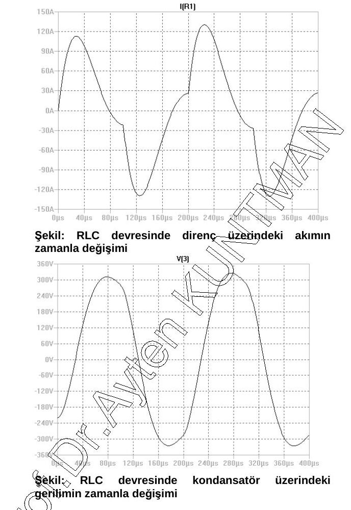

#### Distorsiyon ve gürültü analizi

Distorsiyon analizi devrelerin küçük işaret distorsiyonunu hesaplar; yazımı AC analize benzer. Gürültü analizinde `.noise` komutundan sonra çıkış gürültüsünün ölçüleceği nokta, giriş kaynağı ve AC analizdeki gibi frekans taraması yazılır:

```spice
.DISTO DEC ND FSTART FSTOP
.DISTO DEC 10 1kHz 100Mhz
.NOISE V(OUTPUT) V(INPUT) (DEC | LIN | OCT) PTS FSTART FSTOP
.NOISE V(5) VIN DEC 10 1kHZ 100Mhz
.NOISE V(5,3) V1 OCT 8 100 10kHz
```

Simetrik CMOS OTA'nın gürültü analizi (örnekte TÜBİTAK 3 µ model parametreleri kullanılmış):

```spice
*Simetrik CMOS Ota
Vdd 1 0 dc 2.5V
Vss 3 0 dc -2.5V
Vn 5 0 dc 2v
Vp 9 0 dc 0v
M1 4 5 6 6 NMOD L=1U W=2U
M2 7 9 6 6 NMOD L=1U W=2U
M7 2 2 3 3 NMOD L=1U W=2U
M8 8 2 3 3 NMOD L=1U W=2U
M3 4 4 1 1 PMOD L=1U W=5U
M4 7 7 1 1 PMOD L=1U W=5U
M5 2 4 1 1 PMOD L=1U W=4U
M6 8 7 1 1 PMOD L=1U W=4U
IB 6 3 DC 100uA
*vx 8 0 dc 0V
.MODEL NMOD NMOS (...)
.MODEL PMOD PMOS (...)
*.dc vn -2 2 0.1 ib 10u 100u 20u
.NOISE V(8) VN OCT 8 100 1000000kHz
.probe
.end
```

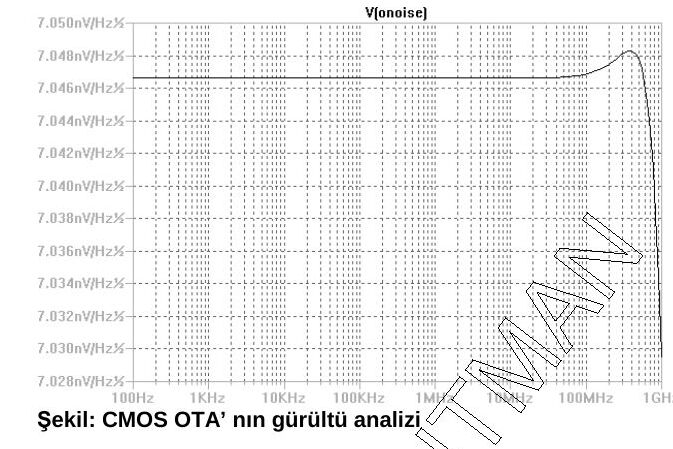

## 9. Serim (layout) editörü kavramı

Notta Vikipedi'ye dayandırılan tanıma göre tümdevre serimi (IC serimi, IC maske serimi veya maske tasarımı), tümdevrenin metal, oksit ve yarıiletken katmanlarının düzlemsel geometrik şekillerle ifade edilmesidir. Standart bir proseste tümdevrenin çalışması bu şekillerin konumuna ve bağlantılarına bağlıdır. Serim mühendisinin görevi, tüm tasarım koşullarını sağlayacak şekilde elemanları kırmığa yerleştirmek ve bağlamaktır; dikkat edilen başlıca özellikler performans, büyüklük ve üretilebilirliktir.

Serim, doğrulama denen bir dizi testten geçirilir; en önemli iki adım **DRC** (*Design Rule Checking*, tasarım kuralları kontrolü) ve **LVS** (*Layout Versus Schematic*, serim–şema karşılaştırması) adımlarıdır. Doğrulamadan sonra veriler endüstride işlenmeye uygun hâle getirilir ve üretime geçilir. Bilgisayar destekli tasarımdan önce serim opak filmlerle elle yapılırdı; günümüzde EDA araçlarıyla (L-Edit, LASI, Electric…) yapılır.

Notta ayrıca bipolar tümdevre prosesinin akış şeması verilmiş:

1. Isıl oksitleme
1. Altkollektör maskesi (**maske 1**) → antimon difüzyonu ve oksitleme
1. Epitaksi katmanı oluşturma
1. İzolasyon maskesi (**maske 2**) → bor difüzyonu ve oksitleme
1. Baz maskesi (**maske 3**) → baz difüzyonu ve oksitleme
1. Emetör maskesi (**maske 4**) → emetör difüzyonu (P veya As)
1. Kontak maskesi (**maske 5**) → metal depolama
1. Metal desen maskesi (**maske 6**) → metal aşındırma
1. SiO₂ pasivasyon katmanı → bağlantı yollarının (pabuçların) açılması (**maske 7**)

### SPICE ve serim örnekleri: CMOS NAND kapısı

PMOS'lar (W/L = 16/3) paralel, NMOS'lar (W/L = 8/3) seri bağlıdır. Doğruluk tablosu (D, E girişler; C çıkış): D = 0 veya E = 0 iken C = 1; D = E = 1 iken C = 0.

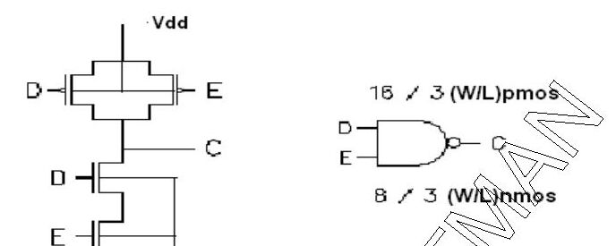

```spice
*nand
vdd 1 0 dc 5V
m1 2 4 1 1 pmod W=16u L=3u
m2 2 5 1 1 pmod W=16u L=3u
m3 2 4 3 0 nmod W=8u L=3u
m4 3 5 0 0 nmod W=8u L=3u
.MODEL NMOD NMOS (... LEVEL=3 model parametreleri ...)
.MODEL PMOD PMOS (... LEVEL=3 model parametreleri ...)
v1 4 0 pulse(0 5V 1n 0 0 10n 15n)
v2 5 0 pulse(0 5V 5n 0 0 15n 20n)
.tran 0.1n 25n
.probe
.end
```

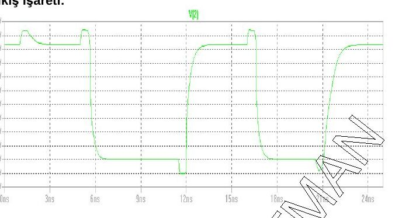

NAND kapısının maskeleri sırasıyla çizilmiş: 1) n-kuyu oluşturulması, 2) geçit bölgesinin oluşturulması, 3) N⁺ difüzyonu, 4) P⁺ difüzyonu, 5) kontaklar, 6) metalizasyon ve bağlantılar.

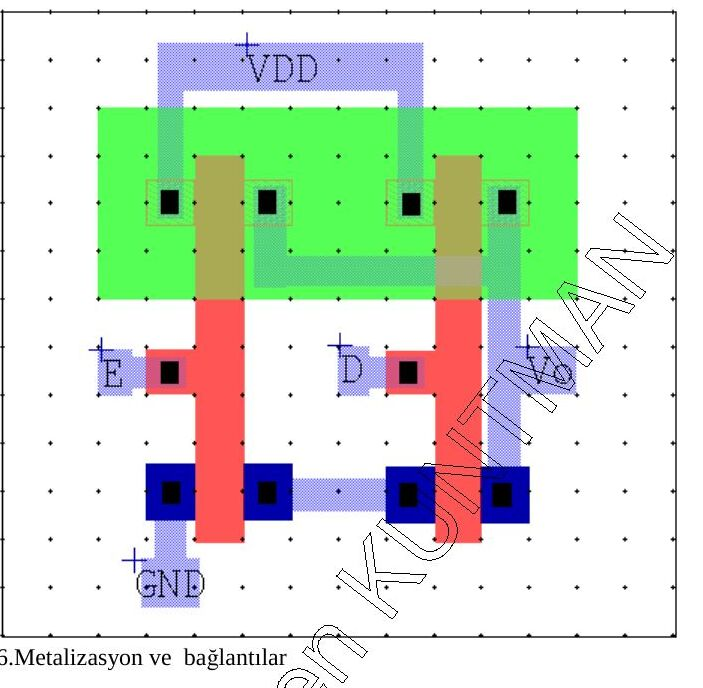

### CMOS NOR kapısı

PMOS'lar (W/L = 10/2) seri, NMOS'lar (W/L = 5/2) paralel bağlıdır. Doğruluk tablosu (G, H girişler; F çıkış): yalnız G = H = 0 iken F = 1, diğer durumlarda F = 0.

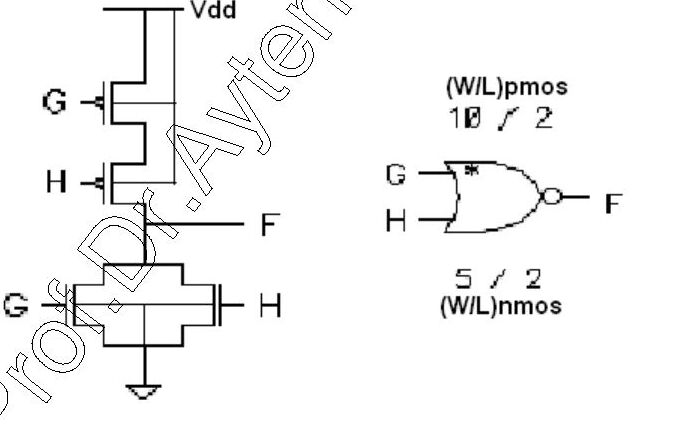

```spice
*nor
vdd 1 0 dc 5V
m1 2 4 1 1 pmod W=10u L=2u
m2 3 5 2 1 pmod W=10u L=2u
m3 3 4 0 0 nmod W=5u L=2u
m4 3 5 0 0 nmod W=5u L=2u
.MODEL NMOD NMOS (LEVEL=3 model parametreleri)
.MODEL PMOD PMOS (LEVEL=3 model parametreleri)
v1 4 0 pulse(0 5V 2n 0 0 5n 10n)
v2 5 0 pulse(0 5V 3n 0 0 4n 15n)
.tran 0.1n 17n
.probe
.end
```

NOR kapısı için de aynı altı maske adımı (n-kuyu, geçit, N⁺, P⁺, kontaklar, metalizasyon) çizilmiş.

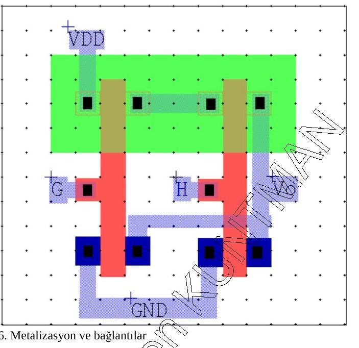

### Tümdevre teknolojisi dersi uygulama planı

1. SPICE programının tanıtımı; temel yarıiletken elemanların (diyot, BJT, MOSFET) akım-gerilim eğrilerinin çıkarılması.
1. L-Edit programının tanıtılması.
1. SPICE ile temel analog işlem bloklarının (akım aynası, …) incelenmesi.
1. L-Edit ile bipolar tranzistör ve akım aynası seriminin hazırlanması.
1. SPICE ile temel analog işlem bloklarının (akım aynası, NMOS ve CMOS eviriciler, basit kuvvetlendirici yapıları) incelenmesi.
1. L-Edit ile MOS tranzistör ve CMOS evirici seriminin hazırlanması.
1. SPICE ve L-Edit'in birlikte kullanıldığı uygulama (NOR kapısı).

## 10. Sorular

1. Bir tümdevre direncin uçlarına 4 V'luk gerilim uygulandığında 2 mA'lik akım akmaktadır. Bu direncin üretim yöntemini belirleyerek L/W oranını bulunuz. Düşey kesitini çiziniz.
1. Bir p-n jonksiyonunda N_A = 5×10¹⁵ atom/cm³, N_D = 10¹⁶ atom/cm³, E_kritik = 3×10⁵ V/cm olduğuna göre: a) jonksiyonun belverme gerilimini bulunuz (ε = 1,04×10⁻¹² F/cm); b) p tipi bölge için fakirleşmiş bölge kalınlığını bulunuz.
1. N_A = 2×10¹⁵ atom/cm³ ve N_D = 5×10¹⁶ atom/cm³ olan sert geçişli bir p-n jonksiyonunun belverme gerilimi 30 V olduğuna göre, p tipi bölge için fakirleşmiş bölge kalınlığını hesaplayınız.
1. n tipi katkı yoğunluğu 10¹⁸ atom/cm³ olan 4 µm kalınlığındaki difüzyon bölgesinin tabaka direncini hesaplayınız.
1. a) Şekil 1'de serimi verilen yapının (p-taban, n-kuyu ve geçit maskeleri) A-A′ doğrultusundaki düşey kesitini çiziniz. b) Şekil 2'de düşey kesiti verilen yapının (p tipi taban, n⁺ gömük tabaka, n-epi, p ve n difüzyonları) maskelerini çizip serimini oluşturunuz.
1. a) MOSFET üretim aşamalarından hareketle serimi verilen elemanın (aktif, polisilisyum, metal katmanları) A-A′ doğrultusundaki düşey kesitini çiziniz. b) Entegre devre üretiminde metalizasyon prosesinin ana amacı nedir? c) Polisilisyum prosesinin ana amacı nedir?
1. a) MOSIS serim tasarım kurallarından yararlanarak bir CMOS eviricinin kırmık üzerindeki yerleşim alanını hesaplayınız; kullanılan minimum boyutları çizerek gösteriniz (λ = 0,5 µm). b) Kontak maskesini çizerek gösteriniz.
1. Bir p kanallı MOS tranzistörün kaynak ve savak bölgeleri 10¹⁹ 1/cm³ yoğunlukla katkılanıyor, difüzyon derinliği 3 µm'dir. a) Bu bölgenin tabaka direncini hesaplayınız. b) Bölgenin direncinin 50 Ω olması için L/W oranı ne olur? (µ_p = 70 cm²/V·s)
1. Bir p-kanallı MOS tranzistörde proses parametreleri N_D = 10¹⁶ 1/cm³, (kaynak-savak) 10²⁰ 1/cm³, N_ox = 4×10¹⁰, t_ox = 0,1 µm, q = 1,6×10⁻¹⁹ C, V_SB = 0, ε_r(SiO₂) = 4, ε_r(Si) = 11,7, ε₀ = 8,86×10⁻¹⁴ F/cm, Φ_GC = −0,2014 V, Q_BO = 4,81×10⁻⁸ C/cm², n_i = 1,5×10¹⁰ 1/cm³'tür. Bu tranzistörün eşik gerilimini hesaplayınız.
1. Bir MOS tranzistörde kaynak-savak difüzyonu katkı yoğunluğu N_A = 10²⁰ 1/cm³, jonksiyon derinliği 3 µm ve direnci 100 Ω olduğuna göre kaynak-savak bölgesinin W/L oranını bulunuz (µ = 500 cm²/V·s, q = 1,6×10⁻¹⁹ C).
1. Şekil 1 ve 2'de NMOS ve PMOS'un I_D–V_DS eğrileri görülmektedir. Bu tranzistörlerle 5 V'luk kaynakla beslenen ve 10 pF'lık kapasitif yükü süren bir CMOS evirici tasarlanmak isteniyor. Eviricinin a) lojik 0 gerilimini, b) evirtim noktasını, c) aşağı gecikmesini, d) yukarı gecikmesini hesaplayınız (µ_n·C_ox = 130 µA/V², µ_p·C_ox = 10 µA/V²).
1. Bir NMOS tranzistör için V_GS'nin √I_D ile değişimi şekilde görülmektedir (V_GS = 2 V'ta √I_D = 0,4 mA^½, V_GS = 3 V'ta 0,8 mA^½). µC_ox = 60 µA/V² ve V_BS = 0'dır. a) Eşik gerilimi nedir? b) Hangi çalışma bölgesinde çalışmaktadır? c) Tranzistörün β değerini ve W/L oranını hesaplayınız.
1. Şekildeki nMOS tranzistörün (V_GS = V_DS) farklı kutuplama şartlarında oda sıcaklığındaki I-V karakteristiği aşağıda verilmiştir. W/L = 1,0, t_ox = 150 Å, |2Φ_F| = 0,64 V. a) Eşik gerilimi V_TO'yu, b) elektron mobilitesi µ_n'yi, c) gövde etkisi katsayısı γ'yı bulunuz.
1. Gerilim uygulanmamış bir N-kanallı MOS tranzistörde oluşan kapasiteleri hesaplayınız ve şekil üzerinde gösteriniz. Çizilen kanal genişliği 90 µ, kanal boyu 6 µ; L(overlap) = 0,3 µ, t_ox = 100 Å, ε_r(Si) = 11,7, ε_r(SiO₂) = 4, ε₀ = 8,85×10⁻¹⁴ F/cm.
1. Bir CMOS eviricide K_p = µ_p·C_ox = 10 µA/V², K_n = µ_n·C_ox = 30 µA/V², V_TD = 1 V, V_TL = −2 V'tur; V_inv = V_DD/2 olması isteniyor. a) (W/L)_D ve (W/L)_L oranları ne olmalıdır? b) Gecikme sürelerinin eşit olması için (W/L)_D/(W/L)_L oranı ne olmalıdır? (C_L = 5 pF)
1. Bir akım aynasında besleme gerilimi 5 V, I_ref = 1 mA, V_T = 26 mV, I_S = 10⁻¹⁵ A ve β ≫ 1'dir (I_C1 = I_ref = I_S·e^(V_BE/V_T)). a) V_BE = ? b) R1 = ? c) R1 direnci proses sırasında hangi adımda gerçekleştirilebilir?
1. a) Bir npn tranzistörde 40 °C sıcaklıkta, sıfır kutuplamada 50 µm² alanda oluşacak maksimum kollektör-baz kapasitesini hesaplayınız (epi katkı yoğunluğu 5×10¹⁵ cm⁻³, baz katkı yoğunluğu 8×10¹⁹ cm⁻³, ε₀ = 8,86×10⁻¹⁴ F/cm, ε_r(Si) = 11,8, n_i = 1,5×10¹⁰ /cm³, q = 1,6×10⁻¹⁹ C, k = 1,38×10⁻²³ J/K). b) Aynı kapasite MOS kapasite olarak yapılırsa ne kadar kırmık alanı gerekir? (ε_r(SiO₂) = 4, t_ox = 1000 Å)
1. Bipolar npn tranzistörde çizilen baz bölgesi boyutları W = 40 µm, L = 30 µm, difüzyon derinliği 4 µm ve baz bölgesi direnci 50 Ω olduğuna göre bölgenin katkı yoğunluğunu hesaplayınız (µ = 120 cm²/V·s, q = 1,6×10⁻¹⁹ C).
1. Bir npn tranzistörün çizilmiş boyutları emetör 20 µm × 25 µm, gömük tabaka 41 µm × 65 µm, epi bölgesi 140 µm × 75 µm, kollektör kontağı 18 µm × 49 µm, baz 60 µm × 45 µm, izolasyon difüzyonu 10 µm × 15 µm olduğuna göre tranzistörün çip üzerinde kapladığı alanı hesaplayınız.
1. Bipolar npn tranzistörün V_BE = 550 mV, I_C = 10 µA, emetör alanı 4 mil × 4 mil olduğuna göre baz bölgesi katkı yoğunluğunu (φ_B) hesaplayınız. D_n = 13 cm²/s, V_T = 26 mV (300 K), 1 mil = 25,4 µm.
1. a) Bipolar tümdevre tasarımında seri baz direncinin 200 Ω olması isteniyor; sebebi nedir? b) Difüzyon kalınlığı 25 µm, katkı yoğunluğu 5×10¹⁵ atom/cm³ için baz bölgesinin L/W oranını bulunuz. c) Baz bölgesinin boyutlarını bulunuz.
1. Tipik bir npn tranzistörde sıfır kutuplamada birim alan başına düşebilecek maksimum kollektör-baz kapasitesini bulunuz (300 K). Ayrıca: konsantrasyonu 6×10²⁰ atom/cm³, kalınlığı 2 µm olan n tipi difüzyon katmanının tabaka direncini hesaplayınız.
1. 45 °C'de npn tranzistörün maksimum kollektör-baz kapasitesini bulunuz: A = 20 µm², n_i = 1,5×10¹⁰ /cm³, ε = 1,04×10⁻¹² F/cm, k = 1,38×10⁻²³ J/K, q = 1,6×10⁻¹⁹ C, baz katkısı N_A = 8×10¹⁹ atom/cm³, epi katkısı N_D = 5×10¹⁵ 1/cm³.
1. Klasik bir npn tranzistörde katkı yoğunluğu 5×10²⁰ atom/cm³ olan fosfor atomlarıyla katkılama yapılıyor; oluşan tabakanın derinliği 2 µm'dir. Tabaka direncini hesaplayınız. Bu tabaka tranzistörün hangi bölgesini oluşturur? Neden?
1. V_BE = 620 mV olan tranzistörün emetör alanı 5 × 5 mm, 300 K'de bazın birim alanı başına katkı yoğunluğu 8×10¹² atom/cm² ise tranzistörün kollektör akımını hesaplayınız (D = 13 cm²/s).
1. Tipik bir npn tranzistörün baz bölgesinin 25 × 15 µm'lik bir alan için direncini hesaplayınız; kriterler nedir? (N_A = 10¹⁹ 1/cm³, N_D = 10¹⁵ 1/cm³, T = 3 µm, µ_p = 70 cm²/V·s)
1. Enine bir pnp tranzistör 0,5 Ω·cm özgül dirençli bir epi tabakasında oluşturuluyor. Akım kazancının düşmeye başladığı kollektör akımını bulunuz (D_p = 10 cm²/s, baz genişliği 8 µm, çevre 40 × 40 µm, µ_n = 0,14×10⁴ cm²/V·s, baz difüzyon derinliği ≅ 3 µm).
1. 300 K'de V_BE = 560 mV, I_C = 11 µA, φ_B = 10¹² atom/cm², D_n = 13 cm²/s olan npn tranzistörün emetör alanını bulunuz.
1. Widlar akım kaynağı devresi verilmiştir. a) Tümleştirilmiş Widlar akım kaynağının düşey kesitini çiziniz. b) Üretimde kullanılan maske sayısını ve maskelerin adlarını yazınız. c) Emetör maskesini çiziniz. d) I_C2 = 10 µA olması için R2'nin değerini hesaplayınız (V_T·ln(I_C1/I_C2) = I_C2·R2). e) Bu direnç hangi proses adımında oluşturulabilir? W/L oranını belirleyiniz (V_CC = 15 V, V_BE = 0,7 V, R1 = 14,3 kΩ, T = 300 K).
1. a) Standart bipolar yapılarda npn tranzistörün baz direnci 5 kΩ olduğuna göre baz bölgesinin L/W oranını bulunuz (µ_n = 1000 cm²/V·s; katkı konsantrasyonlarıyla ilgili grafikten yararlanılabilir). b) npn tranzistörün seri kollektör direnci neden oluşur? Emetör boyutları W = 15 µm, L = 34 µm, T = 6 µm, kollektör bölgesinin özdirenci ρ = 5 Ω·cm, µ_n = 1000 cm²/V·s için r_c1 seri kollektör direncini hesaplayınız.
1. a) Kollektör-baz jonksiyonu kullanılarak 300 K'de 10 pF'lık kapasite elde edilmek isteniyor; gerekli çip alanını hesaplayınız (N_D = 10¹⁵, N_A = 10¹⁹ 1/cm³, V_T = 26 mV, n_i = 1,5×10¹⁰ 1/cm³, q = 1,6×10⁻¹⁹ C, ε = 1,04×10⁻¹² F/cm). b) p bölgesindeki fakirleşmiş bölge genişliğini hesaplayınız.
1. (15. sorunun tekrarı) CMOS evirici: K_p = 10 µA/V², K_n = 30 µA/V², V_TD = 1 V, V_TL = −2 V, V_inv = V_DD/2; a) (W/L)_D ve (W/L)_L oranları? b) Eşit gecikme için (W/L)_D/(W/L)_L? (C_L = 5 pF)
1. (18. sorunun tekrarı) W = 40 µm, L = 30 µm, derinlik 4 µm, baz direnci 50 Ω; katkı yoğunluğu? (µ = 120 cm²/V·s)
1. N_D = 10¹⁵ 1/cm³, N_A = 10¹⁶ 1/cm³ olan pn jonksiyonunun a) belverme gerilimini (E_krit = 3×10⁵ V/cm), b) p tarafındaki fakirleşmiş bölge kalınlığını hesaplayınız (V_T = 26 mV, n_i = 1,5×10¹⁰ 1/cm³, q = 1,6×10⁻¹⁹ C, ε = 1,04×10⁻¹² F/cm).
1. (16. sorunun tekrarı) Akım aynası: 5 V, I_ref = 1 mA, V_T = 26 mV, I_S = 10⁻¹⁵ A, β ≫ 1; a) V_BE, b) R1, c) R1 hangi proses adımında yapılır?
1. a) 19. sorudaki npn tranzistörün (gömük tabaka bu kez 41 µm × 85 µm) çip üzerinde kapladığı alanı hesaplayınız. b) Kaynak-savak difüzyonu katkı yoğunluğu N_A = 10¹⁹ 1/cm³, jonksiyon derinliği 3 µm ve direnci 900 Ω olan MOS tranzistörün kaynak-savak bölgesinin W/L oranını bulunuz (µ = 500 cm²/V·s).
1. n tipi katkı yoğunluğu 6×10²⁰ atom/cm³ olan 2 µm kalınlığındaki difüzyon bölgesinin tabaka direncini hesaplayınız. Bu difüzyon bir tümdevrede enine pnp tranzistörün hangi bölgesini oluşturur? Açıklayınız.
1. Doymalı bölgede çalışan bir MOS tranzistörün savak akımı V_GS = 1,5 V iken 100 µA, V_GS = 0,8 V iken 10 µA'dir. Eşik altı iletimi ihmal ederek ve mobilitenin değişmediğini kabul ederek tranzistörün eşik gerilimini ve µ_n·C_ox·(W/L) çarpımını belirleyiniz.
1. (10. sorunun tekrarı) N_A = 10²⁰ 1/cm³, jonksiyon derinliği 3 µm, direnç 100 Ω; kaynak-savak bölgesinin W/L oranı? (µ = 500 cm²/V·s)
1. (7. sorunun tekrarı) MOSIS kurallarıyla CMOS evirici yerleşim alanı (λ = 0,5 µm) ve kontak maskesi.

Soru 13'teki ölçümler:

| V_GS (V) | V_DS (V) | V_SB (V) | I_D (belgede "mA") |
|---|---|---|---|
| 4 | 4 | 0,0 | 256 |
| 5 | 5 | 0,0 | 441 |
| 4 | 4 | 2,6 | 144 |
| 5 | 5 | 2,6 | 256 |

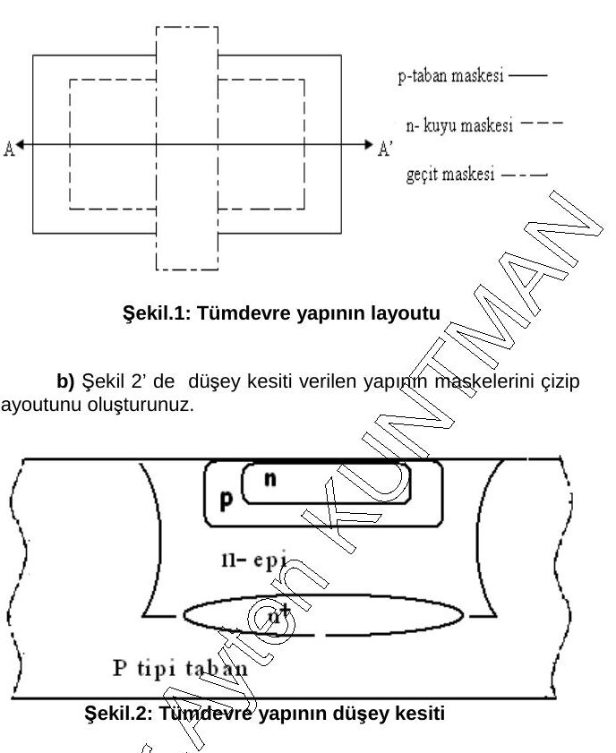

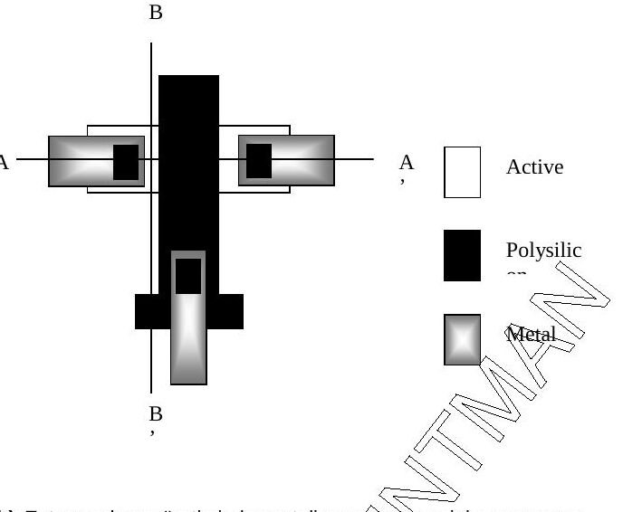

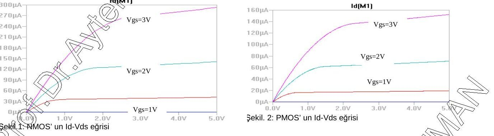

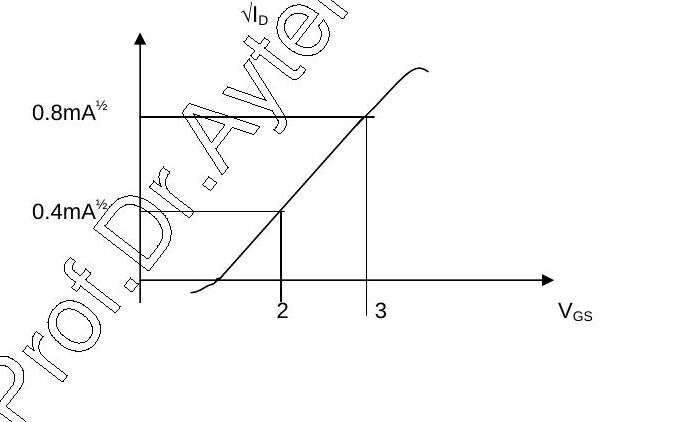

*Not: Sorular belgede 1–40 arası numaralı; bazıları birebir tekrarlanıyor (15 = 32, 16 = 35, 18 = 33, 10 = 39, 7 = 40), "36" numarası iki kez kullanılmış ve 22. sorunun içine "Soru 6" başlıklı ayrı bir tabaka direnci sorusu karışmış; burada sırayla numaralandırıldı. 8. soruda mobilite birimi "cm³/V·s" yazılmış (doğrusu cm²/V·s). 9. soruda katkı yoğunluklarının ikisi de "N_D" olarak yazılmış (ikincisi p⁺ kaynak-savak yoğunluğu olmalı) ve oksit yük yoğunluğu N_ox'un birimi 1/cm³ verilmiş (yüzey yoğunluğu olarak 1/cm² olmalı). 13. sorudaki akımlar W/L = 1 ve t_ox = 150 Å için mA mertebesinde olamaz, büyük olasılıkla µA'dir; üstelik V_SB = 0 verileri √I_D–V_GS eğimi olarak 5, V_SB = 2,6 V verileri 4 (µA^½/V) verdiğinden iki ölçüm takımı aynı β ile tutarlı değil.*

## 11. Kaynaklar

1. SEGEM, TÜBİTAK Seminer Notları.
1. S. M. Kang, Y. Leblebici, *CMOS Digital Integrated Circuits*, McGraw-Hill, 1999.
1. W. Maly, *Atlas of IC Technologies*, Benjamin/Cummings, Menlo Park, CA, 1987.
1. R. L. Geiger, P. E. Allen, N. R. Strader, *VLSI Design Techniques for Analog and Digital Circuits*, McGraw-Hill, 1990.
1. P. R. Gray, R. G. Meyer, *Analysis and Design of Analog Integrated Circuits*, John Wiley & Sons, 1997.
1. D. A. Pucknell, K. Eshraghian, *Basic VLSI Design: Systems and Circuits*, Prentice Hall, 1988.
1. P. Antognetti, G. Massobrio, *Semiconductor Device Modeling with SPICE*, McGraw-Hill.
1. A. B. Grebene, *Bipolar and MOS Analog Integrated Circuit Design*, John Wiley, 1984.

*Not: Kaynakçada yazar adları belgede bozuk yazılmış ("Pischnell, Eshraghair", "Antapnetti, Gossobrio", "Geige") ve Geiger–Allen kitabı iki kez (1996 ve 1990 yıllarıyla) geçiyor; burada adlar düzeltilip tekrar birleştirildi.*
