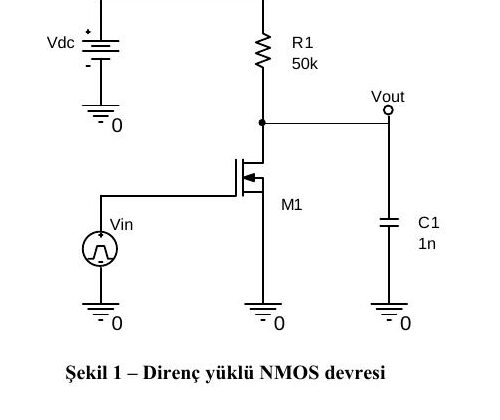
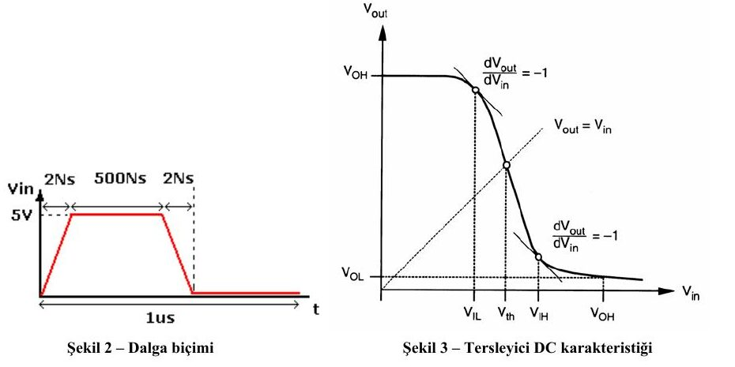

This post contains the first three of the 2010-2011 spring semester **software laboratory** handouts for the Başkent University Electrical and Electronics Engineering course **EEM 312 – Digital Electronics**: **Y1** (inverter measurements with a resistor-loaded NMOS), **Y2** (CMOS inverter characteristics), and **Y3** (investigation of the characteristics of NMOS and PMOS devices). The experiments were carried out with the WinSPICE (Spice3) simulator; the handouts are dated March 2011, and the laboratory supervisors were Research Assistants Numan Yavuz and Evren Emekdaş. The original PDFs of the handouts can be downloaded as a ZIP at the end of the post.

## Y1: Inverter measurements with a resistor-loaded NMOS

### Preliminary work

1. Using the user manuals and help files that come with WinSPICE, explain how to perform the following operations and write the command patterns: DC analysis; voltage source and pulse-shaped source; transient analysis; MOSFET terminal connections and how it is defined in the circuit; plotting graphs and plotting multiple vectors on the same figure; plotting one vector against another (for example, V_out against V_in).
1. Create the Spice3 netlist for the circuit in Figure 1 and the parameters in Table 1. Write the definitions of the following parameters and add the Spice3 commands that obtain them to the file (you can make use of Figure 3): V_OH, V_OL; V_IH, V_IL; V_M; t_f, t_r; t_PHL, t_PLH, t_d; NM_H, NM_L.



**Table 1: Circuit parameters**

| Parameter | Value |
|---|---|
| Vin | Waveform in Figure 2 |
| Vdc | 5 V |
| R1 | 50 kΩ |
| C1 | 1 pF |
| M1 | L = 5u, W = 10u |
| M1 model | .MODEL NMOSFET NMOS(VTO=1 KP=20U GAMMA=0.37 PHI=0.6 CBD=3.1E-15 CBS=3.1E-15) |



In Figure 3, V_IL and V_IH are the points where the slope of the voltage transfer curve is dV_out/dV_in = −1; V_M (the switching threshold) is the point where the curve intersects the line V_out = V_in.

*Note: In Figure 1, C1 is labeled "1n"; however, Table 1 specifies 1 pF.*

### Laboratory work

1. Run the netlist you prepared in the preliminary work in Spice3, obtain the requested graphs, and read the required values from the graphs.
1. Reduce V_dc to 3 V and repeat the simulation. What changed compared to the previous results?
1. Compare the results. Why do the results differ from the ideal case? What are the advantages of the ideal case? What is the effect of the applied V_in signal on the parameters in the preliminary work?

## Y2: CMOS inverter characteristics

### Laboratory work

**Item 1.** Figure 1 shows four different inverter structures. For each one, obtain the **VTC** (voltage transfer characteristic) curve by simulation and fill in Table 1. V_dd = 3.1 V, V_ss = 0 V, load 1 fF, R1 = 100 kΩ. For the VTC, a pulse source is connected to the input and a DC analysis is performed on this source.

 circuits")

The model and control lines given in the handout as a reminder:

```
.MODEL MOSN NMOS LEVEL=2 LD=0.15U TOX=200.0E-10
+ NSUB=5.36726E+15 VTO=0.743469 KP=8.00059E-05 GAMMA=0.543
+ PHI=0.6 U0=655.881 UEXP=0.157282 UCRIT=31443.8
+ DELTA=2.39824 VMAX=55260.9 XJ=0.25U LAMBDA=0.0367072
+ NFS=1E+12 NEFF=1.001 NSS=1E+11 TPG=1.0 RSH=70.00
+ CGDO=4.3E-10 CGSO=4.3E-10 CJ=0.0003 MJ=0.6585
+ CJSW=8.0E-10 MJSW=0.2402 PB=0.58
.MODEL MOSP PMOS LEVEL=2 LD=0.15U TOX=200.0E-10
+ NSUB=4.3318E+15 VTO=-0.738861 KP=2.70E-05 GAMMA=0.58
+ PHI=0.6 U0=261.977 UEXP=0.323932 UCRIT=65719.8
+ DELTA=1.79192 VMAX=25694 XJ=0.25U LAMBDA=0.0612279
+ NFS=1E+12 NEFF=1.001 NSS=1E+11 TPG=-1.0 RSH=120.6
+ CGDO=4.3E-10 CGSO=4.3E-10 CJ=0.0005 MJ=0.5052
+ CJSW=1.349E-10 MJSW=0.2417 PB=0.64
* Example equal-size mosfet definitions
M1 D G S B MOSN W=1.8u L=1.2u NRS=0.333 NRD=0.333
+ AD=6.5p PD=9.0u AS=6.5p PS=9.0u
M1 D G S B MOSP W=1.8u L=1.2u NRS=0.333 NRD=0.333
+ AD=6.5p PD=9.0u AS=6.5p PS=9.0u
* CAUTION! : Pay attention to the drain and source
* definitions in the NMOS and PMOS definitions
* Pulse waveform source applied to the input (fill in according to the values given in item 2)
VIN N1 N2 pulse (v1 v2 td tr tf pw per)
....
.control
....
dc VIN Vin- Vin+ step_voltage
....
.endc
```

**Table 1 (DC analysis results):** V_OH, V_OL, V_IH, V_IL, V_M, NM_H, NM_L for circuits (a)–(d).

**Item 2.** Remove the DC analysis and perform a transient analysis; the pulse period is 10 ns, t_r = t_f = 1 ns. **Table 2:** t_r, t_f, t_pLH, t_pHL, t_d for each circuit.
**Item 3.** According to Tables 1 and 2: (a) Which circuit is the best inverter, and why? (b) Are the circuits symmetric? If not, which parameters should be changed to make them symmetric?
**Item 4.** Below are NMOS and PMOS definitions with unequal sizes. Compare them in terms of L and W, prove with the model parameters why the sizes were chosen this way; update the netlist of Figure 1-d, obtain the VTC again, and evaluate it.

```
M1 D G S B MOSN W=1.8u L=1.2u NRS=0.333 NRD=0.333
+ AD=6.5p PD=9.0u AS=6.5p PS=9.0u
M1 D G S B MOSP W=5.4u L=1.2u NRS=0.111 NRD=0.111
+ AD=16.2p PD=11.4u AS=16.2p PS=11.4u
```

Here, the width of the PMOS is three times that of the NMOS (5.4u / 1.8u). Since in the model KP_n / KP_p = 8.00059E-05 / 2.70E-05 ≈ 2.96, making the PMOS about 3 times wider equalizes the current-driving capability of the two transistors; thus the curve becomes symmetric and the switching threshold V_M approaches V_dd/2.

## Y3: Characteristics of NMOS and PMOS devices

### Preliminary work

Explain the following terms in detail: saturation current, channel length modulation, velocity saturation, hot carrier effect, metal migration, CMOS latchup.

### Laboratory work

**Item 1.** For the resistor-loaded NMOS and PMOS circuits in Figure 1, create the Spice netlist using the **1u technology Level 3** models below. The V_dd source in the figure can be used to measure the MOSFET current.

 Resistor-loaded NMOS and (b) PMOS")

```
.MODEL NMOS NMOS LEVEL = 3
+ TOX = 200E-10 NSUB = 1E17 GAMMA = 0.5
+ PHI = 0.7 VTO = 0.8 DELTA = 3.0
+ UO = 650 ETA = 3.0E-6 THETA = 0.1
+ KP = 120E-6 VMAX = 1E5 KAPPA = 0.3
+ RSH = 0 NFS = 1E12 TPG = 1
+ XJ = 500E-9 LD = 100E-9
+ CGDO = 200E-12 CGSO = 200E-12 CGBO = 1E-10
+ CJ = 400E-6 PB = 1 MJ = 0.5
+ CJSW = 300E-12 MJSW = 0.5
.MODEL PMOS PMOS LEVEL = 3
+ TOX = 200E-10 NSUB = 1E17 GAMMA = 0.6
+ PHI = 0.7 VTO = -0.9 DELTA = 0.1
+ UO = 250 ETA = 0 THETA = 0.1
+ KP = 40E-6 VMAX = 5E4 KAPPA = 1
+ RSH = 0 NFS = 1E12 TPG = -1
+ XJ = 500E-9 LD = 100E-9
+ CGDO = 200E-12 CGSO = 200E-12 CGBO = 1E-10
+ CJ = 400E-6 PB = 1 MJ = 0.5
+ CJSW = 300E-12 MJSW = 0.5
```

Example definitions and control lines:

```
* Example equal-size MOSFET definitions
M1 D G S B MOSN W=1.8u L=1.2u NRS=0.333 NRD=0.333
+ AD=6.5p PD=9.0u AS=6.5p PS=9.0u
M2 D G S B MOSP W=1.8u L=1.2u NRS=0.333 NRD=0.333
+ AD=6.5p PD=9.0u AS=6.5p PS=9.0u
* V1=0, V2=5V, td=0, tr=tf=1n, pw=50n, per=100n
VIN N1 N2 pulse (v1 v2 td tr tf pw per)
....
.control
Alter M1 L=1u
...
* For each value of Vdd, perform a sweep over the VIN value range
dc VIN 0 5 0.1 Vdd 0 5 0.5
...
.endc
```

**Table 3: Simulation graphs and questions**

| Type | Graph | Constants / variables | Questions |
|---|---|---|---|
| NMOS | I_DS – V_DS | V_BS = 0, V_GS = 0–5 V, V_DS = 0–5 V | Is the effect of channel length modulation observed? |
| NMOS | I_DS – V_GS | V_SB = 0–5 V, V_GS = 0–5 V, V_DS = 5 V | Is the body effect observed? What happens if V_BS becomes positive? |
| NMOS | I_DS – V_DS | V_SB = 0, V_GS = 2 V, W = 1.8u / 3.6u / 7.2u (with Alter), V_DS = 0–5 V | Is the change in current observed? |
| PMOS | I_DS – V_DS | V_SB = 0, V_SG = 0–5 V, V_DS = 0–5 V | Is the effect of channel length modulation observed? |
| PMOS | I_DS – V_GS | V_SB = 0–5 V, V_SG = 0–5 V, V_DS = 5 V | Is the body effect observed? What happens if V_BS becomes positive? |
| PMOS | I_DS – V_DS | V_BS = 0, V_SG = 2 V, W = 1.8u / 3.6u / 7.2u, V_DS = 0–5 V | Why does the current change? |

**Item 2.** Using the **0.18u technology** NMOS model given in the handout (Table 5; `LEVEL = 49`, `VERSION = 3.1`, `VTH0 = 0.3999`, `TOX = 4.E-09`, `VSAT = 1.38E+05` …; the full model is in the handout), perform the simulations in Table 4 for Figure 1(a). Leave the area and perimeter parameters other than L and W empty: what is their effect, and in which analyses do they make a difference?

**Table 4:**

| Model | Graph | Variables | Questions |
|---|---|---|---|
| BSIM3 NMOS, L = 1u, W = 90u | I_DS – V_DS | V_BS = 0, V_GS = 0.2–2 V, V_DS = 0–2 V | Is the velocity saturation effect observed? Why were the MOSFET W values not chosen to be equal? |
| BSIM4 NMOS, L = 0.18u, W = 5u | I_DS – V_DS | V_BS = 0, V_GS = 0.2–2 V, V_DS = 0–2 V | Compare and comment on the results. |

*Note: In the handout, the 0.18u model is referred to as "BSIM4" in the heading; however, `LEVEL = 49` and `VERSION = 3.1` in the definition actually correspond to the BSIM3v3 model (the first row of Table 4 also says "BSIM3").*
