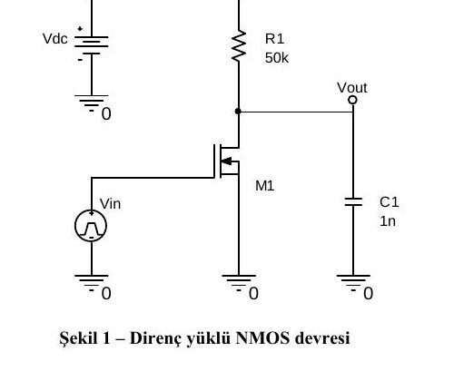
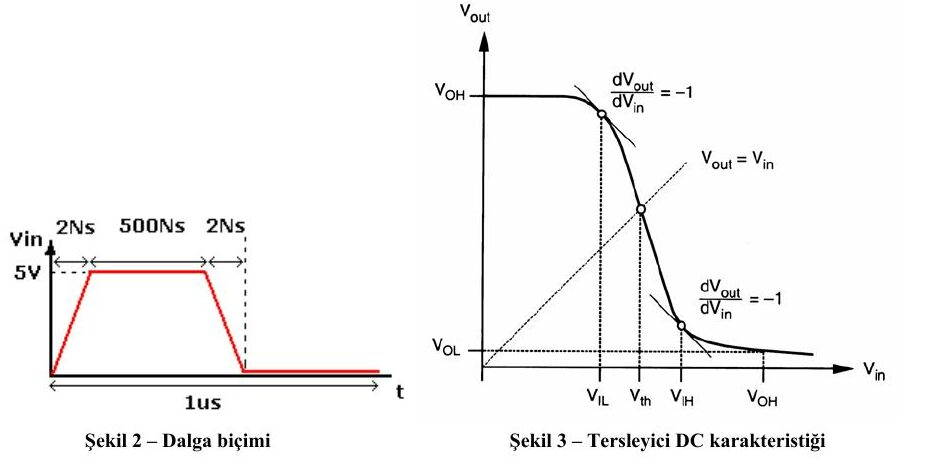

Bu yazı, Başkent Üniversitesi Elektrik-Elektronik Mühendisliği **EEM 312 – Sayısal Elektronik** dersinin 2010-2011 bahar yarıyılı **yazılım laboratuvarı** föylerinin ilk üçünü içeriyor: **Y1** (direnç yüklü NMOS ile tersleyici ölçümleri), **Y2** (CMOS tersleyici karakteristiği) ve **Y3** (NMOS ve PMOS elemanlarının karakteristiklerinin incelenmesi). Deneyler WinSPICE (Spice3) benzetimcisiyle yapılıyordu; föyler Mart 2011 tarihli ve laboratuvar sorumluları Arş. Gör. Numan Yavuz ile Arş. Gör. Evren Emekdaş'tı. Föylerin orijinal PDF'leri yazının sonunda ZIP olarak indirilebilir.

## Y1: Direnç yüklü NMOS ile tersleyici ölçümleri

### Ön çalışma

1. WinSPICE ile birlikte gelen kullanım kılavuzları ve yardım dosyalarından yararlanarak şu işlemlerin nasıl yapılacağını açıklayın ve komut kalıplarını yazın: DC analiz; voltaj kaynağı ve darbe (pulse) biçimli kaynak; geçici durum (transient) analizi; MOSFET bacak bağlantısı ve devrede tanımlanması; grafik çizdirme ve aynı figürde birden çok vektörü üst üste çizdirme; bir vektöre karşı başka bir vektörün grafiği (örneğin V_in'e karşı V_out).
1. Şekil 1'deki devre ve Tablo 1'deki parametreler için Spice3 ağ listesini (netlist) oluşturun. Şu parametrelerin tanımlarını yazın ve bunları elde edecek Spice3 komutlarını dosyaya ekleyin (Şekil 3'ten yararlanabilirsiniz): V_OH, V_OL; V_IH, V_IL; V_M; t_f, t_r; t_PHL, t_PLH, t_d; NM_H, NM_L.



**Tablo 1: Devre parametreleri**

| Parametre | Değer |
|---|---|
| Vin | Şekil 2'deki dalga biçimi |
| Vdc | 5 V |
| R1 | 50 kΩ |
| C1 | 1 pF |
| M1 | L = 5u, W = 10u |
| M1 modeli | .MODEL NMOSFET NMOS(VTO=1 KP=20U GAMMA=0.37 PHI=0.6 CBD=3.1E-15 CBS=3.1E-15) |



Şekil 3'te V_IL ve V_IH, gerilim geçiş eğrisinin eğiminin dV_out/dV_in = −1 olduğu noktalardır; V_M (anahtarlama eşiği) eğrinin V_out = V_in doğrusunu kestiği noktadır.

*Not: Şekil 1'de C1 "1n" yazıyor; Tablo 1'de ise 1 pF verilmiş.*

### Laboratuvar çalışması

1. Ön çalışmada hazırladığınız ağ listesini Spice3'te çalıştırın, istenen grafikleri elde edin ve gerekli değerleri grafikten okuyun.
1. V_dc'yi 3 V'a düşürüp benzetimi tekrarlayın. Bir önceki sonuçlara göre ne değişti?
1. Sonuçları karşılaştırın. Sonuçlar ideal durumdan neden farklıdır? İdeal durumun avantajları nelerdir? Girişe uygulanan V_in sinyalinin ön çalışmadaki parametrelere etkisi nedir?

## Y2: CMOS tersleyici karakteristiği

### Laboratuvar çalışması

**Madde 1.** Şekil 1'de dört farklı tersleyici yapısı var. Her biri için **VTC** (gerilim geçiş karakteristiği) eğrisini benzetimle elde edin ve Tablo 1'i doldurun. V_dd = 3,1 V, V_ss = 0 V, yük 1 fF, R1 = 100 kΩ. VTC için girişe darbe kaynağı bağlanıp bu kaynak üzerinde DC analiz yapılır.

 devreleri")

Föyde hatırlatma olarak verilen model ve kontrol satırları:

```
.MODEL MOSN NMOS LEVEL=2 LD=0.15U TOX=200.0E-10
+ NSUB=5.36726E+15 VTO=0.743469 KP=8.00059E-05 GAMMA=0.543
+ PHI=0.6 U0=655.881 UEXP=0.157282 UCRIT=31443.8
+ DELTA=2.39824 VMAX=55260.9 XJ=0.25U LAMBDA=0.0367072
+ NFS=1E+12 NEFF=1.001 NSS=1E+11 TPG=1.0 RSH=70.00
+ CGDO=4.3E-10 CGSO=4.3E-10 CJ=0.0003 MJ=0.6585
+ CJSW=8.0E-10 MJSW=0.2402 PB=0.58
.MODEL MOSP PMOS LEVEL=2 LD=0.15U TOX=200.0E-10
+ NSUB=4.3318E+15 VTO=-0.738861 KP=2.70E-05 GAMMA=0.58
+ PHI=0.6 U0=261.977 UEXP=0.323932 UCRIT=65719.8
+ DELTA=1.79192 VMAX=25694 XJ=0.25U LAMBDA=0.0612279
+ NFS=1E+12 NEFF=1.001 NSS=1E+11 TPG=-1.0 RSH=120.6
+ CGDO=4.3E-10 CGSO=4.3E-10 CJ=0.0005 MJ=0.5052
+ CJSW=1.349E-10 MJSW=0.2417 PB=0.64
* Örnek eş büyüklükteki mosfet tanımlamaları
M1 D G S B MOSN W=1.8u L=1.2u NRS=0.333 NRD=0.333
+ AD=6.5p PD=9.0u AS=6.5p PS=9.0u
M1 D G S B MOSP W=1.8u L=1.2u NRS=0.333 NRD=0.333
+ AD=6.5p PD=9.0u AS=6.5p PS=9.0u
* DIKKAT! : Nmos ile Pmos tanımlamasında drain ve source
* tanımlamasına dikkat edin
* Girişe uygulanan dalga kaynağı (madde 2'de verilen değerlere göre doldurun)
VIN N1 N2 pulse (v1 v2 td tr tf pw per)
....
.control
....
dc VIN Vin- Vin+ step_voltage
....
.endc
```

**Tablo 1 (DC analiz sonuçları):** (a)–(d) devreleri için V_OH, V_OL, V_IH, V_IL, V_M, NM_H, NM_L.

**Madde 2.** DC analizi kaldırıp geçici durum analizi yapın; darbenin periyodu 10 ns, t_r = t_f = 1 ns. **Tablo 2:** her devre için t_r, t_f, t_pLH, t_pHL, t_d.
**Madde 3.** Tablo 1 ve 2'ye göre: (a) Hangi devre en iyi tersleyicidir, neden? (b) Devreler simetrik midir? Değilse simetrik olması için hangi parametreler değişmelidir?
**Madde 4.** Aşağıda büyüklükleri eşit olmayan NMOS ve PMOS tanımları var. L ve W'ye göre kıyaslayın, büyüklüklerin neden böyle seçildiğini model parametreleriyle ispatlayın; Şekil 1-d'nin ağ listesini güncelleyip VTC'yi yeniden elde ederek değerlendirin.

```
M1 D G S B MOSN W=1.8u L=1.2u NRS=0.333 NRD=0.333
+ AD=6.5p PD=9.0u AS=6.5p PS=9.0u
M1 D G S B MOSP W=5.4u L=1.2u NRS=0.111 NRD=0.111
+ AD=16.2p PD=11.4u AS=16.2p PS=11.4u
```

Buradaki PMOS'un genişliği NMOS'un üç katıdır (5,4u / 1,8u). Modelde KP_n / KP_p = 8,00059E-05 / 2,70E-05 ≈ 2,96 olduğundan, PMOS'u yaklaşık 3 kat geniş almak iki transistörün akım sürme yeteneğini eşitler; böylece eğri simetrikleşir ve anahtarlama eşiği V_M, V_dd/2'ye yaklaşır.

## Y3: NMOS ve PMOS elemanlarının karakteristikleri

### Ön çalışma

Şu terimleri ayrıntılı olarak açıklayın: doyma akımı (saturation current), kanal boyu modülasyonu (channel length modulation), hız doyumu (velocity saturation), sıcak taşıyıcı etkisi (hot carrier effect), metal göçü (metal migration), CMOS mandallama (CMOS latchup).

### Laboratuvar çalışması

**Madde 1.** Şekil 1'deki direnç yüklü NMOS ve PMOS devreleri için, aşağıdaki **1u teknolojisi Level 3** modelleriyle Spice ağ listesini oluşturun. Şekildeki V_dd kaynağı MOSFET akımını ölçmek için kullanılabilir.

 Direnç yüklü NMOS ve (b) PMOS")

```
.MODEL NMOS NMOS LEVEL = 3
+ TOX = 200E-10 NSUB = 1E17 GAMMA = 0.5
+ PHI = 0.7 VTO = 0.8 DELTA = 3.0
+ UO = 650 ETA = 3.0E-6 THETA = 0.1
+ KP = 120E-6 VMAX = 1E5 KAPPA = 0.3
+ RSH = 0 NFS = 1E12 TPG = 1
+ XJ = 500E-9 LD = 100E-9
+ CGDO = 200E-12 CGSO = 200E-12 CGBO = 1E-10
+ CJ = 400E-6 PB = 1 MJ = 0.5
+ CJSW = 300E-12 MJSW = 0.5
.MODEL PMOS PMOS LEVEL = 3
+ TOX = 200E-10 NSUB = 1E17 GAMMA = 0.6
+ PHI = 0.7 VTO = -0.9 DELTA = 0.1
+ UO = 250 ETA = 0 THETA = 0.1
+ KP = 40E-6 VMAX = 5E4 KAPPA = 1
+ RSH = 0 NFS = 1E12 TPG = -1
+ XJ = 500E-9 LD = 100E-9
+ CGDO = 200E-12 CGSO = 200E-12 CGBO = 1E-10
+ CJ = 400E-6 PB = 1 MJ = 0.5
+ CJSW = 300E-12 MJSW = 0.5
```

Örnek tanımlar ve kontrol satırları:

```
* Örnek eş büyüklükteki MOSFET tanımlamaları
M1 D G S B MOSN W=1.8u L=1.2u NRS=0.333 NRD=0.333
+ AD=6.5p PD=9.0u AS=6.5p PS=9.0u
M2 D G S B MOSP W=1.8u L=1.2u NRS=0.333 NRD=0.333
+ AD=6.5p PD=9.0u AS=6.5p PS=9.0u
* V1=0, V2=5V, td=0, tr=tf=1n, pw=50n, per=100n
VIN N1 N2 pulse (v1 v2 td tr tf pw per)
....
.control
Alter M1 L=1u
...
* Vdd'nin her degeri için VIN değer aralığında tarama (sweep) işlemi gerçekleştir
dc VIN 0 5 0.1 Vdd 0 5 0.5
...
.endc
```

**Tablo 3: Benzetim grafikleri ve sorular**

| Tip | Grafik | Sabitler / değişkenler | Sorular |
|---|---|---|---|
| NMOS | I_DS – V_DS | V_BS = 0, V_GS = 0–5 V, V_DS = 0–5 V | Kanal boyu modülasyonunun etkisi gözleniyor mu? |
| NMOS | I_DS – V_GS | V_SB = 0–5 V, V_GS = 0–5 V, V_DS = 5 V | Gövde (body) etkisi gözleniyor mu? V_BS pozitif olursa ne olur? |
| NMOS | I_DS – V_DS | V_SB = 0, V_GS = 2 V, W = 1,8u / 3,6u / 7,2u (Alter ile), V_DS = 0–5 V | Akımdaki değişim gözleniyor mu? |
| PMOS | I_DS – V_DS | V_SB = 0, V_SG = 0–5 V, V_DS = 0–5 V | Kanal boyu modülasyonunun etkisi gözleniyor mu? |
| PMOS | I_DS – V_GS | V_SB = 0–5 V, V_SG = 0–5 V, V_DS = 5 V | Gövde etkisi gözleniyor mu? V_BS pozitif olursa ne olur? |
| PMOS | I_DS – V_DS | V_BS = 0, V_SG = 2 V, W = 1,8u / 3,6u / 7,2u, V_DS = 0–5 V | Akım neden değişiyor? |

**Madde 2.** Föyde verilen **0,18u teknolojisi** NMOS modeliyle (Tablo 5; `LEVEL = 49`, `VERSION = 3.1`, `VTH0 = 0.3999`, `TOX = 4.E-09`, `VSAT = 1.38E+05` …; tam model föyde) Şekil 1(a) için Tablo 4'teki benzetimleri yapın. L ve W dışındaki alan ve çevre parametrelerini boş bırakın: bunların etkisi nedir, hangi analizlerde fark yaratır?

**Tablo 4:**

| Model | Grafik | Değişkenler | Sorular |
|---|---|---|---|
| BSIM3 NMOS, L = 1u, W = 90u | I_DS – V_DS | V_BS = 0, V_GS = 0,2–2 V, V_DS = 0–2 V | Hız doyumu etkisi gözleniyor mu? MOSFET'lerin W'leri neden eşit alınmamış? |
| BSIM4 NMOS, L = 0,18u, W = 5u | I_DS – V_DS | V_BS = 0, V_GS = 0,2–2 V, V_DS = 0–2 V | Sonuçları karşılaştırarak yorumlayın. |

*Not: Föyde 0,18u modeli başlıkta "BSIM4" diye anılıyor; ancak tanımdaki `LEVEL = 49` ve `VERSION = 3.1` aslında BSIM3v3 modeline karşılık gelir (Tablo 4'ün ilk satırında da "BSIM3" yazıyor).*
