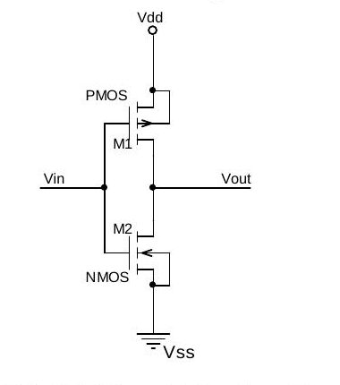
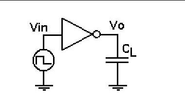
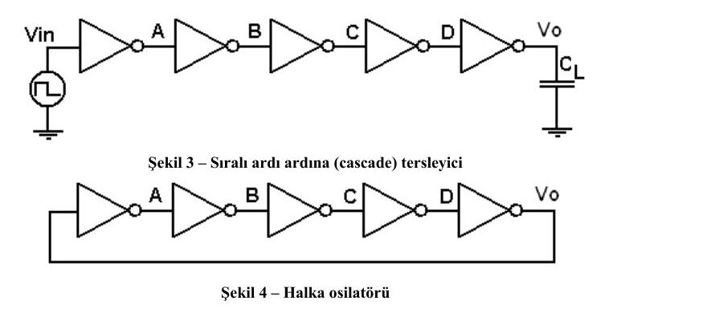
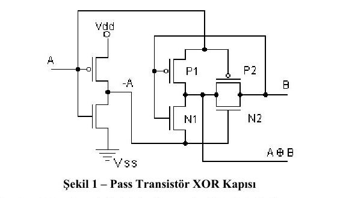

This post contains the second half of the software laboratory handouts for the Başkent University Electrical and Electronics Engineering course **EEM 312 – Digital Electronics**: **Y4** (ring oscillator and the regenerative property of the inverter), **Y5** (static and dynamic power), **Y6** (logic gate design), and **Y8**, a version of the same topic given with three-input gates. The Y4–Y6 handouts are dated March 2011 (laboratory supervisors: Research Assistants Numan Yavuz and Evren Emekdaş); the Y8 handout is a separate revision with no date on it. All experiments were carried out with WinSPICE (Spice3). The original PDFs of the handouts can be downloaded as a ZIP at the end of the post.

The same Level 2 MOSFET models are used in Y4, Y5 and Y6 (and Y8 uses them as well):

```
.MODEL MOSN NMOS LEVEL=2 LD=0.15U TOX=200.0E-10
+ NSUB=5.36726E+15 VTO=0.743469 KP=8.00059E-05 GAMMA=0.543
+ PHI=0.6 U0=655.881 UEXP=0.157282 UCRIT=31443.8
+ DELTA=2.39824 VMAX=55260.9 XJ=0.25U LAMBDA=0.0367072
+ NFS=1E+12 NEFF=1.001 NSS=1E+11 TPG=1.0 RSH=70.00
+ CGDO=4.3E-10 CGSO=4.3E-10 CJ=0.0003 MJ=0.6585
+ CJSW=8.0E-10 MJSW=0.2402 PB=0.58
.MODEL MOSP PMOS LEVEL=2 LD=0.15U TOX=200.0E-10
+ NSUB=4.3318E+15 VTO=-0.738861 KP=2.70E-05 GAMMA=0.58
+ PHI=0.6 U0=261.977 UEXP=0.323932 UCRIT=65719.8
+ DELTA=1.79192 VMAX=25694 XJ=0.25U LAMBDA=0.0612279
+ NFS=1E+12 NEFF=1.001 NSS=1E+11 TPG=-1.0 RSH=120.6
+ CGDO=4.3E-10 CGSO=4.3E-10 CJ=0.0005 MJ=0.5052
+ CJSW=1.349E-10 MJSW=0.2417 PB=0.64
```

## Y4: Ring Oscillator and the Regenerative Property of the Inverter

**Item 1.** Write the netlist of the CMOS inverter in Figure 1 as a **subcircuit**, as in the example below. For the PMOS, L/W = 1.2u/5.4u; for the NMOS, 1.2u/1.8u; supply 3.2 V.



```
.subckt inverter 1 2
* 1=input 2=output
* Subcircuit definition
vdd 3 0 3.2V
...
.ends
```

**Item 2.** Using this subcircuit, build the test circuit in Figure 2 and check that it works correctly.



| Parameter | Value / application |
|---|---|
| Vin | Pulse (0 3.2 0 1n 1n 100n 200n) |
| Inverter | The defined subcircuit |
| C_L | 0.1p |
| Analysis type | Transient analysis |
| Plots to obtain | Vo(t) and Vin(t) |
| Values to measure | t_pHL, t_pLH and t_d |

Example of subcircuit usage:

```
.subckt alt_devre 3 9 12 5
...
.ends
...
x1 2 1 3 4 alt_devre
x2 5 4 1 0 alt_devre
...
```

**Item 3.** Using the same subcircuit, create the netlists of Figure 3 (a chain of five inverters) and Figure 4 (the ring oscillator), and run the simulations in Table 4.



| Circuit | Analysis | Plots and parameters | Questions |
|---|---|---|---|
| Figure 3 | DC analysis | Vin – A, B, C, Vo (VTC) | What changes when Vin–A, Vin–B, Vin–C and Vin–Vo are compared, and why? Is the circuit regenerative? |
| Figure 3 | Transient | Vin(t), A(t), B(t), C(t), D(t), Vo(t); Vin = Pulse (0 3.2 0 1n 1n 100n 200n) | Measure the delays for A, B, C and Vo. |
| Figure 3 | Transient | Same plots; Vin = SIN(VO VA FREQ TD THETA) = SIN(1.6 1 5e6 0 0) | Explain the function of the circuit by looking at A, B, C and Vo. |
| Figure 4 | Transient | A(t), B(t), C(t), D(t), Vo(t) | Obtain only Vo(t) and comment on how it arises. What is its frequency? What differs among the A, B, C signals? |
| Figure 4 | Transient | Vo(t); 100 fF load on each inverter | Same questions, for the loaded case. |

A ring made of an odd number of inverters (here 5) has no stable operating point and oscillates on its own; the oscillation period is approximately T = 2·N·t_p (N is the number of inverters, t_p is the propagation delay of a single stage). Adding a load to each stage increases t_p and therefore the period.

## Y5: Static and Dynamic Power

**Item 1.** Create the netlist of the CMOS inverter from Y4 (PMOS 1.2u/5.4u, NMOS 1.2u/1.8u) and run the simulations in Table 2.

| Analysis and parameters | Questions |
|---|---|
| DC analysis, Vdd = 0–5 V | Obtain the static power dissipated by the circuit as a function of the input voltage for different Vdd values; where does it reach its maximum? What is the effect of Vdd (give ratios)? |
| Transient: C_L = 0.1p, Per = 200n, Vdd = 5 V and C_L = 0.1p, Per = 100n, Vdd = 5 V | In which case is the peak power during switching highest? What is the average power? How does the ratio of the average powers change? |
| Transient: C_L = 0.2p, Per = 100n, Vdd = 5 V and C_L = 0.2p, Per = 100n, Vdd = 3 V | What is the average power? How does the ratio change? |
| Transient: C_L = 0.1p, Per = 100n, Vdd = 5 V and C_L = 0.2p, Per = 100n, Vdd = 5 V | What is the average power? How does the ratio change? |

The expected relationships can be read from the dynamic power formula: P_dyn = C_L · V_dd² · f. Doubling the frequency (Per 200n → 100n) or doubling C_L approximately doubles the power; lowering V_dd from 5 V to 3 V reduces the power to approximately (3/5)² = 0.36 times its value.

**Item 2.** For the same circuit, run transient analyses for Vdd = 1, 1.5, 2, 2.5, 3, 4 and 5 V (C_L = 0.1p, Per = 100n):

- Find the average power consumption for each Vdd.
- Find the delay time and calculate the **power-delay product** (PDP).
- Roughly plot PDP against Vdd; at which value is the performance best?
- How would the results be affected if the MOSFETs were short-channel devices?

## Y6: Logic Gate Design

### Preliminary Work

1. Write the netlist of the **pass-transistor XOR** gate in Figure 1 and explain how it works; indicate the drain and source terminals of each transistor.
1. Design a two-input CMOS **NAND** gate with the minimum number of transistors and write its netlist.
1. Design a two-input CMOS **NOR** gate with the minimum number of transistors and write its netlist.



### Laboratory Work

1. Verify the logical functions of the gates you designed by testing them in Spice with the necessary input signals and the model parameters above.
1. Find the worst-case delays of the gates, compare them, and identify the gate with the lowest delay.

In static CMOS, two-input NAND and NOR gates are each built with four transistors: in the NAND, two NMOS in series and two PMOS in parallel; in the NOR, two NMOS in parallel and two PMOS in series.

## Y8: Logic Gate Design (Three-Input Version)

The aim of this handout is "CMOS and pass-transistor logic gate design", and it begins with the same Figure 1 XOR gate. Its difference from Y6 is that the NAND and NOR gates are required to be **three-input**, and that the preliminary work and the laboratory work are merged into a single list:

1. Write the netlist of the XOR gate in Figure 1 and explain how it works.
1. Design a three-input CMOS NAND gate with the minimum number of transistors and write its netlist.
1. Design a three-input CMOS NOR gate with the minimum number of transistors and write its netlist.
1. Test the gates in Spice with the necessary inputs and the given model parameters.
1. Find the worst-case delays, compare them, and identify the gate with the lowest delay.

The grading information was on the laboratory web page; reports had to be uploaded to this page before the submission deadline.
