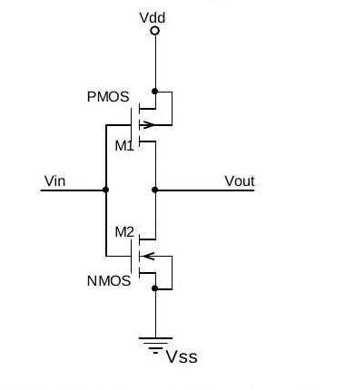
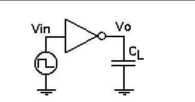
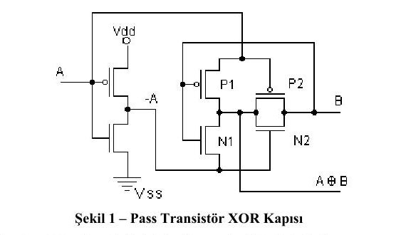

Bu yazı, Başkent Üniversitesi Elektrik-Elektronik Mühendisliği **EEM 312 – Sayısal Elektronik** dersinin yazılım laboratuvarı föylerinin ikinci yarısını içeriyor: **Y4** (halka osilatörü ve tersleyicinin rejeneratif özelliği), **Y5** (statik ve dinamik güç), **Y6** (mantık kapısı tasarımı) ve aynı konunun üç girişli kapılarla verilen **Y8** sürümü. Y4–Y6 föyleri Mart 2011 tarihli (laboratuvar sorumluları Arş. Gör. Numan Yavuz ve Arş. Gör. Evren Emekdaş); Y8 föyü ise üzerinde tarih bulunmayan ayrı bir düzenleme. Tüm deneyler WinSPICE (Spice3) ile yapılıyordu. Föylerin orijinal PDF'leri yazının sonunda ZIP olarak indirilebilir.

Y4, Y5 ve Y6'da aynı Level 2 MOSFET modelleri kullanılıyor (Y8'de de aynısı var):

```
.MODEL MOSN NMOS LEVEL=2 LD=0.15U TOX=200.0E-10
+ NSUB=5.36726E+15 VTO=0.743469 KP=8.00059E-05 GAMMA=0.543
+ PHI=0.6 U0=655.881 UEXP=0.157282 UCRIT=31443.8
+ DELTA=2.39824 VMAX=55260.9 XJ=0.25U LAMBDA=0.0367072
+ NFS=1E+12 NEFF=1.001 NSS=1E+11 TPG=1.0 RSH=70.00
+ CGDO=4.3E-10 CGSO=4.3E-10 CJ=0.0003 MJ=0.6585
+ CJSW=8.0E-10 MJSW=0.2402 PB=0.58
.MODEL MOSP PMOS LEVEL=2 LD=0.15U TOX=200.0E-10
+ NSUB=4.3318E+15 VTO=-0.738861 KP=2.70E-05 GAMMA=0.58
+ PHI=0.6 U0=261.977 UEXP=0.323932 UCRIT=65719.8
+ DELTA=1.79192 VMAX=25694 XJ=0.25U LAMBDA=0.0612279
+ NFS=1E+12 NEFF=1.001 NSS=1E+11 TPG=-1.0 RSH=120.6
+ CGDO=4.3E-10 CGSO=4.3E-10 CJ=0.0005 MJ=0.5052
+ CJSW=1.349E-10 MJSW=0.2417 PB=0.64
```

## Y4: Halka osilatörü ve tersleyicinin rejeneratif özelliği

**Madde 1.** Şekil 1'deki CMOS tersleyicinin ağ listesini, aşağıdaki örnekteki gibi bir **alt devre (subcircuit)** olarak yazın. PMOS için L/W = 1,2u/5,4u, NMOS için 1,2u/1,8u; besleme 3,2 V.



```
.subckt inverter 1 2
* 1=giriş 2=çıkış
* Alt devre tanımlaması
vdd 3 0 3.2V
...
.ends
```

**Madde 2.** Bu alt devreyle Şekil 2'deki test devresini kurun ve doğru çalıştığını kontrol edin.



| Parametre | Değer / uygulama |
|---|---|
| Vin | Pulse (0 3.2 0 1n 1n 100n 200n) |
| Inverter | Tanımlanan alt devre |
| C_L | 0,1p |
| Analiz tipi | Geçici durum analizi |
| Elde edilecek grafikler | Vo(t) ve Vin(t) |
| Ölçülecek değerler | t_pHL, t_pLH ve t_d |

Alt devre kullanım örneği:

```
.subckt alt_devre 3 9 12 5
...
.ends
...
x1 2 1 3 4 alt_devre
x2 5 4 1 0 alt_devre
...
```

**Madde 3.** Aynı alt devreyle Şekil 3 (beş tersleyicilik zincir) ve Şekil 4'ün (halka osilatörü) ağ listesini oluşturup Tablo 4'teki benzetimleri yapın.

 tersleyiciler ve Şekil 4: Halka osilatörü")

| Devre | Analiz | Grafikler ve parametreler | Sorular |
|---|---|---|---|
| Şekil 3 | DC analiz | Vin – A, B, C, Vo (VTC) | Vin–A, Vin–B, Vin–C ve Vin–Vo karşılaştırıldığında ne değişiyor, neden? Devre rejeneratif midir? |
| Şekil 3 | Geçici durum | Vin(t), A(t), B(t), C(t), D(t), Vo(t); Vin = Pulse (0 3.2 0 1n 1n 100n 200n) | A, B, C ve Vo için gecikmeleri ölçün. |
| Şekil 3 | Geçici durum | Aynı grafikler; Vin = SIN(VO VA FREQ TD THETA) = SIN(1.6 1 5e6 0 0) | A, B, C ve Vo'ya bakarak devrenin işlevini açıklayın. |
| Şekil 4 | Geçici durum | A(t), B(t), C(t), D(t), Vo(t) | Yalnız Vo(t)'yi elde edip nasıl oluştuğunu yorumlayın. Frekansı nedir? A, B, C sinyallerinde ne fark var? |
| Şekil 4 | Geçici durum | Vo(t); her tersleyiciye 100 fF yük | Aynı sorular, yük eklenmiş durum için. |

Tek sayıda (burada 5) tersleyiciden oluşan halkanın kararlı bir noktası yoktur ve kendiliğinden salınır; salınım periyodu yaklaşık T = 2·N·t_p'dir (N tersleyici sayısı, t_p tek katın yayılım gecikmesi). Her kata yük eklemek t_p'yi, dolayısıyla periyodu büyütür.

## Y5: Statik ve dinamik güç

**Madde 1.** Y4'teki CMOS tersleyicinin (PMOS 1,2u/5,4u, NMOS 1,2u/1,8u) ağ listesini oluşturup Tablo 2'deki benzetimleri yapın.

| Analiz ve parametreler | Sorular |
|---|---|
| DC analiz, Vdd = 0–5 V | Giriş gerilimine göre devrenin harcadığı statik gücü farklı Vdd'ler için elde edin; en yüksek değeri nerede alıyor? Vdd'nin etkisi nedir (oranlar vererek)? |
| Geçici durum: C_L = 0,1p, Per = 200n, Vdd = 5 V ile C_L = 0,1p, Per = 100n, Vdd = 5 V | Anahtarlama sırasında en yüksek güç hangi durumda? Ortalama güç ne kadar? Ortalama güç oranı nasıl değişiyor? |
| Geçici durum: C_L = 0,2p, Per = 100n, Vdd = 5 V ile C_L = 0,2p, Per = 100n, Vdd = 3 V | Ortalama güç ne kadar? Oranı nasıl değişiyor? |
| Geçici durum: C_L = 0,1p, Per = 100n, Vdd = 5 V ile C_L = 0,2p, Per = 100n, Vdd = 5 V | Ortalama güç ne kadar? Oranı nasıl değişiyor? |

Beklenen ilişki dinamik güç formülünden okunur: P_dyn = C_L · V_dd² · f. Frekansı iki katına çıkarmak (Per 200n → 100n) veya C_L'yi iki katına çıkarmak gücü yaklaşık iki katına çıkarır; V_dd'yi 5 V'tan 3 V'a düşürmek gücü yaklaşık (3/5)² = 0,36 katına indirir.

**Madde 2.** Aynı devrede Vdd = 1; 1,5; 2; 2,5; 3; 4 ve 5 V için (C_L = 0,1p, Per = 100n) geçici durum analizi yapın:

- Her Vdd için ortalama güç tüketimini bulun.
- Gecikme süresini bularak **güç-gecikme çarpanını** (PDP) hesaplayın.
- Vdd'ye karşı PDP'yi kabaca çizin; en iyi performans hangi değerde?
- MOSFET'ler kısa kanallı olsaydı sonuçlar nasıl etkilenirdi?

## Y6: Mantık kapısı tasarımı

### Ön çalışma

1. Şekil 1'deki **pass transistörlü XOR** kapısının ağ listesini yazın ve çalışma yöntemini açıklayın; her transistörün drain ve source bacaklarını belirtin.
1. En az sayıda transistörle iki girişli bir CMOS **NAND** kapısı tasarlayıp ağ listesini yazın.
1. En az sayıda transistörle iki girişli bir CMOS **NOR** kapısı tasarlayıp ağ listesini yazın.



### Laboratuvar çalışması

1. Tasarladığınız kapıları gerekli giriş sinyalleriyle ve yukarıdaki model parametreleriyle Spice'ta test ederek mantıksal işlevlerini doğrulayın.
1. Kapıların en kötü durum gecikmelerini bulun, karşılaştırın ve gecikmesi en düşük kapıyı belirtin.

Statik CMOS'ta iki girişli NAND ve NOR dörder transistörle kurulur: NAND'da iki NMOS seri, iki PMOS paralel; NOR'da iki NMOS paralel, iki PMOS seridir.

## Y8: Mantık kapısı tasarımı (üç girişli sürüm)

Bu föyün amacı "CMOS ve pass transistör mantık kapısı tasarımı"dır ve aynı Şekil 1 XOR kapısıyla başlar. Y6'dan farkı, NAND ve NOR kapılarının **üç girişli** istenmesi ve ön çalışma ile laboratuvar çalışmasının tek listede toplanmasıdır:

1. Şekil 1'deki XOR kapısının ağ listesini yazın, çalışma yöntemini açıklayın.
1. En az sayıda transistörle üç girişli bir CMOS NAND kapısı tasarlayın, ağ listesini yazın.
1. En az sayıda transistörle üç girişli bir CMOS NOR kapısı tasarlayın, ağ listesini yazın.
1. Kapıları Spice'ta gerekli girişlerle ve verilen model parametreleriyle test edin.
1. En kötü durum gecikmelerini bulup karşılaştırın; gecikmesi en düşük kapıyı belirtin.

Değerlendirme bilgileri laboratuvar web sayfasında yer alıyordu; raporların teslim süresinden önce bu sayfaya yüklenmesi gerekiyordu.
