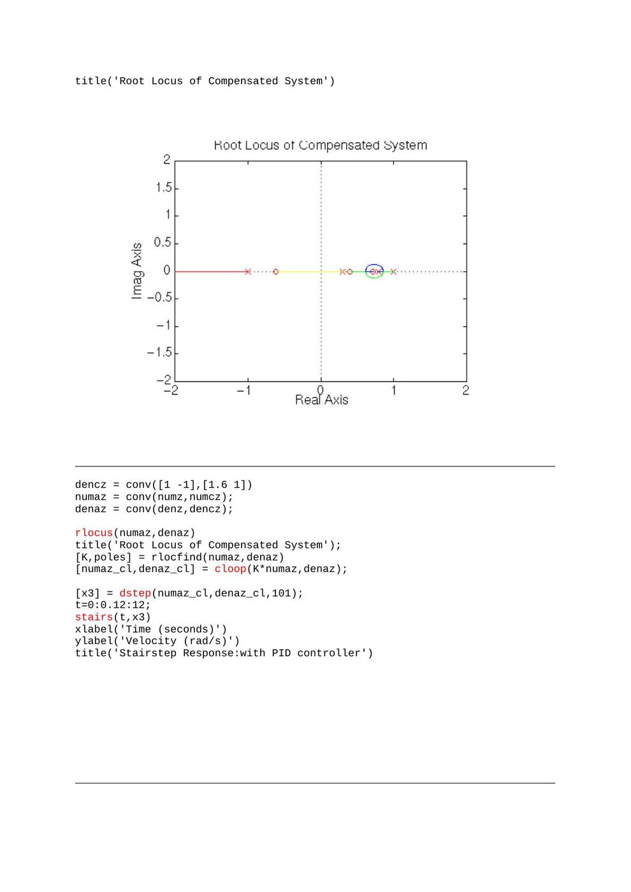
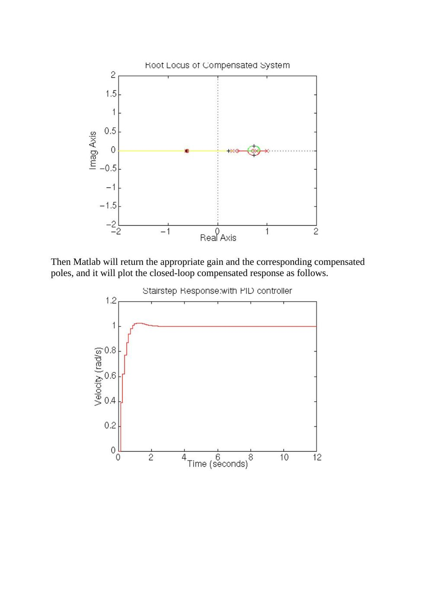

The **"Control Lab - 2"** assignment in the EEM322 folder examines the discretization and PID control of a DC motor model. The Word document, compiled by a friend, carries the course code EEM464; the content does not state an author or date. The archive date is based on the 18 March 2014 creation information of the original Word document. A PDF version of the document and the two MATLAB source files can be downloaded as a ZIP at the end of the post.

## Motor model

The parameters are R = 1, L = 0.5, Kt = 0.01, J = 0.01 and b = 0.1. The transfer function used by the code is:

G(s) = Kt / [JL s² + (JR + Lb)s + Rb + Kt²]

Substituting the numbers gives:

**G(s) = 0.01/(0.005s² + 0.06s + 0.1001)**

The sampling time is **Ts = 0.12 s**. `c2dm(...,'zoh')` performs discretization with a zero-order hold. The first short file contains only this model and the discretization; the long file also continues with the closed-loop and controller stages.

## Uncontrolled closed loop and PID

A unity-feedback model is built with `cloop`, and a 101-sample step response is obtained with `dstep`. The time vector runs from 0 to 12 seconds in steps of 0.12 seconds; the result is plotted with `stairs`.

The PID gains are **Kp = 100, Ki = 200, Kd = 10**. The discrete controller is obtained with the Tustin transformation; the numerator/denominator polynomials of the motor and the controller are multiplied with `conv`.

In the final stage, the controller denominator is replaced with `conv([1 -1],[1.6 1])`, the root locus is plotted again, and the gain is selected interactively with `rlocfind`. Therefore, the final closed-loop result depends on the selected point.

## MATLAB source code

```matlab
R=1;
L=0.5;
Kt=0.01;
J=0.01;
b=0.1;

num = Kt;
den = [(J*L) (J*R)+(L*b) (R*b)+(Kt^2)];

Ts = 0.12;
[numz,denz] = c2dm(num,den,Ts,'zoh')

numz = [numz(2) numz(3)];
[numz_cl,denz_cl] = cloop(numz,denz);

[x1] = dstep(numz_cl,denz_cl,101);
t=0:0.12:12;
stairs(t,x1)
xlabel('Time (seconds)')
ylabel('Velocity (rad/s)')
title('Stairstep Response:Original')
% Discrete PID controller with bilinear approximation
Kp = 100;
Ki = 200;
Kd = 10;

[dencz,numcz]=c2dm([1 0],[Kd Kp Ki],Ts,'tustin'); 
numaz = conv(numz,numcz);
denaz = conv(denz,dencz);
[numaz_cl,denaz_cl] = cloop(numaz,denaz);

[x2] = dstep(numaz_cl,denaz_cl,101);
t=0:0.12:12;
stairs(t,x2)
xlabel('Time (seconds)')
ylabel('Velocity (rad/s)')
title('Stairstep Response:with PID controller')
rlocus(numaz,denaz)
title('Root Locus of Compensated System')

dencz = conv([1 -1],[1.6 1]) 
numaz = conv(numz,numcz);
denaz = conv(denz,dencz);

rlocus(numaz,denaz)
title('Root Locus of Compensated System');
[K,poles] = rlocfind(numaz,denaz)
[numaz_cl,denaz_cl] = cloop(K*numaz,denaz);

[x3] = dstep(numaz_cl,denaz_cl,101);
t=0:0.12:12;
stairs(t,x3)
xlabel('Time (seconds)')
ylabel('Velocity (rad/s)')
title('Stairstep Response:with PID controller')
```

*Note: This archived code was not run; it retains old MATLAB commands such as `c2dm`, `cloop` and `dstep`, as well as the interactive `rlocfind` step. In the first PID plot of the Word document, `stairs(t,x1)` is written, whereas in the long source file it is `stairs(t,x2)`. The first form re-plots the earlier response; the difference is preserved as it appears in the sources.*

## Root locus and final step response




