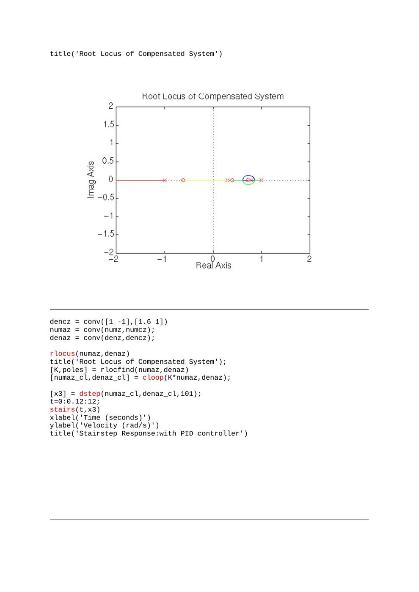
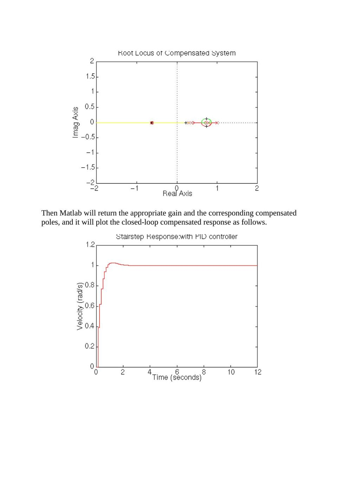

EEM322 klasöründeki **“Denetim Lab - 2”** çalışması, bir DC motor modelinin ayrıklaştırılmasını ve PID denetimini inceliyor. Bir arkadaşın derlediği Word belgesinin adı EEM464 kodunu taşıyor; içerikte yazar ve tarih belirtilmemiş. Arşiv tarihi özgün Word belgesinin 18 Mart 2014 oluşturulma bilgisine dayanıyor. Belgenin PDF karşılığı ve iki MATLAB kaynak dosyası yazının sonunda ZIP olarak indirilebilir.

## Motor modeli

Parametreler R = 1, L = 0.5, Kt = 0.01, J = 0.01 ve b = 0.1’dir. Kodun kullandığı transfer fonksiyonu:

G(s) = Kt / [JL s² + (JR + Lb)s + Rb + Kt²]

Sayılar yerine konulduğunda:

**G(s) = 0.01/(0.005s² + 0.06s + 0.1001)**

Örnekleme süresi **Ts = 0.12 s**. `c2dm(...,'zoh')` sıfır dereceli tutma ile ayrıklaştırma yapar. İlk kısa dosya yalnız bu modeli ve ayrıklaştırmayı içerir; uzun dosya kapalı döngü ve denetleyici aşamalarını da sürdürür.

## Kontrolsüz kapalı döngü ve PID

`cloop` ile birim geri beslemeli model oluşturulup `dstep` ile 101 örneklik basamak yanıtı alınır. Zaman vektörü 0’dan 12 saniyeye 0.12 saniyelik adımlarla ilerler; sonuç `stairs` ile çizilir.

PID katsayıları **Kp = 100, Ki = 200, Kd = 10**. Tustin dönüşümüyle ayrık denetleyici elde edilir; motor ve denetleyicinin pay/payda polinomları `conv` ile çarpılır.

Son aşamada denetleyici paydası `conv([1 -1],[1.6 1])` ile değiştirilir, kök yer eğrisi yeniden çizilir ve `rlocfind` ile etkileşimli kazanç seçilir. Bu yüzden son kapalı döngü sonucu seçilen noktaya bağlıdır.

## MATLAB kaynak kodu

```matlab
R=1;
L=0.5;
Kt=0.01;
J=0.01;
b=0.1;

num = Kt;
den = [(J*L) (J*R)+(L*b) (R*b)+(Kt^2)];

Ts = 0.12;
[numz,denz] = c2dm(num,den,Ts,'zoh')

numz = [numz(2) numz(3)];
[numz_cl,denz_cl] = cloop(numz,denz);

[x1] = dstep(numz_cl,denz_cl,101);
t=0:0.12:12;
stairs(t,x1)
xlabel('Time (seconds)')
ylabel('Velocity (rad/s)')
title('Stairstep Response:Original')
% Discrete PID controller with bilinear approximation
Kp = 100;
Ki = 200;
Kd = 10;

[dencz,numcz]=c2dm([1 0],[Kd Kp Ki],Ts,'tustin'); 
numaz = conv(numz,numcz);
denaz = conv(denz,dencz);
[numaz_cl,denaz_cl] = cloop(numaz,denaz);

[x2] = dstep(numaz_cl,denaz_cl,101);
t=0:0.12:12;
stairs(t,x2)
xlabel('Time (seconds)')
ylabel('Velocity (rad/s)')
title('Stairstep Response:with PID controller')
rlocus(numaz,denaz)
title('Root Locus of Compensated System')

dencz = conv([1 -1],[1.6 1]) 
numaz = conv(numz,numcz);
denaz = conv(denz,dencz);

rlocus(numaz,denaz)
title('Root Locus of Compensated System');
[K,poles] = rlocfind(numaz,denaz)
[numaz_cl,denaz_cl] = cloop(K*numaz,denaz);

[x3] = dstep(numaz_cl,denaz_cl,101);
t=0:0.12:12;
stairs(t,x3)
xlabel('Time (seconds)')
ylabel('Velocity (rad/s)')
title('Stairstep Response:with PID controller')
```

*Not: Bu arşiv kodu çalıştırılmadı; `c2dm`, `cloop`, `dstep` gibi eski MATLAB komutlarını ve etkileşimli `rlocfind` adımını korur. Word belgesinin ilk PID çiziminde `stairs(t,x1)`, uzun kaynak dosyada ise `stairs(t,x2)` yazılıdır. İlk ifade önceki yanıtı yeniden çizer; fark kaynaklarda olduğu gibi korunmuştur.*

## Kök yer ve son basamak yanıtı




