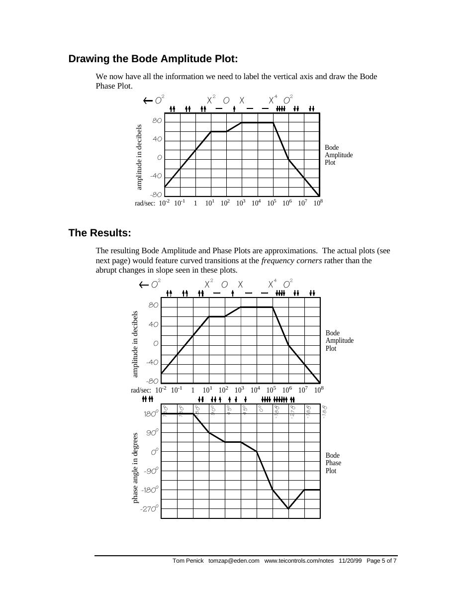
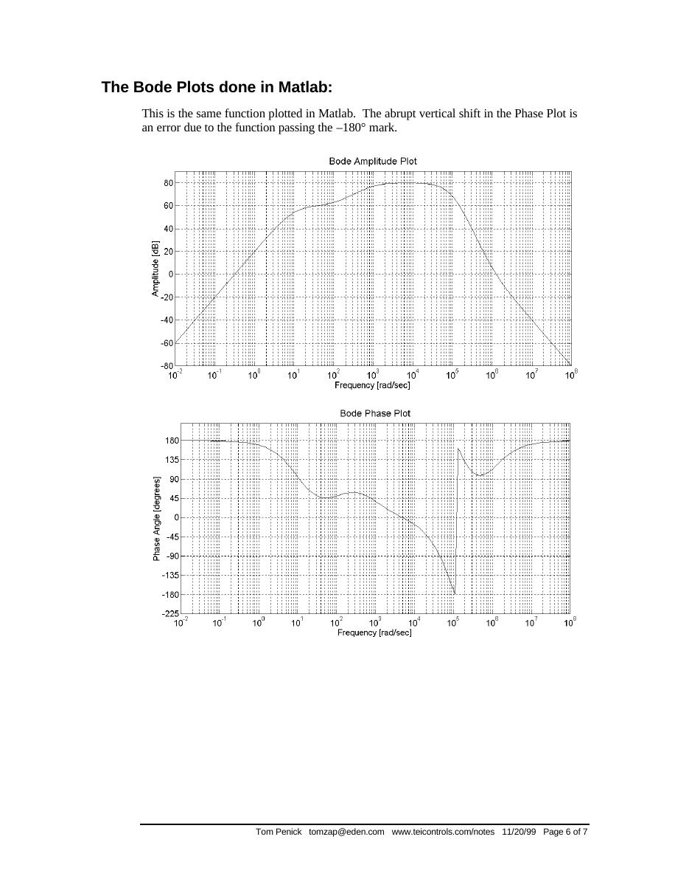
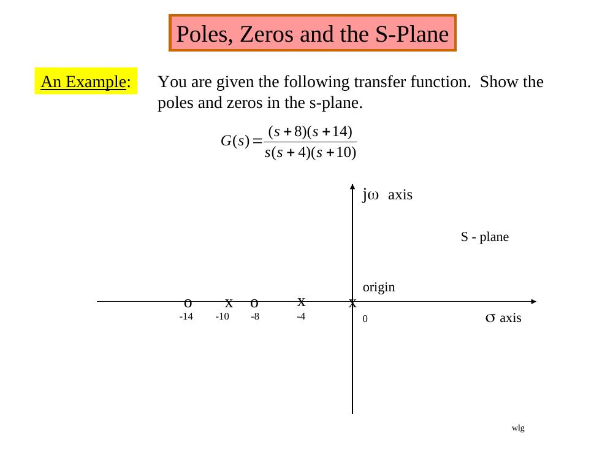
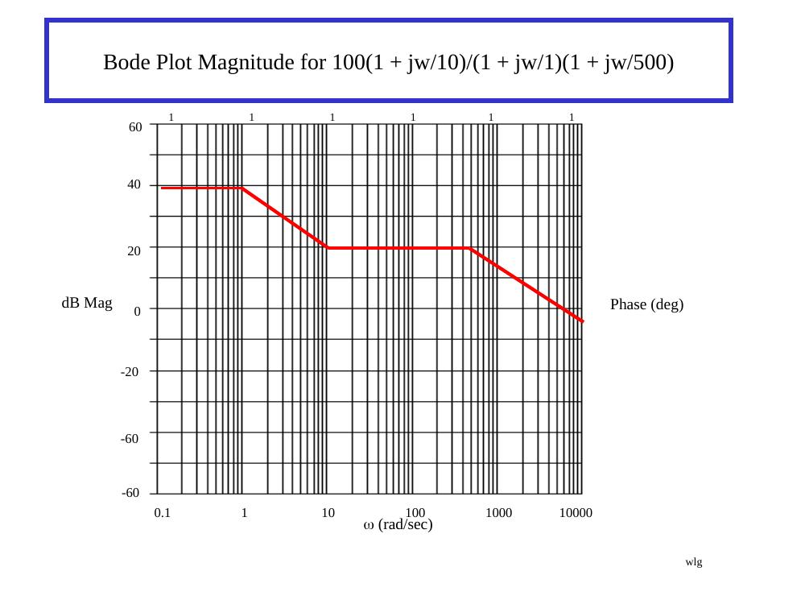
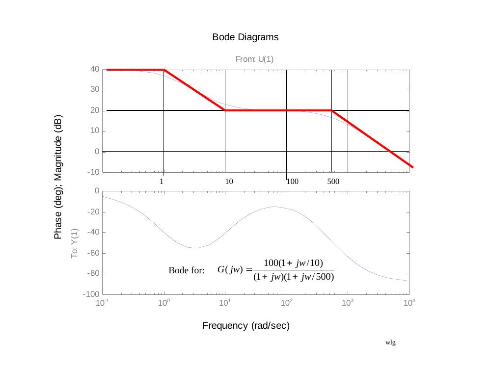
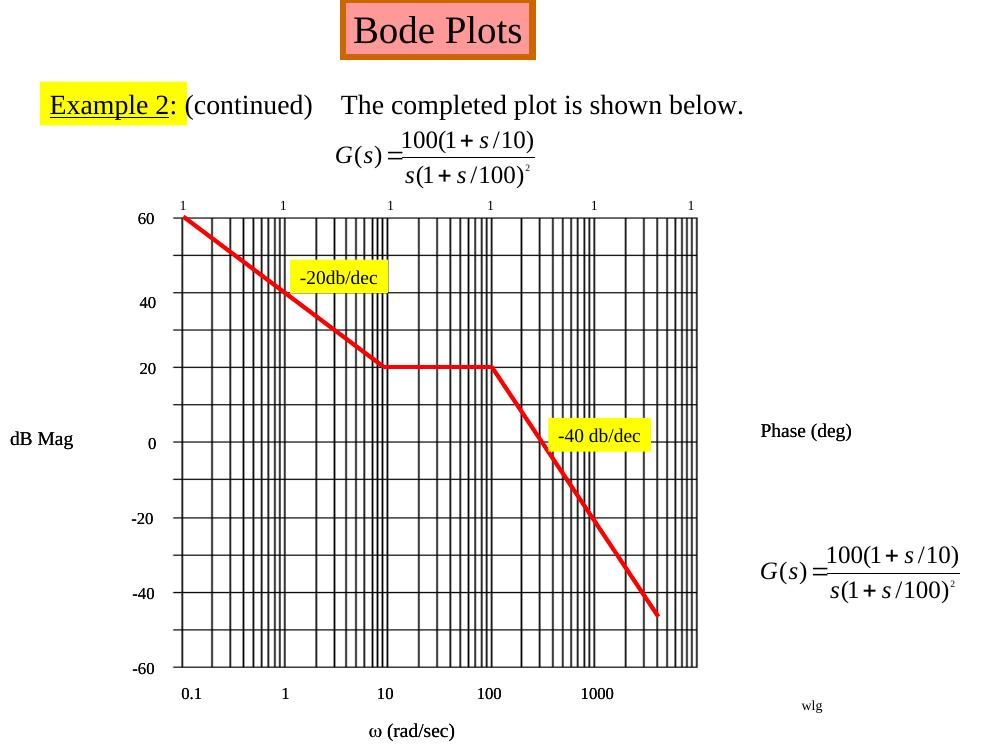
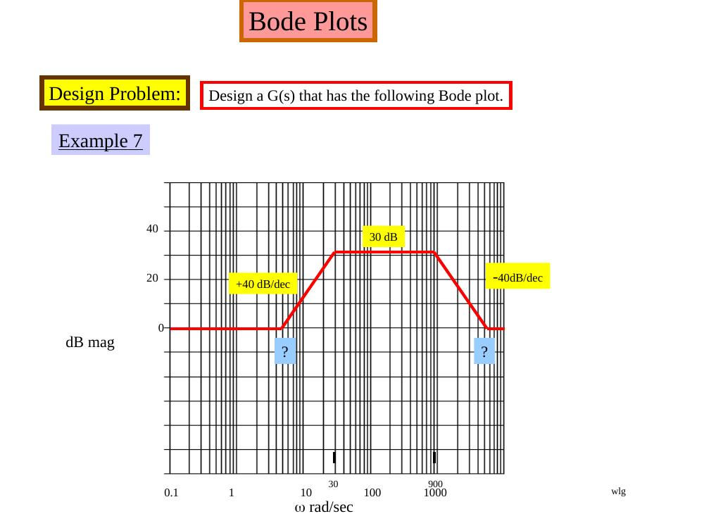
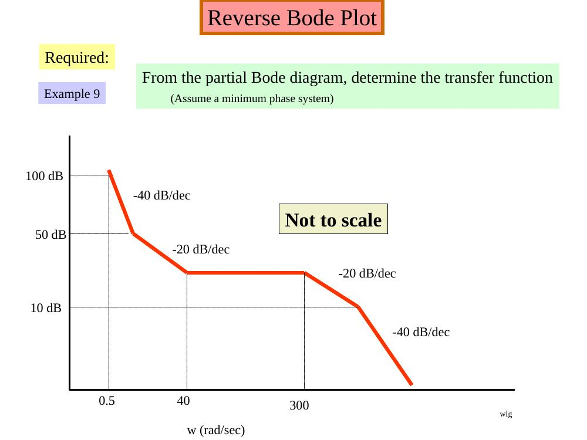
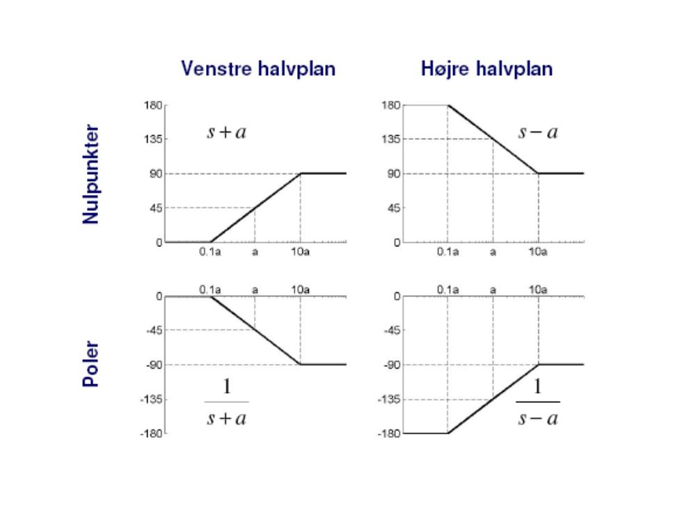

Bu yazı, EEM322 Denetim Sistemleri dersi çalışılırken "kontrol sistemleri farklı yerlerden indirilenler" klasörüne toplanmış, **Bode diyagramı** konusundaki üç **üçüncü taraf** kaynağı bir araya getiriyor:

1. **Tom Penick**, *Creating Bode Plots from a Transfer Function*, 20.11.1999; 7 sayfalık PDF (sayfa altlarında: tomzap@eden.com, www.teicontrols.com/notes).
1. **Walter Green**, *Poles and Zeros and Transfer Functions / Bode Plots*; 32 slaytlık PowerPoint (slaytlarda "wlg" imzası, dosya 2002–2003 tarihli). Kurum adı belgede yazmıyor.
1. **Bo Rohde Pedersen**, *2. Order Circuit and Bode Plots*, Circuit Theory, **AUE 2007**; 15 slaytlık, kısmen Danca PowerPoint.

İçerik İngilizce olduğundan metinler özgün dilinde aktarıldı, denklemler düz metne çevrildi. Üç orijinal dosya yazının sonunda ZIP olarak indirilebilir.

*Bu içerik üçüncü taraf bir kaynağa aittir; arşiv ve nostalji amacıyla kaynak belirtilerek paylaşılmıştır. Hak sahibinin talebi hâlinde kaldırılır.*

## Tom Penick: Creating Bode Plots from a Transfer Function

Given the transfer function (s = jω, G is the gain of the system in V/V):

> G(s) = 10s² (1 + s/10²)(1 + s/10⁶)² / [(1 + s/10)² (1 + s/10³)(1 + s/10⁵)⁴]

### Zeros and poles

We find the zeros and poles by observing the numerator and denominator respectively, and determining the value of s that will make each term zero. The absolute value of that term is the zero or pole; the power to which the expression is raised is the order of the pole or zero.

| Zeros (numerator) | Poles (denominator) |
| --- | --- |
| s = 0 → 2nd order zero at ω = 0 | s = −10 → 2nd order pole at ω = 10 |
| s = −10² → 1st order zero at ω = 10² | s = −10³ → 1st order pole at ω = 10³ |
| s = −10⁶ → 2nd order zero at ω = 10⁶ | s = −10⁵ → 4th order pole at ω = 10⁵ |

Mark the zeros (O) and poles (X) at the top of the Bode plot, from 10⁻² to 10⁸ rad/s. The first zero is off the graph to the left, since ω = 0 is not available on a logarithmic scale. The marks show the *frequency corners*, where the slope changes.

### Slope of the amplitude plot

The order of each zero or pole gives the change in slope in multiples of 20 dB/decade (order 2 → 40 dB/decade). The slope is increased at zeros and reduced at poles. Mark each decade with up or down arrows, each arrow standing for 20 dB/decade. Here the 2nd order zero at ω = 0 means the first decade starts with two up arrows.

### Slope of the phase plot

On the phase plot each arrow represents 45°/decade per order of zero or pole; zeros slope upward, poles downward. Each pole or zero influences one decade on either side of its frequency: a 2nd order pole causes a 90°/decade downward slope from one decade below to one decade above the pole. Arrows in the same decade are summed and may cancel. The 2nd order zero at ω = 0 makes the plot begin at +180°; the phase values at the decades from 10⁻² to 10⁸ are 180°, 180°, 180°, 90°, 45°, 45°, 0°, −180°, −270°, −180°, −180°.

### Starting point and amplitudes

The plot begins at ω = 10⁻², so we need |G(j10⁻²)|. Only one term is not approximately 1:

> G(10⁻²) ≈ 10·(10⁻²)² = 10⁻³ V/V → G_dB = 20 log(10⁻³) = −60 dB

Label −60 dB at ω = 10⁻²; for the two up arrows in the first decade add 40 dB (−20 dB at 10⁻¹), and continue across the plot adding 20 dB per up arrow and subtracting 20 dB per down arrow. The decade values are −60, −20, 20, 60, 60, 80, 80, 80, 0, −40, −80 dB.



The resulting plots are approximations; the actual plots feature curved transitions at the frequency corners instead of abrupt changes in slope. The note also shows the same function plotted in MATLAB, where the abrupt vertical jump in the phase plot is only due to the function passing the −180° mark.



### The MATLAB code

Penick's script evaluates G(jω) on a geometric frequency grid and draws both plots (the note lists five sample problems to paste in):

```matlab
% Problem 1: y = 10*s^2 * (1+s/10^2) * (1+s/10^6)^2 / ((1+s/10)^2 * (1+s/10^3) * (1+s/10^5)^4);
% Problem 2: y = 10^10 * (1+s/10^2) * (s+10^5) / (s*(s+10^3) * (s+10^4)^2);
% Problem 3: y = 10^26*s*(s+1)*(s+10^3)*(s+10^5)^2 / ((s+10)^2*(s+10^2)*(s+10^4)*(s+10^6)^5);
% Problem 4: y = (s+.1) * (s+1)^3 * (s+10^4)^2 / (10^5*s^2 * (1+s/10)^3 * (1+s/10^3)^2);
% Problem 5: y = 10^10*s * (s+.1)^2 * (s+10^2)^3 / ((s+1) * (s+10)^4 * (1+s/10^4)^2 * (s+10^5)^2);
PlotWindowSize = [1400,600];
figure('Position',[10 10 PlotWindowSize(1) PlotWindowSize(2)])
N=[]; X=[]; Y=[]; x=10^-2;
while x < 10^8,
  s = i*x;                                  % get the j-omega
  y = 10*s^2 * (1+s/10^2) * (1+s/10^6)^2 / ((1+s/10)^2 * (1+s/10^3) * (1+s/10^5)^4);
  X = [X,x]; N = [N,y];
  x = x*1.05;                               % controls the resolution
end
Y = 20*log10(abs(N));                       % amplitude in dB
semilogx(X,Y); grid on
title('Bode Amplitude Plot')
xlabel('Frequency [rad/sec]'); ylabel('Amplitude [dB]')
figure('Position',[10 60 PlotWindowSize(1) PlotWindowSize(2)])
Y = angle(N)*180/pi;                        % phase in degrees
semilogx(X,Y); grid on
title('Bode Phase Plot')
xlabel('Frequency [rad/sec]'); ylabel('Phase Angle [degrees]')
```

*Not: Kod burada eksen ayarı satırları kısaltılarak verildi. Orijinalde denklem satırı "y = y = 10*s^2 ..." diye yazılmış; çift "y =" MATLAB'da hata verir, yukarıda tek "y =" ile düzeltildi.*

## Walter Green: Poles, Zeros and Bode Plots

**Transfer function:** the ratio of the Laplace transform of the output to the input with all initial conditions equal to zero; defined only for linear time invariant systems. It can usually be expressed as the ratio of two polynomials in s and factored as

> G(s) = K(s + z₁)(s + z₂)…(s + z_m) / [(s + p₁)(s + p₂)…(s + p_n)]

The roots of the numerator polynomial are called **zeros**; the roots of the denominator polynomial are called **poles**.

**Example:** show the poles and zeros of G(s) = (s + 8)(s + 14)/[s(s + 4)(s + 10)] in the s-plane: zeros (o) at −8 and −14, poles (x) at 0, −4 and −10.



### The four terms of a Bode plot

A transfer function in the form G(jω) = K_B(jω/z + 1)/[(jω)(jω/p + 1)] contains four types of terms: K_B, 1/s, 1/(s/p + 1) and (s/z + 1). In dB:

> 20 log|G(jω)| = 20 log K_B + 20 log|jω/z + 1| − 20 log|jω| − 20 log|jω/p + 1|

- **20 log K_B** is a constant number of dB: a straight line independent of ω.
- **−20 log|jω| = −20 log ω** is a straight line sloping at −20 dB/decade, 0 dB at ω = 1.
- **−20 log|jω/p + 1|**: for ω < p approximated as 0 dB (flat); for ω > p as −20 log(ω/p), sloping −20 dB/dec from ω = p. The approximation has an error of −3 dB at ω = p and −1 dB at ω = p/2 and ω = 2p.
- **20 log|jω/z + 1|**: 0 dB/dec for ω < z, then +20 dB/dec for ω > z.

Bode plots are usually prepared on 5-cycle semi-log paper.

### Example 1

Given G(jω) = 50,000(jω + 10)/[(jω + 1)(jω + 500)].

*First:* always get the poles and zeros in a form where the constants are associated with the jω terms, here by factoring out the 10 in the numerator and the 500 in the denominator: G(jω) = 100(jω/10 + 1)/[(jω + 1)(jω/500 + 1)].

*Second:* with neither poles nor zeros at 0, start the Bode at 20 log K = 20 log 100 = 40 dB.

*Third:* observe the order in which the poles and zeros occur – "the secret of being able to quickly sketch the Bode". A pole at 1 makes the plot break and slope −20 dB/dec; a zero at 10 adds +20 dB/dec and the line becomes flat; a pole at 500 makes it slope down at −20 dB/dec again. The range of active poles and zeros determines the ω scale.

*Not: Slayttaki 50.000 katsayısıyla K = 50.000·10/500 = 1000 (60 dB) olurdu. Slaytların devamındaki 100 kazancı, 40 dB başlangıç ve MATLAB satırı (num = [5000 50000], yani 5000(s + 10)) katsayının 5000 olması gerektiğini gösteriyor.*



**Using MATLAB:** in the form 5000(s + 10)/[(s + 1)(s + 500)] = (5000s + 50000)/(s² + 501s + 500):

```matlab
num = [5000 50000];
den = [1 501 500];
bode(num,den)
```

The exact magnitude and phase (light blue) and the asymptotic magnitude (heavy red) are compared; the 3 dB errors at the corner frequencies are visible.



**Phase:** the phase is generally not as easy to approximate as the magnitude, so it is computed analytically, taking the angle of each pole and zero as tan⁻¹(imaginary part/real part):

> ∠G(jω) = tan⁻¹(ω/10) − tan⁻¹(ω/1) − tan⁻¹(ω/500)

About 10 to 15 calculations are usually enough to see what the phase does.

### Examples 2–6

- **Example 2:** G(s) = 100(1 + s/10)/[s(1 + s/100)²]. Start with the two terms 100/jω, i.e. 20 log 100 − 20 log ω, a tentative −20 dB/dec line until the first pole or zero not at the origin; the plot flattens at the zero at 10 and falls at −40 dB/dec after the double pole at 100.
- **Example 3:** G(s) = 80(1 + jω)³/[(jω)³(1 + jω/20)²]; 20 log 80 = 38 dB; −60 dB/dec at low frequency, flat between 1 and 20, then −40 dB/dec.
- **Example 4:** G(jω) = 10(1 − jω/2)/[(1 + j0.025ω)(1 + jω/500)²]; +20 dB/dec after 2, flat after 40, −40 dB/dec after 500 ("sort of a low pass filter").
- **Example 5:** G(jω) = (1 + jω/30)²(1 + jω/100)²/[(1 + jω/2)²(1 + jω/1700)²]; 0 dB, −40 dB/dec from 2 to 30, flat to 100, +40 dB/dec to 1700, then 0 dB again.
- **Example 6** (problem 11.15 of the course text): H(jω) = 640(jω + 1)(0.01jω + 1)/[(jω)²(jω + 10)] = 64(jω + 1)(0.01jω + 1)/[(jω)²(0.1jω + 1)]; slopes −40, −20, −40, −20 dB/dec with corners at 1, 10 and 100.



### Example 7: design a G(s) from a Bode plot

Design a G(s) whose Bode magnitude is 0 dB at low frequency, rises at +40 dB/dec to 30 dB (reached at 30 rad/s), stays at 30 dB until 900 rad/s and falls at −40 dB/dec back to 0 dB. The two unknown break frequencies follow from #dec = log₁₀(ω₂/ω₁):

> (#dec)(40 dB/dec) = 30 dB → log₁₀(30/ω₁) = 0.75 → ω₁ = 5.33 rad/s
> log₁₀(ω₂/900)·(−40 dB/dec) = −30 dB → ω₂ = 5060 rad/s



So

> G(s) = (1 + s/5.3)²(1 + s/5060)² / [(1 + s/30)²(1 + s/900)²]

and after clearing, (s + 5.3)²(s + 5060)²/[(s + 30)²(s + 900)²], with the polynomials formed in MATLAB by `N = conv(N1,N2)`, N1 = [1 10.6 28.1], N2 = [1 10120 2.56e+7]:

> G(s) = (s⁴ + 10130.6s³ + 2.571·10⁷s² + 2.716·10⁸s + 7.194·10⁸) / (s⁴ + 1860s³ + 9.189·10⁵s² + 5.022·10⁷s + 7.29·10⁸)

**Testing:** at ω = 5.3 rad/s the filter has a gain of 6 dB (about 2); at ω = 164 rad/s, 30 dB (about 31.6). This was checked in MATLAB Simulink with a sine wave source, the transfer function block and scopes; the slides show the filter output at 5.3 rad/s and 70 rad/s.

*Not: Slayttaki son G(s) ifadesinde payın s² katsayısı 2,571e8 yazılmış; çarpım (s² + 10,6s + 28,1)(s² + 10120s + 2,56·10⁷) bu katsayıyı 2,56·10⁷ + 10,6·10120 + 28,1 ≈ 2,571·10⁷ verir (Simulink bloğunda da 2,571e+7 var), yukarıda öyle yazıldı. Simulink bloğundaki pay s³ katsayısı ise 10103,6 diye girilmiş; doğrusu 10130,6'dır (10120 + 10,6).*

### Examples 8–9: reverse Bode plots

From a partial Bode diagram, determine the transfer function (assume a minimum phase system):

- **Example 8:** a +20 dB/dec rise up to 30 dB at ω = 1, flat at 30 dB, another +20 dB/dec rise up to 68 dB at ω = 110, flat until ω = 850, then −20 dB/dec (not to scale).
- **Example 9:** 100 dB at ω = 0.5 with −40 dB/dec, then −20 dB/dec down to 50 dB, flat at 10 dB between ω = 40 and 300, then −20 dB/dec and −40 dB/dec (not to scale).



## Bo Rohde Pedersen: 2. Order Circuit and Bode Plots (AUE 2007)

Pedersen's Circuit Theory slides (partly in Danish) start from the general transfer function

> H(s) = K (s − z₁)(s − z₂)…(s − z_m) / [(s − p₁)(s − p₂)…(s − p_n)]

where z_k are the zeros ("nulpunkter") and p_k the poles, seen as a collection of first-order circuits. The **DC gain** ("DC forstærkning") is the gain for a constant (zero-frequency) input: H(0) = K·b₀/a₀; note that K itself is *not* the DC gain.

**Phase of each factor:**

- s + a: θ = arctan(ω/a), from 0° to +90°;
- 1/(s + a): θ = −arctan(ω/a), from 0° to −90°;
- s − a (right half plane zero): θ = 180° − arctan(ω/a), from 180° to 90°;
- s and 1/s: constant +90° and −90°.

arctan(ω/a) is approximated by straight lines: 0° below 0.1a, 45° at a, 90° above 10a. The slide summarising the four cases (left/right half-plane zeros and poles):



**Bode plot:** magnitude → modulus |z| = √(x² + y²); phase → argument θ = arctan(y/x). **Drawing Bode plots by hand:** write the transfer function poles (s − α) and zeros (s − β), draw the low and high frequency lines, and remember the 3 dB difference at a pole or zero.

The remaining slides cover adding two filters, series and parallel RLC circuits (resonant frequency 1/√(LC), bandwidth R/L for series and 1/(RC) for parallel, quality factor (1/R)√(L/C) for series and R√(C/L) for parallel), the parallel resonant circuit (f_r = 1/(2π√(LC)) for Q ≥ 10), second-order systems in the frequency domain, G(s) = ω_n²/(s² + 2ζω_n s + ω_n²), and the time domain of a complex second-order system, x = c₁e^(r₁t) + c₂e^(r₂t), with its step response.

*Not: Slaytta rezonans frekansı ω_R = ω_n√(1 − ζ²) olarak yazılmış; bu ifade sönümlü doğal frekanstır (ω_d). İkinci dereceden sistemin genlik yanıtının tepe yaptığı rezonans frekansı ω_R = ω_n√(1 − 2ζ²)'dir; tepe değeri 1/(2ζ√(1 − ζ²)) ise slayttaki gibidir.*
