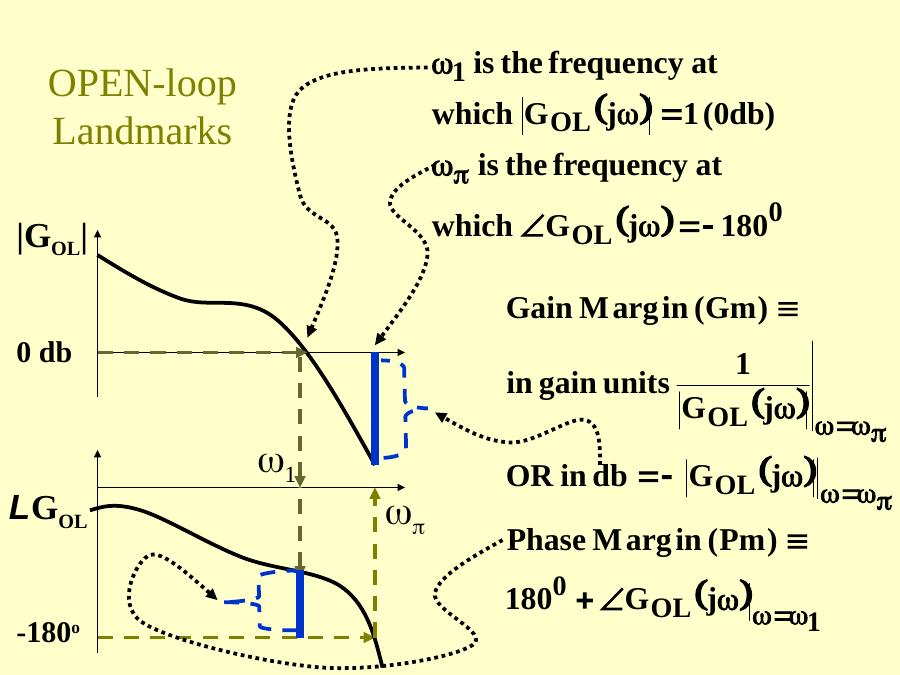
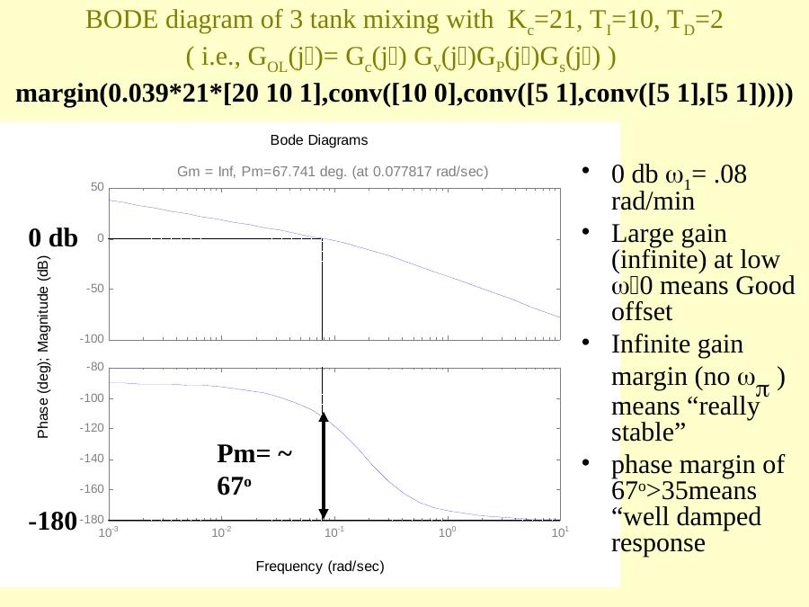
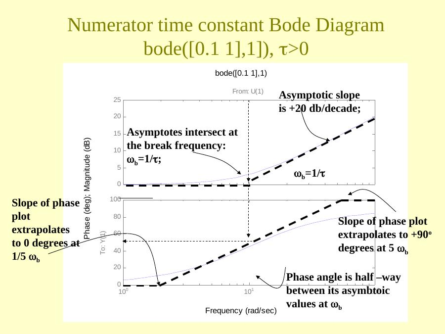
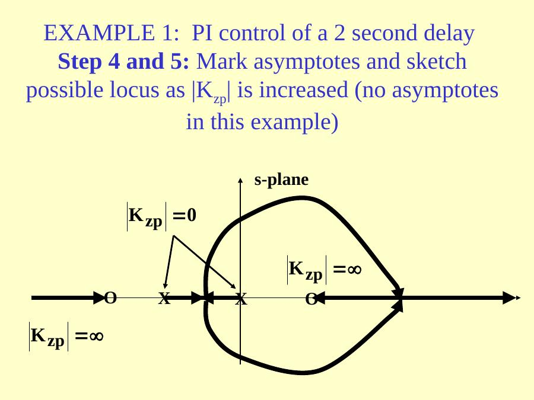
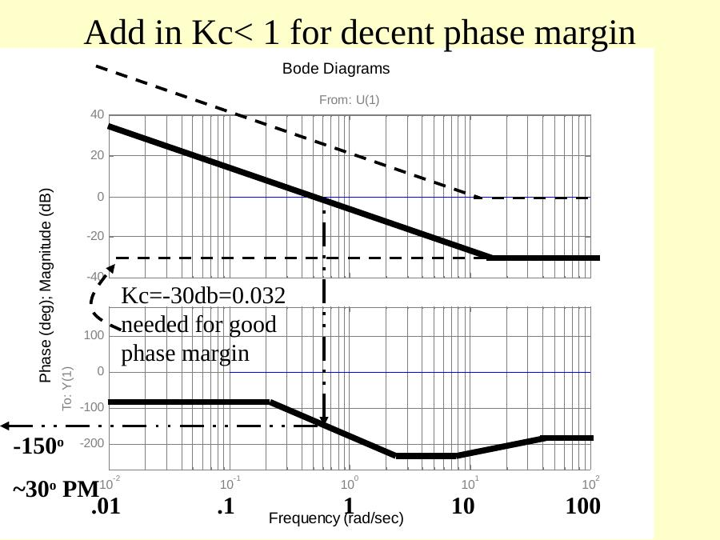
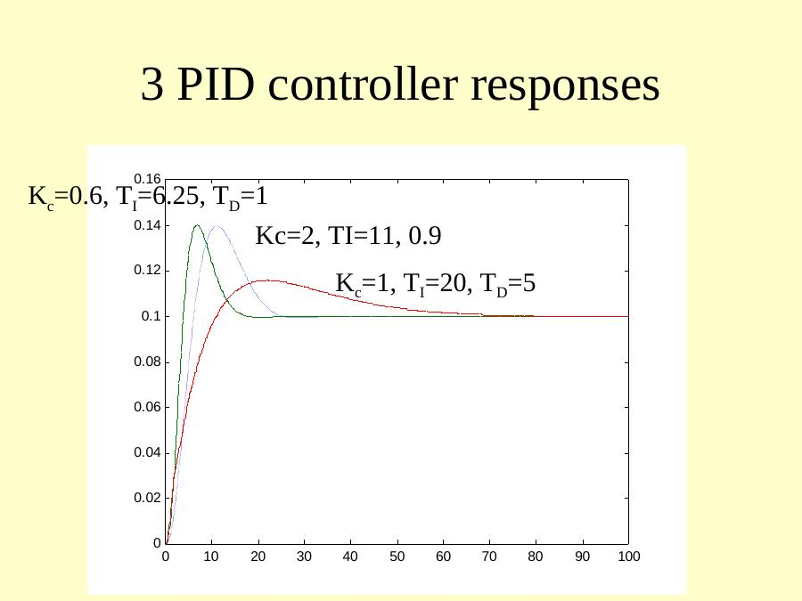

Bu yazı, EEM322 Denetim Sistemleri dersi için internetten indirilip "kontrol sistemleri farklı yerlerden indirilenler" klasörüne konmuş üç **üçüncü taraf** PowerPoint sunumunu bir araya getiriyor: **Robert Edwards**'ın **ChE 450 (Spring 2001)** proses kontrol dersinin **36, 37 ve 38. ders** slaytları. Klasördeki not dosyası kaynağı **http://www.mne.psu.edu/edwards/CLASSES/CHE_SP01/lectures/lecture36.PPT** olarak gösteriyor (Pennsylvania State University sunucusu). Dosyalar Ocak–Mayıs 2001 tarihli. Slaytlar İngilizce olduğundan metin özgün dilinde aktarıldı, denklemler düz metne çevrildi; üç sunum ve kaynak notu yazının sonunda ZIP olarak indirilebilir.

*Bu içerik üçüncü taraf bir kaynağa aittir; arşiv ve nostalji amacıyla kaynak belirtilerek paylaşılmıştır. Hak sahibinin talebi hâlinde kaldırılır.*

Notation in the slides: SP setpoint, E error, MV manipulated variable, CV controlled variable, CVm measured CV, D disturbance; G_c controller, G_v valve, G_p process, G_d disturbance, G_s sensor; G_OL = G_c·G_v·G_p·G_s is the open-loop transfer function.

## Lecture 36: Bode stability criterion and sketching rules

The **Bode stability criterion** uses the open-loop characteristic to predict the closed-loop behavior.

### Open-loop landmarks

- ω₁ is the frequency at which |G_OL(jω)| = 1 (0 dB).
- ω_π is the frequency at which ∠G_OL(jω) = −180°.
- **Gain margin** Gm = 1/|G_OL(jω_π)| in gain units, or −|G_OL(jω_π)| in dB.
- **Phase margin** Pm = 180° + ∠G_OL(jω₁).



### Frequency-domain guidelines for a "good" open loop

- A larger 0 dB crossing ω₁ means larger closed-loop bandwidth and shorter rise time.
- Large |G_OL| at low frequency means small offset.
- Gain margin > 1 (> 0 dB) is required for closed-loop stability; > 2.5 (8 dB) is recommended for performance.
- Phase margin > 35° gives a small resonant peak in the closed loop, good damping and a good decay ratio.

The next question is how to *add components* to a feedback loop (PID, recycle, etc.) to get these desirable frequency response characteristics.

### Example: three-tank mixing process

With K_c = 1, T_I = ∞, T_D = 0, i.e. G_OL(jω) = 1.0·G_v G_p G_s = 0.039/(5s + 1)³ (`bode(0.039, conv([5 1],conv([5 1],[5 1])))`): there is no 0 dB crossing, which implies a slow response; low gain at low ω means poor offset; the large gain margin (~50 dB) means "really stable"; the infinite phase margin means "well damped".

With PID, K_c = 21, T_I = 10, T_D = 2:

```matlab
margin(0.039*21*[20 10 1],conv([10 0],conv([5 1],conv([5 1],[5 1]))))
```

The 0 dB crossing is ω₁ = 0.08 rad/min; the infinite gain at low ω means good (zero) offset; the gain margin is infinite (no ω_π); the phase margin of about 67° (> 35°) means a well damped response. The corresponding root locus (`rlocus(conv([Ti*Td Ti 1],num),conv([Ti 0],den))` with the exact three-tank model) has open-loop poles at s = 0, −1/5, −1/5, −1/5 and open-loop zeros at −0.14 and −0.36 for T_D = 2, T_I = 10. The slides then compare setpoint and disturbance responses with the "setpoint" and "disturbance" tunings.



With the Ziegler–Nichols ultimate-period settings (ultimate gain K_c = 120), K_c = 90, T_I = 9, T_D = 2.3:

```matlab
margin(0.039*90*[20.7 9 1],conv([9 0],conv([5 1],conv([5 1],[5 1]))))
```

the phase margin drops to about 36°. Time responses are compared for Pm = 31° (K_c = 120) and Pm = 36° (K_c = 90).

*Not: Bu slaytta açıklama kutusu bir önceki slayttan kopyalanmış ("phase margin of 67° > 35°"); grafikteki faz payı ise yaklaşık 36°'dir.*

### Bode diagram sketching rules

First, put the open-loop transfer function into **Bode form**, with +1 at all the constant terms:

> G_OL(s) = K_zp·Π(s − z_k)/Π(s − p_i) = K_B·Π(τ_k^N s + 1)/Π(τ_i^D s + 1), K_B = K_zp·Π(−z_k)/Π(−p_i), τ_k^N = −1/z_k, τ_i^D = −1/p_i

Then substitute s = jω. Each numerator or denominator component G_k(jω) = τ_k^N jω + 1 or G_i(jω) = τ_i^D jω + 1 is a complex number with a magnitude and a phase. Collecting the exponential terms and equating magnitude and phase on each side:

> ∠G(jω) = ∠K_B + Σ∠G_k(jω) − Σ∠G_i(jω)
> 20 log₁₀|G(jω)| = 20 log₁₀|K_B| + Σ 20 log₁₀|G_k(jω)| − Σ 20 log₁₀|G_i(jω)|

Logarithms turn magnitude multiplication into addition, so the plot can be constructed graphically: numerator components are **added**, denominator components **subtracted**. Since both have the same form, only one set of sketching rules is needed. There are only 4 possible numerator components: G(s) = K_B·s^ℓ·(τ²s² + 2ζτs + 1)·Π(τ_k^N s + 1)/Π(τ_i^D s + 1).

1. **Constant K_B:** a real number, positive or negative. Magnitude |K_B|; phase 0° if K_B > 0, −180° if K_B < 0.
1. **Repeated zeros at the origin, s^ℓ:** (jω)^ℓ = ω^ℓ e^(jℓπ/2); magnitude in dB = 20ℓ log₁₀ ω, a constant slope of +20ℓ dB/decade crossing 0 dB at ω = 1; phase constant at +90ℓ°. If ℓ < 0 (in the denominator), slope and phase are negative.
1. **Numerator time constants τ_k > 0:** τ_k jω + 1. As ω → 0 the magnitude → 1 (0 dB) and phase → 0°; for large ω the magnitude → ωτ_k and the phase → +90°. The asymptotes intersect at the break frequency ω_b = 1/τ_k; the magnitude increases 20 dB/decade above the break. The phase is half-way between its asymptotic values (45°) at ω_b, and the slope of the phase plot extrapolates to 0° at ω_b/5 and to +90° at 5ω_b (`bode([0.1 1],1)`). For a denominator time constant (`bode(1,[1 1])`) everything is inverted: −20 dB/decade and −90°.
1. **Watch out for τ_k < 0 (zero in the right half plane):** the magnitude behaves the same (+20 dB/decade above the break; magnitude is just the distance from the origin), but the phase goes to **−90°** (`bode([-0.1 1],1)`).

**Repeated time constants:** the high-frequency asymptotic slope, the high-frequency phase and the phase at the break are multiplied by the order of the root; the 0.2ω_b and 5ω_b corners still apply.

**Quadratic terms (−1 < ζ < 1)** are sketched as a time constant repeated twice: for ζ > 0 the numerator slope is 40 dB/decade and the phase goes to +180°; for ζ < 0 the slope is still 40 dB/decade but the phase goes to −180°. Denominator rules have opposite signs for slope and phase.



## Lecture 37: PI control examples (root locus and Bode)

### Example 1: PI control of a 2-second delay

G_c(s) = K_c(T_I s + 1)/(T_I s), G_v = 1, G_s = 1, and the delay is approximated as G_p(s) ≈ (−s + 1)/(s + 1). Then

> G_OL = K_c·[(T_I s + 1)/(T_I s)]·[(−s + 1)/(s + 1)] = (−K_c)·(s + 1/T_I)(s − 1)/[s(s + 1)]

so K_zp = −K_c, m = 2 zeros at s = 1 and −1/T_I, n = 2 poles at s = 0 and −1; n − m = 0, so there are no asymptotes. As |K_zp| increases from 0 to ∞, the locus leaves the poles at 0 and −1 and ends at the zeros, including the right-half-plane zero at +1.



For the Bode diagram, K_B = K_c/T_I; the numerator time constant (−s + 1) breaks at ω_b = |1/(−1)| = 1 and its phase goes to −90° (τ < 0); the denominator pole 1/s and the time constant 1/(s + 1) break at ω_b = 1. The magnitudes of (−s + 1) and 1/(s + 1) add to zero, while their phases add to twice the slope (the numerator and denominator phase contributions are the same because τ < 0 in the numerator). The PI portion (T_I s + 1)/(T_I s), e.g. T_I = 0.1, has a −20 dB/decade slope that becomes flat at ω_b = 1/T_I = 10; the phase plot has twice as many slope changes because there are two "corners" per break. Adding everything, a K_c < 1 is needed for a decent phase margin: K_c = −30 dB = 0.032 gives about 30° phase margin.



### Example 2: PI control with 3 asymptotes

G_p(s) = −1/[s(s + 1)²], so

> G_OL = K_c·[(T_I s + 1)/(T_I s)]·[−1/(s(s + 1)²)] = (−K_c)·(s + 1/T_I)/[s²(s + 1)²]

K_zp = −K_c (note that the gain of the plant is negative), m = 1 zero at −1/T_I, n = 4 poles at s = 0, 0, −1, −1, n − m = 3 asymptotes. The locus (T_I = 2) becomes unstable for K_c too negative; a **reverse response plant needs a reverse action controller** (K_c < 0). In the Bode analysis, to avoid a −180° phase contribution due to a negative Bode gain, K_c < 0 is chosen with reverse action.

The components 1/s and 1/(s + 1)² add to a slope of −20 − 40 = −60 dB/decade after ω = 1. With T_I = 10 (1/T_I = 0.1) the phase margin is maximised by choosing K_c = 0.1 (−20 dB). With K_c = 0.25, T_I = 10:

```matlab
margin(0.25*[10 1],conv([10 0],[1 2 1 0]))   % Gm = 16 dB, Pm = 40 deg
```

The Simulink test with reverse action selected in the controller confirms the response. With T_I = 5 the reset time is too short and the maximum phase margin is only 23°:

```matlab
margin(0.25*[5 1],conv([5 0],[1 2 1 0]))     % Pm = 23 deg
```

*Not: Yanıt grafiklerinin başlığında süreç "1/[s(s² + 1)]" diye yazılmış; incelenen süreç 1/[s(s + 1)²]'dir (Simulink bloğunda da −1/(s³ + 2s² + s)).*

## Lecture 38: PID control of a third order plant

Lecture 38 begins by repeating Example 2 (as "Example 4") and then continues with PID control.

### Example 5: PID control with a 3rd order plant

G_c(s) = K_c(T_I T_D s² + T_I s + 1)/(T_I s), G_p(s) = 1/[s(s + 1)²]:

> G_OL = K_c·(T_I T_D/T_I)·[s² + s/T_D + 1/(T_I T_D)]/s · 1/[s(s + 1)²]

K_zp = K_c T_D; m = 2 zeros at s = [−T_I ± √(T_I² − 4T_I T_D)]/(2T_I); n = 4 poles at s = 0, 0, −1, −1; n − m = 2 asymptotes. With T_I = 4, T_D = 1 the asymptotes are at σ = −1/2 and the response is stable for all K_c; adding T_D requires a change in T_I.

**Bode example 3:** choose T_I and T_D to get a repeated numerator root: T_D = T_I/4 gives the repeated time constant T_I/2, G_OL = K_c(T_I s/2 + 1)²/(T_I s) · 1/[s(s + 1)²]. With T_I = 20 (T_D = 5): |1/20| = −26 dB; the PID components added together rise to 40 − 26 = 14 dB at high frequency, giving an ultimate phase improvement of +90°, but increasing the gain at large ω creates a noise response problem. Combined with the plant (−60 dB/decade), the phase margin is about 30° in the asymptotic sketch.

```matlab
margin([5*20 20 1],conv([20 0],[1 2 1 0]))   % Pm = 47 deg, Gm infinite, Kc = 1
rlocus([5*20 20 1],conv([20 0],[1 2 1 0]))   % Kc = 0.28
```

Placing the PID zeros close to the origin forces a slow closed-loop response (compare K_c = 1 and K_c = 0.28).

![Asymptotic Bode sketch of the plant 1/[s(s+1)²] with the PID controller TI = 20, TD = 5](l38-pid-bode.jpg "Süreç ve PID (TI = 20, TD = 5) Bode çizimi")

**Why frequency response is generally more capable:** with root locus, choosing K_c to get a desired damping factor on "one" set of roots does not account for the presence of additional poles and zeros; frequency response accounts for all the poles and zeros and their relative positions as well.

### Moving the zeros away from the origin speeds the response

| Desired zeros | conv | Bode form | T_I, T_D | Result |
| --- | --- | --- | --- | --- |
| −1 and −0.1 | s² + 1.1s + 0.1 | 10s² + 11s + 1 | T_I = 11, T_D = 10/11 ≈ 0.9 | rlocus: K_c = 0.27; with K_c = 2, PM = 35° |
| −1 and −0.5 | s² + 1.5s + 0.5 | 2s² + 3s + 1 | T_I = 3, T_D = 2/3 = 0.67 | K_c = 2, PM = 45° (max); root locus shows poor damping, asymptotes at −0.25 |
| −0.8 and −0.2 | s² + s + 0.16 | 6.25s² + 6.25s + 1 | T_I = 6.25, T_D = 1 | K_c = 0.6, PM = 47°; rlocus K_c = 0.78 |

```matlab
rlocus([10 11 1],conv([11 0],[1 2 1 0]))
margin(2*[10 11 1],conv([11 0],[1 2 1 0]))        % Kc = 2, PM = 35 deg
rlocus([2 3 1],conv([3 0],[1 2 1 0]))
margin(2*[3 2 1],conv([3 0],[1 2 1 0]))           % PM = 45 deg (slaytta yazıldığı gibi)
margin(0.6*[6.25 6.25 1],conv([6.25 0],[1 2 1 0])) % PM = 47 deg
rlocus([6.25 6.25 1],conv([6.25 0],[1 2 1 0]))
```

Moving the zeros to the left "pulls" the locus to faster pole locations. With T_I = 11, T_D = 0.9 the PID zero at −1 cancels a pole of the plant, and the high-frequency gain increase starts at a higher frequency, which makes the loop less susceptible to noise; the asymptotic sketch shows about 60° phase margin, and K_c was increased until the PM was reduced to 35°.

*Not: T_I = 3, T_D = 0,67 için PID payı T_I·T_D·s² + T_I·s + 1 = 2s² + 3s + 1, yani `[2 3 1]` olmalıdır; margin satırında `[3 2 1]` yazılmış (aynı slayt grubundaki rlocus satırında doğru biçim kullanılmış).*

The lecture ends by comparing the three PID tunings: K_c = 2, T_I = 11, T_D = 0.9; K_c = 0.6, T_I = 6.25, T_D = 1; and K_c = 1, T_I = 20, T_D = 5.


