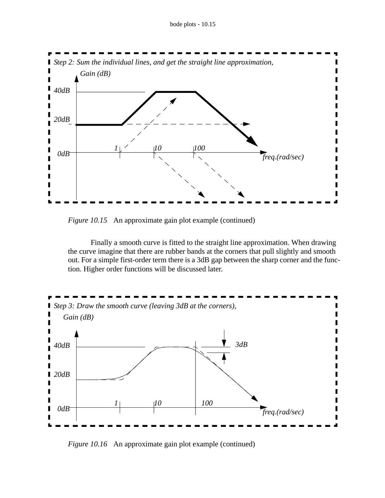
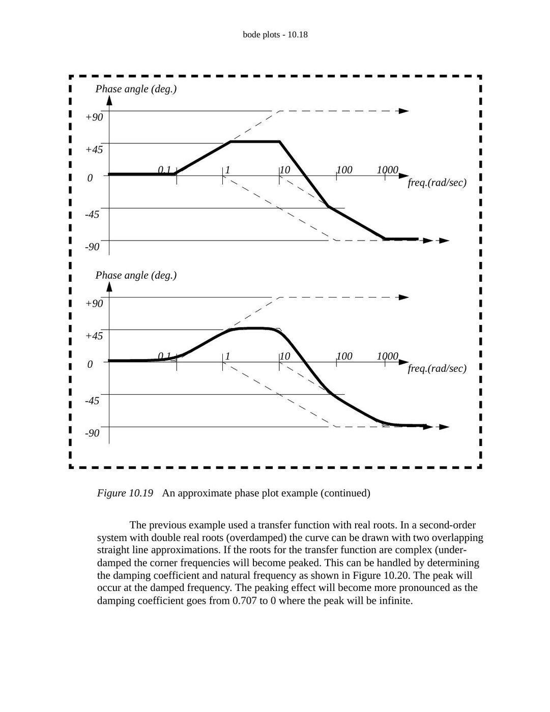

Hugh Jack’ın **“10. Bode Plots”** başlıklı İngilizce notu, EEM322 ders arşivinde bulunan 38 sayfalık `bode.pdf` dosyasından aktarıldı. Kaynak PDF’nin yazar alanı `jackh`; oluşturulma tarihi 8 Ekim 1994, son değişiklik tarihi 20 Aralık 2004. Konu anlatımı, alıştırmalar, çözümler ve logaritmik çizim kâğıtlarını içeren PDF yazının sonunda indirilebilir.

*Bu içerik üçüncü taraf bir kaynağa aittir; arşiv ve nostalji amacıyla kaynak belirtilerek paylaşılmıştır. Hak sahibinin talebi hâlinde kaldırılır.*

## Introduction: gain and phase

A phasor transform expresses the transfer function as a complex quantity that depends on frequency. Its magnitude is the gain and its angle is the phase shift. A Bode diagram plots these two quantities against frequency, providing an overall picture of the system response.

The note uses a graphic equalizer as an analogy: moving the sliders changes the frequency response, emphasizing or suppressing selected bands. In a linear system, each sinusoidal component can be considered separately.

For the mass–spring–damper example:

G(jω) = X(jω)/F(jω) = 1 / [(2000 − 1000ω²) + j3000ω]

|G(jω)| = 1 / √[(2000 − 1000ω²)² + (3000ω)²]

The phase is obtained from the real and imaginary parts, with the appropriate quadrant correction. Frequencies listed in Hz must first be converted using **ω = 2πf**. Magnitude is converted to decibels using **G_dB = 20 log₁₀|G|**.

*Not: Kaynağın 10.3 numaralı sayfasında fazın bölge değişimi ω = 2 ile ayrılmıştır. Yazılan transfer fonksiyonunda gerçek kısmın işareti 2000 − 1000ω² = 0, yani ω = √2 rad/s noktasında değişir. Faz için atan2 yaklaşımı bu bölge belirsizliğini önler.*

The frequency table covers f = 0, 0.001, 0.01, 0.1, 1, 10, 100 and 1000 Hz. The gain tells how much the input amplitude changes; the phase tells how far the output sinusoid leads or lags.

For the input F(t) = 1000 + 20 sin(20t) + 10 sin(0.5t), the constant component gives x = 1000/2000 = 0.5. The remaining terms use the magnitude and phase evaluated at 20 and 0.5 rad/s respectively. The source leaves these numerical entries as an exercise.

## Bode plots on semilog paper

The frequency axis is logarithmic; successive decades might be 0.1, 1, 10, 100 and 1000. Zero frequency cannot appear on this axis. Gain in dB and phase in degrees use linear vertical scales.

There are two approaches:

1. Calculate magnitude and phase at a selection of frequencies, then plot the points.
1. Factor the transfer function and build straight-line approximations from its poles and zeros.

The source provides four-cycle graph paper and asks for the mass–spring–damper points to be plotted both by hand and by computer.

## Straight-line magnitude approximation

1. Write the transfer function in factored form and identify the corner frequencies.
1. Determine the low-frequency level when a finite nonzero DC gain exists.
1. Add the slope contribution of each factor: a first-order numerator factor contributes +20 dB/decade; a denominator factor contributes −20 dB/decade after its corner.
1. Add all contributions to obtain the overall approximation.
1. Smooth the corners. An isolated first-order corner differs from the asymptote by approximately 3 dB.

For G(s) = 1/(ωc + s), the low-frequency magnitude is 1/ωc. At ω = ωc, its magnitude is 1/(√2 ωc), so the relative change is 20 log₁₀(1/√2) = **−3.01 dB** and the phase is **−45°**. At high frequencies G(jω) ≈ 1/(jω), producing −20 dB/decade. A repeated pole produces −40 dB/decade.

The worked example is presented in factored form as:

G(s) = 10⁴(s + 1)/[(s + 10)(s + 100)]

Its initial gain is 10, or 20 dB. The zero at 1 rad/s raises the slope to +20 dB/decade; the pole at 10 rad/s returns it to zero; the pole at 100 rad/s changes it to −20 dB/decade.

*Not: Kaynak aynı örneğin açılmış paydasını 0.01s² + 0.11s + 10 olarak yazıyor. Verilen çarpanlı biçimle uyumlu payda 0.01s² + 1.1s + 10 olur. Buradaki eğri anlatımı kaynağın çarpanlı biçimine aittir.*



## Straight-line phase approximation

The phase contributions are added in the same way. In the example, the zero at 1 rad/s contributes +90°, while the poles at 10 and 100 rad/s each contribute −90°. A first-order transition is approximated over two decades: from one tenth of the corner frequency to ten times that frequency.

An isolated factor s in the numerator contributes +90° from the start; one in the denominator contributes −90°. The plotted example begins near 0° and approaches −90° at high frequency.



## Second-order systems and resonance

The note considers the second-order denominator s² + 2ζωn s + ωn². Complex poles can create a resonant peak, and the peak becomes stronger as damping decreases.

*Not: Kaynak rezonans tepesini sönümlü doğal frekans ωd = ωn√(1 − ζ²) ile aynı yerde gösteriyor ve bir yerde ζ < 1 koşulunu yeterli sayıyor. Standart sabit paylı ikinci dereceden alçak geçiren sistemde genlik rezonansı için ζ < 1/√2 gerekir; tepe frekansı ωr = ωn√(1 − 2ζ²)’dir. ωd geçici yanıtın salınım frekansıdır.*

## Signal spectrums

A spectrum shows component amplitudes versus frequency. The example is:

x(t) = A sin(2πt/0.01) + 0.3A sin(2πt/0.005) + 0.01A sin(2πt/0.0005)

Its three components are:

| Frequency | Amplitude |
|---|---|
| 100 Hz | A |
| 200 Hz | 0.3A |
| 2000 Hz | 0.01A |

The time trace combines these components; the frequency plot displays three separate peaks.

## Scilab example

The source uses the transfer function (s + 5)/(s² + 100s + 10000). The direct plotting portion is:

```scilab
D = poly(0, 'D');
h = syslin('c', (D + 5) / (D^2 + 100*D + 10000));
bode(h, 0.1, 1000, 'Sample Transfer Function');
```

A separate loop samples six points per decade over six decades, starting at 0.1 Hz. It converts frequency to rad/s, calculates polar magnitude and phase, converts to dB and degrees, and writes the results to `data.txt`.

*Not: Kaynağın veri yazma örneğinde `w = f * 2 * %pi);` satırında fazla kapanış parantezi var. Kod burada çalıştırılmadı; örnek döneminin Scilab sözdizimini kullanıyor.*

## Practice problems

1. Draw the gain and phase Bode plots of (s + 1)(s + 1000)/(s + 100)² and 5/s² using the phasor transform.
1. For G(s) = (s + 10)(s + 5)/(s + 5)², draw the straight-line plots and determine the steady-state output for x(t) = 20 sin(9t + 0.3).
1. Draw the straight-line Bode approximation of G(s) = (s + 1000)/(s² + 5s + 100).
1. For Vo/Vi = 1000/(s + 1000), find the response to Vi = 5 sin(100000t) and draw the approximate plot.
1. For G(s) = s(s + 2π)/(s² + 300πs + 62500π²), draw the approximate Bode plot, verify selected points, and find the response to 5 sin(624t) + sin(6.2t).
1. A 10 kg mass is suspended by two springs in series, K₁ = 500 N/m and K₂ = 1000 N/m. With applied force F as input and displacement x as output, neglect gravity and obtain the transfer function. Find the sinusoidal response for F(t) = 10 cos(t + 1), invert the input/output choice, draw Bode plots and find the 10 N step response. Finally include gravity in the step-response calculation.
1. For ÿ + ẏ + 7y = F, y(0) = 1, ẏ(0) = 0 and F(t) = 10 for t > 0, write the state equations; solve numerically and analytically; find and sketch the frequency response.
1. For ẋ + 5x = F and F(t) = 10 sin(100t), find the transfer function, magnitude and phase, Bode plot, sinusoidal response and state equation. Calculate values from t = 0 to 0.010 s in 0.002 s steps, and determine the unit-step response from rest.

## Selected solution results

The source includes graphical solutions for the practice problems. The principal algebraic results are:

- Problem 2: G(j9) = 1.236 − 0.425j; magnitude approximately 1.307, phase approximately −0.3312 rad. Thus y(t) ≈ **26.1 sin(9t − 0.031)**.
- Problem 3: ωn = 10 rad/s and ζ = 0.25. DC gain is 10, or 20 dB. The zero is at 1000 rad/s and the denominator contributes the second-order resonant response.
- Problem 4: the response amplitude is approximately **0.0500** and the phase is approximately **−1.561 rad**.
- Problem 6: the series spring stiffness is K₁K₂/(K₁ + K₂) = 1000/3 N/m, giving X/F = 1/(10s² + 1000/3). The source gives the 10 N step response as approximately 0.03[1 − cos(5.77t)] before gravity is included.
- Problem 7: with x₁ = y and x₂ = ẏ, ẋ = [0 1; −7 −1]x + [0; 1]F and y = [1 0]x. The frequency response is 1/(7 − ω² + jω).
- Problem 8: G(s) = 1/(s + 5), |G(jω)| = 1/√(25 + ω²), phase = −atan(ω/5). At 100 rad/s the response is approximately **0.0999 sin(100t − 1.521)**. For a unit step from rest, x(t) = (1 − e^(−5t))/5.

*Not: Problem 2 çözümünde −0.3312 rad için −9.49° yazılmış; dönüşüm yaklaşık −18.98° verir. Ayrıca çözümün ara satırında giriş sinüs yerine kosinüs yazılmış, son sonuç yeniden sorudaki sinüs girdisini kullanıyor.*

## Assignment problems and drawing paper

The final assignment section asks for computer-generated Bode plots, plots of simple first- and second-order factors, and gain/phase approximations for a factored transfer function. It also asks how a specified two-frequency sinusoidal signal can be passed through the system, how a Bode plot can be reconstructed from poles and zeros, and how to infer an approximate transfer function from a supplied magnitude plot.

The PDF ends with two- and four-cycle log-scale paper for these exercises.
