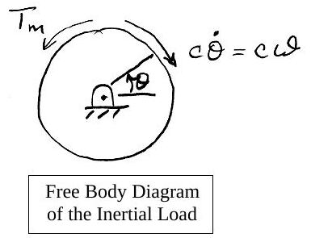
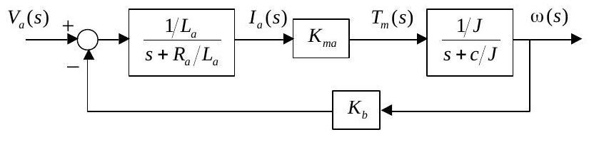

Bu yazı, EEM322 Denetim Sistemleri dersinin klasöründe "DCmotor_model_lecture2.pdf" adıyla duran, **üçüncü taraf** bir ders notudur. Belgenin kendisinde yazar ya da kurum adı yok; PDF özelliklerine göre başlığı **"Me360DCMotorTransferFunctions01"**, yazarı **kamman**'dır ve **10 Eylül 2001**'de Word'den üretilmiştir; yani bir **ME 360** dersi için hazırlanmış 4 sayfalık bir nottur. Notun kendi kaynağı olarak Dorf ve Bishop'un *Modern Control Systems* (9. baskı, Prentice-Hall, 2001) kitabı gösterilmiş. Dosya Dropbox'ta parolalıydı; parolası kaldırılmış kopyası yazının sonunda indirilebilir. İçerik İngilizce olduğundan özgün dille aktarıldı, formüller düz metne çevrildi.

*Bu içerik üçüncü taraf bir kaynağa aittir; arşiv ve nostalji amacıyla kaynak belirtilerek paylaşılmıştır. Hak sahibinin talebi hâlinde kaldırılır.*

## DC Motor Transfer Functions

*(Reference: Dorf and Bishop, Modern Control Systems, 9th Ed., Prentice-Hall, Inc. 2001)*

The figure represents a DC motor attached to an inertial load. The voltages applied to the field and armature sides of the motor are represented by V_f and V_a. The resistances and inductances of the field and armature sides of the motor are represented by R_f, L_f, R_a and L_a. The torque generated by the motor is proportional to i_f and i_a, the currents in the field and armature sides of the motor:

> T_m = K · i_f · i_a  (1.1)

")

## Field-current controlled motor

In a field-current controlled motor, the armature current i_a is held constant, and the field current is controlled through the field voltage V_f. In this case, the motor torque increases linearly with the field current:

> T_m = K_mf · i_f

Taking Laplace transforms of both sides gives the transfer function from the input current to the resulting torque:

> T_m(s) / I_f(s) = K_mf  (1.2)

For the field side of the motor the voltage/current relationship is

> V_f = V_R + V_L = R_f · i_f + L_f · (di_f/dt)

The transfer function from the input voltage to the resulting current is found by taking Laplace transforms of both sides of this equation:

> I_f(s) / V_f(s) = (1/L_f) / (s + R_f/L_f)  (1st order system)  (1.3)

Combining equations (1.2) and (1.3) gives the transfer function from the input voltage to the resulting motor torque:

> T_m(s)/V_f(s) = [T_m(s)/I_f(s)] · [I_f(s)/V_f(s)] = (K_mf/L_f) / (s + R_f/L_f)  (1st order system)  (1.4)

So, a step input in field voltage results in an exponential rise in the motor torque.

### Rotational motion of the inertial load

An equation that describes the rotational motion of the inertial load is found by summing moments (counterclockwise positive):

> ΣM = T_m − c·ω = J·ω̇, or J·ω̇ + c·ω = T_m

Thus, the transfer function from the input motor torque to rotational speed changes is

> ω(s) / T_m(s) = (1/J) / (s + c/J)  (1st order system)  (1.5)

Combining equations (1.4) and (1.5) gives the transfer function from the input field voltage to the resulting speed change:

> ω(s)/V_f(s) = [ω(s)/T_m(s)] · [T_m(s)/V_f(s)] = (K_mf/(L_f·J)) / [(s + c/J)(s + R_f/L_f)]  (2nd order system)  (1.6)

Finally, since ω = dθ/dt, the transfer function from input field voltage to the resulting rotational position change is

> θ(s)/V_f(s) = [θ(s)/ω(s)] · [ω(s)/V_f(s)] = (K_mf/(L_f·J)) / [s(s + c/J)(s + R_f/L_f)]  (3rd order system)  (1.7)

## Armature-current controlled motor

In an armature-current controlled motor, the field current i_f is held constant, and the armature current is controlled through the armature voltage V_a. In this case, the motor torque increases linearly with the armature current:

> T_m = K_ma · i_a

The transfer function from the input armature current to the resulting motor torque is

> T_m(s) / I_a(s) = K_ma  (1.8)

The voltage/current relationship for the armature side of the motor is

> V_a = V_R + V_L + V_b  (1.9)

where V_b represents the "back EMF" induced by the rotation of the armature windings in a magnetic field. The back EMF is proportional to the speed ω, i.e. V_b(s) = K_b·ω(s). Taking Laplace transforms of equation (1.9) gives

> V_a(s) − V_b(s) = (R_a + L_a·s)·I_a(s)  (1.10)

or

> V_a(s) − K_b·ω(s) = (R_a + L_a·s)·I_a(s)  (1.11)

As before, the transfer function from the input motor torque to rotational speed changes is

> ω(s) / T_m(s) = (1/J) / (s + c/J)  (1st order system)  (1.12)

Equations (1.8), (1.11) and (1.12) together can be represented by the closed loop block diagram below: V_a(s) enters a summing junction, passes through (1/L_a)/(s + R_a/L_a) to give I_a(s), through K_ma to give T_m(s), and through (1/J)/(s + c/J) to give ω(s); the back-EMF path K_b feeds ω(s) back negatively.

Block diagram reduction gives the transfer function from the input armature voltage to the resulting speed change:

> ω(s)/V_a(s) = (K_ma/(L_a·J)) / [(s + R_a/L_a)(s + c/J) + K_b·K_ma/(L_a·J)]  (2nd order system)  (1.13)

The transfer function from the input armature voltage to the resulting angular position change is found by multiplying equation (1.13) by 1/s.

## Kısa özet

| Denetim biçimi | Giriş → çıkış | Transfer fonksiyonu | Mertebe |
| --- | --- | --- | --- |
| Alan akımı kontrollü | V_f → T_m | (K_mf/L_f)/(s + R_f/L_f) | 1 |
| Alan akımı kontrollü | V_f → ω | (K_mf/(L_f J))/[(s + c/J)(s + R_f/L_f)] | 2 |
| Alan akımı kontrollü | V_f → θ | (K_mf/(L_f J))/[s(s + c/J)(s + R_f/L_f)] | 3 |
| Endüvi akımı kontrollü | V_a → ω | (K_ma/(L_a J))/[(s + R_a/L_a)(s + c/J) + K_b K_ma/(L_a J)] | 2 |
| Endüvi akımı kontrollü | V_a → θ | (1.13) × 1/s | 3 |

Alan kontrollü motorda geri besleme yoktur ve transfer fonksiyonu alt sistemlerin çarpımıdır; endüvi kontrollü motorda ise ters EMK doğal bir negatif geri besleme döngüsü oluşturur. (1.13) ifadesi, ileri yol G = (1/L_a)/(s + R_a/L_a) · K_ma · (1/J)/(s + c/J) ve geri besleme H = K_b ile G/(1 + GH) bağıntısından doğrudan elde edilir.
