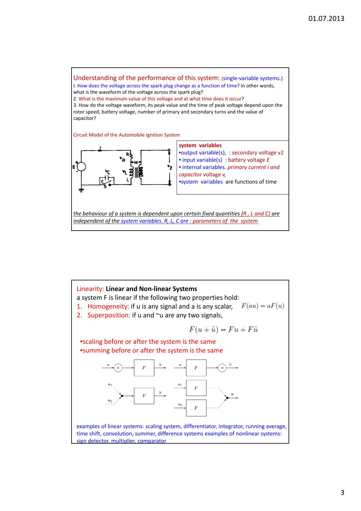
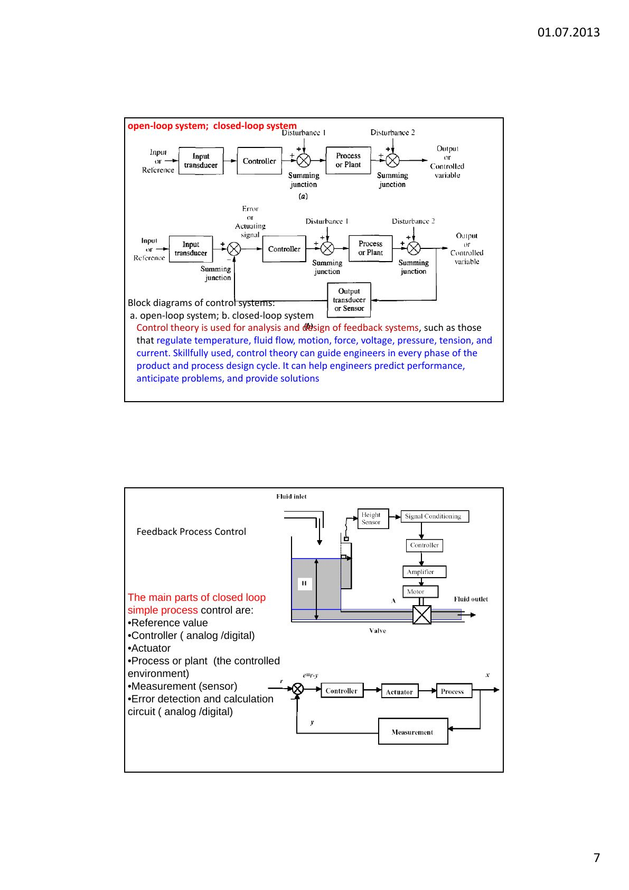
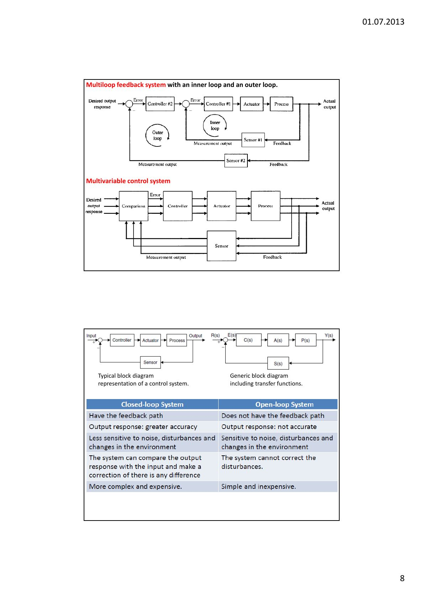
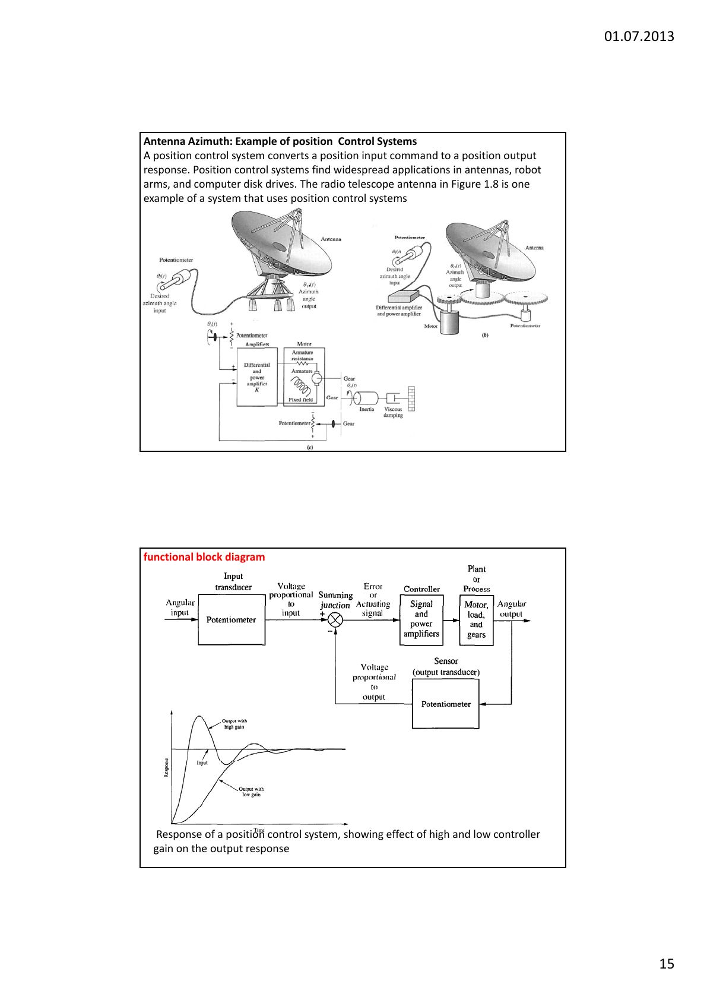
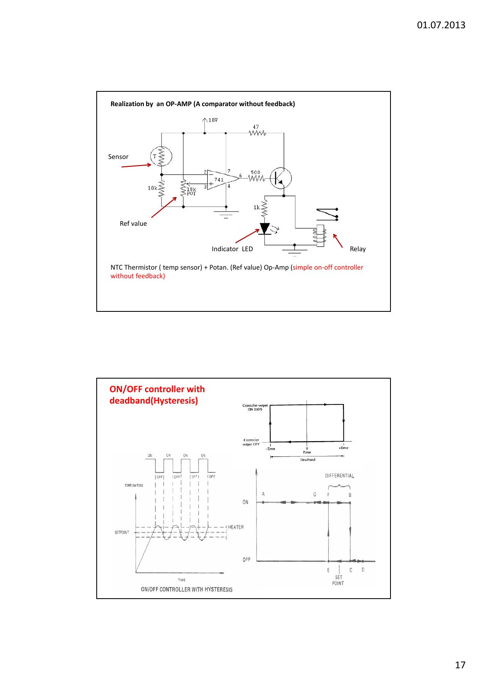

This post is **Lecture Note 1** ("Lecture 1") of the **EEM322 Control Systems** course at Başkent University. The notes belong to the course instructor **Hamit Erdem**; the page headers carry the date 01.07.2013 (2013 summer term). The lecture note is in English, a 19-page PDF with two slides placed per page. The content is summarized below in English, with the original terms given in parentheses where useful; images of the relevant pages are included for the diagrams. The original PDF can be downloaded at the end of the post.

## References

1. Ogata, K., *Modern Control Engineering*, Prentice-Hall, 4th ed., 2002.
1. Dorf, R. C., Bishop, R. H., *Modern Control Systems*, Prentice-Hall.
1. Norman S. Nise, *Control Systems Engineering*, 6th ed., Wiley & Sons.
1. Uraz, A., *Control Systems*, Hacettepe University, 2003.
1. Web: lecture notes (Hamit Erdem).

## The system and the block diagram

A **system** is a structure made up of components interconnected to perform a specific function; it is a collection of physical components arranged so as to behave as a whole. A **control system** consists of physical components connected so as to command, direct, or regulate itself or another system.

- A system has inputs and outputs.
- The system produces an output signal in response to an input signal.
- The system has a mathematical model relating its inputs to its outputs.

A **block diagram** is a concise, pictorial representation of the cause-and-effect relationship between the input and output of a physical system. It is an easy way to describe the functional relationships among the components of a control system; its simplest form is a single block with one input and one output.

Systems fall into the following categories, each independent of the others:

1. Linear or non-linear
1. Dynamic or static
1. Time-invariant or time-varying
1. Continuous-time or discrete-time
1. Deterministic or stochastic

## Modeling example: an automobile ignition system

The main components of the system are the spark plug, the ignition coil, the spring-loaded contact points (breaker points), the engine-driven cam, the capacitor, and the battery. The cam opening and closing the contacts causes a sudden change in the coil's primary current and induces a very high voltage in the secondary winding; this voltage produces the spark at the spark plug. The capacitor connected across the contacts prevents arcing and wear at the contacts. In the analysis, a single spark plug is assumed to be connected directly to the coil.

Questions asked in order to understand the performance of this (single-variable) system:

1. How does the voltage across the spark plug terminals vary with time, and what is its waveform?
1. What is the maximum value of this voltage and when does it occur?
1. How do the waveform, the peak value, and the peak time depend on the cam speed, the battery voltage, the primary and secondary numbers of turns, and the capacitor value?

In the circuit model, the **output variable** is the secondary voltage v₂, the **input variable** is the battery voltage E, and the **internal variables** are the primary current i and the capacitor voltage v; the system variables are functions of time. The behavior of the system depends on constant quantities (R, L, C) that are independent of the system variables; these are the **parameters of the system**.

## Linear and nonlinear systems

A system F is linear if it satisfies the following two properties:

1. **Homogeneity:** If u is any signal and a is any scalar, then F(au) = aF(u).
1. **Superposition:** If u and ũ are any two signals, then F(u + ũ) = Fu + Fũ.

That is, scaling or adding before or after the system gives the same result. Examples of linear systems: scaler, differentiator, integrator, moving average, time shift, convolution, adder, difference systems. Nonlinear examples: signal detector, multiplier, comparator.

## Time-invariant and time-varying systems

Parameters are quantities that depend on the properties of the system elements and not on the system variables. For example, in the equation L·d²i/dt² + R·di/dt + i/C = 0, R, L, and C appear as coefficients. If these parameters become functions of the dependent variable i(t), the system is no longer linear. If the parameters are constant, i.e., do not change with time, the system is **time-invariant**; if one or more parameters are functions of time, it is a **time-varying** system. The terms stationary and non-stationary are also used for these. (Source: A. N. Tripathi, *Linear Systems Analysis*.)

The **input** is the stimulus or command applied to a control system, usually from an external energy source, in order to obtain a specified response. The **output** is the actual response obtained from the control system; it may or may not equal the specified response implied by the input.

- **Electric switch:** A manufactured control system that controls the flow of electricity. Opening and closing the switch is the input (on/off); electricity flowing or not flowing is the output. It is one of the most basic control systems.
- **Heater with thermostat:** The input is the reference temperature set with the thermostat; the output is the actual temperature of the room. When the thermostat senses that the output is lower than the input, the heater turns on, switches off when the temperature reaches the reference, and turns on again when it drops slightly.

## Dynamic and static systems

A dynamic control system responds to an input by giving a **transient response** before reaching the steady state:

- Its models are given by differential (or difference) equations; the independent variable is time.
- Even when the input is constant, the output is always a function of time; there is a "motion".
- The output depends not only on the input but also on the initial conditions (the solution of an nth-order differential equation requires the initial values of the dependent variable and its derivatives). The system "remembers" its past inputs, that is, it has memory.

A circuit containing a single inductance or capacitance is a dynamic system: the presence of an energy-storing element makes the system dynamic. In a mechanical system, mass and spring store energy. Variables related to energy storage (capacitor voltage, inductor current, velocity of the mass, spring force) cannot change instantaneously; an instantaneous change in the inductor current would imply an infinite rate of energy change, that is, infinite power. For this reason dynamic systems are not instantaneous.

## Definition of a control system and performance criteria

A control system consists of subsystems and processes (plants) assembled for the purpose of obtaining a desired output with desired performance, given a specified input. **Elevator example:** Pressing the fourth-floor button on the first floor is a step input representing the desired output. The elevator rises to the fourth floor with a speed suited to passenger comfort and a floor-alignment accuracy. Two basic performance criteria:

1. **Transient response:** If it is too fast, passenger comfort is sacrificed; if it is too slow, the passenger's patience is sacrificed.
1. **Steady-state error:** If the elevator is not properly aligned with the floor, passenger safety and comfort are sacrificed.

### Open- and closed-loop examples

- **Toaster:** Most automatic toasters are controlled by a timer and are therefore **open-loop**. The time is estimated by the user, who is not part of the system; once the time is set, there is no control over the quality of the toasting (the output).
- **Autopilot:** The autopilot and the aircraft it controls form a **closed-loop** (feedback) system; it continuously measures the actual heading of the aircraft and adjusts the rudder and ailerons to maintain the desired heading. The pilot who sets the autopilot is not part of the system.
- **The human body's sweating system:** When the air outside the skin becomes very hot, the sweat glands increase secretion, and the skin cools by evaporation; when the desired cooling is achieved, the secretion decreases.
- **A person driving a car:** The input is the direction of the road (the lane markings), and the output is the direction of the car. The driver continuously measures the output with their eyes and brain and corrects it with their hands on the steering wheel.

Control theory is used in the analysis and design of feedback systems that regulate quantities such as temperature, flow, motion, force, voltage, pressure, tension, and current. The main parts of a simple closed-loop process control are:

- Reference value
- Controller (analog / digital)
- Actuator
- Process or plant (the controlled environment)
- Measurement (sensor)
- Error detection and computation circuit (analog / digital)

| Closed-loop system | Open-loop system |
|---|---|
| Has a feedback path | Has no feedback path |
| Output response is more accurate | Output response is not accurate |
| Less sensitive to noise, disturbances, and environmental changes | Sensitive to noise, disturbances, and environmental changes |
| Can compare the output with the input and correct if there is a difference | Cannot correct the effects of disturbances |
| More complex and expensive | Simple and inexpensive |

The note also gives the following as examples: automobile steering control, speed control with a DC motor (open and closed loop), a robot arm with pattern recognition, a temperature control system, a national income feedback model, and the block diagram of a person playing a video game. In control engineering, the aim of design is to determine the structure, the characteristics, and the key parameters of a system that will meet a real need.

## Servomechanism and regulator

A **servomechanism** is a feedback control system with power amplification in which the controlled variable is mechanical position or a derivative of position (velocity, acceleration). The hydraulic steering of an automobile is a servomechanism: the command input is the angular position of the steering wheel; the small torque applied to the wheel is amplified hydraulically and converted into the force that changes the angular position of the front wheels.

A **regulator** (regulating system) is a feedback system whose reference input remains constant for a long time, often for the entire operating period of the system; this input is called the **setpoint**. The main job of a regulator is to keep the output constant, whereas that of a servomechanism is to make the output follow a changing input.

## Control laws and power conversion

The controller includes both the control laws (for example proportional-integral-derivative, **PID** control) and power conversion. Control laws produce information; but power must be applied to control the plant, so almost all controllers contain a power converter. The gains are adjusted to obtain a fast and stable command response and to suppress disturbances. For robust operation, the control laws must be designed with margins that accommodate reasonable variations in the plant and the power converter.

## Analog and digital control systems

- **Continuous-time (analog) signal:** A signal that depends on continuous values of the independent variable t.
- **Discrete-time (sampled, digital) signal:** A signal defined only at certain discrete instants of t.
- **Continuous-time control systems** contain only analog signals and components; **discrete-time control systems** have a discrete-time signal at one or more points. Some systems are a combination of both (hybrid).

Control system models: mathematical models such as differential equations, difference equations, Laplace and z transforms; block diagrams; signal flow graphs.

## Analysis and design objectives

**Analysis** is the determination of the performance of a system (for example, whether the transient response and the steady-state error meet the desired specifications). **Design** is the creation or modification of the performance; if the specifications are not met, parameters are changed or additional components are added.

- **Transient response:** In an elevator, a slow transient response makes passengers impatient, and an excessively fast one is uncomfortable.
- **Steady-state response:** The response that resembles the input and remains after the transient components have died out to zero (an elevator stopping near the fourth floor, a disk head staying on the correct track).
- **Stability:** Total response = natural response + forced response. The natural response describes how the system dissipates or gains energy and depends only on the system; the forced response depends on the input. In a useful control system, the natural response must either eventually go to zero or oscillate. If the natural response grows without bound, the system is **unstable**; if there are no limit stops, this can cause the physical device to destroy itself (an elevator crashing into the floor, an aircraft rolling out of control, an antenna locked onto its target being damaged by growing oscillations).

## The design process

1. Transform the requirements into a physical system.
1. Draw a functional block diagram.
1. Create a schematic.
1. Develop the mathematical model (block diagram): Kirchhoff's voltage law (the sum of voltages around a closed path is zero), Kirchhoff's current law (the sum of currents leaving a node is zero), Newton's laws (the sum of forces and moments acting on a body is zero).
1. Reduce the block diagram.
1. Analyze and design: If the response specifications cannot be met by simple parameter adjustments, additional hardware is designed to provide the desired performance.

To verify the design, **standard test inputs** are used in analysis and testing: impulse, step, ramp, parabola, and sine. The unit impulse is infinite at t = 0 and zero everywhere else, and the area under it is 1; it is used to give the system initial energy and to see only the transient response. A step input represents a constant command such as position, velocity, or acceleration.

### Example: antenna azimuth position control

A position control system converts a position command into a position output; it is common in antennas, robot arms, and computer disk drives. The note shows the functional block diagram of a radio telescope antenna and the effect of high and low controller gain on the output response.

## Controller types and the on-off controller

- **Discontinuous control (on-off, ON-OFF):** The simplest control.
- **Continuous controllers (P, PI, PD, PID):** Require design and analysis.

The application example is a simple on-off temperature controller: an NTC thermistor (temperature sensor), a potentiometer that sets the reference value, and an op-amp comparator without feedback; at the output, an indicator LED and a relay. In the practical circuit, an on-off controller with a dead band (**hysteresis**) is used.

## Definitions

- **Plant (process, controlled system):** The system, subsystem, process, or object controlled by the feedback control system. These are the elements that produce the system response and usually dissipate power (a mechanical device, a heating furnace, a chemical reactor, a spacecraft…).
- **Controlled output (c):** The output variable of the plant that is under the control of the feedback system.
- **Forward path:** The transmission path from the summing point to the controlled output.
- **Transducer:** A device that converts one form of energy into another.
- **Controlled variable and manipulated variable:** The controlled variable is the quantity that is measured and controlled; the manipulated variable is the quantity that the controller changes to affect the controlled variable.
- **Modeling:** Obtaining the mathematical description of the system. **Analysis:** Examining the properties of the system. **Design:** Designing a controller for a given plant according to performance specifications.
- **System:** A set of components working together to fulfill a specific purpose; the term is used not only for physical systems but also for abstract and dynamic phenomena such as the economy.

The last page of the note is a glossary table containing English definitions of basic terms related to control systems (automation, closed-loop, feedback signal, plant, process, stability, specifications, etc.).
