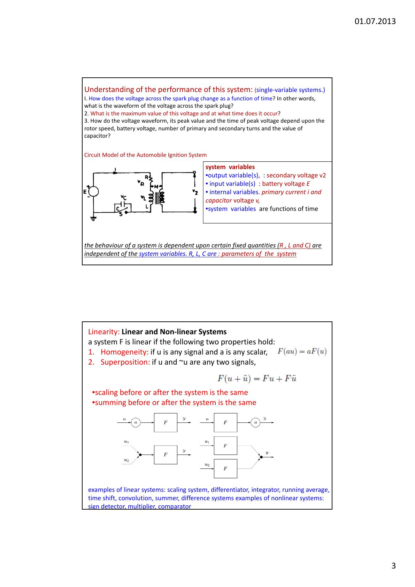
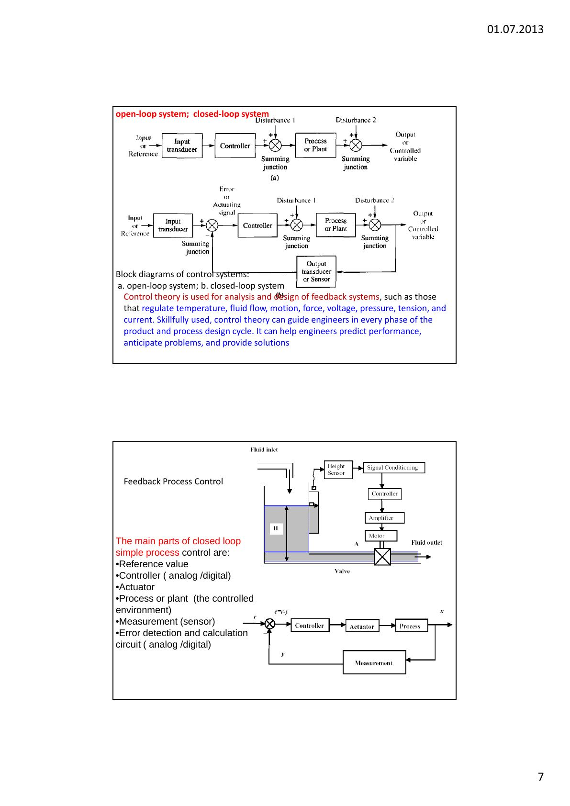
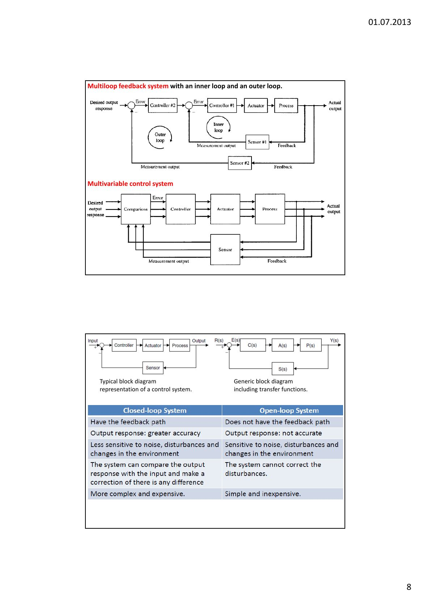
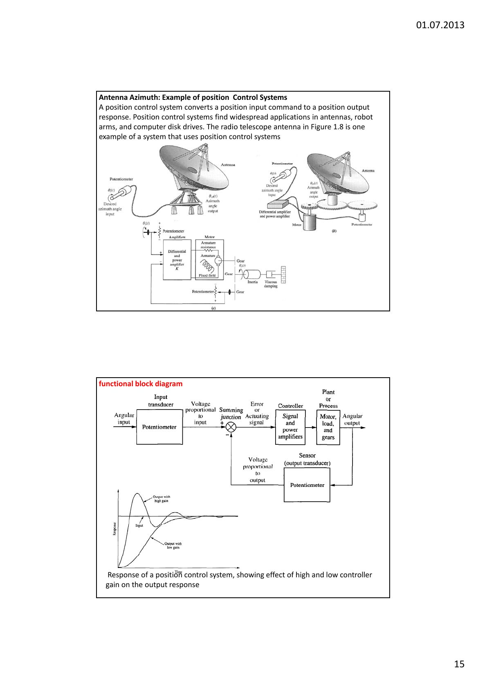
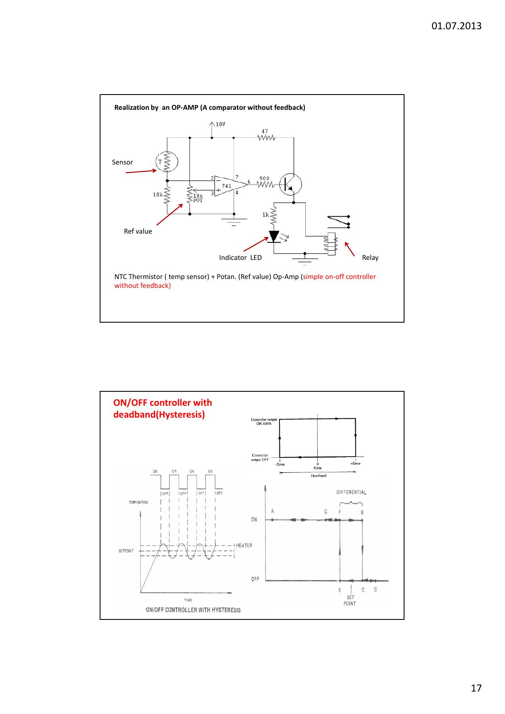

Bu yazı, Başkent Üniversitesi **EEM322 Denetim Sistemleri** dersinin **1. ders notudur** ("Lecture 1"). Notlar dersi veren **Hamit Erdem**'e ait; sayfa başlarında 01.07.2013 tarihi var (2013 yaz dönemi). Ders notu İngilizce, sayfa başına iki slayt yerleştirilmiş 19 sayfalık bir PDF. Aşağıda içerik Türkçe olarak özetlendi, İngilizce terimler parantez içinde verildi; şemalar için ilgili sayfaların görselleri eklendi. Orijinal PDF yazının sonunda indirilebilir.

## Kaynaklar

1. Ogata, K., *Modern Control Engineering*, Prentice-Hall, 4. baskı, 2002.
1. Dorf, R. C., Bishop, R. H., *Modern Control Systems*, Prentice-Hall.
1. Norman S. Nise, *Control Systems Engineering*, 6. baskı, Wiley & Sons.
1. Uraz, A., *Control Systems*, Hacettepe Üniversitesi, 2003.
1. Web: ders notları (Hamit Erdem).

## Sistem ve blok diyagramı

**Sistem**, belirli bir işlevi yerine getirmek için birbirine bağlanmış bileşenlerden oluşan yapıdır; bir bütün olarak davranacak biçimde düzenlenmiş fiziksel bileşenler topluluğudur. **Denetim sistemi** (control system) ise kendisini ya da başka bir sistemi yönetecek, yönlendirecek veya düzenleyecek biçimde bağlanmış fiziksel bileşenlerdir.

- Bir sistemin girişleri ve çıkışları vardır.
- Sistem, bir giriş işaretine karşılık bir çıkış işareti üretir.
- Sistemin, girişleri çıkışlara bağlayan bir matematiksel modeli vardır.

**Blok diyagramı**, fiziksel bir sistemin girişi ile çıkışı arasındaki neden-sonuç ilişkisinin kısa yoldan, resimli gösterimidir. Denetim sisteminin bileşenleri arasındaki işlevsel ilişkileri anlatmanın kolay bir yoludur; en basit biçimi tek girişli, tek çıkışlı tek bloktur.

Sistemler birbirinden bağımsız şu kategorilere ayrılır:

1. Doğrusal ya da doğrusal olmayan (linear / non-linear)
1. Dinamik ya da statik (dynamic / static)
1. Zamanla değişmeyen ya da zamanla değişen (time invariant / time-varying)
1. Sürekli zamanlı ya da ayrık zamanlı (continuous time / discrete time)
1. Belirlenimci ya da olasılıksal (deterministic / stochastic)

## Modelleme örneği: otomobil ateşleme sistemi

Sistemin ana bileşenleri buji, ateşleme bobini, yaylı kontak noktaları (platin), motorla dönen kam, kondansatör ve aküdür. Kamın kontakları açıp kapaması bobinin primer akımında ani değişime yol açar ve sekonder sargıda çok yüksek bir gerilim indükler; bu gerilim bujide kıvılcımı oluşturur. Kontaklar arasına bağlanan kondansatör, kontaklarda ark oluşmasını ve aşınmayı önler. İncelemede tek bir bujinin doğrudan bobine bağlı olduğu varsayılır.

Bu (tek değişkenli) sistemin başarımını anlamak için sorulan sorular:

1. Buji uçlarındaki gerilim zamana göre nasıl değişir, dalga biçimi nedir?
1. Bu gerilimin en büyük değeri nedir ve ne zaman oluşur?
1. Dalga biçimi, tepe değeri ve tepe zamanı; kam hızına, akü gerilimine, primer ve sekonder sarım sayılarına ve kondansatör değerine nasıl bağlıdır?

Devre modelinde **çıkış değişkeni** sekonder gerilimi v₂, **giriş değişkeni** akü gerilimi E, **iç değişkenler** primer akımı i ve kondansatör gerilimi v'dir; sistem değişkenleri zamanın fonksiyonudur. Sistemin davranışı, sistem değişkenlerinden bağımsız sabit büyüklüklere (R, L, C) bağlıdır; bunlar **sistemin parametreleridir**.

## Doğrusal ve doğrusal olmayan sistemler

Bir F sistemi şu iki özelliği sağlıyorsa doğrusaldır:

1. **Homojenlik:** u herhangi bir işaret ve a herhangi bir skaler ise F(au) = aF(u).
1. **Süperpozisyon:** u ve ũ herhangi iki işaret ise F(u + ũ) = Fu + Fũ.

Yani ölçeklemeyi ya da toplamayı sistemden önce veya sonra yapmak aynı sonucu verir. Doğrusal sistem örnekleri: ölçekleyici, türev alıcı, integral alıcı, kayan ortalama, zaman kaydırma, konvolüsyon, toplayıcı, fark sistemleri. Doğrusal olmayan örnekler: işaret dedektörü, çarpıcı, karşılaştırıcı.

## Zamanla değişmeyen ve zamanla değişen sistemler

Parametreler, sistem elemanlarının özelliklerine bağlı olan, sistem değişkenlerine bağlı olmayan büyüklüklerdir. Örneğin L·d²i/dt² + R·di/dt + i/C = 0 denkleminde R, L ve C katsayı olarak görünür. Bu parametreler bağımlı değişken i(t)'nin fonksiyonu olursa sistem doğrusal olmaz. Parametreler sabitse, yani zamanla değişmiyorsa sistem **zamanla değişmeyen** (time invariant), bir ya da daha fazla parametre zamanın fonksiyonuysa **zamanla değişen** (time-varying) sistemdir. Bunlar için durağan (stationary) ve durağan olmayan (non-stationary) terimleri de kullanılır. (Kaynak: A. N. Tripathi, *Linear Systems Analysis*.)

**Giriş**, bir denetim sistemine belirli bir yanıt elde etmek için, genellikle dış bir enerji kaynağından uygulanan uyarı ya da komuttur. **Çıkış**, denetim sisteminden elde edilen gerçek yanıttır; girişin ima ettiği istenen yanıta eşit olabilir ya da olmayabilir.

- **Elektrik anahtarı:** Elektrik akışını denetleyen, üretilmiş bir denetim sistemidir. Anahtarı açıp kapatmak giriş (açık/kapalı), elektriğin akması ya da akmaması çıkıştır. En temel denetim sistemlerinden biridir.
- **Termostatlı ısıtıcı:** Giriş, termostatla ayarlanan referans sıcaklık; çıkış, odanın gerçek sıcaklığıdır. Termostat çıkışın girişten küçük olduğunu algıladığında ısıtıcı çalışır, sıcaklık referansa ulaşınca kapanır, biraz düşünce yeniden açılır.

## Dinamik ve statik sistemler

Dinamik bir denetim sistemi, girişe kalıcı duruma ulaşmadan önce bir **geçici yanıt** vererek karşılık verir:

- Modelleri diferansiyel (ya da fark) denklemleriyle verilir; bağımsız değişken zamandır.
- Giriş sabit olsa bile çıkış her zaman zamanın fonksiyonudur; bir "hareket" vardır.
- Çıkış yalnızca girişe değil, başlangıç koşullarına da bağlıdır (n. mertebeden bir diferansiyel denklemin çözümü bağımlı değişkenin ve türevlerinin başlangıç değerlerini gerektirir). Sistem geçmiş girişlerini "hatırlar", yani belleği vardır.

Tek bir endüktans ya da kapasitans içeren devre dinamik bir sistemdir: enerji depolayan bir elemanın varlığı sistemi dinamik yapar. Mekanik sistemde kütle ve yay enerji depolar. Enerji depolanmasıyla ilgili değişkenler (kondansatör gerilimi, bobin akımı, kütlenin hızı, yay kuvveti) ani olarak değişemez; bobin akımındaki ani bir değişim sonsuz enerji değişim hızı, yani sonsuz güç anlamına gelirdi. Bu yüzden dinamik sistemler anlık (instantaneous) değildir.

## Denetim sistemi tanımı ve başarım ölçütleri

Denetim sistemi, belirli bir giriş verildiğinde istenen başarımla istenen çıkışı elde etmek için bir araya getirilmiş alt sistemlerden ve süreçlerden (plant) oluşur. **Asansör örneği:** Birinci katta dördüncü kat düğmesine basmak, istenen çıkışı temsil eden bir basamak (step) girişidir. Asansör yolcu konforuna uygun bir hız ve kat hizalama doğruluğuyla dördüncü kata çıkar. İki temel başarım ölçütü:

1. **Geçici yanıt** (transient response): Çok hızlıysa yolcu konforu, çok yavaşsa yolcunun sabrı feda edilir.
1. **Kalıcı durum hatası** (steady-state error): Asansör katla düzgün hizalanmazsa yolcu güvenliği ve rahatı feda edilir.

### Açık ve kapalı çevrim örnekleri

- **Ekmek kızartma makinesi:** Çoğu otomatik ekmek kızartıcı bir zamanlayıcıyla denetlendiği için **açık çevrimdir**. Süreyi sistemin parçası olmayan kullanıcı tahmin eder; süre ayarlandıktan sonra kızarmanın kalitesi (çıkış) üzerinde denetim kalmaz.
- **Otopilot:** Otopilot ve denetlediği uçak **kapalı çevrim** (geri beslemeli) bir sistemdir; uçağın gerçek rotasını sürekli ölçüp dümen ve kanatçıkları ayarlayarak istenen rotayı korur. Otopilotu ayarlayan pilot sistemin parçası değildir.
- **İnsan vücudunun terleme sistemi:** Cilt dışındaki hava çok ısındığında ter bezleri salgıyı artırır, buharlaşmayla cilt soğur; istenen soğuma sağlanınca salgı azalır.
- **Araba süren insan:** Giriş yolun (şerit çizgilerinin) yönü, çıkış otomobilin yönüdür. Sürücü çıkışı gözü ve beyniyle sürekli ölçer, elleriyle direksiyonda düzeltir.

Denetim kuramı; sıcaklık, akış, hareket, kuvvet, gerilim, basınç, gerginlik ve akım gibi büyüklükleri düzenleyen geri beslemeli sistemlerin analizinde ve tasarımında kullanılır. Basit bir kapalı çevrim süreç denetiminin ana parçaları:

- Referans değer
- Denetleyici (analog / sayısal)
- Eyleyici (actuator)
- Süreç ya da tesis (plant; denetlenen ortam)
- Ölçüm (algılayıcı, sensor)
- Hata algılama ve hesaplama devresi (analog / sayısal)

| Kapalı çevrim sistem | Açık çevrim sistem |
|---|---|
| Geri besleme yolu vardır | Geri besleme yolu yoktur |
| Çıkış yanıtı daha doğrudur | Çıkış yanıtı doğru değildir |
| Gürültüye, bozuculara ve ortam değişimlerine daha az duyarlıdır | Gürültüye, bozuculara ve ortam değişimlerine duyarlıdır |
| Çıkışı girişle karşılaştırıp fark varsa düzeltme yapabilir | Bozucuların etkisini düzeltemez |
| Daha karmaşık ve pahalıdır | Basit ve ucuzdur |

Notta ayrıca otomobil direksiyon denetimi, DC motorlu hız denetimi (açık ve kapalı çevrim), örüntü tanımalı robot kolu, sıcaklık denetim sistemi, ulusal gelir geri besleme modeli ve video oyunu oynayan bir insanın blok diyagramı örnek olarak veriliyor. Denetim mühendisliğinde tasarımın amacı, gerçek bir ihtiyacı karşılayacak sistemin yapısını, özelliklerini ve kilit parametrelerini belirlemektir.

## Servomekanizma ve regülatör

**Servomekanizma**, denetlenen değişkeni mekanik konum ya da konumun bir türevi (hız, ivme) olan, güç yükselten geri beslemeli bir denetim sistemidir. Otomobilin hidrolik direksiyonu bir servomekanizmadır: komut girişi direksiyon simidinin açısal konumudur; simide uygulanan küçük tork hidrolik olarak yükseltilir ve ön tekerleklerin açısal konumunu değiştirecek kuvvete dönüşür.

**Regülatör** (düzenleyici sistem), referans girişi uzun süre, çoğu zaman sistemin çalıştığı sürenin tamamında sabit kalan geri beslemeli sistemdir; bu girişe **ayar noktası** (setpoint) denir. Regülatörün asıl işi çıkışı sabit tutmak, servomekanizmanınki ise çıkışın değişen bir girişi izlemesini sağlamaktır.

## Denetim yasaları ve güç dönüşümü

Denetleyici hem denetim yasalarını (örneğin oransal-integral-türevsel, **PID** denetim) hem de güç dönüşümünü içerir. Denetim yasaları bilgi üretir; ama tesisi denetlemek için güç uygulanmalıdır, bu yüzden hemen bütün denetleyicilerde güç dönüştürücü bulunur. Kazançlar, hızlı ve kararlı bir komut yanıtı elde etmek ve bozucuları bastırmak için ayarlanır. Gürbüz (robust) çalışma için denetim yasaları, tesis ve güç dönüştürücüsündeki makul değişimleri karşılayacak paylarla tasarlanmalıdır.

## Analog ve sayısal denetim sistemleri

- **Sürekli zamanlı (analog) işaret:** Bağımsız değişken t'nin sürekli değerlerine bağlı işaret.
- **Ayrık zamanlı (örneklenmiş, sayısal) işaret:** Yalnızca t'nin belirli ayrık anlarında tanımlı işaret.
- **Sürekli zamanlı denetim sistemleri** yalnızca analog işaret ve bileşen içerir; **ayrık zamanlı denetim sistemlerinin** bir ya da daha fazla noktasında ayrık zamanlı işaret vardır. Bazı sistemler ikisinin birleşimidir (hibrit).

Denetim sistemi modelleri: diferansiyel denklemler, fark denklemleri, Laplace ve z dönüşümleri gibi matematiksel modeller; blok diyagramları; işaret akış grafikleri.

## Analiz ve tasarım hedefleri

**Analiz**, bir sistemin başarımının belirlenmesidir (örneğin geçici yanıtın ve kalıcı durum hatasının istenen özellikleri karşılayıp karşılamadığı). **Tasarım**, başarımın oluşturulması ya da değiştirilmesidir; özellikler karşılanmıyorsa parametreler değiştirilir ya da ek bileşenler eklenir.

- **Geçici yanıt:** Asansörde yavaş geçici yanıt yolcuları sabırsızlandırır, aşırı hızlısı rahatsız eder.
- **Kalıcı durum yanıtı:** Geçici bileşenler sıfıra söndükten sonra kalan, girişe benzeyen yanıttır (dördüncü kata yakın duran asansör, doğru izde duran disk kafası).
- **Kararlılık:** Toplam yanıt = doğal yanıt + zorlanmış yanıt. Doğal yanıt sistemin enerjiyi nasıl harcadığını ya da kazandığını anlatır ve yalnızca sisteme bağlıdır; zorlanmış yanıt girişe bağlıdır. Kullanışlı bir denetim sisteminde doğal yanıt ya sonunda sıfıra gitmeli ya da salınım yapmalıdır. Doğal yanıt sınırsız büyürse sistem **kararsızdır**; bu durum, sınır durdurucular yoksa fiziksel aygıtın kendini tahrip etmesine yol açabilir (asansörün tabana çakılması, uçağın denetimsiz yuvarlanması, hedefe kilitlenen antenin giderek büyüyen salınımlarla hasar görmesi gibi).

## Tasarım süreci

1. Gereksinimleri fiziksel bir sisteme dönüştür.
1. İşlevsel bir blok diyagramı çiz.
1. Bir şema (schematic) oluştur.
1. Matematiksel modeli (blok diyagramı) geliştir: Kirchhoff'un gerilim yasası (kapalı bir yol boyunca gerilimlerin toplamı sıfırdır), Kirchhoff'un akım yasası (bir düğümden çıkan akımların toplamı sıfırdır), Newton yasaları (bir cisme etkiyen kuvvetlerin ve momentlerin toplamı sıfırdır).
1. Blok diyagramını indirge.
1. Analiz ve tasarım yap: Yanıt özellikleri basit parametre ayarlarıyla karşılanamıyorsa istenen başarımı sağlayacak ek donanım tasarlanır.

Tasarımı doğrulamak için analizde ve testte **standart test girişleri** kullanılır: dürtü (impulse), basamak (step), rampa, parabol ve sinüs. Birim dürtü t = 0'da sonsuz, başka her yerde sıfırdır ve altındaki alan 1'dir; sisteme başlangıç enerjisi vermek ve yalnızca geçici yanıtı görmek için kullanılır. Basamak girişi konum, hız ya da ivme gibi sabit bir komutu temsil eder.

### Örnek: anten azimut konum denetimi

Konum denetim sistemi, bir konum komutunu konum çıkışına dönüştürür; antenlerde, robot kollarında ve bilgisayar disk sürücülerinde yaygındır. Notta radyo teleskobu anteninin işlevsel blok diyagramı ve yüksek ve düşük denetleyici kazancının çıkış yanıtına etkisi gösteriliyor.

## Denetleyici türleri ve aç-kapa denetleyici

- **Süreksiz denetim (aç-kapa, ON-OFF):** En basit denetim.
- **Sürekli denetleyiciler (P, PI, PD, PID):** Tasarım ve analiz gerektirir.

Uygulama örneği basit bir aç-kapa sıcaklık denetleyicisidir: NTC termistör (sıcaklık algılayıcı), referans değeri ayarlayan potansiyometre ve geri beslemesiz bir op-amp karşılaştırıcı; çıkışta gösterge LED'i ve röle. Pratik devrede ölü bölgeli (**histerezisli**) aç-kapa denetleyici kullanılır.

## Tanımlar

- **Tesis (plant, süreç, denetlenen sistem):** Geri beslemeli denetim sisteminin denetlediği sistem, alt sistem, süreç ya da nesne. Sistem yanıtını üreten ve genellikle güç harcayan elemanlardır (mekanik bir aygıt, ısıtma fırını, kimyasal reaktör, uzay aracı…).
- **Denetlenen çıkış (c):** Tesisin, geri beslemeli sistemin denetimi altındaki çıkış değişkeni.
- **İleri yol (forward path):** Toplama noktasından denetlenen çıkışa giden iletim yolu.
- **Dönüştürücü (transducer):** Bir enerji biçimini başka birine dönüştüren aygıt.
- **Denetlenen değişken ve ayarlanan değişken:** Denetlenen değişken ölçülen ve denetlenen büyüklüktür; ayarlanan (manipulated) değişken, denetlenen değişkeni etkilemek için denetleyicinin değiştirdiği büyüklüktür.
- **Modelleme:** Sistemin matematiksel tanımını elde etmek. **Analiz:** Sistemin özelliklerini incelemek. **Tasarım:** Verilen bir tesis için başarım özelliklerine göre denetleyici tasarlamak.
- **Sistem:** Birlikte çalışıp belirli bir amacı yerine getiren bileşenler bütünü; yalnızca fiziksel değil, ekonomi gibi soyut ve dinamik olgular için de kullanılır.

Notun son sayfası, denetim sistemleriyle ilgili temel terimlerin (automation, closed-loop, feedback signal, plant, process, stability, specifications vb.) İngilizce tanımlarını içeren bir sözlük tablosudur.
