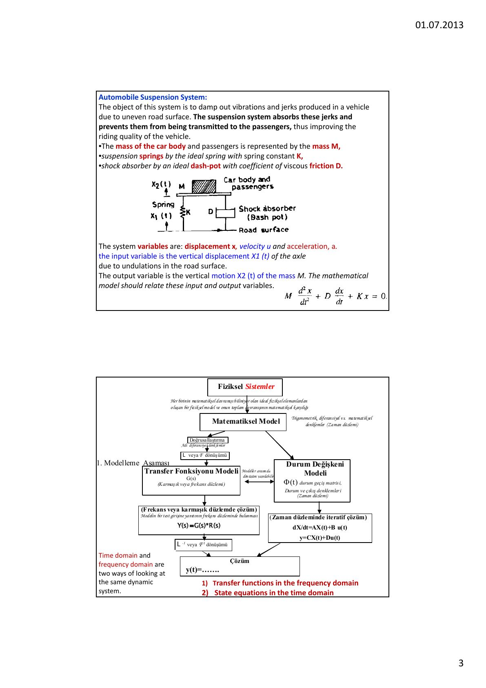
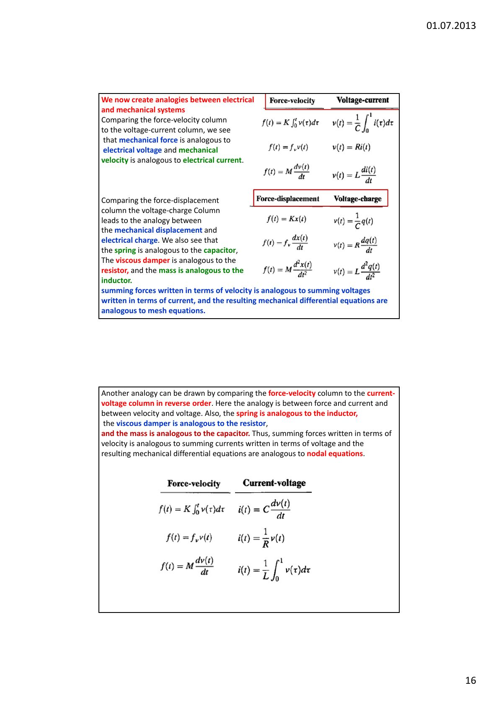
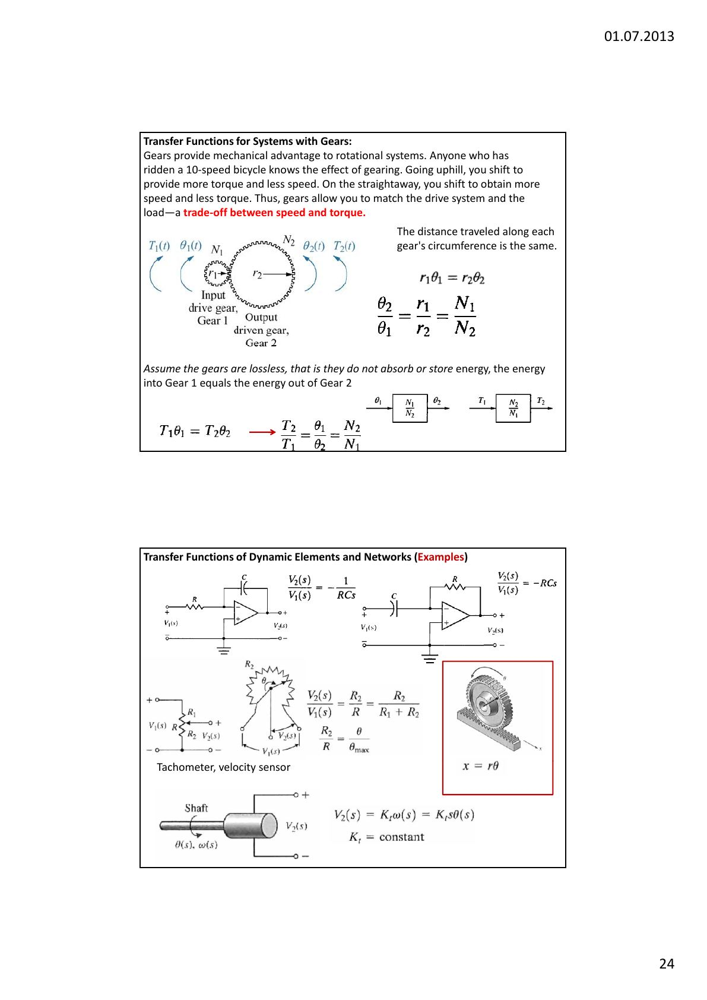
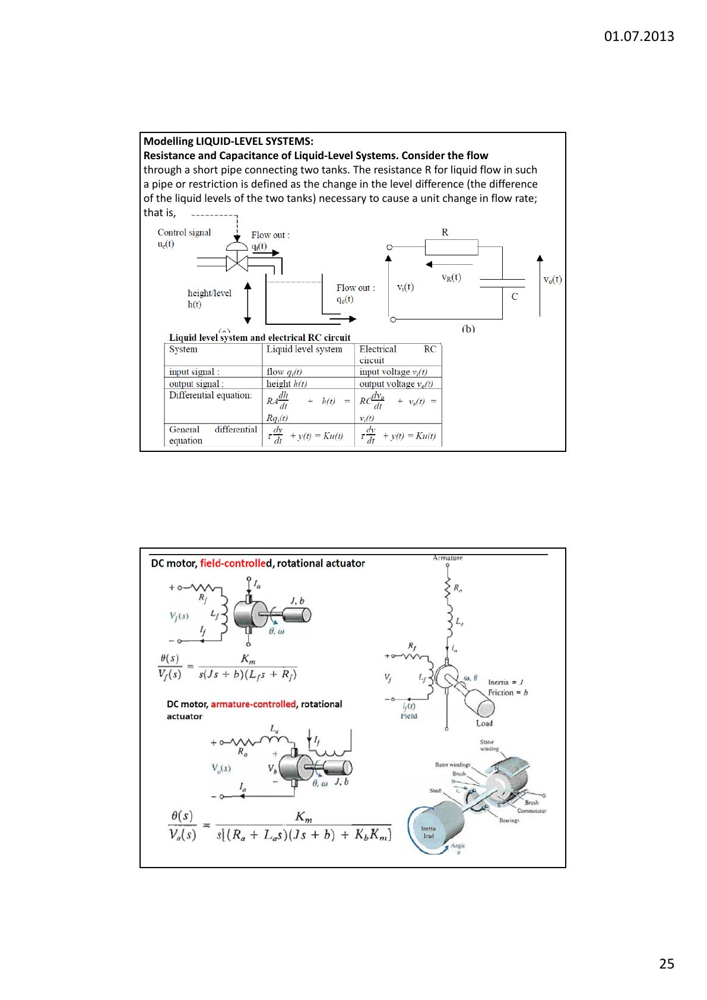

This post is the **2nd lecture note** of the **EEM322 Control Systems** course at Başkent University ("Lecture 2: Modeling of Systems – Modeling in Frequency Domain"). The notes belong to the course instructor **Hamit Erdem**; the page headers carry the date 01.07.2013. The lecture note is in English and is a 25-page PDF with two slides per page; a significant portion of the examples are taken from Nise's *Control Systems Engineering* and Ogata's *Modern Control Engineering*. Below, the content is summarized in English, the worked examples are written out, and page images are included for the circuit and mechanical diagrams. The original PDF can be downloaded at the end of the post.

This chapter covers three topics:

- Transfer function
- Laplace transform
- Inverse Laplace transform

## Modeling and the mathematical model

To study the behavior of a system, functional relationships must be established between different variables. These relationships are given by a set of equations called the system's **mathematical model**. A mathematical model is a tool for studying a system's behavior without experiments; it describes the relationships among measurable physical quantities in the system (distance, current, flow rate, even the unemployment rate…) as mathematical relations.

Building a model always involves approximations and simplifying assumptions that are valid for specific operating conditions, because physical reality is too complex for a model that accounts for every detail. The key factors to consider when developing a model are:

- Structure
- Components and the connections between them
- Parameters
- Variables
- Inputs and outputs
- Initial conditions

A dynamic system can be fully described by known differential equations or by experimental test data. Being able to analyze the system and determine its performance depends on how well its properties are expressed mathematically.

**Analogous systems:** An analysis method developed for a second-order system can be applied to any second-order system, whether it is electrical, mechanical, thermal, or hydraulic. Developing the analysis method according to the type of model makes it possible to study problems in different branches of engineering, and even in biological, economic, and management systems, with a common systems approach.

A mathematical model is a set of equations that relate the variables in the system to one another and are determined by the physical laws applied to that system (for example, Kirchhoff's laws). In the note, for a series RLC circuit, the equation L·di/dt + Ri + (1/C)∫i dt = E is written from Kirchhoff's voltage law; when the switch is opened after having been closed for some time, the capacitor remains in series with R and L, and the circuit equation changes. Assumption: L is independent of the current, i.e., the inductance is linear.

### Example: automobile suspension system

The purpose is to damp the vibrations and shocks that a rough road surface produces in the vehicle and to prevent them from being transmitted to the passengers.

- The mass of the vehicle body and passengers is represented by a mass M,
- the suspension springs are represented by an ideal spring with spring constant K,
- the shock absorber is represented by an ideal damper (dash-pot) with viscous friction coefficient D.

The system variables are displacement x, velocity u, and acceleration a. The input is the vertical displacement x₁(t) of the axle caused by irregularities of the road surface; the output is the vertical motion x₂(t) of the mass M. The mathematical model must relate these input and output variables; in the note, the mass-spring-damper equation is given as M·d²x/dt² + D·dx/dt + Kx = 0.

Summary of the flow chart: The physical system is represented by a physical model consisting of ideal elements, each with known mathematical behavior. After linearization, ordinary differential equations are obtained. From here there are two paths: the **transfer function model** G(s) via the Laplace (or Fourier) transform (complex or frequency domain), or the **state variable model** dX/dt = AX(t) + Bu(t), y = CX(t) + Du(t) (time domain). Conversion between the models is possible. In the solution stage, for the transfer function model the response to a test input is found as Y(s) = G(s)·R(s) and y(t) is obtained by the inverse transform; for the state model, the solution is carried out (iteratively) in the time domain. The time domain and the frequency domain are two different views of the same dynamic system.

## Modeling in the frequency domain and the Laplace transform

The transfer function describes the relationship between two signals as a function of s. A transfer function in the frequency domain can only describe **linear, time-invariant** elements. The Laplace transform is used in systems theory to make solving differential equations easier. The solution takes three steps:

1. The differential equation is converted into an algebraic equation by the Laplace transform.
1. The algebraic equation is solved for the Laplace transform of the solution; the solution is separated into its basic components using partial fractions.
1. The inverse Laplace transform of each basic component is taken to find the solution in the time domain.

Definition: L[f(t)] = F(s) = ∫₀^∞ f(t) e^(−st) dt, where s = σ + jω is a complex variable. The **transfer function** is the ratio of the Laplace transform of the output C(s) to the Laplace transform of the input R(s), with initial conditions assumed to be zero. Pages 5 and 6 of the note contain tables of Laplace transform pairs.

### Inverse Laplace examples

**Example 1:** G(s) = (s³ + 5s² + 9s + 7) / ((s + 1)(s + 2)) = s + 2 + (s + 3)/((s + 1)(s + 2)).

Since the Laplace transform of the unit impulse is 1 and the transform of dδ(t)/dt is s:

g(t) = dδ(t)/dt + 2δ(t) + 2e^(−t) − e^(−2t),  t ≥ 0⁻

**Example 2:** F(s) = (2s + 12) / (s² + 2s + 5). The denominator is written in the form (s + 1)² + 2², and the pairs L[e^(−at) sin ωt] = ω/((s + a)² + ω²) and L[e^(−at) cos ωt] = (s + a)/((s + a)² + ω²) are used:

F(s) = [10 + 2(s + 1)] / ((s + 1)² + 2²) = 5·2/((s + 1)² + 2²) + 2·(s + 1)/((s + 1)² + 2²)

f(t) = 5e^(−t) sin 2t + 2e^(−t) cos 2t,  t ≥ 0

**Example 3 (solving a differential equation):** Solve d²y/dt² + 12 dy/dt + 32y = 32u(t) with zero initial conditions.

s²Y(s) + 12sY(s) + 32Y(s) = 32/s  →  Y(s) = 32 / (s(s + 4)(s + 8)) = K₁/s + K₂/(s + 4) + K₃/(s + 8)

- K₁ = 32/((s + 4)(s + 8)) |s→0 = 1
- K₂ = 32/(s(s + 8)) |s→−4 = −2
- K₃ = 32/(s(s + 4)) |s→−8 = 1

y(t) = (1 − 2e^(−4t) + e^(−8t)) u(t)

### Partial fraction expansion with repeated poles

**Example 4:** F(s) = (s² + 2s + 3)/(s + 1)³ = b₁/(s + 1) + b₂/(s + 1)² + b₃/(s + 1)³

- b₃ = [(s + 1)³ F(s)] at s = −1 = (s² + 2s + 3) at s = −1 = 2
- b₂ = d/ds[(s² + 2s + 3)] at s = −1 = (2s + 2) at s = −1 = 0
- b₁ = (1/2!)·d²/ds²[(s² + 2s + 3)] at s = −1 = (1/2)·2 = 1

f(t) = e^(−t) + 0 + t²e^(−t) = (1 + t²) e^(−t),  t ≥ 0

**Example 5 (roots of the denominator real and repeated):** F(s) = 2/((s + 1)(s + 2)²) = K₁/(s + 1) + K₂/(s + 2)² + K₃/(s + 2)

K₁ = 2 is found. For K₂, both sides are multiplied by (s + 2)²: 2/(s + 1) = (s + 2)²K₁/(s + 1) + K₂ + (s + 2)K₃; for s → −2, K₂ = −2. For K₃, the derivative of this expression with respect to s is taken: −2/(s + 1)² = (s + 2)s·K₁/(s + 1)² + K₃; for s → −2, K₃ = −2.

f(t) = 2e^(−t) − 2te^(−2t) − 2e^(−2t)

## Transfer function

A general nth-order, linear, time-invariant differential equation (c(t) output, r(t) input):

aₙ dⁿc/dtⁿ + aₙ₋₁ dⁿ⁻¹c/dtⁿ⁻¹ + … + a₀c(t) = bₘ dᵐr/dtᵐ + bₘ₋₁ dᵐ⁻¹r/dtᵐ⁻¹ + … + b₀r(t)

If all initial conditions are assumed to be zero:

G(s) = C(s)/R(s) = (bₘsᵐ + bₘ₋₁sᵐ⁻¹ + … + b₀) / (aₙsⁿ + aₙ₋₁sⁿ⁻¹ + … + a₀),  C(s) = R(s)G(s)

A transfer function can be represented by a single block with input R(s) and output C(s).

**Example:** The transfer function of the system dc/dt + 2c(t) = r(t): sC(s) + 2C(s) = R(s) → G(s) = 1/(s + 2). If the input is a unit step (r(t) = u(t)), then C(s) = 1/(s(s + 2)) = (1/2)/s − (1/2)/(s + 2) and c(t) = 1/2 − (1/2)e^(−2t).

## Transfer functions of electrical circuits

Resistors, inductors, and capacitors are passive (no internal energy source) and linear elements. Their impedances are R, Ls, and 1/(Cs), respectively; admittance (Y) is the reciprocal of impedance and is a measure of how easily a circuit passes current.

**Single-loop circuit:** In a series RLC circuit, the transfer function between the capacitor voltage Vc(s) and the input voltage V(s) is:

Vc(s)/V(s) = (1/LC) / (s² + (R/L)s + 1/LC)

**Complex circuits by mesh analysis:**

1. Replace passive element values with their impedances.
1. Replace all sources and time variables with their Laplace transforms.
1. Assume a transform current and direction in each loop.
1. Write Kirchhoff's voltage law around each loop.
1. Solve the simultaneous equations for the output.

The mesh equations can be written directly using the pattern "sum of impedances around the loop × that loop's current − common impedances × adjacent loop currents = sum of applied voltages in the loop." In **nodal analysis**, currents leaving a node are taken as positive and currents entering as negative, and the currents are summed; if there is more than one node and there are voltage sources, voltage sources in series with an impedance are converted by Norton's theorem into current sources in parallel with an admittance, and the pattern becomes "sum of admittances connected to the node × node voltage − common admittances × adjacent node voltages = sum of applied currents entering the node."

**Circuits with operational amplifiers:** For the inverting amplifier, V₀(s)/Vi(s) = −Z₂(s)/Z₁(s); for the noninverting amplifier, V₀(s)/Vi(s) = (Z₁(s) + Z₂(s))/Z₁(s). In the note's inverting amplifier example (C₁ = 5.6 µF ∥ R₁ = 360 kΩ at the input, R₂ = 220 kΩ in series with C₂ = 0.1 µF in the feedback path), Z₁(s) = 360×10³/(2.016s + 1), Z₂(s) = 220×10³ + 10⁷/s, and V₀(s)/Vi(s) = −1.232 (s² + 45.95s + 22.55)/s is found. For the noninverting amplifier with finite gain A, V₀/Vi = A/(1 + AZ₁/(Z₁ + Z₂)) is written; for A → ∞ the result above is obtained. In another example, for a circuit consisting of two 1 Ω resistors and three 1 H inductors, VL(s)/V(s) = (s² + 2s + 1)/(s² + 5s + 2) is given.

## Translational mechanical systems

Mechanical systems are so similar to electrical circuits that analogies can be established between elements and variables. Mechanical systems also have three passive, linear elements: the spring and the mass store energy, and the viscous damper dissipates energy.

| Element | Force–velocity | Force–displacement | Impedance Z_M(s) = F(s)/X(s) |
|---|---|---|---|
| Spring (K) | f(t) = K∫v dτ | f(t) = Kx(t) | K |
| Viscous damper (f_v) | f(t) = f_v·v(t) | f(t) = f_v·dx/dt | f_v·s |
| Mass (M) | f(t) = M·dv/dt | f(t) = M·d²x/dt² | Ms² |

**Analogies:** If the force–velocity column is compared with the voltage–current column, and the force–displacement column with the voltage–charge column, force is analogous to voltage, velocity to current, and displacement to charge. The spring corresponds to the capacitor, the viscous damper to the resistor, and the mass to the inductor; sums of forces written in terms of velocity are analogous to mesh equations (**series analogy**). If the force–velocity column is compared with the current–voltage column in reverse order, force corresponds to current and velocity to voltage; the spring corresponds to the inductor, the damper to the resistor, and the mass to the capacitor, and the mechanical equations are analogous to nodal equations (**parallel analogy**).

**Example (single mass):** X(s)/F(s) is found for a mass-spring-damper system. A positive direction of motion (for example, to the right) is chosen; this is similar to choosing a current direction in an electrical circuit. A free-body diagram is drawn: only the applied force points to the right, while the forces from the spring, the damper, and the acceleration oppose the motion and point to the left. The forces are summed by Newton's law and set equal to zero; with zero initial conditions the Laplace transform is taken:

(Ms² + f_v s + K) X(s) = F(s)  →  G(s) = X(s)/F(s) = 1/(Ms² + f_v s + K)

General pattern: [Sum of impedances at the point of motion] · X(s) = [Sum of applied forces].

### Multiple-degree-of-freedom systems

The number of equations of motion required in mechanical systems equals the number of linearly independent motions, i.e., the **degrees of freedom**. Linear independence means that a point can still move when all other points of motion are held fixed; this does not mean that the motions are independent of one another, and in general they are coupled (just as the loop currents are coupled in a two-loop circuit).

For the solution, a free-body diagram is drawn for each point of motion and superposition is used: first, the forces arising from the body's own motion are found with the other points held fixed; then, with the body held fixed, the neighboring points are moved one at a time and the forces these motions exert on the body are added. In the two-mass (M₁, M₂) example the equations of motion are:

- [M₁s² + (f_v1 + f_v3)s + (K₁ + K₂)] X₁(s) − (f_v3 s + K₂) X₂(s) = F(s)
- −(f_v3 s + K₂) X₁(s) + [M₂s² + (f_v2 + f_v3)s + (K₂ + K₃)] X₂(s) = 0

*Note: In the first equation in the lecture note, the "+" sign between M₁s² and (f_v1 + f_v3)s is missing; the corrected form is given above.*

From these, by Cramer's rule, G(s) = X₂(s)/F(s) = (f_v3 s + K₂)/Δ is found, where Δ is the determinant of the coefficient matrix. These equations are analogous to electrical mesh equations; the note also draws the series and parallel electrical analog circuits of the system.

## Rotational mechanical systems

Rotational systems are treated like translational systems; only force is replaced by torque and translational displacement by angular displacement. The torque of a force F applied at a point P is T = F·R (if the force is perpendicular to the radius). The moment of inertia of a rotating body is J = m₁r₁² + m₂r₂² + m₃r₃² + …, and its total kinetic energy is K = (1/2)Jω².

| Element | Torque–angular velocity | Torque–angular displacement | Impedance Z_M(s) = T(s)/θ(s) |
|---|---|---|---|
| Spring (K) | T(t) = K∫ω dτ | T(t) = Kθ(t) | K |
| Viscous damper (D) | T(t) = Dω(t) | T(t) = D·dθ/dt | Ds |
| Inertia (J) | T(t) = J·dω/dt | T(t) = J·d²θ/dt² | Js² |

In the two-inertia (J₁, J₂) example, free-body diagrams are likewise drawn by superposition (J₂ held fixed while J₁ rotates, J₁ held fixed while J₂ rotates), and the transfer function is found in the form θ₂(s)/T(s) = K/Δ.

## Gear systems and other dynamic elements

Gears provide mechanical advantage to rotational systems. Anyone who has used a 10-speed bicycle knows the effect of gearing: one shifts gears for more torque and less speed going uphill, and for more speed and less torque on level ground. Gears allow matching the driving system to the load, that is, a **trade-off between speed and torque**.

The distance traveled along the circumference of each gear is the same: r₁θ₁ = r₂θ₂, so θ₂/θ₁ = r₁/r₂ = N₁/N₂. If the gears are assumed lossless (they neither absorb nor store energy), the energy entering Gear 1 equals the energy leaving Gear 2: T₁θ₁ = T₂θ₂, hence T₂/T₁ = θ₁/θ₂ = N₂/N₁.

Examples of transfer functions of dynamic elements:

- Op-amp integrator: V₂(s)/V₁(s) = −1/(RCs)
- Op-amp differentiator: V₂(s)/V₁(s) = −RCs
- Potentiometer: V₂(s)/V₁(s) = R₂/R = R₂/(R₁ + R₂), R₂/R = θ/θ_max
- Rack-and-pinion: x = rθ
- Tachometer (speed sensor): V₂(s) = K_t ω(s) = K_t s θ(s), K_t constant

## Liquid-level systems and the DC motor

For flow in a short pipe connecting two tanks, the **resistance** R is defined as the change in level difference required to produce a unit change in flow rate. The liquid-level system and the RC circuit are described by a first-order equation of the same form:

| | Liquid-level system | Electrical RC circuit |
|---|---|---|
| Input signal | Flow rate qᵢ(t) | Input voltage vᵢ(t) |
| Output signal | Height h(t) | Output voltage v₀(t) |
| Differential equation | RA·dh/dt + h(t) = R·qᵢ(t) | RC·dv₀/dt + v₀(t) = vᵢ(t) |
| General equation | τ·dy/dt + y(t) = Ku(t) | τ·dy/dt + y(t) = Ku(t) |

For a field-controlled DC motor, θ(s)/V_f(s) = K_m / (s(Js + b)(L_f s + R_f)). For an armature-controlled DC motor, θ(s)/V(s) = K_m / (s[(R_a + L_a s)(Js + b) + K_b K_m]).

