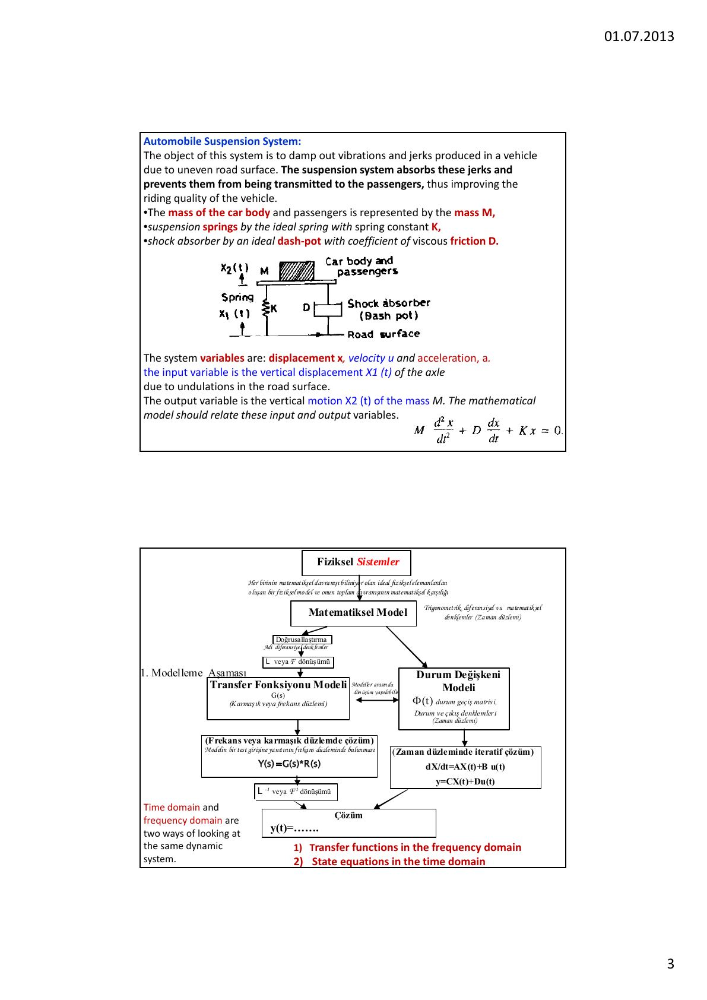
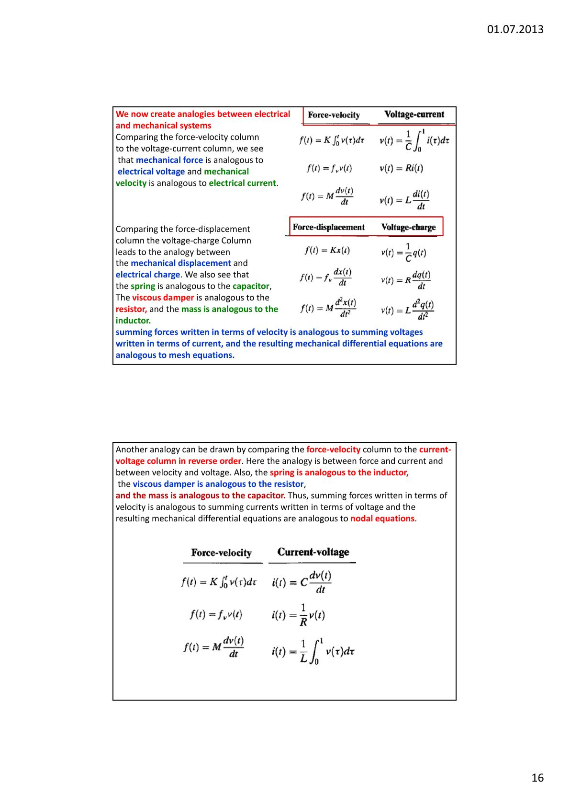
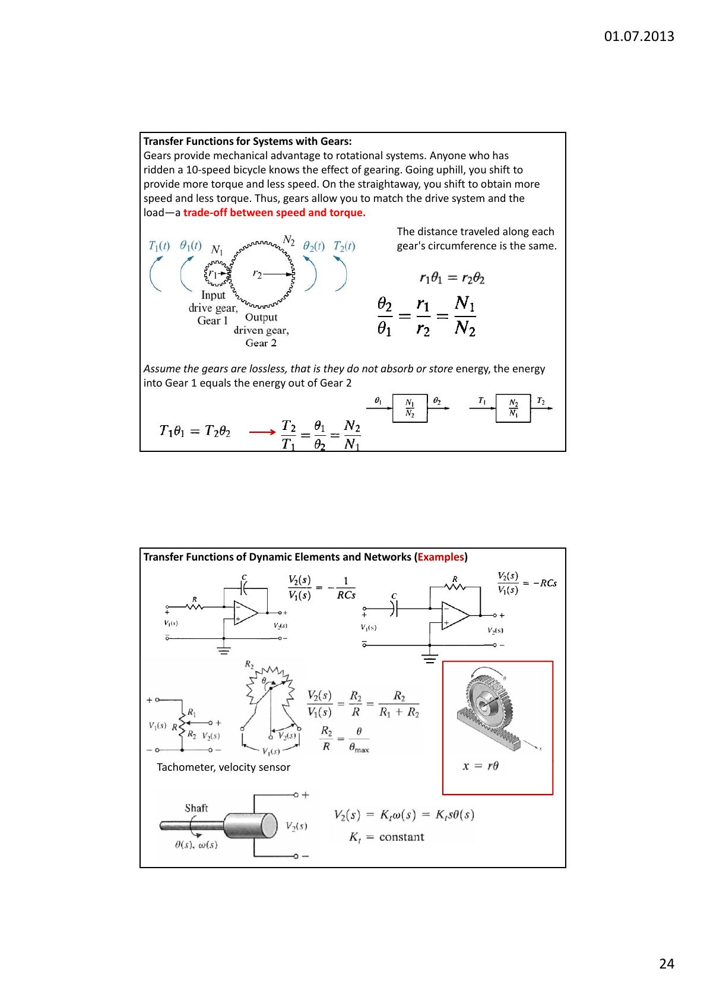
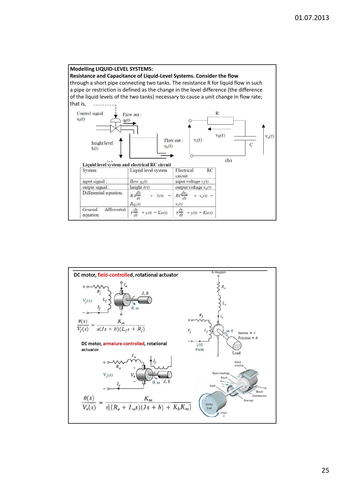

Bu yazı, Başkent Üniversitesi **EEM322 Denetim Sistemleri** dersinin **2. ders notudur** ("Lecture 2: Modeling of Systems – Modeling in Frequency Domain"). Notlar dersi veren **Hamit Erdem**'e ait; sayfa başlarında 01.07.2013 tarihi var. Ders notu İngilizce ve sayfa başına iki slayt yerleştirilmiş 25 sayfalık bir PDF; örneklerin önemli bir kısmı Nise'nin *Control Systems Engineering* ve Ogata'nın *Modern Control Engineering* kitaplarından alınmış. Aşağıda içerik Türkçe olarak özetlendi, çözümlü örnekler yazıya döküldü; devre ve mekanik şemalar için sayfa görselleri eklendi. Orijinal PDF yazının sonunda indirilebilir.

Bu bölümde üç konu işleniyor:

- Transfer fonksiyonu
- Laplace dönüşümü
- Ters Laplace dönüşümü

## Modelleme ve matematiksel model

Bir sistemin davranışını incelemek için farklı değişkenler arasında işlevsel ilişkiler kurmak gerekir. Bu ilişkiler, sistemin **matematiksel modeli** denen bir denklem takımıyla verilir. Matematiksel model, deney yapmadan sistemin davranışını incelemeye yarayan bir araçtır; sistemdeki ölçülebilir fiziksel büyüklükler (uzaklık, akım, debi, hatta işsizlik oranı…) arasındaki ilişkileri matematiksel bağıntılar olarak anlatır.

Model kurmak her zaman belirli çalışma koşulları için geçerli yaklaşıklıklar ve basitleştirici varsayımlar içerir; çünkü fiziksel gerçeklik, bütün ayrıntılarıyla ele alınabilecek bir model kurulamayacak kadar karmaşıktır. Model geliştirirken incelenecek temel etkenler:

- Yapı
- Bileşenler ve aralarındaki bağlantılar
- Parametreler
- Değişkenler
- Girişler ve çıkışlar
- Başlangıç koşulları

Dinamik bir sistem, bilinen diferansiyel denklemlerle ya da deneysel test verileriyle tam olarak tanımlanabilir. Sistemi analiz edip başarımını belirleyebilmek, özelliklerinin matematiksel olarak ne kadar iyi ifade edildiğine bağlıdır.

**Benzeşik sistemler (analogous systems):** İkinci mertebeden bir sistem için geliştirilen bir analiz yöntemi, sistem elektriksel, mekanik, ısıl ya da hidrolik olsun, her ikinci mertebeden sisteme uygulanabilir. Analiz yöntemini modelin türüne göre geliştirmek; mühendisliğin farklı dallarındaki, hatta biyolojik, ekonomik ve yönetim sistemlerindeki problemleri ortak bir sistem yaklaşımıyla incelemeyi mümkün kılar.

Matematiksel model, sistemdeki değişkenleri birbirine bağlayan ve o sisteme uygulanan fizik yasalarıyla (örneğin Kirchhoff yasaları) belirlenen denklemler takımıdır. Notta seri RLC devresi için Kirchhoff gerilim yasasından L·di/dt + Ri + (1/C)∫i dt = E denklemi yazılıyor; anahtar bir süre kapalı kaldıktan sonra açıldığında ise kondansatör R ve L ile seri kalır ve devre denklemi değişir. Varsayım: L akımdan bağımsızdır, yani endüktans doğrusaldır.

### Örnek: otomobil süspansiyon sistemi

Amaç, bozuk yol yüzeyinin araçta oluşturduğu titreşim ve sarsıntıları sönümlemek ve yolculara iletilmesini önlemektir.

- Araç gövdesi ve yolcuların kütlesi M kütlesiyle,
- süspansiyon yayları yay sabiti K olan ideal bir yayla,
- amortisör, viskoz sürtünme katsayısı D olan ideal bir sönümleyiciyle (dash-pot) gösterilir.

Sistem değişkenleri yer değiştirme x, hız u ve ivme a'dır. Giriş, yol yüzeyindeki dalgalanmalardan kaynaklanan dingilin düşey yer değiştirmesi x₁(t); çıkış, M kütlesinin düşey hareketi x₂(t)'dir. Matematiksel model bu giriş ve çıkış değişkenlerini birbirine bağlamalıdır; notta kütle-yay-sönümleyici denklemi M·d²x/dt² + D·dx/dt + Kx = 0 olarak veriliyor.

Akış şemasının özeti: Fiziksel sistem, her birinin matematiksel davranışı bilinen ideal elemanlardan oluşan bir fiziksel modelle temsil edilir. Doğrusallaştırmadan sonra adi diferansiyel denklemler elde edilir. Buradan iki yol vardır: Laplace (ya da Fourier) dönüşümüyle **transfer fonksiyonu modeli** G(s) (karmaşık ya da frekans düzlemi) veya **durum değişkeni modeli** dX/dt = AX(t) + Bu(t), y = CX(t) + Du(t) (zaman düzlemi). Modeller arasında dönüşüm yapılabilir. Çözüm aşamasında transfer fonksiyonu modelinde test girişine yanıt Y(s) = G(s)·R(s) olarak bulunup ters dönüşümle y(t) elde edilir; durum modelinde zaman düzleminde (iteratif) çözüm yapılır. Zaman düzlemi ve frekans düzlemi, aynı dinamik sisteme iki farklı bakış biçimidir.

## Frekans düzleminde modelleme ve Laplace dönüşümü

Transfer fonksiyonu iki işaret arasındaki ilişkiyi s'nin fonksiyonu olarak anlatır. Frekans düzlemindeki transfer fonksiyonu yalnızca **doğrusal ve zamanla değişmeyen** elemanları tanımlayabilir. Laplace dönüşümü, sistem kuramında diferansiyel denklemlerin çözümünü kolaylaştırmak için kullanılır. Çözüm üç adımdır:

1. Laplace dönüşümüyle diferansiyel denklem cebirsel denkleme çevrilir.
1. Cebirsel denklem çözümün Laplace dönüşümü için çözülür; kısmi kesirlerle çözüm temel bileşenlerine ayrılır.
1. Her temel bileşenin ters Laplace dönüşümü alınarak zaman düzlemindeki çözüm bulunur.

Tanım: L[f(t)] = F(s) = ∫₀^∞ f(t) e^(−st) dt, burada s = σ + jω karmaşık değişkendir. **Transfer fonksiyonu**, başlangıç koşulları sıfır kabul edilerek çıkışın Laplace dönüşümü C(s)'nin girişin Laplace dönüşümü R(s)'ye oranıdır. Notun 5. ve 6. sayfalarında Laplace dönüşüm çifti tabloları yer alıyor.

### Ters Laplace örnekleri

**Örnek 1:** G(s) = (s³ + 5s² + 9s + 7) / ((s + 1)(s + 2)) = s + 2 + (s + 3)/((s + 1)(s + 2)).

Birim dürtünün Laplace dönüşümü 1, dδ(t)/dt'nin dönüşümü s olduğundan:

g(t) = dδ(t)/dt + 2δ(t) + 2e^(−t) − e^(−2t),  t ≥ 0⁻

**Örnek 2:** F(s) = (2s + 12) / (s² + 2s + 5). Payda (s + 1)² + 2² biçiminde yazılır ve L[e^(−at) sin ωt] = ω/((s + a)² + ω²), L[e^(−at) cos ωt] = (s + a)/((s + a)² + ω²) çiftleri kullanılır:

F(s) = [10 + 2(s + 1)] / ((s + 1)² + 2²) = 5·2/((s + 1)² + 2²) + 2·(s + 1)/((s + 1)² + 2²)

f(t) = 5e^(−t) sin 2t + 2e^(−t) cos 2t,  t ≥ 0

**Örnek 3 (diferansiyel denklem çözümü):** Başlangıç koşulları sıfırken d²y/dt² + 12 dy/dt + 32y = 32u(t) denklemini çözün.

s²Y(s) + 12sY(s) + 32Y(s) = 32/s  →  Y(s) = 32 / (s(s + 4)(s + 8)) = K₁/s + K₂/(s + 4) + K₃/(s + 8)

- K₁ = 32/((s + 4)(s + 8)) |s→0 = 1
- K₂ = 32/(s(s + 8)) |s→−4 = −2
- K₃ = 32/(s(s + 4)) |s→−8 = 1

y(t) = (1 − 2e^(−4t) + e^(−8t)) u(t)

### Katlı kutuplu kısmi kesir açılımı

**Örnek 4:** F(s) = (s² + 2s + 3)/(s + 1)³ = b₁/(s + 1) + b₂/(s + 1)² + b₃/(s + 1)³

- b₃ = [(s + 1)³ F(s)] at s = −1 = (s² + 2s + 3) at s = −1 = 2
- b₂ = d/ds[(s² + 2s + 3)] at s = −1 = (2s + 2) at s = −1 = 0
- b₁ = (1/2!)·d²/ds²[(s² + 2s + 3)] at s = −1 = (1/2)·2 = 1

f(t) = e^(−t) + 0 + t²e^(−t) = (1 + t²) e^(−t),  t ≥ 0

**Örnek 5 (paydanın kökleri gerçel ve katlı):** F(s) = 2/((s + 1)(s + 2)²) = K₁/(s + 1) + K₂/(s + 2)² + K₃/(s + 2)

K₁ = 2 bulunur. K₂ için iki taraf (s + 2)² ile çarpılır: 2/(s + 1) = (s + 2)²K₁/(s + 1) + K₂ + (s + 2)K₃; s → −2 için K₂ = −2. K₃ için bu ifadenin s'ye göre türevi alınır: −2/(s + 1)² = (s + 2)s·K₁/(s + 1)² + K₃; s → −2 için K₃ = −2.

f(t) = 2e^(−t) − 2te^(−2t) − 2e^(−2t)

## Transfer fonksiyonu

Genel n. mertebeden, doğrusal, zamanla değişmeyen bir diferansiyel denklem (c(t) çıkış, r(t) giriş):

aₙ dⁿc/dtⁿ + aₙ₋₁ dⁿ⁻¹c/dtⁿ⁻¹ + … + a₀c(t) = bₘ dᵐr/dtᵐ + bₘ₋₁ dᵐ⁻¹r/dtᵐ⁻¹ + … + b₀r(t)

Bütün başlangıç koşulları sıfır kabul edilirse:

G(s) = C(s)/R(s) = (bₘsᵐ + bₘ₋₁sᵐ⁻¹ + … + b₀) / (aₙsⁿ + aₙ₋₁sⁿ⁻¹ + … + a₀),  C(s) = R(s)G(s)

Transfer fonksiyonu, girişi R(s), çıkışı C(s) olan tek bir blokla gösterilebilir.

**Örnek:** dc/dt + 2c(t) = r(t) sisteminin transfer fonksiyonu: sC(s) + 2C(s) = R(s) → G(s) = 1/(s + 2). Giriş birim basamak (r(t) = u(t)) ise C(s) = 1/(s(s + 2)) = (1/2)/s − (1/2)/(s + 2) ve c(t) = 1/2 − (1/2)e^(−2t).

## Elektrik devrelerinin transfer fonksiyonları

Direnç, bobin ve kondansatör pasif (iç enerji kaynağı yok) ve doğrusal elemanlardır. Empedansları sırasıyla R, Ls ve 1/(Cs); admitans (Y) empedansın tersidir ve bir devrenin akımı ne kadar kolay geçirdiğinin ölçüsüdür.

**Tek çevreli devre:** Seri RLC devresinde kondansatör gerilimi Vc(s) ile giriş gerilimi V(s) arasındaki transfer fonksiyonu:

Vc(s)/V(s) = (1/LC) / (s² + (R/L)s + 1/LC)

**Çevre (mesh) analiziyle karmaşık devreler:**

1. Pasif eleman değerlerini empedanslarıyla değiştir.
1. Bütün kaynakları ve zaman değişkenlerini Laplace dönüşümleriyle değiştir.
1. Her çevrede bir dönüşüm akımı ve yönü varsay.
1. Her çevre etrafında Kirchhoff gerilim yasasını yaz.
1. Eşzamanlı denklemleri çıkış için çöz.

Çevre denklemleri, "çevredeki empedansların toplamı × o çevrenin akımı − ortak empedanslar × komşu çevre akımları = çevredeki uygulanan gerilimlerin toplamı" kalıbıyla doğrudan yazılabilir. **Düğüm (nodal) analizinde** düğümden çıkan akımlar pozitif, giren akımlar negatif alınarak akımlar toplanır; birden fazla düğüm ve gerilim kaynağı varsa, Norton teoremiyle empedansla seri gerilim kaynakları admitansla paralel akım kaynaklarına çevrilir ve kalıp "düğüme bağlı admitansların toplamı × düğüm gerilimi − ortak admitanslar × komşu düğüm gerilimleri = düğüme giren uygulanan akımların toplamı" olur.

**İşlemsel yükselteçli devreler:** Eviren yükselteçte V₀(s)/Vi(s) = −Z₂(s)/Z₁(s), evirmeyen yükselteçte V₀(s)/Vi(s) = (Z₁(s) + Z₂(s))/Z₁(s). Notta eviren yükselteç örneğinde (C₁ = 5.6 µF ∥ R₁ = 360 kΩ girişte, R₂ = 220 kΩ ile C₂ = 0.1 µF seri geri beslemede) Z₁(s) = 360×10³/(2.016s + 1), Z₂(s) = 220×10³ + 10⁷/s ve V₀(s)/Vi(s) = −1.232 (s² + 45.95s + 22.55)/s bulunuyor. Evirmeyen yükselteçte A sonlu kazançla V₀/Vi = A/(1 + AZ₁/(Z₁ + Z₂)) yazılır; A → ∞ için yukarıdaki sonuç elde edilir. Bir başka örnekte, 1 Ω'luk iki direnç ve 1 H'lik üç bobinden oluşan devre için VL(s)/V(s) = (s² + 2s + 1)/(s² + 5s + 2) veriliyor.

## Öteleme mekanik sistemleri

Mekanik sistemler elektrik devrelerine öyle benzer ki elemanlar ve değişkenler arasında benzeşimler kurulabilir. Mekanik sistemlerin de üç pasif, doğrusal elemanı vardır: yay ve kütle enerji depolar, viskoz sönümleyici enerji harcar.

| Eleman | Kuvvet–hız | Kuvvet–yer değiştirme | Empedans Z_M(s) = F(s)/X(s) |
|---|---|---|---|
| Yay (K) | f(t) = K∫v dτ | f(t) = Kx(t) | K |
| Viskoz sönümleyici (f_v) | f(t) = f_v·v(t) | f(t) = f_v·dx/dt | f_v·s |
| Kütle (M) | f(t) = M·dv/dt | f(t) = M·d²x/dt² | Ms² |

**Benzeşimler:** Kuvvet–hız sütunu gerilim–akım sütunuyla karşılaştırılırsa kuvvet gerilime, hız akıma; kuvvet–yer değiştirme sütunu gerilim–yük sütunuyla karşılaştırılırsa yer değiştirme yüke benzer. Yay kondansatöre, viskoz sönümleyici dirence, kütle bobine karşılık gelir; hız cinsinden yazılan kuvvet toplamları çevre denklemlerine benzer (**seri benzeşim**). Kuvvet–hız sütunu akım–gerilim sütunuyla ters sırada karşılaştırılırsa kuvvet akıma, hız gerilime; yay bobine, sönümleyici dirence, kütle kondansatöre karşılık gelir ve mekanik denklemler düğüm denklemlerine benzer (**paralel benzeşim**).

**Örnek (tek kütle):** Kütle-yay-sönümleyici sisteminde X(s)/F(s) bulunur. Pozitif hareket yönü (örneğin sağ) seçilir; bu, elektrik devresinde akım yönü seçmeye benzer. Serbest cisim diyagramı çizilir: yalnızca uygulanan kuvvet sağa doğrudur, yay, sönümleyici ve ivmeden doğan kuvvetler hareketi engeller ve sola doğrudur. Newton yasasıyla kuvvetler toplanır ve sıfıra eşitlenir; başlangıç koşulları sıfırken Laplace dönüşümü alınır:

(Ms² + f_v s + K) X(s) = F(s)  →  G(s) = X(s)/F(s) = 1/(Ms² + f_v s + K)

Genel kalıp: [Hareketteki empedansların toplamı] · X(s) = [Uygulanan kuvvetlerin toplamı].

### Çok serbestlik dereceli sistemler

Mekanik sistemlerde gereken hareket denklemi sayısı, doğrusal bağımsız hareket sayısına, yani **serbestlik derecesine** eşittir. Doğrusal bağımsızlık, diğer bütün hareket noktaları sabit tutulduğunda bir noktanın hâlâ hareket edebilmesi demektir; bu hareketlerin birbirinden bağımsız olduğu anlamına gelmez, genelde birbirlerine bağlıdırlar (iki çevreli bir devrede çevre akımlarının birbirine bağlı olması gibi).

Çözüm için her hareket noktasının serbest cisim diyagramı çizilir ve süperpozisyon kullanılır: önce diğer noktalar sabitken cismin kendi hareketinden doğan kuvvetler bulunur; sonra cisim sabitken komşu noktalar teker teker hareket ettirilir ve bu hareketlerin cisme uyguladığı kuvvetler eklenir. İki kütleli (M₁, M₂) örnekte hareket denklemleri:

- [M₁s² + (f_v1 + f_v3)s + (K₁ + K₂)] X₁(s) − (f_v3 s + K₂) X₂(s) = F(s)
- −(f_v3 s + K₂) X₁(s) + [M₂s² + (f_v2 + f_v3)s + (K₂ + K₃)] X₂(s) = 0

*Not: Ders notundaki ilk denklemde M₁s² ile (f_v1 + f_v3)s arasındaki "+" işareti eksik yazılmış; yukarıda düzeltilmiş hâli verildi.*

Buradan Cramer kuralıyla G(s) = X₂(s)/F(s) = (f_v3 s + K₂)/Δ bulunur; Δ katsayılar matrisinin determinantıdır. Bu denklemler elektrik çevre denklemlerine benzer; notta sistemin seri ve paralel elektrik benzeşik devreleri de çiziliyor.

## Dönme mekanik sistemleri

Dönme sistemleri öteleme sistemleri gibi ele alınır; yalnızca kuvvetin yerini tork, öteleme yer değiştirmesinin yerini açısal yer değiştirme alır. Bir P noktasına uygulanan F kuvvetinin torku T = F·R'dir (kuvvet yarıçapa dik ise). Dönen bir cismin eylemsizlik momenti J = m₁r₁² + m₂r₂² + m₃r₃² + …, toplam kinetik enerjisi K = (1/2)Jω²'dir.

| Eleman | Tork–açısal hız | Tork–açısal yer değiştirme | Empedans Z_M(s) = T(s)/θ(s) |
|---|---|---|---|
| Yay (K) | T(t) = K∫ω dτ | T(t) = Kθ(t) | K |
| Viskoz sönümleyici (D) | T(t) = Dω(t) | T(t) = D·dθ/dt | Ds |
| Eylemsizlik (J) | T(t) = J·dω/dt | T(t) = J·d²θ/dt² | Js² |

İki eylemsizlikli (J₁, J₂) örnekte de serbest cisim diyagramları süperpozisyonla çizilir (J₁ dönerken J₂ sabit, J₂ dönerken J₁ sabit) ve θ₂(s)/T(s) = K/Δ biçiminde transfer fonksiyonu bulunur.

## Dişli sistemler ve diğer dinamik elemanlar

Dişliler dönme sistemlerine mekanik avantaj sağlar. 10 vitesli bisiklet kullanan herkes dişlinin etkisini bilir: yokuş yukarı daha çok tork ve daha az hız için, düz yolda daha çok hız ve daha az tork için vites değiştirilir. Dişliler, sürücü sistemle yükü eşleştirmeyi, yani **hız ile tork arasında bir ödünleşimi** sağlar.

Her dişlinin çevresi boyunca alınan yol aynıdır: r₁θ₁ = r₂θ₂, dolayısıyla θ₂/θ₁ = r₁/r₂ = N₁/N₂. Dişliler kayıpsız kabul edilirse (enerji soğurmaz ya da depolamazlar) Dişli 1'e giren enerji Dişli 2'den çıkan enerjiye eşittir: T₁θ₁ = T₂θ₂, buradan T₂/T₁ = θ₁/θ₂ = N₂/N₁.

Dinamik elemanların transfer fonksiyonu örnekleri:

- Op-amp integral alıcı: V₂(s)/V₁(s) = −1/(RCs)
- Op-amp türev alıcı: V₂(s)/V₁(s) = −RCs
- Potansiyometre: V₂(s)/V₁(s) = R₂/R = R₂/(R₁ + R₂), R₂/R = θ/θ_max
- Kremayer-dişli: x = rθ
- Takometre (hız algılayıcı): V₂(s) = K_t ω(s) = K_t s θ(s), K_t sabit

## Sıvı seviye sistemleri ve DC motor

İki tankı birleştiren kısa bir borudaki akış için **direnç** R, debide birim değişiklik oluşturmak için gereken seviye farkı değişimi olarak tanımlanır. Sıvı seviye sistemi ile RC devresi aynı biçimde birinci mertebeden bir denklemle tanımlanır:

| | Sıvı seviye sistemi | Elektriksel RC devresi |
|---|---|---|
| Giriş işareti | Debi qᵢ(t) | Giriş gerilimi vᵢ(t) |
| Çıkış işareti | Yükseklik h(t) | Çıkış gerilimi v₀(t) |
| Diferansiyel denklem | RA·dh/dt + h(t) = R·qᵢ(t) | RC·dv₀/dt + v₀(t) = vᵢ(t) |
| Genel denklem | τ·dy/dt + y(t) = Ku(t) | τ·dy/dt + y(t) = Ku(t) |

Alan denetimli DC motor için θ(s)/V_f(s) = K_m / (s(Js + b)(L_f s + R_f)). Endüvi denetimli DC motor için ise θ(s)/V(s) = K_m / (s[(R_a + L_a s)(Js + b) + K_b K_m]).

