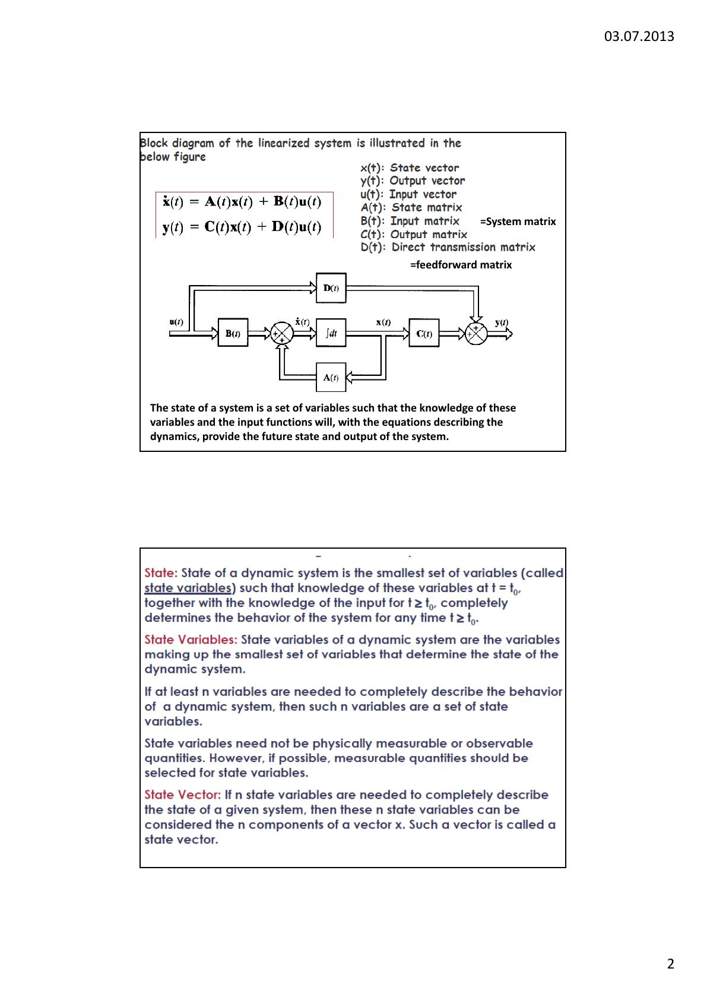
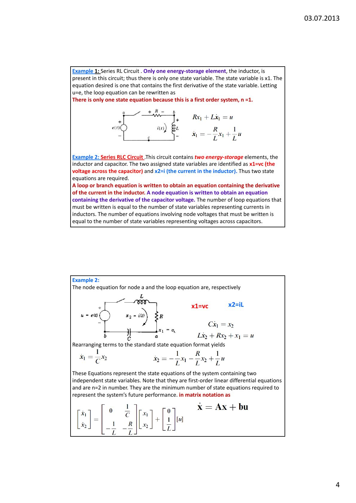
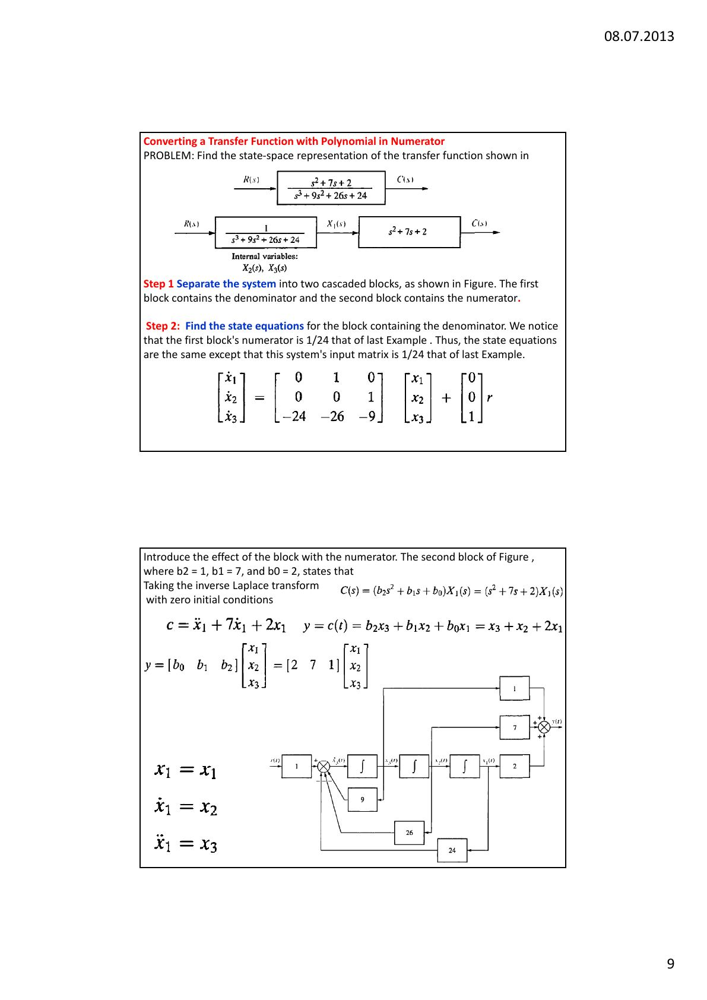
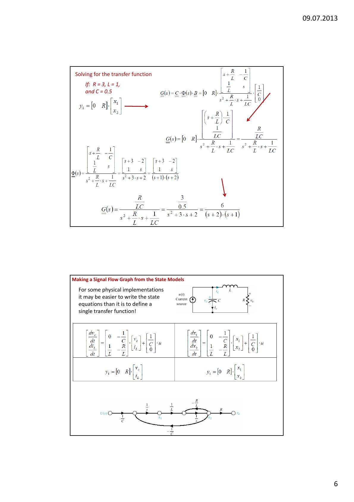

This post brings together three lecture notes and one worked-example handout from **week 3** of the **EEM322 Control Systems** course at Başkent University. The notes belong to the course instructor **Hamit Erdem**:

- **Lecture 3** (3a, 03.07.2013): Time-domain modeling, state-variable models.
- **Lecture 3b** (08.07.2013): Conversion from state space to transfer function and from transfer function to state space.
- **Lecture 3C** (09.07.2013): The state transition equation and the state transition matrix.
- **System modeling examples** (9 July 2013, "solution"): Differential equation, transfer function, and state-space models for a series RLC circuit, a mass-spring-damper, and a DC motor (in Turkish).

The notes are a mix of English and Turkish; the content is summarized below in English, and the worked examples have been written out. The PDFs of the four files can be downloaded as a ZIP at the end of the post.

## Classical and modern approaches

There are two approaches to the analysis and design of feedback control systems. The greatest advantage of the **classical (frequency-domain) approach** is that it quickly gives stability and transient response information; the effect of changing system parameters is immediately visible. Its disadvantage is its limited applicability: it can only be applied to linear, time-invariant systems, or to systems that can be approximated as such.

The **state-space (time-domain, modern) approach**, on the other hand, can be used for linear and nonlinear, time-varying and time-invariant, and multivariable systems. The state and output equations for a linear system are:

ẋ(t) = A(t)x(t) + B(t)u(t)
y(t) = C(t)x(t) + D(t)u(t)

Here x(t) is the state vector, y(t) is the output vector, u(t) is the input vector, A(t) is the state (system) matrix, B(t) is the input matrix, C(t) is the output matrix, and D(t) is the direct transmission (feedforward) matrix.

## State, state variables, and the state vector

- **State:** The state of a dynamic system is the smallest set of variables (state variables) such that knowledge of them at t = t₀, together with knowledge of the input for t ≥ t₀, completely determines the behavior of the system for t ≥ t₀.
- **State variables:** The smallest set of variables that determines the state of the system. If at least n variables are needed to describe the behavior, then these n variables form a set of state variables.
- **State vector:** The vector x whose components are the n state variables.
- **State equations:** For an nth-order system, n simultaneous first-order differential equations written in terms of the state variables.

Notes:

- The minimum number of state variables required equals the order of the differential equation; a second-order system requires at least two state variables.
- State variables must be linearly independent; none of them can be written as a linear combination of the others. The concept of state is not limited to physical systems; it also applies to biological, economic, and social systems.
- The state-space representation is not unique; a different choice of state variables gives a different representation of the same system.
- State variables need not be physically measurable or observable; however, where possible it is practical to choose easily measured quantities, because optimal control laws require feeding back all state variables with appropriate weights.
- The **state space** is the n-dimensional space whose axes are the state variables. The **state trajectory** is the path traced by the state vector x(t) in state space over time; in the two-dimensional case these are called the phase plane and phase trajectory.
- In the physical-variable method, the state variables are chosen according to the system's **energy-storing elements**.

## State equations for electrical circuits

**Example 1 – Series RL circuit:** The only energy-storing element is the inductor; there is a single state variable x₁ = i (n = 1). Taking u = e, the loop equation is Rx₁ + Lẋ₁ = u, i.e., ẋ₁ = −(R/L)x₁ + (1/L)u.

**Example 2 – Series RLC circuit:** Since there are two energy-storing elements, there are two state variables: x₁ = v_C (capacitor voltage) and x₂ = i_L (inductor current). One writes a loop equation containing the derivative of the inductor current and a node equation containing the derivative of the capacitor voltage. The number of loop equations to be written equals the number of state variables that are currents, and the number of node equations equals the number of state variables that are voltages.

Cẋ₁ = x₂,  Lẋ₂ + Rx₂ + x₁ = u

ẋ₁ = (1/C)x₂,  ẋ₂ = −(1/L)x₁ − (R/L)x₂ + (1/L)u

In matrix form, ẋ = Ax + bu, where A = [0, 1/C; −1/L, −R/L], b = [0; 1/L]. If the output is the capacitor voltage, y = [1 0]x + [0]u, i.e., cᵀ = [1 0], d = 0. (Source: *Linear Control System Analysis and Design with MATLAB*.)

The general method has five steps:

1. Label all branch currents in the circuit.
1. Choose the state variables (the energy-storing L and C elements) and write their derivative equations: C·dv_C/dt = i_C, L·di_L/dt = v_L.
1. Express the non-state variables (i_C and v_L) as linear combinations of the state variables (v_C and i_L) and the input.
1. Substitute and rearrange to obtain the state equations.
1. Find the output equation.

The notes also work through several more circuit examples: a circuit with three state variables (x₁ = i₁, x₂ = i₂, x₃ = v_C), a circuit with a current source and five state variables, a circuit with two inputs (e₁, e₂) and three outputs (v₁, v₂, v_C), and a circuit containing two capacitors and one inductor. For a multi-input multi-output (MIMO) system with m inputs and l outputs, A is the n×n plant matrix, B is the n×m control matrix, C is the l×n output matrix, D is the l×m feedforward matrix, u is the m-dimensional control vector, and y is the l-dimensional output vector.

## State model for a mechanical system

The spring-mass-damper system is described by the equation M·d²y/dt² + b·dy/dt + ky = u(t). Position and velocity are chosen as state variables: x₁ = y(t), x₂ = dy/dt. This gives two first-order equations:

ẋ₁ = x₂,  ẋ₂ = −(k/M)x₁ − (b/M)x₂ + (1/M)u

In matrix form, A = [0, 1; −k/M, −b/M], B = [0; 1/M], y = [1 0]x. The notes also write a four-state-variable model (x₁, v₁, x₂, v₂) for a system with two masses (M₁, M₂).

## From state space to transfer function

Different choices of a system's state variables lead to the state equations being written in different canonical forms; that is, a system has many state models, but its transfer function representation is **unique**.

Applying the Laplace transform to ẋ = Ax + Bu, y = Cx + Du gives:

sX(s) − x(0) = AX(s) + BU(s),  Y(s) = CX(s) + DU(s)

X(s) = (sI − A)⁻¹x(0) + (sI − A)⁻¹BU(s)

Y(s) = C(sI − A)⁻¹x(0) + C(sI − A)⁻¹BU(s) + DU(s)

By the definition of the transfer function, taking x(0) = 0 gives Y(s) = [C(sI − A)⁻¹B + D]U(s). For a single-input single-output system:

G(s) = Y(s)/U(s) = C(sI − A)⁻¹B + D,  (sI − A)⁻¹ = Adj(sI − A)/|sI − A|

G(s) = [C·Adj(sI − A)·B + |sI − A|·D] / |sI − A|

The denominator of the transfer function is defined as the **characteristic equation**. The equation det(sI − A) = 0 is the characteristic equation of the matrix A, and its roots are the **eigenvalues** of A; hence the poles of the system are the same as the eigenvalues of the state matrix. The matrix C(sI − A)⁻¹B + D is called the **transfer function matrix**, since it relates the output vector to the input vector.

**Example 1:** A = [0, 1; −2, −3], B = [0; 1], C = [3 1], D = 0.

|sI − A| = s(s + 3) + 2 = s² + 3s + 2,  Adj(sI − A) = [s + 3, 1; −2, s]

G(s) = [3 1] · (1/(s² + 3s + 2)) · [s + 3, 1; −2, s] · [0; 1] = (s + 3)/(s² + 3s + 2)

**Example 2:** A = [−4, −1.5; 4, 0], B = [2; 0], C = [1.5 0.625].

det(sI − A) = s(s + 4) + 6 = s² + 4s + 6,  C·Adj(sI − A)·B = [1.5 0.625]·[2s; 8] = 3s + 5

G(s) = (3s + 5)/(s² + 4s + 6)

The notes also include two more third-order examples: A = [0, 1, 0; 0, 0, 1; −1, −2, −3], B = [10; 0; 0], C = [1 0 0] gives T(s) = 10(s² + 3s + 2)/(s³ + 3s² + 2s + 1); another system gives G(s) = (s + 2)/(s³ + 3s² + 2s + 10).

## From transfer function to state space: phase variables

In the nth-order equation dⁿy/dtⁿ + aₙ₋₁dⁿ⁻¹y/dtⁿ⁻¹ + … + a₁dy/dt + a₀y = b₀u, the output y(t) and its (n − 1) derivatives are chosen as state variables; this is called the **phase-variable** choice:

x₁ = y, x₂ = dy/dt, x₃ = d²y/dt², …, xₙ = dⁿ⁻¹y/dtⁿ⁻¹

Differentiating both sides gives ẋ₁ = x₂, ẋ₂ = x₃, …, ẋₙ₋₁ = xₙ and ẋₙ = −a₀x₁ − a₁x₂ − … − aₙ₋₁xₙ + b₀u. This form is easily recognized by its distinctive structure: 1's above the diagonal, 0's elsewhere, and the differential equation coefficients written in reverse order with their signs changed in the last row. The output is y = [1 0 0 … 0]x.

In summary: the transfer function is converted to a differential equation by cross-multiplying and taking the inverse Laplace transform with zero initial conditions; the differential equation is then represented in state space in phase-variable form.

**Example (constant numerator):** C(s)/R(s) = 24/(s³ + 9s² + 26s + 24).

1. Cross-multiplying: (s³ + 9s² + 26s + 24)C(s) = 24R(s); taking the inverse Laplace transform gives c⃛ + 9c̈ + 26ċ + 24c = 24r.
1. State variables: x₁ = c, x₂ = ċ, x₃ = c̈. Thus ẋ₁ = x₂, ẋ₂ = x₃, ẋ₃ = −24x₁ − 26x₂ − 9x₃ + 24r, y = c = x₁.

In vector-matrix form, A = [0, 1, 0; 0, 0, 1; −24, −26, −9], B = [0; 0; 24], C = [1 0 0]. The third row of the system matrix contains the coefficients of the transfer function's denominator in reverse order and with negative signs.

**Example (polynomial numerator):** If the degree of the numerator polynomial is less than that of the denominator, the system is split into two cascaded blocks: the first contains only the denominator, and the second contains only the numerator. The first block is converted to phase-variable form (x₁ is the output, the others are internal variables); the second block gives the output as a linear combination of the phase variables. For C(s)/R(s) = (s² + 7s + 2)/(s³ + 9s² + 26s + 24), since the numerator of the first block is 1/24 of that in the previous example, the input matrix becomes B = [0; 0; 1]; the second block (b₂ = 1, b₁ = 7, b₀ = 2) gives c = x₃ + 7x₂ + 2x₁ via the inverse Laplace transform, i.e., y = [2 7 1]x.

## The state transition equation and the state transition matrix

The state transition equation is the solution of the linear nonhomogeneous state equation. For the linear time-invariant system ẋ(t) = Ax(t) + Bu(t), y(t) = Cx(t) + Du(t), the state equation can be solved by differential equation methods or by the Laplace transform:

x(t) = L⁻¹[(sI − A)⁻¹]x(0) + L⁻¹{(sI − A)⁻¹BU(s)}

x(t) = e^(At)x(0) + ∫₀ᵗ e^(A(t−τ))Bu(τ)dτ,  t ≥ 0

The first term is the **natural (zero-input) solution**, and the second term is the **forced (zero-state) solution**. The output equation is:

y(t) = Ce^(At)x(0) + ∫₀ᵗ Ce^(A(t−τ))Bu(τ)dτ + Du(t),  t ≥ 0

The **state transition matrix** Φ(t) = e^(At) = L⁻¹{(sI − A)⁻¹} can be computed by the inverse Laplace transform. Its properties are:

1. Φ(t₁ + t₂) = Φ(t₁)Φ(t₂), i.e., e^(A(t₁+t₂)) = e^(At₁)e^(At₂)
1. dΦ(t)/dt = AΦ(t), i.e., d(e^(At))/dt = Ae^(At)
1. Φ(0) = e^(A·0) = I
1. dΦ(t)/dt |t=0 = A

The matrix exponential function is defined analogously to the Taylor expansion of the exponential function: e^(At) = I + At + A²t²/2! + … + Aᵏtᵏ/k! + …

**Example:** For the system with A = [0, 1; −2, −3], B = [0; 1], find e^(At) and x(t) for u(t) = 1, t ≥ 0.

(sI − A)⁻¹ = (1/(s² + 3s + 2)) · [s + 3, 1; −2, s]

e^(At) = [2e^(−t) − e^(−2t), e^(−t) − e^(−2t); −2e^(−t) + 2e^(−2t), −e^(−t) + 2e^(−2t)]

One way to find the forced solution is to evaluate L⁻¹[(sI − A)⁻¹BU(s)]:

L⁻¹{(1/(s(s² + 3s + 2))) · [1; s]} = [0.5 − e^(−t) + 0.5e^(−2t); e^(−t) − e^(−2t)],  t ≥ 0

**Example (RLC circuit, R = 3, L = 1, C = 0.5):** A = [0, −1/C; 1/L, −R/L] = [0, −2; 1, −3], B = [1/C; 0].

det(sI − A) = s(s + 3) + 2 = s² + 3s + 2 = (s + 1)(s + 2)

Φ(s) = [(s + 3)/((s + 1)(s + 2)), −2/((s + 1)(s + 2)); 1/((s + 1)(s + 2)), s/((s + 1)(s + 2))]

Φ(t) = [2e^(−t) − e^(−2t), −2e^(−t) + 2e^(−2t); e^(−t) − e^(−2t), −e^(−t) + 2e^(−2t)]

The initial-condition response is x(t) = Φ(t)·x(0); the general solution for the states is X(s) = Φ(s)·x(0) + Φ(s)·B·U(s).

*Note: On this page of the lecture notes, the A matrix is written in one place as [0, 2; 1, −3]; the correct one is [0, −2; 1, −3] (sI − A and Φ(s) were computed with this correct matrix). Also, on page 2 of 3C, the expression sI − A is mistakenly labeled (sI − A)⁻¹.*

The last page of the notes shows how to draw a signal flow graph from state models: in some physical applications, writing the state equations may be easier than defining a single transfer function.

## Appendix: System modeling examples (Turkish handout)

### Example 1: Series RLC circuit

Dynamic equations according to Kirchhoff's law: Ri(t) + L·di/dt + (1/C)∫i dt = e(t), (1/C)∫i dt = v(t). Hence i(t) = C·dv/dt and:

d²v/dt² + (R/L)·dv/dt + (1/LC)·v(t) = (1/LC)·e(t)  (differential equation model)

V(s)/E(s) = (1/LC) / (s² + (R/L)s + 1/LC)  (transfer function model)

Since the input side of the differential equation contains no derivatives, x₁ = v, x₂ = v̇ are chosen: ẋ₁ = x₂, ẋ₂ = −(1/LC)x₁ − (R/L)x₂ + (1/LC)e; A = [0, 1; −1/LC, −R/L], B = [0; 1/LC], v = [1 0]x.

### Example 2: Mass-spring-damper

According to Newton's law of motion ΣF = Ma, f(t) − f_B(t) − f_K(t) = Ma; here f_B = B·dx/dt, f_K = Kx. Hence f(t) − B·dx/dt − Kx = M·d²x/dt². The handout gives the model as:

d²x/dt² + (B/M)·dx/dt + (K/M)·x(t) = (1/K)·f(t),  X(s)/F(s) = (1/K) / (s² + (B/M)s + K/M)

Choosing x₁ = x, x₂ = ẋ gives A = [0, 1; −K/M, −B/M], B = [0; 1/K], x = [1 0]x.

*Note: When the equation f − B·dx/dt − Kx = M·d²x/dt² is divided by M, the right-hand side should be (1/M)·f(t); the 1/K coefficient in the handout is incorrect. The correct form is X(s)/F(s) = (1/M)/(s² + (B/M)s + K/M) = 1/(Ms² + Bs + K), and the input matrix is [0; 1/M] (consistent with the 1/(Ms² + f_v s + K) result in Lecture 2).*

### Example 3: DC motor (electromechanical system)

From Kirchhoff's law, e_g = R_g i_g + L_g·di_g/dt + e_b, where e_b = K_b·dθ/dt is the back electromotive force voltage. From Newton's law, M = J·d²θ/dt² + B·dθ/dt, where M = K_m i_g is the torque produced by the motor. Solving for i_g and substituting into the first equation:

e_g = R_g[(J/K_m)·d²θ/dt² + (B/K_m)·dθ/dt] + L_g[(J/K_m)·d³θ/dt³ + (B/K_m)·d²θ/dt²] + K_b·dθ/dt

The handout ends at this point (pages 15–17).
