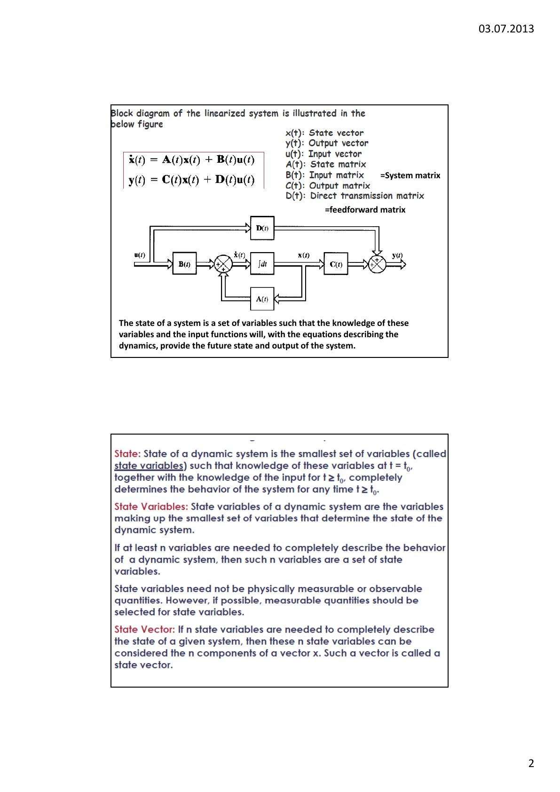
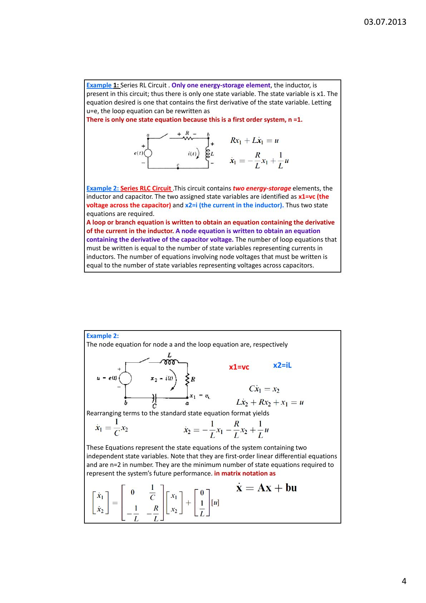
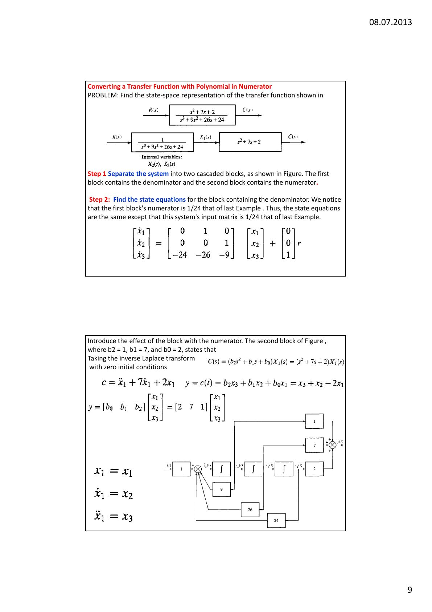
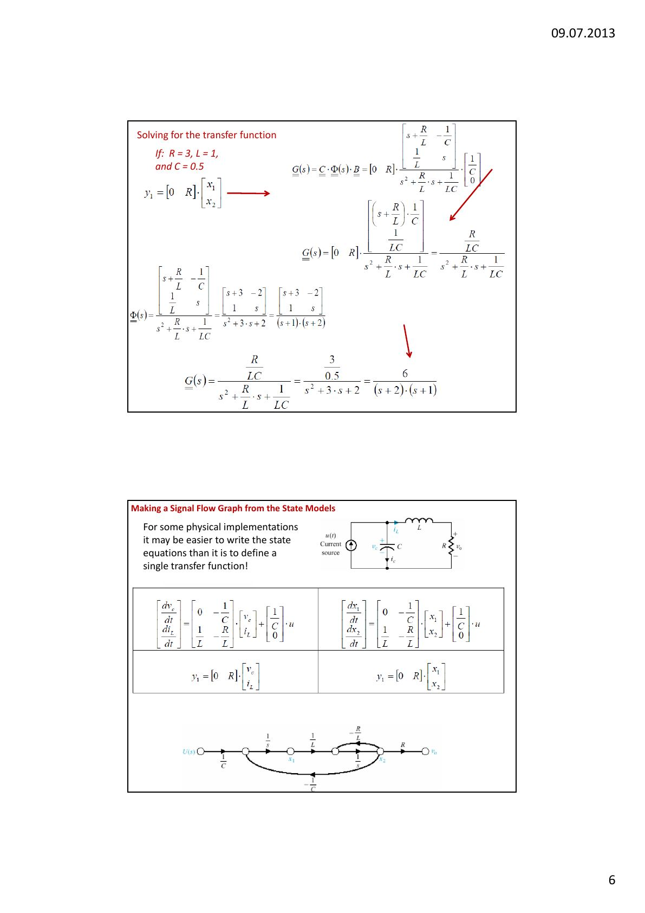

Bu yazı, Başkent Üniversitesi **EEM322 Denetim Sistemleri** dersinin **3. haftasına** ait üç ders notunu ve bir çözümlü örnek föyünü bir araya getiriyor. Notlar dersi veren **Hamit Erdem**'e ait:

- **Lecture 3** (3a, 03.07.2013): Zaman düzleminde modelleme, durum değişkeni modelleri.
- **Lecture 3b** (08.07.2013): Durum uzayından transfer fonksiyonuna ve transfer fonksiyonundan durum uzayına dönüşüm.
- **Lecture 3C** (09.07.2013): Durum geçiş denklemi ve durum geçiş matrisi.
- **Sistem modelleme örnekleri** (9 Temmuz 2013, "solution"): Seri RLC devresi, kütle-yay-sönümleyici ve DC motor için diferansiyel denklem, transfer fonksiyonu ve durum uzayı modelleri (Türkçe).

Notlar İngilizce ve Türkçe karışık; aşağıda içerik Türkçe olarak özetlendi, çözümlü örnekler yazıya döküldü. Dört dosyanın PDF'leri yazının sonunda ZIP olarak indirilebilir.

## Klasik ve modern yaklaşım

Geri beslemeli denetim sistemlerinin analizi ve tasarımı için iki yaklaşım vardır. **Klasik (frekans düzlemi) yaklaşımın** en büyük avantajı kararlılık ve geçici yanıt bilgisini hızla vermesidir; sistem parametrelerini değiştirmenin etkisi hemen görülür. Dezavantajı uygulanabilirliğinin sınırlı olmasıdır: yalnızca doğrusal, zamanla değişmeyen sistemlere ya da böyle yaklaşıklanabilen sistemlere uygulanabilir.

**Durum uzayı (zaman düzlemi, modern) yaklaşımı** ise doğrusal ve doğrusal olmayan, zamanla değişen ve değişmeyen ve çok değişkenli sistemlerde kullanılabilir. Doğrusal sistem için durum ve çıkış denklemleri:

ẋ(t) = A(t)x(t) + B(t)u(t)
y(t) = C(t)x(t) + D(t)u(t)

Burada x(t) durum vektörü, y(t) çıkış vektörü, u(t) giriş vektörü, A(t) durum (sistem) matrisi, B(t) giriş matrisi, C(t) çıkış matrisi ve D(t) doğrudan iletim (ileri besleme) matrisidir.

## Durum, durum değişkenleri ve durum vektörü

- **Durum:** Dinamik bir sistemin durumu, t = t₀ anındaki bilgisi t ≥ t₀ için giriş bilgisiyle birlikte sistemin davranışını tamamen belirleyen en küçük değişken (durum değişkenleri) kümesidir.
- **Durum değişkenleri:** Sistemin durumunu belirleyen en küçük değişken kümesi. Davranışı tanımlamak için en az n değişken gerekiyorsa bu n değişken bir durum değişkenleri kümesidir.
- **Durum vektörü:** n durum değişkenini bileşen kabul eden x vektörü.
- **Durum denklemleri:** n. mertebeden bir sistem için durum değişkenleri cinsinden yazılan n tane eşzamanlı, birinci mertebeden diferansiyel denklem.

Notlar:

- Gereken en az durum değişkeni sayısı diferansiyel denklemin mertebesine eşittir; ikinci mertebeden sistem için en az iki durum değişkeni gerekir.
- Durum değişkenleri doğrusal bağımsız olmalıdır; hiçbiri diğerlerinin doğrusal birleşimi olarak yazılamaz. Durum kavramı fiziksel sistemlerle sınırlı değildir; biyolojik, ekonomik ve sosyal sistemlere de uygulanır.
- Durum uzayı gösterimi tek değildir; farklı durum değişkeni seçimi aynı sistemin farklı bir gösterimini verir.
- Durum değişkenlerinin fiziksel olarak ölçülebilir ya da gözlenebilir olması gerekmez; ama mümkünse kolay ölçülen büyüklükleri seçmek pratiktir, çünkü optimal denetim yasaları bütün durum değişkenlerinin uygun ağırlıklarla geri beslenmesini gerektirir.
- **Durum uzayı**, eksenleri durum değişkenleri olan n boyutlu uzaydır. **Durum yörüngesi**, x(t) durum vektörünün zamanla durum uzayında çizdiği yoldur; iki boyutlu durumda bunlara faz düzlemi ve faz yörüngesi denir.
- Fiziksel değişken yönteminde durum değişkenleri, sistemin **enerji depolayan elemanlarına** göre seçilir.

## Elektrik devreleri için durum denklemleri

**Örnek 1 – Seri RL devresi:** Tek enerji depolayan eleman bobindir; tek durum değişkeni x₁ = i vardır (n = 1). u = e alınırsa çevre denklemi Rx₁ + Lẋ₁ = u, yani ẋ₁ = −(R/L)x₁ + (1/L)u olur.

**Örnek 2 – Seri RLC devresi:** İki enerji depolayan eleman olduğundan iki durum değişkeni vardır: x₁ = v_C (kondansatör gerilimi), x₂ = i_L (bobin akımı). Bobin akımının türevini içeren bir çevre denklemi, kondansatör geriliminin türevini içeren bir düğüm denklemi yazılır. Yazılması gereken çevre denklemi sayısı akım olan durum değişkeni sayısına, düğüm denklemi sayısı gerilim olan durum değişkeni sayısına eşittir.

Cẋ₁ = x₂,  Lẋ₂ + Rx₂ + x₁ = u

ẋ₁ = (1/C)x₂,  ẋ₂ = −(1/L)x₁ − (R/L)x₂ + (1/L)u

Matris biçiminde ẋ = Ax + bu; burada A = [0, 1/C; −1/L, −R/L], b = [0; 1/L]. Çıkış kondansatör gerilimi ise y = [1 0]x + [0]u, yani cᵀ = [1 0], d = 0. (Kaynak: *Linear Control System Analysis and Design with MATLAB*.)

Genel yöntem beş adımdır:

1. Devredeki bütün kol akımlarını etiketle.
1. Durum değişkenlerini (enerji depolayan L ve C elemanları) seç ve türev denklemlerini yaz: C·dv_C/dt = i_C, L·di_L/dt = v_L.
1. Durum olmayan değişkenleri (i_C ve v_L) durum değişkenlerinin (v_C ve i_L) ve girişin doğrusal birleşimi olarak ifade et.
1. Yerine koyup düzenleyerek durum denklemlerini elde et.
1. Çıkış denklemini bul.

Notta ayrıca üç durum değişkenli (x₁ = i₁, x₂ = i₂, x₃ = v_C) bir devre, akım kaynaklı beş durum değişkenli bir devre, iki girişli (e₁, e₂) ve üç çıkışlı (v₁, v₂, v_C) bir devre ve iki kondansatör ile bir bobin içeren bir devre örneği çözülüyor. m girişli ve l çıkışlı çok girişli çok çıkışlı (MIMO) sistemde A n×n tesis matrisi, B n×m denetim matrisi, C l×n çıkış matrisi, D l×m ileri besleme matrisi, u m boyutlu denetim vektörü ve y l boyutlu çıkış vektörüdür.

## Mekanik sistem için durum modeli

Yay-kütle-sönümleyici sistemi M·d²y/dt² + b·dy/dt + ky = u(t) denklemiyle tanımlanır. Durum değişkenleri konum ve hız seçilir: x₁ = y(t), x₂ = dy/dt. Buradan iki birinci mertebeden denklem elde edilir:

ẋ₁ = x₂,  ẋ₂ = −(k/M)x₁ − (b/M)x₂ + (1/M)u

Matris biçiminde A = [0, 1; −k/M, −b/M], B = [0; 1/M], y = [1 0]x. Notta iki kütleli (M₁, M₂) bir sistem için de dört durum değişkenli (x₁, v₁, x₂, v₂) model yazılıyor.

## Durum uzayından transfer fonksiyonuna

Bir sistemin durum değişkenlerinin farklı seçimleri, durum denklemlerinin farklı kanonik biçimlerde yazılmasını sağlar; yani bir sistemin çok sayıda durum modeli vardır, ama transfer fonksiyonu gösterimi **tektir**.

ẋ = Ax + Bu, y = Cx + Du denklemlerine Laplace dönüşümü uygulanırsa:

sX(s) − x(0) = AX(s) + BU(s),  Y(s) = CX(s) + DU(s)

X(s) = (sI − A)⁻¹x(0) + (sI − A)⁻¹BU(s)

Y(s) = C(sI − A)⁻¹x(0) + C(sI − A)⁻¹BU(s) + DU(s)

Transfer fonksiyonunun tanımı gereği x(0) = 0 alınırsa Y(s) = [C(sI − A)⁻¹B + D]U(s). Tek girişli tek çıkışlı sistemde:

G(s) = Y(s)/U(s) = C(sI − A)⁻¹B + D,  (sI − A)⁻¹ = Adj(sI − A)/|sI − A|

G(s) = [C·Adj(sI − A)·B + |sI − A|·D] / |sI − A|

Transfer fonksiyonunun paydası **karakteristik denklem** olarak tanımlanır. det(sI − A) = 0 denklemi A matrisinin karakteristik denklemidir, kökleri A'nın **özdeğerleridir**; dolayısıyla sistemin kutupları durum matrisinin özdeğerleriyle aynıdır. C(sI − A)⁻¹B + D matrisine, çıkış vektörünü giriş vektörüne bağladığı için **transfer fonksiyonu matrisi** denir.

**Örnek 1:** A = [0, 1; −2, −3], B = [0; 1], C = [3 1], D = 0.

|sI − A| = s(s + 3) + 2 = s² + 3s + 2,  Adj(sI − A) = [s + 3, 1; −2, s]

G(s) = [3 1] · (1/(s² + 3s + 2)) · [s + 3, 1; −2, s] · [0; 1] = (s + 3)/(s² + 3s + 2)

**Örnek 2:** A = [−4, −1.5; 4, 0], B = [2; 0], C = [1.5 0.625].

det(sI − A) = s(s + 4) + 6 = s² + 4s + 6,  C·Adj(sI − A)·B = [1.5 0.625]·[2s; 8] = 3s + 5

G(s) = (3s + 5)/(s² + 4s + 6)

Notta ayrıca üçüncü mertebeden iki örnek daha var: A = [0, 1, 0; 0, 0, 1; −1, −2, −3], B = [10; 0; 0], C = [1 0 0] için T(s) = 10(s² + 3s + 2)/(s³ + 3s² + 2s + 1); bir başka sistem için G(s) = (s + 2)/(s³ + 3s² + 2s + 10).

## Transfer fonksiyonundan durum uzayına: faz değişkenleri

n. mertebeden dⁿy/dtⁿ + aₙ₋₁dⁿ⁻¹y/dtⁿ⁻¹ + … + a₁dy/dt + a₀y = b₀u denkleminde çıkış y(t) ve (n − 1) türevi durum değişkeni seçilir; buna **faz değişkeni** seçimi denir:

x₁ = y, x₂ = dy/dt, x₃ = d²y/dt², …, xₙ = dⁿ⁻¹y/dtⁿ⁻¹

İki taraf türetilirse ẋ₁ = x₂, ẋ₂ = x₃, …, ẋₙ₋₁ = xₙ ve ẋₙ = −a₀x₁ − a₁x₂ − … − aₙ₋₁xₙ + b₀u elde edilir. Bu biçim; köşegen üstündeki 1'ler, geri kalan 0'lar ve son satırda ters sırada yazılmış, işareti değiştirilmiş diferansiyel denklem katsayılarından oluşan özgün yapısıyla kolayca tanınır. Çıkış y = [1 0 0 … 0]x'tir.

Özetle: transfer fonksiyonu çapraz çarpılıp başlangıç koşulları sıfırken ters Laplace dönüşümü alınarak diferansiyel denkleme çevrilir; sonra diferansiyel denklem faz değişkeni biçiminde durum uzayında gösterilir.

**Örnek (payda sabit terim):** C(s)/R(s) = 24/(s³ + 9s² + 26s + 24).

1. Çapraz çarpım: (s³ + 9s² + 26s + 24)C(s) = 24R(s); ters Laplace ile c⃛ + 9c̈ + 26ċ + 24c = 24r.
1. Durum değişkenleri: x₁ = c, x₂ = ċ, x₃ = c̈. Böylece ẋ₁ = x₂, ẋ₂ = x₃, ẋ₃ = −24x₁ − 26x₂ − 9x₃ + 24r, y = c = x₁.

Vektör-matris biçiminde A = [0, 1, 0; 0, 0, 1; −24, −26, −9], B = [0; 0; 24], C = [1 0 0]. Sistem matrisinin üçüncü satırında transfer fonksiyonunun paydasındaki katsayılar ters sırada ve negatif olarak yer alır.

**Örnek (payda polinom):** Pay polinomunun derecesi paydanınkinden küçükse sistem iki seri bloğa ayrılır: birincisi yalnızca paydayı, ikincisi yalnızca payı içerir. Birinci blok faz değişkeni biçimine çevrilir (x₁ çıkış, diğerleri iç değişkenler); ikinci blok çıkışı faz değişkenlerinin doğrusal birleşimi olarak verir. C(s)/R(s) = (s² + 7s + 2)/(s³ + 9s² + 26s + 24) için birinci bloğun payı önceki örneğinkinin 1/24'ü olduğundan giriş matrisi B = [0; 0; 1] olur; ikinci blok (b₂ = 1, b₁ = 7, b₀ = 2) ters Laplace ile c = x₃ + 7x₂ + 2x₁ verir, yani y = [2 7 1]x.

## Durum geçiş denklemi ve durum geçiş matrisi

Durum geçiş denklemi, doğrusal homojen olmayan durum denkleminin çözümüdür. Doğrusal zamanla değişmeyen sistem ẋ(t) = Ax(t) + Bu(t), y(t) = Cx(t) + Du(t) için durum denklemi diferansiyel denklem yöntemleriyle ya da Laplace dönüşümüyle çözülebilir:

x(t) = L⁻¹[(sI − A)⁻¹]x(0) + L⁻¹{(sI − A)⁻¹BU(s)}

x(t) = e^(At)x(0) + ∫₀ᵗ e^(A(t−τ))Bu(τ)dτ,  t ≥ 0

İlk terim **doğal çözüm**, ikinci terim **zorlanmış çözümdür**. Çıkış denklemi:

y(t) = Ce^(At)x(0) + ∫₀ᵗ Ce^(A(t−τ))Bu(τ)dτ + Du(t),  t ≥ 0

**Durum geçiş matrisi** Φ(t) = e^(At) = L⁻¹{(sI − A)⁻¹} ters Laplace dönüşümüyle hesaplanabilir. Özellikleri:

1. Φ(t₁ + t₂) = Φ(t₁)Φ(t₂), yani e^(A(t₁+t₂)) = e^(At₁)e^(At₂)
1. dΦ(t)/dt = AΦ(t), yani d(e^(At))/dt = Ae^(At)
1. Φ(0) = e^(A·0) = I
1. dΦ(t)/dt |t=0 = A

Matris üstel fonksiyonu, üstel fonksiyonun Taylor açılımına benzer biçimde tanımlanır: e^(At) = I + At + A²t²/2! + … + Aᵏtᵏ/k! + …

**Örnek:** A = [0, 1; −2, −3], B = [0; 1] olan sistemde t ≥ 0 için u(t) = 1 iken e^(At) ve x(t)'yi bulun.

(sI − A)⁻¹ = (1/(s² + 3s + 2)) · [s + 3, 1; −2, s]

e^(At) = [2e^(−t) − e^(−2t), e^(−t) − e^(−2t); −2e^(−t) + 2e^(−2t), −e^(−t) + 2e^(−2t)]

Zorlanmış çözümü bulmanın bir yolu da L⁻¹[(sI − A)⁻¹BU(s)] ifadesini hesaplamaktır:

L⁻¹{(1/(s(s² + 3s + 2))) · [1; s]} = [0.5 − e^(−t) + 0.5e^(−2t); e^(−t) − e^(−2t)],  t ≥ 0

**Örnek (RLC devresi, R = 3, L = 1, C = 0.5):** A = [0, −1/C; 1/L, −R/L] = [0, −2; 1, −3], B = [1/C; 0].

det(sI − A) = s(s + 3) + 2 = s² + 3s + 2 = (s + 1)(s + 2)

Φ(s) = [(s + 3)/((s + 1)(s + 2)), −2/((s + 1)(s + 2)); 1/((s + 1)(s + 2)), s/((s + 1)(s + 2))]

Φ(t) = [2e^(−t) − e^(−2t), −2e^(−t) + 2e^(−2t); e^(−t) − e^(−2t), −e^(−t) + 2e^(−2t)]

Başlangıç koşulu yanıtı x(t) = Φ(t)·x(0); durumlar için genel çözüm X(s) = Φ(s)·x(0) + Φ(s)·B·U(s).

*Not: Ders notunun bu sayfasında A matrisi bir yerde [0, 2; 1, −3] olarak yazılmış; doğrusu [0, −2; 1, −3]'tür (sI − A ve Φ(s) bu doğru matrisle hesaplanmış). Ayrıca 3C'nin 2. sayfasında sI − A ifadesi yanlışlıkla (sI − A)⁻¹ diye etiketlenmiş.*

Notun son sayfası durum modellerinden işaret akış grafiği çizmeyi gösteriyor: bazı fiziksel uygulamalarda durum denklemlerini yazmak, tek bir transfer fonksiyonu tanımlamaktan daha kolay olabilir.

## Ek: Sistem modelleme örnekleri (Türkçe föy)

### Örnek 1: Seri RLC devresi

Kirchhoff yasasına göre dinamik denklemler: Ri(t) + L·di/dt + (1/C)∫i dt = e(t), (1/C)∫i dt = v(t). Buradan i(t) = C·dv/dt ve:

d²v/dt² + (R/L)·dv/dt + (1/LC)·v(t) = (1/LC)·e(t)  (diferansiyel denklem modeli)

V(s)/E(s) = (1/LC) / (s² + (R/L)s + 1/LC)  (transfer fonksiyonu modeli)

Diferansiyel denklemin giriş tarafı türev içermediğinden x₁ = v, x₂ = v̇ seçilir: ẋ₁ = x₂, ẋ₂ = −(1/LC)x₁ − (R/L)x₂ + (1/LC)e; A = [0, 1; −1/LC, −R/L], B = [0; 1/LC], v = [1 0]x.

### Örnek 2: Kütle-yay-sönümleyici

Newton'un hareket yasası ΣF = Ma'ya göre f(t) − f_B(t) − f_K(t) = Ma; burada f_B = B·dx/dt, f_K = Kx. Buradan f(t) − B·dx/dt − Kx = M·d²x/dt². Föyde model şöyle veriliyor:

d²x/dt² + (B/M)·dx/dt + (K/M)·x(t) = (1/K)·f(t),  X(s)/F(s) = (1/K) / (s² + (B/M)s + K/M)

x₁ = x, x₂ = ẋ seçilerek A = [0, 1; −K/M, −B/M], B = [0; 1/K], x = [1 0]x elde ediliyor.

*Not: f − B·dx/dt − Kx = M·d²x/dt² denklemi M'ye bölündüğünde sağ taraf (1/M)·f(t) olmalıdır; föydeki 1/K katsayısı hatalıdır. Doğrusu X(s)/F(s) = (1/M)/(s² + (B/M)s + K/M) = 1/(Ms² + Bs + K) ve giriş matrisi [0; 1/M]'dir (2. dersteki 1/(Ms² + f_v s + K) sonucuyla da uyumlu).*

### Örnek 3: DC motor (elektromekanik sistem)

Kirchhoff yasasından e_g = R_g i_g + L_g·di_g/dt + e_b, burada e_b = K_b·dθ/dt zıt elektromotor kuvvet gerilimidir. Newton yasasından M = J·d²θ/dt² + B·dθ/dt, burada M = K_m i_g motorun ürettiği döndürme momentidir. i_g çekilip birinci denklemde yerine konursa:

e_g = R_g[(J/K_m)·d²θ/dt² + (B/K_m)·dθ/dt] + L_g[(J/K_m)·d³θ/dt³ + (B/K_m)·d²θ/dt²] + K_b·dθ/dt

Föy bu noktada sona eriyor (sayfa 15–17).
