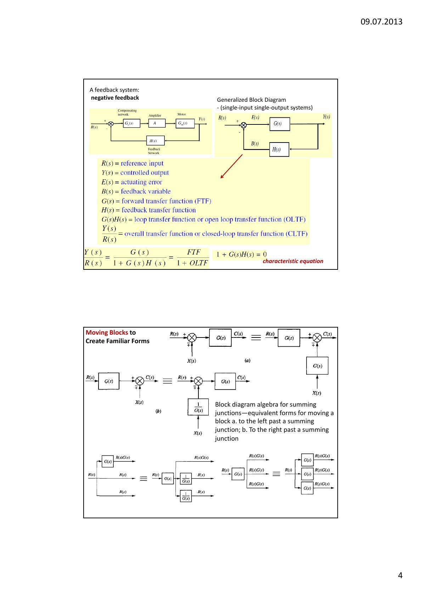
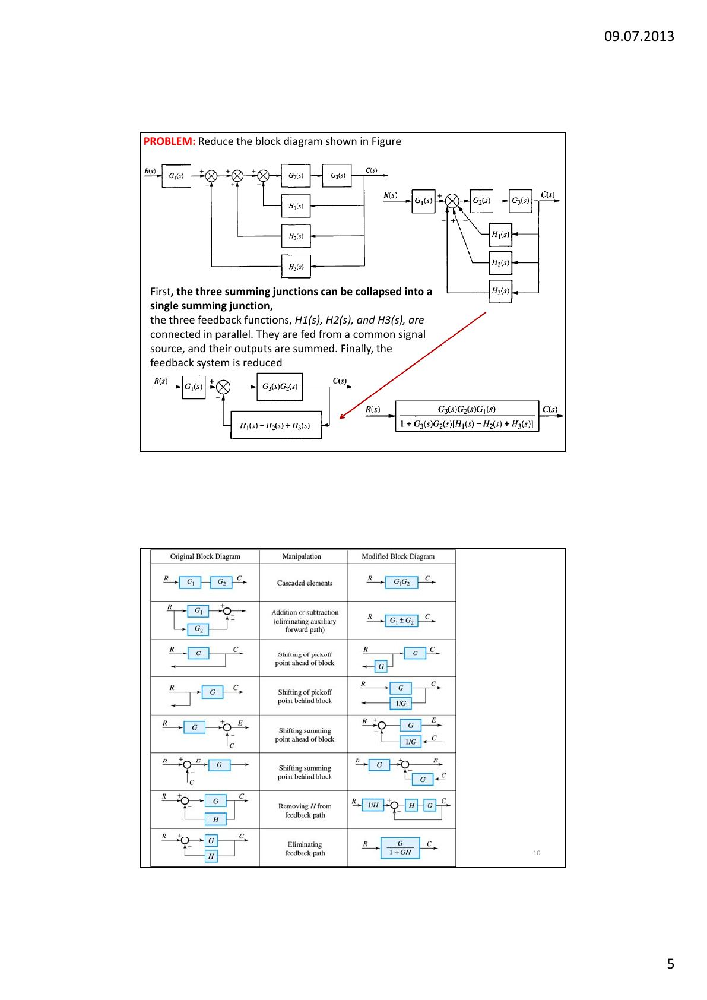
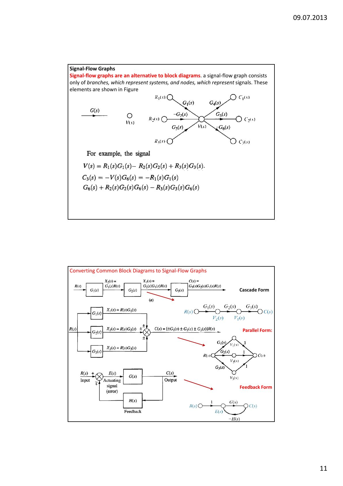
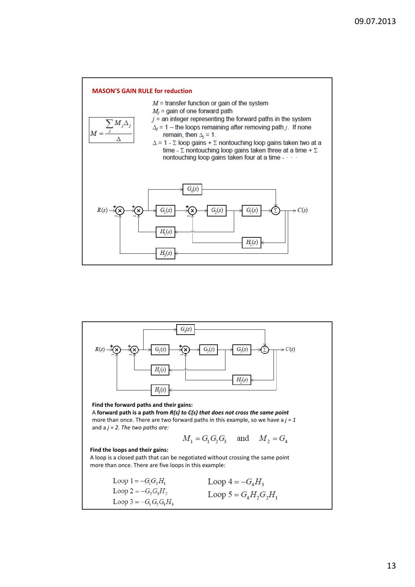
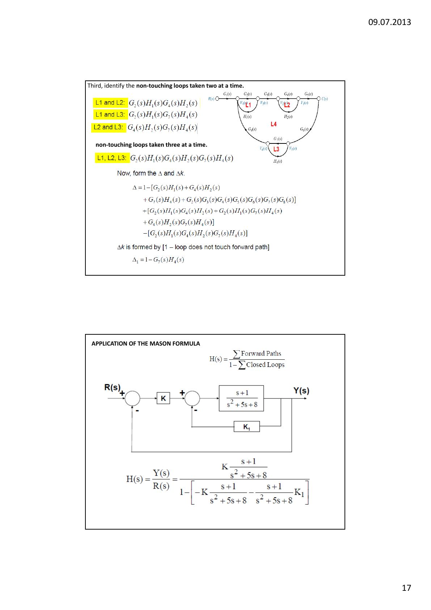

This post is the **4th lecture note** ("EEM322 – Lecture 4") of the **EEM322 Control Systems** course at Başkent University. The notes belong to **Hamit Erdem**; the page headers carry the date 09.07.2013. The lecture note is in English, an 18-page PDF with two slides per page; most of the examples come from Nise's *Control Systems Engineering*. Below, the content is summarized, the results are written out, and page images are included for the diagrams. The original PDF can be downloaded at the end of the post.

Topics:

- Representing systems with block diagrams
- Signal-flow graphs
- Block diagram reduction
- Signal-flow graph reduction
- Mason's rule

## Block diagram or signal-flow graph?

Multiple subsystems are represented in two ways: **block diagrams** (generally in frequency-domain analysis) and **signal-flow graphs** (generally in state-space analysis). Signal-flow graphs represent transfer functions with lines and signals with small circular nodes; summation is implicit. The transfer function of a system can be shown with a single block, but in state space each state variable must be shown separately. In the note's example, showing the state variables of the transfer function 24/(s³ + 9s² + 26s + 24) explicitly requires seven blocks and one summing junction. For this reason, signal-flow graphs are quicker to draw, more compact, and bring the state variables to the foreground.

## Elements of a block diagram

A subsystem is represented by a block that has an input, an output and a transfer function. When subsystems are interconnected, two new elements are added: the **summing junction** and the **pickoff point**. The block diagram of a linear, time-invariant system consists of these four elements: signals, systems (blocks), summing junctions and pickoff points.

## Basic connection types

### Series (cascade) connection

The equivalent transfer function is the product of the subsystems' transfer functions: G_e(s) = G₃(s)G₂(s)G₁(s). This result was obtained under the assumption that the subsystems do **not load** one another; that is, the output of a subsystem must stay the same whether or not the next subsystem is connected. If the output changes, the next subsystem loads the previous one, and the equivalent transfer function is not the product of the individual transfer functions.

The note gives two RC circuits as an example: Each alone has the transfer function G₁(s) = (1/R₁C₁)/(s + 1/R₁C₁) and G₂(s) = (1/R₂C₂)/(s + 1/R₂C₂). When they are connected directly, the correct result, found with loop or node equations, is

G(s) = (1/R₁C₁R₂C₂) / (s² + (1/R₁C₁ + 1/R₂C₂ + 1/R₂C₁)s + 1/R₁C₁R₂C₂)

which differs from the product G₁G₂ (the difference is the 1/R₂C₁ term). One way to **prevent loading** is to place an amplifier between the two circuits: Because the amplifier's input impedance is high, it does not load the previous circuit; because its output impedance is low, it appears to the next circuit as an ideal voltage source. In this case the equivalent transfer function is the product of the transfer functions and the amplifier gain K: G(s) = K·G₁(s)G₂(s).

### Parallel connection

Parallel subsystems share a common input; the output is the algebraic sum of all the subsystem outputs: G_e(s) = ±G₁(s) ± G₂(s) ± G₃(s).

### Feedback connection

Writing E(s) = R(s) ∓ C(s)H(s) and C(s) = E(s)G(s) and eliminating E(s) gives:

C(s)/R(s) = G(s) / (1 ± G(s)H(s))

The sign in the denominator is + for negative feedback and − for positive feedback. In the general single-input single-output feedback system, R(s) is the reference input, Y(s) is the controlled output, E(s) is the error (actuating) signal, B(s) is the feedback variable, G(s) is the forward-path transfer function (FTF), H(s) is the feedback transfer function, G(s)H(s) is the loop or open-loop transfer function (OLTF), and Y(s)/R(s) is the closed-loop transfer function (CLTF):

Y(s)/R(s) = G(s)/(1 + G(s)H(s)) = FTF/(1 + OLTF),  characteristic equation: 1 + G(s)H(s) = 0

## Block diagram reduction

To form familiar configurations (series, parallel, feedback), blocks are moved to the right or left of summing junctions, and in front of or behind pickoff points. The note gives a "block diagram algebra" table: combining cascaded blocks, summing or subtracting in the forward path, moving a pickoff point in front of or behind a block, moving a summing junction in front of or behind a block, eliminating a feedback loop, and eliminating a feedback path.

**Example 1 (combining summing junctions):** The three summing junctions are combined into a single summing junction; the feedback functions H₁(s), H₂(s) and H₃(s) are parallel because they are fed from a common signal and their outputs are summed; finally the feedback system is reduced:

C(s)/R(s) = G₃G₂G₁ / (1 + G₃G₂[H₁ − H₂ + H₃])

**Example 2 (moving a pickoff point):** Pickoff point a is moved to c, and the boxed feedback loop is simplified:

Y/R = G₁G₂ / (1 + G₁ + G₂)

**Example 3 (reduction by moving blocks):** First G₂(s) is moved to the left of the pickoff point to form parallel subsystems, and the feedback system made of G₃(s) and H₃(s) is reduced. Then the parallel pair of 1/G₂(s) and unity is reduced, and G₁(s) is pushed to the right of the summing junction to form parallel subsystems in the feedback path. The result is:

C(s)/R(s) = G₁G₃[1 + G₂] / ([1 + G₂H₂ + G₁G₂H₁][1 + G₃H₃])

**Closed-loop transfer function (when loops are nested or touch the forward path):**

C(s)/R(s) = (product of the transfer functions in the forward path) / (1 − Σ product of the transfer functions around each loop)

Note: A positive feedback loop gives a negative term in the denominator.

**Example 4:** A unity-feedback system with 2s + 4 and 1/s² in its forward path:

T(s) = [(2s + 4)/s²] / [1 + (2s + 4)/s²] = (2s + 4)/(s² + 2s + 4)

**Example 5:** For the system on page 10 of the note, moving the pickoff points gives T(s) = (G₁G₂G₅ + G₁G₆)/(1 − G₁G₃ + G₁G₂G₄).

## Signal-flow graphs

A signal-flow graph consists only of **branches** (which represent systems) and **nodes** (which represent signals). The signal at a node is the sum of the signal × gain of the branches entering that node; for example, V(s) = R₁(s)G₁(s) − R₂(s)G₂(s) + R₃(s)G₃(s).

Converting a block diagram to a signal-flow graph:

1. First the signal nodes (outputs of summing junctions, outputs of blocks, the input and the output) are identified and marked.
1. The nodes are connected by branches carrying the transfer functions between them; for subtraction, a minus sign is placed on the branch gain.
1. The graph is simplified by removing unnecessary nodes.

The note also includes a homework assignment: simplify the given signal-flow graph and convert the given block diagram to a signal-flow graph.

## Mason's gain rule

Mason's rule reduces a signal-flow graph to a single transfer function with one formula:

M = C(s)/R(s) = Σⱼ Mⱼ Δⱼ / Δ

- M: transfer function (gain) of the system
- Mⱼ: gain of the j-th forward path
- j: integer numbering the forward paths
- Δ = 1 − Σ loop gains + Σ gains of non-touching loops taken two at a time − Σ gains of non-touching loops taken three at a time + Σ gains of non-touching loops taken four at a time … 
- Δⱼ: Δ formed with the loops remaining after the j-th path is removed; if no loops remain, Δⱼ = 1.

Definitions:

- **Path:** A connection made of consecutive branches in the same direction.
- **Loop:** A closed path that passes through no node twice; the loop gain is the product of the branch gains along a path that starts and ends at the same node.
- **Forward path:** A path from the input (source) node to the output (sink) node that passes through no node more than once; the forward-path gain is the product of the gains along this path.
- **Non-touching loops:** Loops that have no common node. A loop and a path also do not touch if they have no common nodes.
- **Non-touching loop gain:** The product of the gains of non-touching loops taken two, three, four … at a time.

### Example 1

There are two forward paths: M₁ = G₁G₂G₃ and M₂ = G₄. There are five loops:

- Loop 1 = −G₁G₂H₁
- Loop 2 = −G₂G₃H₂
- Loop 3 = −G₁G₂G₃H₃
- Loop 4 = −G₄H₃
- Loop 5 = G₄H₂G₂H₁

When either path is removed, no loop remains intact, so Δ₁ = Δ₂ = 1. Since there is no pair of non-touching loops, Δ is simply one minus the sum of the loop gains:

C(s)/R(s) = (G₁G₂G₃ + G₄) / (1 + G₁G₂H₁ + G₂G₃H₂ + G₁G₂G₃H₃ + G₄H₃ − G₄H₂G₂H₁)

### Example 2

In the signal-flow graph on pages 15–17 of the note, the forward path is G₁G₂G₃G₄G₅; there are four loops: L₁ = G₂H₁, L₂ = G₄H₂, L₃ = G₇H₄, L₄ = G₂G₃G₄G₅G₆G₇G₈. The non-touching loops taken two at a time are L₁L₂, L₁L₃ and L₂L₃; taken three at a time, L₁L₂L₃. Accordingly:

Δ = 1 − [G₂H₁ + G₄H₂ + G₇H₄ + G₂G₃G₄G₅G₆G₇G₈] + [G₂H₁G₄H₂ + G₂H₁G₇H₄ + G₄H₂G₇H₄] − [G₂H₁G₄H₂G₇H₄]

Since the only loop that does not touch the forward path is L₃, Δ₁ = 1 − G₇H₄ and C(s)/R(s) = G₁G₂G₃G₄G₅(1 − G₇H₄)/Δ.

### Example 3: Applying Mason's formula

For a system with a gain K and a block (s + 1)/(s² + 5s + 8) in the forward path, K₁ feedback in the inner loop and unity feedback in the outer loop, H(s) = Σ forward paths / (1 − Σ closed loops):

H(s) = K(s + 1)/(s² + 5s + 8) / [1 − (−K(s + 1)/(s² + 5s + 8) − K₁(s + 1)/(s² + 5s + 8))]

H(s) = (Ks + K) / (s² + (5 + K + K₁)s + (8 + K + K₁))

In the example on the last page, a disturbance input N(s) is added to the same system, and the output's response to both R(s) and N(s) is found by superposition.
