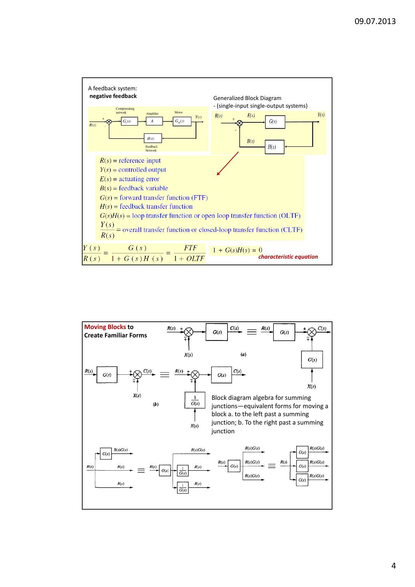
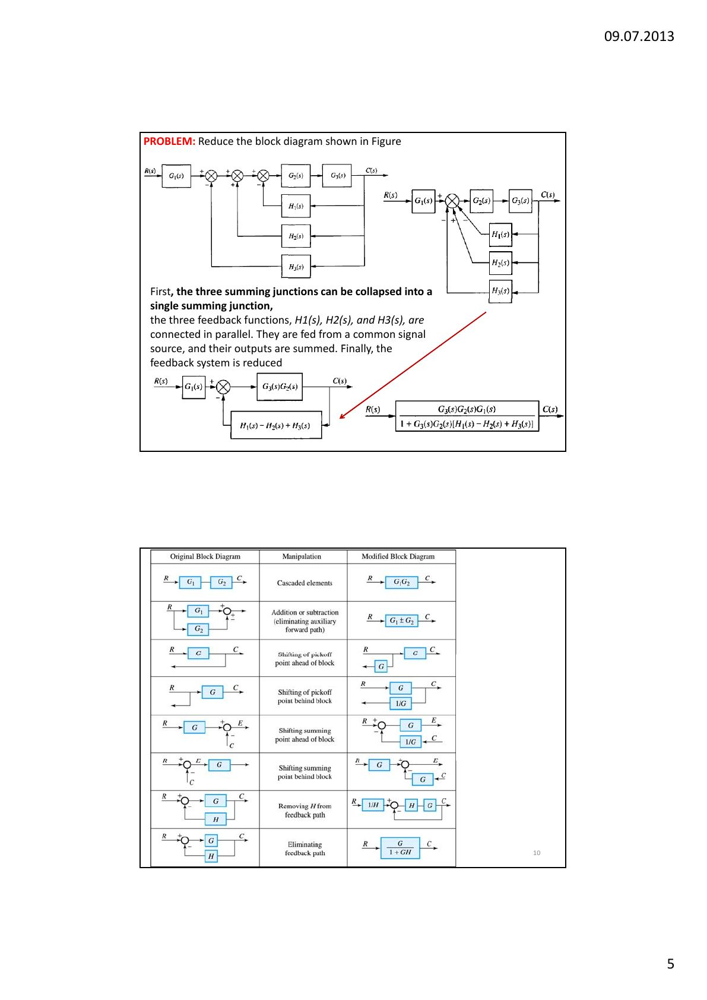
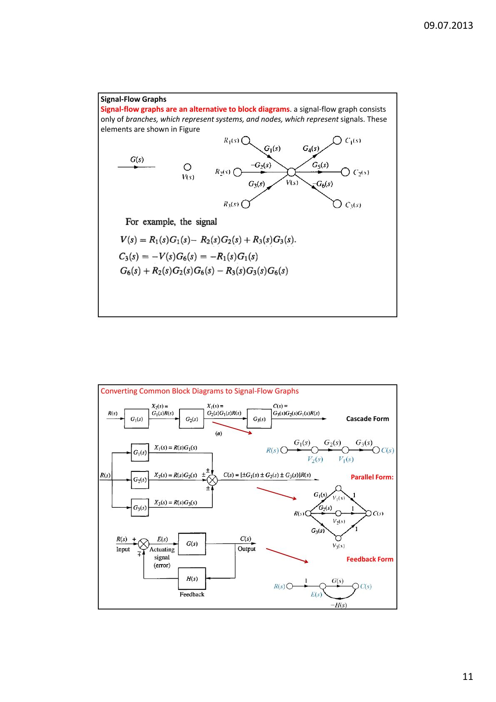
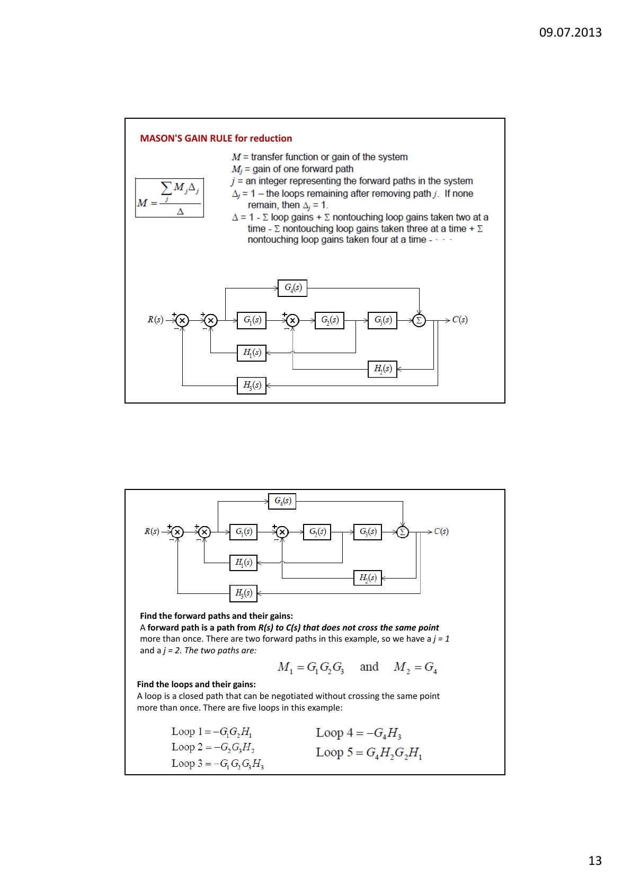
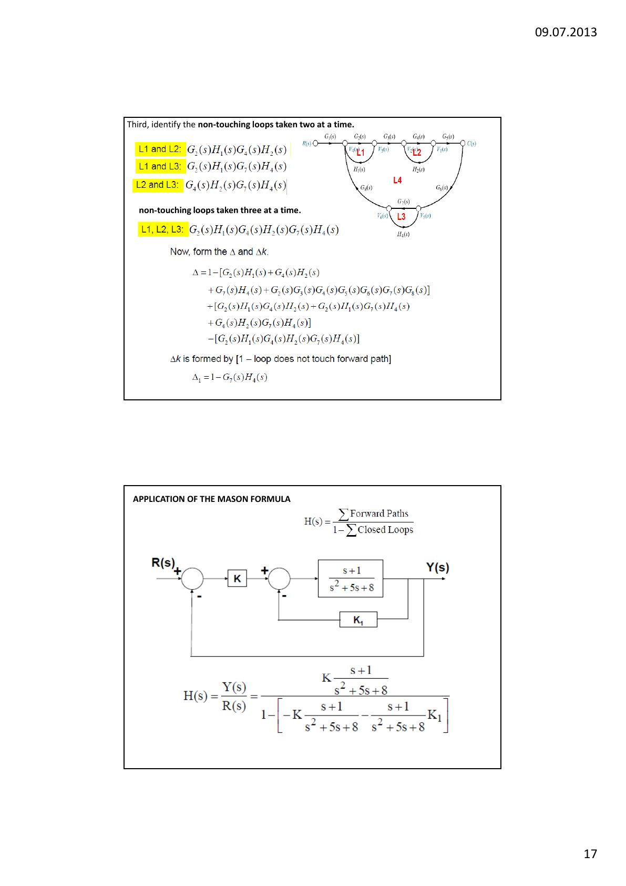

Bu yazı, Başkent Üniversitesi **EEM322 Denetim Sistemleri** dersinin **4. ders notudur** ("EEM322 – Lecture 4"). Notlar dersi veren **Hamit Erdem**'e ait; sayfa başlarında 09.07.2013 tarihi var. Ders notu İngilizce, sayfa başına iki slayt yerleştirilmiş 18 sayfalık bir PDF; örneklerin çoğu Nise'nin *Control Systems Engineering* kitabından. Aşağıda içerik Türkçe olarak özetlendi, sonuçlar yazıya döküldü; diyagramlar için sayfa görselleri eklendi. Orijinal PDF yazının sonunda indirilebilir.

Konular:

- Sistemlerin blok diyagramıyla gösterimi
- İşaret akış grafikleri (signal-flow graphs)
- Blok diyagramı indirgeme
- İşaret akış grafiği indirgeme
- Mason kuralı

## Blok diyagramı mı, işaret akış grafiği mi?

Birden çok alt sistem iki şekilde gösterilir: **blok diyagramları** (genellikle frekans düzlemi analizinde) ve **işaret akış grafikleri** (genellikle durum uzayı analizinde). İşaret akış grafikleri transfer fonksiyonlarını çizgilerle, işaretleri küçük dairesel düğümlerle gösterir; toplama örtüktür. Bir sistemin transfer fonksiyonu tek bir blokla gösterilebilir; ama durum uzayında her durum değişkeninin ayrıca gösterilmesi gerekir. Notun örneğinde 24/(s³ + 9s² + 26s + 24) transfer fonksiyonunun durum değişkenlerini açıkça göstermek için yedi blok ve bir toplama noktası gerekiyor. Bu yüzden işaret akış grafikleri daha hızlı çizilir, daha derli topludur ve durum değişkenlerini öne çıkarır.

## Blok diyagramının elemanları

Bir alt sistem; girişi, çıkışı ve transfer fonksiyonu olan bir blokla gösterilir. Alt sistemler birbirine bağlandığında iki yeni eleman eklenir: **toplama noktası** (summing junction) ve **ayrılma noktası** (pickoff point). Doğrusal, zamanla değişmeyen bir sistemin blok diyagramı bu dört elemandan oluşur: işaretler, sistem (blok), toplama noktası ve ayrılma noktası.

## Temel bağlantı biçimleri

### Seri (kaskad) bağlantı

Eşdeğer transfer fonksiyonu alt sistemlerin transfer fonksiyonlarının çarpımıdır: G_e(s) = G₃(s)G₂(s)G₁(s). Bu sonuç, alt sistemlerin birbirini **yüklemediği** varsayımıyla elde edilmiştir; yani bir alt sistemin çıkışı, sonraki alt sistem bağlansa da bağlanmasa da aynı kalmalıdır. Çıkış değişiyorsa sonraki alt sistem öncekini yükler ve eşdeğer transfer fonksiyonu tek tek transfer fonksiyonlarının çarpımı olmaz.

Notta iki RC devresi örnek veriliyor: Her biri tek başına G₁(s) = (1/R₁C₁)/(s + 1/R₁C₁) ve G₂(s) = (1/R₂C₂)/(s + 1/R₂C₂) transfer fonksiyonuna sahip. Doğrudan bağlandıklarında çevre ya da düğüm denklemleriyle bulunan doğru sonuç

G(s) = (1/R₁C₁R₂C₂) / (s² + (1/R₁C₁ + 1/R₂C₂ + 1/R₂C₁)s + 1/R₁C₁R₂C₂)

olur ve G₁G₂ çarpımından farklıdır (fark, 1/R₂C₁ terimidir). **Yüklemeyi önlemenin** bir yolu iki devre arasına bir yükselteç koymaktır: Yükseltecin giriş empedansı yüksek olduğu için önceki devreyi yüklemez; çıkış empedansı düşük olduğu için sonraki devreye saf bir gerilim kaynağı gibi görünür. Bu durumda eşdeğer transfer fonksiyonu, transfer fonksiyonları ile yükselteç kazancı K'nın çarpımıdır: G(s) = K·G₁(s)G₂(s).

### Paralel bağlantı

Paralel alt sistemlerin girişi ortaktır; çıkış, bütün alt sistem çıkışlarının cebirsel toplamıdır: G_e(s) = ±G₁(s) ± G₂(s) ± G₃(s).

### Geri beslemeli bağlantı

E(s) = R(s) ∓ C(s)H(s) ve C(s) = E(s)G(s) yazılıp E(s) yok edilirse:

C(s)/R(s) = G(s) / (1 ± G(s)H(s))

Paydaki işaret negatif geri besleme için +, pozitif geri besleme için −'dir. Genel tek girişli tek çıkışlı geri beslemeli sistemde R(s) referans giriş, Y(s) denetlenen çıkış, E(s) hata (eyletim) işareti, B(s) geri besleme değişkeni, G(s) ileri yol transfer fonksiyonu (FTF), H(s) geri besleme transfer fonksiyonu, G(s)H(s) çevrim ya da açık çevrim transfer fonksiyonu (OLTF), Y(s)/R(s) ise kapalı çevrim transfer fonksiyonudur (CLTF):

Y(s)/R(s) = G(s)/(1 + G(s)H(s)) = FTF/(1 + OLTF),  karakteristik denklem: 1 + G(s)H(s) = 0

## Blok diyagramı indirgeme

Tanıdık biçimler (seri, paralel, geri besleme) oluşturmak için bloklar toplama noktalarının sağına ya da soluna, ayrılma noktalarının önüne ya da arkasına kaydırılır. Notta "blok diyagramı cebiri" tablosu veriliyor: seri blokların birleştirilmesi, ileri yolda toplama ya da çıkarma, ayrılma noktasının bloğun önüne ya da arkasına kaydırılması, toplama noktasının bloğun önüne ya da arkasına kaydırılması, geri besleme çevriminin kaldırılması ve geri besleme yolunun yok edilmesi.

**Örnek 1 (toplama noktalarını birleştirme):** Üç toplama noktası tek bir toplama noktasında birleştirilir; H₁(s), H₂(s) ve H₃(s) geri besleme fonksiyonları ortak bir işaretten beslendikleri ve çıkışları toplandığı için paraleldir; son olarak geri besleme sistemi indirgenir:

C(s)/R(s) = G₃G₂G₁ / (1 + G₃G₂[H₁ − H₂ + H₃])

**Örnek 2 (ayrılma noktasını kaydırma):** a ayrılma noktası c'ye taşınır ve çerçevelenen geri besleme çevrimi sadeleştirilir:

Y/R = G₁G₂ / (1 + G₁ + G₂)

**Örnek 3 (blokları kaydırarak indirgeme):** Önce G₂(s) ayrılma noktasının soluna kaydırılarak paralel alt sistemler oluşturulur ve G₃(s), H₃(s)'ten oluşan geri besleme sistemi indirgenir. Sonra 1/G₂(s) ile birimin paralel çifti indirgenir ve G₁(s) toplama noktasının sağına itilerek geri beslemede paralel alt sistemler oluşturulur. Sonuç:

C(s)/R(s) = G₁G₃[1 + G₂] / ([1 + G₂H₂ + G₁G₂H₁][1 + G₃H₃])

**Kapalı çevrim transfer fonksiyonu (çevrimler iç içe ve ileri yolla temas hâlindeyse):**

C(s)/R(s) = (ileri yoldaki transfer fonksiyonlarının çarpımı) / (1 − Σ her çevredeki transfer fonksiyonlarının çarpımı)

Not: Pozitif geri besleme çevrimi paydada negatif bir terim verir.

**Örnek 4:** İleri yolunda 2s + 4 ve 1/s² bulunan birim geri beslemeli sistem:

T(s) = [(2s + 4)/s²] / [1 + (2s + 4)/s²] = (2s + 4)/(s² + 2s + 4)

**Örnek 5:** Notun 10. sayfasındaki sistem için ayrılma noktaları kaydırılarak T(s) = (G₁G₂G₅ + G₁G₆)/(1 − G₁G₃ + G₁G₂G₄) bulunuyor.

## İşaret akış grafikleri

İşaret akış grafiği yalnızca **dallardan** (sistemleri temsil eder) ve **düğümlerden** (işaretleri temsil eder) oluşur. Bir düğümdeki işaret, o düğüme giren dalların işaret × kazanç toplamıdır; örneğin V(s) = R₁(s)G₁(s) − R₂(s)G₂(s) + R₃(s)G₃(s).

Blok diyagramından işaret akış grafiğine geçiş:

1. Önce işaret düğümleri (toplama noktalarının çıkışları, blokların çıkışları, giriş ve çıkış) belirlenip işaretlenir.
1. Düğümler, aralarındaki transfer fonksiyonlarını taşıyan dallarla bağlanır; çıkarma için dal kazancına eksi işareti konur.
1. Gereksiz düğümler kaldırılarak grafik sadeleştirilir.

Notta bir de ödev var: verilen işaret akış grafiğini sadeleştirin ve verilen blok diyagramını işaret akış grafiğine çevirin.

## Mason kazanç kuralı

Mason kuralı, bir işaret akış grafiğini tek bir formülle tek bir transfer fonksiyonuna indirger:

M = C(s)/R(s) = Σⱼ Mⱼ Δⱼ / Δ

- M: sistemin transfer fonksiyonu (kazancı)
- Mⱼ: j. ileri yolun kazancı
- j: ileri yolları numaralandıran tam sayı
- Δ = 1 − Σ çevrim kazançları + Σ ikişer alınan temas etmeyen çevrim kazançları − Σ üçer alınan temas etmeyen çevrim kazançları + Σ dörder alınan … 
- Δⱼ: j. yol çıkarıldığında geriye kalan çevrimlerle oluşturulan Δ; hiç çevrim kalmıyorsa Δⱼ = 1.

Tanımlar:

- **Yol:** Aynı yönde, ardışık dallardan oluşan bağlantı.
- **Çevrim:** Hiçbir düğümden iki kez geçmeyen kapalı yol; çevrim kazancı, bir düğümden başlayıp aynı düğümde biten yol boyunca dal kazançlarının çarpımıdır.
- **İleri yol:** Giriş (kaynak) düğümünden çıkış (yutak) düğümüne, hiçbir düğümden bir kereden fazla geçmeden giden yol; ileri yol kazancı bu yol boyunca kazançların çarpımıdır.
- **Temas etmeyen çevrimler:** Ortak düğümü olmayan çevrimler. Bir çevrim ile bir yol da ortak düğümleri yoksa temas etmez.
- **Temas etmeyen çevrim kazancı:** İkişer, üçer, dörder… alınan temas etmeyen çevrimlerin kazanç çarpımı.

### Örnek 1

İki ileri yol vardır: M₁ = G₁G₂G₃ ve M₂ = G₄. Beş çevrim vardır:

- Çevrim 1 = −G₁G₂H₁
- Çevrim 2 = −G₂G₃H₂
- Çevrim 3 = −G₁G₂G₃H₃
- Çevrim 4 = −G₄H₃
- Çevrim 5 = G₄H₂G₂H₁

Her iki yol çıkarıldığında da tam bir çevrim kalmadığından Δ₁ = Δ₂ = 1. Temas etmeyen çevrim çifti olmadığından Δ yalnızca bir eksi çevrim kazançlarının toplamıdır:

C(s)/R(s) = (G₁G₂G₃ + G₄) / (1 + G₁G₂H₁ + G₂G₃H₂ + G₁G₂G₃H₃ + G₄H₃ − G₄H₂G₂H₁)

### Örnek 2

Notun 15.–17. sayfalarındaki işaret akış grafiğinde ileri yol G₁G₂G₃G₄G₅'tir; dört çevrim vardır: L₁ = G₂H₁, L₂ = G₄H₂, L₃ = G₇H₄, L₄ = G₂G₃G₄G₅G₆G₇G₈. İkişer temas etmeyen çevrimler L₁L₂, L₁L₃ ve L₂L₃; üçer temas etmeyen çevrimler L₁L₂L₃'tür. Buna göre:

Δ = 1 − [G₂H₁ + G₄H₂ + G₇H₄ + G₂G₃G₄G₅G₆G₇G₈] + [G₂H₁G₄H₂ + G₂H₁G₇H₄ + G₄H₂G₇H₄] − [G₂H₁G₄H₂G₇H₄]

İleri yola değmeyen tek çevrim L₃ olduğundan Δ₁ = 1 − G₇H₄ ve C(s)/R(s) = G₁G₂G₃G₄G₅(1 − G₇H₄)/Δ.

### Örnek 3: Mason formülünün uygulanması

İleri yolda K kazancı ve (s + 1)/(s² + 5s + 8) bloğu, iç çevrimde K₁ geri beslemesi, dış çevrimde birim geri besleme bulunan sistem için H(s) = Σ ileri yollar / (1 − Σ kapalı çevrimler):

H(s) = K(s + 1)/(s² + 5s + 8) / [1 − (−K(s + 1)/(s² + 5s + 8) − K₁(s + 1)/(s² + 5s + 8))]

H(s) = (Ks + K) / (s² + (5 + K + K₁)s + (8 + K + K₁))

Son sayfadaki örnekte aynı sisteme N(s) bozucu girişi eklenerek çıkışın hem R(s)'ye hem N(s)'ye göre yanıtı süperpozisyonla bulunuyor.
