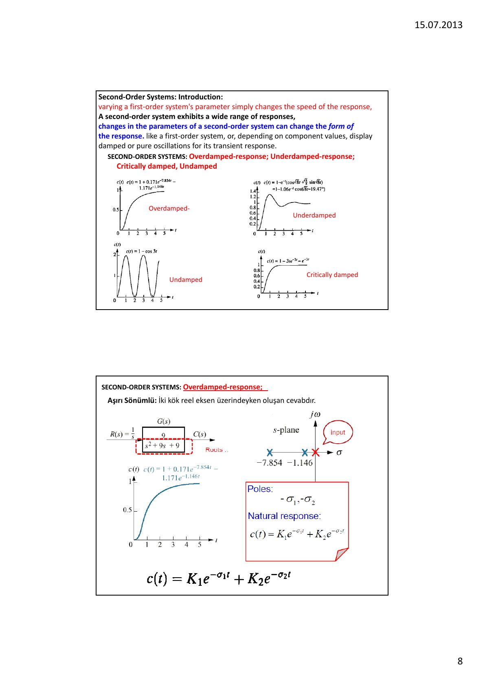
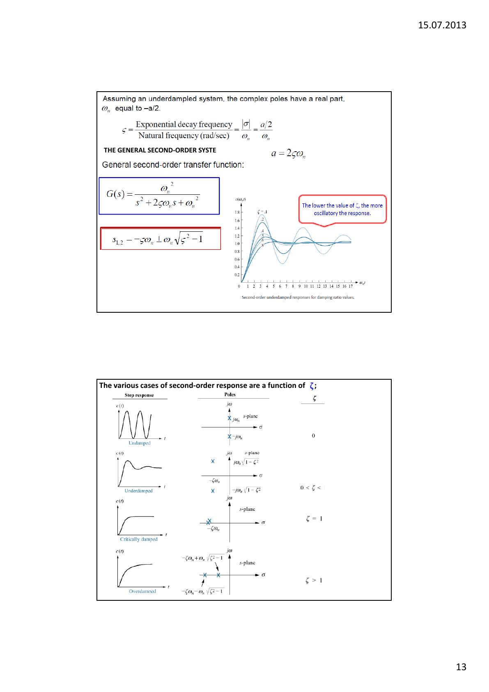
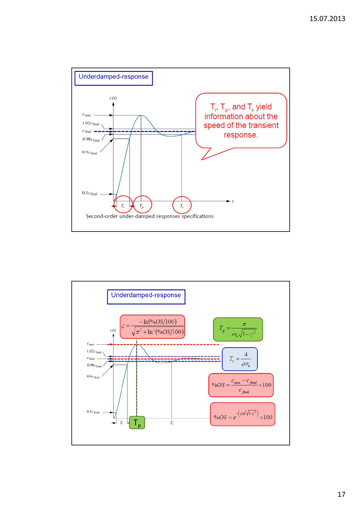
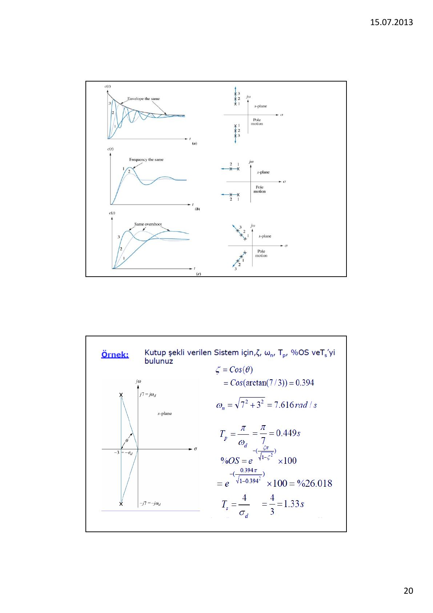

This post is the **5th lecture note** ("EEM322: Lecture 5") of the **EEM322 Control Systems** course at Başkent University. The notes belong to the instructor **Hamit Erdem**; the page headers carry the date 15.07.2013. The lecture note is a 20-page PDF with two slides per page, written in a mix of English and Turkish; some slides cite Prof. Dr. Galip Cansever's lecture notes and Nise's textbook. Below, the content is summarized in English and the numerical examples are written out; page images are included for the response curves. The original PDF can be downloaded at the end of the post.

Topics: zeros and poles of the transfer function, time response, first- and second-order systems, transient response, rise time, settling time, steady state and test input functions.

## Test input functions

- **Impulse:** r(t) = aδ(t), a constant
- **Step:** r(t) = au(t), a constant
- **Ramp:** r(t) = at for t ≥ 0, 0 for t < 0; it is the integral of the step function
- **Parabola:** r(t) = at² for t ≥ 0, 0 for t < 0; it is the integral of the ramp function

Impulse and step inputs are used to examine the transient response (rise time and settling time), and ramp and parabola inputs are used to examine the steady-state error.

## Transfer function, poles and zeros

The **transfer function** is the ratio of the Laplace transforms of the response function (output) to the driving function (input) of a system, assuming zero initial conditions. It describes the dynamic characteristics of the system and is a property of the system itself; it gives no information about its physical structure, and different physical systems can have the same transfer function.

Solving differential equations or taking inverse Laplace transforms is laborious and time-consuming. Using the poles and zeros and their relation to the time response is a much easier method.

- **Poles:** The values of s that make the transfer function infinite; the roots of the denominator. Complex poles are the natural frequencies of the system; they represent the frequencies at which energy circulates freely among the system's different internal energy-storage elements.
- **Zeros:** The values of s that make the transfer function zero; the roots of the numerator.

Example: for G(s) = K(s + 1)(s + 15) / (s(s + 3)(s + 5)(s + 8)²), the zeros are −1 and −15, and the poles are 0, −3, −5 and −8 (−8 is a double pole).

**Poles determine the nature of the response:** The poles of the input function determine the form of the **forced response**, and the poles of the transfer function determine the form of the **natural response**.

**Example:** If a unit step is applied to the system G(s) = (s + 2)/(s + 5):

C(s) = (s + 2)/(s(s + 5)) = (2/5)/s + (3/5)/(s + 5)  →  c(t) = 2/5 + (3/5)e^(−5t)

Conclusions from this example:

1. The pole of the input function generates the form of the forced solution (the unit step pole at the origin produces a step function at the output).
1. The pole of the transfer function generates the natural response (the pole at −5 generates e^(−5t)).
1. A pole on the real axis generates an exponential response of the form e^(−αt); the farther the pole is to the left of the origin, the faster the exponential transient decays.
1. The zero contributes to the formation of the response amplitudes both in the steady state and in the transient regime.

### Writing the response from the poles

Each system pole on the real axis generates an exponential term that is a component of the natural response; the input pole generates the forced response. For example, if a unit step is applied to the system (s + 3)/((s + 2)(s + 4)(s + 5)), then c(t) ≡ K₁ + K₂e^(−2t) + K₃e^(−4t) + K₄e^(−5t): the first term is the forced response and the others are the natural response.

**Problem:** Write the general form of the unit step response of the system G(s) = 10(s + 4)(s + 6) / ((s + 1)(s + 7)(s + 8)(s + 10)).

**Answer:** c(t) ≡ A + Be^(−t) + Ce^(−7t) + De^(−8t) + Ee^(−10t)

## First-order systems

A first-order system with no zero: G(s) = a/(s + a). Unit step response:

C(s) = a/(s(s + a))  →  c(t) = c_f(t) + c_n(t) = 1 − e^(−at)

The input pole at the origin generates the forced response c_f(t) = 1, and the system pole at −a generates the natural response c_n(t) = −e^(−at). The only parameter needed to describe the transient response is a.

- **Time constant (τ = 1/a):** At t = 1/a, e^(−at) = e^(−1) = 0.37, so c(t) = 1 − 0.37 = 0.63. The time constant is the time for e^(−at) to decay to 37% of its initial value, or for the step response to rise to 63% of its final value. If a = 1, the system responds on the order of 1 second; if a = 100, on the order of 0.01 second; fast systems have large values of a.
- **Rise time (T_r):** The time for the response to go from 0.1 to 0.9 of its final value. For 0.1 = 1 − e^(−at), t₁ = 0.11/a; for 0.9 = 1 − e^(−at), t₂ = 2.31/a; hence T_r = 2.31/a − 0.11/a = **2.2/a**.
- **Settling time (T_s):** The time for the response to reach within ±2% of its final value and stay there. For c(t) = 0.98, −at = ln 0.02 = −3.912, hence T_s = **4/a**.

A first-order system is also commonly written in the form G(s) = K/(τs + 1); K is the system gain and τ is the time constant. If the pole-zero form is G(s) = K_p/(s + a), then K_p = K/τ and a = 1/τ. The total response is split as y(t) = y_forced(t) + y_free(t).

## Second-order systems

Changing the parameter of a first-order system only changes the speed of the response. In a second-order system, however, changing the parameters can change the **form** of the response: the response may resemble that of a first-order system, or, depending on the element values, it may show damped or pure oscillations.

| Type | Poles | Natural response c(t) |
|---|---|---|
| Overdamped | Two distinct real roots: −σ₁, −σ₂ | K₁e^(−σ₁t) + K₂e^(−σ₂t) |
| Underdamped | Complex conjugates: −σ_d ± jω_d | Ae^(−σ_d t) cos(ω_d t − φ) |
| Undamped | On the imaginary axis: ± jω₁ | A cos(ω₁t − φ) |
| Critically damped | Repeated real root: −σ₁ | K₁e^(−σ₁t) + K₂te^(−σ₁t) |

- **Overdamped:** Occurs when both roots lie on the real axis. In the note's example, the poles of the system 9/(s² + 9s + 9) are −7.854 and −1.146.
- **Undamped (oscillatory):** Occurs when both roots lie on the imaginary axis; without damping, a pure sinusoidal response would be obtained. Example: 9/(s² + 9), poles ±j3.
- **Critically damped:** There is a double root on the negative real axis. Critically damped responses are the fastest responses that can be obtained without the overshoot characteristic of the underdamped response. Example: 9/(s² + 6s + 9), poles −3 (double).
- **Underdamped:** There are complex conjugate poles. The real part of the pole corresponds to the exponential damping frequency of the sinusoid's amplitude, and the imaginary part corresponds to the oscillation frequency of the sinusoid. The frequency of the sinusoid is called the **damped oscillation frequency** ω_d. Example: 9/(s² + 2s + 9).

**Example (form of the underdamped response):** The poles of the system 200/(s² + 10s + 200) are s = −5 ± j13.23. The real part −5 is the exponential frequency of the damping and is the inverse of the damping time constant of the oscillations; the imaginary part 13.23 is the angular frequency of the sinusoidal oscillations. Unit step response:

c(t) = K₁ + e^(−5t)(K₂ cos 13.23t + K₃ sin 13.23t) = K₁ + K₄e^(−5t) cos(13.23t − φ),  φ = tan⁻¹(K₃/K₂), K₄ = √(K₂² + K₃²)

**Examples (general form of the unit step response):**

| Transfer function | Form of the response |
|---|---|
| G(s) = 400/(s² + 12s + 400) | c(t) = A + Be^(−6t) cos(19.08t + φ) |
| G(s) = 900/(s² + 90s + 900) | c(t) = A + Be^(−78.54t) + Ce^(−11.46t) |
| G(s) = 225/(s² + 30s + 225) | c(t) = A + Be^(−15t) + Cte^(−15t) |
| G(s) = 625/(s² + 625) | c(t) = A + B cos(25t + φ) |

## General second-order system: natural frequency and damping ratio

To describe the second-order transient response, two quantities with physical meaning are defined, analogous to the time constant of a first-order system:

- **Natural frequency (ω_n):** The oscillation frequency of the second-order system when there is no damping. For example, the oscillation frequency of a series RLC circuit with its resistance short-circuited is the natural frequency.
- **Damping ratio (ζ):** ζ = exponential decay frequency / natural frequency (rad/s) = (1/2π) · natural period / exponential time constant. For underdamped systems, ζ lies between 0 and 1.

For the general system G(s) = b/(s² + as + b), when there is no damping (a = 0) the poles are at ±j√b, so ω_n = √b, b = ω_n². In the underdamped system the real part of the complex poles is σ = −a/2, so ζ = |σ|/ω_n = (a/2)/ω_n, i.e., a = 2ζω_n. The general second-order transfer function is:

G(s) = ω_n² / (s² + 2ζω_n s + ω_n²),  s₁,₂ = −ζω_n ± ω_n√(ζ² − 1)

| ζ | Response |
|---|---|
| ζ = 0 | Undamped |
| 0 < ζ < 1 | Underdamped |
| ζ = 1 | Critically damped |
| ζ > 1 | Overdamped |

**Example:** For G(s) = 36/(s² + 4.2s + 36), ω_n² = 36 → ω_n = 6 and 2ζω_n = 4.2 → ζ = 4.2/(2 × 6) = 0.35.

**Example:** In the system 12/(s² + 8s + 12), ζ = 8/(2√12) = 1.155 > 1, so the response is **overdamped**. In the system 16/(s² + 8s + 16), ζ = 8/(2√16) = 1, so the response is **critically damped**.

**Example:** ζ and ω_n for the following systems:

1. 400/(s² + 12s + 400): ζ = 0.3, ω_n = 20; underdamped.
1. 900/(s² + 90s + 900): ζ = 1.5, ω_n = 30; overdamped.
1. 225/(s² + 30s + 225): ζ = 1, ω_n = 15; critically damped.
1. 625/(s² + 625): ζ = 0, ω_n = 25; undamped.

## Performance measures of the underdamped second-order system

The step response of the general system is found by partial fraction expansion and taking the inverse Laplace transform:

c(t) = 1 − (1/√(1 − ζ²)) e^(−ζω_n t) cos(ω_n√(1 − ζ²) t − φ),  φ = tan⁻¹(ζ/√(1 − ζ²))

The smaller ζ is, the more oscillatory the response. Other parameters associated with the underdamped response:

- **Rise time T_r:** The time for the response to go from 0.1 to 0.9 of the final value (from 10% to 90% of the system response).
- **Peak time T_p:** The time for the response to reach the first (largest) peak.
- **Percent overshoot (%OS):** How much the response exceeds the steady-state value at the peak time, as a percentage of the steady-state value.
- **Settling time T_s:** The time for the transient damped oscillations to reach within ±2% of the steady-state value and stay there.

This information is important for the designer to decide whether the speed or quality of the response degrades system performance. For example, the time a CD reader head takes to settle in order to read the information affects the performance of the whole computer.

**Finding T_p:** Differentiate c(t) and find the first zero crossing after t = 0; this is made easier in the frequency domain by "differentiating" (sC(s)):

ċ(t) = (ω_n/√(1 − ζ²)) e^(−ζω_n t) sin(ω_n√(1 − ζ²) t)

Setting the derivative to zero gives ω_n√(1 − ζ²) t = nπ, i.e., t = nπ/(ω_n√(1 − ζ²)). Each value of n indicates a local maximum or minimum; n = 0 corresponds to the instant t = 0, where the slope is zero; n = 1 gives the first peak time:

T_p = π / (ω_n√(1 − ζ²))

**%OS:** %OS = (c_max − c_final)/c_final × 100 = e^(−ζπ/√(1 − ζ²)) × 100. Conversely, ζ = −ln(%OS/100) / √(π² + ln²(%OS/100)).

**T_s:** To find the settling time, calculate the time at which c(t) reaches 2% of the steady-state value; by definition, settling occurs when the envelope of the damped sinusoid reaches 0.02. Result: T_s = 4/(ζω_n).

**T_r:** There is no simple analytical relationship between rise time and damping ratio; the note gives a table and a graph showing the variation of ω_n·T_r with ζ.

### Example: G(s) = 100/(s² + 15s + 100)

ω_n = √100 = 10, ζ = 15/(2√100) = 0.75

- T_p = π / (10√(1 − 0.75²)) = 0.475 s
- %OS = e^(−0.75π/√(1 − 0.75²)) × 100 = 2.838
- T_s = 4/(0.75 × 10) = 0.533 s
- From the figure (the normalized rise time graph), T_r = 2.3/10 = 0.23 s

## Relationship between pole location and performance measures

The poles of the underdamped second-order system are s₁,₂ = −σ_d ± jω_d; here σ_d = ζω_n is the **exponential damping frequency** and ω_d = ω_n√(1 − ζ²) is the **damped oscillation frequency**. The radial distance from the origin to the pole equals the natural frequency ω_n, and for the angle θ that the line joining the pole to the origin makes with the negative real axis, cos θ = ζ. Thus:

T_p = π/ω_d,  T_s = 4/σ_d

The following conclusions follow: if the poles move parallel to the imaginary axis (σ_d constant), the envelope stays the same and the settling time does not change; if they move parallel to the real axis (ω_d constant), the oscillation frequency and peak time stay the same; if they move along the same line through the origin (ζ constant), the percent overshoot stays the same.

### Example: system with poles −3 ± j7

- ζ = cos θ = cos(arctan(7/3)) = 0.394
- ω_n = √(7² + 3²) = 7.616 rad/s
- T_p = π/ω_d = π/7 = 0.449 s
- %OS = e^(−0.394π/√(1 − 0.394²)) × 100 = 26.018%
- T_s = 4/σ_d = 4/3 = 1.33 s
