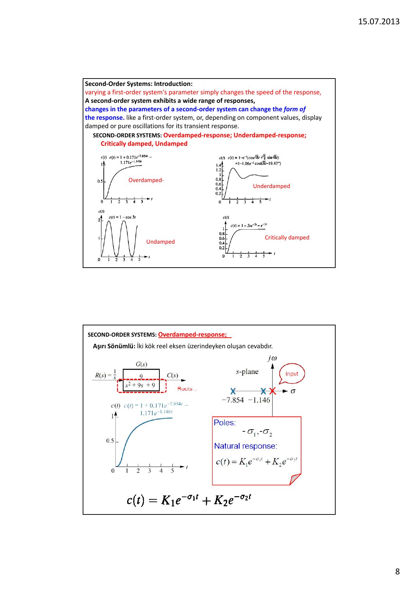
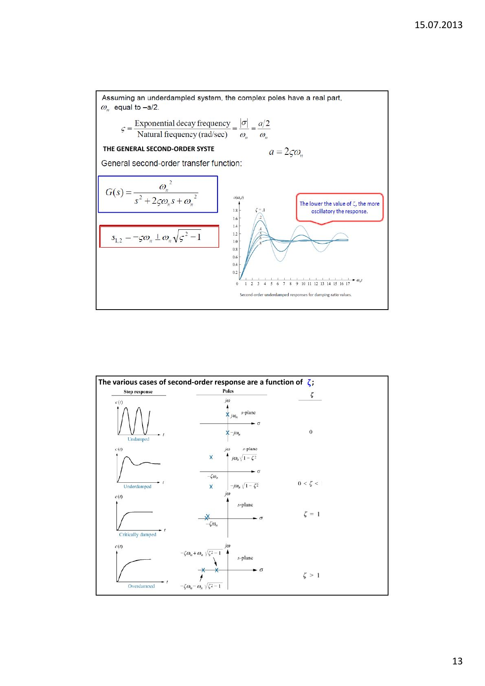
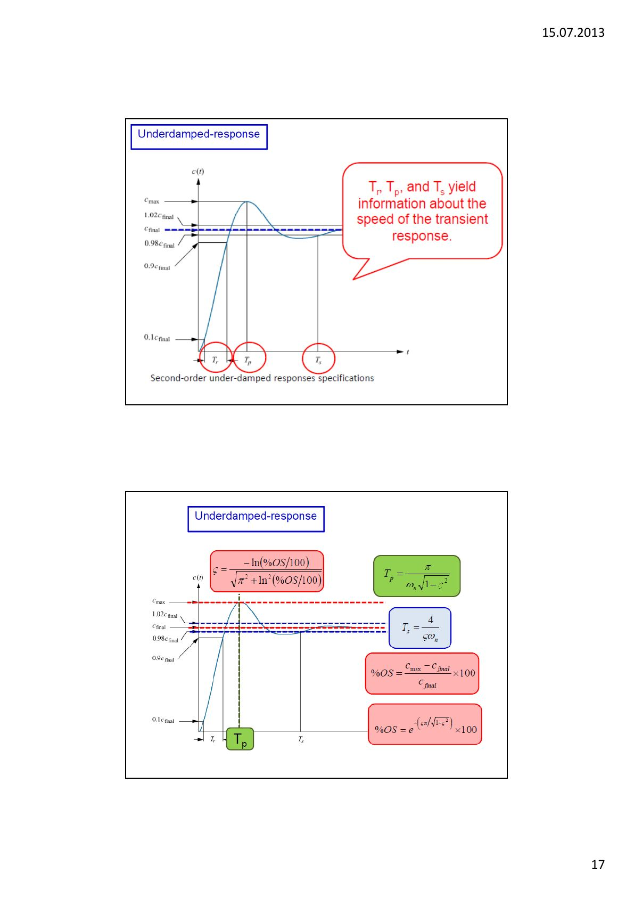
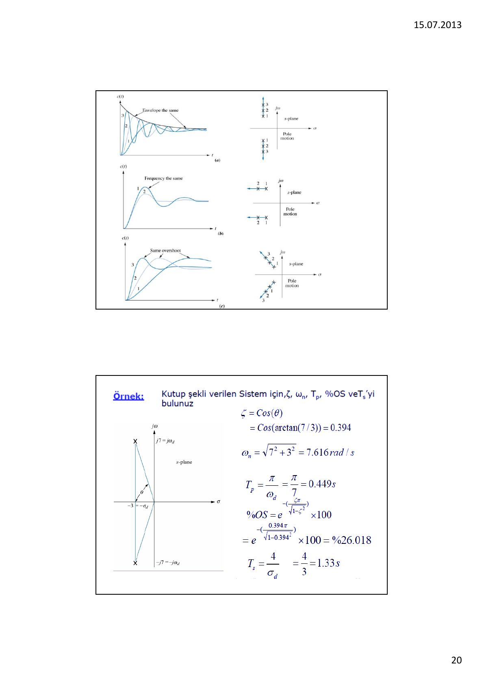

Bu yazı, Başkent Üniversitesi **EEM322 Denetim Sistemleri** dersinin **5. ders notudur** ("EEM322: Lecture 5"). Notlar dersi veren **Hamit Erdem**'e ait; sayfa başlarında 15.07.2013 tarihi var. Ders notu İngilizce ve Türkçe karışık, sayfa başına iki slayt yerleştirilmiş 20 sayfalık bir PDF; bazı slaytlarda Prof. Dr. Galip Cansever'in ders notlarına ve Nise'nin kitabına kaynak gösteriliyor. Aşağıda içerik Türkçe olarak özetlendi ve sayısal örnekler yazıya döküldü; yanıt eğrileri için sayfa görselleri eklendi. Orijinal PDF yazının sonunda indirilebilir.

Konular: transfer fonksiyonunun sıfırları ve kutupları, zaman yanıtı, birinci ve ikinci dereceden sistemler, geçici yanıt, yükselme süresi, yerleşme süresi, kalıcı durum ve test giriş fonksiyonları.

## Test giriş fonksiyonları

- **Dürtü:** r(t) = aδ(t), a sabit
- **Basamak:** r(t) = au(t), a sabit
- **Rampa:** t ≥ 0 için r(t) = at, t < 0 için 0; basamak fonksiyonunun integralidir
- **Parabol:** t ≥ 0 için r(t) = at², t < 0 için 0; rampa fonksiyonunun integralidir

Dürtü ve basamak girişleri geçici yanıtı (yükselme ve yerleşme süresi), rampa ve parabol girişleri kalıcı durum hatasını incelemek için kullanılır.

## Transfer fonksiyonu, kutuplar ve sıfırlar

**Transfer fonksiyonu**, başlangıç koşulları sıfır kabul edilerek bir sistemin yanıt fonksiyonu (çıkış) ile sürücü fonksiyonu (giriş) arasındaki Laplace dönüşümlerinin oranıdır. Sistemin dinamik özelliklerini tanımlar ve sistemin kendi özelliğidir; fiziksel yapısı hakkında bilgi vermez, farklı fiziksel sistemlerin transfer fonksiyonları aynı olabilir.

Diferansiyel denklem çözmek ya da ters Laplace dönüşümü almak zahmetli ve zaman alıcıdır. Kutupları ve sıfırları ve bunların zaman yanıtıyla ilişkisini kullanmak çok daha kolay bir yöntemdir.

- **Kutuplar:** Transfer fonksiyonunu sonsuz yapan s değerleri; paydanın kökleri. Karmaşık kutuplar sistemin doğal frekanslarıdır; enerjinin sistemin farklı iç enerji depolama elemanları arasında serbestçe dolaştığı frekansları temsil eder.
- **Sıfırlar:** Transfer fonksiyonunu sıfır yapan s değerleri; payın kökleri.

Örnek: G(s) = K(s + 1)(s + 15) / (s(s + 3)(s + 5)(s + 8)²) için sıfırlar −1 ve −15, kutuplar 0, −3, −5 ve −8'dir (−8 çift katlı).

**Kutuplar yanıtın niteliğini belirler:** Giriş fonksiyonunun kutupları **zorlanmış yanıtın**, transfer fonksiyonunun kutupları **doğal yanıtın** biçimini belirler.

**Örnek:** G(s) = (s + 2)/(s + 5) sistemine birim basamak uygulanırsa:

C(s) = (s + 2)/(s(s + 5)) = (2/5)/s + (3/5)/(s + 5)  →  c(t) = 2/5 + (3/5)e^(−5t)

Bu örnekten çıkan sonuçlar:

1. Giriş fonksiyonunun kutbu zorlanmış çözümün biçimini üretir (orijindeki birim basamak kutbu çıkışta bir basamak fonksiyonu oluşturur).
1. Transfer fonksiyonunun kutbu doğal yanıtı üretir (−5'teki kutup e^(−5t)'yi üretir).
1. Gerçel eksendeki bir kutup e^(−αt) biçiminde üstel bir yanıt üretir; kutup orijinden ne kadar soldaysa üstel geçici yanıt o kadar hızlı söner.
1. Sıfır, hem kalıcı durumda hem geçici rejimde yanıtın genliklerinin oluşmasına katkıda bulunur.

### Yanıtı kutuplardan yazmak

Gerçel eksendeki her sistem kutbu, doğal yanıtın bileşeni olan bir üstel terim üretir; giriş kutbu zorlanmış yanıtı üretir. Örneğin (s + 3)/((s + 2)(s + 4)(s + 5)) sistemine birim basamak uygulanırsa c(t) ≡ K₁ + K₂e^(−2t) + K₃e^(−4t) + K₄e^(−5t) olur: ilk terim zorlanmış, diğerleri doğal yanıttır.

**Problem:** G(s) = 10(s + 4)(s + 6) / ((s + 1)(s + 7)(s + 8)(s + 10)) sisteminin birim basamak yanıtını genel biçimde yazın.

**Cevap:** c(t) ≡ A + Be^(−t) + Ce^(−7t) + De^(−8t) + Ee^(−10t)

## Birinci dereceden sistemler

Sıfırı olmayan birinci dereceden sistem G(s) = a/(s + a). Birim basamak yanıtı:

C(s) = a/(s(s + a))  →  c(t) = c_f(t) + c_n(t) = 1 − e^(−at)

Orijindeki giriş kutbu zorlanmış yanıtı c_f(t) = 1, −a'daki sistem kutbu doğal yanıtı c_n(t) = −e^(−at) üretir. Geçici yanıtı tanımlamak için gereken tek parametre a'dır.

- **Zaman sabiti (τ = 1/a):** t = 1/a'da e^(−at) = e^(−1) = 0.37, dolayısıyla c(t) = 1 − 0.37 = 0.63. Zaman sabiti, e^(−at)'nin başlangıç değerinin %37'sine düşmesi ya da basamak yanıtının son değerinin %63'üne yükselmesi için geçen süredir. a = 1 ise sistem 1 saniye mertebesinde, a = 100 ise 0.01 saniye mertebesinde yanıt verir; hızlı sistemlerin a değeri büyüktür.
- **Yükselme süresi (T_r):** Yanıtın son değerinin 0.1'inden 0.9'una çıkması için geçen süre. 0.1 = 1 − e^(−at) için t₁ = 0.11/a, 0.9 = 1 − e^(−at) için t₂ = 2.31/a, dolayısıyla T_r = 2.31/a − 0.11/a = **2.2/a**.
- **Yerleşme süresi (T_s):** Yanıtın son değerinin ±%2'sine ulaşıp orada kalması için geçen süre. c(t) = 0.98 için −at = ln 0.02 = −3.912, dolayısıyla T_s = **4/a**.

Birinci dereceden sistem genel olarak G(s) = K/(τs + 1) biçiminde de yazılır; K sistem kazancı, τ zaman sabitidir. Kutup-sıfır biçimi G(s) = K_p/(s + a) ise K_p = K/τ, a = 1/τ'dur. Toplam yanıt y(t) = y_zorlanmış(t) + y_serbest(t) olarak ayrılır.

## İkinci dereceden sistemler

Birinci dereceden bir sistemin parametresini değiştirmek yalnızca yanıtın hızını değiştirir. İkinci dereceden sistemde ise parametrelerin değişmesi yanıtın **biçimini** değiştirebilir: yanıt birinci dereceden bir sistem gibi olabileceği gibi, eleman değerlerine bağlı olarak sönümlü ya da saf salınımlar da gösterebilir.

| Tür | Kutuplar | Doğal yanıt c(t) |
|---|---|---|
| Aşırı sönümlü (overdamped) | İki ayrı gerçel kök: −σ₁, −σ₂ | K₁e^(−σ₁t) + K₂e^(−σ₂t) |
| Sönümlü (underdamped) | Karmaşık eşlenik: −σ_d ± jω_d | Ae^(−σ_d t) cos(ω_d t − φ) |
| Sönümsüz (undamped) | Sanal eksende: ± jω₁ | A cos(ω₁t − φ) |
| Kritik sönümlü (critically damped) | Katlı gerçel kök: −σ₁ | K₁e^(−σ₁t) + K₂te^(−σ₁t) |

- **Aşırı sönümlü:** İki kök gerçel eksen üzerindeyken oluşur. Notun örneğinde 9/(s² + 9s + 9) sisteminin kutupları −7.854 ve −1.146'dır.
- **Sönümsüz (salınımlı):** İki kök sanal eksen üzerindeyken oluşur; sönüm olmasaydı saf sinüs biçiminde bir yanıt elde edilirdi. Örnek: 9/(s² + 9), kutuplar ±j3.
- **Kritik sönümlü:** Negatif gerçel eksende iki katlı kök vardır. Kritik sönümlü yanıtlar, sönümlü yanıta özgü aşım olmadan elde edilebilecek en hızlı yanıtlardır. Örnek: 9/(s² + 6s + 9), kutuplar −3 (çift).
- **Sönümlü:** Karmaşık eşlenik kutuplar vardır. Kutbun gerçel kısmı sinüsün genliğinin üstel sönüm frekansına, sanal kısmı sinüsün salınım frekansına karşılık gelir. Sinüsün frekansına **sönümlü salınım frekansı** ω_d denir. Örnek: 9/(s² + 2s + 9).

**Örnek (sönümlü yanıtın biçimi):** 200/(s² + 10s + 200) sisteminin kutupları s = −5 ± j13.23'tür. Gerçel kısım −5 sönümün üstel frekansıdır ve salınımların sönüm zaman sabitinin tersidir; sanal kısım 13.23 sinüs salınımlarının açısal frekansıdır. Birim basamak yanıtı:

c(t) = K₁ + e^(−5t)(K₂ cos 13.23t + K₃ sin 13.23t) = K₁ + K₄e^(−5t) cos(13.23t − φ),  φ = tan⁻¹(K₃/K₂), K₄ = √(K₂² + K₃²)

**Örnekler (birim basamak yanıtının genel biçimi):**

| Transfer fonksiyonu | Yanıtın biçimi |
|---|---|
| G(s) = 400/(s² + 12s + 400) | c(t) = A + Be^(−6t) cos(19.08t + φ) |
| G(s) = 900/(s² + 90s + 900) | c(t) = A + Be^(−78.54t) + Ce^(−11.46t) |
| G(s) = 225/(s² + 30s + 225) | c(t) = A + Be^(−15t) + Cte^(−15t) |
| G(s) = 625/(s² + 625) | c(t) = A + B cos(25t + φ) |

## Genel ikinci dereceden sistem: doğal frekans ve sönüm oranı

İkinci dereceden geçici yanıtı tanımlamak için, birinci dereceden sistemdeki zaman sabiti gibi, fiziksel anlamı olan iki büyüklük tanımlanır:

- **Doğal frekans (ω_n):** İkinci dereceden sistemin sönüm olmadığındaki salınım frekansı. Örneğin direnci kısa devre edilmiş bir seri RLC devresinin salınım frekansı doğal frekanstır.
- **Sönüm oranı (ζ):** ζ = üstel düşüm frekansı / doğal frekans (rad/s) = (1/2π) · doğal periyot / üstel zaman sabiti. Sönümlü sistemlerde ζ, 0 ile 1 arasındadır.

Genel sistem G(s) = b/(s² + as + b) için sönüm yokken (a = 0) kutuplar ±j√b'de olduğundan ω_n = √b, b = ω_n²'dir. Sönümlü sistemde karmaşık kutupların gerçel kısmı σ = −a/2 olduğundan ζ = |σ|/ω_n = (a/2)/ω_n, yani a = 2ζω_n. Genel ikinci dereceden transfer fonksiyonu:

G(s) = ω_n² / (s² + 2ζω_n s + ω_n²),  s₁,₂ = −ζω_n ± ω_n√(ζ² − 1)

| ζ | Yanıt |
|---|---|
| ζ = 0 | Sönümsüz |
| 0 < ζ < 1 | Sönümlü |
| ζ = 1 | Kritik sönümlü |
| ζ > 1 | Aşırı sönümlü |

**Örnek:** G(s) = 36/(s² + 4.2s + 36) için ω_n² = 36 → ω_n = 6 ve 2ζω_n = 4.2 → ζ = 4.2/(2 × 6) = 0.35.

**Örnek:** 12/(s² + 8s + 12) sisteminde ζ = 8/(2√12) = 1.155 > 1 olduğundan yanıt **aşırı sönümlüdür**. 16/(s² + 8s + 16) sisteminde ζ = 8/(2√16) = 1 olduğundan yanıt **kritik sönümlüdür**.

**Örnek:** Aşağıdaki sistemler için ζ ve ω_n:

1. 400/(s² + 12s + 400): ζ = 0.3, ω_n = 20; sönümlü.
1. 900/(s² + 90s + 900): ζ = 1.5, ω_n = 30; aşırı sönümlü.
1. 225/(s² + 30s + 225): ζ = 1, ω_n = 15; kritik sönümlü.
1. 625/(s² + 625): ζ = 0, ω_n = 25; sönümsüz.

## Sönümlü ikinci dereceden sistemin başarım ölçütleri

Genel sistemin basamak yanıtı kısmi kesirlere açılıp ters Laplace dönüşümü alınarak bulunur:

c(t) = 1 − (1/√(1 − ζ²)) e^(−ζω_n t) cos(ω_n√(1 − ζ²) t − φ),  φ = tan⁻¹(ζ/√(1 − ζ²))

ζ ne kadar küçükse yanıt o kadar salınımlıdır. Sönümlü yanıtla ilişkili diğer parametreler:

- **Yükselme süresi T_r:** Yanıtın son değerin 0.1'inden 0.9'una çıkması için geçen süre (sistem yanıtının %10'undan %90'ına).
- **Tepe zamanı T_p:** Yanıtın ilk (en büyük) tepeye ulaşması için geçen süre.
- **Yüzde aşım (%OS):** Yanıtın tepe zamanında kalıcı durum değerini ne kadar aştığı, kalıcı durum değerinin yüzdesi olarak.
- **Yerleşme süresi T_s:** Geçici sönümlü salınımların kalıcı durum değerinin ±%2'sine ulaşıp orada kalması için geçen süre.

Bu bilgiler, tasarımcının yanıtın hızının ya da niteliğinin sistem başarımını düşürüp düşürmediğine karar vermesi için önemlidir. Örneğin bir CD okuyucu kafasının bilgiyi okumak için kararlı hâle gelme süresi bütün bilgisayarın başarımını etkiler.

**T_p'nin bulunması:** c(t)'nin türevi alınıp t = 0'dan sonraki ilk sıfır geçişi bulunur; bu iş frekans düzleminde "türev alarak" (sC(s)) kolaylaştırılır:

ċ(t) = (ω_n/√(1 − ζ²)) e^(−ζω_n t) sin(ω_n√(1 − ζ²) t)

Türev sıfıra eşitlenirse ω_n√(1 − ζ²) t = nπ, yani t = nπ/(ω_n√(1 − ζ²)). n'nin her değeri yerel bir maksimum ya da minimumu gösterir; n = 0, t = 0 anına karşılık gelir ve orada eğim sıfırdır; n = 1 birinci tepe zamanını verir:

T_p = π / (ω_n√(1 − ζ²))

**%OS:** %OS = (c_max − c_final)/c_final × 100 = e^(−ζπ/√(1 − ζ²)) × 100. Tersine, ζ = −ln(%OS/100) / √(π² + ln²(%OS/100)).

**T_s:** Yerleşme süresini bulmak için c(t)'nin kalıcı durum değerinin %2'sine ulaştığı zaman hesaplanır; tanım gereği sönümlü sinüzoidin zarfı 0.02'ye ulaştığında yerleşme olur. Sonuç: T_s = 4/(ζω_n).

**T_r:** Yükselme süresi ile sönüm oranı arasında basit analitik bir ilişki yoktur; notta ω_n·T_r'nin ζ'ye göre değişimini veren bir tablo ve grafik veriliyor.

### Örnek: G(s) = 100/(s² + 15s + 100)

ω_n = √100 = 10, ζ = 15/(2√100) = 0.75

- T_p = π / (10√(1 − 0.75²)) = 0.475 s
- %OS = e^(−0.75π/√(1 − 0.75²)) × 100 = 2.838
- T_s = 4/(0.75 × 10) = 0.533 s
- Şekilden (normalize yükselme süresi grafiğinden) T_r = 2.3/10 = 0.23 s

## Kutupların yeri ile başarım ölçütleri arasındaki ilişki

Sönümlü ikinci dereceden sistemin kutupları s₁,₂ = −σ_d ± jω_d'dir; burada σ_d = ζω_n **üstel sönüm frekansı**, ω_d = ω_n√(1 − ζ²) **sönümlü salınım frekansıdır**. Orijinden kutba olan radyal uzaklık doğal frekans ω_n'ye eşittir ve kutbu orijine bağlayan doğrunun negatif gerçel eksenle yaptığı açı için cos θ = ζ'dir. Böylece:

T_p = π/ω_d,  T_s = 4/σ_d

Buradan şu sonuçlar çıkar: Kutuplar sanal eksene paralel (σ_d sabit) hareket ederse zarf aynı kalır ve yerleşme süresi değişmez; gerçel eksene paralel (ω_d sabit) hareket ederse salınım frekansı ve tepe zamanı aynı kalır; orijinden geçen aynı doğru (ζ sabit) üzerinde hareket ederse yüzde aşım aynı kalır.

### Örnek: kutupları −3 ± j7 olan sistem

- ζ = cos θ = cos(arctan(7/3)) = 0.394
- ω_n = √(7² + 3²) = 7.616 rad/s
- T_p = π/ω_d = π/7 = 0.449 s
- %OS = e^(−0.394π/√(1 − 0.394²)) × 100 = %26.018
- T_s = 4/σ_d = 4/3 = 1.33 s
