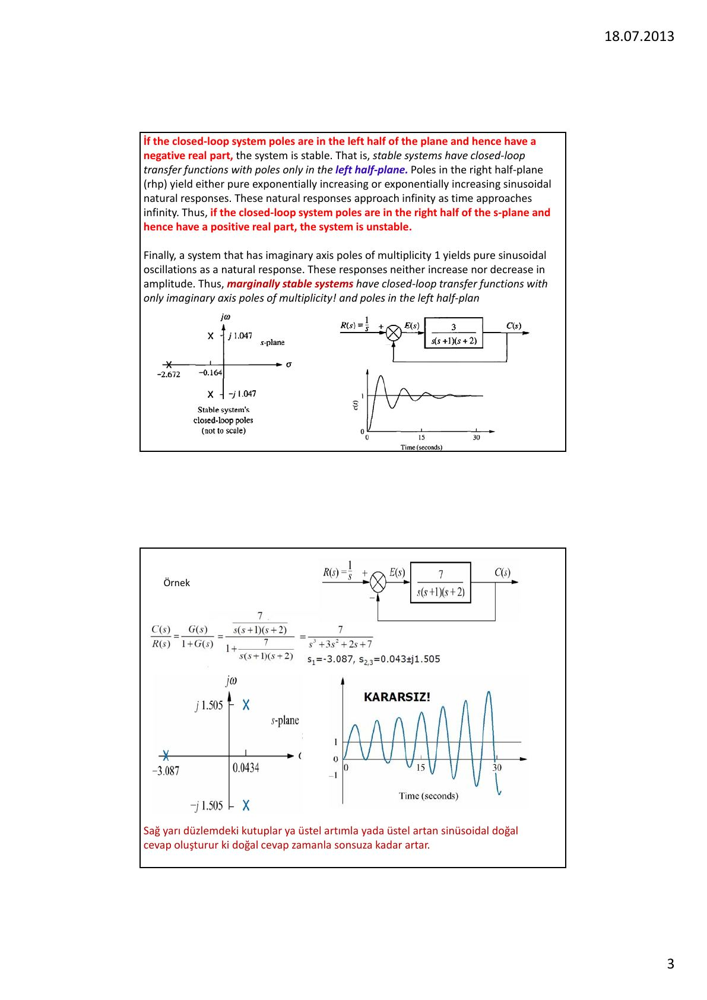
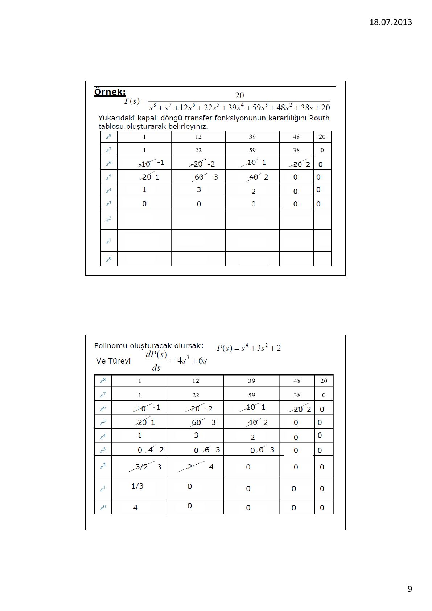
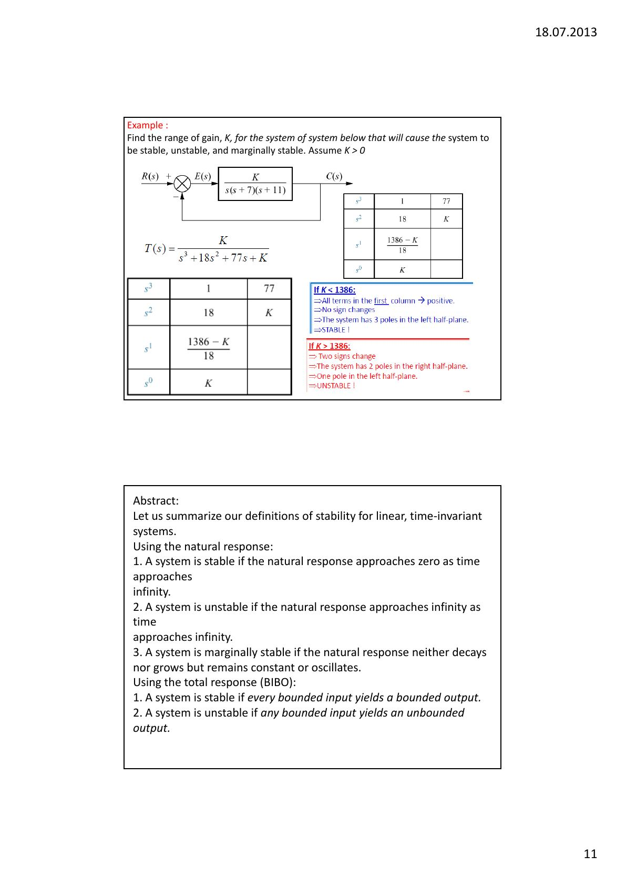

This post is the **6th lecture note** of the **EEM322 Control Systems** course at Başkent University ("EEM322: Lecture 6 – Stability"). The notes belong to the course instructor **Hamit Erdem**; the page headers carry the date 18.07.2013. The lecture note is a 13-page PDF written in a mix of English and Turkish, with two slides per page. Below, the content is summarized in English and the Routh tables are written out. The original PDF can be downloaded at the end of the post.

Topics: closed-loop system stability; pole locations; the Hurwitz method; the Routh-Hurwitz criterion.

## Why is stability the most important property?

Three requirements enter the design of a control system: **transient response**, **stability**, and **steady-state error**. Stability is the most important of these: if the system is unstable, the transient response and steady-state error are not even worth discussing; an unstable system cannot be designed for a specific transient response or steady-state error.

The total response of the system is the sum of the forced and natural responses: c(t) = c_forced(t) + c_natural(t).

- A linear, time-invariant system is **stable** if its natural response goes to zero as time goes to infinity. In this case, since the natural solution approaches zero, the total response equals the forced response.
- If the natural response grows without bound as time goes to infinity, the system is **unstable**.
- If the natural response neither decays nor grows, but stays constant or oscillates, the system is **marginally stable**. Since these systems are sensitive to parameter changes, they are regarded as unstable in practice.

Physically, unstable systems with an unbounded natural response can harm themselves, nearby equipment, or people. In linear systems, stability is an intrinsic property of the system: if a disturbance acts on the equilibrium point of a stable linear system, the system returns to the equilibrium point on its own over time. The note has a figure illustrating this: a ball resting at the peaks of a curve is unstable, one resting in the valleys is stable, and one resting on a flat region is neutrally stable.

**BIBO definition:** A system is stable if the output remains bounded for all bounded input signals applied to the system; if any bounded input produces an unbounded output, the system is unstable.

## Pole locations and stability

- If the closed-loop poles are in the left half-plane (their real parts are negative), the system is **stable**.
- Poles in the right half-plane produce natural responses that are either purely exponentially increasing or exponentially increasing sinusoids; these go to infinity over time and the system is **unstable**.
- Simple (single-order) poles on the imaginary axis produce pure sinusoidal oscillations whose amplitude neither increases nor decreases; systems that have only simple poles on the imaginary axis together with poles in the left half-plane are **marginally stable**.
- For a system to be unstable, it is sufficient that at least one of its poles is in the right half-plane or that it has a repeated root on the imaginary axis. A repeated root on the imaginary axis produces a response of the form At^n cos(ωt + φ), which goes to infinity over time.

**Example:** For a unity-feedback system with open-loop transfer function 7/(s(s + 1)(s + 2)), the closed-loop transfer function is 7/(s³ + 3s² + 2s + 7). The poles are s₁ = −3.087 and s₂,₃ = 0.0434 ± j1.505; since two poles are in the right half-plane, the system is **unstable** and its step response shows oscillations of growing amplitude.

## The Hurwitz test

If all poles of the closed-loop transfer function are in the left half-plane, the polynomial in the denominator of the system, i.e., the characteristic equation, can be factored in the form (s + aᵢ); the aᵢ are positive numbers or complex numbers with positive real parts. Multiplying these factors yields a polynomial whose coefficients are all positive; in addition, all powers of s must be present.

From this: a negative coefficient alone is enough to say that the system is unstable. If one of the powers of s is missing, the system is either unstable or marginally stable.

**In brief, the Hurwitz test:** All coefficients of the characteristic polynomial of a stable system must exist and be positive. This condition is **necessary but not sufficient** for stability.

## The Routh-Hurwitz criterion

This method (the Routh-Hurwitz criterion, 1905) consists of two steps: generating the Routh table and interpreting the table. With this method, information about the stability of the system is obtained without solving for the closed-loop poles; it can also be determined how many poles of the system lie in the left half-plane, how many in the right half-plane, and how many on the imaginary axis.

For the closed-loop transfer function N(s)/(a₄s⁴ + a₃s³ + a₂s² + a₁s + a₀), the table is constructed as follows:

- The powers of s, from the highest power down to s⁰, are written in the first column.
- In the first row, the coefficient of the highest-order term is written, followed by the other coefficients, skipping every other one (a₄, a₂, a₀).
- In the second row, the coefficient of the second-highest-order term is written, followed by the others, skipping every other one (a₃, a₁, 0).
- Each subsequent element is found as the negative of the 2×2 determinant taken from the two rows above, divided by the first element of the row immediately above. For example, b₁ = −(a₄a₁ − a₂a₃)/a₃ = −det[a₄ a₂; a₃ a₁]/a₃.

**Interpretation:** The number of roots of the polynomial in the right half-plane is equal to the **number of sign changes in the first column** of the table. If there are no sign changes in the first column, the system is stable.

### Example 1

For a unity-feedback system with forward path 1000/((s + 2)(s + 3)(s + 5)), C(s)/R(s) = 1000/(s³ + 10s² + 31s + 1030). For convenience, the s² row can be divided by 10 (multiplying or dividing a row by a positive number does not change the result):

| | | |
|---|---|---|
| s³ | 1 | 31 |
| s² | 10 → 1 | 1030 → 103 |
| s¹ | −72 | 0 |
| s⁰ | 103 | 0 |

The first column is 1, 1, −72, 103: there are two sign changes, so the system has two poles in the right half-plane and is **unstable**.

## Special cases in the Routh-Hurwitz criterion

### 1. The first element of a row is zero

To avoid division by zero, a small ε is written in place of the zero. **Example:** T(s) = 10/(s⁵ + 2s⁴ + 3s³ + 6s² + 5s + 3)

| | | | |
|---|---|---|---|
| s⁵ | 1 | 3 | 5 |
| s⁴ | 2 | 6 | 3 |
| s³ | 0 → ε | 7/2 | 0 |
| s² | (6ε − 7)/ε | 3 | 0 |
| s¹ | (42ε − 49 − 6ε²)/(12ε − 14) | 0 | 0 |
| s⁰ | 3 | 0 | 0 |

If ε is chosen positive, the signs in the first column are +, +, +, −, +, +, and there are two sign changes. If ε is chosen negative, two sign changes again result; that is, the system is **unstable** in either case (two poles in the right half-plane).

The note also shows another approach: a polynomial is written whose roots are the reciprocals of the roots of the denominator (the coefficients in reverse order). The first column of the Routh table of the polynomial D(s) = 3s⁵ + 5s⁴ + 6s³ + 3s² + 2s + 1 is 3, 5, 4.2, 1.33, −1.75, 1; since the sign changes twice, the system is unstable (two poles in the right half-plane).

### 2. An entire row is zero

- Go back to the previous row and form the **auxiliary polynomial**.
- The polynomial begins with the s power of that row and continues, skipping every other power.
- Then the derivative of the polynomial with respect to s is taken.
- The coefficients of this derivative are used in the row that was entirely zero.

**Example:** T(s) = 10/(s⁵ + 7s⁴ + 6s³ + 42s² + 8s + 56)

The s⁴ row (7, 42, 56) is divided by 7 to become (1, 6, 8), and the s³ row comes out entirely zero. The auxiliary polynomial is P(s) = s⁴ + 6s² + 8, whose derivative is dP/ds = 4s³ + 12s; 4, 12 (or, dividing by 4, 1, 3) are written in the s³ row:

| | | | |
|---|---|---|---|
| s⁵ | 1 | 6 | 8 |
| s⁴ | 7 → 1 | 42 → 6 | 56 → 8 |
| s³ | 0 → 4 → 1 | 0 → 12 → 3 | 0 |
| s² | 3 | 8 | 0 |
| s¹ | 1/3 | 0 | 0 |
| s⁰ | 8 | 0 | 0 |

**Note:** An entire row of zeros in the Routh table arises from the polynomial having a factor consisting only of odd-order or only of even-order terms (for example, s⁴ + s² + 7). The roots of an even polynomial are symmetric about the origin; this symmetry can be (a) symmetric about the real axis, (b) symmetric about the imaginary axis, or (c) four-quadrant. A zero row indicates the existence of an even polynomial whose roots are symmetric about the origin.

### Example: eighth-order system

Determine the stability of the closed-loop system T(s) = 20/(s⁸ + s⁷ + 12s⁶ + 22s⁵ + 39s⁴ + 59s³ + 48s² + 38s + 20) using the Routh table.

| | | | | | |
|---|---|---|---|---|---|
| s⁸ | 1 | 12 | 39 | 48 | 20 |
| s⁷ | 1 | 22 | 59 | 38 | 0 |
| s⁶ | −10 → −1 | −20 → −2 | 10 → 1 | 20 → 2 | 0 |
| s⁵ | 20 → 1 | 60 → 3 | 40 → 2 | 0 | 0 |
| s⁴ | 1 | 3 | 2 | 0 | 0 |
| s³ | 0 → 4 → 2 | 0 → 6 → 3 | 0 | 0 | 0 |
| s² | 3/2 → 3 | 2 → 4 | 0 | 0 | 0 |
| s¹ | 1/3 | 0 | 0 | 0 | 0 |
| s⁰ | 4 | 0 | 0 | 0 | 0 |

Since the s³ row is entirely zero, the auxiliary polynomial P(s) = s⁴ + 3s² + 2 and its derivative dP/ds = 4s³ + 6s are used.

Interpretation: since there is no sign change from s⁴ down to s⁰, the auxiliary polynomial (the fourth-order even polynomial) has no roots in the right half-plane; if it had roots in the right half-plane, by symmetry it would also have to have roots in the left half-plane. From this it follows that four roots lie on the jω axis. The other poles are in the rows from s⁸ to s⁴: there are two sign changes among these rows, so there are two roots in the right half-plane. As a result, the transfer function has two left half-plane poles, two right half-plane poles, and four imaginary-axis poles; at least one pole in the right half-plane is enough to say that the system is **unstable**.

## Range of gain K for stability

**Example:** Find the ranges of K (K > 0) for which a unity-feedback system with forward path K/(s(s + 7)(s + 11)) is stable, unstable, and marginally stable.

T(s) = K/(s³ + 18s² + 77s + K)

| | | |
|---|---|---|
| s³ | 1 | 77 |
| s² | 18 | K |
| s¹ | (1386 − K)/18 | 0 |
| s⁰ | K | 0 |

- **K < 1386:** All terms in the first column are positive, with no sign changes; all three poles are in the left half-plane, and the system is **stable**.
- **K > 1386:** Two sign changes; two poles are in the right half-plane, one pole is in the left half-plane, and the system is **unstable**.
- **K = 1386:** All elements of the s¹ row become zero. The auxiliary polynomial is P(s) = 18s² + 1386, with derivative dP/ds = 36s. Since there is no sign change after the s² term, the roots of the even polynomial are on the jω axis (s = ±j√77); since there is also no sign change above the s² term, the other root is in the left half-plane. The system is **marginally stable**.

## Summary

Stability definitions for linear, time-invariant systems:

**Based on the natural response:**

1. If the natural response goes to zero as time goes to infinity, the system is stable.
1. If the natural response goes to infinity as time goes to infinity, the system is unstable.
1. If the natural response neither decays nor grows, but stays constant or oscillates, the system is marginally stable.

**Based on the total response (BIBO):**

1. If every bounded input gives a bounded output, the system is stable.
1. If any bounded input gives an unbounded output, the system is unstable.

The stability of linear closed-loop systems is determined by the locations of their poles in the s-plane. If any of the poles is in the right half-plane, the transient response either increases monotonically or oscillates with increasing amplitude. When an unstable system is operated, the output grows over time; unless there is a saturation function or a mechanical limit, the physical system may be damaged. For this reason, closed-loop poles in the right half-plane are avoided. If all poles are to the left of the jω axis, every kind of transient decays and reaches the equilibrium point.

Stability is a property of the system itself and is independent of the input function; the input cannot affect whether the system is stable or unstable, but it shows itself in the solution. Mathematically, poles on the jω axis lead to oscillations whose amplitude neither increases nor decreases; in practice, that is, in a noisy environment, the amplitude of the oscillation grows depending on the noise level. For this reason, a control system should not contain poles on the jω axis.

## Stability in state space

The roots of the equation det(sI − A) = 0 are the **eigenvalues** of the system matrix A and equal the poles of the system's transfer function. This equation is the characteristic equation of matrix A; its n roots λᵢ (i = 1 … n) are the eigenvalues.

**Example:** For A = [0, 1; −6, −5], |λI − A| = (λ + 2)(λ + 3) = 0, hence λ₁ = −2 and λ₂ = −3.

**Problem:** For the system A = [0, 3, 1; 2, 8, 1; −10, −5, −2], B = [10; 0; 0], y = [1 0 0]x, find how many poles lie in the left half-plane, in the right half-plane, and on the jω axis.

sI − A = [s, −3, −1; −2, s − 8, −1; 10, 5, s + 2] and det(sI − A) = s³ − 6s² − 7s − 52. Since this polynomial cannot be factored easily, the Routh-Hurwitz criterion is applied. There is one sign change in the first column of the Routh table; the system has one right half-plane pole and two left half-plane poles, and is therefore **unstable**.
