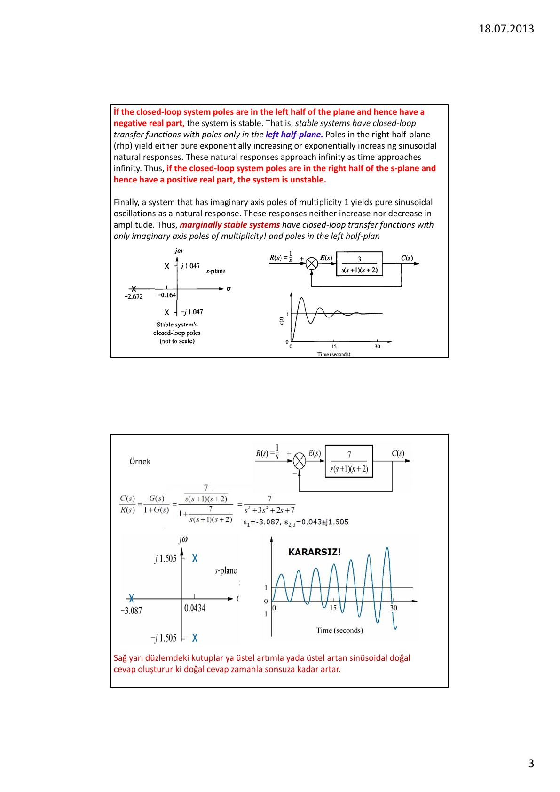
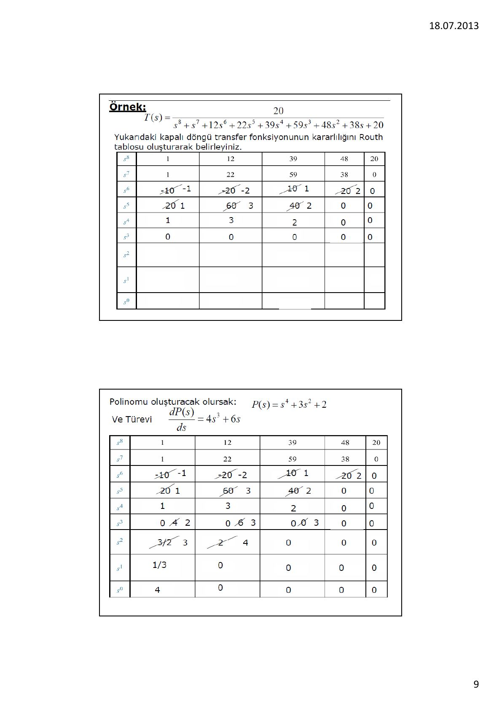
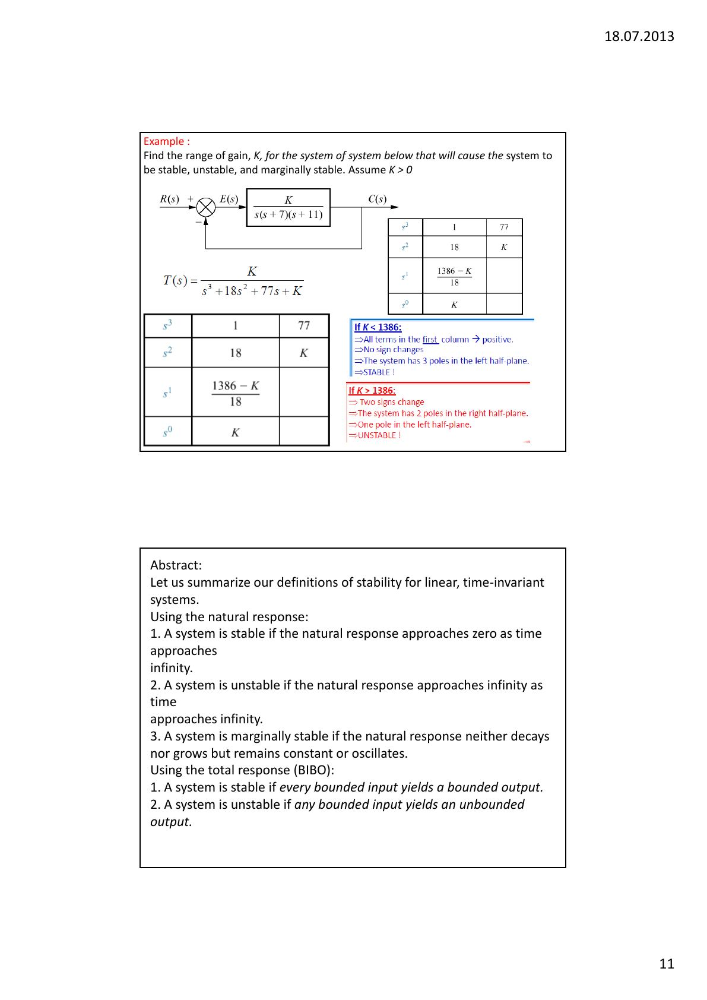

Bu yazı, Başkent Üniversitesi **EEM322 Denetim Sistemleri** dersinin **6. ders notudur** ("EEM322: Lecture 6 – Stability"). Notlar dersi veren **Hamit Erdem**'e ait; sayfa başlarında 18.07.2013 tarihi var. Ders notu İngilizce ve Türkçe karışık, sayfa başına iki slayt yerleştirilmiş 13 sayfalık bir PDF. Aşağıda içerik Türkçe olarak özetlendi ve Routh tabloları yazıya döküldü. Orijinal PDF yazının sonunda indirilebilir.

Konular: kapalı çevrim sistem kararlılığı; kutup yerleri; Hurwitz yöntemi; Routh-Hurwitz kriteri.

## Kararlılık neden en önemli özellik?

Bir denetim sisteminin tasarımına üç gereksinim girer: **geçici yanıt**, **kararlılık** ve **kalıcı durum hatası**. Kararlılık bunların en önemlisidir: Sistem kararsızsa geçici yanıt ve kalıcı durum hatası tartışmaya bile değmez; kararsız bir sistem belirli bir geçici yanıt ya da kalıcı durum hatası için tasarlanamaz.

Sistemin toplam yanıtı zorlanmış ve doğal yanıtların toplamıdır: c(t) = c_zorlanmış(t) + c_doğal(t).

- Doğrusal, zamanla değişmeyen bir sistem, zaman sonsuza giderken doğal yanıtı sıfıra gidiyorsa **kararlıdır**. Bu durumda doğal çözüm sıfıra ulaşacağından toplam yanıt zorlanmış yanıta eşit olur.
- Doğal yanıt zaman sonsuza giderken sınırsız büyüyorsa sistem **kararsızdır**.
- Doğal yanıt ne söner ne büyür, sabit kalır ya da salınım yapıyorsa sistem **marjinal kararlıdır**. Bu sistemler parametre değişimine duyarlı oldukları için pratikte kararsız kabul edilir.

Fiziksel olarak, doğal yanıtı sınırsız olan kararsız sistemler kendilerine, çevredeki araç gereçlere ya da insanlara zarar verebilir. Doğrusal sistemlerde kararlılık sistemin kendi özelliğidir: kararlı bir doğrusal sistemin denge noktasına bir bozucu etki ederse sistem zamanla kendiliğinden denge noktasına döner. Notta bunu anlatan bir şekil var: bir eğri üzerindeki tepe noktalarında duran top kararsız, çukurlarda duran kararlı, düz bölgede duran ise nötr kararlıdır.

**BIBO tanımı:** Sistemin girişine uygulanan bütün sınırlı giriş işaretleri için çıkış sınırlı kalıyorsa sistem kararlıdır; sınırlı herhangi bir giriş sınırsız bir çıkış üretiyorsa sistem kararsızdır.

## Kutup yerleri ve kararlılık

- Kapalı çevrim kutupları sol yarı düzlemdeyse (gerçel kısımları negatifse) sistem **kararlıdır**.
- Sağ yarı düzlemdeki kutuplar ya saf üstel artan ya da üstel artan sinüs biçiminde doğal yanıtlar üretir; bunlar zamanla sonsuza gider ve sistem **kararsızdır**.
- Sanal eksen üzerindeki tek katlı kutuplar, genliği ne artan ne azalan saf sinüs salınımları üretir; yalnızca sanal eksende tek katlı kutupları ve sol yarı düzlemde kutupları olan sistemler **marjinal kararlıdır**.
- Bir sistemin kararsız olması için en az bir kutbunun sağ yarı düzlemde olması ya da sanal eksen üzerinde katlı bir kökünün bulunması yeterlidir. Sanal eksendeki katlı kök At^n cos(ωt + φ) biçiminde, zamanla sonsuza giden bir yanıt üretir.

**Örnek:** Açık çevrim transfer fonksiyonu 7/(s(s + 1)(s + 2)) olan birim geri beslemeli sistemde kapalı çevrim transfer fonksiyonu 7/(s³ + 3s² + 2s + 7) olur. Kutuplar s₁ = −3.087 ve s₂,₃ = 0.0434 ± j1.505'tir; iki kutup sağ yarı düzlemde olduğundan sistem **kararsızdır** ve basamak yanıtı genliği büyüyen salınımlar gösterir.

## Hurwitz testi

Kapalı çevrim transfer fonksiyonunun bütün kutupları sol yarı düzlemdeyse sistemin paydasındaki polinom, yani karakteristik denklem, (s + aᵢ) biçiminde çarpanlara ayrılabilir; aᵢ'ler pozitif ya da pozitif gerçel kısımlı karmaşık sayılardır. Bu çarpanlar çarpıldığında bütün katsayıları pozitif olan bir polinom elde edilir; ayrıca s'nin bütün kuvvetleri var olmalıdır.

Buradan: katsayılardan birinin negatif olması sistemin kararsız olduğunu söylemeye yeter. s'nin kuvvetlerinden biri eksikse sistem ya kararsızdır ya da marjinal kararlıdır.

**Kısaca Hurwitz testi:** Kararlı bir sistemin karakteristik polinomunun bütün katsayıları var olmalı ve pozitif olmalıdır. Bu koşul kararlılık için **gereklidir ama yeterli değildir**.

## Routh-Hurwitz kriteri

Bu yöntem (Routh-Hurwitz kriteri, 1905) iki adımdan oluşur: Routh tablosunu oluşturmak ve tabloyu yorumlamak. Yöntemle kapalı çevrim kutuplarını çözmeden sistemin kararlılığı hakkında bilgi edinilir; ayrıca sistemin kaç kutbunun sol yarı düzlemde, kaçının sağ yarı düzlemde ve kaçının sanal eksen üzerinde olduğu bulunabilir.

Kapalı çevrim transfer fonksiyonu N(s)/(a₄s⁴ + a₃s³ + a₂s² + a₁s + a₀) için tablo şöyle kurulur:

- İlk sütuna s'nin en yüksek kuvvetinden başlayarak s⁰'a kadar kuvvetler yazılır.
- Birinci satıra en yüksek dereceli terimin katsayısı ve birer atlayarak diğer katsayılar (a₄, a₂, a₀) yazılır.
- İkinci satıra en yüksek ikinci dereceli terimin katsayısı ve birer atlayarak diğerleri (a₃, a₁, 0) yazılır.
- Sonraki her eleman, üstteki iki satırdan alınan 2×2 determinantın eksi işaretlisinin, hemen üstteki satırın ilk elemanına bölünmesiyle bulunur. Örneğin b₁ = −(a₄a₁ − a₂a₃)/a₃ = −det[a₄ a₂; a₃ a₁]/a₃.

**Yorum:** Polinomun sağ yarı düzlemdeki kök sayısı, tablonun **birinci sütunundaki işaret değişimi sayısına** eşittir. Birinci sütunda işaret değişimi yoksa sistem kararlıdır.

### Örnek 1

İleri yolu 1000/((s + 2)(s + 3)(s + 5)) olan birim geri beslemeli sistemde C(s)/R(s) = 1000/(s³ + 10s² + 31s + 1030). Kolaylık için s² satırı 10'a bölünebilir (bir satırı pozitif bir sayıyla çarpmak ya da bölmek sonucu değiştirmez):

| | | |
|---|---|---|
| s³ | 1 | 31 |
| s² | 10 → 1 | 1030 → 103 |
| s¹ | −72 | 0 |
| s⁰ | 103 | 0 |

Birinci sütun 1, 1, −72, 103: iki işaret değişimi vardır, yani sistemin sağ yarı düzlemde iki kutbu vardır ve sistem **kararsızdır**.

## Routh-Hurwitz kriterinde özel durumlar

### 1. Bir satırın ilk elemanının sıfır olması

Sıfıra bölmeyi önlemek için sıfır yerine küçük bir ε yazılır. **Örnek:** T(s) = 10/(s⁵ + 2s⁴ + 3s³ + 6s² + 5s + 3)

| | | | |
|---|---|---|---|
| s⁵ | 1 | 3 | 5 |
| s⁴ | 2 | 6 | 3 |
| s³ | 0 → ε | 7/2 | 0 |
| s² | (6ε − 7)/ε | 3 | 0 |
| s¹ | (42ε − 49 − 6ε²)/(12ε − 14) | 0 | 0 |
| s⁰ | 3 | 0 | 0 |

ε pozitif seçilirse birinci sütunun işaretleri +, +, +, −, +, + olur ve iki işaret değişimi vardır. ε negatif seçilse de iki işaret değişimi çıkar; yani sistem her durumda **kararsızdır** (sağ yarı düzlemde iki kutup).

Notta ayrıca bir başka yaklaşım gösteriliyor: paydanın köklerinin terslerini kök olarak alan polinom yazılır (katsayılar ters sırada). D(s) = 3s⁵ + 5s⁴ + 6s³ + 3s² + 2s + 1 polinomunun Routh tablosunun birinci sütunu 3, 5, 4.2, 1.33, −1.75, 1'dir; işaret iki kez değiştiğinden sistem kararsızdır (sağ yarı düzlemde iki kutup).

### 2. Bir satırın tamamen sıfır olması

- Bir önceki satıra gidilip **yardımcı polinom** oluşturulur.
- Polinom, ilgili satırın s derecesiyle başlar ve birer atlayarak devam eder.
- Sonra polinomun s'ye göre türevi alınır.
- Bu türevin katsayıları, tamamen sıfır olan satırda kullanılır.

**Örnek:** T(s) = 10/(s⁵ + 7s⁴ + 6s³ + 42s² + 8s + 56)

s⁴ satırı (7, 42, 56) 7'ye bölünerek (1, 6, 8) olur ve s³ satırı tamamen sıfır çıkar. Yardımcı polinom P(s) = s⁴ + 6s² + 8, türevi dP/ds = 4s³ + 12s'dir; s³ satırına 4, 12 (ya da 4'e bölünerek 1, 3) yazılır:

| | | | |
|---|---|---|---|
| s⁵ | 1 | 6 | 8 |
| s⁴ | 7 → 1 | 42 → 6 | 56 → 8 |
| s³ | 0 → 4 → 1 | 0 → 12 → 3 | 0 |
| s² | 3 | 8 | 0 |
| s¹ | 1/3 | 0 | 0 |
| s⁰ | 8 | 0 | 0 |

**Not:** Routh tablosunda bir satırın tamamen sıfır olması, polinomda yalnızca tek ya da yalnızca çift dereceli terimlerden oluşan bir çarpan bulunmasından kaynaklanır (örneğin s⁴ + s² + 7). Çift dereceli polinomun kökleri orijine göre simetriktir; bu simetri (a) gerçel eksene göre simetrik, (b) sanal eksene göre simetrik ya da (c) dört bölgeli olabilir. Sıfır satırı, kökleri orijine göre simetrik olan çift dereceli bir polinomun varlığını gösterir.

### Örnek: sekizinci dereceden sistem

T(s) = 20/(s⁸ + s⁷ + 12s⁶ + 22s⁵ + 39s⁴ + 59s³ + 48s² + 38s + 20) kapalı çevrim sisteminin kararlılığını Routh tablosuyla belirleyin.

| | | | | | |
|---|---|---|---|---|---|
| s⁸ | 1 | 12 | 39 | 48 | 20 |
| s⁷ | 1 | 22 | 59 | 38 | 0 |
| s⁶ | −10 → −1 | −20 → −2 | 10 → 1 | 20 → 2 | 0 |
| s⁵ | 20 → 1 | 60 → 3 | 40 → 2 | 0 | 0 |
| s⁴ | 1 | 3 | 2 | 0 | 0 |
| s³ | 0 → 4 → 2 | 0 → 6 → 3 | 0 | 0 | 0 |
| s² | 3/2 → 3 | 2 → 4 | 0 | 0 | 0 |
| s¹ | 1/3 | 0 | 0 | 0 | 0 |
| s⁰ | 4 | 0 | 0 | 0 | 0 |

s³ satırı tamamen sıfır olduğundan yardımcı polinom P(s) = s⁴ + 3s² + 2 ve türevi dP/ds = 4s³ + 6s kullanılır.

Yorum: s⁴'ten s⁰'a kadar işaret değişimi olmadığından yardımcı polinomun (dördüncü dereceden çift polinomun) sağ yarı düzlemde kökü yoktur; sağ yarı düzlemde kökü olsaydı simetriden dolayı sol yarı düzlemde de olması gerekirdi. Buradan dört kökün jω ekseni üzerinde olduğu anlaşılır. Diğer kutuplar s⁸'den s⁴'e kadar olan satırlardadır: bu satırlar arasında iki işaret değişimi vardır, yani sağ yarı düzlemde iki kök bulunur. Sonuç olarak transfer fonksiyonunun iki sol yarı düzlem, iki sağ yarı düzlem ve dört sanal eksen kutbu vardır; en az bir kutbun sağ yarı düzlemde olması sistemin **kararsız** olduğunu söylemek için yeterlidir.

## Kararlılık için K kazancının aralığı

**Örnek:** İleri yolu K/(s(s + 7)(s + 11)) olan birim geri beslemeli sistemin kararlı, kararsız ve marjinal kararlı olduğu K aralıklarını bulun (K > 0).

T(s) = K/(s³ + 18s² + 77s + K)

| | | |
|---|---|---|
| s³ | 1 | 77 |
| s² | 18 | K |
| s¹ | (1386 − K)/18 | 0 |
| s⁰ | K | 0 |

- **K < 1386:** Birinci sütundaki bütün terimler pozitif, işaret değişimi yok; üç kutup da sol yarı düzlemde, sistem **kararlı**.
- **K > 1386:** İki işaret değişimi; iki kutup sağ yarı düzlemde, bir kutup sol yarı düzlemde, sistem **kararsız**.
- **K = 1386:** s¹ satırının bütün elemanları sıfır olur. Yardımcı polinom P(s) = 18s² + 1386, türevi dP/ds = 36s'dir. s²'li terimden sonra işaret değişimi olmadığından çift polinomun kökü jω ekseni üzerindedir (s = ±j√77); s²'li terimin üzerinde de işaret değişimi olmadığından diğer kök sol yarı düzlemdedir. Sistem **marjinal kararlıdır**.

## Özet

Doğrusal, zamanla değişmeyen sistemler için kararlılık tanımları:

**Doğal yanıta göre:**

1. Doğal yanıt zaman sonsuza giderken sıfıra gidiyorsa sistem kararlıdır.
1. Doğal yanıt zaman sonsuza giderken sonsuza gidiyorsa sistem kararsızdır.
1. Doğal yanıt ne sönüyor ne büyüyorsa, sabit kalıyor ya da salınım yapıyorsa sistem marjinal kararlıdır.

**Toplam yanıta göre (BIBO):**

1. Her sınırlı giriş sınırlı bir çıkış veriyorsa sistem kararlıdır.
1. Herhangi bir sınırlı giriş sınırsız bir çıkış veriyorsa sistem kararsızdır.

Doğrusal kapalı çevrim sistemlerin kararlılığı kutuplarının s düzlemindeki konumuyla belirlenir. Kutuplardan herhangi biri sağ yarı düzlemdeyse geçici rejim yanıtı monoton olarak artar ya da artan genlikli salınım yapar. Kararsız bir sistem çalıştırıldığında çıkış zamanla artar; bir doyum fonksiyonu ya da mekanik sınırlama yoksa fiziksel sistem hasar görebilir. Bu yüzden kapalı çevrim kutuplarının sağ yarı düzlemde olmasından kaçınılır. Bütün kutuplar jω ekseninin solundaysa her türlü geçici rejim sönümlenerek denge noktasına ulaşır.

Kararlılık sistemin kendi özelliğidir ve giriş fonksiyonundan bağımsızdır; giriş, sistemin kararlı ya da kararsız olmasını etkileyemez ama çözümde kendini gösterir. Matematiksel olarak jω ekseni üzerindeki kutuplar genliği ne artan ne azalan salınımlara yol açar; pratikte, yani gürültülü ortamda, gürültü seviyesine göre salınımın genliği artar. Bu yüzden bir denetim sistemi jω ekseni üzerinde kutup içermemelidir.

## Durum uzayında kararlılık

det(sI − A) = 0 denkleminin kökleri sistem matrisi A'nın **özdeğerleridir** ve sistemin transfer fonksiyonunun kutuplarına eşittir. Bu denklem A matrisinin karakteristik denklemidir; n kökü λᵢ (i = 1 … n) özdeğerlerdir.

**Örnek:** A = [0, 1; −6, −5] için |λI − A| = (λ + 2)(λ + 3) = 0, dolayısıyla λ₁ = −2 ve λ₂ = −3.

**Problem:** A = [0, 3, 1; 2, 8, 1; −10, −5, −2], B = [10; 0; 0], y = [1 0 0]x sisteminin kaç kutbunun sol yarı düzlemde, sağ yarı düzlemde ve jω ekseni üzerinde olduğunu bulun.

sI − A = [s, −3, −1; −2, s − 8, −1; 10, 5, s + 2] ve det(sI − A) = s³ − 6s² − 7s − 52. Bu polinom kolayca çarpanlara ayrılamadığından Routh-Hurwitz kriteri uygulanır. Routh tablosunun birinci sütununda bir işaret değişimi vardır; sistemin bir sağ yarı düzlem ve iki sol yarı düzlem kutbu vardır, dolayısıyla **kararsızdır**.
