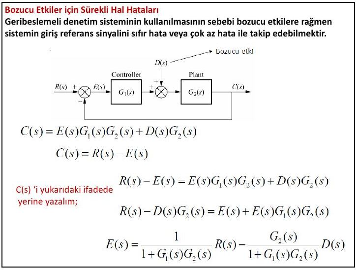
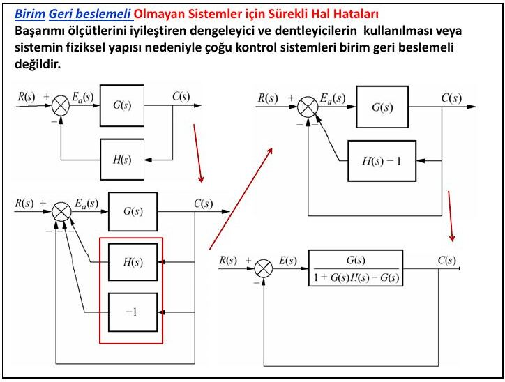

This post is **Lecture Note 7** ("EEM322: Lecture 7") of the **EEM322 Control Systems** course at Başkent University. The notes belong to **Hamit Erdem**; the page headers carry the date 18.07.2013. The lecture note is an 18-page PDF mixing Turkish and English, with two slides placed per page; it continues Lectures 1–6. The content is transcribed below in English, with the formulas and worked examples written out. The original PDF can be downloaded at the end of the post.

Topics: steady-state errors; steady-state errors for disturbances; sensitivity.

## Three Design Criteria and Test Inputs

The analysis and design of control systems focus on three criteria:

1. Transient response
1. Stability
1. Steady-state errors

**Steady-state error** is the difference between the input (reference) signal and the output signal as t → ∞ for a predetermined input (reference) signal. The input signals used to determine the steady-state error:

- **Unit step:** represents constant position; determines the system's ability to locate itself with respect to a fixed target.
- **Ramp:** represents constant velocity; used to test the ability to follow a linearly increasing input.
- **Parabola:** represents constant acceleration; used for accelerating targets (for example, guided missiles).

Steady-state errors are defined for **stable systems**; therefore the designer must always examine the stability of the closed-loop system before calculating the steady-state error. In control systems, steady-state errors mostly arise from nonlinear sources (such as backlash in gears, or a motor that does not turn until the voltage applied to it exceeds a certain threshold). The error can also arise from the way the system is connected or from the type of input applied; these are the focus of the lecture.

## Control with a Gain K Alone

In a unit-feedback system with only a gain K in the forward path:

- E(s) = R(s) − C(s), C(s) = K·E(s)
- R(s) = E(s) + K·E(s) ⇒ **E(s) = R(s) / (1 + K)**

c(t) is finite and nonzero, but e(t) can never be zero. For a unit step input, **the larger K is, the smaller the error, but it cannot be made zero**.

### Proportional Control of a First-Order System

G(s) = Y(s)/R(s) = G_c G_v G_p / (1 + G_c G_v G_p), where the plant is G_p = K/(Ts + 1), the proportional controller is G_c = K_p, and the control element is taken as G_v = 1. The closed-loop transfer function is:

- Y(s)/R(s) = K K_p / (Ts + 1 + K K_p) = [K K_p/(1 + K K_p)] / ([T/(1 + K K_p)] s + 1)

As the controller gain increases, the overall gain of the system approaches 1 and **the time constant T/(1 + K K_p) decreases**; that is, the system response becomes faster. Proportional control also changes the characteristic equation.

With the **final value theorem**, for R(s) = 1/s:

- lim(t→∞) e(t) = lim(s→0) s·E(s), E(s) = R(s) / (1 + G_c G_p)
- lim(t→∞) e(t) = lim(s→0) s · 1/(1 + K_p K/(Ts + 1)) · 1/s = **1 / (1 + K K_p)**

As an example, step responses are shown for G_p = 5/(10s + 1) with K_p = 0.1, 1, and 10. This equation says that an error will always remain unless K_p is infinite; the magnitude of the error is inversely proportional to the proportional gain.

### Adding an Integrator to the Forward Path

If K/s is added to the forward path, e(t) decreases as c(t) grows, and this continues until e(t) becomes zero. Even though the error becomes zero, c(t), the integrator output, has a value, because an integrator gives a constant output for zero input. Take a motor, for example: it rotates while voltage is applied, and when the voltage is removed it stops at its current position; although it has no input, an angular position change has occurred between the starting and stopping positions. A motor can therefore simply be regarded as an integrator; if a motor is connected in the forward path, the steady-state error for a unit step input is always zero.

**Integral control (step input):** u(t) = K_i ∫ e(t) dt, G_c = U(s)/E(s) = K_i/s. With the plant K/(Ts + 1):

- Y(s)/R(s) = K K_i / (Ts² + s + K K_i)
- E(s) = R(s)[1 − K K_i/(Ts² + s + K K_i)] = R(s)(Ts² + s)/(Ts² + s + K K_i)
- lim(t→∞) e(t) = lim(s→0) s · (1/s) · (Ts² + s)/(Ts² + s + K K_i) = **0**

## Steady-State Error in a Unity-Feedback System

E(s) = R(s) − C(s), C(s) = E(s)G(s) ⇒ E(s) = R(s)/(1 + G(s)). With the final value theorem f(∞) = lim(s→0) sF(s):

- **e(∞) = lim(s→0) s R(s) / (1 + G(s))**

As can be seen, the input (reference) signal R(s) directly affects the steady-state error.

### 1. Unit Step Input

For R(s) = 1/s, e(∞) = lim(s→0) 1/(1 + G(s)). lim(s→0) G(s) is the **dc gain** of the forward-path transfer function. For the error to be zero, lim(s→0) G(s) = ∞ is required; for this, G(s) must have the form:

- G(s) = (s + z₁)(s + z₂)… / [sⁿ (s + p₁)(s + p₂)…], n ≥ 1

That is, the denominator polynomial must have at least one root at the origin; in technical terms, **there must be at least one pure integrator in the forward path**. If there is no pole at the origin, lim(s→0) G(s) = z₁z₂…/(p₁p₂…), which corresponds to a finite steady-state error.

### 2. Ramp Input

For R(s) = 1/s², e(∞) = lim(s→0) 1/(s + sG(s)) = 1 / lim(s→0) sG(s). For the error to be zero, lim sG(s) = ∞ is required; for this, **at least two poles must be at the origin**, that is, there must be two pure integrators in the forward path. With a single integrator, lim sG(s) = z₁z₂…/(p₁p₂…) and a constant error remains; with no integrator, lim sG(s) = 0 and the output drifts away from the ramp input over time, so the error goes to infinity.

### 3. Parabolic Input

For R(s) = 1/s³, e(∞) = 1 / lim(s→0) s²G(s). For zero error, **at least three poles must be at the origin**. With two pure integrators a constant error remains; with one integrator or none, lim s²G(s) = 0 and the error goes to infinity.

### Worked Examples

**Example 1:** G(s) = 100(s + 2)(s + 6) / [s(s + 3)(s + 4)]; for the inputs 5u(t), 5tu(t), and 5t²u(t):

- 5u(t) → 5/s: lim G(s) = ∞ ⇒ e(∞) = 5/∞ = **0**
- 5tu(t) → 5/s²: lim sG(s) = 100·2·6/(3·4) = 100 ⇒ e(∞) = 5/100 = **1/20**
- 5t²u(t) → 10/s³: lim s²G(s) = 0 ⇒ e(∞) = **∞**

**Example 2:** G(s) = 120(s + 2) / [(s + 3)(s + 4)]:

- Step: lim G(s) = 120·2/(3·4) = 20 ⇒ e(∞) = 5/(1 + 20) = **5/21**
- Ramp: lim sG(s) = 0 ⇒ e(∞) = **∞**; parabola: lim s²G(s) = 0 ⇒ e(∞) = **∞**

## Static Error Constants and System Type

The limit terms in the denominators of the error expressions are called **static error constants**:

| Constant | Definition | Input | Steady-state error |
|---|---|---|---|
| Position constant K_p | lim(s→0) G(s) | unit step u(t) | e(∞) = 1/(1 + K_p) |
| Velocity constant K_v | lim(s→0) sG(s) | ramp tu(t) | e(∞) = 1/K_v |
| Acceleration constant K_a | lim(s→0) s²G(s) | parabola (1/2)t²u(t) | e(∞) = 1/K_a |

**System type:** The number of pure integrators in the forward path (the n of the sⁿ term in the denominator of G(s)) is the type of the system. If n = 0 it is Type 0, if n = 1 it is Type 1, if n = 2 it is Type 2.

| Input | Type 0 | Type 1 | Type 2 |
|---|---|---|---|
| Step | K_p constant, error 1/(1 + K_p) | K_p = ∞, error 0 | K_p = ∞, error 0 |
| Ramp | K_v = 0, error ∞ | K_v constant, error 1/K_v | K_v = ∞, error 0 |
| Parabola | K_a = 0, error ∞ | K_a = 0, error ∞ | K_a constant, error 1/K_a |

**Example 3:** G(s) = 500(s + 2)(s + 5) / [(s + 8)(s + 10)(s + 12)] (Type 0):

- K_p = 500·2·5/(8·10·12) = 5.208; K_v = 0; K_a = 0
- Position input: e(∞) = 1/(1 + K_p) = **0.161**; velocity input: **∞**; acceleration input: **∞**

**Example 4:** G(s) = 500(s + 2)(s + 5)(s + 6) / [s(s + 8)(s + 10)(s + 12)] (Type 1):

- K_p = ∞; K_v = 500·2·5·6/(8·10·12) = 31.25; K_a = 0
- Position: e(∞) = **0**; velocity: e(∞) = 1/31.25 = **0.032**; acceleration: **∞**

**Example 5:** G(s) = 500(s + 2)(s + 4)(s + 5)(s + 6)(s + 7) / [s²(s + 8)(s + 10)(s + 12)] (Type 2):

- K_p = ∞, K_v = ∞; K_a = 500·2·4·5·6·7/(8·10·12) = 875
- Position: **0**; velocity: **0**; acceleration: e(∞) = 1/875 = **1.14 × 10⁻³**

**Example 6:** If a system's velocity constant is K_v = 1000, what can be said about this system?

1. The system is stable (steady-state error is defined).
1. The system is Type 1 (K_v = 0 for Type 0 systems, and K_v is infinite for Type 2 systems).
1. The test signal is a ramp; for a ramp input the steady-state error is inversely proportional to the velocity constant.
1. The steady-state error between the input ramp and the output ramp is 1/K_v.

Similarly, if the position constant is K_p = 1000, the system is stable, it is Type 0 (K_p is not infinite), the test signal is a unit step, and e(∞) = 1/(1 + 1000) = 1/1001.

**Example 7:** In the system G(s) = K(s + 5) / [s(s + 6)(s + 7)(s + 8)], find K such that the steady-state error is 10%. Since the system is Type 1, the error is defined for a ramp input: e(∞) = 1/K_v = 0.1 ⇒ K_v = 10. K_v = lim sG(s) = 5K/(6·7·8) = 10 ⇒ **K = 672**.

## Steady-State Errors for Disturbances

The reason for using feedback control is that the system can track the input reference with zero or very little error despite disturbances. When a disturbance D(s) enters between the controller G₁(s) and the plant G₂(s):

- C(s) = E(s)G₁(s)G₂(s) + D(s)G₂(s), C(s) = R(s) − E(s)
- **E(s) = R(s)/(1 + G₁G₂) − G₂ D(s)/(1 + G₁G₂)**

By the final value theorem, e(∞) = e_R(∞) + e_D(∞): e_R(∞) is the error due to the input (R(s)); e_D(∞) is the error due to the disturbance (D(s)). For a unit step disturbance D(s) = 1/s:

- e_D(∞) = −lim(s→0) s G₂/(1 + G₁G₂) · (1/s) = −1 / [lim(s→0) 1/G₂(s) + lim(s→0) G₁(s)]

For a unit step disturbance, **increasing the dc gain of G₁(s) or decreasing the dc gain of G₂(s)** reduces the steady-state error due to the disturbance.

## Non-Unity Feedback Systems

Because of the use of compensators and controllers that improve performance measures, or because of the physical structure of the system, most control systems are not unity-feedback. A system with feedback H(s) is converted to an equivalent unity-feedback system by adding −1 in parallel with H(s) in the feedback path and applying block reduction:

- G_e(s) = G(s) / [1 + G(s)H(s) − G(s)]

**Example:** G(s) = 100/[s(s + 10)], H(s) = 1/(s + 5). The system type, the appropriate error constant, and the steady-state error for a unit step:

- G_e(s) = 100(s + 5) / (s³ + 15s² − 50s − 400)
- Since there is no pure integrator, the system is **Type 0**; the appropriate error constant is the position constant.
- K_p = lim G_e(s) = 100·5/(−400) = −5/4 ⇒ e(∞) = 1/(1 + K_p) = 1/(1 − 5/4) = **−4**

The negative sign indicates that the output value is larger than the input value.

For a **system that has both non-unity feedback and a disturbance input** (G₁, G₂, H, and D(s)):

- e(∞) = lim(s→0) s{[1 − G₁G₂/(1 + G₁G₂H)] R(s) − [G₂/(1 + G₁G₂H)] D(s)}

For R(s) = 1/s and D(s) = 1/s, zero error requires:

- lim s[G₁G₂] / lim s[1 + G₁G₂H] = 1 and lim sG₂ / lim s[1 + G₁G₂H] = 0

If the system is stable, G₁(s) is Type 1, G₂(s) is Type 0, and H(s) is a Type 0 system with dc gain 1, these conditions are always satisfied and the steady-state error is zero.

## Sensitivity

In the design process, the engineer wants to know to what extent the system parameters affect the system's behavior; for example, ideally parameters such as temperature should not affect performance. **The degree to which system parameters affect the transfer function, and thus the performance, is called sensitivity.**

**Example:** The sensitivity of the function F = K/(K + a) with respect to a. For K = 10, a = 100, F = 0.091. If a is tripled (300), F = 0.032. The fractional change in a is (300 − 100)/100 = 2, and in F it is (0.032 − 0.091)/0.091 = −0.65 (−65%). F has a decreasing sensitivity to changes in a.

If G(s) → G(s) + ΔG(s) changes in the system, the output becomes Y(s) + ΔY(s) = [G(s) + ΔG(s)]R(s), that is, ΔY(s) = ΔG(s)·R(s). Another advantage of feedback is that it tends to reduce the sensitivity of the system to parameters. The definition of sensitivity:

- S_F:P = lim(ΔP→0) (fractional change in F)/(fractional change in P) = lim (ΔF/F)/(ΔP/P) = (P/F)(∂F/∂P)

**Example:** In a unity-feedback system with G(s) = K/[s(s + a)], T(s) = K/(s² + as + K). The sensitivity to the parameter a:

- S_T:a = (a/T)(∂T/∂a) = **−as / (s² + as + K)**

For any value of s, increasing K reduces the sensitivity of the closed-loop transfer function to changes in a.

**Example:** For the same system with a ramp input, the sensitivity of the steady-state error to a and K: K_v = lim sG(s) = K/a, e(∞) = 1/K_v = a/K.

- S_e:a = (a/e)(∂e/∂a) = (a/(a/K))·(1/K) = **1**
- S_e:K = (K/e)(∂e/∂K) = (K/(a/K))·(−a/K²) = **−1**

Changes in a and K appear directly in e(∞); there is neither a decrease nor an increase in sensitivity.

**Example:** When a unit step is applied to the system G(s) = K/[(s + a)(s + b)]: the system is Type 0, K_p = K/(ab), e(∞) = 1/(1 + K/(ab)) = ab/(ab + K).

- S_e:a = (a/e)(∂e/∂a) = [a / (ab/(ab + K))]·[((ab + K)b − ab²)/(ab + K)²] = **K / (ab + K)**
