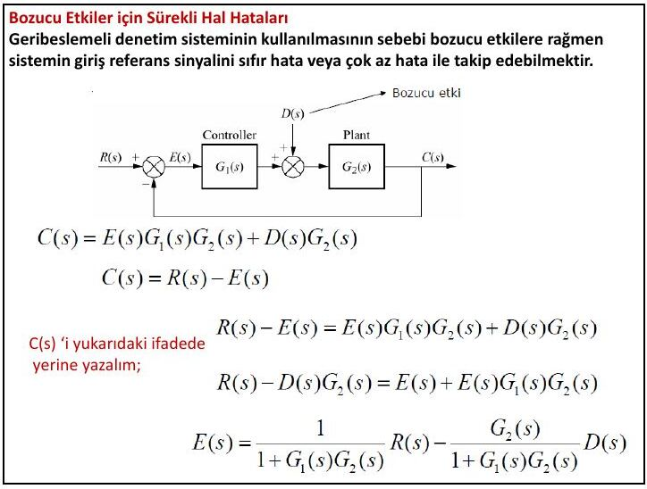
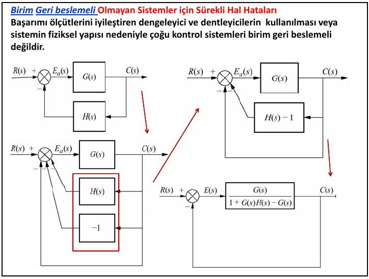

Bu yazı, Başkent Üniversitesi **EEM322 Denetim Sistemleri** dersinin **7. ders notudur** ("EEM322: Lecture 7"). Notlar dersi veren **Hamit Erdem**'e ait; sayfa başlarında 18.07.2013 tarihi var. Ders notu Türkçe ve İngilizce karışık, sayfa başına iki slayt yerleştirilmiş 18 sayfalık bir PDF; Ders 1–6'nın devamıdır. Aşağıda içerik Türkçe olarak aktarıldı, formüller ve çözümlü örnekler yazıya döküldü. Orijinal PDF yazının sonunda indirilebilir.

Konular: sürekli hal (kararlı hal) hataları; bozucu etkiler için sürekli hal hataları; duyarlılık (sensitivity).

## Üç tasarım ölçütü ve test girişleri

Denetim sistemlerinin analiz ve tasarımında üç ölçüte odaklanılır:

1. Geçici rejim cevabı
1. Kararlılık
1. Sürekli hal (kararlı hal) hataları

**Sürekli hal hatası**, önceden belirlenmiş bir giriş (referans) sinyali için t → ∞ giderken giriş ile çıkış sinyali arasındaki farktır. Sürekli hal hatasını belirlemekte kullanılan giriş işaretleri:

- **Birim basamak (step):** sabit konumu temsil eder; sistemin sabit bir hedefe göre yerini bulma yeteneğini belirler.
- **Rampa:** sabit hızı temsil eder; doğrusal olarak artan girişi izleyebilme yeteneğini test etmek için kullanılır.
- **Parabol:** sabit ivmeyi temsil eder; hızlanan hedefler için kullanılır (örneğin güdümlü füzeler).

Sürekli hal hataları **kararlı sistemler** için tanımlıdır; bu yüzden tasarımcı kararlı hal hatasını hesaplamadan önce mutlaka kapalı döngü sistemin kararlılığını incelemelidir. Kontrol sistemlerinde sürekli hal hataları çoğunlukla doğrusal olmayan kaynaklardan doğar (dişlilerdeki boşluk, motora uygulanan gerilim belli bir eşiği geçmeden motorun dönmemesi gibi). Hata ayrıca sistemin bağlantı şeklinden ya da uygulanan giriş tipinden de kaynaklanabilir; derste bunlar üzerinde durulur.

## Yalnız K kazancı ile denetim

Birim geri beslemeli, ileri yolunda yalnız K kazancı olan sistemde:

- E(s) = R(s) − C(s), C(s) = K·E(s)
- R(s) = E(s) + K·E(s) ⇒ **E(s) = R(s) / (1 + K)**

c(t) sonlu ve sıfırdan farklıdır ama e(t) hiçbir zaman sıfır olamaz. Birim basamak giriş için **K ne kadar artarsa hata o kadar azalır, fakat sıfırlanamaz**.

### Birinci dereceden sistemde oransal denetim

G(s) = Y(s)/R(s) = G_c G_v G_p / (1 + G_c G_v G_p), burada süreç G_p = K/(Ts + 1), oransal denetleyici G_c = K_p ve denetim elemanı G_v = 1 alınıyor. Kapalı çevrim transfer fonksiyonu:

- Y(s)/R(s) = K K_p / (Ts + 1 + K K_p) = [K K_p/(1 + K K_p)] / ([T/(1 + K K_p)] s + 1)

Denetleyici kazancı arttıkça sistemin toplam kazancı 1'e yaklaşır ve **zaman sabiti T/(1 + K K_p) küçülür**; yani sistem yanıtı hızlanır. Oransal denetim karakteristik denklemi de değiştirir.

**Son değer teoremi** ile R(s) = 1/s için:

- lim(t→∞) e(t) = lim(s→0) s·E(s), E(s) = R(s) / (1 + G_c G_p)
- lim(t→∞) e(t) = lim(s→0) s · 1/(1 + K_p K/(Ts + 1)) · 1/s = **1 / (1 + K K_p)**

Örnek olarak G_p = 5/(10s + 1) için K_p = 0,1, 1 ve 10 değerlerindeki basamak yanıtları gösteriliyor. Bu denklem, K_p sonsuz olmadıkça her zaman bir hata kalacağını söyler; hatanın büyüklüğü oransal kazançla ters orantılıdır.

### İleri yola integratör eklemek

İleri yola K/s eklenirse c(t) büyüdükçe e(t) azalır ve bu e(t) sıfır olana kadar sürer. Hata sıfırlansa da integratör çıkışı olan c(t) bir değere sahiptir, çünkü integratör sıfır girişe sabit bir çıkış verir. Örneğin bir motor: gerilim uygulandıkça döner, gerilim kesilince o anki konumunda durur; girişi olmamasına rağmen başlangıç ile duruş konumu arasında bir açısal konum değişimi oluşmuştur. Bu yüzden motor basitçe bir integratör olarak düşünülebilir; ileri yola bir motor bağlanırsa birim basamak girişte sürekli hal hatası her zaman sıfır olur.

**İntegral denetim (basamak giriş):** u(t) = K_i ∫ e(t) dt, G_c = U(s)/E(s) = K_i/s. Süreç K/(Ts + 1) ile:

- Y(s)/R(s) = K K_i / (Ts² + s + K K_i)
- E(s) = R(s)[1 − K K_i/(Ts² + s + K K_i)] = R(s)(Ts² + s)/(Ts² + s + K K_i)
- lim(t→∞) e(t) = lim(s→0) s · (1/s) · (Ts² + s)/(Ts² + s + K K_i) = **0**

## Birim geri beslemeli sistemde sürekli hal hatası

E(s) = R(s) − C(s), C(s) = E(s)G(s) ⇒ E(s) = R(s)/(1 + G(s)). Son değer teoremi f(∞) = lim(s→0) sF(s) ile:

- **e(∞) = lim(s→0) s R(s) / (1 + G(s))**

Görüldüğü gibi giriş (referans) işareti R(s), sürekli hal hatası üzerinde doğrudan etkilidir.

### 1. Birim basamak girişi

R(s) = 1/s için e(∞) = lim(s→0) 1/(1 + G(s)). lim(s→0) G(s), ileri yol transfer fonksiyonunun **dc kazancıdır**. Hatanın sıfır olması için lim(s→0) G(s) = ∞ olmalıdır; bunun için G(s) şu biçimde olmalıdır:

- G(s) = (s + z₁)(s + z₂)… / [sⁿ (s + p₁)(s + p₂)…], n ≥ 1

Yani paydadaki polinomun en az bir kökü orijinde olmalıdır; teknik ifadeyle **ileri yolda en az bir saf integratör** bulunmalıdır. Orijinde hiç kutup yoksa lim(s→0) G(s) = z₁z₂…/(p₁p₂…) olur ve bu sonlu bir sürekli hal hatasına karşılık gelir.

### 2. Rampa girişi

R(s) = 1/s² için e(∞) = lim(s→0) 1/(s + sG(s)) = 1 / lim(s→0) sG(s). Hatanın sıfır olması için lim sG(s) = ∞ olmalıdır; bunun için **en az iki kutup orijinde** olmalı, yani ileri yolda iki saf integratör bulunmalıdır. Tek integratör varsa lim sG(s) = z₁z₂…/(p₁p₂…) olur ve sabit bir hata kalır; hiç integratör yoksa lim sG(s) = 0 olur ve çıkış rampa girişinden zamanla uzaklaşarak hata sonsuza gider.

### 3. Parabolik giriş

R(s) = 1/s³ için e(∞) = 1 / lim(s→0) s²G(s). Sıfır hata için **en az üç kutup orijinde** olmalıdır. İki saf integratör varsa sabit bir hata kalır; bir integratör varsa ya da hiç yoksa lim s²G(s) = 0 olur ve hata sonsuza gider.

### Çözümlü örnekler

**Örnek 1:** G(s) = 100(s + 2)(s + 6) / [s(s + 3)(s + 4)]; 5u(t), 5tu(t) ve 5t²u(t) girişleri için:

- 5u(t) → 5/s: lim G(s) = ∞ ⇒ e(∞) = 5/∞ = **0**
- 5tu(t) → 5/s²: lim sG(s) = 100·2·6/(3·4) = 100 ⇒ e(∞) = 5/100 = **1/20**
- 5t²u(t) → 10/s³: lim s²G(s) = 0 ⇒ e(∞) = **∞**

**Örnek 2:** G(s) = 120(s + 2) / [(s + 3)(s + 4)]:

- Basamak: lim G(s) = 120·2/(3·4) = 20 ⇒ e(∞) = 5/(1 + 20) = **5/21**
- Rampa: lim sG(s) = 0 ⇒ e(∞) = **∞**; parabol: lim s²G(s) = 0 ⇒ e(∞) = **∞**

## Statik hata katsayıları ve sistem tipi

Hata ifadelerinin paydasındaki limit terimlerine **statik hata katsayıları** denir:

| Katsayı | Tanım | Giriş | Sürekli hal hatası |
|---|---|---|---|
| Konum sabiti K_p | lim(s→0) G(s) | birim basamak u(t) | e(∞) = 1/(1 + K_p) |
| Hız sabiti K_v | lim(s→0) sG(s) | rampa tu(t) | e(∞) = 1/K_v |
| İvmelenme sabiti K_a | lim(s→0) s²G(s) | parabol (1/2)t²u(t) | e(∞) = 1/K_a |

**Sistem tipi:** İleri yoldaki saf integratör sayısı (G(s) paydasındaki sⁿ teriminin n'si) sistemin tipidir. n = 0 ise Tip 0, n = 1 ise Tip 1, n = 2 ise Tip 2.

| Giriş | Tip 0 | Tip 1 | Tip 2 |
|---|---|---|---|
| Basamak | K_p sabit, hata 1/(1 + K_p) | K_p = ∞, hata 0 | K_p = ∞, hata 0 |
| Rampa | K_v = 0, hata ∞ | K_v sabit, hata 1/K_v | K_v = ∞, hata 0 |
| Parabol | K_a = 0, hata ∞ | K_a = 0, hata ∞ | K_a sabit, hata 1/K_a |

**Örnek 3:** G(s) = 500(s + 2)(s + 5) / [(s + 8)(s + 10)(s + 12)] (Tip 0):

- K_p = 500·2·5/(8·10·12) = 5,208; K_v = 0; K_a = 0
- Konum girişi: e(∞) = 1/(1 + K_p) = **0,161**; hız girişi: **∞**; ivme girişi: **∞**

**Örnek 4:** G(s) = 500(s + 2)(s + 5)(s + 6) / [s(s + 8)(s + 10)(s + 12)] (Tip 1):

- K_p = ∞; K_v = 500·2·5·6/(8·10·12) = 31,25; K_a = 0
- Konum: e(∞) = **0**; hız: e(∞) = 1/31,25 = **0,032**; ivme: **∞**

**Örnek 5:** G(s) = 500(s + 2)(s + 4)(s + 5)(s + 6)(s + 7) / [s²(s + 8)(s + 10)(s + 12)] (Tip 2):

- K_p = ∞, K_v = ∞; K_a = 500·2·4·5·6·7/(8·10·12) = 875
- Konum: **0**; hız: **0**; ivme: e(∞) = 1/875 = **1,14 × 10⁻³**

**Örnek 6:** Bir sistemin hız sabiti K_v = 1000 ise bu sistem hakkında ne söylenebilir?

1. Sistem kararlıdır (sürekli hal hatası tanımlı).
1. Sistem Tip 1'dir (Tip 0 sistemlerde K_v = 0, Tip 2 sistemlerde K_v sonsuzdur).
1. Test işareti rampadır; rampa girişte sürekli hal hatası hız sabitiyle ters orantılıdır.
1. Giriş rampası ile çıkış rampası arasındaki sürekli hal hatası 1/K_v'dir.

Benzer şekilde konum sabiti K_p = 1000 ise sistem kararlıdır, Tip 0'dır (K_p sonsuz değil), test işareti birim basamaktır ve e(∞) = 1/(1 + 1000) = 1/1001.

**Örnek 7:** G(s) = K(s + 5) / [s(s + 6)(s + 7)(s + 8)] sisteminde sürekli hal hatasının %10 olması için K'yı bulun. Sistem Tip 1 olduğundan hata rampa girişi için tanımlıdır: e(∞) = 1/K_v = 0,1 ⇒ K_v = 10. K_v = lim sG(s) = 5K/(6·7·8) = 10 ⇒ **K = 672**.

## Bozucu etkiler için sürekli hal hataları

Geri beslemeli denetim kullanmanın nedeni, bozucu etkilere rağmen sistemin giriş referansını sıfır ya da çok az hatayla izleyebilmesidir. Denetleyici G₁(s) ile süreç G₂(s) arasına bir bozucu D(s) girdiğinde:

- C(s) = E(s)G₁(s)G₂(s) + D(s)G₂(s), C(s) = R(s) − E(s)
- **E(s) = R(s)/(1 + G₁G₂) − G₂ D(s)/(1 + G₁G₂)**

Son değer teoremiyle e(∞) = e_R(∞) + e_D(∞): e_R(∞), girişten (R(s)) doğan hata; e_D(∞), bozucudan (D(s)) doğan hatadır. Birim basamak bozucu D(s) = 1/s için:

- e_D(∞) = −lim(s→0) s G₂/(1 + G₁G₂) · (1/s) = −1 / [lim(s→0) 1/G₂(s) + lim(s→0) G₁(s)]

Birim basamak bozucuda **G₁(s)'in dc kazancını artırmak ya da G₂(s)'in dc kazancını azaltmak**, bozucudan doğan sürekli hal hatasını azaltır.

## Birim geri beslemeli olmayan sistemler

Başarım ölçütlerini iyileştiren dengeleyici ve denetleyicilerin kullanılması ya da sistemin fiziksel yapısı nedeniyle çoğu denetim sistemi birim geri beslemeli değildir. H(s) geri beslemeli sistem, geri besleme yoluna H(s) ile paralel −1 eklenip blok indirgemesiyle eşdeğer birim geri beslemeli sisteme çevrilir:

- G_e(s) = G(s) / [1 + G(s)H(s) − G(s)]

**Örnek:** G(s) = 100/[s(s + 10)], H(s) = 1/(s + 5). Sistemin tipi, uygun hata sabiti ve birim basamak için sürekli hal hatası:

- G_e(s) = 100(s + 5) / (s³ + 15s² − 50s − 400)
- Saf integratör olmadığından sistem **Tip 0**'dır; uygun hata sabiti konum sabitidir.
- K_p = lim G_e(s) = 100·5/(−400) = −5/4 ⇒ e(∞) = 1/(1 + K_p) = 1/(1 − 5/4) = **−4**

İşaretin negatif olması çıkış değerinin giriş değerinden büyük olduğunu gösterir.

**Hem birim geri beslemesi olmayan hem de bozucu girişi olan sistem** (G₁, G₂, H ve D(s)) için:

- e(∞) = lim(s→0) s{[1 − G₁G₂/(1 + G₁G₂H)] R(s) − [G₂/(1 + G₁G₂H)] D(s)}

R(s) = 1/s ve D(s) = 1/s için sıfır hata olabilmesi:

- lim s[G₁G₂] / lim s[1 + G₁G₂H] = 1 ve lim sG₂ / lim s[1 + G₁G₂H] = 0

Sistem kararlıysa, G₁(s) Tip 1, G₂(s) Tip 0 ve H(s) dc kazancı 1 olan Tip 0 bir sistemse bu koşullar her zaman sağlanır ve sürekli hal hatası sıfır olur.

## Duyarlılık (sensitivity)

Tasarım sürecinde mühendis, sistem parametrelerinin sistem davranışını ne derece etkilediğini bilmek ister; örneğin ideal olarak sıcaklık gibi parametreler başarımı etkilememelidir. **Sistem parametrelerinin transfer fonksiyonunu, dolayısıyla başarımı etkileme derecesine duyarlılık** denir.

**Örnek:** F = K/(K + a) fonksiyonunun a'ya göre duyarlılığı. K = 10, a = 100 için F = 0,091. a üç katına (300) çıkarılırsa F = 0,032 olur. a'daki kesirli değişim (300 − 100)/100 = 2, F'deki ise (0,032 − 0,091)/0,091 = −0,65 (−%65). F'nin a'daki değişime azalan bir duyarlılığı vardır.

Sistemde G(s) → G(s) + ΔG(s) değişirse çıkış Y(s) + ΔY(s) = [G(s) + ΔG(s)]R(s), yani ΔY(s) = ΔG(s)·R(s) olur. Geri beslemenin bir diğer avantajı, sistemin parametrelere göre duyarlılığını azaltma eğiliminde olmasıdır. Duyarlılık tanımı:

- S_F:P = lim(ΔP→0) (F'deki kesirli değişim)/(P'deki kesirli değişim) = lim (ΔF/F)/(ΔP/P) = (P/F)(∂F/∂P)

**Örnek:** G(s) = K/[s(s + a)] birim geri beslemeli sistemde T(s) = K/(s² + as + K). a parametresine duyarlılık:

- S_T:a = (a/T)(∂T/∂a) = **−as / (s² + as + K)**

s'nin herhangi bir değeri için K'nın artırılması, kapalı döngü transfer fonksiyonunun a'daki değişime duyarlılığını azaltır.

**Örnek:** Aynı sisteme rampa girişi uygulandığında sürekli hal hatasının a ve K'ya duyarlılığı: K_v = lim sG(s) = K/a, e(∞) = 1/K_v = a/K.

- S_e:a = (a/e)(∂e/∂a) = (a/(a/K))·(1/K) = **1**
- S_e:K = (K/e)(∂e/∂K) = (K/(a/K))·(−a/K²) = **−1**

a ve K'daki değişiklikler doğrudan e(∞)'da görülür; duyarlılıkta azalma ya da artma olmaz.

**Örnek:** G(s) = K/[(s + a)(s + b)] sistemine birim basamak uygulandığında: sistem Tip 0, K_p = K/(ab), e(∞) = 1/(1 + K/(ab)) = ab/(ab + K).

- S_e:a = (a/e)(∂e/∂a) = [a / (ab/(ab + K))]·[((ab + K)b − ab²)/(ab + K)²] = **K / (ab + K)**
