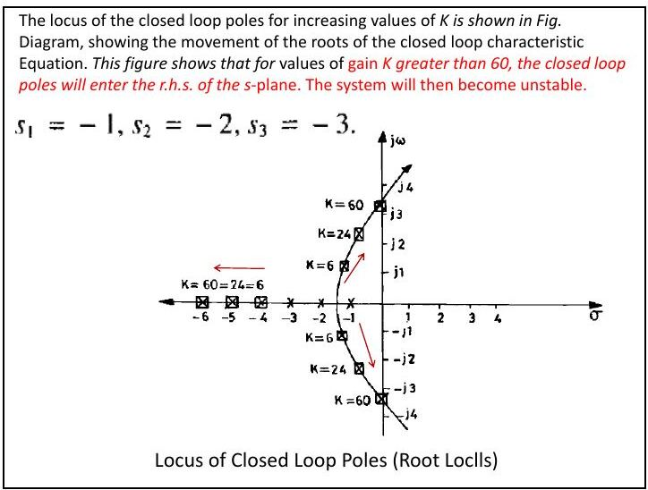
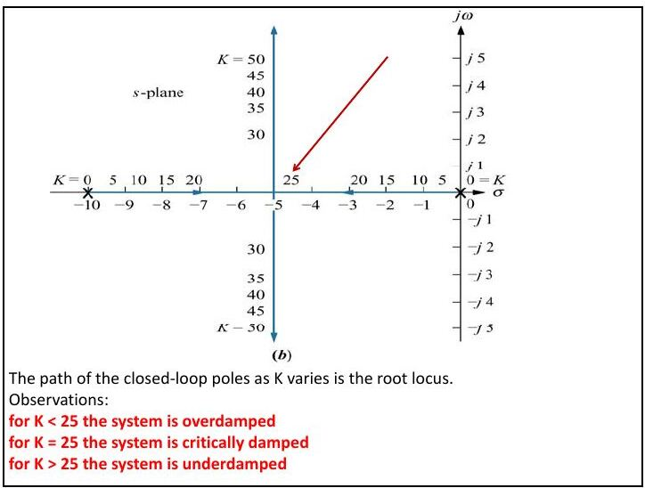
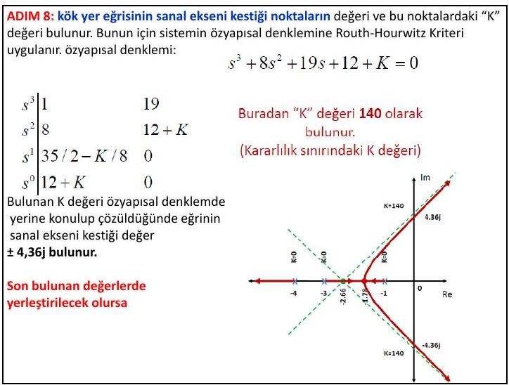
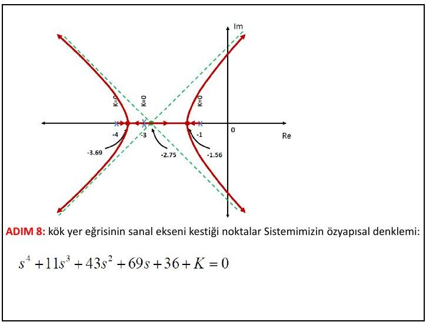
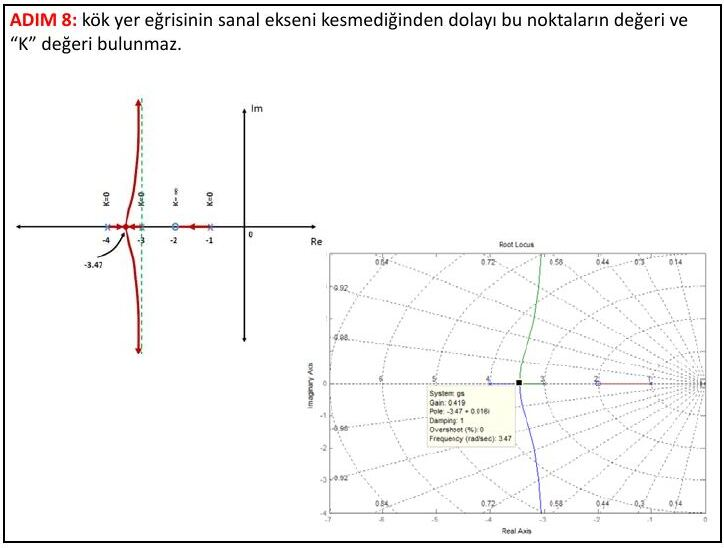
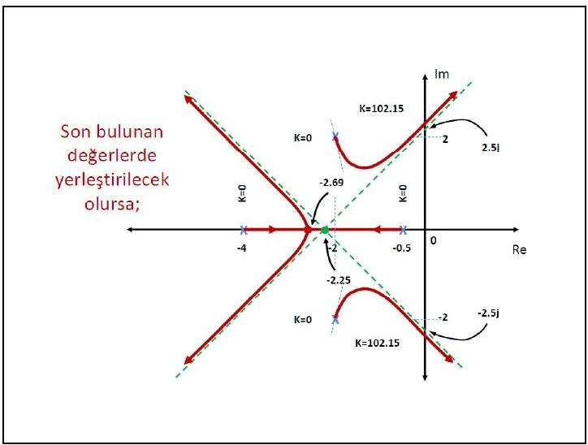

This post collects the **lecture 8 notes** of the **EEM322 Control Systems** course at Başkent University: "EEM322L8: Root locus" and "EEM322L8b: Root locus – plotting method and steps". The notes belong to the course instructor **Hamit Erdem**; the page headers carry the date 26.07.2013. The first is a 10-page PDF written mostly in English, the second a 15-page PDF in Turkish, both with two slides per page; they continue the [Lecture 7](/arsiv/eem322-ders-07-surekli-hal-hatalari/) notes. The content is transcribed below, with the calculations and root locus plots written out. The original PDFs can be downloaded as a ZIP at the end of the post.

## What is the root locus?

For analysis in the frequency domain there are four basic graphical methods: the root locus, Bode diagrams, Nyquist diagrams and Nichols diagrams. The root locus shows the **variation of the closed-loop poles**: with the characteristic equation of the closed loop being

- 1 + K G(s) = 0

the root locus is the set of paths traced by the roots of this equation as the parameter K is varied from 0 to infinity.

In a system with K and G(s) in the forward path and H(s) in the feedback path, the open-loop transfer function is T₁(s) = K G(s)H(s) and the closed-loop transfer function is T(s) = KG(s)/(1 + KG(s)H(s)). The essence of the control problem is the following:

- The poles of the open-loop transfer function are easily found by looking at the denominator and are not affected by changes in the system gain.
- The poles of the closed-loop transfer function are harder to find and depend on the gain.

The root locus is a graphical method that shows the locations of the closed-loop poles as a system parameter varies; it can be applied to first- and second-order systems as well as to higher-order systems. It gives a qualitative description of system performance, a graphical representation of stability, and the ranges of stability/instability.

**Definition:** The root locus is the plot showing the locations of the closed-loop roots in the s-plane as the system parameters vary. The transient response characteristics of closed-loop systems depend on the locations of the closed-loop poles; if the system has variable gain, the poles change with the selected gain. **Goal:** to select suitable poles to obtain the desired system response, and to determine the system gain for those poles.

### Example: K/(s(s + 2))

The closed loop is C(s)/R(s) = K/(s(s + 2) + K), the characteristic equation is s² + 2s + K = 0, and the roots are s = −1 ± √(1 − K).

- At K = 0 the closed-loop poles are at the open-loop poles (0 and −2).
- For 0 < K < 1 the poles are on the real axis.
- For K > 1 the poles are complex; the real part is −1 and the imaginary part grows with K. Step responses are plotted for K = 0.5, 1, 2, 15 and 50: as K increases, the overshoot increases.

### Example: K/((s + 1)(s + 2)(s + 3))

For the unity-feedback system the open-loop G(s) = K/(s³ + 6s² + 11s + 6) and the characteristic equation is s³ + 6s² + 11s + 6 + K = 0. Since the three poles of the plant (−1, −2, −3) are negative, the system without feedback is stable. As K increases, the closed-loop poles are:

1. K = 0: s₁ = −1, s₂ = −2, s₃ = −3 (open-loop poles)
1. K = 6: s₁,₂ = −1 ± j√2, s₃ = −4
1. K = 24: s₁,₂ = −0.5 ± j√23/2, s₃ = −5
1. K = 60: s₁,₂ = ±j√11, s₃ = −6

For K > 60 the closed-loop poles move into the right half-plane and the system becomes **unstable**.

### Example: The CameraMan camera system

In a camera system that automatically tracks a person carrying an infrared sensor, the open loop is G₀(s) = K₁K₂/(s(s + 10)) = K/(s(s + 10)) and the closed loop is G_c(s) = K/(s² + 10s + K). The pole locations as K varies:

| K | Pole 1 | Pole 2 |
|---|---|---|
| 0 | −10 | 0 |
| 5 | −9.47 | −0.53 |
| 10 | −8.87 | −1.13 |
| 15 | −8.16 | −1.84 |
| 20 | −7.24 | −2.76 |
| 25 | −5 | −5 |
| 30 | −5 + j2.24 | −5 − j2.24 |
| 35 | −5 + j3.16 | −5 − j3.16 |
| 40 | −5 + j3.87 | −5 − j3.87 |
| 45 | −5 + j4.47 | −5 − j4.47 |
| 50 | −5 + j5 | −5 − j5 |

Observations: for K < 25 the system is overdamped, at K = 25 it is critically damped, and for K > 25 it is underdamped.

## Complex numbers and vector representation

Every complex number σ + jω can be represented by a vector. (s + a) is a complex number and is represented by the vector drawn from the zero of the function at −a to the point s; it can be written in polar form as M∠θ. For example, the function F(s) = s + 7 becomes 12 + j2 at s = 5 + j2.

For F(s) = ∏(s + zᵢ) / ∏(s + pⱼ) (m zeros, n poles), each factor is a vector, and the value of F(s) at any point s is:

- **Magnitude:** M = |F(s)| = ∏|s + zᵢ| / ∏|s + pⱼ| = (product of zero lengths) / (product of pole lengths)
- **Angle:** θ = Σ∠(s + zᵢ) − Σ∠(s + pⱼ) = (sum of zero angles) − (sum of pole angles)

**Example:** For F(s) = (s + 1)/(s(s + 2)) at the point s = −3 + j4:

- Zero at −1: √20∠116.6°; pole at the origin: 5∠126.9°; pole at −2: √17∠104.0°
- |F(s)|∠F(s) = √20/(5√17) ∠(116.6° − 126.9° − 104.0°) = **0.217∠−114.3°**

**Example:** For F(s) = (s + 2)(s + 4)/(s(s + 3)(s + 6)) at the point s = −7 + j9, computed either by direct substitution or with vectors, F(s) = −0.0339 − j0.0899 = **0.096∠−110.7°**.

## Angle and magnitude conditions

When the denominator of T(s) = KG(s)/(1 + KG(s)H(s)) is zero:

- KG(s)H(s) = −1 = 1∠(2k + 1)180°, k = 0, ±1, ±2, …

The closed-loop poles must satisfy two conditions:

- **Magnitude condition:** |KG(s)H(s)| = 1 ⇒ K = 1/(|G(s)||H(s)|)
- **Angle condition:** ∠KG(s)H(s) = (2k + 1)180°

Substituting a value of s into KG(s)H(s) gives a complex number; if its angle is an odd multiple of 180°, that s is a pole of the system for a certain K. Since K is a scalar, the angle condition looks only at G(s)H(s); K is the inverse of the magnitude of G(s)H(s) when the pole location is substituted.

**Example:** For KG(s)H(s) = K/(s(s + 10)), at K = 5 the closed-loop poles are at −9.47 and −0.53; substituting s = −9.47 and K = 5 gives KG(s)H(s) = −1 (the same result is obtained for the other points in the table).

**Example:** KG(s)H(s) = K(s + 3)(s + 4)/((s + 1)(s + 2)), with closed loop T(s) = K(s + 3)(s + 4)/[(1 + K)s² + (3 + 7K)s + (2 + 12K)].

- For the point s = −2 + j3, zero angles minus pole angles: θ₁ + θ₂ − θ₃ − θ₄ = 56.31° + 71.57° − 90° − 108.43° = −70.55°. Since this is not an odd multiple of 180°, **−2 + j3 is not a closed-loop pole**.
- The point s = −2 + j(√2/2), on the other hand, lies on the root locus: K = (product of pole lengths)/(product of zero lengths) = L₃L₄/(L₁L₂) = (√2/2)(1.22)/((2.12)(1.22)) = **0.33**.

## Root locus plotting steps

The system considered: G(s) = 1/((s + 1)(s + 3)(s + 4)), H(s) = 1. The characteristic equation:

- 1 + K/((s + 1)(s + 3)(s + 4)) = 0 ⇒ s³ + 8s² + 19s + (12 + K) = 0

The notes show the root locations one by one with MATLAB plots for K = 0, 1, 2, 2.11, 5, 15, 45, 140 and 200: two roots meet at −1.78 and leave the real axis, and at K = 140 the locus crosses the imaginary axis at ±j4.36.

1. **Number of branches:** The degree of the characteristic equation (the number of open-loop poles) gives the number of branches; here **3 branches**.
1. **Starting and ending points:** The open-loop poles are the starting points (K = 0, marked with "x"), and the zeros are the ending points (K = ∞, marked with "o"). Here there are three poles at −1, −3 and −4, and no zeros.
1. **Branches on the real axis:** Starting to the left of the leftmost pole or zero on the real axis, test points are chosen; if the total number of poles and zeros to the right of the point is **odd**, the root locus passes through there, and if it is even it does not. Complex poles and zeros are not included in this test. Here the branches lie between −∞ and −4 and between −3 and −1.
1. **Asymptote angles:** α = 180°(2k + 1)/(n − m); for n = 3, m = 0, α = 60°(2k + 1): 60°, 180°, 300°.
1. **Point where the asymptotes cross the real axis:** σ = (Σpᵢ − Σzᵢ)/(n − m) = (−1 − 3 − 4)/3 = −8/3 ≈ **−2.66**.
1. **Breakaway point from the real axis:** K = −(s³ + 8s² + 19s + 12), dK/ds = −(3s² + 16s + 19) = 0 ⇒ s = −1.78 and s = −3.54. Since −3.54 lies in a region where there is no root locus, the breakaway point is **−1.78**.
1. **Departure angles from the poles:** The angle condition is applied. For the pole at −4, φ₋₁ + φ₋₃ + φ₋₄ = −180°, here −180 − 180 + φ₋₄ = −180 (angles summing to 360° are ignored) ⇒ φ₋₄ = −180°; similarly φ₋₃ = 0° and φ₋₁ = −180°. Curves meeting at a point move in exactly opposite directions.
1. **Imaginary-axis crossing:** The Routh-Hurwitz criterion is applied:

| Row | 1st column | 2nd column |
|---|---|---|
| s³ | 1 | 19 |
| s² | 8 | 12 + K |
| s¹ | 35/2 − K/8 | 0 |
| s⁰ | 12 + K | 0 |

The value of **K = 140**, at which the s¹ row is zero, is the stability limit. With this K, 8s² + 152 = 0 ⇒ the locus crosses the imaginary axis at **±j4.36**.

### Multiple-pole case

G(s) = 1/((s + 1)(s + 3)²(s + 4)), H(s) = 1.

1. The number of branches is 4 (the number of open-loop poles).
1. There are 4 poles: simple poles at −1 and −4, and a double pole at −3.
1. The real-axis branches are between −4 and −3 and between −3 and −1.
1. α = 180°(2k + 1)/4 = 45°(2k + 1): 45°, 135°, 225°, 315°.
1. σ = (−1 − 3 − 3 − 4)/4 = −11/4 = **−2.75**.
1. K = −(s⁴ + 11s³ + 43s² + 69s + 36); from dK/ds = 0, s₁ = −3.69, s₂ = −3.00 (the pole itself, not possible), s₃ = −1.56. The breakaway points are **−3.69** and **−1.56**.
1. Departure angles: φ₋₁ + φ₋₃₁ + φ₋₃₂ + φ₋₄ = −180 ⇒ φ₋₄ = 0°, φ₋₁ = −180°. At the multiple pole the curves move in opposite directions: φ₋₃₁ = −180°, φ₋₃₂ = 0°.
1. Routh table for s⁴ + 11s³ + 43s² + 69s + 36 + K = 0:

| | Row | 1st column | 2nd column |
|---|---|---|---|
| s⁴ | 1 | 43 | K + 36 |
| s³ | 11 | 69 | 0 |
| s² | 404/11 | K + 36 | 0 |
| s¹ | 5880/101 − 121K/404 | 0 | 0 |
| s⁰ | K + 36 | 0 | 0 |

From this the stability limit is **K = 194.38**; from the s² row, the values at which the locus crosses the imaginary axis are found to be **±j2.5**.

### Case with a zero

G(s) = (s + 2)/((s + 1)(s + 3)(s + 4)), H(s) = 1.

1. The number of branches is again 3.
1. There are three poles at −1, −3 and −4 (K = 0), and one zero at −2 (K = ∞).
1. The real-axis branches are between −4 and −3 and between −2 and −1.
1. For n = 3, m = 1, α = 90°(2k + 1): 90° and 270°.
1. σ = (−1 − 3 − 4 − (−2))/(3 − 1) = **−3**.
1. K = −(s³ + 8s² + 19s + 12)/(s + 2); from dK/ds = 0, s₁ = −3.47 and s₂,₃ = −1.77 ± j0.79 (not possible). The breakaway point is **−3.47**.
1. Departure and arrival angles: φ₋₁ + φ₋₃ + φ₋₄ − θ₋₂ = −180 ⇒ φ₋₄ = −180°; by similar steps φ₋₃ = −180°, θ₋₂ = 0°, φ₋₁ = −180°.
1. Since the root locus does not cross the imaginary axis, these points and the K value are not found; the system is stable for every K.

### Complex-pole case

G(s) = 1/((s + 0.5)(s² + 4s + 8)(s + 4)), H(s) = 1.

1. The number of branches is 4.
1. There are 4 poles: simple poles at −0.5 and −4, and complex poles at −2 ± j2.
1. On the real axis there is a branch only between −4 and −0.5 (complex poles and zeros are not counted in this determination).
1. α = 45°(2k + 1): 45°, 135°, 225°, 315°.
1. σ = (Σpᵢ)/4; the notes obtain (−1 − 4 − 2 − 2)/4 = −9/4 = −2.25.
1. K = −(s⁴ + 8.5s³ + 28s² + 44s + 16); from dK/ds = 0, s₁ = −2.69, s₂,₃ = −1.84 ± j0.83 (not possible). The breakaway point is **−2.69**.
1. Departure angles: for the real poles, φ₋₀.₅ = −180° and φ₋₄ = 0°. For the pole at −2 + j2, by the angle rule: [180 − arctan(2/1.5)] + arctan(2/2) + φ₋₂₁ + arctan(4/0) = −180 ⇒ φ₋₂₁ + 126.87 + 45 + 90 = −180 ⇒ **φ₋₂₁ = −81.87°**, **φ₋₂₂ = +81.87°**.
1. Routh table for s⁴ + 8.5s³ + 28s² + 44s + 16 + K = 0:

| | Row | 1st column | 2nd column |
|---|---|---|---|
| s⁴ | 1 | 28 | K + 16 |
| s³ | 17/2 | 44 | 0 |
| s² | 388/17 | K + 16 | 0 |
| s¹ | 3690/97 − 289K/776 | 0 | 0 |
| s⁰ | K + 16 | 0 | 0 |

The stability limit is **K = 102.15**; from the s² row, the imaginary-axis crossing is found to be **±j2.28**.

*Note: In the complex-pole example, the pole at −0.5 is written as −1 in the asymptote centroid calculation. The correct value is σ = (−0.5 − 4 − 2 − 2)/4 = −8.5/4 = −2.125 (this is also consistent with the s³ coefficient 8.5 in the characteristic equation). Also, in the final plot the imaginary-axis crossing is labeled ±2.5j; the value found from the Routh table is ±j2.28 (K + 16 = 118.15 and (388/17)s² + 118.15 = 0 ⇒ s ≈ ±j2.275).*
