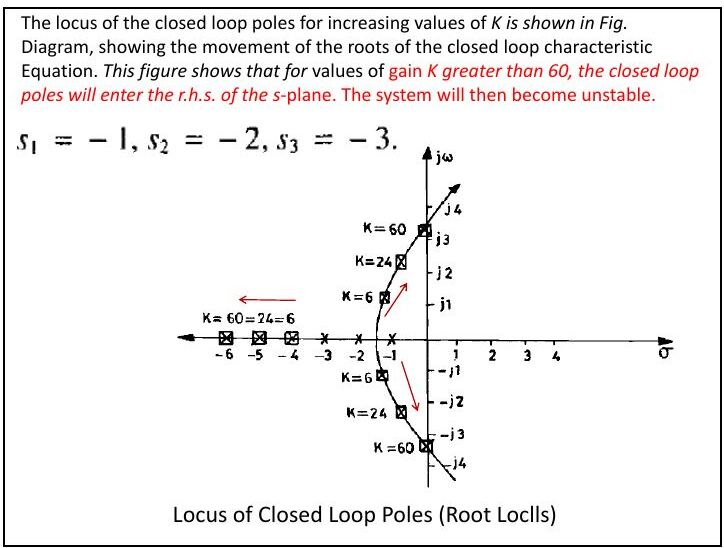
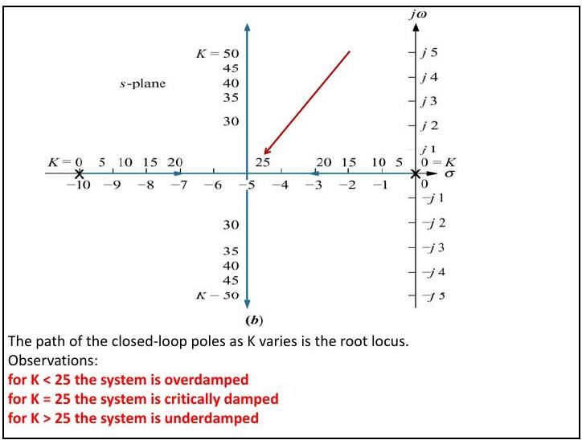
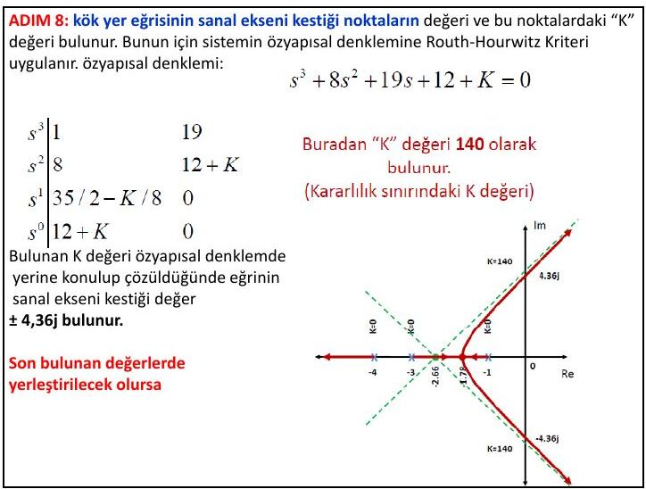
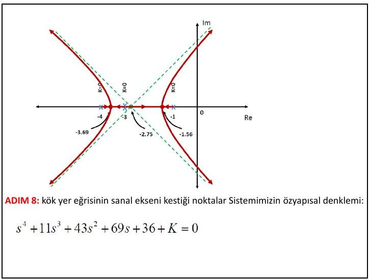
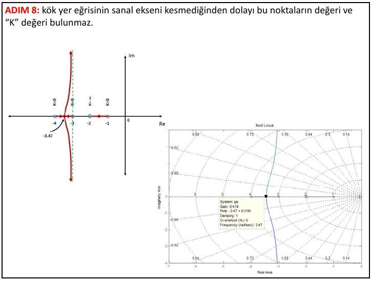
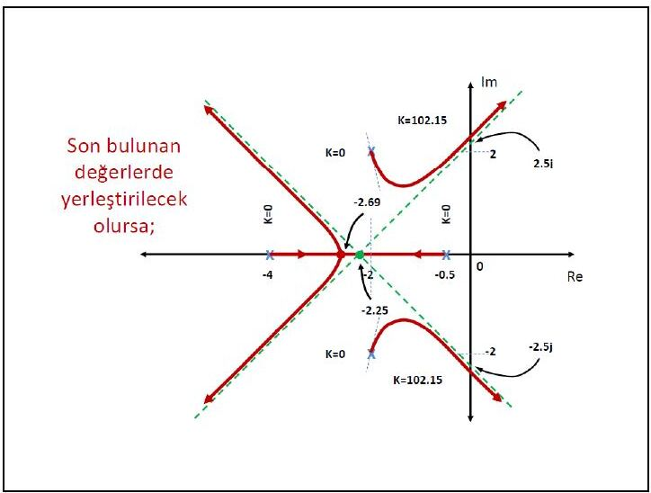

Bu yazı, Başkent Üniversitesi **EEM322 Denetim Sistemleri** dersinin **8. ders notlarını** bir araya getiriyor: "EEM322L8: Root locus (kök yer eğrisi)" ve "EEM322L8b: Root locus – çizim yöntemi ve adımları". Notlar dersi veren **Hamit Erdem**'e ait; sayfa başlarında 26.07.2013 tarihi var. İlki İngilizce ağırlıklı 10, ikincisi Türkçe 15 sayfalık, sayfa başına iki slayt yerleştirilmiş PDF'ler; [Ders 7](/arsiv/eem322-ders-07-surekli-hal-hatalari/) notunun devamıdır. Aşağıda içerik aktarıldı, hesaplar ve kök yer eğrisi çizimleri yazıya döküldü. Orijinal PDF'ler yazının sonunda ZIP olarak indirilebilir.

## Kök yer eğrisi nedir?

Frekans bölgesinde analiz için dört temel grafik yöntem vardır: kök yer eğrisi, Bode diyagramları, Nyquist diyagramları ve Nichols diyagramları. Kök yer eğrisi, **kapalı çevrim kutuplarının değişimini** gösterir: kapalı çevrimin karakteristik denklemi

- 1 + K G(s) = 0

olmak üzere kök yer eğrisi, K parametresi 0'dan sonsuza değiştirilirken bu denklemin köklerinin izlediği yollardır.

İleri yolda K ve G(s), geri beslemede H(s) olan sistemde açık çevrim transfer fonksiyonu T₁(s) = K G(s)H(s), kapalı çevrim transfer fonksiyonu T(s) = KG(s)/(1 + KG(s)H(s))'dir. Denetim probleminin özü şudur:

- Açık çevrim transfer fonksiyonunun kutupları paydaya bakarak kolayca bulunur ve sistem kazancındaki değişimden etkilenmez.
- Kapalı çevrim transfer fonksiyonunun kutuplarını bulmak daha zordur ve kazanca bağlıdır.

Kök yer eğrisi, bir sistem parametresi değiştikçe kapalı çevrim kutuplarının yerini gösteren grafik bir yöntemdir; birinci ve ikinci dereceden sistemlere olduğu kadar yüksek dereceli sistemlere de uygulanabilir. Sistem başarımının nitel bir tanımını, kararlılığın grafik gösterimini ve kararlılık/kararsızlık aralıklarını verir.

**Tanım:** Kök yer eğrisi, sistem parametrelerinin değişimiyle kapalı döngü köklerinin s düzlemindeki yerini gösteren grafiktir. Kapalı döngü sistemlerin geçici rejim cevap karakteristikleri kapalı döngü kutuplarının yerlerine bağlıdır; sistem değişken kazançlıysa kutuplar seçilen kazanca göre değişir. **Amaç:** istenen sistem cevabını elde etmek için uygun kutupları seçmek ve bu kutuplar için sistem kazancını belirlemektir.

### Örnek: K/(s(s + 2))

Kapalı çevrim C(s)/R(s) = K/(s(s + 2) + K), karakteristik denklem s² + 2s + K = 0, kökler s = −1 ± √(1 − K).

- K = 0'da kapalı çevrim kutupları açık çevrim kutuplarındadır (0 ve −2).
- 0 < K < 1'de kutuplar gerçel eksendedir.
- K > 1'de kutuplar karmaşıktır; gerçel kısmı −1'dir, sanal kısmı K ile artar. Basamak yanıtları K = 0,5; 1; 2; 15 ve 50 için çizilmiş: K büyüdükçe aşım artar.

### Örnek: K/((s + 1)(s + 2)(s + 3))

Birim geri beslemeli sistemde açık çevrim G(s) = K/(s³ + 6s² + 11s + 6), karakteristik denklem s³ + 6s² + 11s + 6 + K = 0. Tesisin üç kutbu (−1, −2, −3) negatif olduğundan geri beslemesiz sistem kararlıdır. K arttıkça kapalı çevrim kutupları:

1. K = 0: s₁ = −1, s₂ = −2, s₃ = −3 (açık çevrim kutupları)
1. K = 6: s₁,₂ = −1 ± j√2, s₃ = −4
1. K = 24: s₁,₂ = −0,5 ± j√23/2, s₃ = −5
1. K = 60: s₁,₂ = ±j√11, s₃ = −6

K > 60 için kapalı çevrim kutupları sağ yarı düzleme geçer ve sistem **kararsız** olur.

### Örnek: CameraMan kamera sistemi

Kızılötesi algılayıcı taşıyan kişiyi otomatik izleyen bir kamera sisteminde açık çevrim G₀(s) = K₁K₂/(s(s + 10)) = K/(s(s + 10)), kapalı çevrim G_c(s) = K/(s² + 10s + K). K değiştikçe kutup yerleri:

| K | Kutup 1 | Kutup 2 |
|---|---|---|
| 0 | −10 | 0 |
| 5 | −9,47 | −0,53 |
| 10 | −8,87 | −1,13 |
| 15 | −8,16 | −1,84 |
| 20 | −7,24 | −2,76 |
| 25 | −5 | −5 |
| 30 | −5 + j2,24 | −5 − j2,24 |
| 35 | −5 + j3,16 | −5 − j3,16 |
| 40 | −5 + j3,87 | −5 − j3,87 |
| 45 | −5 + j4,47 | −5 − j4,47 |
| 50 | −5 + j5 | −5 − j5 |

Gözlemler: K < 25 iken sistem aşırı sönümlü, K = 25'te kritik sönümlü, K > 25'te az sönümlüdür.

## Karmaşık sayılar ve vektör gösterimi

Her karmaşık sayı σ + jω bir vektörle gösterilebilir. (s + a) karmaşık bir sayıdır ve fonksiyonun −a'daki sıfırından s noktasına çizilen vektörle temsil edilir; kutupsal biçimde M∠θ yazılabilir. Örneğin F(s) = s + 7 fonksiyonu s = 5 + j2 noktasında 12 + j2 olur.

F(s) = ∏(s + zᵢ) / ∏(s + pⱼ) (m sıfır, n kutup) için her çarpan bir vektördür ve F(s)'nin herhangi bir s noktasındaki değeri:

- **Genlik:** M = |F(s)| = ∏|s + zᵢ| / ∏|s + pⱼ| = (sıfır uzunlukları çarpımı) / (kutup uzunlukları çarpımı)
- **Açı:** θ = Σ∠(s + zᵢ) − Σ∠(s + pⱼ) = (sıfır açıları toplamı) − (kutup açıları toplamı)

**Örnek:** F(s) = (s + 1)/(s(s + 2)), s = −3 + j4 noktasında:

- −1'deki sıfır: √20∠116,6°; orijindeki kutup: 5∠126,9°; −2'deki kutup: √17∠104,0°
- |F(s)|∠F(s) = √20/(5√17) ∠(116,6° − 126,9° − 104,0°) = **0,217∠−114,3°**

**Örnek:** F(s) = (s + 2)(s + 4)/(s(s + 3)(s + 6)), s = −7 + j9 noktasında doğrudan yerine koyarak ya da vektörlerle hesaplandığında F(s) = −0,0339 − j0,0899 = **0,096∠−110,7°**.

## Açı ve genlik koşulu

T(s) = KG(s)/(1 + KG(s)H(s)) paydası sıfır olduğunda:

- KG(s)H(s) = −1 = 1∠(2k + 1)180°, k = 0, ±1, ±2, …

Kapalı çevrim kutupları iki koşulu sağlamalıdır:

- **Genlik koşulu:** |KG(s)H(s)| = 1 ⇒ K = 1/(|G(s)||H(s)|)
- **Açı koşulu:** ∠KG(s)H(s) = (2k + 1)180°

Bir s değeri KG(s)H(s)'de yerine konduğunda bir karmaşık sayı çıkar; açısı 180°'nin tek katıysa o s, belli bir K için sistemin kutbudur. K skaler olduğundan açı koşulu yalnız G(s)H(s)'e bakar; K ise kutup yerine konduğunda G(s)H(s) genliğinin tersidir.

**Örnek:** KG(s)H(s) = K/(s(s + 10)) için K = 5'te kapalı çevrim kutupları −9,47 ve −0,53'tedir; s = −9,47 ve K = 5 konursa KG(s)H(s) = −1 çıkar (tablodaki diğer noktalar için de aynı sonuç elde edilir).

**Örnek:** KG(s)H(s) = K(s + 3)(s + 4)/((s + 1)(s + 2)), kapalı çevrim T(s) = K(s + 3)(s + 4)/[(1 + K)s² + (3 + 7K)s + (2 + 12K)].

- s = −2 + j3 noktası için sıfır açıları eksi kutup açıları: θ₁ + θ₂ − θ₃ − θ₄ = 56,31° + 71,57° − 90° − 108,43° = −70,55°. Bu 180°'nin tek katı olmadığından **−2 + j3 kapalı çevrim kutbu değildir**.
- s = −2 + j(√2/2) noktası ise kök yer eğrisi üzerindedir: K = (kutup uzunlukları)/(sıfır uzunlukları) = L₃L₄/(L₁L₂) = (√2/2)(1,22)/((2,12)(1,22)) = **0,33**.

## Kök yer eğrisi çizim adımları

Ele alınan sistem: G(s) = 1/((s + 1)(s + 3)(s + 4)), H(s) = 1. Özyapısal (karakteristik) denklem:

- 1 + K/((s + 1)(s + 3)(s + 4)) = 0 ⇒ s³ + 8s² + 19s + (12 + K) = 0

Notta K = 0, 1, 2, 2,11, 5, 15, 45, 140 ve 200 için köklerin yerleri MATLAB çizimleriyle tek tek gösteriliyor: iki kök −1,78'de buluşup gerçek eksenden ayrılıyor, K = 140'ta sanal ekseni ±j4,36'da kesiyor.

1. **Kol sayısı:** Özyapısal denklemin derecesi (açık döngü kutup sayısı) kol sayısını verir; burada **3 kol**.
1. **Başlangıç ve bitiş noktaları:** Açık döngü kutupları başlangıç (K = 0, "x" ile), sıfırları bitiş (K = ∞, "o" ile) noktalarıdır. Burada −1, −3 ve −4'te üç kutup var, sıfır yok.
1. **Gerçek eksen üzerindeki kollar:** Gerçek eksende en soldaki kutup ya da sıfırın solundan başlayarak test noktaları seçilir; noktanın sağındaki toplam kutup ve sıfır sayısı **tekse** kök yer eğrisi oradan geçer, çiftse geçmez. Karmaşık kutup ve sıfırlar bu teste dahil edilmez. Burada kollar −∞ ile −4 arasında ve −3 ile −1 arasındadır.
1. **Asimptot açıları:** α = 180°(2k + 1)/(n − m); n = 3, m = 0 için α = 60°(2k + 1): 60°, 180°, 300°.
1. **Asimptotların gerçek ekseni kestiği nokta:** σ = (Σpᵢ − Σzᵢ)/(n − m) = (−1 − 3 − 4)/3 = −8/3 ≈ **−2,66**.
1. **Gerçek eksenden ayrılma noktası:** K = −(s³ + 8s² + 19s + 12), dK/ds = −(3s² + 16s + 19) = 0 ⇒ s = −1,78 ve s = −3,54. −3,54 kök yer eğrisinin olmadığı bir bölgede kaldığından ayrılma noktası **−1,78**'dir.
1. **Kutuplardan ayrılma açıları:** Açı koşulu uygulanır. −4'teki kutup için φ₋₁ + φ₋₃ + φ₋₄ = −180°, burada −180 − 180 + φ₋₄ = −180 (toplamı 360° olan açılar göz ardı edilir) ⇒ φ₋₄ = −180°; benzer şekilde φ₋₃ = 0° ve φ₋₁ = −180°. Bir noktada karşı karşıya gelen eğriler tam zıt yönlerde hareket eder.
1. **Sanal eksen kesişimi:** Routh-Hurwitz kriteri uygulanır:

| Satır | 1. sütun | 2. sütun |
|---|---|---|
| s³ | 1 | 19 |
| s² | 8 | 12 + K |
| s¹ | 35/2 − K/8 | 0 |
| s⁰ | 12 + K | 0 |

s¹ satırının sıfır olduğu **K = 140** kararlılık sınırıdır. Bu K ile 8s² + 152 = 0 ⇒ eğri sanal ekseni **±j4,36**'da keser.

### Katlı kutup durumu

G(s) = 1/((s + 1)(s + 3)²(s + 4)), H(s) = 1.

1. Kol sayısı 4 (açık döngü kutup sayısı).
1. −1 ve −4'te tek katlı, −3'te çift katlı olmak üzere 4 kutup var.
1. Gerçek eksen kolları −4 ile −3 ve −3 ile −1 arasında.
1. α = 180°(2k + 1)/4 = 45°(2k + 1): 45°, 135°, 225°, 315°.
1. σ = (−1 − 3 − 3 − 4)/4 = −11/4 = **−2,75**.
1. K = −(s⁴ + 11s³ + 43s² + 69s + 36); dK/ds = 0'dan s₁ = −3,69, s₂ = −3,00 (kutbun kendisi, olamaz), s₃ = −1,56. Ayrılma noktaları **−3,69** ve **−1,56**.
1. Ayrılma açıları: φ₋₁ + φ₋₃₁ + φ₋₃₂ + φ₋₄ = −180 ⇒ φ₋₄ = 0°, φ₋₁ = −180°. Katlı kutupların olduğu noktada eğri zıt yönlerde hareket eder: φ₋₃₁ = −180°, φ₋₃₂ = 0°.
1. s⁴ + 11s³ + 43s² + 69s + 36 + K = 0 için Routh tablosu:

| | Satır | 1. sütun | 2. sütun |
|---|---|---|---|
| s⁴ | 1 | 43 | K + 36 |
| s³ | 11 | 69 | 0 |
| s² | 404/11 | K + 36 | 0 |
| s¹ | 5880/101 − 121K/404 | 0 | 0 |
| s⁰ | K + 36 | 0 | 0 |

Buradan kararlılık sınırı **K = 194,38**; s² satırıyla eğrinin sanal ekseni kestiği değerler **±j2,5** bulunur.

### Sıfır olması durumu

G(s) = (s + 2)/((s + 1)(s + 3)(s + 4)), H(s) = 1.

1. Kol sayısı yine 3.
1. −1, −3 ve −4'te üç kutup (K = 0), −2'de bir sıfır (K = ∞).
1. Gerçek eksen kolları −4 ile −3 ve −2 ile −1 arasında.
1. n = 3, m = 1 için α = 90°(2k + 1): 90° ve 270°.
1. σ = (−1 − 3 − 4 − (−2))/(3 − 1) = **−3**.
1. K = −(s³ + 8s² + 19s + 12)/(s + 2); dK/ds = 0'dan s₁ = −3,47 ve s₂,₃ = −1,77 ± j0,79 (olamaz). Ayrılma noktası **−3,47**.
1. Ayrılma ve sıfıra varma açıları: φ₋₁ + φ₋₃ + φ₋₄ − θ₋₂ = −180 ⇒ φ₋₄ = −180°; benzer adımlarla φ₋₃ = −180°, θ₋₂ = 0°, φ₋₁ = −180°.
1. Kök yer eğrisi sanal ekseni kesmediğinden bu noktalar ve K değeri bulunmaz; sistem her K için kararlıdır.

### Karmaşık kutup durumu

G(s) = 1/((s + 0,5)(s² + 4s + 8)(s + 4)), H(s) = 1.

1. Kol sayısı 4.
1. −0,5 ve −4'te tekil, −2 ± j2'de karmaşık olmak üzere 4 kutup var.
1. Gerçek eksende yalnız −4 ile −0,5 arasında kol var (karmaşık kutup ve sıfırlar bu tespitte hesaba katılmaz).
1. α = 45°(2k + 1): 45°, 135°, 225°, 315°.
1. σ = (Σpᵢ)/4; notta (−1 − 4 − 2 − 2)/4 = −9/4 = −2,25 bulunuyor.
1. K = −(s⁴ + 8,5s³ + 28s² + 44s + 16); dK/ds = 0'dan s₁ = −2,69, s₂,₃ = −1,84 ± j0,83 (olamaz). Ayrılma noktası **−2,69**.
1. Ayrılma açıları: gerçek kutuplar için φ₋₀,₅ = −180° ve φ₋₄ = 0°. −2 + j2'deki kutup için açı kuralı: [180 − arctan(2/1,5)] + arctan(2/2) + φ₋₂₁ + arctan(4/0) = −180 ⇒ φ₋₂₁ + 126,87 + 45 + 90 = −180 ⇒ **φ₋₂₁ = −81,87°**, **φ₋₂₂ = +81,87°**.
1. s⁴ + 8,5s³ + 28s² + 44s + 16 + K = 0 için Routh tablosu:

| | Satır | 1. sütun | 2. sütun |
|---|---|---|---|
| s⁴ | 1 | 28 | K + 16 |
| s³ | 17/2 | 44 | 0 |
| s² | 388/17 | K + 16 | 0 |
| s¹ | 3690/97 − 289K/776 | 0 | 0 |
| s⁰ | K + 16 | 0 | 0 |

Kararlılık sınırı **K = 102,15**; s² satırıyla sanal eksen kesişimi **±j2,28** bulunur.

*Not: Karmaşık kutup örneğinde asimptot merkezi hesabında −0,5'teki kutup −1 olarak yazılmış. Doğrusu σ = (−0,5 − 4 − 2 − 2)/4 = −8,5/4 = −2,125'tir (karakteristik denklemdeki s³ katsayısı 8,5 ile de uyumlu). Ayrıca son çizimde sanal eksen kesişimi ±2,5j olarak etiketlenmiş; Routh tablosundan bulunan değer ±j2,28'dir (K + 16 = 118,15 ve (388/17)s² + 118,15 = 0 ⇒ s ≈ ±j2,275).*
