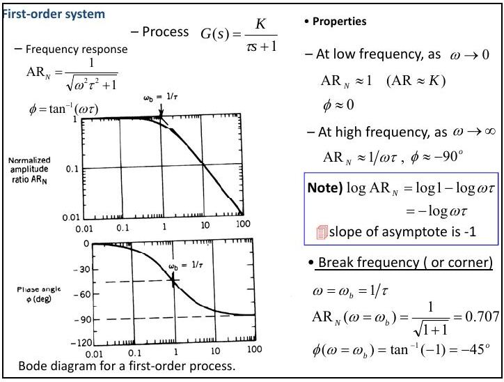
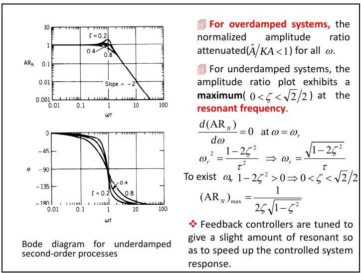
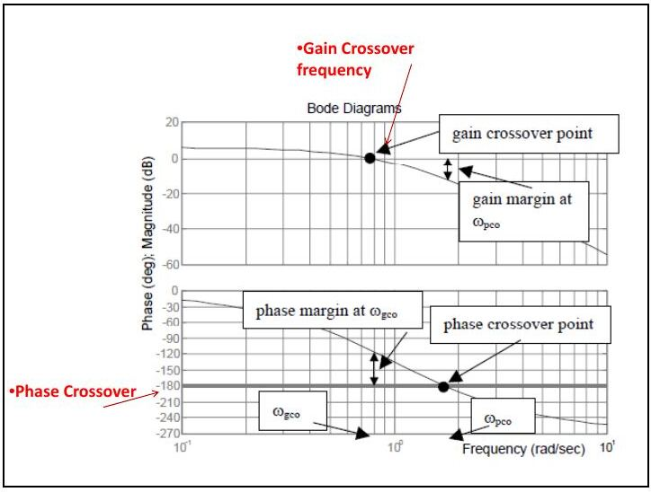
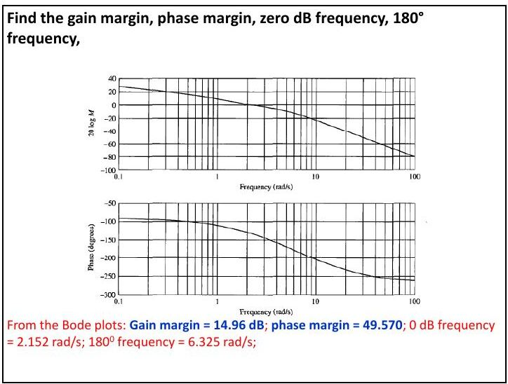

This post is the **9th lecture note** of the **EEM322 Control Systems** course at Başkent University ("EEM322: Lecture 9 – Frequency Domain Analysis, Frequency Response Techniques, Bode Diagrams"). The notes belong to the course instructor **Hamit Erdem**; the page headers carry the date 07.08.2013. It is a 16-page PDF with two slides per page, mostly in English, and it continues the notes of [Lecture 7](/arsiv/eem322-ders-07-surekli-hal-hatalari/) and [Lecture 8](/arsiv/eem322-ders-08-kok-yer-egrisi/). Below, the content is presented in English, with the formulas and examples written out. The original PDF can be downloaded at the end of the post.

## Frequency-domain analysis

The performance of a control system is usually measured by time-domain specifications; but because there is a relationship between time-domain and frequency-domain performance in linear systems, the same measurement can also be made in the frequency domain, and time-domain specifications can be estimated from frequency analysis. The frequency-domain approach gives an additional viewpoint, complementary to time-domain studies, for complex analysis and design problems. There are four basic graphical methods for analysis in the frequency domain:

1. Root locus method
1. Bode diagrams
1. Nyquist diagrams
1. Nichols diagrams

The **frequency response** of a system is its **steady-state response** to a sinusoidal (harmonic) input. In linear systems the output is also sinusoidal and differs from the input only in **amplitude and phase**: an input A sin(ωt) produces an output βA sin(ωt + φ). β is the amplitude factor (if β > 1 the system amplifies the input, if β < 1 it attenuates it), and φ is the phase shift between input and output. System gain = output amplitude / input amplitude = B/A; phase: φ₂ = φ₁ + phase shift.

An unstable process has no frequency response, because a sinusoidal input produces an unstable output. Frequency response methods were developed by Nyquist and Bode in the 1930s and predate the root locus method found by Evans in 1948 (Nyquist, 1932; Bode, 1945).

### Why a sinusoidal signal?

The sinusoid is not chosen simply because it is used everywhere (mains is 60 Hz in the USA, 50 Hz elsewhere). Its importance comes from **Fourier theory**: a signal applied to a circuit can be expressed as a sum of sinusoids of different amplitudes and frequencies so that analysis becomes easy (the note includes an example of the Fourier components of a triangular wave).

**Complex numbers:** z = a + jb, Re(z) = a, Im(z) = b, j = √−1. Exponential/polar form: z = re^(jθ), r = |z| = √(a² + b²), θ = atan(b/a).

**Decibel:** V₂/V₁, I₂/I₁, P₂/P₁ are dimensionless; taking their logarithms gives the decibel (dB) unit:

- 20 log₁₀|V₂/V₁|: log-magnitude of voltage gain (dB)
- 20 log₁₀|I₂/I₁|: log-magnitude of current gain (dB)
- 10 log₁₀|P₂/P₁|: log-magnitude of power gain (dB)
- Gain_dB = 20 log₁₀(Gain); 20 log(K × 10) = 20 log K + 20; 20 log(K × 10ⁿ) = 20 log K + 20n; 20 log K = −20 log(1/K)

## Frequency response from the transfer function

If the transfer function G(s) of a linear system is known, the magnitude characteristic |G(jω)| and the phase characteristic ∠G(jω) completely describe the steady-state performance for a sinusoidal input. The magnitude and phase characteristics of the closed-loop system can be used to estimate time-domain specifications such as overshoot, rise time, and steady-state performance.

**Frequency response of the closed-loop system:** M(s) = Y(s)/R(s) = G(s)/(1 + G(s)H(s)); in the sinusoidal steady state, s = jω:

- M(jω) = G(jω)/(1 + G(jω)H(jω)) = |M(jω)| ∠M(jω)
- |M(jω)| = |G(jω)| / |1 + G(jω)H(jω)|
- ∠M(jω) = φ_M(jω) = ∠G(jω) − ∠[1 + G(jω)H(jω)]

In general s = σ + jω; in a stable system the contribution of the real part dies out in the steady state, so in sinusoidal steady-state analysis only jω is substituted for s: Y(jω) = G(jω)R(jω). From this:

- Magnitude relation: |Y(jω)| = |G(jω)| · |R(jω)|
- Phase relation: ∠Y(jω) = ∠G(jω) + ∠R(jω)
- For an input r(t) = R sin ω₀t, the output is y(t) = Y sin(ω₀t + φ), Y = R|G(jω₀)|, φ = ∠G(jω₀)

**Shortcut:**

1. Substitute s = jω in G(s) to obtain G(jω).
1. Multiply the numerator and denominator by the conjugate of the denominator to put G(jω) into the form G(jω) = R + jI (R and I are functions of ω).
1. Amplitude ratio AR = √(R² + I²), phase angle φ = tan⁻¹(I/R).

*Note: In the lecture note, the phase angle in step 3 is written as φ = tan⁻¹(R/I); the correct form is φ = tan⁻¹(I/R) (in the first-order example below, φ = tan⁻¹(−ωτ) also follows from this relation).*

### Examples

**First-order system:** G(s) = 1/(τs + 1). G(jω) = 1/(jωτ + 1); multiplying numerator and denominator by (−jωτ + 1):

- G(jω) = (1 − jωτ)/(ω²τ² + 1) = 1/(ω²τ² + 1) + j(−ωτ)/(ω²τ² + 1) = R + jI

**Example:** G(s) = 3/(s + 2) ⇒ G(jω) = 3/(jω + 2), |G(jω)| = 3/(ω² + 4)^(1/2), ∠G(jω) = −tan⁻¹(ω/2).

**Example:** G(s) = K/(Ts + 1), input x(t) = X sin ωt:

- |G(jω)| = K/√(1 + T²ω²), φ = ∠G(jω) = −tan⁻¹(Tω)
- y_ss(t) = [XK/√(1 + T²ω²)] sin(ωt − tan⁻¹Tω)

**Example:** G(s) = (s + 1/T₁)/(s + 1/T₂), input x(t) = X sin ωt:

- G(jω) = T₂(1 + T₁jω) / [T₁(1 + T₂jω)], |G(jω)| = T₂√(1 + T₁²ω²) / [T₁√(1 + T₂²ω²)]
- φ = tan⁻¹(T₁ω) − tan⁻¹(T₂ω)
- y_ss(t) = [XT₂√(1 + T₁²ω²) / (T₁√(1 + T₂²ω²))] sin(ωt + tan⁻¹T₁ω − tan⁻¹T₂ω)

**Example (RC circuit):** H(s) = V_o(s)/V_i(s) = 1/(1 + sRC); for R = 1, C = 0.1, H(jω) = 1/(1 + j0.1ω). If the input and the transfer function are written as phasors, multiplication is easy (magnitudes are multiplied, phases are added). For V_i = 3 sin(30t) = 3∠0°:

- H(j30) = 1/(1 + j3) = 0.1 − j0.3 = 0.316∠−71.6°
- V_o = V_i · H = (3∠0°)(0.316∠−71.6°) = 0.95∠−71.6°, i.e. v_o(t) = 0.95 sin(30t − 71.6°)

## Bode diagram

When a sinusoidal input is applied to a stable linear system, the output in the steady state is also sinusoidal; its amplitude is a multiple of the input's, and there may be a phase shift. If the input amplitude is held constant and the frequency is varied, a different output amplitude and phase shift are obtained. In this way gain and phase values can be plotted over a wide frequency range. Gain is used instead of output amplitude because it does not depend on the input amplitude.

The **Bode diagram** is a graphical representation of the frequency response on semi-logarithmic axes and consists of two plots:

- **Gain plot:** system gain (usually in dB) vs. frequency (logarithmic axis)
- **Phase plot:** phase shift introduced by the system (degrees, linear axis) vs. frequency (logarithmic axis)

Since ω is examined over a very wide range, the magnitude also varies enormously; therefore the magnitude is plotted in decibels (dB(x) = 20 log₁₀ x) and the frequency on a logarithmic scale. The note gives the magnitude and phase plots for H(s) = 1/(s + 1) and G(s) = 1/(s + 2) as examples.

### First-order process

G(s) = K/(τs + 1); normalized amplitude ratio AR_N = AR/K = 1/√(ω²τ² + 1), φ = −tan⁻¹(ωτ).

- At low frequency (ω → 0): AR_N ≈ 1 (AR ≈ K), φ ≈ 0.
- At high frequency (ω → ∞): AR_N ≈ 1/(ωτ), φ ≈ −90°. log AR_N = log 1 − log ωτ = −log ωτ, i.e. the slope of the asymptote is −1 (−20 dB/decade).
- **Break (corner) frequency:** ω_b = 1/τ; AR_N(ω_b) = 1/√2 = 0.707; φ(ω_b) = tan⁻¹(−1) = −45°.

Plotting steps:

1. Find the break frequency ω_b = 1/τ; at this point AR = 0.707K.
1. For the low-frequency region (ω ≤ ω_b), draw the horizontal asymptote AR = K.
1. Draw the high-frequency asymptote with slope −1 so that it intersects AR = K at ω = ω_b.
1. Draw the actual frequency response following this shape.
1. Mark the point φ = −45° at ω = ω_b, draw the horizontal asymptotes at φ = 0° and −90°, and draw the phase curve according to the table below.

| ωτ | 0.01 | 0.1 | 0.5 | 1.0 | 2.0 | 10.0 | 100.0 |
|---|---|---|---|---|---|---|---|
| φ (°) | −0.6 | −5.7 | −26.6 | −45.0 | −63.4 | −84.3 | −89.4 |

*Note: In the first-order slide of the lecture note, the phase is written as φ = tan⁻¹(ωτ); as can be seen from the plot and the table, the correct form is φ = −tan⁻¹(ωτ).*

### Second-order process

G(s) = K/(τ²s² + 2ζτs + 1):

- AR = K / √[(1 − ω²τ²)² + (2ωτζ)²], φ = tan⁻¹[−2ωτζ/(1 − ω²τ²)]
- At low frequency AR ≈ K, φ ≈ 0; at high frequency AR_N ≈ 1/(ωτ)², φ ≈ −180°. log AR_N = −2 log ωτ, i.e. the asymptote slope is −2 (−40 dB/decade).
- For overdamped systems, the normalized amplitude ratio is less than 1 for all ω (attenuation).
- For underdamped systems (0 < ζ < √2/2), the amplitude ratio has a peak at the **resonant frequency**: d(AR_N)/dω = 0 ⇒ ω_r² = (1 − 2ζ²)/τ², ω_r = √(1 − 2ζ²)/τ; for a peak, 1 − 2ζ² > 0, i.e. 0 < ζ < √2/2. **(AR_N)max = 1/(2ζ√(1 − ζ²))**.
- Feedback controllers are tuned to give slight resonance in order to speed up the response of the controlled system.

**AR plot for an overdamped system:** (1) draw the low-frequency asymptote at K; (2) at ω_b1 = 1/τ₁ (τ₁ the larger time constant) the slope changes to −1; (3) at ω_b2 = 1/τ₂ the slope changes to −2; (4) compute a few points on the actual curve and plot it with respect to the asymptotes.

**AR plot for an underdamped system:** (1) draw the low-frequency asymptote at K; (2) at ω_b = 1/τ the slope changes to −2; (3) compute a few points and plot. The peak in AR is seen only if 0 < ζ < √2/2.

**Pure integrator:** G(s) = 1/s, G(jω) = 1/(jω) = −j(1/ω); AR = 1/ω, φ = −90°.

**Pure differentiator:** G(s) = s, G(jω) = jω; AR = ω, φ = +90°.

## Frequency-domain performance measures

1. **Resonant peak M_r:** the maximum value of the magnitude M, and a measure of **relative stability**. A large M_r is associated with a large overshoot in the transient response; the recommended value for the closed loop is in the range 1.1–1.5.
1. **Resonant frequency ω_r:** the frequency at which the peak M_r occurs.
1. **Bandwidth (BW):** the frequency at which |M(jω)| drops to 70.7% of its zero-frequency value, i.e. 3 dB below. A large bandwidth corresponds to a faster rise time (high-frequency signals pass easily to the output); with a small bandwidth only low frequencies pass and the time response becomes sluggish.
1. **Cutoff rate:** the slope of M(jω) at the high-frequency end. Two systems may have the same bandwidth but different cutoff rates.

For a second-order system with ζ < 0.707, the resonant frequency and resonant magnitude can be estimated with the following relations:

- ω_r = ω_n √(1 − 2ζ²)
- M_r = [2ζ√(1 − ζ²)]⁻¹

These frequency-domain specifications are related to the time-domain behavior: M_r indicates relative stability; a large M_r means low damping, an oscillatory response, and a large overshoot. Systems with large bandwidth respond faster but may be more sensitive to noise; noise sensitivity is determined by the combined effect of the bandwidth and the rate at which the magnitude falls off at high frequencies.

**Signal bandwidth:** for (i) signals with a midband region or a peak and (ii) signals with constant dc gain, it is the frequency range over which the gain is greater than 0.707G; 0.707 = −3 dB.

## Gain and phase margin

- **Gain crossover frequency ω_gco:** the frequency at which the gain crosses 0 dB.
- **Phase crossover frequency ω_pco:** the frequency at which the phase crosses −180°.

**Minimum-phase system:** the loop transfer function GH(s) has no zeros or poles in the right half of the s-plane. Systems that have poles or zeros in the right half-plane are called non-minimum-phase systems. The gain and phase margins of a minimum-phase system are found by plotting the Bode diagram of GH(s):

- **Gain margin:** GM = 0 dB − |G(jω_pco)| (dB)
- **Phase margin:** the additional phase lag required to bring the phase angle to −180° at the frequency where the gain crosses the 0 dB line: PM = φ(ω_gco) − (−180°)

A minimum-phase system is stable if both margins are positive and unstable if they are negative. Systems with a high degree of stability have large margins, and less stable systems have small margins. If PM is negative or GM is negative, the system is unstable.

**Example:** For GH(s) = 100(s + 2) / [(s + 5)(s + 10)(s² + 2s + 2)], the phase margin is **PM = +68°** (at 2.2 rad/s) and the gain margin is **GM = +17.4 dB** (at 7.15 rad/s); the closed-loop system is stable.

**Example:** From the given Bode plots, find the gain margin, phase margin, 0 dB frequency, and 180° frequency.

From the Bode plots: gain margin = **14.96 dB**, phase margin = **49.57°**, 0 dB frequency = **2.152 rad/s**, 180° frequency = **6.325 rad/s**.
